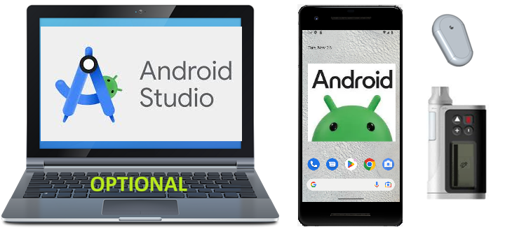

# Component Overview

**AAPS**는 단순한 (직접 빌드한) 앱이 아닙니다. 폐쇄 루프 시스템을 이루는 여러 모듈 중 하나입니다. 구성 요소를 정하기 전에 구성 요소 문서를 살펴보는 것이 좋습니다.



```{admonition} IMPORTANT SAFETY NOTICE
:class: important

이 문서에서 다루는 **AAPS** 안전 기능의 기반은 시스템을 구성하는 하드웨어의 안전 기능입니다. 자동 인슐린 주입 루프를 닫으려면, 시험을 거쳐 완전히 작동하며 해당 국가의 공식 기관에서 승인한 인슐린 펌프와 CGM만 사용하는 것이 매우 중요합니다. 이러한 구성요소에 대한 하드웨어 또는 소프트웨어의 변형은 예기치 않은 인슐린 투약을 야기하여 사용자에게 상당한 위험을 초래할 수 있습니다. 고장 났거나 개조되었거나 직접 만든 인슐린 펌프 또는 CGM 수신기를 발견하거나 제안받더라도, **AAPS** 시스템을 만드는 데 이를 **사용하지 마십시오**.

또한, 펌프 또는 CGM과 함께 사용하도록 제조사가 승인한 삽입기, 캐뉼라, 인슐린 용기 등 정품 소모품만 사용하는 것도 똑같이 중요합니다. 검증되지 않았거나 개조된 소모품을 사용하면 CGM이 부정확해지고 인슐린 주입 오류가 생길 수 있습니다. 인슐린은 용량이 잘못되면 매우 위험합니다. 소모품을 임의로 개조하여 생명을 위험하게 하지 마십시오.

마지막으로 중요한 점: SGLT-2 억제제(글리플로진)는 혈당을 예측할 수 없게 낮추므로 복용하면 안 됩니다. 혈당을 올리기 위해 기저 주입량을 낮추는 시스템과 함께 사용하는 것은 특히 위험합니다. 글리플로진 때문에 혈당이 오르지 않을 수 있고, 위험한 인슐린 부족 상태가 생길 수 있습니다. [자세한 정보는 여기를 참조하십시오](#PreparingForAaps-no-sglt-2-inhibitors).
```

## Necessary Modules

### 당뇨병 치료에 맞는 좋은 개인별 용량 알고리즘

만들거나 살 수 있는 것은 아니지만, 아마도 가장 과소평가되는 '모듈'이며 꼭 필요합니다. 알고리즘이 당뇨병 관리를 돕게 하려면, 심각한 실수를 하지 않도록 알고리즘이 올바른 설정을 알아야 합니다. 다른 모듈이 아직 없더라도, 당뇨병 치료 팀과 함께 **프로파일**을 미리 확인하고 조정할 수 있습니다.

**프로파일**에는 다음이 포함됩니다:

- BR (기저 주입량): 배경 인슐린을 제공합니다;
- ISF (인슐린 민감도 계수): 인슐린 1 U가 혈당을 얼마나 낮추는지;
- CR (탄수화물 비율): 인슐린 1 U가 탄수화물 몇 g을 처리하는지.

대부분의 루프 사용자는 하루 중 호르몬에 따라 변하는 인슐린 민감도를 반영하는 하루 주기 BR, ISF, CR을 사용합니다.

**프로파일** 외에 **관리 → 인슐린 설정**에서 DIA(인슐린 작용 시간)를 포함한 **인슐린**도 설정해야 합니다. [인슐린 설정](#Config-Builder-insulin-dia)을 참조하십시오.

**프로파일**에 대한 자세한 정보는 [전용 페이지](../SettingUpAaps/YourAapsProfile.md)에 있습니다.

### 휴대폰

전용 페이지 [스마트폰](../Getting-Started/Phones.md)을 참조하십시오.

### Insulin pump

전용 페이지 [호환 펌프](../Getting-Started/CompatiblePumps.md)를 참조하십시오.

**일부 펌프 모델의 장단점**

Combo, Insight, 구형 Medtronic은 튼튼한 펌프이며 루프에 사용할 수 있습니다. Combo는 표준 Luer-Lock을 사용하므로 선택할 수 있는 주입 세트 종류가 훨씬 많다는 장점이 있습니다. 그리고 배터리는 일반 규격이라 주유소나 24시간 편의점 어디서나 살 수 있고, 정말 급하면 호텔 방의 리모컨에서 빌려 쓸 수도 있습니다 ;-).

하지만 Combo와 비교한 DanaR/RS 및 Dana-i의 장점은 다음과 같습니다:

- Dana-i/RS는 처음 페어링이 더 간단합니다. 하지만 보통 이 작업은 한 번만 하므로, 여러 펌프로 새 기능을 테스트하려는 경우에만 영향이 있습니다.
- 지금까지 Combo는 화면 파싱(screen parsing) 방식으로 동작합니다. 대체로 잘 동작하지만 느립니다. 루프에서는 모든 작업이 백그라운드에서 이루어지므로 이는 큰 문제가 되지 않습니다. 그래도 연결되어 있어야 하는 시간이 훨씬 길어서 BT 연결이 끊길 수 있는 시간도 더 깁니다. 볼러스 주입 중에 요리하면서 휴대폰에서 멀어지면 이것은 쉽지 않습니다.
- Combo는 TBR이 끝날 때 진동하고, DanaR은 SMB 때 진동(또는 신호음)합니다. 밤에는 SMB보다 TBR을 더 많이 사용할 가능성이 높습니다.  Dana-i/RS는 신호음도 진동도 내지 않도록 설정할 수 있습니다.
- Dana-i/RS는 탄수화물을 포함한 이력을 몇 초 만에 읽을 수 있습니다. 그래서 오프라인 상태에서도 휴대폰을 쉽게 바꿀 수 있고, CGM 값이 들어오면 바로 루프를 계속할 수 있습니다.
- **AAPS**와 통신할 수 있는 모든 펌프는 출고 시 방수입니다. 밀봉된 배터리 칸과 레저버 충전 시스템 덕분에 Dana 펌프만 "보증상 방수"입니다.

### 혈당 출처

전용 페이지 [호환 CGM](../Getting-Started/CompatiblesCgms.md)을 참조하십시오.

### **AAPS**-.apk 파일

시스템의 핵심 구성 요소입니다. 앱을 설치하려면 먼저 apk 파일을 직접 빌드해야 합니다. 방법은 [여기](../SettingUpAaps/BuildingAaps.md)에 있습니다.

### 리포팅 서버

리포팅 서버는 혈당과 처치 데이터를 표시하고, 자세한 분석을 위한 보고서를 만듭니다. 현재 AAPS와 함께 사용할 수 있는 리포팅 서버는 두 가지입니다: [Nightscout](#SettingUpTheReportingServer-nightscout)와 [Tidepool](#SettingUpTheReportingServer-tidepool). 둘 다 시간에 따른 당뇨병 데이터를 시각화하고, **범위 내 시간**(TIR) 및 기타 지표에 대한 통계를 제공합니다.

리포팅 서버는 다른 모듈과 독립적입니다. 리포팅 서버를 사용하고 싶지 않다면, 장기적으로 **AAPS**를 실행하는 데 필수는 아니라는 점을 알아 두십시오. 하지만 [**목표 1**](#objectives-objective1)을 완료하는 데 필요하므로 일단 설정은 해야 합니다.

리포팅 서버 설정 방법에 대한 추가 정보는 [여기](../SettingUpAaps/SettingUpTheReportingServer.md)에 있습니다.

## Optional Modules

### 스마트워치

**Wear OS 3** 이상을 실행하는 스마트워치라면 어떤 것이든 선택할 수 있습니다. 자세한 내용은 [스마트워치와 AAPS](../Getting-Started/Watches.md)를 참조하십시오.

사용자들이 [테스트된 휴대폰과 워치 목록](#Phones-list-of-tested-phones)을 만들고 있습니다. **AAPS**와 함께 사용할 수 있는 여러 워치 페이스가 있으며, [여기](../WearOS/WearOsSmartwatch.md)에서 찾을 수 있습니다.

### xDrip

xDrip 앱이 **혈당 출처**로 필요하지 않더라도, 알람이나 다른 혈당 표시 등에 계속 사용할 수 있습니다. 원하는 만큼 알람을 만들 수 있고, 알람이 활성화될 시간을 지정하거나 무음 모드를 무시할지 선택하는 등의 설정을 할 수 있습니다. xDrip에 대한 정보는 [여기](../CompatibleCgms/xDrip.md)에서 볼 수 있습니다. 이 앱은 빠르게 바뀌기 때문에 문서가 항상 최신은 아닐 수 있다는 점에 유의하십시오.

## 모듈을 기다리는 동안 할 수 있는 일

루프를 닫는 데 필요한 모든 모듈을 갖추기까지 시간이 걸릴 수 있습니다. 하지만 걱정하지 마십시오. 기다리는 동안 할 수 있는 일이 많습니다. 기저 주입량(BR), 인슐린-탄수화물 비율(IC), 인슐린 민감도 계수(ISF) 등을 확인하고 (필요하면) 조정하는 것이 **꼭 필요**합니다. 그리고 개방 루프는 시스템을 테스트하고 **AAPS**에 익숙해지는 좋은 방법이 될 수 있습니다. 이 모드에서는 **AAPS**가 처치 권장 사항을 제시하고, 사용자가 직접 실행할 수 있습니다.

여기에서 문서를 계속 읽거나, 온라인 또는 오프라인에서 다른 루프 사용자와 교류하거나, 문서나 다른 루프 사용자가 쓴 글을 [읽을](../UsefulLinks/BackgroundReading.md) 수 있습니다(단, 모든 내용이 맞거나 그대로 따라 해도 좋은 것은 아니므로 주의하십시오).

**다 되었습니까?** **AAPS** 구성 요소를 모두 갖추었거나(축하합니다!) 최소한 개방 루프 모드로 시작할 만큼 갖추었다면, 새 목표를 시작하기 전마다 먼저 [목표 설명](../SettingUpAaps/CompletingTheObjectives.md)을 읽고 하드웨어를 설정하십시오.
