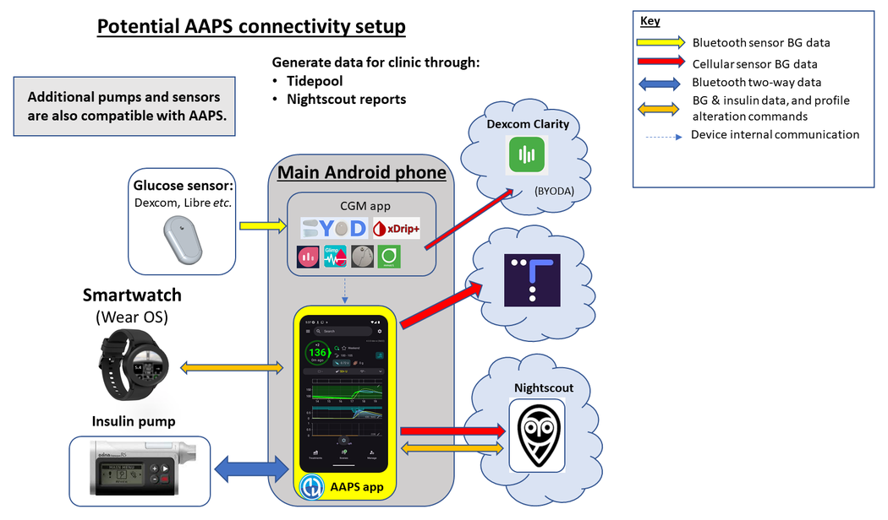
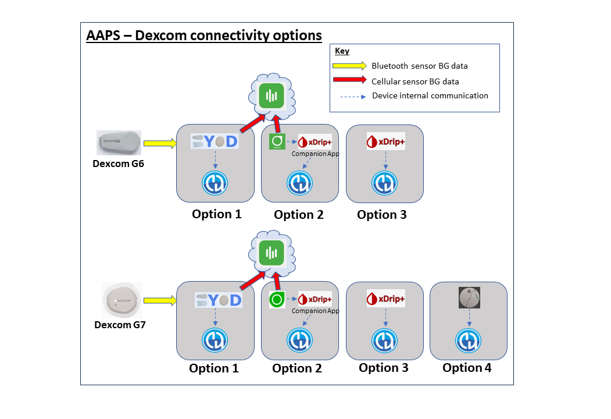
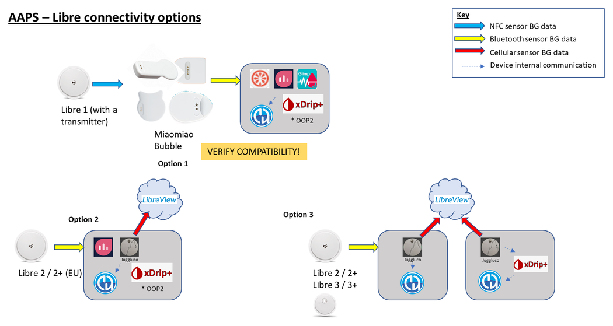
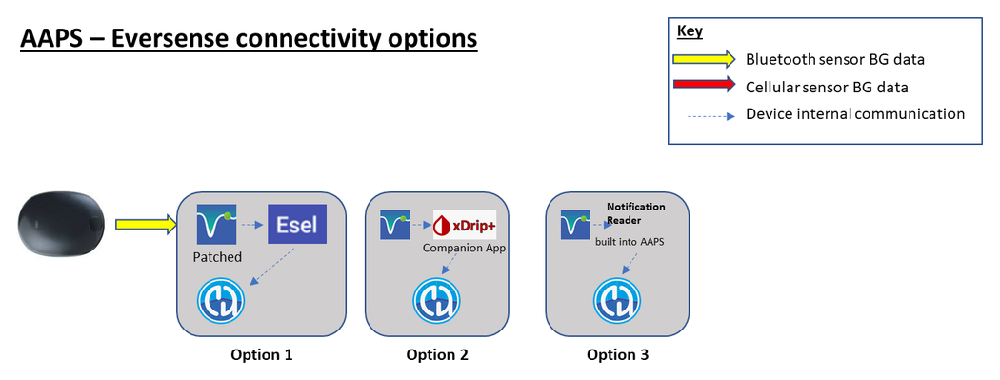

# AAPS 시작 준비하기

Welcome. 이 문서는 Android 인공 췌장 시스템(**AAPS**)을 설정하고 사용하기 시작하려는 사용자를 안내하기 위한 것입니다.

## 문서 둘러보기

문서 구조의 **색인**과 설명은 [여기](../index.md)에서 볼 수 있으며, 문서 왼쪽 위의 **AAPS** 로고를 클릭해도 갈 수 있습니다. 그곳에서 문서의 각 섹션이 어떤 목적을 갖는지 개요를 볼 수 있습니다. 이 페이지 왼쪽의 제목을 사용하여 문서를 둘러볼 수도 있습니다. 마지막으로, **AAPS** 로고 바로 아래에 편리한 검색 기능이 있습니다.

우리는 **AAPS**의 기능과 한계를 쉽게 알 수 있도록 하는 것을 목표로 합니다. 문서를 읽는 데 시간을 들인 후에야 호환되는 인슐린 펌프나 CGM이 없다는 것, 또는 **AAPS**가 기대와 다른 기능을 제공한다는 것을 알게 되면 실망스러울 수 있습니다.

**AAPS** 문서에 있는 경험에 관한 많은 내용은 실제로 **AAPS**를 실시간으로 사용할 때 더 잘 이해됩니다. 규칙만 읽어서는 운동을 배우기 어려운 것처럼, **AAPS**도 먼저 안전하게 사용하기 위한 기본 규칙을 배우고, 그다음 **AAPS**를 사용하기 시작하면서 그 규칙을 가장 잘 적용하는 방법을 배워야 합니다.

(preparing-safety-first)=

## 안전 우선
“큰 힘에는 큰 책임이 따른다…”

### 기술적 안전
**AAPS**에는 다양한 안전 기능이 있습니다. 이러한 제한은 일련의 [목표](../SettingUpAaps/CompletingTheObjectives.md)를 단계적으로 완료하면서 점차 해제됩니다. 목표에는 특정 매개변수를 테스트하고 객관식 질문에 답하는 과제가 포함됩니다. **AAPS**의 기능은 목표를 하나씩 완료할 때마다 잠금 해제됩니다. 이 과정을 통해 사용자는 **AAPS**의 여러 기능을 배우면서 개방 루프에서 폐쇄 루프로 단계적으로 안전하게 넘어갈 수 있습니다.

[목표](../SettingUpAaps/CompletingTheObjectives.md)는 **AAPS** 개발자들이 새 사용자에게서 관찰한 흔한 실수와 일반적인 경향을 고려하여, **AAPS**를 가장 잘 배울 수 있도록 설계되었습니다. 초보자는 경험이 부족하고 **AAPS**를 너무 서둘러 시작하려 하거나 중요한 점을 놓쳐서 실수를 할 수 있습니다. [목표](../SettingUpAaps/CompletingTheObjectives.md)는 이러한 문제를 줄이기 위한 것입니다.

### 의학적 안전
```{admonition} Avoid permanent and painful damage to your eyes and nerves
:class: danger
혈당 조절이 빠르게 개선되고 HbA1c가 낮아질 때는 주의가 필요합니다 
```

중요한 안전 고려 사항은 **한동안 혈당이 높았던 사람에게서 HbA1c가 빠르게 낮아지고 혈당 조절이 개선되면 영구적인 손상이 생길 수 있다**는 점입니다. 많은 당뇨인이 이 사실을 모르며, 모든 임상의가 환자에게 이 문제를 알려 주는 것은 아닙니다.

이 손상에는 **시력 상실과 영구적인 신경병증(통증)**이 포함될 수 있습니다. 평균 혈당을 더 천천히 낮추면 이러한 손상을 피할 수 있습니다. 현재 HbA1c가 높은 상태에서 **AAPS**(또는 다른 폐쇄 루프 시스템)로 바꾸려는 경우, 시작하기 전에 _반드시_ 의료진과 이 잠재적 위험을 상의하고, 안전한 혈당 목표를 점차 낮추어 가는 일정을 함께 정하십시오. 처음에는 **AAPS**에서 혈당 목표를 쉽게 높게 설정할 수 있으며(현재 선택할 수 있는 가장 높은 목표는 11.1 mmol/L이지만, 필요하면 일부러 약한 프로파일을 유지할 수도 있습니다), 몇 달에 걸쳐 목표를 낮추면 됩니다.

#### 영구적인 손상의 위험 없이 HbA1c를 얼마나 빨리 낮출 수 있습니까?

76명의 환자를 대상으로 한 한 후향적 [연구](https://pubmed.ncbi.nlm.nih.gov/1464975/)에 따르면, 6개월 동안 HbA1c가 각각 1%, 2%, 3% 떨어졌을 때 망막병증 진행 위험이 각각 1.6배, 2.4배, 3.8배 높아졌습니다. 연구자들은 **"망막병증의 진행을 막으려면 어느 6개월 동안이든 HbA1c 감소를 2% 미만으로 제한해야 한다....혈당 조절을 시작할 때 너무 빠르게 낮추면 망막병증 진행이 심하게 또는 일시적으로 악화될 수 있다."**고 제안했습니다.

참고 다른 HbA1c 단위(% 대신 mmol/mol)를 사용한다면 HbA1c 계산 도구는 [여기](https://www.diabetes.co.uk/hba1c-units-converter.html)를 클릭하십시오.

954명의 환자를 대상으로 한 또 다른 후향적 [평가](https://academic.oup.com/brain/article/138/1/43/337923)에서 연구자들은 다음과 같이 밝혔습니다:

**"3개월 동안 HbA1c가 2–3%포인트 감소하면 당뇨병에서 치료로 인한 신경병증이 생길 절대 위험이 20%였고, 3개월 동안 HbA1c가 >4%포인트 감소하면 치료로 인한 신경병증이 생길 절대 위험이 80%를 넘었다."**

이 연구에 대한 [논평](https://academic.oup.com/brain/article/138/1/2/340563)에서도 합병증을 피하려면 **3개월 동안 A1c 감소를 <2%로 하는 것을 목표로 해야 한다.**는 데 동의했습니다. 이 주제에 대한 다른 리뷰는 [여기](https://www.ncbi.nlm.nih.gov/pmc/articles/PMC6587545/pdf/DOM-21-454.pdf)와 [여기](https://www.mdpi.com/1999-4923/15/7/1791)에서 읽을 수 있습니다.

_새로_ 진단받은 1형 당뇨인(진단 시 인슐린 치료를 시작하기 전 HbA1c가 매우 높은 경우가 많음)은 그렇게 오랫동안 혈당이 높았던 것이 아니기 때문에, 진단 직후 HbA1c를 빠르게 낮추어도 이러한 위험을 같은 정도로 겪지 않는 것으로 일반적으로 알려져 있습니다. 그래도 이는 의료진과 상의해야 할 사항입니다.

(PreparingForAaps-no-sglt-2-inhibitors)=
### SGLT-2 억제제 사용 금지

```{admonition} NO SGLT-2 inhibitors
:class: danger
SGLT-2 억제제(글리플로진이라고도 함)는 신장에서 포도당의 재흡수를 억제합니다. 글리플로진은 혈당을 예측할 수 없을 만큼 낮추므로, AAPS 같은 폐쇄 루프 시스템을 사용하는 동안에는 절대 복용하면 안 됩니다! 케토산증 및/또는 저혈당의 위험이 매우 큽니다! 혈당을 올리기 위해 기저 주입량을 낮추는 시스템과 이 약을 함께 사용하는 것은 특히 위험합니다. 

요약하면:
- **예 1: 저혈당 위험**
>점심에 탄수화물 45 g을 섭취한다고 보고 **AAPS**로 볼러스를 합니다. 문제는 AAPS가 모르는 사이에 억제제가 탄수화물의 일부를 몸 밖으로 배출시킨다는 것입니다. 그 결과 흡수된 탄수화물에 비해 몸에 인슐린이 너무 많아져 저혈당이 생깁니다.

- **예 2: 케토산증 위험**
>억제제가 눈에 띄지 않게 탄수화물 일부를 배출시켜 혈당이 낮아집니다. **AAPS**는 자동으로 펌프에 기저를 포함한 인슐린 주입을 줄이라고 지시합니다. 시간이 지나면 혈당이 목표값보다 낮게 유지되어, 몸에 탄수화물을 흡수할 기본 인슐린이 부족해지고 결국 케토산증이 생길 수 있습니다. 보통 1형 당뇨 환자에게 케토산증은 펌프가 고장 나서 생기며, 이 경우 휴대폰에 경고가 뜨고 혈당이 높아져 알아차릴 수 있습니다. 그러나 글리플로진의 위험은 펌프가 정상 작동하고 혈당도 목표 범위 안에 있을 수 있어서 AAPS 경고가 전혀 없다는 것입니다.

SGLT-2 억제제의 일반적인 상품명은 Invokana, Farxiga, Jardiance, Glyxambi, Synjardy, Steglatro, Xigduo XR 등입니다.
```


### AAPS로 루프를 사용하는 핵심 원칙

**AAPS**를 사용하기 전에 루프의 핵심 원칙과 개념을 이해해야 합니다. 이를 위해 시간을 들여 **AAPS** 문서를 읽고 목표를 완료하십시오. 목표는 **AAPS**를 안전하고 효과적으로 사용하기 위한 튼튼한 기반을 제공합니다. **AAPS** 문서의 양이 처음에는 너무 많아 보일 수 있지만, 인내심을 갖고 과정을 믿으십시오. 올바르게 접근하면 해낼 수 있습니다!

진행 속도는 사람마다 다르지만, 모든 목표를 완료하는 데 보통 6 - 9주가 걸린다는 점을 알아 두십시오. 많은 사람이 **AAPS**를 사용하기 훨씬 전부터 빌드, 설치, 설정을 시작합니다. 이를 돕기 위해 시스템에는 "가상 펌프"가 있습니다. 초기 목표를 진행하는 동안 이를 사용하면 실제로 인슐린을 주입하지 않고도 **AAPS**에 익숙해질 수 있습니다. 자세한 일정은 아래에 있습니다. **AAPS**의 목표 7에서 폐쇄 루프를 사용하게 되며, 그 이후 목표는 **SMB**와 **자동화** 같은 추가 기능을 더합니다. 이 기능은 일부 사용자에게 유용하지만 **AAPS**의 핵심 기능에 꼭 필요한 것은 아닙니다.

**AAPS**로 성공하려면 적극적인 자세, 혈당 데이터를 되돌아보려는 의지, 그리고 결과를 개선하기 위해 **AAPS**를 필요한 만큼 유연하게 조정하는 태도가 필요합니다. 규칙만 읽어서는 운동을 배우기가 거의 불가능한 것처럼, **AAPS**도 마찬가지입니다.

#### 모든 것을 설정하고 실행하는 과정에서 지연과 작은 문제가 생길 수 있음을 미리 계획하십시오

**AAPS**를 시작하는 초기 단계에서는 루프의 모든 구성 요소가 서로(그리고 팔로워와) 잘 통신하도록 만드는 일과 설정을 세밀하게 조정하는 일이 어려울 수 있습니다. 일부 문제는 **AAPS**를 일상생활에서 사용해 보기 전까지는 해결할 수 없지만, Facebook 그룹과 Discord에서 많은 도움을 받을 수 있습니다. 이에 맞게 계획을 세우고, 문제를 해결할 때는 주말의 조용한 아침처럼 "좋은" 시간을 고르십시오(즉, 밤늦게나 피곤할 때, 또는 중요한 회의나 여행 직전은 피하십시오).

#### 기술 호환성

**AAPS**는 특정 종류의 인슐린 펌프, CGM, 휴대폰과만 호환되며, 일부 기술은 국가에 따라 사용할 수 없을 수 있습니다. 실망하거나 답답한 일을 피하려면 [CGM](../Getting-Started/CompatiblesCgms.md), [펌프](../Getting-Started/CompatiblePumps.md), [휴대폰](../Getting-Started/Phones.md) 섹션을 읽으십시오.

#### 앱 빌드 시간과 완전한 루프까지의 진행

**AAPS** 앱을 빌드하는 데 걸리는 시간은 여러분의 경험과 기술 능력에 따라 다릅니다. 경험이 적은 사용자는 보통 (커뮤니티의 도움을 받아) **AAPS**를 빌드하는 데 반나절에서 하루 정도 걸릴 수 있습니다. 경험이 쌓이면 새 **AAPS** 버전을 빌드하는 과정은 훨씬 빨라집니다.

이 문서의 여러 부분이 빌드 과정을 돕습니다:

- [AAPS 빌드](../SettingUpAaps/BuildingAaps.md)는 앱을 빌드하고 휴대폰에 설치하는 과정을 단계별로 안내합니다;

- [FAQ](../UsefulLinks/FAQ.md)는 자주 묻는 질문에 답하고 가장 흔히 생기는 오류를 설명합니다; 그리고

- [문제 해결](../GettingHelp/GeneralTroubleshooting.md) 허브는 가장 흔한 문제의 해결 방법을 주제별로 모아 둡니다.

폐쇄 루프까지 걸리는 시간은 사람마다 다릅니다. **AAPS**로 완전한 루프에 이르는 대략적인 일정은 [아래](#preparing-how-long-will-it-take)에 있습니다.


#### 키 저장소와 구성 설정 내보내기 파일

“키 저장소”(.jks 파일)는 여러분의 **AAPS** 사본에만 있는 고유한 파일이며, 비밀번호로 암호화되어 있습니다. Android 휴대폰은 이 파일을 사용하여, 키 저장소가 없는 다른 사람이 여러분의 사본을 업그레이드할 수 없도록 합니다. 요약하면, **AAPS** 빌드 과정에서 다음을 하십시오:

1.  키 저장소 파일(앱 서명에 사용하는 .jks 파일)을 안전한 곳에 저장하십시오;

2.  키 저장소 파일의 비밀번호를 기록해 두십시오.

키 저장소를 저장하는 방법은 빌드 방법에 따라 다릅니다:

- **Android Studio (컴퓨터) 빌드**: 키 저장소는 빌드 중에 만들어집니다. 저장 위치는 [서명된 APK 생성](#Building-APK-generate-signed-apk)을 참조하십시오.
- **AAPS Builder**: 키를 만들 때 설정 페이지에서 제공한 백업 파일 `aaps-keystore.jks`를 비밀번호, 별칭(alias)과 함께 보관하십시오. 직접 키 저장소를 업로드했다면 그 파일을 보관하십시오.
- **fork를 사용한 브라우저 빌드**: 전용 [Export keystore](#ci-keystore-export) 워크플로를 사용하여 사본을 Google Drive에 내려받으십시오.

이렇게 하면 새 버전의 **AAPS**를 만들 때마다 똑같은 키 저장소 파일을 사용할 수 있습니다. 평균적으로 1년에 2번 **AAPS** 업데이트가 필요합니다.

또한 **AAPS**에서는 [모든 구성 설정을 내보낼](../Maintenance/ExportImportSettings.md) 수 있습니다. 이렇게 하면 휴대폰을 바꾸거나 앱을 업그레이드/재설치할 때 중단을 최소화하면서 시스템을 안전하게 복구할 수 있습니다. 

#### Troubleshooting

확실하지 않은 것이 있으면 언제든지 AAPS 커뮤니티에 문의하십시오. 어리석은 질문이란 없습니다! 경험 수준과 상관없이 모든 사용자가 질문하기를 권장합니다. **AAPS** 사용자가 많기 때문에 보통 질문에 대한 답변이 빠릅니다.

##### [AAPS Facebook 그룹에서 질문하기](https://www.facebook.com/groups/AndroidAPSUsers/)

##### [AAPS Discord 채널에서 질문하기](https://discord.gg/4fQUWHZ4Mw)


#### [어디에서 도움을 받을 수 있습니까](../GettingHelp/WhereCanIGetHelp.md)?

이 섹션은 새 사용자에게 도움을 받을 수 있는 자료의 링크를 제공합니다. 여기에는 질문에 답하고 AAPS에서 흔히 생기는 문제를 해결해 줄 수 있는, 신규 사용자와 숙련된 사용자로 이루어진 커뮤니티 지원도 포함됩니다.

#### [임상의를 위한 섹션](../UsefulLinks/ClinicianGuideToAaps.md)

AAPS와 오픈 소스 인공 췌장 기술에 대해 더 알고 싶은 [임상의를 위한 섹션](../UsefulLinks/ClinicianGuideToAaps.md)입니다. 소개 페이지에는 [의료진과 대화하는 방법](#introduction-how-can-i-approach-discussing-aaps-with-my-clinical-team)에 대한 안내도 있습니다.

## 무엇을 빌드하고 설치합니까?

이 다이어그램은 **AAPS** 시스템의 주요 구성 요소(하드웨어와 소프트웨어)의 개요를 보여 줍니다:




세 가지 기본 하드웨어 구성 요소(휴대폰, 펌프, 혈당 센서) 외에 다음도 필요합니다: 1) **AAPS** 앱 2) 리포팅 서버 그리고 3) 연속 혈당 측정기(CGM) 앱

### 1) Android 휴대폰 앱: **AAPS**

**AAPS**는 Android 스마트폰과 기기에서 실행되는 앱입니다. 단계별 안내에 따라 GitHub에서 **AAPS** 소스 코드를 내려받고, 컴퓨터에 필요한 프로그램(Android Studio, GitHub desktop)을 설치한 다음, 여러분만의 **AAPS** 앱을 빌드하여 **AAPS** 앱(apk 파일)을 직접 만듭니다. 그런 다음 **AAPS** 앱을 (이메일, USB 케이블 _등_으로) 스마트폰에 옮겨 설치합니다.

### 2) 리포팅 서버: Nightscout (Tidepool*)

**AAPS**를 제대로 활용하려면 Nightscout 서버를 설정해야 합니다. [직접 설정](https://nightscout.github.io/nightscout/new_user/#free-diy)하거나, 적은 비용을 내고 [관리형 Nightscout 서비스](https://nightscout.github.io/#nightscout-as-a-service)를 이용할 수 있습니다. Nightscout는 **AAPS**의 데이터를 오랜 기간 모으며, CGM과 인슐린 패턴을 서로 연결한 자세한 보고서를 만들 수 있습니다. 보호자는 Nightscout를 사용하여 **AAPS** 앱과 원격으로 통신하고 자녀의 당뇨 관리를 지켜볼 수도 있습니다. 이러한 원격 통신 기능에는 혈당과 인슐린 수치의 실시간 모니터링, (문자 메시지를 통한) 원격 인슐린 볼러스, 식사 알림이 포함됩니다. CGM 데이터를 펌프 데이터와 따로 보면서 당뇨 관리 결과를 분석하려는 것은, 운전자는 앞을 보지 못하고 옆 사람이 풍경을 설명해 주는 상태로 차를 운전하는 것과 같습니다. Nightscout 대신 Tidepool을 사용할 수도 있습니다.

### 3) CGM 센서 앱

사용하는 혈당 센서/CGM에 따라, 혈당 측정값을 받아 **AAPS**로 보내는 호환 앱이 필요합니다. 여러 가지 옵션은 아래와 같으며, 자세한 내용은 [호환 CGM 섹션](../Getting-Started/CompatiblesCgms.md)에서 볼 수 있습니다:

  

### **AAPS** 시스템 유지 관리

개선된 버전이 출시되므로 **Nightscout**와 **AAPS**는 대략 1년에 한 번 업데이트해야 합니다. 경우에 따라 업데이트를 미룰 수 있지만, 다른 경우에는 업데이트가 강력히 권장되거나 안전을 위해 꼭 필요합니다. 이러한 업데이트 소식은 Facebook 그룹과 Discord 서버에서 알려 드립니다. 릴리스 노트에서 어떤 경우인지 명확히 알 수 있습니다. 업데이트 시기에는 여러분과 비슷한 질문을 하는 사람이 많을 것이며, 업데이트할 때 도움을 받을 수 있습니다.

(preparing-how-long-will-it-take)=
## 모든 것을 설정하는 데 얼마나 걸립니까?

앞에서 말했듯이, **AAPS**를 사용하는 것은 개인 시간을 투자해야 하는 “여정”에 가깝습니다. 한 번 설정하고 끝나는 것이 아닙니다. **AAPS** 빌드, **AAPS**와 **CGM** 소프트웨어 설치 및 구성, 그리고 **AAPS**로 개방 루프에서 하이브리드 폐쇄 루프까지 가는 데 현재 전체적으로 약 4~6개월이 걸리는 것으로 예상됩니다. 따라서 아직 다른 인슐린 주입 시스템을 사용하고 있더라도 **AAPS** 앱을 빌드하고 초기 목표를 가능한 한 빨리 진행하는 것이 좋습니다(목표 5까지는 가상 펌프를 사용할 수 있습니다).

일부 목표는 새 기능을 이해했는지 확인하기 위해 정해진 일수가 지나야 합니다. 이 대기 시간은 건너뛸 수 없습니다. 최소 대기 시간은 여러분의 안전을 위해 정해진 것입니다.

대략적인 일정은 다음과 같습니다:

| 작업                                            |     예상 시간     |
| --------------------------------------------- |:-------------:|
| 문서 처음 읽기                                      |     1-2일      |
| 브라우저 빌드를 위한 GitHub 구성                         |     1-4시간     |
| 리포팅 서버 설정                                     |    1 hour     |
| CGM 앱 설치 (xDrip, BYODA, …)                    |    1 hour     |
| CGM → xDrip → AAPS 초기 구성                      |    1 hour     |
| AAPS → 펌프 초기 구성                               |    1 hour     |
| AAPS → Nightscout/Tidepool 구성 (리포팅 전용)        |    1 hour     |
| 선택 사항: Nightscout ↔ **AAPS** 및 NSFollowers 구성 |    1 hour     |
| 목표 1: 시각화와 모니터링 설정                            |    1 hour     |
| 목표 2: AAPS를 사용하는 방법 배우기                       |      2시간      |
| Objective 3: Prove your knowledge             |    최대 14일     |
| 목표 4: 개방 루프 시작                                |     최소 7일     |
| 목표 5: 개방 루프 이해하기                              |      7일       |
| 목표 6: 폐쇄 루프 시작 (저혈당 주입 정지)                    | 최소 5일, 최대 14일 |
| 목표 7: 폐쇄 루프 조정                                | 최소 1일, 최대 7일  |
| 목표 8: 기저와 비율 조정, Autosens 활성화                 | 최소 7일, 최대 14일 |
| 목표 9: 슈퍼 마이크로 볼러스(SMB) 활성화                    |    최소 28일     |
| 목표 10: 자동화                                    |    최소 28일     |

**AAPS**를 완전히 사용하게 된 후에도 전반적인 당뇨 관리를 개선하기 위해 설정을 정기적으로 세밀하게 조정해야 합니다.

## 요구 사항

### 의학적 고려 사항

[안전 섹션](#preparing-safety-first)의 의학적 경고 외에도, 펌프에서 사용하는 인슐린에 따라 다른 매개변수가 있습니다.

#### 인슐린 선택

**AAPS**의 계산은 인슐린 농도 100U/ml(펌프의 표준과 같음)를 기준으로 합니다. 인슐린은 **관리 → 인슐린 설정**에서 구성합니다. **피크**와 **DIA**를 설정하거나, **피크 불러오기**를 사용하여 프리셋 중 하나의 표준 피크 시간을 채우십시오:

- **Novorapid** (Humalog와 NovoLog에도 해당)
- **Fiasp**
- **Lyumjev**

고급 사용자는 피크 시간(35~120분)을 직접 입력할 수 있습니다. 예를 들어 여러 인슐린을 섞어 쓰는 경우입니다. [인슐린 설정](#Config-Builder-insulin)을 참조하십시오.


### 기술

이 문서는 필요한 기술 지식을 최소한으로 줄이는 것을 목표로 합니다. **AAPS** 앱을 빌드하는 방법은 여러 가지가 있습니다. 개요는 [AAPS 빌드](../SettingUpAaps/BuildingAaps.md)를 참조하십시오:

- **브라우저 빌드**(권장): GitHub Actions를 사용하여 스마트폰에서 바로 앱을 빌드합니다. 컴퓨터나 Android Studio가 필요 없습니다. [AAPS Builder](../SettingUpAaps/BrowserBuildAapsBuilder.md)를 사용하면 GitHub 계정만 있으면 됩니다. 앱은 GitHub에서 바로 내려받습니다. fork 방법에서는 앱을 Google Drive에 저장하기 위해 Google 계정도 필요합니다.
- **Android Studio 빌드**: Android Studio를 사용하여 컴퓨터에서 앱을 빌드합니다. 주로 코드를 수정하려는 개발자가 이 방법을 사용합니다.
- **명령줄 빌드**: Android Studio를 설치하지 않고 로컬에서 빌드하려는 사용자를 위한 방법입니다.

앱을 빌드하는 것 외에도 리포팅 서버를 설정하고, 여러 Android 휴대폰 앱을 구성하고, 당뇨 관리에 대한 전문 지식을 쌓아야 합니다. 단계별로 차근차근, 인내심을 갖고 **AAPS** 커뮤니티의 도움을 받으면 해낼 수 있습니다. 인터넷을 사용할 줄 알고 자신의 Gmail 이메일을 관리할 수 있다면 **AAPS**를 빌드하는 것은 충분히 할 수 있는 일입니다. 천천히 하십시오.

### 스마트폰

#### AAPS와 Android 버전

현재 **AAPS** 버전(4.0)에는 Google **Android 12.0 이상**이 설치된 Android 스마트폰이 필요합니다. 새 휴대폰 구입을 고려하고 있다면 (2026년 1월 기준) Android 16을 권장합니다.<br/> 안전을 위해 **AAPS** 빌드를 항상 최신 상태로 유지할 것을 강력히 권장합니다. 그러나 Android 12.0 이상 기기를 사용할 수 없는 사용자를 위해 이전 Android 버전과 호환되는 이전 **AAPS** 버전도 계속 제공됩니다. [릴리스 노트](#maintenance-android-version-aaps-version)를 참조하십시오.

#### 스마트폰 모델 선택
어떤 모델을 구입할지는 원하는 기능에 따라 다릅니다. [스마트폰 페이지](../Getting-Started/Phones.md)에서 권장 사항과 잘 작동하는 구성에 대한 사용자 의견을 볼 수 있습니다.

휴대폰의 Android 버전을 보안 업데이트를 포함하여 최신 상태로 유지하는 것을 권장합니다. 그러나 **AAPS**를 처음 사용하거나 기술 전문가가 아니라면, 다른 사람들이 먼저 업데이트하고 여러 포럼에서 안전하다고 확인할 때까지 휴대폰 업데이트를 미루는 것이 좋습니다.

```{admonition} Delaying Samsung phone updates
:class: warning
Samsung은 휴대폰에 업데이트를 강제로 설치해 온 좋지 않은 이력이 있으며, 이로 인해 블루투스 연결 문제가 생길 수 있습니다. 이 강제 업데이트를 끄려면 휴대폰을 "개발자 모드"로 전환해야 합니다:

1. **Settings**(설정) > **About phone**(휴대전화 정보) > **Software information**(소프트웨어 정보)로 이동한 다음, 개발자 모드가 잠금 해제되었다는 확인이 나올 때까지 **Build number**(빌드 번호)를 탭하십시오.
2. 기본 **Settings**(설정) 메뉴로 돌아가면 새 **Developer options**(개발자 옵션) 메뉴 항목이 보입니다.
3. **Developer options**(개발자 옵션)를 열고, 스크롤하여 **Auto system update**(자동 시스템 업데이트)를 찾아 끄십시오.
```

```{admonition} Google Play Protect potential issue
:class: warning
Google Play Protect가 매일 아침 **AAPS**를 임의로 종료했다는 보고가 여러 건 있습니다. 이런 일이 생기면 Google Play 옵션으로 가서 **Google Play Protect**를 꺼야 합니다. 모든 휴대폰 모델이나 모든 Android 버전이 영향을 받는 것은 아닙니다.
```

```{admonition} Android developer verification
:class: note
2026년 9월부터 Google은 [Android 개발자 인증](#android-developer-verification)을 단계적으로 도입하고 있으며, 이에 따라 직접 빌드한 앱을 휴대폰에 설치하는 방법이 바뀝니다. **AAPS** 빌드는 영향을 받지 않으며, 무료 설치 방법도 계속 사용할 수 있습니다. 자세한 내용은 링크된 페이지를 참조하십시오.
```

