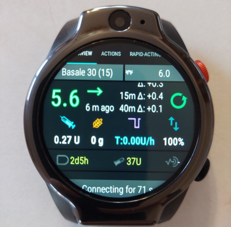
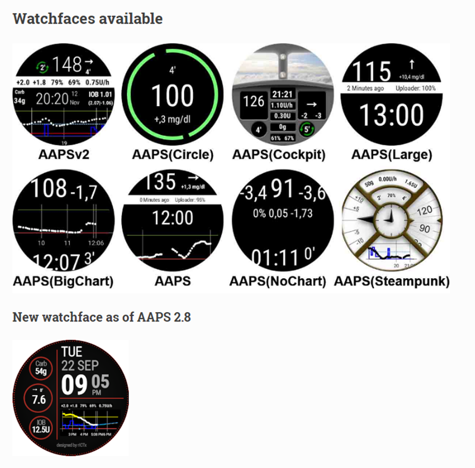
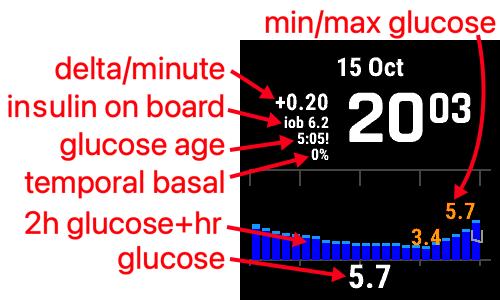
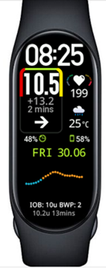

# 스마트워치와 AAPS

여러 스마트워치를 사용하여 **AAPS**의 정보 일부를 표시하거나 원격 작업을 할 수 있습니다.

스마트워치로 **AAPS**(펌프와 센서)를 직접 제어하려면 완전한 Android 워치(작은 [스마트폰](./Phones.md)처럼 볼 수 있는 워치)를 사용합니다.

일부 스마트워치에서는 처치 등을 입력할 수 있지만, **AAPS**는 여전히 휴대폰에서 관리합니다.

**AAPS**와 함께 스마트워치를 사용하는 경우가 늘고 있습니다. 당뇨병이 있는 성인과 당뇨병이 있는 어린이의 보호자/부모가 _모두_ 사용합니다.

## **AAPS**와 함께 스마트워치를 사용할 때의 일반적인 장점


스마트워치는 모델에 따라 **AAPS**와 함께 여러 가지 방법으로 사용할 수 있습니다. **AAPS**를 완전히 또는 부분적으로 제어하거나, 단순히 원격으로 혈당 수치, 활성 인슐린과 그 밖의 값을 확인하는 데 사용할 수 있습니다.

스마트워치를 **AAPS**와 연동하면 자동차나 (오토)바이를 운전할 때, 운동할 때 등 여러 상황에서 유용합니다. 어떤 사람들은 (회의, 파티, 식사 자리 등에서) 휴대폰을 보는 것보다 워치를 보는 것이 더 눈에 띄지 않는다고 느낍니다. 보안 측면에서도 스마트워치는 이동 중에 유용할 수 있습니다. **AAPS** 휴대폰은 보이지 않게(예: 가방 안에) 보관하고, 스마트워치로 원격 제어를 할 수 있습니다.

## **AAPS**를 사용하는 부모/보호자를 위한 특별한 장점

어린이의 경우 - 어린이의 **AAPS** 휴대폰이 가까이 있으면 - 보호자는 **AAPS** 휴대폰을 사용하지 않고 스마트워치로 모니터링하거나 변경할 수 있습니다. 예를 들어 **AAPS** 휴대폰이 펌프 벨트 안에 들어 있을 때 유용합니다.

스마트워치는 원격 제어나 [팔로우만 하기](../RemoteFeatures/FollowingOnly.md)를 위한 휴대폰 기반 방법에 _더하여_ 사용하거나, 그 _대신_ 사용할 수 있습니다.

또한 부모/보호자의 팔로워 휴대폰(모바일 네트워크나 Wi-Fi 연결에 의존함)과 달리, 블루투스로 연결된 스마트워치는 동굴, 배 위, 산 중턱 같은 외진 곳에서도 유용합니다. 두 기기(**AAPS** 휴대폰과 스마트워치)가 같은 Wi-Fi 네트워크에 있으면 Wi-Fi도 사용할 수 있습니다.

## 스마트워치와 AAPS 연동의 여러 종류

현재 스마트워치를 **AAPS**와 함께 사용하는 주요 방법은 다섯 가지입니다. 아래 표에 정리되어 있습니다: 

| 워치 구성     | 기능                           | 요구 사항                                                                                                                                                                                                                                                   |
| --------- | ---------------------------- | ------------------------------------------------------------------------------------------------------------------------------------------------------------------------------------------------------------------------------------------------------- |
| 단독 사용     | 휴대폰 없는 AAPS                  | 완전한 Android 스마트워치(최소 Android 버전 확인)</br> **app-fullRelease** 실행                                                                                                                                                                                         |
| 완전한 원격 제어 | 대부분의 AAPS 기능                 | Android **Wear OS** 워치(Android/API 버전 확인)</br>**wear-fullRelease** 실행                                                                                                                                                                                   |
| 원격 제어     | AAPSClient 기능                | Android **Wear OS** 워치(Android/API 버전 확인)</br>**[wear-aapsclientRelease](https://github.com/nightscout/AndroidAPS/releases)** 실행                                                                                                                        |
| 원격 제어     | 일부 AAPSClient 기능             | Garmin 워치</br>(이전 Samsung Tizen 및 Fitbit 구성만 해당, 권장하지 않음)</br>아래를 참조하십시오.                                                                                                                                                                               |
| 표시        | 혈당, 추세, IOB, COB, 루프 및 펌프 상태 | [외부 연동 앱](#watches-external-companion-apps) 브로드캐스트를 받는 **AAPS** 휴대폰의 동반 앱을 통한 여러 스마트워치: [WatchDrip+](https://bigdigital.home.blog/)(Xiaomi, Amazfit), [GlucoDataHandler](https://github.com/pachi81/GlucoDataHandler)(Wear OS), G-Watch</br>아래를 참조하십시오. |

## 스마트워치를 사기 전에…

어떤 모델의 스마트워치를 살지는 원하는 기능에 따라 다릅니다. [스마트폰 페이지](#Phones-list-of-tested-phones)에서 유용한 정보를 찾을 수 있습니다. 여기에는 일부 스마트워치도 들어 있는 테스트된 휴대폰 목록이 있습니다.

인기 있는 워치 브랜드에는 Samsung Galaxy, Garmin, Fossil, Mi band가 있습니다. 위 표에 정리된 여러 옵션은 아래에서 더 자세히 설명합니다. 자신의 상황에 맞는 스마트워치를 고르는 데 도움이 될 것입니다.

휴대폰의 **AAPS**와 원격으로 상호작용하려고 스마트워치를 **AAPS**와 연동한다면, 두 기기가 서로 호환되는지도 확인해야 합니다. 특히 오래되었거나 흔하지 않은 휴대폰을 사용한다면 더욱 그렇습니다.

일반적으로 **AAPS**와 상호작용하지 않고 혈당 수치만 보려면, 더 저렴하고 간단한 워치를 폭넓게 선택할 수 있습니다.

스마트워치를 고르는 가장 좋은 방법은 Discord나 Facebook **AAPS** 그룹에서 "watch" 게시물을 검색하는 것입니다. 다른 사람들의 경험을 읽어 보고, 이전 게시물에서 답을 찾지 못하면 구체적인 질문을 올리십시오.

## 완전한 Android

매력적인 옵션으로 들리지요? 그러나 현재는 소수의 열성 사용자만 단독 워치에서 **AAPS**를 시험하고 있습니다. 쓸 만한 화면을 갖추고 **AAPS**와 CGM 앱의 단독 사용에도 잘 작동하는 스마트워치는 많지 않습니다. 인기 있는 모델로는 LEMFO LEM 15 Pro와 16이 있습니다. 워치에는 **AAPS** "wear" apk가 아니라 **AAPS** "full" apk(보통 스마트폰에 설치하는 apk)를 설치해야 합니다.

워치가 단독 **AAPS** 사용에 잘 맞는지 알려 주는 명확한 기준은 없지만, 다음 항목이 도움이 됩니다:

1)  Android 12 이상. 2)  워치 페이스의 “정사각형” 모드를 꺼서 글자를 더 크고 읽기 쉽게 할 수 있을 것. 3)  배터리 수명이 매우 좋을 것. 4)  블루투스 범위가 좋을 것.

단독 **AAPS** 워치의 불편함은 대부분 작은 화면으로 조작해야 한다는 점과, 현재 AAPS full 앱 화면이 워치용으로 설계되지 않았다는 점에서 옵니다. 화면이 작기 때문에 워치에서 **AAPS** 설정을 편집할 때 스타일러스를 쓰는 것이 더 나을 수 있습니다. 또한 일부 AAPS 버튼이 워치 화면에 보이지 않을 수 있습니다.

또 다른 어려움은 충분한 배터리 수명을 얻기 어렵다는 점이고, 배터리가 충분한 워치는 크고 두꺼운 경우가 많습니다. 사용자들은 OS 및 절전 설정과 씨름하고, 워치에서 센서를 시작하기 어렵고, 블루투스 범위가 좁고(센서와 펌프 모두와 연결을 유지하기 위해), 방수 성능이 의심스럽다고 보고합니다. 예는 아래 사진에 있습니다.



단독 워치를 설정하는 데 관심이 있다면, 더 많은 정보를 얻기 위해 **AAPS** Facebook 그룹(“standalone”과 “Lemfo”로 검색하면 좋습니다)과 Discord의 게시물과 댓글을 읽으십시오.

## Wear OS

**AAPS** 코드에는 [**Wear OS** 스마트워치](https://wearos.google.com/#oem-carousel)에 설치할 수 있는 앱 확장이 들어 있습니다.


스마트워치가 **AAPS** [전제 조건](#maintenance-android-version-aaps-version)을 충족하는지 확인하십시오.

### Wear OS란 _무엇입니까_?

처음 세 가지 스마트워치 옵션은 스마트워치에 **Wear OS**가 설치되어 있어야 합니다.

**Wear OS**는 일부 최신 Android 스마트워치에서 실행되는 운영 체제입니다. 스마트워치 설명에 Android 및 iOS와 _호환_된다고만 되어 있다면, Wear OS를 실행한다는 뜻이 아닙니다. **AAPS**와 호환되지 않는 다른 제조사 전용 운영 체제일 수 있습니다. 모든 버전의 **AAPS** 또는 **AAPSClient**를 설치하고 사용하려면, 스마트워치가 **Wear OS 3.0, 3.2 또는 3.5**(Android 11, API 레벨 30) **이상**을 실행해야 합니다. 각 Wear OS 릴리스는 기반이 되는 Android 버전을 따릅니다: **Wear OS 3**은 Android 11(API 레벨 30), **Wear OS 4**는 Android 13(API 레벨 33), **Wear OS 5**는 Android 14(API 레벨 34), **Wear OS 6**은 Android 16(API 레벨 36)입니다. Wear OS 2 워치에서는 **AAPS**를 실행할 수 없습니다.

**Wear OS** 워치에 **AAPS** wear.apk를 설치하면, 여러 가지 **AAPS** 전용 워치 페이스 중에서 선택할 수 있습니다. 또는 일반 스마트워치 워치 페이스를 사용하고, **AAPS** 정보를 화면의 “컴플리케이션”이라는 작은 타일에 넣을 수도 있습니다. 컴플리케이션은 워치 페이스에 시간 외에 표시되는 모든 기능을 말합니다.

```{note}
최근 **Wear OS** 변경으로 사용자 지정 **AAPS** 워치 페이스가 점점 더 작동하지 않게 됩니다(Wear OS 버전이 높을수록 더 심합니다). 그러나 **컴플리케이션**은 계속 작동합니다. 워치를 사거나 업데이트하기 전에 [Wear OS 워치 페이스 변경 사항](#wearos-watchface-changes)을 읽으십시오.
```


### 내 스마트워치는 어떻게 보일까요?

[워치에 **AAPS**를 설치](../WearOS/WearOsSmartwatch.md)하면, 이 **AAPS** 전용 워치 페이스 중에서 원하는 워치 페이스를 바로 선택할 수 있습니다. 대부분의 워치에서는 화면이 작아질 때까지 홈 화면을 길게 누른 다음, 오른쪽으로 밀어 다른 화면을 선택하면 됩니다:



이것은 **AAPS**에 들어 있는 기본 화면입니다. [다른 워치 페이스](#WearOS_changing-to-AAPS-watchface)도 있고 [컴플리케이션](#Watchfaces-complications)도 사용할 수 있습니다.

### Wear OS 워치를 매일 어떻게 사용합니까?

워치 페이스와 일상적인 사용에 대한 자세한 내용(자신만의 사용자 지정 워치 페이스를 만들고 공유하는 방법 포함)은 [스마트워치에서 Wear AAPS 사용하기](../WearOS/WearOsSmartwatch.md) 섹션에 있습니다.

(Watchfaces-tizen)= (watches-external-companion-apps)=

## 외부 연동 앱

**AAPS**는 같은 휴대폰에 설치된 다른 앱으로 상태를 브로드캐스트할 수 있습니다: 혈당과 추세, IOB, COB, 기저와 임시 기저, 프로파일 이름, 루프 상태, 휴대폰과 펌프 배터리, 레저버 잔량, 볼러스 진행 상황. 여러 워치 동반 앱이 이 브로드캐스트를 읽어, **AAPS**가 직접 지원하지 않는 워치에 데이터를 표시합니다. 데이터를 보내려면 **구성** > **통신**에서 **외부 연동 앱**을 활성화하십시오(구성 페이지의 [외부 연동 앱](#external-companion-apps) 참조). 브로드캐스트는 새 측정값마다 보내지며 따로 요청할 수 없습니다: 동반 앱의 새로고침 버튼은 **AAPS**에 아무 효과가 없습니다.


이 브로드캐스트를 사용하는 것으로 알려진 동반 앱:

- Xiaomi 및 Amazfit 워치용 [WatchDrip+](https://bigdigital.home.blog/). 아래의 [Xiaomi 및 Amazfit 워치](#watches-xiaomi-amazfit)를 참조하십시오.
- Wear OS 워치용 [GlucoDataHandler](https://github.com/pachi81/GlucoDataHandler). 컴플리케이션이나 위젯으로 사용합니다. **AAPS** 워치 페이스가 잘 작동하지 않는 Wear OS 버전에서 유용한 대안입니다. [Wear OS 워치에 AAPS 설정하기](../WearOS/WearOsSmartwatch.md)를 참조하십시오. 동반 앱 GlucoDataAuto는 Android Auto가 있는 자동차에서 같은 데이터를 보여 줍니다.
- Samsung Tizen 워치용 [G-Watch 앱](https://play.google.com/store/apps/details?id=sk.trupici.g_watch)과 나중에 나온 Wear OS 버전. 이전 **AAPS** 버전에서는 이 앱의 이름을 따서 플러그인 이름이 **Samsung Tizen**이었습니다.

```{warning}
**G-Watch 앱**과 그 **Wear OS** 버전은 더 이상 관리되지 않으며, Samsung은 스마트워치를 Tizen에서 Wear OS로 바꾸었습니다. G-Watch는 기존의 오래된 구성에만 해당되며, 새로 설치하는 경우에는 권장하지 않습니다. 최신 소식은 전용 [Facebook 그룹](https://www.facebook.com/groups/gwatchapp)을 확인하십시오.
```

(Watchfaces-garmin)=

## Garmin

Garmin ConnectIQ 스토어에는 [AAPS](https://apps.garmin.com/search?keywords=androidaps)와 연동되는 Garmin용 워치 페이스가 몇 가지 있습니다.


[AAPS Glucose Watch](https://apps.garmin.com/apps/3d163641-8b13-456e-84c3-470ecd781fb1)는 **AAPS**와 직접 연동됩니다. 혈당 측정값 외에 루프 상태 데이터(활성 인슐린, 임시 기저)를 보여 주고, 심박수 측정값을 **AAPS**로 보냅니다. ConnectIQ 스토어에서 받을 수 있습니다. **구성 → 통신**에서 **Garmin** 플러그인을 활성화하십시오. 

1. 그래프의 최고 및 최저 혈당 값
2. 분당 혈당 변화
3. 활성 인슐린 (IOB)
4. 마지막 혈당 측정 이후 시간(분:초)
5. 임시 기저 주입량(프로파일 기저 주입량에 대한 퍼센트)
6. 최근 2시간의 혈당 그래프
7. 현재 혈당 값


## Fitbit

```{warning}
Google은 Fitbit을 Google Health로 옮기고 있으며, EU에서는 Fitbit 워치에서 타사 앱과 워치 페이스를 없애고 있습니다. 따라서 Fitbit 워치 페이스는 **더 이상 권장하는 옵션이 아니며**, **AAPS**와 함께 쓰려고 Fitbit을 사는 것은 권장하지 않습니다.
```

기존 Fitbit 워치의 경우, [Nightscout 웹 페이지](https://nightscout.github.io/nightscout/wearable/#fitbit)에 [Glance](https://glancewatchface.com/) 같은 모니터링 전용 옵션이 나와 있습니다. 이것도 타사 워치 페이스이므로 같은 EU 제한이 적용됩니다.

## 팔로우만 하기

이 스마트워치들은 **AAPS** 정보 일부를 보여 줍니다. 일부는 다른 앱이 필요합니다.

표시만 하는 저렴한 스마트워치는 매우 다양합니다. Nightscout를 사용한다면 모든 옵션에 대한 좋은 개요는 [여기](https://nightscout.github.io/nightscout/wearable/#)에 있습니다

아래는 **AAPS** 사용자에게 인기 있는 팔로우 전용 워치 옵션 몇 가지입니다:

(watches-xiaomi-amazfit)=
### Xiaomi 및 Amazfit 워치

**WatchDrip+**는 커뮤니티에서 개발한 동반 앱으로, 여러 스마트워치 모델에 혈당과 루프 데이터를 표시합니다. 주로 Xiaomi(_예:_ Mi Band)와 Amazfit 브랜드입니다:



버전 0.5부터 **WatchDrip+**는 xDrip+를 중계로 쓰지 않고 **AAPS**에서 직접 데이터를 읽습니다. **AAPS** 휴대폰에서:

1. **구성** > **통신**에서 **외부 연동 앱**을 활성화하십시오. [위](#watches-external-companion-apps)를 참조하십시오. 현재 혈당, 증분, 추세 화살표, IOB와 펌프 상태를 제공합니다.
2. **구성** > **통신**에서 **xDrip** 플러그인을 활성화하고, 그 설정에서 **xDrip+로 상태 보내기**를 켜십시오. IOB/COB 상태 줄을 제공하며, 측정값이 몇 개 들어오면 워치의 혈당 그래프가 채워집니다.
3. 휴대폰에 xDrip+가 설치되어 있으면, 워치가 데이터를 두 번 받지 않도록 xDrip+의 **Broadcast Service API**(xDrip+ > Settings > Inter-app settings)를 끄십시오. xDrip+가 워치로 데이터를 중계하는 용도로만 쓰였다면 삭제해도 됩니다.

WatchDrip+의 새로고침 버튼은 **AAPS**에서는 효과가 없습니다: 데이터는 새 측정값마다 들어옵니다.


설정 방법을 포함한 자세한 내용은 [WatchDrip+ 웹사이트](https://bigdigital.home.blog/)에서 읽을 수 있습니다. 이 워치들의 장점은 작고 비교적 저렴하다는 것입니다. 특히 어린이와 손목이 작은 사람에게 인기 있는 옵션입니다.

### Pebble 워치


Pebble 워치([현재 단종](https://en.wikipedia.org/wiki/Pebble_(watch)))는 2013년부터 2016년까지 판매되었고, 중고로는 아직 구할 수 있을 수 있습니다. Fitbit이 Pebble의 자산을 인수했습니다. Pebble 사용자는 Urchin 워치 페이스로 Nightscout 데이터를 볼 수 있습니다. 표시할 수 있는 데이터에는 IOB, 현재 실행 중인 임시 기저 주입량과 예측이 있습니다. 개방 루프를 사용한다면 IFTTT로 애플릿을 만들어, **AAPS**에서 알림을 받으면 SMS나 pushover 알림을 보내도록 할 수 있습니다.

### [Bluejay 워치](https://bluejay.website/)


Dexcom 트랜스미터에서 혈당 데이터를 **직접** 받을 수 있는 독특한 기기입니다. Dexcom G6/G7 트랜스미터가 실제로 현재 혈당 데이터를 휴대폰 채널과 의료 채널이라는 _두_ 개의 별도 채널로 브로드캐스트한다는 사실은 잘 알려져 있지 않습니다. Bluejay 워치는 두 채널 중 어느 쪽에서든 혈당 데이터를 받도록 설정할 수 있습니다. 따라서 **AAPS**가 휴대폰 채널을 사용하면 Bluejay 워치는 의료 채널을 사용할 수 있습니다.

가장 큰 장점은 워치가 휴대폰과 루프 시스템 모두로부터 독립적이라는 것입니다. 예를 들어 해변이나 놀이공원에서 펌프와 **AAPS** 휴대폰을 떼어 두어 **AAPS** 휴대폰의 범위를 벗어나도, Dexcom에서 Bluejay 워치로 측정값을 직접 받을 수 있습니다.

원래의 **Bluejay GTS**는 단종되었고 Dexcom G7을 읽을 수 없습니다. 이후 모델(U1, 그리고 현재의 **U3**, 이 글을 쓰는 시점에 얼리 액세스로 판매 중)은 xDrip을 실행하는 완전한 Android 워치이며, Dexcom G6와 G7에서 직접 데이터를 수집합니다. 제조사는 이 워치를 의료용이 아닌 연구용 도구라고 설명합니다. 보고된 단점은 5분마다 측정값을 항상 받지는 못한다는 점과 배터리를 자주 충전해야 한다는 점입니다. 현재 모델과 구입 가능 여부는 [Bluejay 웹사이트](https://bluejay.website/)를 확인하십시오.

### Apple 워치

[Nightscout on your watch](https://nightscout.github.io/nightscout/wearable/#)를 확인하십시오.

Apple 워치는 이제 G7 직접 연결을 지원하며 **AAPS**와 동시에 사용할 수 있습니다.

