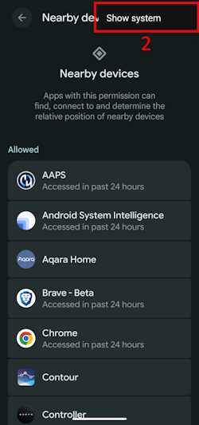
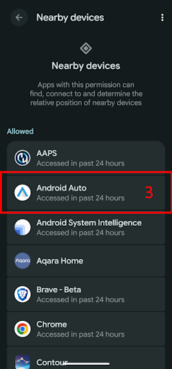

(bluetoothtroubleshooting-bluetooth-related-issues)=

# 블루투스 관련 문제

일부 사용자는 블루투스와 관련된 Omnipod DASH 활성화 실패, Medtrum Nano 연결 문제와 그 밖의 Pod 오류를 겪고 있습니다. 이 문제의 대부분은 아래 원인 중 하나로 설명할 수 있습니다.

이 문제 중 일부는 다른 블루투스 인슐린 펌프에도 해당될 수 있습니다. Omnipod DASH와 마찬가지로 Medtrum Nano도 근처 기기 권한과 관련된 알려진 문제가 있습니다.

---

(bluetoothtroubleshooting-cannot-start-omnipod-with-android-16)=

## Android 16에서 Omnipod를 시작할 수 없음
- Android 16에서 Omnipod DASH가 올바르게 작동하려면 **AAPS** 버전이 최소 3.3.2.1이어야 합니다. 이 버전에는 Android 16에서 생긴 Omnipod 관련 알려진 문제를 해결하기 위한 수정이 들어 있습니다.

---

(bluetoothtroubleshooting-bluetooth-battery-optimisation)=

## 블루투스 배터리 최적화

새 버전의 Android는 시스템 블루투스 앱에 배터리 최적화를 켜 두었습니다. 이 설정은 블루투스 펌프와 CGM에 일부 문제를 일으키는 것으로 알려져 있습니다.

[설정 마법사](../SettingUpAaps/SetupWizard.md)를 따라 하고 [블루투스 배터리 최적화](#setup-wizard-bluetooth-battery-optimisation) 섹션의 설정을 따랐다면 이 설정은 올바를 것입니다. 그러나 이 가이드의 이전 버전을 따랐다면 이 설정을 바꾸지 않았을 수 있습니다.

펌프와 CGM 연결이 끊긴다면 이 설정이 올바른지 확인하십시오.

---

(bluetoothtroubleshooting-apps-using-nearby-device-permission)=

## "근처 기기" Android 권한을 사용하는 앱은 연결 끊김과 Pod 활성화 문제를 일으킬 수 있습니다

Android에서는 권한 모델을 통해 각 앱이 휴대폰에서 무엇을 하거나 무엇에 접근할 수 있는지 제어할 수 있습니다. 설치된 각 앱마다 특정 권한을 허용하거나 거부할 수 있습니다. 예를 들어 기기의 파일 접근, 블루투스 접근, 근처 기기 검색 등입니다.

**AAPS**가 작동하려면 여러 특정 권한이 필요합니다. 그중 Pod가 작동하는 데 꼭 필요한 권한이 "근처 기기" 권한입니다. 이 권한이 필요한 다른 앱도 많습니다. 커뮤니티에서는 여러 앱이 이 권한을 받으면 일부 기기에서 새 Pod 활성화에 문제를 일으킬 수 있다는 것을 확인하고 있습니다.

(bluetoothtroubleshooting-apps-using-nearby-device-permission-known-apps)=

### "근처 기기" 권한을 사용하고 문제를 일으킨 것으로 알려진 앱:

이 목록의 앱은 커뮤니티의 한 곳 이상에서 Omnipod DASH 기기에, 그리고 일부 경우에는 Medtrum Nano에도 문제를 일으키는 앱으로 논의되었습니다.

```{admonition} Updating the list
:class: note
이 목록에 추가할 앱을 논의하려면 #omnipod-dash Discord 채널에서 @XiTatiON에게 연락하십시오.
```

- **myBMW** MyBMW가 Medtrum Nano와 Omnipod DASH를 방해했습니다. MyBMW 앱은 "근처 기기 찾기" 권한을 한 번만 묻습니다. 권한을 허용하지 않아도 앱은 완전히 정상적으로 작동합니다

- **Amazon Alexa**  일부 사용자는 Alexa 앱에서 "근처 기기" 권한을 없애서 문제를 해결했습니다. 그러나 그러면 Matter IoT 기기를 페어링할 수 없게 됩니다

- **MINI app**  이 앱은 myBMW 앱을 바탕으로 만들어진 것으로 보이며, 그래서 같은 동작을 할 수 있습니다

- **BM2** 일부 캠핑카와 캠핑용 태양광 설비에서 쓰는 태양광 배터리 모니터링 앱입니다. 이 앱이 실행 중일 때 새 Pod를 활성화할 수 없었습니다. 새 Pod를 활성화하는 동안 앱을 강제 중지하면 이 문제를 피할 수 있습니다. 그 뒤에 앱을 실행해도 Dash 기능에는 방해가 되지 않는 것으로 보였습니다(Android 16을 실행하는 Pixel 8 Pro에서).

(bluetoothtroubleshooting-revoke-nearby-device-permission)=

### 다른 앱의 "근처 기기" 권한을 없애는 방법:
새 Pod 활성화에 문제가 있고 사용하는 Android 버전에 맞는 올바른 **AAPS** 버전을 실행하고 있다면, 새 Pod를 활성화하는 동안 다른 앱의 권한을 없애야 할 수도 있습니다.

**AAPS**를 제외한 모든 앱의 "근처 기기" 권한을 없애려면 다음 절차를 따르십시오:

```{admonition} Menus and settings
:class: note
이 가이드의 스크린샷과 설명은 Google Pixel 8 Pro에 설치된 순정(Vanilla) Android 16의 것입니다. 다른 제조사와 기기에서는 메뉴와 설정 설명이 정확히 같지 않을 가능성이 높습니다. 가지고 있는 기기에 맞게 단계를 조정하십시오. 막히면 커뮤니티에 도움을 요청하는 방법은 [Dash 도움을 받을 수 있는 곳](#omnipod-dash-where-to-get-help-for-dash) 섹션을 참조하십시오.
```

1. 휴대폰에서 Android 설정을 열고 아래로 스크롤하여 **Security and privacy**(보안 및 개인정보 보호) (1)을 누르십시오.

    

2. 아래로 스크롤하여 **Privacy controls**(개인정보 보호 관리) (1)를 누르십시오.

   

3. **Permission manager**(권한 관리자) (1)를 누르십시오.

   

3. 아래로 스크롤하여 **Nearby devices**(근처 기기) (1)를 누르십시오.

   

4. 앱 목록을 살펴보고 **Nearby devices**(근처 기기) 권한을 없앨 앱을 누르십시오.

   이 가이드에서는 **Android Auto (1)**에서 권한을 없앱니다.

   Pod를 더 이상 망가뜨리지 않도록, 처음에는 **AAPS**를 제외한 모든 앱에서 권한을 없애기를 권장합니다.

```{admonition} Which app to select?
:class: tip
어떤 앱이 문제를 일으키는지 확실하지 않으면 모든 앱에서 권한을 끄십시오(알려진 문제 앱 목록도 확인하고 그 앱부터 시작하십시오). 그 과정에서 Pod 몇 개를 잃어도 괜찮다면, 새 Pod를 활성화하기 전마다 앱 하나에서만 권한을 다시 켜십시오. 이렇게 해서 어느 앱이 Pod 문제를 일으키는지 찾을 때까지 범위를 좁히십시오. 문제가 되는 새 앱을 찾으면 #omnipod-dash Discord 채널에 알려 주십시오.
```

   

5. 권한을 없애려면 **Don't allow**(허용 안함) (1)을 누른 다음 **Don't allow anyway**(허용 안함) (2)을 누르십시오. 올바르게 했다면 선택된 옵션으로 **Don't allow**(허용 안함) (3)이 보입니다. 이제 **Back arrow**(뒤로 화살표) (4)를 눌러 **Nearby device**(근처 기기) 메뉴로 돌아갈 수 있습니다. 필요하면 다른 앱에서도 이 설정을 바꾸십시오.

      

(bluetoothtroubleshooting-re-enable-nearby-device-permission)=

### 시스템 앱과 다른 앱의 "근처 기기" 권한을 다시 켜는 방법:

1. 필요하면 앱 개인정보 설정으로 가는 방법은 **"다른 앱의 '근처 기기' 권한을 없애는 방법"** 섹션을 참조하십시오. **Nearby device**(근처 기기) 설정에 들어가면 2단계로 진행하십시오.

2. 앱 목록을 살펴보고 **Nearby devices**(근처 기기) 권한을 허용할 앱을 누르십시오.

   이 가이드에서는 **Android Auto (1)**에서 권한을 허용합니다.

   권한을 없앤 뒤에는 앱 목록에서 **Android Auto (1)**가 보이지 않는 것을 알 수 있습니다. **Android Auto** 앱은 **System app**(시스템 앱)이고, 기본적으로 시스템 앱은 숨겨져 있기 때문입니다.

   

3. 숨겨진 시스템 앱을 보려면 오른쪽 위의 **three-dot menu (⋮)**(점 3개 메뉴) (1)를 누른 다음 **"Show system"**(시스템 표시) (2)을 누르십시오. 이제 목록에서 숨겨진 시스템 앱 **Android Auto (3)**을 볼 수 있습니다.

```{admonition} Find your app
:class: tip
권한을 없앤 앱은 목록 아래쪽에 있는 허용 안 된 앱 목록이 보일 때까지 아래로 스크롤해야 합니다.
```

     

5. 각 앱의 권한을 다시 켜려면 **"다른 앱의 '근처 기기' 권한을 없애는 방법"**의 안내를 거꾸로 따라 하십시오.

---

(bluetoothtroubleshooting-android-15-bluetooth-connection-problems)=

## Android 15에서 잦은 블루투스 연결 문제

Android를 업그레이드하거나 최신 휴대폰으로 바꾼 뒤, **AAPS**가 펌프와의 블루투스 연결을 자주 잃습니다. 휴대폰을 다시 시작하면 문제가 잠시 사라집니다. **Omnipod DASH**를 사용하고 휴대폰이 Android 15를 실행한다면, **블루투스 본딩** 설정을 켜면 블루투스 연결이 더 안정될 수 있습니다. 켜는 방법:

```{admonition} Android 16
:class: warning
**블루투스 본딩**은 Android 15에서만, 그리고 연결 문제가 있을 때만 켜십시오. Android 16에서는 본딩을 켜지 마십시오.
```

1. [Dash 설정](#omnipod-dash-settings)을 여십시오: **관리** > **펌프**로 DASH 펌프 화면을 열고 오른쪽 위의 **설정**(톱니바퀴) 아이콘을 누르십시오.

   

2. **고급 설정** 섹션을 열고 **블루투스 본딩**을 켜십시오.

   

3. 휴대폰에 페어링 요청이 표시되면 수락하십시오.

4. 휴대폰을 다시 시작하십시오.
