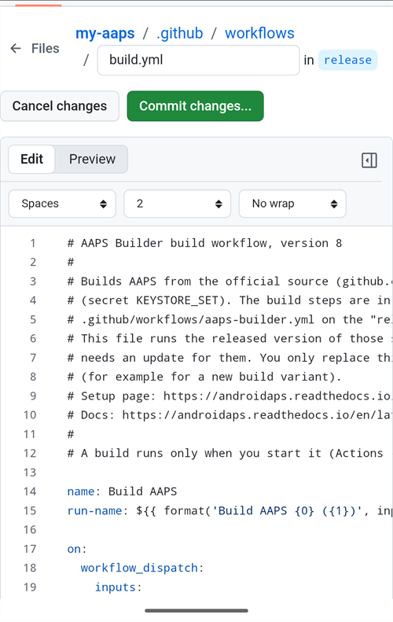
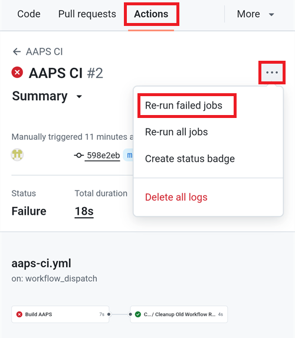
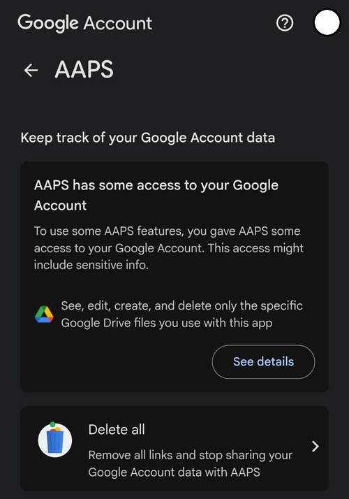

(aaps-ci-troubleshooting)=

# 브라우저 빌드: 문제 해결

```{note}
This page collects troubleshooting tips for the [Browser build](../SettingUpAaps/BrowserBuild.md).
```

(aaps-builder-troubleshooting)=

## AAPS Builder

### Step 1: the repository

(aaps-builder-ts-repo-exists)=

#### "my-aaps already exists in this account"


You already have this repository, for example from an earlier attempt. Close the GitHub tab, keep that name in step 1 of the setup page and go on. If you already did steps 2 and 3 for it, your key is still in it: continue with [step 4](#aaps-builder-step4). If it was made with an earlier version of the setup page, update its workflow once as explained in [Updating AAPS](#aaps-builder-updates). You prefer a fresh start? Type another name, for example `my-aaps-2`, and use the same keystore in step 2.

(aaps-builder-ts-user-not-found)=

#### "No GitHub user with this name"


- 1단계에서 **"No GitHub user with this name"**(이 이름의 GitHub 사용자가 없음)이 표시되는 경우: 이메일이 아니라 GitHub 프로필에 표시된 GitHub 사용자 이름을 입력하십시오.
- **"Build AAPS" 또는 "Run workflow" 버튼이 없거나 저장소가 비어 있는 경우**: 저장소가 템플릿으로 만들어지지 않았습니다. 그 저장소를 삭제하고(**Settings** → 페이지 맨 아래 → **Delete this repository**) **Create my private repository** 버튼으로 [1단계](#aaps-builder-step1)를 다시 하십시오.

### Step 3: the secret

(aaps-builder-ts-404)=

#### "Page not found" (404)


- **설정 페이지가 GitHub를 열 때 "Page not found"(404)가 표시되는 경우**: 같은 브라우저에서 github.com에 로그인하십시오(로그인하지 않으면 GitHub는 비공개 저장소에 대해 404를 표시합니다). 로그인되어 있다면 설정 페이지 1단계의 사용자 이름 또는 저장소 이름이 자신의 저장소와 맞지 않는 것입니다. 이름을 정확히 입력하십시오.

### Step 4: the build

(aaps-builder-ts-workflow-not-found)=

#### "This workflow does not exist"


Right after the repository is created, GitHub may not have read its workflow file yet: **Build AAPS** is missing from the **Actions** tab, and there is no **Run workflow** button. Any small change to the file makes GitHub read it:

1. In your repository, open **Code**, then the folder `.github`, then `workflows`, then the file `build.yml`.
2. Tap the **⋯** menu at the top right of the file, then **Edit file… In place** (on a computer, click the pencil).

   

3. Tap at the very end of the text and add an empty line (Enter). Tap **Commit changes…** at the top.

   

4. Tap **Commit changes** again.

   

5. Open the **Actions** tab again: **Build AAPS** is now in the list of workflows (on a phone, the list opens with the icon at the left of **All workflows**). Tap it, then **Run workflow**.

   

(aaps-builder-ts-build-failed)=

#### The build failed (red cross)

1. On the setup page, tap **Open my builds** and tap the build with the red cross.

   

2. The page of the build shows **Failure**, and which part failed: **AAPS / Check** (the repository, the secret, the version or the variant: nothing was built) or **AAPS / Build AAPS**.

   

3. Scroll down to **Annotations**, with your finger on the text, not on the diagram. The red lines explain the problem: tap **Show more** to read the whole message, then find it below.

   

- **"Secret KEYSTORE_SET is missing"**(KEYSTORE_SET secret이 없음): 설정 페이지의 3단계를 하십시오.
- **빌드가 "This repository is PUBLIC"(이 저장소는 공개 상태입니다)로 멈추는 경우**: 저장소에서 **Settings**(설정) → **General**(일반) → **Danger Zone**(위험 구역) → **Change visibility**(공개 범위 변경) → **Private**(비공개)를 연 다음 다시 빌드하십시오.
- **"Version … does not exist"**: only released versions of **AAPS** can be built, the ones on the [tags page](https://github.com/nightscout/AndroidAPS/tags) of nightscout/AndroidAPS, such as `3.3.2.0`. A branch name such as `dev` doesn't work. Use `latest`, or type a tag exactly as listed.
- **"Variant … is not supported"**(변형 …은 지원되지 않음): 워크플로 파일이 이전 버전입니다. [AAPS 업데이트](#aaps-builder-updates)에 설명된 대로 파일을 바꾸십시오.
- **"The secret is too short"**(secret이 너무 짧음), **"The secret is not a valid code"**(secret이 올바른 코드가 아님) 또는 **"The secret does not contain a keystore"**(secret에 키 저장소가 없음): secret에 잘못된 텍스트를 붙여 넣었습니다. 흔히 `KEYSTORE_SET`이라는 단어 자체나 코드의 일부만 붙여 넣은 경우입니다. 저장소에서 **Settings** → **Secrets and variables** → **Actions**를 열고, `KEYSTORE_SET`을 편집하여 **Copy secret**으로 복사한 긴 코드를 다시 붙여 넣으십시오(설정 페이지를 닫았다면 먼저 설정 페이지의 2단계를 다시 하십시오).
- **"Keystore, password or alias is wrong"**(키 저장소, 비밀번호 또는 별칭이 틀림): 키 저장소의 비밀번호와 별칭을 확인한 다음 설정 페이지의 2단계와 3단계를 다시 하십시오.
- **"Google Drive access has expired or was revoked"**(Google Drive 액세스가 만료되었거나 취소됨): [6단계](#aaps-builder-google-drive)를 다시 하고 `GDRIVE_OAUTH2` secret을 업데이트하십시오.
- **Another error**: [read the build log](#aaps-ci-read-the-logs), then [run the build again](#aaps-ci-rerun). If it fails again the same way, ask for help with the name of the failed step and the error lines. secret의 내용은 절대 공유하지 마십시오.

### Step 5: the app

- **Download 링크가 없거나 GitHub 앱이 열린 경우**: GitHub 앱은 빌드를 다운로드할 수 없습니다. [5단계](#aaps-builder-step5)에 설명된 대로 Chrome에서 빌드를 여십시오. GitHub 링크가 앱에서 열리지 않게 하려면: Android **Settings**(설정) → **Apps**(애플리케이션) → **GitHub** → **Open by default**(기본으로 열기) → **Open supported links**(지원되는 링크 열기)를 끄십시오.

## AAPS-CI 문제 해결

(aaps-ci-read-the-logs)=
### 먼저: 무엇이 잘못되었는지 찾기

빌드가 실패하면 GitHub는 모든 단계의 로그를 남깁니다. 로그를 보면 어느 단계가 왜 실패했는지 알 수 있습니다. 다른 것을 시도하기 전에 로그를 읽으십시오: 이 페이지에서 찾아야 할 것도, 도와주는 사람이 물어볼 것도 오류 메시지입니다.

1. GitHub에 있는 AndroidAPS 사본에서 **Actions**를 여십시오. 실패한 빌드에는 빨간색 X 표시가 있습니다. 그 이름을 누르십시오.

   

2. 실행 요약에 **Failure**(실패)가 표시되고, 그 아래에 실패한 작업(빨간색 X 표시가 있는 **Build AAPS**)이 표시됩니다.

   

3. **Annotations**까지 아래로 스크롤하고 빨간색 **Build AAPS** 줄을 누르십시오.

   

4. 작업이 열립니다. 회색 체크 표시가 있는 단계는 성공한 것입니다. 빨간색 X 표시가 있는 단계가 실패한 단계입니다: GitHub가 이 단계를 열어 줍니다. 그 뒤의 단계는 건너뛰었습니다(회색 원).

   

5. `Error: Process completed with exit code 1.` 바로 위의 줄을 읽으십시오: 문제를 설명합니다. 이 예에서는 **Retrieving Google Drive access token** 단계가 `invalid_grant` 및 `Token has been expired or revoked.`로 실패했습니다. [Google 갱신 토큰(Refresh Token) 만료](#aaps-ci-google-token-expired)를 참조하십시오.

   

```{tip}
도움을 요청합니까? 실패한 단계의 이름과 오류 줄을 공유하십시오(위와 같은 스크린샷이면 충분합니다). secret의 내용은 절대 공유하지 마십시오.
```

(aaps-ci-update-secret)=
#### secret 업데이트

많은 수정은 secret의 값을 바꾸는 것입니다. GitHub에 있는 AndroidAPS 사본에서 **Settings** → **Secrets and variables** → **Actions**로 가서 secret 옆의 연필 아이콘을 누르십시오.


새 값을 입력하거나 붙여 넣고 **Update secret**을 누르십시오. GitHub는 이전 값을 절대 보여 주지 않습니다: 입력란은 항상 비어 있습니다.


(aaps-ci-rerun)=
#### 수정한 뒤 빌드 다시 실행하기

원인을 고친 뒤에는 처음부터 다시 시작할 필요가 없습니다: 실패한 실행을 열고 **...**(오른쪽 위)을 누른 다음 **Re-run failed jobs**를 누르십시오.



**Re-run jobs**를 누르십시오. 평소처럼 **Run workflow**에서 새 빌드를 시작할 수도 있습니다.


(aaps-ci-preparation-web)=
### aaps-ci-preparation 웹 페이지
  - 준비 페이지는 임시 로컬 서버(예: 컴퓨터의 Simple Web Server)가 보여 줍니다. 이 서버는 Google 갱신 토큰도 받습니다.
  - 아래 화면이 보이면 로컬 서버가 멈췄거나 연결할 수 없는 것입니다.
  - 준비 페이지를 닫고 로컬 서버가 실행 중인지 확인한 다음, 2단계와 같은 방법으로 aaps-ci-preparation.html을 다시 열고 남은 단계를 마치십시오. 특히 설정 중에 처음으로 Google 연결을 만들 때 필요합니다.

  

(aaps-ci-google-token-expired)=
### Google 갱신 토큰(Refresh Token) 만료
  - Google OAuth2 갱신 토큰은 6개월 동안 사용하지 않으면 만료됩니다. 다른 경우에도 무효가 될 수 있습니다(예: Google 계정 비밀번호를 바꾸었거나 직접 액세스 권한을 취소한 경우). 자세한 내용은 [Google OAuth2 문서](https://developers.google.com/identity/protocols/oauth2)를 참조하십시오.
  - [빌드 로그](#aaps-ci-read-the-logs)에서 **Retrieving Google Drive access token** 단계가 `invalid_grant` 및 `Token has been expired or revoked.`로 실패합니다:

  

  - Google 갱신 토큰이 만료되었거나 취소되어 빌드가 실패하면, [Google Drive 인증](#aaps-ci-google-drive-auth) 단계를 다시 하여 새 `GDRIVE_OAUTH2` 토큰을 받고, GitHub 저장소에서 [secret을 업데이트](#aaps-ci-update-secret)한 다음 [빌드를 다시 실행](#aaps-ci-rerun)해야 합니다.
  - 인증이 다시 실패하거나 Google이 더 이상 동의를 묻지 않으면, 먼저 Google 계정에서 기존 AAPS 액세스 권한을 삭제하십시오. [아래](#aaps-ci-google-remove-access)를 참조하십시오.

(aaps-ci-google-remove-access)=
### Google 계정에서 AAPS 액세스 권한을 삭제하고 인증을 다시 시작하기
  - Google Drive 인증이 계속 실패하거나 깨끗한 상태에서 다시 시작하려면, 먼저 이전에 AAPS에 준 액세스 권한을 삭제한 다음 인증을 다시 하십시오.
  - 휴대폰에서 [https://myaccount.google.com](https://myaccount.google.com)을 열고 **Security**(보안)를 누른 다음, **Your connections to third-party apps & services**(서드 파티 앱 및 서비스와의 연결)까지 아래로 스크롤하여 연결된 앱 목록을 여십시오. [https://myaccount.google.com/connections](https://myaccount.google.com/connections)로 바로 갈 수도 있습니다.
  - 목록에서 **AAPS**를 누르십시오.

  

  - 이 페이지에는 AAPS에 준 액세스 권한(앱에서 사용하는 Google Drive 파일)이 표시됩니다. 연결을 삭제하려면 **Delete all**(모두 삭제)을 누르고, 먼저 확인하려면 **See details**(세부정보 보기)를 누르십시오.

  

  - 세부정보 페이지에서 **Remove all access**(모든 액세스 권한 삭제)를 누르십시오.

  

  - **Confirm**(확인)을 누르십시오.

  

  - Google에서 AAPS에 더 이상 액세스 권한이 없다고 확인해 줍니다. 이제 AAPS가 연결된 앱 목록에 더 이상 표시되지 않습니다.

  

  - 이제 인증을 깨끗하게 다시 시작하십시오: 준비 페이지와 파일 관리자 앱을 **모두** 닫고, 파일 관리자에서 aaps-ci-preparation.html을 다시 연 다음 [Google Drive 인증](#aaps-ci-google-drive-auth) 단계를 다시 하십시오. Google이 다시 액세스 권한을 허용할지 묻고, 페이지에 새 `GDRIVE_OAUTH2` 토큰이 표시됩니다.
  - GitHub 저장소에서 새 토큰으로 [`GDRIVE_OAUTH2` secret을 업데이트](#aaps-ci-update-secret)한 다음 [빌드를 다시 실행](#aaps-ci-rerun)하십시오.

(aaps-ci-disable-software)=
### OAuth 확인을 방해할 수 있는 소프트웨어 끄기
  - OAuth 키를 받기 전에 휴대폰의 VPN이나 보안 앱(방화벽, 안티멀웨어 등)을 모두 끄십시오.

(aaps-ci-actions-permission)=
### GitHub Actions 권한 설정 확인
  - GitHub Actions 정책이 “Allow all actions and reusable workflows”로 설정되어 있는지 확인하십시오(Settings → Actions → General). 바꾸었다면 옵션 아래의 **Save**를 누르십시오.

  

`actions/checkout@v4` and `actions/setup-java@v4` are not allowed to be used in `xxxxx/AndroidAPS`. Actions in this workflow must be: within a repository owned by `xxxxx`

(aaps-ci-workflow-permissions)=
### GitHub 워크플로 권한 설정 확인
  - 빌드가 아래와 비슷한 "Invalid workflow file" 오류로 바로 실패하면, 저장소의 기본 워크플로 권한이 너무 제한되어 있는 것입니다:

```
Invalid workflow file
The workflow is not valid. .github/workflows/aaps-ci.yml (Line: 361, Col: 3):
Error calling workflow 'xxxxx/AndroidAPS/.github/workflows/cleanup-workflow-runs.yml@...'.
The nested job 'cleanup' is requesting 'actions: write', but is only allowed 'actions: none'.
```

  - Workflow permissions가 “Read and write permissions”로 설정되어 있는지 확인하십시오(Settings → Actions → General → Workflow permissions). 그런 다음 저장하고 빌드 워크플로를 다시 실행하십시오.

  

(aaps-ci-password-special-characters)=
### 키 저장소 비밀번호 확인에서 빌드 실패
  - [빌드 로그](#aaps-ci-read-the-logs)에서 **Validating keystore, alias and password** 단계가 `Either KEYSTORE_BASE64, KEYSTORE_PASSWORD, KEY_PASSWORD, or KEY_ALIAS is incorrect`로 실패하고, 그 뒤에 `Keystore was tampered with, or password was incorrect`가 표시됩니다. 빌드는 여기서 멈춥니다: AAPS를 빌드하기 전에 키 저장소와 비밀번호를 확인합니다.

  

  - 빌드 워크플로는 비밀번호의 모든 문자를 그대로 유지합니다. `KEYSTORE_PASSWORD`와 `KEY_PASSWORD`는 백슬래시나 다른 이스케이프 문자를 추가하지 말고 정확히 그대로 입력하십시오. 백슬래시를 추가했다면 비밀번호를 정확히 그대로 하여 [secret을 업데이트](#aaps-ci-update-secret)하십시오. 아래 예는 잘못된 것입니다: 비밀번호는 `Example2026`인데 백슬래시가 추가되었습니다.

  

  - 비밀번호가 맞는데도 APK 서명 중에 빌드가 계속 실패하고, 비밀번호에 `$`, 백틱, `"` 또는 `\`가 들어 있다면, fork의 워크플로 파일이 2026년 9월보다 오래되어 아직 이 문자들을 해석하는 것입니다. 최신 dev로 [fork를 동기화](#Update-to-new-version-update-your-repo)한 다음 빌드 워크플로를 다시 실행하십시오.
  - 세로 막대 `|`는 특별한 경우입니다. [옵션 1](#aaps-ci-option1)의 준비 페이지는 키 저장소, 비밀번호와 별칭(alias)을 `|`로 구분하여 하나의 `KEYSTORE_SET` secret으로 합치고, 워크플로는 이 문자로 다시 나눕니다. 준비 페이지가 만드는 비밀번호에는 문자와 숫자만 들어 있으므로, 옵션 1에서는 이 문제가 생길 수 없습니다. `|`가 들어 있는 비밀번호로 `KEYSTORE_SET` secret을 직접 만든 경우에만 생길 수 있습니다. 그런 경우에는 `KEYSTORE_SET`을 삭제하고 대신 [옵션 2](#aaps-ci-option2)의 개별 secret을 입력하십시오.
