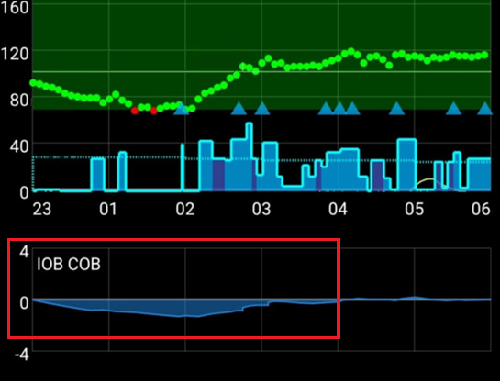
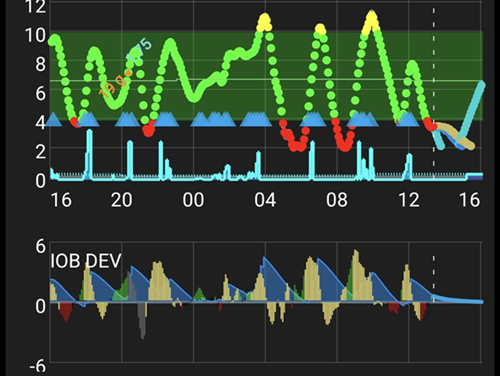
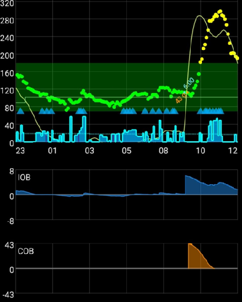

# AAPS 프로파일 조정

```{admonition} This is NOT a medical advice
:class: warning
당뇨병 관리에 대한 지원과 조언은 의료진과 함께 받으십시오.</br>
모든 **AAPS** 목표를 따라 [**프로파일**을 올바르게 설정한](https://androidaps.readthedocs.io/en/latest/SettingUpAaps/YourAapsProfile.md) 다음에만 이 가이드를 사용하십시오.
```

이 가이드는 주어진 __프로파일__에서 OpenAPS 알고리즘 결과의 논리를 설명합니다. 또한 어떤 상황이나 패턴이 관찰될 때 **AAPS**에서 어떤 값을 조정할 수 있는지에 대한 정보를 제공합니다. 아래의 기저 테스트에 대한 제안은 의료진의 조언과 다를 수 있습니다.

**폐쇄 루프**를 사용하면 기저 테스트가 더 쉬워질 수 있고, __프로파일__ 기저가 너무 강한 경우 저혈당 위험을 크게 줄일 수 있습니다.

## 프로파일 설정 변경 방법

1. 아래의 __AAPS__ 권장 설정과 조언을 읽고 이해했는지 확인하십시오. 이 조언을 따르지 않으면 조정 과정이 어려워지고 잘 조정된 __프로파일__을 얻을 가능성이 낮아질 수 있습니다
2. **며칠 동안** __혈당__과 __IOB__에 어떤 일이 일어나는지 주의 깊게 관찰하고 비교하십시오.
3. **AAPS**에서 (거의) 매일 같은 시간 무렵에 일어나는 패턴을 잘 살펴보십시오.
4. 며칠 동안 관찰하는 것이 중요합니다. 하루 동안 관찰한 데이터만으로 __프로파일__ 조정을 결정하면 결과가 나쁜 경우가 많습니다.
5. 반복되는 패턴을 확인한 다음에만(예: 오후 1시에 __혈당__이 급상승하거나 __IOB__ 값이 음수가 됨) __프로파일__을 조금씩 바꾸기 시작하십시오.
6. 한 번에 한 가지만 바꾸는 것이 중요합니다. 예: 오후 1시 무렵의 기저를 10% 높입니다.
7. 바꾼 뒤에는 매번 다음 며칠 동안 __혈당__과 __IOB__에 미치는 영향을 관찰하는 것이 중요합니다.
8. 이 과정을 반복하십시오: 관찰하고, 결정하고, 필요하면 다시 조정하십시오

서두르지 말고 천천히 하십시오!

## 기저 조정 중 권장 설정과 조언

- 모든 테스트는 [폐쇄 루프를 켠 상태](#AapsScreens-loop-status)에서 하십시오.
- **모든 [자동화](../DailyLifeWithAaps/Automations.md)를 <u>끄십시오</u>**
- **[DynISF](#Open-APS-features-DynamicISF), [AutoISF](#Open-APS-features-auto-isf), [AutoSens](#Open-APS-features-autosens)를 <u>끄십시오</u>**. 그러면 이 기능들이 프로파일을 조정하려고 하지 않습니다.
- 테스트하는 동안에는 수동 사용자 동작(수동 볼러스, 임시 목표 등)을 하지 마십시오: 시스템이 **프로파일** 설정만 사용하게 하십시오.
- [추가 그래프](#AapsScreens-section-g-additional-graphs): 그래프 1에서는 활성 인슐린 (IOB), 활성 탄수화물 (COB)(그리고 민감도 변화)를 사용하십시오. 그래프 2에서는 편차와 혈당 영향 (BGI)을 사용하십시오. 조언을 구할 때는 스크린샷에 항상 이 그래프들을 포함하십시오.
- COB=0[*](#profiletuning-cob-zero)

데이터에 영향을 주어 잘못된 결론으로 이어질 수 있으므로 되도록 피해야 할 다른 사항:
- 신체 활동 없음.
- 스트레스 없음.
- 질병 없음.
- 매우 높거나 낮은 기온 같은 극단적인 날씨 없음.
- 실패한 펌프 세션이나 CGM 세션 없음.
- 입력하지 않은 탄수화물 없음.

다음도 참고하십시오:
- [기저 주입량 프로파일](#your-aaps-profile-basal-rates)이 올바르면, COB=0[*](#profiletuning-cob-zero)이고 IOB=0인 상태로 목표 혈당에 있을 때 **ISF**와 관계없이 계속 목표 혈당에 머뭅니다(**ISF**는 **혈당** 목표보다 높을 때만 사용됩니다).
- 현재 **IOB**뿐 아니라 **IOB** 그래프도 확인하여 지난 몇 시간 동안 **IOB**가 어떻게 변했는지 관찰해야 합니다.

(profiletuning-cob-zero)=

***COB = 0**

식사가 소화되어 몸에 탄수화물이 더 이상 남아 있지 않다는 뜻입니다.

**AAPS**는 [아직 활성 탄수화물이 있는데도 COB=0](../DailyLifeWithAaps/CobCalculation.md)으로 표시할 수 있습니다.

## [프로파일](../SettingUpAaps/YourAapsProfile.md) 정의

**프로파일이 너무 강하다**는 것은 다음 중 몇 가지가 함께 있다는 뜻입니다:

- [ISF](#your-aaps-profile-insulin-sensitivity-factor) 숫자가 너무 작습니다.
- [기저](#your-aaps-profile-basal-rates) 숫자가 너무 큽니다.
- [I:C](#your-aaps-profile-insulin-to-carbs-ratio) 숫자가 너무 작습니다.

## IOB 관찰

*참고: Nightscout 보고서의 Loopalyzer IOB 그래프로 여러 날의 IOB를 볼 수도 있습니다.*

며칠 뒤 다음 패턴이 관찰되면 다음 변경을 고려하십시오:

### IOB 양수

- **프로파일** 기저가 충분히 강하지 않을 수 있습니다(입력하지 않은 음식, 질병, 나쁜 주입 부위 흡수 등 때문일 수도 있습니다)


### IOB 음수

- 기본 기저가 너무 강합니다.
- 이전 운동/신체 활동의 영향일 수 있습니다.



- 이전 식사: 볼러스가 너무 많았음(그 결과 매우 긴 0 임시 기저가 생김)


## 혈당 목표 관찰

### 높은 상태에서 내려오지 않음

- __ISF__ 숫자가 높아서 충분히 강하지 않습니다(계산된 인슐린이 너무 약함)


- __프로파일__ 기저가 충분히 강하지 않을 수 있습니다(**SMB**가 사용할 "기저 여유분"이 부족함)
- 안전 장치([MaxIOB](#Open-APS-features-maximum-total-iob-openaps-cant-go-over)?)가 작동하여 인슐린 주입을 제한하고 있을 수 있습니다. **APS** 플러그인 화면(**구성 → APS → 플러그인 열기**)에서 확인하십시오. [SMB](#Open-APS-features-super-micro-bolus-smb)를 보십시오.
- 기술적 문제: 주입 부위 흡수, 주입 세트, ...

### 낮은 상태에서 올라오지 않음

- __ISF__가 너무 강하므로 숫자를 더 높여야 합니다
- __프로파일__ 기저가 너무 강함(IOB도 음수인 경우)

### 롤러코스터 (오르내림)

- **ISF**가 너무 강합니까? [AAPS 프로파일](#your-aaps-profile-insulin-sensitivity-factor)을 보십시오



## 식후 혈당 관찰

### 빠르게 상승하고 혈당이 높아짐

- 음식에 빠르게 흡수되는 탄수화물이 들어 있습니다(과일 주스 등).
- 사전 볼러스를 하거나 사전 볼러스를 조금 더 일찍 하는 것을 고려하십시오.
- 볼러스(IC 또는 주입 %)가 충분히 강하지 않습니다.



### 빠르게 상승한 뒤 혈당이 낮아짐

- 사전 볼러스를 고려하십시오. **프로파일**이 너무 공격적일 수 있습니다(상승에 대한 과잉 교정)
- 볼러스가 너무 강합니다.


## [I:C 계산 방법](#your-aaps-profile-insulin-to-carbs-ratio)

1. 먼저 **프로파일**의 기본 기저 설정이 올바라야 합니다.
2. 목표 혈당에서 시작하십시오. 음수 IOB가 없는 것이 더 좋습니다.
3. **관리 → 펌프**(또는 펌프 이력)에서 총 주입 인슐린을 기록하고 이것을 시작 인슐린이라고 하십시오. 알고 있는 양의 탄수화물을 매우 정확하게 계량하고, 시작 시간과 시작 IOB를 기록하십시오. 그런 다음 현재 설정된 I:C로 마법사를 사용하여 탄수화물과 볼러스 정보를 **AAPS**에 입력하십시오. 탄수화물을 먹는 것을 잊지 마십시오 ;)
4. 몇 시간 뒤 COB=0[*](#profiletuning-cob-zero)이 되고 다시 목표 혈당으로 돌아오면 종료 시간을 기록하고 종료 IOB를 적으십시오. 앞에서와 같이 총 주입 인슐린을 확인하고 이것을 종료 인슐린이라고 하십시오. *참고: 소화 시간보다 길기만 하면 기간의 길이는 중요하지 않습니다*
5. 시작 인슐린과 종료 인슐린의 차이에서 (종료 IOB - 시작 IOB)의 차이를 빼거나 더하십시오. 그런 다음 **프로파일** 설정으로 계산한 기저 인슐린을 빼십시오.
6. __혈당__이 목표 범위 안에 있으면 탄수화물을 “소화”하는 데 쓰인 총 인슐린을 얻게 됩니다. **I:C**를 계산하십시오.

### I:C 계산 설명

- 기본 기저 주입량이 올바른 **프로파일**이라면 어떤 기간에도 목표 혈당을 유지하고 IOB가 0에 가까워야 합니다. **프로파일** 기저만 받습니다.
- 여기에 탄수화물과 볼러스를 더합니다. 몸이 탄수화물을 모두 소화하고 **혈당**이 목표로 돌아올 때까지 기다립니다. 사용한 인슐린은 기저 + 탄수화물에 필요한 인슐린의 합입니다. (**프로파일**을 사용하여) 기저에 쓰인 인슐린을 계산하면, 나머지가 탄수화물을 소화하는 데 쓰인 인슐린입니다.
- 기간이 너무 짧으면 소화되지 않은 탄수화물이 남아 있어 "탄수화물에 필요한 인슐린"이 틀리게 됩니다.
- 기간이 너무 길어도 나쁜 일은 일어나지 않습니다. 탄수화물을 모두 쓰게 되고 기저를 더 받게 됩니다. 마지막에 총 사용 인슐린에서 기저를 빼므로, 길어진 기간(더 많은 기저 사용)은 결과에 영향을 주지 않습니다.

원래 @Robby (Discord)가 **AAPS 프로파일** 조정을 돕는 팁과 요령으로 작성했으며, 커뮤니티가 검토하고 편집했습니다(감사합니다!).
