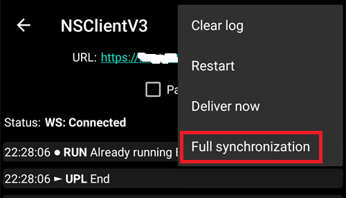
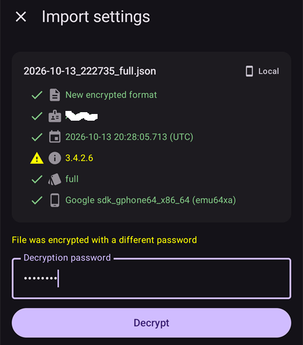
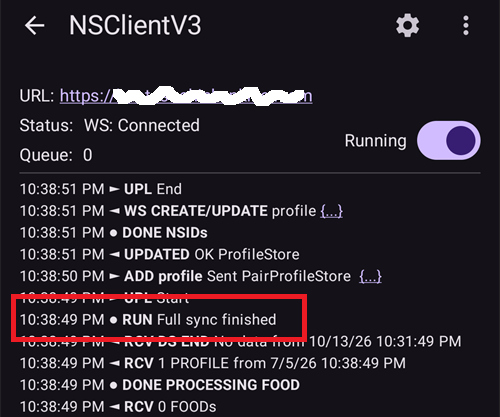

(reinstall-aaps)=
# 새 키 저장소로 AAPS 재설치하기

모든 **AAPS** apk는 **키 저장소**로 서명됩니다. 업데이트는 **같은 키 저장소**로 서명된 경우에만 현재 **AAPS** 위에 설치됩니다. 이 경우 모든 설정과 데이터가 유지됩니다. 그래서 키 저장소와 비밀번호를 안전한 곳에 보관하는 것이 좋습니다.

이전과 다른 키 저장소로 서명된 apk를 설치하려고 하면 설치에 실패했다는 오류 메시지가 나타납니다!

(reinstall-aaps-when)=
## 언제 재설치해야 합니까?

새 apk가 다른 키 저장소로 서명된 경우 **AAPS**를 삭제하고 다시 설치해야 합니다. 예를 들어:

- 이전 키 저장소나 그 비밀번호를 찾을 수 없습니다.
- 새 키 저장소를 만들었습니다. 예를 들어 [브라우저 빌드의 옵션 1](../SettingUpAaps/BrowserBuildKeystore.md)이나 [AAPS Builder](../SettingUpAaps/BrowserBuildAapsBuilder.md)의 **Create a new key**(새 키 만들기)로 만든 경우입니다.
- 새 컴퓨터에서 빌드하면서 키 저장소를 그 컴퓨터로 복사하지 않았습니다.

키 저장소가 아직 있으면 이 페이지는 필요하지 않습니다. 그 키 저장소를 다시 사용하여 [**AAPS**를 그대로 업데이트](../Maintenance/UpdateToNewVersion.md)하십시오.

(reinstall-aaps-before)=
## 시작하기 전에

- **AAPS**를 삭제하면 모든 설정, [목표](../SettingUpAaps/CompletingTheObjectives.md), 현재 펌프 연결이 삭제됩니다. **설정 파일**을 가져오면 이것들을 되찾을 수 있으므로 최근 설정 파일이 있는지 확인하십시오.
- 설정 파일에는 처치 이력과 혈당 이력이 들어 있지 않습니다. [Nightscout](../SettingUpAaps/SettingUpTheReportingServer.md)에 업로드하고 있다면 재설치 후에 이 이력을 다시 불러올 수 있습니다(8단계).
- [**마스터 비밀번호**](#Preferences-master-password)가 필요합니다. 설정 파일은 이 비밀번호로 암호화됩니다.
- **Omnipod 및 Medtrum 사용자:** 먼저 [튜브 없는 펌프](#ExportImportSettings-tubeless-pumps)를 읽으십시오. 설정 파일은 지금 착용하고 있는 Pod 또는 패치를 사용하는 동안 내보낸 것이어야 합니다.
- 필요하면 시작하기 전에 [CGM/혈당 출처 수신 앱을 설정](../Getting-Started/CompatiblesCgms.md)하십시오.

(reinstall-aaps-steps)=
## 단계

그림은 **AAPS** 3.4(1~3단계)에서 **AAPS** 4(6~8단계)로 옮기는 과정을 보여 줍니다. 다른 버전은 조금 다르게 보입니다.

(reinstall-aaps-export)=
### 1. 설정 내보내기

휴대폰에 현재 설치된 **AAPS**로 설정을 내보내십시오. 자세한 내용은 [설정 내보내기](#ExportImportSettings-Settings-Export)를 보십시오.

**AAPS** 3.4에서: **정비**를 열고 **Export options**(내보내기 옵션)를 누르십시오. **User Settings**(사용자 설정)에서 **Local Storage**(로컬 저장소)를 선택하고 **확인**을 누르십시오.

*참고: 안전을 위한 백업 사본을 두기 위해 [클라우드 저장소](#preferences-maintenance-cloud)도 사용할 수 있습니다. 좋은 생각이지만, 설정을 빨리 복구할 수 있도록 로컬 저장소도 유지하십시오.*

이제 버튼에 **Export settings (local)**(설정 내보내기 (로컬))이라고 표시됩니다. 이 버튼을 누르십시오.

**AAPS**가 만들 파일의 이름을 보여 줍니다. **확인**을 누르고 마스터 비밀번호를 입력한 다음 **확인**을 누르십시오.

**AAPS** 4에서: **정비**를 열고 **설정 내보내기** 옆의 **로컬** 칩을 선택한 다음 **설정 내보내기**를 누르십시오.

(reinstall-aaps-copy)=
### 2. 설정 파일을 휴대폰 밖으로 복사하기

파일은 [**AAPS** 디렉터리](#SetupWizard-StoragePermission)의 **preferences** 폴더에 있으며, 이름은 `2026-10-13_222735_full.json`과 같은 형식입니다. 파일을 외부 장소(예: 컴퓨터, 클라우드 저장소 서비스...)에 복사하거나 업로드하십시오. 보통 파일은 삭제 후에도 휴대폰에 남아 있지만, 만일을 위해 다른 곳에도 사본을 보관하십시오.

(reinstall-aaps-nightscout-before)=
### 3. Nightscout와 동기화하기

이 단계는 필수는 아니지만 [DynISF](#Open-APS-features-DynamicISF)를 사용한다면 권장합니다. 플러그인에 필요한 데이터를 쌓기 위해 5일을 기다리지 않고 현재 설정으로 바로 다시 시작할 수 있습니다. NSClient V3가 [활성화되고 구성](../SettingUpAaps/SettingUpTheReportingServer.md)되어 있어야 합니다.

삭제하기 전에 Nightscout에 모든 데이터가 있는지 확인하십시오.

**NSClient**를 열고 화면 아래쪽의 **전체 동기화** 버튼을 누른 다음 **확인**을 누르십시오.

*참고: 걸리는 시간은 Nightscout 호스팅 서비스에 따라 다릅니다.*

그런 다음 **AAPS**가 데이터베이스 정리를 제안합니다. **확인**을 누르면 3개월보다 오래된 데이터가 휴대폰에서 제거되어 동기화가 훨씬 빨라집니다. **취소**를 누르면 정리하지 않고 동기화합니다. 어차피 앱을 삭제하면 휴대폰의 데이터베이스는 삭제되므로 둘 다 괜찮습니다.

동기화가 끝날 때까지 **AAPS**를 실행 상태로 두십시오.

(reinstall-aaps-build)=
### 4. 새 apk 빌드하기

새 키 저장소로 서명된 새 apk를 [빌드](../SettingUpAaps/BuildingAaps.md)하고 휴대폰으로 옮기십시오.

(reinstall-aaps-uninstall)=
### 5. AAPS 삭제하기

휴대폰의 **Settings**(설정) > **Apps**(애플리케이션) > **AAPS**에서 **Uninstall**(삭제)을 누르고 **OK**(확인)로 확인하십시오.

(reinstall-aaps-install)=
### 6. 새 AAPS 설치하고 시작하기

새 apk를 [설치](../SettingUpAaps/TransferringAndInstallingAaps.md)하고 **AAPS**를 시작하십시오. [설정 마법사](../SettingUpAaps/SetupWizard.md)가 **AAPS**에 필요한 권한을 요청합니다. 각 권한마다 **허용**을 누르십시오. 이렇게 하면 [배터리 최적화](#setup-wizard-bluetooth-battery-optimisation)도 다시 꺼집니다.

**AAPS 디렉터리**에서는 이전과 같은 **AAPS** 폴더(안에 **preferences** 폴더가 있는 폴더)를 선택하고 **Use this folder**(이 폴더 사용)와 **Allow**(허용)를 누르십시오.

**AAPS**가 내보낸 설정을 찾으면 설정 마법사에 [저장된 설정이 있습니다](#setup-wizard-import-settings) 화면이 나타나며, 여기에서 설정을 가져올 수 있습니다. 마법사를 닫고 아래 설명처럼 **정비**에서 가져올 수도 있습니다.

(reinstall-aaps-import)=
### 7. 설정 가져오기

설정 파일이 더 이상 휴대폰에 없으면 **AAPS** 디렉터리의 **preferences** 폴더로 다시 복사하십시오.

메뉴(☰) > **정비**를 열고 **설정 가져오기** 옆의 **로컬** 칩을 선택한 다음 **설정 가져오기**를 누르십시오.

목록에는 각 파일의 **AAPS** 버전과 파일이 얼마나 오래되었는지가 표시됩니다. 1단계에서 내보낸 파일을 선택하십시오.

새 **AAPS**에서 먼저 마스터 비밀번호를 설정할 필요는 없습니다. 내보낼 때 사용한 마스터 비밀번호를 **해독 비밀번호**에 입력하고 **해독**을 누르십시오. **파일이 다른 비밀번호로 암호화되었습니다**라는 메시지는 정상입니다. 새 **AAPS**는 아직 비밀번호를 모르기 때문입니다. 가져오기를 하면 다른 설정과 함께 비밀번호도 복원됩니다.

**펌프 설정도 교체**를 선택하십시오. 선택하지 않으면 펌프와 펌프 설정이 복원되지 않습니다. Omnipod 및 Medtrum 사용자: 현재 Pod 또는 패치를 사용하는 동안 내보낸 파일인 경우에만 선택하십시오([튜브 없는 펌프](#ExportImportSettings-tubeless-pumps) 참조).

**가져오기**를 누른 다음 **확인**을 눌러 설정을 적용하고, **설정이 적용됨**에서 다시 **확인**을 누르십시오.

(reinstall-aaps-nightscout-after)=
### 8. Nightscout에서 이력 되찾기

메뉴(☰) > [**구성**](../SettingUpAaps/ChangeAapsConfiguration.md) > **통신**을 열고 **NSClientV3** 아래의 **플러그인 열기**를 누르십시오. 상태가 **연결됨**으로 표시되는지 확인하십시오. 그렇지 않으면 [NSClient 문제 해결](TroubleshootingNsClient.md)을 보십시오.

화면 아래쪽의 **전체 동기화** 버튼을 누르고 **확인**을 누르십시오. 데이터베이스가 새것이므로 정리 질문에는 어느 쪽으로 답해도 됩니다.

**AAPS**가 Nightscout에서 데이터를 불러옵니다. 완료되면 로그에 **Full sync finished**가 표시됩니다.

(reinstall-aaps-check)=
### 9. 확인하고 루프 계속하기

펌프가 연결되어 있고 CGM 값이 들어오는지 확인한 다음 계속 루프를 사용하십시오.

(reinstall-aaps-afterwards)=
## 그 후

앞으로는 항상 새 키 저장소를 계속 사용하고, 키 저장소와 비밀번호를 휴대폰이 아닌 안전한 곳에 보관하십시오. [백업 만들기](../Maintenance/ExportImportSettings.md)를 보십시오.
