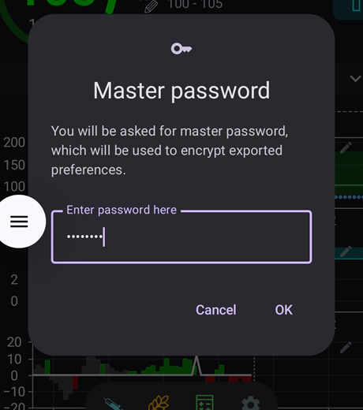
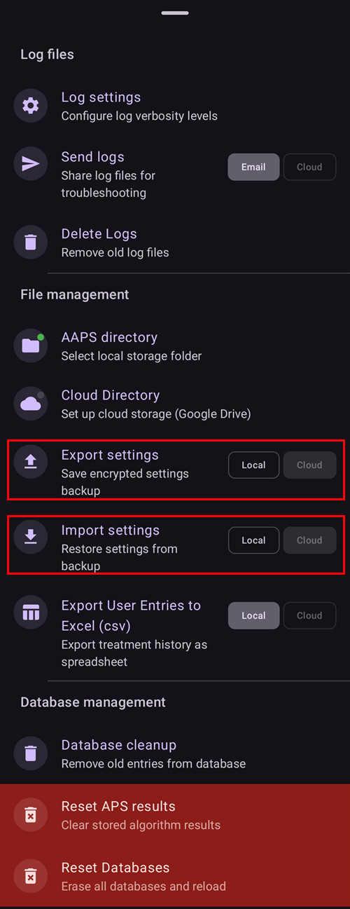

# 백업 만들기와 복원하기

휴대폰에 AAPS를 설치하면, 휴대폰은 매일 의존하는 "의료 기기"가 됩니다. 휴대폰이 고장 나거나 도난당하거나 분실될 때를 대비하여 비상 백업 계획을 세워 두는 것을 강력히 권장합니다. 따라서 "만약 이런 일이 생긴다면?"이라고 스스로 물어보며 미리 대비하는 것이 중요합니다.

AAPS 설정을 기존 휴대폰이나 새 휴대폰에 복원하려면, 다음 항목을 안전한 장소(휴대폰이 아닌 곳)에 보관하는 것이 중요합니다. 최소한 두 개의 별도 백업을 보관하는 것이 좋습니다: 로컬 하드 드라이브, USB 메모리, 그리고 (권장) Google Drive나 Microsoft 365 OneDrive 같은 클라우드 저장소. 백업을 클라우드에 보관하면, 언제 어디서나 휴대폰에서 설정 복원에 필요한 모든 것에 접근할 수 있습니다.

예비 백업 휴대폰을 마련하고 AAPS 복원을 연습하여, 백업 휴대폰이 제대로 작동하는지 확인하는 것을 고려하십시오. 이 단계를 거치면 비상 계획이 효과가 있고, 주 휴대폰을 사용할 수 없게 되어도 AAPS를 끊김 없이 계속 사용할 수 있다는 확신을 가질 수 있습니다.

```{admonition} Android backups and phone-transfer tools do not carry your AAPS settings
:class: warning
**AAPS** 4.0부터 설정은 휴대폰의 암호화된 저장소에 보관되며, Google 백업과 새 휴대폰으로의 휴대폰 간 전송에는 포함되지 않습니다. 설정을 옮기는 유일한 방법은 이 페이지에서 설명하는 설정 내보내기입니다.
```

복원하려면 다음 항목을 준비해 두는 것이 중요합니다:

- **Android Studio 키 저장소 파일**과 해당 **비밀번호**: AAPS .APK 설치 파일을 (다시) 빌드하는 데 필요합니다.
- 최근 **AAPS 설치 .APK** 사본
- 최근 **설정 내보내기** 파일: 중요한 설정(목표 포함!)을 복원하는 데 필요합니다.
- **AAPS 마스터 비밀번호**
- 추가 유틸리티의 백업: 예를 들어 BYODA 및/또는 xDrip.
- 사용 환경에 대한 개인 메모.

아래는 백업해 두기를 권장하는 항목입니다.

## 백업 만들기

### APK를 빌드할 때 사용한 컴퓨터의 키 저장소 파일
Android Studio에서 .APK 설치 파일을 빌드할 때 **키 저장소 파일과 비밀번호로 .APK 설치 파일에 서명**합니다. 현재 설치된 AAPS를 업데이트하려면, 처음 설치할 때 사용한 것과 같은 키 저장소로 업데이트 .APK 설치 파일에 서명해야 합니다. 업데이트할 때는 모든 설정과 AAPS 데이터베이스가 유지됩니다. 이것이 없으면 먼저 현재 앱을 삭제한 다음 AAPS를 [재설치](#reinstall-aaps)하고 다시 구성해야 합니다.

키 저장소와 비밀번호를 보관해 두면 나중에 APK를 업데이트하기가 훨씬 쉬워집니다. 특히 새 컴퓨터에서 앱을 빌드해야 할 때 그렇습니다. 새 APK를 빌드할 때 키 저장소를 사용하는 방법은 [AAPS 업데이트](../Maintenance/UpdateToNewVersion.md) 섹션을 참조하십시오.

**백업 시기:** 키 저장소는 **AAPS** .APK 설치 파일을 처음 빌드한 후에 백업해야 합니다.

**백업 방법:** 키 저장소 경로를 찾으십시오. 기억나지 않으면 Android Studio에서 **Build > APK > Next**를 선택하여 찾을 수 있습니다. 경로는 “Key store path”에 표시됩니다. 파일 탐색기로 이 경로로 이동하여 키 저장소 파일(파일 확장자 `.jks`로 끝남)의 사본을 만드십시오. 컴퓨터를 사용할 수 없게 될 경우에 대비하여 안전한 클라우드 위치에 저장하십시오. 키 저장소 비밀번호, 키 별칭(key alias), 키 비밀번호도 꼭 기록해 두십시오.

### 가장 최근 APK의 사본
메인 **AAPS** 휴대폰을 분실하거나 휴대폰이 손상된 경우, APK 사본이 있으면 새 휴대폰에서 **AAPS**를 빠르게 다시 사용할 수 있습니다. 참고: 아래에 설명한 대로 설정도 백업해 두어야 합니다.

**백업 시기:** 메인 **AAPS** 휴대폰에 설치한 가장 최근 APK의 백업을 보관해야 합니다. 어떤 이유로든 이전 버전으로 되돌려야 할 경우에 대비하여 이전 버전 하나를 함께 보관하는 것도 좋습니다.

**백업 방법:** Android Studio로 APK를 빌드한 컴퓨터에 사본을 보관하십시오. 또한 클라우드 플랫폼에 설치 APK 사본을 보관하는 것을 권장합니다. 필요할 때 두 백업을 모두 찾을 수 있는지 확인하십시오. 이 백업을 보관할 전용 폴더를 만드는 것을 고려하십시오.

### AAPS 설정 파일('Preferences'라고도 함)

```{admonition} Where are preferences stored on my phone?
:class: tip
설정은 [AAPS 설정 마법사](#SetupWizard-StoragePermission)에서 선택한 **AAPS 디렉터리**에 있습니다.</br>
**정비** 화면(**메뉴**(☰) > **정비**)에서 **AAPS 디렉터리**를 변경할 수도 있습니다. [로컬 AAPS 디렉터리 설정](#preferences-maintenance-logdirectory)을 참조하십시오.
```

APK 설치 파일 사본(위 참조)과 **설정** 파일이 있으면 기존 휴대폰이나 새 휴대폰에서 빠르게 다시 사용할 수 있습니다.

**설정** 파일은 AAPS 앱을 사용자의 구성에 맞게 조정하는 데 사용됩니다. 여기에는 **구성** 설정, 목표 상태, 외부 서비스 통신 설정(예: Nightscout, Tidepool), 자동화, 프로파일 같은 정보가 포함됩니다.

AAPS 설정을 파일로 내보내 두면 특정 시점의 구성으로 복원할 수 있습니다. 앞에서 말했듯이, 내보내기 파일에는 모든 구성 설정 외에 목표의 진행 상태도 들어 있으며, AAPS를 **(재)설치**할 때 이를 복원해야 합니다. 이것이 없으면 폐쇄 루프를 사용하기 위해 모든 목표를 처음부터 다시 완료해야 합니다. 설정 파일로 "마지막으로 정상이었던" 설정을 복원하여 구성 변경을 되돌릴 수도 있습니다.

**AAPS 설정을 백업해야 하는 시기:**
* 목표를 완료할 때마다 백업하여 진행 상황을 잃지 않도록 하십시오. _**설정** 사본이 없으면, AAPS를 다시 설치하거나 휴대폰을 교체해야 할 때 모든 목표를 다시 완료해야 합니다._

* 구성을 크게 변경할 계획이 있을 때마다(SMB 설정 변경, 인슐린 종류 변경, 펌프 변경, 자동화 변경) 변경 전과 후에 **설정**을 백업해야 합니다. 이렇게 하면 가장 최근 설정과 함께 변경 전 설정의 사본도 가지게 되므로, 필요하면 이전 설정으로 되돌릴 수 있습니다.

* 튜브 없는 펌프(예: Omnipod, Medtrum) 사용자만 해당: **설정** 파일에는 현재 Pod의 연결 정보가 들어 있으며, 새 휴대폰에서 그 Pod와 다시 연결하는 데 사용할 수 있습니다. 현재 Pod를 시작한 후에 내보낸 설정 사본이 없으면, 현재 휴대폰을 교체해야 할 때 새 Pod를 시작해야 합니다.

**직접 백업하는 방법:**

1. **설정**을 처음 가져오거나 내보내는 경우에는 [설정 > 보안](#Preferences-master-password)에서 마스터 비밀번호를 설정해야 합니다. 비밀번호를 설정하고 안전한 곳에 기록해 두십시오. _이 비밀번호가 없으면 **설정** 백업에 접근할 수 없습니다._

2. **AAPS** 메인 화면에서 **메뉴**(☰) > **정비**를 여십시오. **설정 내보내기** 옆의 **로컬** 및 **클라우드** 칩으로 파일을 저장할 위치를 선택한 다음(아래 **설정 내보내기 또는 가져오기** 참조), **설정 내보내기**를 누르십시오. **AAPS**가 파일을 저장할 위치를 보여 줍니다: **로컬**이면 파일 이름, **클라우드**이면 **Google Drive**. **확인**을 누르십시오.

   

   

   위에서 설정한 마스터 비밀번호를 입력하고 **확인**을 누르십시오.

   

   **설정을 내보냈습니다**(로컬) 또는 **클라우드 내보내기 성공**(클라우드) 메시지가 내보내기가 끝났음을 알려 줍니다.

   

   

3. 휴대폰의 파일 탐색기(보통 “파일” 또는 “내 파일”이라고 함)를 사용하여 내장 저장공간 > AAPS > preferences로 이동하십시오. 여기에서 내보낸 모든 설정 파일의 사본을 볼 수 있습니다. 파일 이름은 `YYYY-MM-DD_Time_appname.json` 형식입니다. 이 파일을 원하는 클라우드 플랫폼에 업로드하십시오. 그런 다음 클라우드 플랫폼에서 로컬 컴퓨터로도 사본을 다운로드하십시오.

(ExportImportSettings-Settings-Export)=

## 설정 내보내기

```{admonition} Where are preferences stored on my phone?
:class: tip
설정은 [AAPS 설정 마법사](#SetupWizard-StoragePermission)에서 선택한 **AAPS 디렉터리**에 있습니다.</br>
**정비** 화면(**메뉴**(☰) > **정비**)에서 **AAPS 디렉터리**를 변경할 수도 있습니다. [로컬 AAPS 디렉터리 설정](#preferences-maintenance-logdirectory)을 참조하십시오.
```

정기적으로 설정을 내보내는 것을 권장합니다. 특히 구성을 변경하기 전과 후에 내보내십시오. 내보내기는 **직접 하거나 (권장) 자동화로** 할 수 있습니다. AAPS 마스터 비밀번호를 꼭 기록해 두고, 설정 파일을 휴대폰 밖으로(예: 클라우드 저장소로) 복사하여 백업하십시오.

**참고**: _내보낸 설정은 AAPS 마스터 비밀번호로 암호화됩니다. 내보낼 때 사용한 마스터 비밀번호가 없으면 설정 파일을 가져올 수 없습니다!_

### 설정 내보내기 또는 가져오기
설정을 내보내거나 가져오려면 **메뉴**(☰)를 열고 **정비**를 선택하십시오. **파일 관리** 아래에서, **설정 내보내기**와 **설정 가져오기** 옆의 **로컬** 및 **클라우드** 칩으로 설정 파일을 저장하거나 읽어 올 위치를 선택합니다: **로컬**은 휴대폰의 AAPS 디렉터리이고, **클라우드**는 [클라우드 디렉터리](#preferences-maintenance-cloud)를 설정한 후에 사용할 수 있습니다. 칩을 누르면 켜지거나 꺼집니다. 항상 하나 이상은 선택되어 있으며, 두 행은 같은 선택을 공유합니다. 그런 다음 **설정 내보내기** 또는 **설정 가져오기** 자체를 눌러 시작하십시오.



(ExportImportSettings-Automating-Settings-Export)=
### 설정 내보내기 자동화

설정 내보내기를 자동화하려면 [(**자동화 참조**)](../DailyLifeWithAaps/Automations.md#automating-preference-settings-export) [**설정** > **정비**](#preferences-maintenance-settings)를 열고 **자동 설정 내보내기**를 펼친 다음 **자동 설정 내보내기 활성화**를 켜십시오.

이제 [자동화](../DailyLifeWithAaps/Automations.md#automating-preference-settings-export)를 설정하여 정기적으로(_예:_ 매주) 또는 Pod 교체 후에 설정을 내보낼 수 있습니다.

_**참고:** 설정을 가져올 때는 항상 AAPS 마스터 비밀번호를 입력해야 합니다!_


(ExportImportSettings-restoring-from-your-backups-on-a-new-phone-or-fresh-installation-of-aaps)=
## 새 휴대폰 또는 새로 설치한 AAPS에서 백업으로 복원하기

```{admonition} Where are preferences stored on my phone?
:class: tip
설정은 [AAPS 설정 마법사](#SetupWizard-StoragePermission)에서 선택한 **AAPS 디렉터리**에 있습니다.</br>
**정비** 화면(**메뉴**(☰) > **정비**)에서 **AAPS 디렉터리**를 변경할 수도 있습니다. [로컬 AAPS 디렉터리 설정](#preferences-maintenance-logdirectory)을 참조하십시오.</br>
**AAPS**가 그 디렉터리에 접근할 수 없게 되면(재설치 후 또는 앱 저장공간을 지운 후에 생길 수 있습니다), **AAPS 디렉터리에 대한 접근 권한이 없어져**로 시작하는 알림을 표시하고, [디렉터리를 다시 선택](#preferences-maintenance-logdirectory)할 때까지 휴대폰에 설정을 저장하지 않습니다.
```

APK와 **설정**의 백업을 새 휴대폰에 불러오려는 경우, 또는 어떤 이유로 기존 휴대폰에서 APK를 삭제하고 다시 설치해야 했던 경우에 이 안내를 따르십시오.

_같은 키 저장소로 빌드한 APK로 **AAPS**를 업데이트하는 경우에는 이 과정을 따를 필요가 없습니다. 그래도 업데이트를 적용하기 전에 백업을 만드는 것이 좋습니다._

원래 키 저장소를 잃어버렸거나 교체한 후에(예: 키 저장소를 옮기지 않고 새 빌드 컴퓨터를 사용하는 경우) **AAPS**를 업데이트하는 경우에는, 위의 방법으로 모든 설정을 백업한 다음 휴대폰에서 기존 **AAPS**를 삭제하십시오. 전체 절차는 [새 키 저장소로 AAPS 재설치하기](#reinstall-aaps)를 참조하십시오.

필요하면 아래 단계를 진행하기 전에 [CGM/혈당 출처 수신기를 설정](../Getting-Started/CompatiblesCgms.md)하십시오

(ExportImportSettings-tubeless-pumps)=
```{admonition} Tubeless pumps (Omnipod and Medtrum) users
:class: warning
**설정** 파일에는 내보낼 당시 활성 상태였던 Pod 또는 패치의 세션이 들어 있습니다.
- **Pod 또는 패치를 활성화할 때마다 바로 내보내고** 파일을 휴대폰 밖으로 복사하십시오.
- **같은 휴대폰, Pod가 아직 작동 중:** **펌프 설정도 교체**를 체크하지 마십시오. 현재 Pod는 유지되고 다른 설정만 가져옵니다.
- **새 휴대폰이 Pod를 넘겨받는 경우:** **펌프 설정도 교체**를 체크하고, 지금 착용 중인 Pod를 사용하는 동안 내보낸 파일만 사용하십시오. 이전 Pod의 파일은 현재 Pod 세션을 덮어쓰며, 그러면 새 Pod를 시작해야 합니다.
- **이전 Pod 세션을 실수로 가져온 경우:** **AAPS**가 그 Pod에 계속 연결을 시도하며, 새 Pod를 활성화할 수 없습니다. 그 Pod를 비활성화하십시오. 실패하면 폐기하십시오(예를 들어 Omnipod DASH는 [Pod 폐기하기](#omnipod-dash-discard-pod) 참조).
```

```{admonition} Pump settings are kept unless you say otherwise
:class: note
기본적으로 가져오기는 펌프 설정을 바꾸지 않습니다: **구성**에서 선택한 펌프, 그 페어링과 다른 모든 펌프 설정은 이 휴대폰에 있는 그대로 유지됩니다. 새 휴대폰이 같은 펌프를 넘겨받도록 복원할 때만 가져오기 화면에서 **펌프 설정도 교체**를 체크하십시오. 파일에 없는 설정은 가져오기로 절대 삭제되지 않습니다.
```

1. 위에서 백업한 APK 사본을 사용하여 [새 설치](../SettingUpAaps/TransferringAndInstallingAaps.md) 안내를 따르십시오

2. **AAPS**를 실행하고 요청되는 모든 권한을 허용하십시오

3. 설정 마법사를 종료하십시오. **설정**의 백업 사본에서 필요한 모든 설정을 가져옵니다

4. **AAPS** 메인 화면에서 **허용**을 누르고 위쪽의 **권한 필요** 패널에 나열된 모든 권한을 허용하십시오

5. **AAPS** 메인 화면에서 [설정 > 보안](#Preferences-master-password)의 마스터 비밀번호를 백업할 때 사용한 것과 같은 비밀번호로 설정하십시오.

6. 아직 하지 않았다면 [**AAPS 디렉터리**를 설정](#preferences-maintenance-logdirectory)하십시오: **AAPS** 메인 화면에서 **메뉴**(☰) > **정비** > **AAPS 디렉터리**를 여십시오.

7. **AAPS** 메인 화면에서 **메뉴**(☰) > **정비** > **설정 내보내기** > 위에서 설정한 마스터 비밀번호 입력 > **확인**을 누르십시오. 휴대폰에 preferences 폴더가 아직 없으면 이 폴더가 만들어집니다.

8. 클라우드 플랫폼에서 **설정** 파일의 백업을 다운로드하십시오.

9. **AAPS 디렉터리**가 `/internal storage/AAPS`로 설정되어 있다면, 파일 탐색기(보통 “파일” 또는 “내 파일”이라고 함)를 사용하여 다운로드 폴더의 파일을 `/internal storage/AAPS/preferences`로 옮기십시오.

10. **AAPS** 메인 화면에서 **메뉴**(☰) > **정비**를 열고 **설정 가져오기**를 누르십시오. 복원할 설정 파일을 선택하십시오(가장 최근 파일이 맨 위에 있습니다). 올바른 설정 파일을 선택했는지 확인하십시오. preferences 폴더(또는 **클라우드**를 선택한 경우 클라우드 디렉터리)의 모든 .json 파일이 표시됩니다.

    

    **AAPS**가 파일의 세부 정보를 보여 줍니다. 위에서 설정한 마스터 비밀번호를 입력하고 **해독 및 검토**를 누르십시오.

11. 파일이 해독되면 펌프 설정을 어떻게 할지 결정하십시오. 같은 펌프를 넘겨받는 새 휴대폰에서는 **펌프 설정도 교체**를 체크하여 페어링과 펌프 설정을 파일에서 가져오십시오. 이 휴대폰에 이미 페어링된 펌프를 유지하려면 체크하지 않은 상태로 두십시오. 그런 다음 **가져오기**를 누르십시오.

    

12. **AAPS**가 **가져온 설정을 적용하시겠습니까?**라고 묻고, 변경될 설정의 수와, 체크 상자를 체크하지 않았다면 유지되는 펌프 설정의 수를 알려 줍니다. 아직 아무것도 저장되지 않았으므로 **취소**를 누르면 휴대폰은 이전 상태 그대로 유지됩니다. **확인**을 눌러 적용하십시오.

    

13. **AAPS**는 가져온 설정을 다시 시작하지 않고 바로 적용합니다. 설정이 변경된 플러그인만 다시 시작됩니다. 이 작업이 진행되는 동안 **AAPS**는 **설정 적용 중…**을 표시합니다. 펌프가 사용 중이면 **펌프를 기다리는 중…**을 표시하고, 펌프가 유휴 상태가 되면 설정을 적용합니다. 1분이 지나도 펌프가 계속 사용 중이면 **AAPS**가 다시 시도할 것을 제안합니다. **설정이 적용됨** 메시지는 가져온 설정이 사용 중임을 알려 줍니다. 가져오기가 진행되는 동안 대기열에 있던 처치는 모두 취소되고 **AAPS**가 취소되었다고 알려 주므로, 펌프로 두 번 전송되는 일은 없습니다.

    

파일에서 선택된 펌프가 이 버전의 **AAPS**에 없으면, **AAPS**는 **가상 펌프**로 대체하고 이를 알려 줍니다. **구성**에서 펌프를 다시 선택하고 그 설정을 확인하십시오.

14. 튜브 없는 펌프(Omnipod, Medtrum) 사용자만 해당 - **펌프 설정도 교체**를 체크했는데 **설정**을 현재 사용 중인 같은 Pod에서 백업하지 않았다면, 인슐린 주입을 시작하려면 새 Pod를 시작해야 합니다.

**문제 해결:** **AAPS** 메인 화면에서 활성 프로파일을 설정할 수 없으면, 왼쪽 위의 **메뉴**(☰) > **구성** > **펌프** > **가상 펌프**로 전환 > 그런 다음 원래 펌프 종류로 다시 전환하십시오

### Dana RS 사용자를 위한 참고 사항

- **펌프 설정도 교체**를 체크했다면 펌프 연결 설정도 가져옵니다: 새 휴대폰의 **AAPS**는 이미 펌프를 "알고" 있으므로 Bluetooth 스캔을 시작하지 않습니다.
- 새 휴대폰과 펌프를 직접 페어링하십시오.