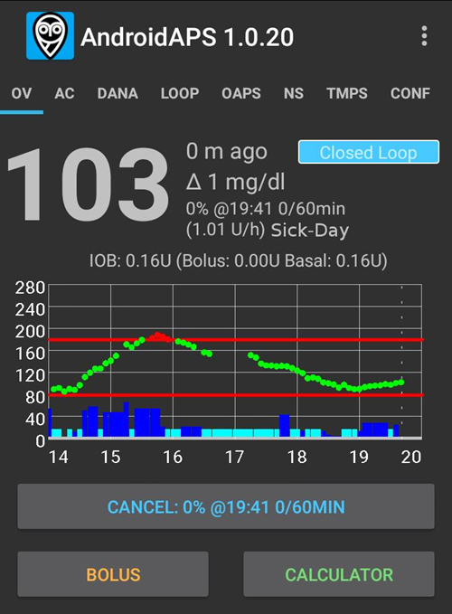

# 릴리스 노트

```{toctree}
:hidden:

Update2_7.md
Update3_0.md
UpdateAaps3204.md
```

새 버전으로 업데이트하려면 [업데이트 매뉴얼](UpdateToNewVersion.md)의 안내를 따르십시오. 문제 해결 섹션은 업데이트 매뉴얼 페이지에서 **AAPS**를 업데이트할 때 가장 흔히 겪는 어려움도 다룹니다.

```{admonition} Upgrading from AAPS v3?
:class: tip
기능의 이동, 이름 변경, 제거 등 주요 동작 변경 사항은 [AAPS v4의 변경 사항](V4Changes.md)을 참조하십시오.
```

새 업데이트가 있으면 다음과 같은 알림을 받게 됩니다:


만료일까지 업데이트하지 않으면 **AAPS**는 개방 루프로 전환됩니다.

AAPS 버전별 지원 종료일은 [지원 종료](EndOfLife.md)를 참조하십시오.

**알림을 무시하지 마십시오.** **AAPS**의 새 버전은 중요한 안전 수정 사항을 제공합니다. 따라서 모든 **AAPS** 사용자는 가능한 한 빨리 최신 버전으로 업데이트해야 합니다. 이것은 모든 **AAPS** 사용자와 DIY 커뮤니티의 안전을 높이기 위한 노력입니다. 이해해 주셔서 감사합니다.

(maintenance-android-version-aaps-version)=

## Android 버전과 AAPS 버전

스마트폰의 Android 버전이 Android 12보다 오래되었다면 AAPS v3.4 이상을 사용할 수 없습니다. 최소 Android 12가 필요하기 때문입니다.

오래된 Android를 사용하는 사용자도 오래된 버전의 AAPS를 사용할 수 있도록, 버전 확인만 변경한 새 버전을 배포했습니다. 다른 개선 사항은 포함되어 있지 않습니다.

아래 표에서 자신의 Android 버전을 찾아, 그에 맞는 **AAPS** 버전을 사용하십시오. 코드는 표에 나온 브랜치를 사용하여 <https://github.com/nightscout/AndroidAPS>에서 다운로드합니다.

| 사용 중인 Android 버전 | 사용할 AAPS 버전 | 다운로드할 브랜치                                                        |
| ---------------- | ----------- | ---------------------------------------------------------------- |
| Android 12 이상    | 최신 버전       | [master](https://github.com/nightscout/AndroidAPS) (기본값)         |
| Android 11       | **3.3.2.1** | [3.3.2.1](https://github.com/nightscout/AndroidAPS/tree/3.3.2.1) |
| Android 9, 10    | **3.2.0.4** | [3.2.0.4](https://github.com/nightscout/AndroidAPS/tree/3.2.0.4) |
| Android 8        | **2.8.2.1** | [2.8.2.1](https://github.com/nightscout/AndroidAPS/tree/2.8.2.1) |
| Android 7        | **2.6.2**   | [2.6.2](https://github.com/nightscout/AndroidAPS/tree/2.6.2)     |

## WearOS 버전

- AAPS는 WearOS 3.0, 3.2 또는 3.5(Android 11, API 레벨 30) 이상이 필요합니다. WearOS 2 워치는 지원하지 않습니다.

```{tip}
WearOS 5, API 레벨 34(Android 14)에는 [제한 사항](#BuildingAapsWearOs-WearOS5)이 있습니다.
```

제목이 있는 버전은 각 Android 버전의 최신 릴리스입니다(위 표 참조). 다른 릴리스는 그 사이에 있으며, 릴리스 노트 또는 GitHub 링크가 함께 있습니다.

(latestrelease)=

(version400)=

## 버전 4.0.0

출시일: 31-10-2026

**새 기능**

- 새 사용자 인터페이스: 휴대폰 앱을 Jetpack Compose로 다시 만듦 @MilosKozak
- [전체 검색](../DailyLifeWithAaps/GlobalSearch.md) @MilosKozak
- Kotlin Multiplatform 마이그레이션, Windows, Mac, Linux 데스크톱 및 iOS용 클라이언트 @MilosKozak
- [장면](../DailyLifeWithAaps/Scenes.md): 여러 동작을 저장하고 한꺼번에 실행 @MilosKozak
- [마스터 ↔ 클라이언트 제어](../RemoteFeatures/ClientMasterControl.md): 클라이언트 휴대폰에서 마스터로 명령 보내기 @MilosKozak
  - [클라이언트 역할](#client-master-control-roles): 클라이언트마다 읽기 전용, 식사, 보호자 또는 관리자 @MilosKozak
  - [강화 모드](#client-master-control-hardened-mode): 클라이언트 제어가 켜져 있으면 마스터는 페어링된 클라이언트의 변경만 받습니다 @MilosKozak
  - 클라이언트에 Nightscout도 함께 설정하는 QR 코드 또는 PIN으로 페어링하며, 페어링 비밀값은 페어링 직후 교체됩니다 @MilosKozak
  - 클라이언트마다 필요한 권한만 가진 [자기 Nightscout 토큰](#client-master-control-own-token) @MilosKozak
- 펌프, 마법사, 프로파일 전반에서 [인슐린 농도](../AdvancedOptions/InsulinConcentration.md) 지원(U200, U500) @Philoul @MilosKozak
- 인슐린 관리: 인슐린 목록, 별칭, 프로파일과 마법사에서 선택 @Philoul
- 보정 플러그인 @MilosKozak
- [평활화](../CompatibleCgms/SmoothingBloodGlucoseData.md): Unscented Kalman Filter (UKF) @piecycle
- 새 [자동화 동작](#automations-automation-action): **평활화 변경** @olorinmaia, **장면 실행**, **장면 활성화** 또는 **장면 비활성화** @MilosKozak
- [위치 순환](#Aapsscreens-site-rotation): 주입 부위를 기록하고 순환 @Philoul @MilosKozak
- [Autotune](../AdvancedOptions/Autotune.md) 재작업 @Philoul
- 새 [위젯](../DailyLifeWithAaps/Widgets.md) @MilosKozak @t1dude
- 접근성: 휴대폰 앱이 화면 낭독기와 함께 작동합니다 - 이름이 있는 컨트롤, 음성으로 읽어 주는 상태, 그래프 설명, 훑어보기 위한 제목 @MilosKozak
- [설정 가져오기](../Maintenance/ExportImportSettings.md): 펌프 설정을 유지할 수 있음 @MilosKozak
- 상시 알림이 Android 실시간 업데이트를 사용하며, Samsung Now bar와 증분 표시를 지원 @premnirmal
- 혈당 그래프: 개요 화면의 모든 그래프에서 [길게 눌러](#aaps-screens-graph-press-and-hold) 한 측정 시점의 값 보기 @t1dude @olorinmaia
- 성능 개선 @MilosKozak
- 볼러스 마법사의 자동 eCarbs @MilosKozak

**새 기기**

- **CareLevo**: 새 [펌프 드라이버](../CompatiblePumps/CareLevo.md) @Kisu-Choi @MilosKozak
- **Dana-i2**: 지원 @MilosKozak
- **Instara**: 새 CGM 소스 @leohunt

**펌프 드라이버 개선**

- Insight, Medtronic, Medtrum, Omnipod, Dana, Diaconn, Equil의 펌프 개요 화면을 다시 만듦 @MilosKozak
- **Omnipod DASH**: PDM 방식의 Ref 코드와 읽기 쉬운 오류 설명, 시간 오차 보정 항상 켜짐, 볼러스 유형 보고 개선 @nl-ruud
- **Omnipod**: Dash & Eros의 최종 종료일 @mcnelson
- **DanaR, RS**: 테스트용 펌프 에뮬레이터 @MilosKozak
- **Equil**: 테스트용 펌프 에뮬레이터 @MilosKozak
- 많은 펌프 및 루프 수정 @MilosKozak 외

**Wear OS**

- [워치 앱](../WearOS/WearOsSmartwatch.md)을 Compose로 다시 만듦, 새 타일과 컴플리케이션, Wear OS 6+에서 워치 페이스 자동 설치(Watch Face Push) @olorinmaia @Philoul
- WFF 전용 워치 페이스로 WearOS 6.0(GW7, GW8, GW9...)에서 CustomWatchface 사용 가능 @Philoul @olorinmaia
- 이제 CustomWatchface에 사용자 지정 가능한 컴플리케이션 슬롯 5개를 넣을 수 있음(오래된 워치에서만 사용 가능한 새 기능) @Philoul
- 새 [AAPS 컴플리케이션 기반 WFF 워치 페이스](#wearos-complications-watchface-setup) @olorinmaia
- 볼러스 마법사와 빠른 마법사 결과 수정 @olorinmaia
- 메인 메뉴에 새 혈당 그래프와 실행 모드 화면 @olorinmaia
- 볼러스 마법사: 휴대폰 마법사처럼 탄수화물을 나누는 [식사 유형](#WearOsSmartwatch-wizard-meal-type) 페이지, 그리고 워치에서 *식사 시간* 알림을 주는 [탄수화물 시간](#WearOsSmartwatch-wizard-carb-time) @olorinmaia
- [워치에서 휴대폰 알람](#WearOsSmartwatch-phone-alarms): 워치가 알람을 표시하고 음소거와 5분 무음을 제공합니다 @olorinmaia

**빌드**

- 태그/브랜치 빌드용 CI 워크플로, JDK 버전 매핑 @Angus-repo

**기여자**

@MilosKozak @Philoul @olorinmaia @Kisu-Choi @leohunt @piecycle @Angus-repo @mcnelson @t1dude @premnirmal @nl-ruud

전체 변경 기록: <https://github.com/nightscout/AndroidAPS/compare/3.4.2.6...4.0.0>

---

(version3426)=

## 버전 3.4.2.6

- Equil: 안정성 개선 @MilosKozak

---

(version3425)=

**버전 3.4.2.5**

- Equil 경쟁 상태 수정 @MilosKozak

---

(version3424)=

**버전 3.4.2.4**

- Equil 수정 @MilosKozak
- NS 프로파일 동기화 수정 @MilosKozak

---

(version3423)=

**버전 3.4.2.3**

- Dash: 시간 오차 해결 @nl-ruud
- NSClientV3: 재연결 후 데이터 공백 수정 @MilosKozak
- 자동화: 역직렬화 수정 @MilosKozak
- Equil: 배터리 보고 수정 @MilosKozak
- 워크플로 정리 @vanelsberg
- Equil: 오류 복구 개선 @MilosKozak
- DanaRS: 국내용 펌프 통신 수정 @MilosKozak
- Insight: TBR 동기화 수정 @MilosKozak
- Dash: 활성화 버그 수정 @nl-ruud

---

(version3422)=

**버전 3.4.2.2**

- Equil 및 Medtronic 문제 수정
- Medtrum 안전성 개선

---

(version3421)=

**버전 3.4.2.1**

- Equil: 페어링과 진행 대화 상자 수정 @MilosKozak

---

(version3420)=

**버전 3.4.2.0**

출시일: 02-04-2026

- Equil: 모델별 저항 수정 @hhfcvmars
- Tidepool: 세션 수정 @MilosKozak
- Medtrum: 이중 채우기를 막아 활성화 과정 수정 @MilosKozak
- COB: COB 계산 수정(위험한 예외 상황 해결) @MilosKozak

---

(version3410)=

**버전 3.4.1.0**

출시일: 08-03-2026

**코어**

- 서머타임 처리 수정 @MilosKozak
- 일반 목표 식별 개선 및 통일(mgdl > 99, mmol > 5.5) @MilosKozak
- SMS: RESTART를 PIN으로 보호 @MilosKozak
- 정비: 잘못된 디렉터리를 선택하면 경고 @MilosKozak

**펌프 드라이버 개선**

- **Omnipod DASH**: BLE 드라이버 코드를 omnipod/common 모듈로 리팩터링 @jwoglom
- **Omnipod DASH**: 연결 상태 수정 시도 @MilosKozak
- **Omnipod**: Pod 낭비를 막기 위해 Pod 활성화 전에 프로파일 검증(#4534) @brianV
- **Medtronic**: 설정 대화 상자에 같은 인코딩 유형이 표시되던 문제 수정 @mifi100
- **Medtronic**: 펌프 공통 클래스 준비(Tandem 준비) @andy-rozman
- **RileyLink**: 인코딩 수정(#4519) @mifi100
- **Equil**: 일련번호 접두사로 인슐린 펌프 호환성 확장(#4510) @hhfcvmars
- **Equil**: 로깅 추가 @MilosKozak
- **Diaconn G8**: 로그 동기화 버그 수정 및 펌웨어 3.58+ 지원 추가 @miyeongkim
- **Diaconn**: TBR 지속 시간 단위 변환 수정 @miyeongkim
- **Diaconn**: 이력 동기화에 commandQueue.loadEvents() 사용 @miyeongkim
- 루프가 일시 중지되었지만 펌프를 사용할 수 있을 때 인슐린 주입 허용 @cschuijt

**클라우드 / 백업**

- Google Drive 백업 추가 @Angus-repo
- 클라우드 저장소 오류 상태가 바뀌면 UI에 알림 @Angus-repo
- 로컬 저장소와 클라우드 저장소를 동시에 사용 허용 @Angus-repo

**Tidepool**

- Tidepool OAuth2 마이그레이션 개선 @MilosKozak
- Tidepool BLOCKED 상태가 끝나지 않던 문제 수정, 빈 SSID 거부 문제 수정 @michaeln-synapse

**NSClient**

- NSCv3: 재연결 개선 @MilosKozak

**Wear OS**

- 계산에 IOB를 사용하면 마법사 결과에 새 IOB 표시 @olorinmaia
- Wear BolusProgress의 총량 표시 수정 @Philoul

**UI**

- 위치 순환의 ic_none 아이콘 개선 @Philoul
- 위치 순환의 펌프 관리 설정이 사용되지 않던 문제 수정 @samfundev

**기여자**

@MilosKozak @Philoul @olorinmaia @jwoglom @mifi100 @andy-rozman @Angus-repo @brianV @cschuijt @hhfcvmars @miyeongkim @samfundev @michaeln-synapse

---

(version3400)=

**버전 3.4.0.0**

출시일: 31-12-2025

**업그레이드 전:**

* 이 버전은 Google Android 12.0 이상이 필요합니다. 업데이트하기 전에 휴대폰 버전을 확인하십시오.
* 최신 Android Studio로 업데이트하거나, 더 좋은 방법으로 브라우저 빌드를 사용하십시오.

**새 기능**

* 실행 모드 @MilosKozak
  * 처치 탭에 [루프 상태 이력](#AapsScreens-running-mode) 표시
  * [AAPSClient에서 루프 상태](#RemoteControl_aapsclient)를 표시하고 변경할 수 있습니다.<br>참고: [NSClient > 동기화 > NS에서 실행 모드 받기](#Preferences-nsclient-synchronization) 설정이 필요합니다
* [새 CGM](../Getting-Started/CompatiblesCgms.md): Glunovo, Intelligo, Sinocare
* [위치 순환](#Aapsscreens-site-rotation) 지원 @Philoul
* 새 [자동화 동작](#automations-automation-action): SMB 활성화 또는 비활성화 @MilosKozak
* Syai CGM은 [신뢰할 수 있는 소스](#GettingStarted-TrustedBGSource)이며 고급 필터링을 지원합니다 @MilosKozak

**Wear OS 개선**

* 배터리 사용량 대폭 감소 @MilosKozak
* UI 개선과 수정 @olorinmaia
* 현재 라이브러리 수준에 맞게 코드를 거의 전부 다시 작성(이전에는 WearOS 2) @MilosKozak
* 확장 데이터를 위한 새 컴플리케이션 2개 @Philoul
* DataStore를 사용하는 최신 컴플리케이션 제공자로 마이그레이션 @MilosKozak

**메모리 누수 수정**

* 코드의 메모리 누수 수정 @MilosKozak
* Firebase Crashlytics에 LeakCanary 메모리 누수 보고 추가 @MilosKozak

**펌프 드라이버 개선**

* **DanaI**: 연결 끊김 문제 수정 @MilosKozak
* **RileyLink**: 지연을 최소화하여 통신 속도 향상 @mifi100
* **Medtrum**: 패치 활성화 시간과 사용 기간 표시 추가 @vanelsberg, 비밀번호 대문자 수정 @MilosKozak
* **Combo**: 테스트 경쟁 상태 수정 @MilosKozak @dv1
* **Equil**: 연결 최적화, 배터리 사용량 감소 @MilosKozak

**Nightscout 동기화**

* NS 실패 시 중복 제거 개선 @MilosKozak

**UI/UX 개선**

* 여러 가지 개선 @MilosKozak @Philoul @olorinmaia

**Automation**

* 새 SMB 제어 동작 - 자동화로 SMB 활성화/비활성화 @MilosKozak

**테스트**

* Equil, Eopatch, Dana, Medtronic 펌프에 대한 포괄적인 단위 테스트 추가 @MilosKozak
* 여러 모듈에서 테스트 안정성과 범위 개선 @MilosKozak

**Tidepool**

* Tidepool OAUTH2(새 Tidepool 인증 지원) @MilosKozak

---

(version3321)=

## 버전 3.3.2.1

출시일: 13-08-2025

- Android 16에서 Omnipod 블루투스 연결 수정
- CI 프로세스(브라우저 빌드)
- mmol-mgdl 변환 수정
- 일부 시간대에서 대화 상자의 잘못된 시간 선택 수정
- 간단 모드에서 키 읽기 수정
- Wear에서 누락된 예측 수정
- 구성 화면 개선
- NSCv3 전체 동기화 개선

---

(version3300)=

**버전 3.3.2.0**

출시일: 27-03-2025

**업그레이드 방법**

* 이 버전을 빌드하려면 ["Meerkat"이라는 Android Studio 버전](#Building-APK-recommended-specification-of-computer-for-building-apk-file) 이상이 필요합니다. 이미 3.3.x 버전을 빌드했다면 Android Studio를 다시 업그레이드해야 합니다.

(version-enforcement)=

**이 버전부터 알림과 버전 강제 적용이 단순해지고 완화되었으며, 다음과 같이 작동합니다:**

*  기기가 오프라인일 때(인터넷에 연결되지 않은 경우) 만료되지 않습니다. 즉, 더 이상 60일 및 90일 유예 기간이 없습니다.
*  만료 후에는 LGS 모드가 강제로 적용됩니다
*  경고/알림을 덜 자주 받게 됩니다:
   - 28일 이상 남음: 7일마다
   - 27-14일 남음: 3일마다
   - 그다음에는 하루에 한 번
   - 밤에 방해하지 않도록 알림은 정오 이후에 생성됩니다
* 알림은 2가지 종류뿐입니다
   - 새 버전 사용 가능(AAPS에 영향 없음)
   - 애플리케이션이 미래의 어느 날짜에 만료됨(아직 AAPS에 영향 없음) / 만료됨(AAPS가 LGS 모드로 바뀜)

**새 소식**

* SMS RESTART 명령 @MilosKozak
* 워치의 프로파일 전환 매개변수 @olorinmaia
* 어두운 모드 AAPS V2 워치페이스 @olorinmaia
* G7 데이터 교환 개선 @olorinmaia
* 위젯 구성 @MilosKozak
* 라디오 버튼 UI 개선 @olorinmaia
* 자동화: 지도에서 위치 선택 @MilosKozak
* 메인 화면에 버전 표시 @MilosKozak
* 기존 git 시스템으로 컴파일하는 것이 강제됩니다(zip 다운로드 불가)
* 메인 화면에 버전 표시 @MilosKozak
* Tidepool 업로드 개선 @ConstantinMatheis

**버그 수정**

* Dash 본딩 해제 수정 @Andreas
* Garmin 수정 @robertbuessow @suside
* 대화 상자의 IOB 표시 수정 @olorinmaia
* 목표의 맞춤법과 검증 개선 @MilosKozak
* 에뮬레이트된 TBR 표시 수정 @MilosKozak
* 보안 우회 문제 수정 @tdrkDev

---

**버전 3.3.1.3**

출시일: 21-01-2025

**버그 수정**

* Dash: 본딩은 선택 사항(기본값 꺼짐) @MilosKozak
* Equil: 10U 이상 볼러스 수정, 알람 개선 @EquilHack
* Garmin: 워치 개선 @swissalpine
* 워치 개선 @olorinmaia
* 워치에서 루프 상태 제어 @tdrkDev
* 안정성 개선

*  **[인증 설정](#sms-commands-authenticator-setup)을 새로 해야 할 수 있습니다.**

---

**버전 3.3.1.2**

출시일: 15-01-2025

**업그레이드 방법**

* 이 버전을 빌드하려면 ["Ladybug Feature Drop"이라는 Android Studio 버전](#Building-APK-recommended-specification-of-computer-for-building-apk-file) 이상이 필요합니다. **이것은 그냥 "Ladybug"와 같지 않습니다.** 이미 3.3.x 버전을 빌드했다면 Android Studio를 다시 업그레이드해야 합니다.

**버그 수정**

* Dash: Android 15+에서 본딩 사용
* 개요 화면에 Dexcom 버튼 복원
* Equil: 작동하지 않는 펌프 제거 허용
* DynISF 조정 계수가 0이면 경고
* NSCv3: 시간이 약간 다른 휴대폰에서 웹소켓 통신 문제 해결
* SMS 명령: OneTimePassword 수정. **[인증 설정](#sms-commands-authenticator-setup)을 새로 해야 할 수 있습니다.**
* 일부 설정을 더 이상 편집할 수 없던 문제 수정.
* 가상 펌프 사용 시 마스터 비밀번호 재설정 수정.
* 큰 설정 백업 파일 가져오기 수정.

---

**버전 3.3.1.0**

출시일: 06-01-2025

**UI 변경**

* [AAPSClient와 AAPSClient2를 구별하기 위한 색상 추가](#RemoteControl_aapsclient) @MilosKozak
* 사용자 동작 레이아웃과 아이콘 개선

**기타 기능**

* 새 자동화 트리거: [걸음 수](#screen-heart-rate-steps) @Roman Rihter
* NSCv3 전체 동기화에서 모든 데이터 수신 허용(TBR처럼 이전에 동기화되지 않던 데이터 포함) @MilosKozak
* NSClient v3: 공지 기능 작동(_즉,_ AAPSClient에서 AAPS로) @MilosKozak

**기술적 변경 & 버그 수정**

* Insight 충돌 수정 @philoul
* Nightscout에 deviceStatus 항목이 지나치게 많이 생성되던 문제 수정 @MilosKozak
* 탄수화물 흡수 수정 @MilosKozak
* 라디오 버튼 & 체크박스 색상 수정 @MilosKozak
* DynISF 퍼센트 마이그레이션 버그 수정 @MilosKozak
* 잘못된 위치에 나타나던 DynISF 알림 해결 @MilosKozak
* 워치페이스 버그 수정 @philoul

---

**버전 3.3.0.0**

출시일: 29-12-2024

**주요 기능**

* **[동적 ISF](../DailyLifeWithAaps/DynamicISF.md)** 기능은 더 이상 별도 플러그인이 아니며, 이제 [OpenAPS SMB](#Config-Builder-aps) 플러그인의 옵션으로 포함되었습니다. 동작도 일부 바뀌었습니다:
  * 이제 **동적 ISF**에서 동적 민감도의 강도와 관련하여 **프로파일 전환**과 **프로파일 퍼센트**를 반영합니다
  * 지난 24시간의 평균 **ISF**를 계산하여, 이 값을 볼러스 마법사와 **COB** 계산에 사용합니다. **프로파일 ISF** 값은 전혀 사용하지 않습니다(이력 데이터가 없을 때 대체값으로 쓰는 경우는 제외)
  * DynamicISF 문서 페이지를 다시 작성했습니다. 중요한 섹션 [동적 ISF를 활성화할 때 고려할 사항](#dyn-isf-things-to-consider-when-activating-dynamicisf)을 읽으십시오.
* FreeStyle Libre 2 및 Libre 3 사용자를 위해 [“항상 SMB 활성화”와 “탄수화물 후 SMB 활성화” 사용 가능](#Open-APS-features-enable-smb-always)
  * 참고: 최신 버전의 xDrip+ 또는 Juggluco가 필요합니다.
* 새 **자동화** 트리거
* 자동 설정 내보내기

**업그레이드 방법**

* 업그레이드 전:
  * **<span style="color:red">이 버전은 Google Android 11.0 이상이 필요합니다</span>**. 업데이트하기 전에 휴대폰 버전을 확인하십시오.
  * ruffy 기기와 함께 “오래된” Combo 드라이버를 사용한다면, 업데이트하기 전에 [네이티브 Combo 드라이버](../CompatiblePumps/Accu-Chek-Combo-Pump-v2.md)로 이전하십시오
  * 업그레이드하는 동안 홈 화면의 [추가 그래프](#AapsScreens-section-g-additional-graphs) 설정이 사라집니다: 필요하면 현재 구성을 직접 메모해 두었다가 업그레이드 후에 다시 만드십시오.
  * 일부 사용자가 Android 15에서 겪는 [블루투스 연결 문제](../Getting-Started/Phones.md)는 이번 릴리스로 해결되지 **않습니다**(이것은 **AAPS**가 아니라 Android의 문제입니다). 3.3.1.2에서 수정되었습니다.
  * Android 제한 때문에 홈 화면의 BYODA 버튼은 더 이상 사용할 수 없습니다. 3.3.1.2에서 수정되었습니다.
* 업데이트 방법: [새 버전으로 업데이트](../Maintenance/UpdateToNewVersion.md) 가이드를 따르십시오.
  * 이 버전을 빌드하려면 ["Ladybug"라는 Android Studio 버전](#Building-APK-recommended-specification-of-computer-for-building-apk-file) 이상이 필요합니다. 이전 버전의 Android Studio가 이미 설치되어 있다면 <span style="color:red">JVM 버전을 21로 구성</span>해야 할 수 있습니다. [Android Studio 문제 해결 > Incompatible Gradle JVM](#incompatible-gradle-jvm)을 참조하십시오.
  * 팁 - **AAPS** 이력을 잃고 싶지 않다면 항상 업데이트를 하고, 제거 후 설치를 하지 마십시오. 문제가 생길 경우 이전 버전으로 되돌릴 수 있도록, 예방 조치로 현재 **AAPS** 설정과 이전 APK를 백업하십시오.
* 업그레이드 후:
  * 정비 탭에서 새 [“AAPS 디렉터리” 설정](#preferences-maintenance-logdirectory)을 설정하십시오.

**자세한 변경 사항**

**CGM과 펌프**

* FreeStyle Libre 2 및 Libre 3 사용자를 위해 [“항상 SMB 활성화”와 “탄수화물 후 SMB 활성화” 사용 가능](#Open-APS-features-enable-smb-always) @MilosKozak
* [Medtrum 드라이버](../CompatiblePumps/MedtrumNano.md) 개선 @jbr77rr
  * 통신 개선. 일부 스마트폰의 문제를 피하기 위한 새 설정 포함
  * 활성화 시작 시 레저버 잔량 표시
  * 활성화가 처음으로 돌아가서 사용자가 활성화를 끝낼 수 없던 버그 수정
  * 동기화 상태 피드백과 기타 설명 개선
* 새로 지원하는 펌프: [Equil 5.3](../CompatiblePumps/Equil5.3.md) @EquilHack
* 새로 지원하는 CGM: [Ottai](../CompatibleCgms/OttaiM8.md) @ottai-developer 및 [Syai Tag](../CompatibleCgms/SyaiTagX1.md) @syai-dev
* Insight 드라이버를 kotlin으로 다시 작성 @Philoul
* ruffy에 의존하던 오래된 Combo 드라이버 제거

**UI 변경**

* 새로 설치할 때 [간단 모드](#preferences-simple-mode)가 기본으로 활성화됨 @MilosKozak
* 새 [빠른 마법사](#Preferences-quick-wizard) 옵션 @radicalb
  * 이제 빠른 마법사는 볼러스 계산과 표시에 계산기와 같은 로직을 사용합니다. 이제 빠른 마법사의 “탄수화물 시간” 필드를 사용하여 사전 볼러스를 할 수 있습니다.
* 새 [그래프 배율 메뉴](#aaps-screens-main-graph); [추가 그래프 메뉴](#AapsScreens-activate-optional-information) UI 개선 @Philoul
* [구성 화면 레이아웃 개선](../SettingUpAaps/ConfigBuilder.md) @MilosKozak
  * 이제 섹션은 기본으로 접혀 있습니다. 펼치려면 화살표를 사용하십시오.
* AAPSClient에서 가변 민감도 표시
* 볼러스 마법사 UI 개선 @kenzo44
* 밝은 테마를 사용할 때 펌프 탭의 텍스트 표시 수정 @jbr77rr

**기타 기능**

* [자동 설정 내보내기](#ExportImportSettings-Automating-Settings-Export) @vanelsberg
* 새 [자동화 트리거](#automations-automation-triggers) @vanelsberg
  * Pod 활성화(패치 펌프 전용)
* 새 [자동화 트리거](#automations-automation-triggers) @jbr77rr
  * 캐뉼라 사용 기간, 인슐린 사용 기간, 배터리 사용 기간, 센서 사용 기간, 레저버 잔량, 펌프 배터리 레벨
* 음수 탄수화물 입력 허용 @MilosKozak
* 기본 디렉터리와 다른 저장 디렉터리를 선택할 수 있는 새 매개변수 [“AAPS 디렉터리”](#preferences-maintenance-settings).
* [펌프가 일시 중지되었을 때 인슐린 기록](#aaps-screens-buttons-insulin) 허용 @jbr77rr
* [목표 2](#objectives-objective2) 업데이트 @MilosKozak
  * 마스터 비밀번호가 설정되어 있고 알고 있는지 확인
* 테스트 모드에서 무작위 탄수화물 @MilosKozak
* TDD 계산 버그 수정 @MilosKozak
* SMS 명령: NS에서 오는 프로파일 변경에 대해 [SMS를 **보내지 않도록**](#sms-commands-too-many-messages) 허용 @MilosKozak

**스마트워치**

* Wear와 워치페이스 개선 @Philoul @MilosKozak @olorinmaia
* 자동화 동작으로 만드는 워치 타일 @Philoul
* 더 많은 환자를 모니터링하기 위해 AAPS, AAPSClient, AAPSClient2의 워치페이스 결합 @Philoul @MilosKozak
* EXTRA: show\_user\_actions\_on\_watch\_only @MilosKozak

**기술적 변경**

* [로그 파일 위치 변경](#Accessing-logfiles-accessing-logfiles)
* 새 내부 모듈 구조 @MilosKozak
* 영속성 계층을 메인 코드에서 분리 @MilosKozak
* 빌드 파일을 kts로 다시 작성 @MilosKozak
* 더 나은 성능을 위해 알고리즘을 kotlin으로 다시 작성 @MilosKozak
* 많은 새 단위 테스트 @MilosKozak 외
* 더 많은 코드를 kotlin으로 변환 @MilosKozak
* 새 설정 관리, xml \-\> kotlin @MilosKozak
* 새 CI 구성, 자체 서버에서 CI 실행 @MilosKozak
* 라이브러리를 최신 버전으로 업데이트, toml @MilosKozak
* kotlin 2.0, java 21로 마이그레이션 @MilosKozak

---

(version3204)=

## [버전 3.2.0.4](https://github.com/nightscout/AndroidAPS/releases/tag/3.2.0.4)

출시일: 27-02-2024

이 버전은 Android 10을 지원하는 마지막 버전입니다. Android 11로 업그레이드할 수 없다면 [AAPS를 3.2.0.4로 업데이트](#update-aaps-3204)하십시오.

**변경 사항**

- xDrip G7 지원
- Medtrum 수정
- 자동화 아이콘 수정
- 목표 1 통과 수정

---

(version3200)=

**버전 3.2.0.0, @Philoul에게 바칩니다**

출시일: 23-10-2023

**중요 안내**

- NS 15가 필요합니다
- NS v3 플러그인에서 웹소켓을 사용하는 동안, NS UI(더하기 버튼)로 입력한 처치와 v1 API를 사용하는 다른 애플리케이션에서 입력한 처치는 AAPS로 전송되지 않습니다. 이 문제는 향후 NS 릴리스에서 수정될 예정입니다. The same is valid for AAPS and AAPSClient itself. AAPS와 AAPSClient 자체에도 똑같이 적용됩니다.
- v3 플러그인의 웹소켓은 v1 플러그인과 비슷한 방식으로 작동합니다. 웹소켓을 사용하지 않으면 AAPS는 NS에서 정기적으로 다운로드하도록 예약합니다. NS에 계속 연결되어 있지 않으므로 전력 소비가 줄어듭니다. 반면에 이것은 데이터 교환이 지연된다는 뜻입니다. 사용하기 전에 개발팀의 중요한 설명을 [여기](#Important-comments-on-using-v3-versus-v1-API-for-Nightscout-with-AAPS)에서 읽으십시오!
- xdrip을 CGM 소스로 사용하는 경우, 내부 변경 때문에 업데이트 후 다시 선택해야 합니다
- 첫 번째 목표를 통과하기 위해 NS 대신 Tidepool을 사용할 수 있습니다
- xDrip+로 데이터를 보내는 경우 xDrip 동기화 플러그인을 구성해야 합니다. xDrip에서 AAPS의 혈당을 받으려면 소스로 “xDrip+ Sync Follower”를 선택해야 합니다
- ComboV2 드라이버로 바꾸려면 Ruffy를 제거하고 펌프를 AAPS에 다시 페어링해야 합니다
- DynISF 플러그인을 사용하려면 목표 11을 시작해야 합니다(11을 시작하려면 이전 목표를 모두 완료해야 합니다)

**변경 사항**

- EOPatch2 / GlucomenDay 펌프 드라이버 @jungsomyeonggithub @MilosKozak
- ComboV2 펌프 드라이버(Ruffy 필요 없음) @dv1
- Medtrum Nano 드라이버 @jbr7rr
- 한국 DanaI 지원 @MilosKozak
- Glunovo CGM 지원 @christinadamianou
- G7 지원 @MilosKozak @rICTx-T1D @khskekec
- NSClient v3 플러그인 @MilosKozak
- Tidepool 지원 @MilosKozak
- 평활화 플러그인 @MilosKozak, @justmara, 지수 평활화 @nichi (Tsunami), 평균 평활화 @jbr7rr
- DynamicISF 플러그인 @Chris Wilson, @tim2000s
- Garmin 워치페이스 & 심박수 지원 @buessow
- 새 로고 @thiagomsoares
- 새 워치페이스 @Philoul
- 3.1 버전의 많은 문제 수정
- 더 많은 곳에서 메모 추가 가능 @Sergey Zorchenko
- UI 수정 @MilosKozak @osodebailar @Andries-Smit @yodax @Philoul @dv1 @paravoid
- 새 SMS 명령 LOOP LGS/CLOSED @pzadroga
- Wear 번역 @Andries-Smit
- xdrip 통신을 별도 모듈로 이동 @MilosKozak
- 내부 변경: 라이브러리 버전 업데이트, rx3 마이그레이션, 새 모듈 구조 @MilosKozak
- Diaconn 드라이버 수정 @miyeongkim
- 더 많은 데이터베이스 정비 옵션 @MilosKozak
- AAPSClient가 메인 휴대폰이 충전 중인지 정보를 제공 @MilosKozak
- 볼러스 마법사 변경. CGM을 사용할 수 없으면 퍼센트를 무시합니다(즉, 100%를 사용합니다)
- kts 빌드 시스템으로 마이그레이션 @MilosKozak
- CI 통합 개선 @MilosKozak @buessow
- 테스트 정리 @ryanhaining @MilosKozak
- 새 코드 110k+ 줄, 변경 240k 줄, 변경된 파일 6884개

(Important-comments-on-using-v3-versus-v1-API-for-Nightscout-with-AAPS)= **AAPS에서 Nightscout용 v3 API와 v1 API 사용에 관한 중요 참고 사항**

v1은 NS 웹사이트와 NS 서버 사이에서 데이터를 주고받는 데 쓰는 오래된 프로토콜입니다. 제한이 많습니다
- v1은 2일 분량의 데이터만 보냅니다
- v1은 다시 연결할 때마다 2일 분량의 데이터를 모두 보냅니다
- 웹소켓 사용이 필수입니다 = 영구 연결, 배터리 소모 증가
- 연결이 자주 끊기면 많은 데이터 사용을 막기 위해 NS 연결을 15분 동안 일시 중지합니다

v3는 새 프로토콜입니다. 더 안전하고 효율적입니다
- 토큰을 사용하면 접근 권한을 더 잘 정할 수 있습니다
- 프로토콜이 양쪽(AAPS & NS)에서 더 효율적입니다
- NS에서 최대 3개월 분량의 데이터를 읽을 수 있습니다
- 기기마다 웹소켓 사용 여부를 선택할 수 있습니다(사용하면 업데이트가 빠르고, 사용하지 않으면 전력 소비가 적지만 업데이트가 느립니다. 즉, 몇 분 단위)
- 연결이 끊겨도 NSClient가 일시 중지되지 않습니다

제한 사항
- AAPS 3.2에서는 NS 15를 사용해야 합니다
- v3는 v1 프로토콜로 한 업데이트를 보지 못합니다(아마 향후 NS 버전에서 해결될 것입니다)
- 반대 방향으로는, 변경 사항을 추적하는 예전의 비효율적인 방법 때문에 v1이 v3가 한 변경을 볼 수 있습니다
- NS는 아직 내부적으로 v1을 사용하므로, v3를 사용하는 경우 NS 웹 UI로 데이터를 입력할 수 없다는 점을 기억하십시오. 데이터를 원격으로 입력하려면 AAPSClient 또는 SMS를 사용해야 합니다

권장 설정
- 위의 모든 이유 때문에 한 가지 방법만 골라 모든 기기에서 사용해야 합니다(이 글을 쓰는 시점에 다른 업로더는 모두 v1을 사용한다는 점을 기억하십시오). v3로 바꾸기로 했다면 AAPS와 모든 AAPSClient에서 v3를 선택하십시오
- 효율성 때문에 v3를 권장합니다
- v3에서 웹소켓을 사용할지 여부는 선호에 따라 정하십시오
- AAPS가 모든 데이터를 모은 다음 단일 업로더로서 NS에 업로드하도록 하는 것을 강력히 권장합니다. 다른 모든 기기/애플리케이션은 NS에서 읽기만 해야 합니다. 이렇게 하면 충돌과 동기화 오류를 막을 수 있습니다. Dexcom Share 커넥터 등으로 혈당 데이터를 NS에 올리는 경우에도 마찬가지입니다

---

(version3100)=

**버전 3.1.0**

출시일: 19-07-2022

[릴리스 노트](https://github.com/nightscout/AndroidAPS/releases/tag/3.1.0)

---

**버전 3.0.0**

출시일: 31-01-2022

[릴리스 노트](https://github.com/nightscout/AndroidAPS/releases/tag/3.0.0)

---

(version2821)=

## 버전 2.8.2.1

출시일: 05-10-2021

이 버전은 Android 8을 지원하는 마지막 버전입니다. [릴리스 노트](https://github.com/nightscout/AndroidAPS/releases/tag/2.8.2.1)

---

**버전 2.8.2**

출시일: 23-01-2021

[릴리스 노트](https://github.com/nightscout/AndroidAPS/releases/tag/2.8.2)

---

(version-2811)= (important-hints-2-8-1-1)=

**버전 2.8.1.1**

출시일: 12-01-2021

[릴리스 노트](https://github.com/nightscout/AndroidAPS/releases/tag/2.8.1.1)

---

(Releasenotes-version-2-8-0)=

**버전 2.8.0**

출시일: 01-01-2021

[릴리스 노트](https://github.com/nightscout/AndroidAPS/releases/tag/2.8.0)

---

(Releasenotes-version-2-7-0)=

**버전 2.7.0**

출시일: 24-09-2020

[릴리스 노트](https://github.com/nightscout/AndroidAPS/releases/tag/2.7.0)

---

(Releasenotes-version-2-6-1-4)=

**버전 2.6.1.4**

출시일: 04-05-2020

[릴리스 노트](https://github.com/openaps/AndroidAPSdocs/blob/e7e2e73cae3dd16af3391ce770fb48b3b3388c1b/docs/EN/Maintenance/ReleaseNotes.md#version-2614)

---

**버전 2.6.1.3**

출시일: 03-05-2020

[릴리스 노트](https://github.com/openaps/AndroidAPSdocs/blob/e7e2e73cae3dd16af3391ce770fb48b3b3388c1b/docs/EN/Maintenance/ReleaseNotes.md#version-2613)

---

**버전 2.6.1.2**

출시일: 19-04-2020

[릴리스 노트](https://github.com/openaps/AndroidAPSdocs/blob/e7e2e73cae3dd16af3391ce770fb48b3b3388c1b/docs/EN/Maintenance/ReleaseNotes.md#version-2612)

---

**버전 2.6.1.1**

출시일: 06-04-2020

[릴리스 노트](https://github.com/openaps/AndroidAPSdocs/blob/e7e2e73cae3dd16af3391ce770fb48b3b3388c1b/docs/EN/Maintenance/ReleaseNotes.md#version-2611)

---

**버전 2.6.1**

출시일: 21-03-2020

[릴리스 노트](https://github.com/openaps/AndroidAPSdocs/blob/e7e2e73cae3dd16af3391ce770fb48b3b3388c1b/docs/EN/Maintenance/ReleaseNotes.md#version-261)

---

(Releasenotes-version-2-6-0)=

**버전 2.6.0**

출시일: 29-02-2020

[릴리스 노트](https://github.com/openaps/AndroidAPSdocs/blob/e7e2e73cae3dd16af3391ce770fb48b3b3388c1b/docs/EN/Maintenance/ReleaseNotes.md#version-260)

---

**버전 2.5.1**

출시일: 31-10-2019

[릴리스 노트](https://github.com/openaps/AndroidAPSdocs/blob/e7e2e73cae3dd16af3391ce770fb48b3b3388c1b/docs/EN/Maintenance/ReleaseNotes.md#version-251)

---

(Releasenotes-version-2-5-0)=

**버전 2.5.0**

출시일: 26-10-2019

[릴리스 노트](https://github.com/openaps/AndroidAPSdocs/blob/e7e2e73cae3dd16af3391ce770fb48b3b3388c1b/docs/EN/Maintenance/ReleaseNotes.md#version-250)

---

**버젼 2.3**

출시일: 25-04-2019

[릴리스 노트](https://github.com/openaps/AndroidAPSdocs/blob/e7e2e73cae3dd16af3391ce770fb48b3b3388c1b/docs/EN/Maintenance/ReleaseNotes.md#version-23)

---

**버전 2.2.2**

출시일: 07-04-2019

[릴리스 노트](https://github.com/openaps/AndroidAPSdocs/blob/e7e2e73cae3dd16af3391ce770fb48b3b3388c1b/docs/EN/Maintenance/ReleaseNotes.md#version-222)

---

**버젼 2.2**

출시일: 29-03-2019

[릴리스 노트](https://github.com/openaps/AndroidAPSdocs/blob/e7e2e73cae3dd16af3391ce770fb48b3b3388c1b/docs/EN/Maintenance/ReleaseNotes.md#version-22)

---

**버젼 2.1**

출시일: 03-03-2019

[릴리스 노트](https://github.com/openaps/AndroidAPSdocs/blob/e7e2e73cae3dd16af3391ce770fb48b3b3388c1b/docs/EN/Maintenance/ReleaseNotes.md#version-21)

---

**버젼 2.0**

출시일: 03-11-2018

[릴리스 노트](https://github.com/openaps/AndroidAPSdocs/blob/e7e2e73cae3dd16af3391ce770fb48b3b3388c1b/docs/EN/Maintenance/ReleaseNotes.md#version-20)

---

**버전 1.0**

```{admonition} First version of **AAPS**
:class: note

첫 번째 테스트 버전은 2015년에 시작되었고 첫 번째 릴리스는 2016년에 나왔습니다.

이 릴리스들의 정확한 연대표는 현재 없지만, 이 질문을 여러 번 받았기 때문에 여기에 기록해 둡니다.

```

