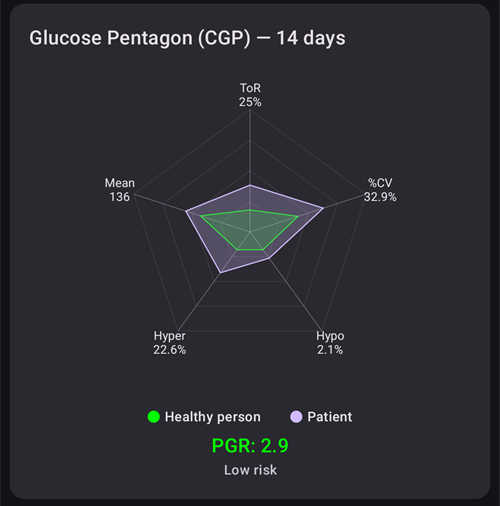

# 데이터 검토

## AAPS 이력 브라우저

**AAPS**는 모든 이력(**혈당**, 처치, 기저, 목표, **프로파일 전환** 등)을 휴대폰의 로컬 데이터베이스에 저장합니다. 이 데이터베이스는 [설정 내보내기](../Maintenance/ExportImportSettings.md)에 포함되지 않습니다. **AAPS** 안에서 아래에 설명한 **이력 브라우저**와 **통계** 화면으로 이 데이터를 검토할 수 있습니다. 장기적인 검토와 보고서를 위해서는 데이터를 [Nightscout](../SettingUpAaps/Nightscout.md) 또는 [Tidepool](../SettingUpAaps/Tidepool.md)에 업로드하십시오.

**AAPS** 이력은 **이력 브라우저**에서 검토할 수 있습니다. **메뉴**(☰)를 열고 **이력 브라우저**를 선택하십시오.

- 검토할 날짜를 고르려면 **날짜 카드**를 누르십시오.
- 그래프는 축소된 상태로 열리며 **선택한 날 전체**를 보여 줍니다. 일부를 확대하려면 두 손가락으로 벌리십시오.
- **<** 및 **>** 화살표로 하루 앞이나 뒤로 이동하고, **현재**를 눌러 오늘로 돌아갑니다.
- 그래프는 메인 화면 그래프와 같은 데이터를 보여 줍니다(혈당, 처치, 기저, IOB, COB, 활동, 편차 등).

(reviewing-statistics)=
## AAPS 통계

**AAPS**는 기본적인 모니터링 통계를 제공합니다.

대부분의 값은 ADA 2023 [권고 사항](https://diabetesjournals.org/care/article/46/Supplement_1/S97/148053/6-Glycemic-Targets-Standards-of-Care-in-Diabetes)을 기준으로 합니다.

통계를 열려면 **메뉴**(☰)를 열고 **통계**를 선택하십시오.

**통계** 화면에는 **인슐린**, **범위 내 시간**, **혈당**, **주기**의 네 가지 탭이 있습니다. 탭을 누르거나 왼쪽 또는 오른쪽으로 밀어서 탭 사이를 이동하십시오.

(reviewing-tdd)=
### 인슐린 탭: 총 일일 용량

**총 일일 용량** 카드는 **AAPS**에 인슐린 데이터가 있는 지난 날들(최대 1주일)을 하루에 한 줄씩 보여 주고, 그다음에 그 **평균**, 마지막으로 지금까지의 **오늘**을 보여 줍니다. **AAPS**를 설치한 직후에는 **오늘**만 표시됩니다. 열은 다음과 같습니다:

- **기저**: 기저만 포함합니다.
- **볼러스**: 볼러스 처치와 SMB의 합계입니다.
- **총 TDD**: 인슐린의 총 일일 용량(**TDD**)으로, 하루 동안 주입된 볼러스 인슐린과 기저 인슐린의 합계입니다.
- **탄수화물**: 입력한 탄수화물과 eCarbs 처치입니다.

**TDD** 부분은 페이지를 열 때 계산되며, 계산에 몇 초가 걸립니다. 다시 계산하려면 **다시 계산**을 누르십시오.

**TDD**는 하루 동안의 볼러스 인슐린과 기저 인슐린을 더한 값입니다. 일부 의사는 특히 펌프를 처음 사용하는 사람에게 기저-볼러스 비율 50:50을 사용합니다. 이 경우 총 기본 기저(**TBB**, 24시간 동안의 기저 주입량 합계)는 TDD의 약 절반이어야 합니다. 다른 의사는 TBB를 TDD의 32 %에서 37 %로 하는 것을 선호합니다.

대부분의 경험 법칙처럼 이 규칙도 실제 타당성은 제한적입니다. 당뇨병은 사람마다 다릅니다!

### 범위 내 시간 탭

범위 내 시간(**TIR**): 70-180 mg/dL 또는 3.9-10 mmol/L.

**TIR** 정보는 **AAPS** 데이터베이스에 있는 데이터의 양에 따라 7일과 30일 기준으로 제공됩니다.

좁은 범위 내 시간(TITR) 70-140 mg/dL 또는 3.9-7.8 mmol/L 통계는 아래에 있습니다(화면에서는 이 범위를 70-141로 표시합니다).

**목표는 내분비내과 전문의와 상의하십시오**

당뇨병은 사람마다 다릅니다. 제안된 목표는 모두 내분비내과 전문의 또는 담당 의료진과 상의해야 합니다. 올바르게 사용하면 AAPS 통계는 __혈당__ 추세를 따라가고 진행 상황을 확인하는 데 유용한 도구가 될 수 있습니다.

그 아래의 **Dexcom TIR** 카드는 14일 동안의 자세한 **TIR** 통계를 보여 줍니다.

**SD**: 표준편차입니다. 혈당 변동성의 [지표](https://www.ncbi.nlm.nih.gov/pmc/articles/PMC3125941/)입니다 (값이 가장 높을수록 가장 나쁩니다).

HbA1c: CGM 측정값의 평균을 바탕으로 추정한 당화혈색소 값입니다. 이 값은 참고용이며 혈액 HbA1c 검사 결과와 다를 수 있습니다.

(reviewing-statistics-agp)=
### 혈당 탭: 활동 혈당 프로파일(AGP)

**활동 혈당 프로파일**(**AGP**)은 하루 동안 혈당이 보통 어떻게 움직이는지 보여 줍니다. 위쪽 버튼으로 기간을 선택하십시오: **오늘**, **24h**, **7일**, **30일** 또는 **90일**.

- **차트**: 자정부터 자정까지의 하루입니다. 선은 **중앙값**입니다(그 시간의 측정값 중 절반은 이보다 낮았고 절반은 높았습니다). 그 주위에 있는 띠 하나는 측정값의 가운데 절반(**25–75%**)을 나타내고, 더 넓은 띠는 대부분의 측정값(**10–90%**)을 나타냅니다. 띠가 좁으면 그 시간의 혈당이 날마다 비슷하다는 뜻입니다. 점선은 **저혈당 선**, 140 mg/dL(7.8 mmol/L), **고혈당 선**을 표시합니다.
- **혈당 개요**: 내 범위 안, 좁은 범위(70–140 mg/dL 또는 3.9–7.8 mmol/L) 안, 범위 위, 범위 아래에 있었던 시간과, 그다음 **평균** 및 **중앙값** 혈당입니다. 내 범위는 [차트 표시 범위](#Preferences-range-for-visualization)에서 설정한 **저혈당 선**과 **고혈당 선**입니다.
- **eA1c** 및 **GMI**: CGM 측정값으로 계산한 HbA1c 추정값 두 가지입니다. 위의 HbA1c와 마찬가지로 혈액 HbA1c 검사 결과와 다를 수 있습니다.
- **SD**(표준편차) 및 **CV**(변동계수): 혈당이 얼마나 변하는지 나타냅니다. 값이 낮을수록 혈당이 더 안정적이라는 뜻입니다.
- **일수**: 사용된 CGM 데이터의 일수입니다.

 

AGP 아래의 **혈당 오각형 (CGP)** 카드는 최근 14일 혈당의 다섯 가지 지표를 오각형으로 그립니다. 오각형이 작을수록 혈당 조절이 더 좋다는 뜻입니다.

### 주기 탭: TDD 주기 패턴

**TDD 주기 패턴**은 일일 인슐린 총량을 28일 주기로 겹쳐서 보여 주어, 반복되는 패턴을 찾는 데 도움을 줍니다. 각 주기는 하나의 선(**개별 주기**)으로 그려지고, 그 평균도 함께 표시됩니다.

- **원시 TDD** / **정리된 TDD**: 주입된 그대로의 총 일일 용량 또는 탄수화물용 인슐린을 뺀 TDD를 선택합니다.
- **주기 오프셋**: 주기의 시작을 옮깁니다(0일에서 27일).

최소 56일(주기 2개)의 데이터가 필요합니다. 데이터가 이보다 적으면 카드에 **데이터가 부족합니다 (주기 2개에 최소 56일 필요)**가 표시됩니다. 패턴은 168일의 데이터를 읽기 때문에 **주기** 탭을 열 때만 계산됩니다.

(aaps-screens-treatments)=
## 처치 이력

메인 화면 왼쪽 위의 **메뉴**(☰)를 열고 **처치 이력**을 선택하십시오. 이 화면에서는 다음 처치의 이력을 보고 변경할 수 있습니다. 각각 별도의 탭에 있습니다(모든 탭을 보려면 탭 줄을 미십시오):

* 탄수화물과 볼러스
* [확장 볼러스](#Extended-Carbs-extended-bolus-and-switch-to-open-loop-dana-and-insight-pump-only)
* 임시 기저
* [Temporary target](../DailyLifeWithAaps/TempTargets.md)
* [프로파일 전환](../DailyLifeWithAaps/ProfileSwitch-ProfilePercentage.md)
* 케어포털: 메모와 케어포털 항목
* 실행 모드: 루프 상태 이력
* 사용자 항목: Nightscout로 보내지 않는 기타 메모

각 줄 끝에 있는 작은 아이콘은 데이터가 어디에서 왔는지 또는 어디로 보내졌는지 보여 줍니다:
* **Nightscout** 아이콘(Nightscout 로고): 데이터가 Nightscout에서 왔거나 Nightscout에 기록되었습니다
* **펌프** 아이콘: 데이터가 펌프 이력에서 왔습니다(펌프가 처리했습니다)
* **휴지통** 아이콘: 항목이 삭제되었습니다(오른쪽 위의 **눈** 아이콘으로 삭제된 항목을 표시할 때만 보입니다)

(screens-bolus-carbs)=
### 탄수화물과 볼러스

이 탭에서는 볼러스와 탄수화물 기록을 볼 수 있습니다. 각 볼러스(**1**번 줄)는 인슐린 양 옆에 남아 있는 관련 IOB를 보여 줍니다. 볼러스의 출처는 다음 중 하나입니다:
* 식사(인슐린, 빠른 마법사 또는 볼러스 마법사 버튼으로 직접 입력)
* SMB 기능을 사용할 때의 SMB

탄수화물 항목(**2**번 줄)은 그램 단위의 양과 함께 표시됩니다.

[볼러스 마법사](#aaps-screens-bolus-wizard)로 인슐린 용량을 계산했다면, 볼러스 줄의 “Calc” 텍스트를 눌러 볼러스가 어떻게 계산되었는지 자세히 볼 수 있습니다.

사용하는 펌프에 따라 인슐린과 탄수화물이 한 줄로 표시되거나, 여러 줄로 나뉘어 표시됩니다: 계산 내용 한 줄, 탄수화물 한 줄, 볼러스 자체 한 줄.

처치 이력을 사용하여 잘못된 탄수화물 입력을 고칠 수 있습니다(_예:_ 탄수화물을 너무 많이 또는 너무 적게 추정한 경우). 기존 항목은 편집할 수 없습니다. 다음 절차를 따라야 합니다:

1. 메인 화면에서 현재 COB와 IOB를 확인하고 기억하십시오.
2. 펌프에 따라 탄수화물이 인슐린과 함께 한 줄로 표시되거나 별도 항목으로 표시될 수 있습니다(예: Dana RS).
3. 잘못된 탄수화물 양이 있는 항목을 삭제하십시오: 휴지통 아이콘을 누르고, 삭제할 줄을 선택한 다음, 휴지통 아이콘을 다시 눌러 완료합니다.
4. 메인 화면에서 COB를 다시 확인하여 탄수화물이 제대로 삭제되었는지 확인하십시오.
5. 탄수화물과 인슐린이 한 줄에 함께 있다면 IOB도 똑같이 확인하십시오.

   → 탄수화물이 의도한 대로 삭제되지 않았는데 여기 설명한 대로(6.) 탄수화물을 추가로 입력하면 COB가 너무 높아지고, 인슐린이 너무 많이 주입될 수 있습니다.

6. 올바른 탄수화물 양을 다시 입력하고(하단 내비게이션의 **처치 → 탄수화물** 또는 [QuickLaunch](#quicklaunch) **탄수화물** 버튼) 올바른 이벤트 시간을 설정하십시오.
7. 탄수화물과 인슐린이 한 줄에 함께 있었다면 인슐린 양도 추가로 입력해야 합니다. 올바른 이벤트 시간을 설정하고, 새 항목을 확인한 후 메인 화면에서 IOB를 확인하십시오.

### 임시 기저

루프가 적용한 **임시 기저**가 여기에 표시됩니다. 항목이 아직 IOB에 영향을 주고 있으면 그 정보가 주입량 옆에 표시됩니다(**1**번 줄). 다음 중 하나일 수 있습니다:
* 임시 기저가 프로파일에 설정된 기저보다 높았으면 양수 IOB
* 0 임시 기저(**1**번 줄처럼)이거나 임시 기저가 프로파일에 설정된 기저보다 낮았으면 음수 IOB

항목을 삭제하면 Nightscout의 보고서에만 영향을 주며, 실제 IOB를 왜곡할 수 있습니다. 권장하지 않습니다.

줄 왼쪽의 빨간 S는 “일시 중지”를 뜻합니다: 현재 기저가 주입되지 않을 때 나타납니다. 예를 들어 Pod를 교체하는 중에는 정상적인 상황입니다.

### Temporary target

임시 목표 이력은 여기에서 볼 수 있습니다.

### 프로파일 전환

프로파일 전환 이력은 여기에서 볼 수 있습니다. 프로파일을 전환할 때마다 여러 항목이 보일 수 있습니다: NS와 펌프 이력 양쪽에 저장된 **1**번 줄은 실제 전환에 해당합니다. Nightscout에는 저장되었지만 펌프 이력에는 없는 **2**번 줄은 사용자가 요청한 프로파일 전환에 해당합니다.

항목을 삭제하면 Nightscout의 보고서에만 영향을 주며, 현재 프로파일은 실제로 바뀌지 않습니다.

**2**번 줄에 표시된 **복사** 버튼을 사용하여 **프로파일 전환**의 사본을 만들 수 있습니다. 자세한 내용은 [AAPS 프로파일 > 프로파일 관리](#your-aaps-profile-clone-profile-switch)를 참조하십시오.

### 케어포털

이 탭은 Nightscout에 기록된 모든 메모와 케어포털 항목을 보여 줍니다.

(AapsScreens-running-mode)= (aaps-screens-running-mode)=
### 실행 모드

이 탭은 [루프 상태](#AapsScreens-loop-status) 변경 이력을 보여 줍니다: 개방, 폐쇄, LGS, 일시 중지, 연결 해제.

### 사용자 항목

이 탭은 사용자 또는 **자동화**가 **AAPS**에서 한 동작을 보여 줍니다(루프 모드 변경, 프로파일 전환, 처치, 설정 내보내기 등). 이 항목들은 Nightscout로 보내지지 않습니다.

------

## Nightscout와 Tidepool의 차이는 무엇입니까?

Nightscout는 사용자가 **AAPS** 데이터를 저장하도록 돕고, 다양한 [보고서 도구](https://nightscout.github.io/nightscout/reports/)를 제공합니다.

반면 Tidepool에서는 사용자가 [자신의 데이터를 검토](https://www.tidepool.org/viewing-your-data)할 수 있고, [담당 의료진과 간단히 공유](https://www.tidepool.org/providers/how-it-works#tidepool-data-platform)할 수 있습니다.