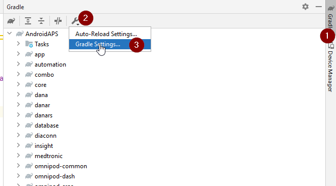
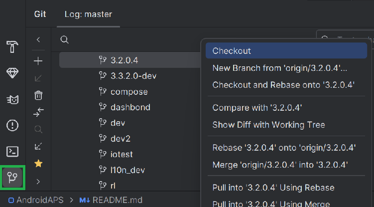
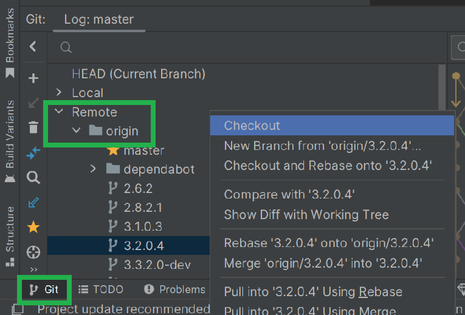
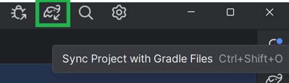
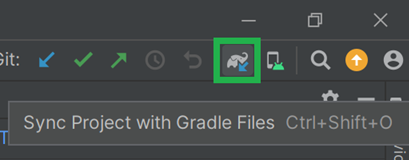

# AAPS 3.2.0.4로 업데이트

(update-aaps-3204)=

## 다운로드 대신 직접 빌드

**의료기기 관련 규정 때문에 AAPS 앱(apk 파일)은 다운로드할 수 없습니다. 본인이 사용하기 위해 앱을 빌드하는 것은 합법이지만, 다른 사람에게 복사본을 주어서는 안 됩니다!**

자세한 내용은 [FAQ 페이지](../UsefulLinks/FAQ.md)를 참조하십시오.

## AAPS 3.2.0.4 빌드를 위한 컴퓨터 및 소프트웨어 사양

* APK를 빌드하려면 특정 **[Android Studio](https://developer.android.com/studio/)** 버전이 필요할 수 있습니다.

| AAPS Version            | 권장<br/>Android Studio<br/>버전 | 대체<br/>Android Studio<br/>버전 | Gradle | JVM |
| ----------------------- | ---------------------------------------- | ---------------------------------------- | ------ |:--- |
| [3.2.0.4](#version3204) | Hedgehog (2023.1.1)                      | Meerkat까지                                | 8.2    | 17  |

"권장 버전"에는 알맞은 JVM 버전이 함께 들어 있습니다. 권장 버전은 **AAPS**를 빌드할 때 사용할 수 있는 최소 버전이기도 합니다. "권장" 버전보다 오래된 버전으로는 빌드할 수 **없습니다**. 다른 버전을 사용하면 JVM 버전과 관련된 문제가 생길 수 있습니다. 이 문제를 해결하려면 [Android Studio 문제 해결](#incompatible-gradle-jvm) 페이지를 참조하십시오. 현재 Android Studio 버전이 표에 없으면 먼저 Android Studio를 업데이트해야 합니다.

Gradle 버전은 소스 코드에 연결되어 있으므로, 소스 코드를 다운로드하거나 업데이트할 때 항상 올바른 Gradle 버전을 받게 됩니다. 여기서는 참고용으로만 적었으며, 따로 조치할 필요는 없습니다.

* Android Studio는 [Windows 32비트 시스템](#troubleshooting_androidstudio-unable-to-start-daemon-process)을 지원하지 않습니다. **64비트 CPU와 64비트 OS가 모두 필수 조건입니다.** 이 점을 꼭 기억하십시오. 시스템이 이 조건을 충족하지 않으면 해당 하드웨어나 소프트웨어 또는 시스템 전체를 바꿔야 합니다.

<table class="tg">
<tbody>
  <tr>
    <th class="tg-baqh">OS (64비트만)</th>
    <td class="tg-baqh">Windows 8 이상</td>
    <td class="tg-baqh">Mac OS 10.14 이상</td>
    <td class="tg-baqh">Gnome, KDE 또는 Unity DE를 지원하는 모든 Linux;&nbsp;&nbsp;GNU C Library 2.31 이상</td>
  </tr>
  <tr>
    <th class="tg-baqh"><p align="center">CPU (64비트만)</th>
    <td class="tg-baqh">x86_64 CPU 아키텍처; 2세대 Intel Core 이상, 또는 다음을 지원하는 AMD CPU: <br><a href="https://developer.android.com/studio/run/emulator-acceleration#vm-windows" target="_blank" rel="noopener noreferrer"><span style="text-decoration:var(--devsite-link-text-decoration,none)">Windows Hypervisor</span></a></td>
    <td class="tg-baqh">ARM 기반 칩, 또는 다음을 지원하는 2세대 Intel Core 이상: <br><a href="https://developer.android.com/studio/run/emulator-acceleration#vm-mac" target="_blank" rel="noopener noreferrer"><span style="text-decoration:var(--devsite-link-text-decoration,none)">Hypervisor.Framework</span></a></td>
    <td class="tg-baqh">x86_64 CPU 아키텍처; 2세대 Intel Core 이상, 또는 AMD 가상화(AMD-V)와 SSSE3를 지원하는 AMD 프로세서</td>
  </tr>
  <tr>
    <th class="tg-baqh"><p align="center">RAM</th>
    <td class="tg-baqh" colspan="3"><p align="center">8GB 이상</td>
  </tr>
  <tr>
    <th class="tg-baqh"><p align="center">디스크</th>
    <td class="tg-baqh" colspan="3"><p align="center">여유 공간 30GB 이상. SSD를 권장합니다.</td>
  </tr>
  <tr>
    <th class="tg-baqh"><p align="center">해상도</th>
    <td class="tg-baqh" colspan="3"><p align="center">최소 1280 x 800 <br></td>
  </tr>
  <tr>
    <th class="tg-baqh"><p align="center">인터넷</th>
    <td class="tg-baqh" colspan="3"><p align="center">광대역</td>
  </tr>
</tbody>
</table>

**AAPS APK 파일을 빌드할 때 시간이 덜 걸리므로 HDD(하드 디스크 드라이브) 대신 SSD(솔리드 스테이트 디스크)를 사용할 것을 강력히 권장합니다(필수는 아님).**  **AAPS** APK 파일을 빌드할 때 HDD를 사용해도 됩니다. 그렇게 하면 빌드 과정이 오래 걸릴 수 있지만, 일단 시작되면 그대로 두어도 됩니다.

## 3.2.0.4 빌드 중 도움과 지원

**AAPS** 앱을 빌드하다가 어려움이 생기면 먼저 별도의 [**Android Studio 문제 해결**](https://androidaps.readthedocs.io/en/3.2/GettingHelp/TroubleshootingAndroidStudio.html) 섹션을 참조하십시오.

빌드 안내에 틀리거나 빠졌거나 헷갈리는 내용이 있다고 생각되거나 여전히 해결이 어려우면 [Facebook](https://www.facebook.com/groups/AndroidAPSUsers) 또는 [Discord](https://discord.gg/4fQUWHZ4Mw)의 다른 **AAPS** 사용자 그룹에 문의하십시오. 직접 무언가를 바꾸고 싶다면(스크린샷 업데이트 _등_) [Pull Request(PR)](../SupportingAaps/HowToEditTheDocs.md)를 제출하십시오.

```{note}
이 페이지에는 새(**New**) Android Studio 사용자 인터페이스와 이전(**Classic**) 사용자 인터페이스의 예시 그림이 모두 있습니다.
```

## 3.2.0.x에서 3.2.0.4로 업데이트하는 과정 개요

```{contents} Steps for updating to 3.2.0.4
:depth: 1
:local: true
```

### 현재 설정 내보내기

휴대폰에 있는 기존 **AAPS** 버전에서 설정을 내보내십시오. 필요하지 않을 수도 있지만, 만일을 위해 해 두는 것이 좋습니다.

방법이 기억나지 않으면 [백업 만들기와 복원하기](ExportImportSettings.md) 페이지를 참조하십시오.

### 로컬 AAPS 복사본 업데이트

* Android Studio에서 기존 AAPS 프로젝트를 여십시오. 프로젝트를 선택해야 할 수도 있습니다. AAPS 프로젝트를 (더블) 클릭하십시오.


<br>


* Android Studio의 메뉴 표시줄에서 Git -> Fetch를 선택하십시오.


<br>


* 오른쪽 아래에 Fetch가 성공했다는 메시지가 표시됩니다.


<br>


* 이제 메뉴 표시줄에서 Git -> Pull을 선택하십시오.


<br>


* 모든 옵션은 그대로(origin/master) 두고 Pull을 선택하십시오.


<br>


* 다운로드가 진행되는 동안 기다리십시오. 진행 상황은 아래쪽 바에 정보로 표시됩니다. 다운로드가 끝나면 성공 메시지가 표시됩니다.

  ```{note}
  업데이트된 파일은 다를 수 있습니다! 문제가 있다는 뜻은 아닙니다.
  ```


<br>


* 일부 종속 항목을 다운로드하기 위해 Gradle Sync가 실행됩니다. 끝날 때까지 기다리십시오.


<br>


### JVM 버전 17 선택

- Android Studio 오른쪽의 코끼리(1)를 눌러 Gradle 보기를 열고, 설정(2)을 연 다음 **Gradle Settings**(3)를 선택하십시오:


<br>



- **Gradle JDK** 항목(1)에서 알맞은 버전인 **jbr-17**이 선택되어 있는지 확인하십시오. 선택되어 있지 않으면 항목을 클릭하고 목록에 이미 있는지 확인하십시오. 목록에 없으면(아래 스크린샷은 **jbr-21**만 있는 컴퓨터입니다) **Download JDK...** (2)를 선택하십시오.


- Version (1)에서 **17**을 선택하십시오. Vendor (2)에서 JetBrains Runtime 또는 아무 Vendor나 선택하십시오. Location(3): 바꾸지 마십시오.


- **OK**로 **Settings** 대화 상자를 닫으십시오.

### AAPS 3.2.0.4 브랜치 선택

- 왼쪽 아래에서 Git 기호를 선택하고, 3.2.0.4를 마우스 오른쪽 버튼으로 클릭한 다음 Checkout을 선택하십시오.



<br>



### 프로젝트를 Gradle과 동기화

```{admonition} WARNING!
:class: warning
**Gradle을 절대 업데이트하지 마십시오.** 항상 프로젝트와 동기화하십시오.
```

새 UI에서는 코끼리 아이콘을 누르고 Sync Project with Gradle Files를 선택하십시오(또는 [이 방법](#gradle-resync)을 따르십시오).



클래식 UI에서는 ([이 방법](https://androidaps.readthedocs.io/en/3.2/GettingHelp/TroubleshootingAndroidStudio.html#gradle-resync))을 따르십시오.



### 서명된 3.2.0.4 APK 빌드

이제 소스 코드는 현재 릴리스 버전이며, 모든 전제 조건을 확인했습니다. 이제 [서명된 APK 빌드 섹션](#Building-APK-generate-signed-apk)에 설명된 대로 서명된 APK를 빌드할 차례입니다.

### 3.2.0.4 APK 전송 및 설치

APK를 설치하려면 휴대폰으로 전송해야 합니다.

```{note}
Android Studio에서 기존과 같은 키 저장소로 빌드했다면 휴대폰의 기존 앱을 삭제할 필요가 없습니다. APK를 설치할 때 안내에 따라 업데이트를 설치하십시오.
서명된 APK를 위해 Android Studio에서 새 키 저장소를 만든 경우처럼 다른 상황에서는 APK를 설치하기 전에 이전 앱을 삭제해야 합니다. **반드시 설정을 내보내십시오!**
```

[AAPS 전송 및 설치](../SettingUpAaps/TransferringAndInstallingAaps.md) 안내를 참조하십시오.

### 휴대폰에서 AAPS 버전 3.2.0.4 확인

새 APK를 설치한 후 오른쪽 위의 점 세 개 메뉴를 누르고 정보를 누르면 휴대폰에서 AAPS 버전을 확인할 수 있습니다. 현재 버전이 표시되어야 합니다.

