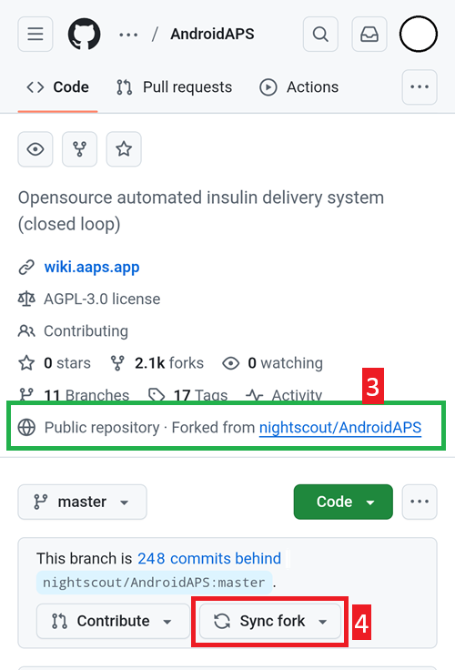
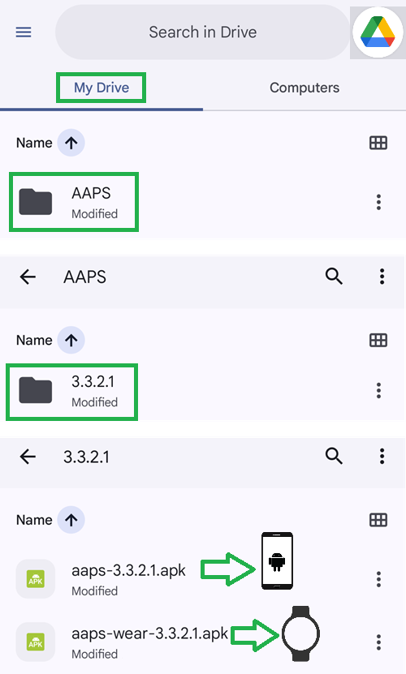

# 브라우저로 업데이트 (fork)

```{tip}
**AAPS Builder**로 AAPS를 빌드했습니까? 이 페이지는 필요하지 않습니다. [AAPS Builder로 AAPS 업데이트하기](#aaps-builder-updates)를 참조하십시오.
```

## 다운로드 대신 직접 빌드

**AAPS**는 의료기기 관련 규정 때문에 다운로드할 수 없습니다. 본인이 사용하기 위해 앱을 빌드하는 것은 합법이지만, 다른 사람에게 복사본을 주어서는 안 됩니다! 자세한 내용은 [FAQ 페이지](../UsefulLinks/FAQ.md)를 참조하십시오.

```{note}
브라우저로 **AAPS**를 처음 업그레이드하려면 백업해 둔 키 저장소 파일을 Google Drive에 복사하십시오. 그런 다음 이 안내 대신 [**AAPS** 브라우저 빌드 절차](../SettingUpAaps/BrowserBuild.md)를 따르십시오. 새 키 저장소를 만드는 대신 컴퓨터에서 복사해 온 키 저장소를 선택해야 합니다.
이 작업은 처음 한 번만 필요하며, 그다음 업그레이드부터는 이 안내를 따르면 됩니다.
```

```{tip}
**AAPS Builder로 바꾸시겠습니까?** [AAPS Builder](../SettingUpAaps/BrowserBuildAapsBuilder.md)는 더 간단한 브라우저 빌드입니다. 동기화할 fork가 없고, 앱을 GitHub에서 바로 다운로드합니다. 바꿀 필요는 없습니다. 이 안내는 계속 사용할 수 있습니다. 바꾸려면 먼저 [이전 브라우저 빌드에서 전환하는 경우](#aaps-builder-from-fork)에 설명된 대로 fork에서 키 저장소 복사본을 받으십시오. 그렇지 않으면 새 빌드로 휴대폰의 AAPS를 업데이트할 수 없습니다.
```

## 브라우저로 AAPS 새 버전으로 업데이트하는 과정 개요

```{contents} Steps for updating to a new version of AAPS
:depth: 1
:local: true
```

문제가 생기면 별도의 [브라우저 빌드: 문제 해결](../GettingHelp/BrowserBuildTroubleshooting.md) 페이지를 참조하십시오.

### 설정 내보내기

휴대폰에 있는 기존 **AAPS** 버전에서 설정을 내보내십시오. 필요하지 않을 수도 있지만, 만일을 위해 해 두는 것이 좋습니다.

방법이 기억나지 않으면 [백업 만들기와 복원하기](ExportImportSettings.md) 페이지를 참조하십시오.

(Update-to-new-version-update-your-repo)=
### GitHub 저장소 업데이트

[GitHub에 로그인](https://github.com/login)하십시오.

1. Repositories를 선택하십시오.
2. 아래로 스크롤하여 자신의 AndroidAPS 저장소를 선택하십시오.


3. 자신의 AndroidAPS 복사본(Forked from nightscout/AndroidAPS)을 사용하고 있는지 확인하십시오.
4. Sync Fork를 눌러 업데이트하십시오(뒤처진 커밋 수는 그림과 다를 수 있습니다).




5. Update Branch를 누르십시오.


참고: 실수로 AndroidAPS 복사본을 수정했다면 이 화면이 표시됩니다. 모든 변경 사항(커밋)을 버리고(Discard) 릴리스 버전으로 되돌리십시오.


이제 자신의 복사본을 **AAPS**의 최신 릴리스와 동기화(업데이트)했습니다. 잘하셨습니다.


### 서명된 APK를 빌드하는 워크플로 실행

1. GitHub에 있는 AndroidAPS 복사본에서 Actions를 선택하십시오.
2. All Workflows를 펼치십시오.
3. AAPS-CI를 선택하십시오.


4. 아래로 스크롤하여 Run Workflow를 누르십시오.


5. 브랜치는 master로 두십시오. **Select AAPS Version**에서 목록 맨 위에 있는 최신 버전 **4.0.0**이 선택되어 있는지 확인하십시오. 포크가 최신 상태가 아니면 미리 선택된 버전이 이전 버전입니다: 열린 양식 그대로 워크플로를 실행하면 그 이전 버전을 다시 빌드하게 되고 앱은 업데이트되지 않습니다. [변형](#browserbuild-variant)(fullRelease)을 선택한 다음 Run workflow를 누르십시오.

   ```{note}
   버전 목록은 포크에 있는 워크플로의 일부입니다. **4.0.0**이 없으면 포크가 아직 동기화되지 않은 것입니다: [GitHub 저장소 업데이트](#Update-to-new-version-update-your-repo)로 돌아가십시오.
   ```


6. Workflow run was successfully requested 메시지가 표시됩니다. 브라우저 페이지를 새로 고치면 빌드 진행 상황을 볼 수 있습니다. 작업이 끝나면 AAPS CI 작업에 녹색 체크 표시가 나타납니다. 업데이트된 **AAPS** 버전을 성공적으로 빌드했습니다. 이제 Master APK와 Wear APK가 Google Drive에 바로 저장된다는 뜻입니다(아래 참조). AAPSClient APK는 Github > nightscout > AndroidAPS [여기](https://github.com/nightscout/AndroidAPS/releases)에서 다운로드할 수 있습니다.


### AAPS APK 설치

1. Google Drive를 여십시오.
2. AAPS 폴더로 들어가 새 버전 폴더를 선택하면 휴대폰용 버전과 Android Wear용 버전이 모두 있습니다.



```{note}
2026년 9월부터 Google의 [Android 개발자 인증](#android-developer-verification) 때문에, 국가에 따라 파일을 눌러 APK를 설치하는 것이 막힐 수 있습니다. 무료 해결 방법은 그 페이지에 설명되어 있습니다.
```

[여기](#Update-to-new-version-check-aaps-version-on-phone)에서 계속하십시오.

(update-browser-build-troubleshooting)=

## Troubleshooting

문제가 생겨도 당황하지 마십시오.

숨을 한 번 고르십시오!

그런 다음 문제가 이미 문서에 있는지 확인하십시오. **AAPS Builder**로 빌드한다면 [AAPS Builder 문제 해결](#aaps-builder-troubleshooting)을, 그렇지 않으면 [브라우저 빌드 문제 해결](#aaps-ci-troubleshooting)을 참조하십시오.

더 도움이 필요하면 [Facebook](https://www.facebook.com/groups/AndroidAPSUsers) 또는 [Discord](https://discord.gg/4fQUWHZ4Mw)에서 다른 **AAPS** 사용자에게 문의하십시오.
