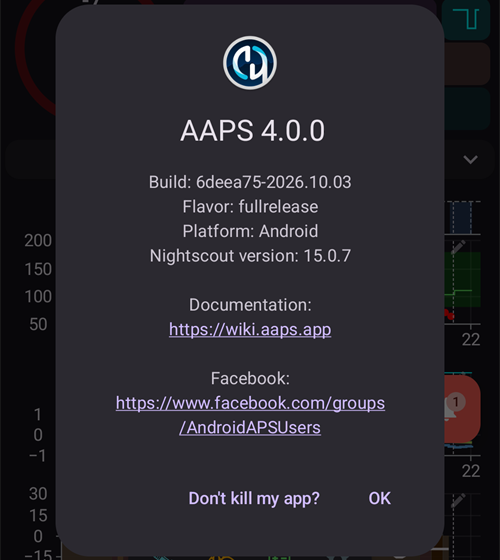

# 새 버전 또는 브랜치로 업데이트

## 다운로드 대신 직접 빌드

**AAPS**는 의료기기 관련 규정 때문에 다운로드할 수 없습니다. 본인이 사용하기 위해 앱을 빌드하는 것은 합법이지만, 다른 사람에게 복사본을 주어서는 안 됩니다! 자세한 내용은 [FAQ 페이지](../UsefulLinks/FAQ.md)를 참조하십시오.

## 중요사항

- 새 릴리스가 나오면 가능한 한 빨리 **AAPS** 새 버전으로 업데이트하십시오.
- 새 릴리스가 나오면 **AAPS** 앱 안에 새 버전에 대한 정보 배너가 표시됩니다.
- 새 버전은 릴리스 시점에 Facebook에도 공지됩니다.
- 릴리스가 나온 후에는 업데이트를 진행하기 전에 [릴리스 노트](ReleaseNotes.md)를 자세히 읽고, 궁금한 점은 Facebook 또는 Discord 커뮤니티에서 확인하십시오.
- **AAPS** 3.x에서 업데이트합니까? 먼저 [AAPS v4의 변경 사항](V4Changes.md)을 읽으십시오: 옮겨졌거나 이름이 바뀌었거나 삭제된 기능이 정리되어 있습니다.
- [설정을 내보내는 것](ExportImportSettings.md)을 잊지 마십시오. 업데이트 후 설정을 다시 가져올 때, 펌프 설정도 교체할지 선택합니다.

## 브라우저 빌드로 AAPS 업데이트

이미 브라우저로 AAPS 앱을 빌드했습니까? 사용한 방법에 맞는 안내를 따르십시오.

- **AAPS Builder**: 개인 저장소(보통 이름은 `my-aaps`)의 **Build AAPS** 페이지에서 빌드하고 GitHub에서 앱을 내려받습니다. [AAPS Builder로 AAPS 업데이트하기](#aaps-builder-updates)를 따르십시오. 동기화할 fork가 없습니다.
- **Fork와 준비 파일**: GitHub 계정에 있는 `AndroidAPS`라는 저장소, 즉 자신의 AndroidAPS 복사본(fork)에서 **AAPS-CI** 워크플로를 실행하며, 앱은 Google Drive에 저장됩니다. [브라우저로 업데이트 (fork)](./UpdateBrowserBuild.md)를 따르십시오.

## Android Studio로 AAPS 업데이트

[이 안내](./UpdateComputerBuild.md)를 따르십시오.

## 명령줄로 AAPS 업데이트

이전에 AAPS를 빌드할 때와 [같은 안내](../SettingUpAaps/CLIBuild.md)를 따르되, 새 변경 사항은 git으로 pull하십시오.

(Update-to-new-version-check-aaps-version-on-phone)=

## 업데이트 후

이 단계는 모든 빌드 방법에서 같습니다. 업데이트 후 따로 해야 할 일이 있는지 [릴리스 노트](../Maintenance/ReleaseNotes.md)에서 확인하십시오.

새 APK를 설치한 후:

- 왼쪽 위의 **메뉴**(☰)를 열고 **정보**를 누르면 휴대폰에서 **AAPS** 버전을 확인할 수 있습니다(아래 스크린샷 참조). 현재 **AAPS** 버전을 볼 수 있습니다.
- 설정을 가져왔는지 확인하십시오.
- **설정**에서 **AAPS** 설정을 확인하고 설정이 그대로 정확한지 확인하십시오.

