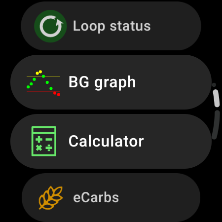
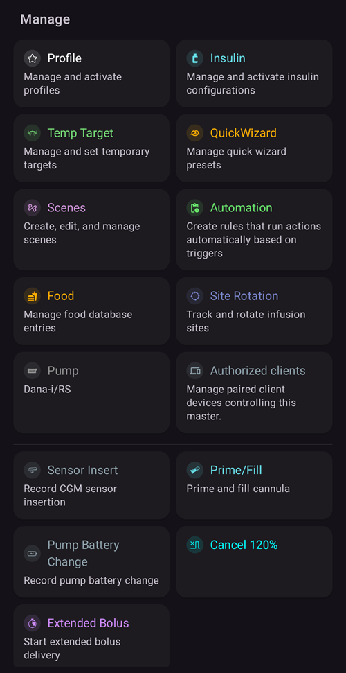

(v4-changes)=
# AAPS v4의 변경 사항

이 페이지는 **AAPS** v3과 v4 사이의 주요 **동작 변경 사항**을 모은 것입니다. 다르게 작동하는 것, 위치가 바뀐 것, 제거된 것을 정리하여 기존 사용자가 업데이트할 때 무엇이 달라지는지 알 수 있게 합니다. [릴리스 노트](ReleaseNotes.md)와 [업데이트 설명서](UpdateToNewVersion.md)도 참조하십시오.

```{contents} Table of contents
:depth: 2
:local: true
```

---

## NSClient v1이 제거되었습니다

**AAPS** v3에는 Nightscout 동기화 플러그인이 **두 개** 있었습니다:

- **NSClient** — 이전 클라이언트(이전 Nightscout REST / socket.io API, *“v1”*이라고도 함), 그리고
- **NSClientV3** — 새로운 Nightscout **API v3**용 클라이언트.

**AAPS** v4에서는 이전 **NSClient (v1)** 플러그인이 **제거되었습니다**. Nightscout와 동기화하는 플러그인으로는 **NSClientV3**만 남아 있습니다.

```{admonition} What you need to do
:class: important
여러분(또는 **AAPSClient** 팔로워)이 아직 이전 **NSClient (v1)** 플러그인으로 동기화하고 있었다면, 업데이트 전이나 후에 **NSClientV3**로 바꾸십시오:

- **[구성](../SettingUpAaps/ConfigBuilder.md) → 통신 → NSClientV3**을 여십시오.
- **Nightscout URL**과 **액세스 토큰**을 입력하십시오(NSClientV3는 이전 API secret이 *아니라* 액세스 토큰을 사용합니다. [토큰 만들기](https://nightscout.github.io/nightscout/security/#create-a-token) 참조).
- Nightscout 사이트가 **API v3**를 지원해야 합니다(Nightscout 15 이상).
- **websockets**를 사용한다면 마스터와 팔로워 **양쪽 모두**에서 켜거나 끄십시오. 한쪽에서만 켜면 안 됩니다.
- Websockets are **mandatory** for remote control from **AAPSClient**, on both phones.
```

이것은 앱이 Nightscout와 통신하는 방식에만 영향을 줍니다. Nightscout에 있는 데이터는 바뀌지 않습니다.

---

## 하단 내비게이션: 처치, 장면, 관리

**AAPS** v3에서는 한 줄로 된 **탭**(개요, 동작, 처치, …)으로 앱 안을 이동했고, 여러 기능이 구성 관리자(Config Builder)에서 켜는 **플러그인**이었습니다(**동작**, **자동화**, **음식**, …).

**AAPS** v4에서는 탭이 없어졌고, 구성 관리자에서 플러그인을 탭으로 표시하던 눈 모양 체크박스도 없어졌습니다. 기본 화면은 **개요**이며, **하단 내비게이션**에서 세 개의 시트를 열 수 있습니다. **동작, 자동화, 음식은 더 이상 플러그인이 아닙니다**. [구성](../SettingUpAaps/ConfigBuilder.md)(이름이 바뀐 구성 관리자)에서 켤 것이 없으며, 이 기능들은 이제 이 시트들 안에 있습니다.

(v4changes-treatments)=
### 처치 — 입력과 주입

**처치** 시트에서 처치를 기록하거나 주입합니다: **볼러스 마법사**, **인슐린**(수동 볼러스), **탄수화물**, **처치**(인슐린 + 탄수화물 함께), **보정**, **CGM**(CGM 앱이 설정된 경우 그 앱을 엽니다), 그리고 **[빠른 마법사](../DailyLifeWithAaps/QuickWizards.md)**.


**Wear OS 워치**에서는 같은 처치를 워치의 **AAPS 메뉴**에서 입력합니다(볼러스 마법사 / 계산기, eCarbs, 처치, …):



### 장면

상황별 프리셋입니다. [장면](../DailyLifeWithAaps/Scenes.md)을 참조하십시오.

(v4changes-manage)=
### 관리 — 관리와 활성화

**관리** 시트에서는 그 밖의 모든 것을 관리하고 활성화합니다: **[프로파일](../DailyLifeWithAaps/ProfileSwitch-ProfilePercentage.md)**, **인슐린 설정**(인슐린 구성), **[임시 목표](../DailyLifeWithAaps/TempTargets.md)**, **[빠른 마법사](../DailyLifeWithAaps/QuickWizards.md)** 프리셋, **[장면](../DailyLifeWithAaps/Scenes.md)**, **자동화**, **음식**, **위치 순환**, **펌프**, **[허가된 클라이언트](../RemoteFeatures/ClientMasterControl.md)**. 그리고 예전에 *동작* 탭에 있던 펌프 동작(**확장 볼러스**, **임시 기저 취소**, **프라임/채우기**, **센서 삽입**, **펌프 배터리 교체**)도 여기에 있습니다.



기존의 자동화 규칙과 음식 항목은 모두 유지됩니다. 이 기능들에 접근하는 방법만 바뀌었습니다.

(screens-action-tab)=
#### 동작 탭은 어디로 갔습니까?

**AAPS** 3.x에는 "동작" 탭이 있었습니다. **AAPS** 4에서는 그 기능들이 다른 곳에 있습니다:

* **프로파일 전환**과 **프로파일 퍼센트**: 메인 화면에서 [프로파일 이름](#aaps-screens-profile--target)을 누르거나 **관리 → 프로파일**을 사용하십시오. [프로파일 퍼센트 변경](#ProfileSwitch-change-percentage)을 참조하십시오.
* **임시 목표**: 메인 화면에서 [목표](#aaps-screens-profile--target)를 누르거나 **관리 → 임시 목표**를 사용하십시오.
* **프라임/채우기**, **센서 삽입**, **혈당 체크** 및 기타 케어포털 항목: 펼친 [상태 패널](#aaps-screens-careportal), **관리**, 또는 [QuickLaunch](../DailyLifeWithAaps/QuickLaunch.md) 버튼에서 사용할 수 있습니다.
* **이력 브라우저**, **통계**(TDD): **메뉴**(☰)에 있습니다.

```{admonition} Profile switch and profile percentage
:class: note
**AAPS** v3에서는 프로파일 이름을 길게 누르면 프로파일 전환 대화 상자(퍼센트, 기간, 활동 임시 목표)가 열렸습니다. **AAPS** v4에서는 프로파일 이름을 **누르고**(또는 **관리 → 프로파일**), 오른쪽 아래의 둥근 **▶** 버튼을 누르면 같은 설정이 열립니다. [프로파일 퍼센트 변경](#ProfileSwitch-change-percentage)을 참조하십시오.
```

---

(v4changes-read-only-management)=
## 설정 보안이 이제 관리 화면도 잠급니다

**AAPS** v3에서는 [설정 보안](#Preferences-settings-protection)이 설정을 열 때만 비밀번호를 요청했습니다. 그래서 비밀번호 없이도 **로컬 프로파일** 탭에서 프로파일을 추가하거나 편집할 수 있었습니다.

**AAPS** v4에서는 설정 보안이 관리 화면의 편집에도 적용됩니다: **프로파일**, **인슐린 설정**, **임시 목표**, **빠른 마법사**. 설정이 잠겨 있으면 이 화면들은 **읽기 전용**으로 열립니다:

- 항목을 둘러보고 **▶ 활성화**하거나 사용할 수 있습니다.
- **추가 / 편집 / 복사 / 삭제** 버튼은 **숨겨집니다**. 상단 바의 **✏️ 연필**만이 편집 잠금을 해제할 수 있음을 보여 줍니다.


```{admonition} What you need to do
:class: important
항목을 추가, 편집, 복사 또는 삭제하려면 상단 바의 **✏️ 연필**을 누르고 설정 비밀번호를 입력하십시오(또는 생체 인식을 사용하십시오). 그러면 버튼이 나타납니다.

설정을 보호할 필요가 없다면 **설정 → 보안**에서 설정 보안을 끌 수 있습니다.
```

---

(v4changes-active-insulin)=
## 사용 중인 인슐린은 편집할 수 없습니다

**AAPS** v3에서는 사용 중인 인슐린의 DIA를 언제든지 바꿀 수 있었습니다.

**AAPS** v4에서는 **관리 → 인슐린 설정**에서 **활성**으로 표시된 인슐린이 회색으로 표시되며, 편집하거나 삭제할 수 없습니다.

업그레이드할 때 **AAPS**는 v3 프로파일 전환에 이미 저장된 인슐린과 DIA를 그대로 유지합니다. 인슐린은 알지만 DIA를 모르는 이전 기록을 발견하면, 그 기록에는 기본 DIA를 사용하고 메시지를 한 번 표시합니다. 예: *이전 기록에는 인슐린 작용 시간이 없어서 Lyumjev에 9.0시간을 사용했습니다. 인슐린 설정을 확인하십시오. 이미 이전된 기록은 나중에 수정되지 않습니다.* 이 메시지가 보이면 인슐린 설정을 확인하십시오.

```{admonition} What you need to do
:class: important
DIA나 피크를 바꾸려면 **+**로 새 인슐린을 추가하고, 값을 조정하여 저장한 다음 **▶ 활성화**하십시오. [사용 중인 인슐린 변경](#Config-Builder-insulin-change-active)을 참조하십시오.
```

---

(v4changes-remote-control)=
## AAPSClient 원격 제어에는 페어링이 필요합니다

**AAPS** v3에서는 **AAPSClient**가 Nightscout에 케어포털 처치를 기록하는 방식으로 **AAPS**를 제어했으며, 볼러스를 주입할 수 없었습니다.

**AAPS** v4에서는 클라이언트와 메인 휴대폰을 한 번 **페어링**하며, 모든 명령에 서명이 붙습니다. 메인 휴대폰이 각 명령을 확인하고 승인하며, 이제 클라이언트에서도 볼러스를 주입할 수 있습니다.

- 각 클라이언트에는 할 수 있는 일을 제한하는 **[역할](#client-master-control-roles)**이 있습니다.
- 클라이언트 제어가 켜져 있는 동안 메인 휴대폰은 **[강화 모드](#client-master-control-hardened-mode)**에 있습니다. Nightscout에 직접 입력한 처치와 변경(웹사이트, 다른 앱)은 더 이상 적용되지 않습니다.
- 각 클라이언트는 필요한 권한만 가진 **[자체 Nightscout 토큰](#client-master-control-own-token)**을 받습니다.

```{admonition} What you need to do
:class: important
각 **AAPSClient**를 메인 휴대폰과 페어링하십시오: [마스터 ↔ 클라이언트 제어](#client-master-control)를 참조하십시오. 메인 휴대폰에 관리자 토큰이 있으면, 메인 휴대폰에 QR 코드가 표시되며 한 번 스캔으로 클라이언트를 설정하고 페어링할 수 있습니다. 예전에 Nightscout 웹사이트에서 처치를 입력했다면, 이제는 페어링된 클라이언트에서 입력하십시오.
```

---

## 혈당 데이터가 중복되면 이제 루프가 저혈당 주입 정지로 전환됩니다

**AAPS**가 같은 혈당 값을 두 번 받으면(하단 바의 혈당 출처 바로가기에 빨간 경고 배지가 표시됨) 추세를 신뢰성 있게 계산할 수 없으므로 교정 인슐린을 주지 않습니다.

**AAPS** v3에서는 이 일이 백그라운드에서 조용히 일어났습니다. 더 이상 교정할 수 없는데도 루프는 계속 **폐쇄 루프**로 표시되었습니다.

**AAPS** v4에서는 이 변경이 화면에 보입니다. 폐쇄 루프는 **저혈당 주입 정지** 모드로 전환되며, 루프 대화 상자에 그 이유가 표시됩니다: *"혈당 출처의 중복 값 때문에 LGS 모드"*. **AAPS**는 저혈당을 막기 위해 여전히 기저를 줄이거나 중지할 수 있습니다.

```{admonition} What you need to do
:class: important
중복된 혈당 값을 찾아 삭제하십시오. [혈당 경고 표시](#aaps-screens-bg-warning-sign)를 참조하십시오.

중복 값이 없어진 후에도 **AAPS**는 **저혈당 주입 정지** 상태로 남아 있습니다. 자동으로 **폐쇄 루프**로 돌아가지 않습니다. 루프 아이콘을 길게 누르고 다시 **폐쇄 루프**를 선택하십시오.
```

---

(v4changes-tidepool)=
## Tidepool: 이제 데이터가 기기 이름 AAPS로 표시됩니다

**AAPS** v3에서는 [Tidepool](../SettingUpAaps/Tidepool.md)에 업로드한 데이터가 Tidepool에서 다른 기기 이름으로 표시되었습니다.

**AAPS** v4에서는 데이터가 기기 이름 **AAPS**로 표시됩니다. 업데이트 후 **AAPS**는 Tidepool에서 새 데이터 세트를 시작합니다. 이전 데이터는 이전 기기 이름으로 Tidepool에 남아 있습니다.

```{admonition} What you need to do
:class: important
보통은 아무것도 할 필요가 없습니다. 새 데이터는 그냥 **AAPS** 아래에 나타납니다.

이전 데이터가 아직 Tidepool에 있는 동안에는 "**전체 동기화**"를 실행하지 **마십시오**. 같은 데이터가 두 번 들어가게 됩니다. 모든 데이터를 새 이름 아래에 두려면 먼저 [Tidepool 화면](#tidepool-menu)에서 "**모든 데이터 삭제**" 버튼을 사용한 다음(**AAPS**가 업로드한 이전 데이터도 삭제됩니다) "**전체 동기화**"를 실행하십시오. 휴대폰의 **AAPS**에 아직 저장되어 있는 데이터만 다시 업로드할 수 있습니다.
```

---


<!-- =====================================================================
     This page is a growing list of v4 behavioral changes.
     Add new changes as their own "## " section, newest grouping as agreed.
     Maintainers: relocate page + images and fix cross-links as needed.
     ===================================================================== -->
