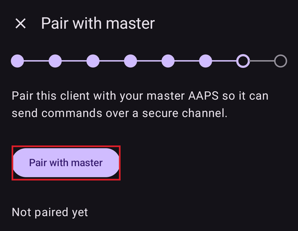

(aapsclient-app)=
# AAPSClient 앱

**AAPSClient**는 **AAPS**의 보조 앱입니다. 두 번째 휴대폰(보통 보호자의 휴대폰)에서 **AAPS** 사용자를 **팔로우**하는 동반 앱입니다. **AAPS** 버전 4부터 보호자는 서명된 명령으로 루프를 원격으로 **제어**할 수도 있습니다. 두 휴대폰은 **Nightscout** 사이트를 통해 통신하며, 휴대폰끼리 직접 연결할 필요는 없습니다.

```{admonition} Wording used on this page
:class: note
- **클라이언트** = **AAPSClient**를 실행하는 휴대폰.
- **마스터** = 펌프를 가지고 루프를 실행하는 메인 **AAPS** 휴대폰.
```

```{admonition} Which devices can run AAPSClient?
:class: note
From **AAPS** version 4, **AAPSClient** runs on Android phones and tablets, on Wear OS watches and on computers (Windows, Mac and Linux). On an iPhone there is no ready-made download: you build the app yourself. See the [table of downloads by device](#aapsclient-platforms).
```

```{contents} Table of contents
:depth: 2
:local: true
```

## AAPSClient가 하는 일 (그리고 하지 않는 일)

**AAPSClient**는 **AAPS**와 비슷하게 보이고 비슷하게 작동하지만, **자체 루프가 없습니다**:

- **APS 알고리즘이 없고**, **목표**도 없으며, **펌프 드라이버도 없습니다**. 스스로 인슐린을 주입하는 일은 절대 없습니다.
- 메인 앱에서만 쓰는 플러그인(**SMS 통신기**, **Tidepool**, **Open Humans**)도 포함되어 있지 않습니다.
- 포함되어 *있는* 것: **NSClientV3** 동기화, 혈당 출처 플러그인, **xDrip+** 브로드캐스트, **Wear OS** / **Garmin** 연결 기능. 팔로우하고 명령을 전달하는 데 필요한 모든 것입니다. 클라이언트에 연결된 **Garmin** 워치는 데이터를 표시할 수 있지만, 워치에서 보낸 탄수화물은 입력되지 않으며 펌프를 연결하거나 연결 해제할 수 없습니다. 클라이언트에 메시지가 표시되며, 이런 입력은 **AAPS**에서 하십시오.

**AAPSClient**에서 시작하는 모든 것은 마스터(펌프가 있는 휴대폰)가 확인하고, 제한하고, 승인하고, **마스터가 실행합니다**. 전용 페이지 [마스터 ↔ 클라이언트 제어](ClientMasterControl.md)에서 이것이 어떻게 작동하는지 설명합니다: 두 휴대폰을 페어링하는 방법, 화면에 보이는 확인 문구를 마스터가 어떻게 작성하는지, 클라이언트에서 시작한 볼러스가 어떻게 주입되는지, 마스터가 오프라인일 때 어떻게 되는지.

## 버전: AAPSClient, AAPSClient2, AAPSClient3

같은 팔로워 휴대폰에 클라이언트 앱을 최대 세 개까지 함께 설치할 수 있으며, 각 앱은 **서로 다른** 사람을 팔로우합니다: **AAPSClient**(노란 부엉이 아이콘), **AAPSClient2**(파란 부엉이), 그리고 **AAPS** 버전 4에서 새로 추가된 **AAPSClient3**(초록 부엉이). 세 앱의 기능은 똑같습니다. 이름과 색(앱 아이콘, 위젯 배경, 홈 화면의 상태 영역)만 달라서 서로 구별할 수 있습니다. 각 앱은 자기 마스터와 페어링됩니다. 자세한 내용은 [AAPSClient, AAPSClient2 및 AAPSClient3 정보](#remotecontrol-aapsclient-versions)를 참조하십시오.

(aapsclient-platforms)=
## 앱 받기

All the ready-made files are in the *Assets* list of the latest release on [GitHub](https://github.com/nightscout/AndroidAPS/releases/) (click *Assets* at the bottom of the release to expand it). In the table, *x.y.z* stands for the version number. Choose the file that matches your device:

| 장치                      | File to download                    | 참고                                                                                                                                                                                           |
| ----------------------- | ----------------------------------- | -------------------------------------------------------------------------------------------------------------------------------------------------------------------------------------------- |
| Android phone or tablet | `app-aapsclient-release_x.y.z.apk`  | Install it like the main app: see [Download and installation of AAPSClient](#RemoteControl_aapsclient) and [Transferring and installing](../SettingUpAaps/TransferringAndInstallingAaps.md). |
| Wear OS watch           | `wear-aapsclient-release_x.y.z.apk` | Goes with the AAPSClient app on the phone. See [Wear OS smartwatch](../WearOS/WearOsSmartwatch.md).                                                                                          |
| Windows computer        | `AAPSClient-x.y.z.msi`              | Open the file to install.                                                                                                                                                                    |
| Mac                     | `AAPSClient-x.y.z.dmg`              | See the note on macOS below the table.                                                                                                                                                       |
| Linux (Debian, Ubuntu)  | `aapsclient_x.y.z_amd64.deb`        | Install it with your package manager.                                                                                                                                                        |
| iPhone                  | none                                | There is no App Store version and no download. You build the app yourself, see [AAPSClient on an iPhone](#aapsclient-iphone).                                                                |

**Following two people?** Each file above also exists as *aapsclient2* / *AAPSClient2*. It is a second client app that installs next to the first one, so one device can follow two people (see [About AAPSClient, AAPSClient2 and AAPSClient3](#remotecontrol-aapsclient-versions)). **AAPSClient3** is not in the release assets: build it yourself ([build variants](#browserbuild-variant)).

**Files to ignore:** the *pumpcontrol* files (`app-pumpcontrol-release_…`, `wear-pumpcontrol-release_…`) are not a client. Leave them out.

**Mac: the first start.** The app is not notarized by Apple, so macOS blocks it the first time you open it. Click *Done*, then open *System Settings → Privacy & Security*, scroll down and click *Open Anyway*.

**Computer: how to connect.** A computer has no camera, so the QR code cannot be scanned. Set up **Nightscout** in the client, then on the master add the client with a **PIN** and type the 8-digit PIN in the client (**Pair with master**). See [Pairing with the master](#aapsclient-pairing-with-the-master).

**Same version everywhere.** The master and all its clients must run the same **AAPS** version. When you update the master, update the clients too.

(aapsclient-iphone)=
### AAPSClient on an iPhone

There is no **AAPSClient** in the App Store and no ready-made file to download, so you build the app yourself:

- You need a Mac with **Xcode** and an Apple developer account.
- The project is the `ios` folder of the [AndroidAPS repository on GitHub](https://github.com/nightscout/AndroidAPS/tree/master/ios).
- A build for a real iPhone is signed with your own Apple developer team. A build for the iPhone simulator does not need one.
- There is no step-by-step guide yet. This page will be updated when there is one.

The iPhone version pairs with the master like the others. Unlike the computer versions, the iPhone can scan the master's QR code with its camera.

## 첫 시작: 더 짧은 설정 마법사

처음 시작할 때 **AAPSClient**는 **AAPS**에서 익숙한 **설정 마법사**를 실행하지만, 단계가 훨씬 적습니다. 팔로워에는 프로파일, 인슐린, 펌프, APS, 목표 설정이 없습니다:

1. **환영합니다**, **최종 사용자 라이선스 계약**, **권한**, **마스터 비밀번호** — 메인 앱과 같습니다. [AAPS 설정 마법사](../SettingUpAaps/SetupWizard.md)를 참조하십시오.
2. 클라이언트는 **단위**나 **저혈당/고혈당 선**을 묻지 **않습니다**. Nightscout에 연결되는 즉시 메인 휴대폰에서 가져옵니다. 나중에 **설정**에서 볼 수 있으며, 작은 **휴대폰 아이콘**이 그 값이 [메인 휴대폰과 동기화됨](#client-master-config-prefs)을 보여 줍니다. 이 값은 마스터에 연결할 수 있을 때만 편집할 수 있습니다.
3. **마스터에서 설정** — 마스터에서 **관리 → 허가된 클라이언트**를 열고 **QR 코드**로 이 휴대폰을 추가한 다음, 여기에서 **QR 코드 스캔**을 누르십시오. 한 번 스캔하면 이 휴대폰 전용 토큰으로 Nightscout가 설정되고, 페어링 코드인 경우 휴대폰 페어링도 함께 됩니다. 휴대폰은 마스터에서 추가할 때 사용한 이름을 인스턴스 이름으로 가져옵니다(악센트가 있는 글자는 일반 글자로 바뀝니다. "Miloš"는 "Milos"가 됩니다). **스캔이 끝나면 설정이 완료됩니다**. 다음 단계는 코드가 한 일을 보여 주기만 하므로 마법사가 닫힙니다. QR 코드가 없으면 이 단계를 건너뛰십시오. (Not on a computer: it has no camera, see [Getting the app](#aapsclient-platforms).)

   

4. **통신** — 플러그인 목록에는 팔로워에게 필요한 것만 있습니다(NSClientV3, xDrip+, 워치, 외부 연동 앱, Garmin). QR 코드를 스캔하지 않았다면 **NSClientV3**를 켜고, 메인 휴대폰과 **같은 Nightscout URL**과 액세스 토큰을 입력하고, **websockets**를 켜십시오. [동기화](#RemoteControl_aapsclient)에 설명된 그대로 하십시오.

   

5. **마스터와 페어링** — 이 단계는 클라이언트에**만** 있습니다. PIN을 사용하여 보안 명령 채널로 이 기기를 마스터에 연결하고, QR 코드와 마찬가지로 마스터에서 추가할 때 사용한 휴대폰 이름을 가져옵니다. **페어링이 끝나면 설정이 완료됩니다.** 이 단계를 건너뛰고 나중에 언제든지 **관리 → 마스터와 페어링**에서 페어링할 수도 있습니다.

   

6. **이 휴대폰은 누가 사용합니까?** — 마법사에서 페어링하지 않은 경우에만 나타납니다. 이 휴대폰을 사용하는 사람의 이름입니다. 보고서와 동기화에서 이 인스턴스를 구별하는 데 쓰입니다.

(aapsclient-pairing-with-the-master)=

## 마스터와 페어링하기

**마스터**에서 **관리 → 허가된 클라이언트**를 열고 클라이언트를 추가하십시오. 페어링하는 방법은 두 가지입니다:

- **QR 코드로**(휴대폰에 카메라가 있으면 가장 빠름): 마법사 단계 "**마스터에서 설정**" 또는 **관리 → 마스터와 페어링 → QR 코드 스캔**에서 코드를 스캔하고 "**사용**"으로 확인하십시오. Nightscout도 함께 설정됩니다.
- **PIN으로**: **클라이언트**에서 위의 마법사 단계(또는 **관리 → 마스터와 페어링**)를 열고, 마스터에 표시된 일회용 PIN을 입력한 다음 "**페어링**"을 누르십시오. 그러면 클라이언트가 신뢰하려는 대상을 보여 줍니다. "**페어링**"으로 확인하십시오:


마법사에서 페어링에 성공하면 설정이 끝나고 홈 화면이 열립니다. 마스터에서는 [허가된 클라이언트](#client_master_master_setup) 목록에 클라이언트가 **활성**으로 표시됩니다. 그 후 **관리 → 마스터와 페어링**에는 "*이미 페어링됨*", 휴대폰의 역할, 강화 모드가 켜져 있는지가 표시됩니다:

 전체 페어링 절차, 보안 세부 사항, 문제 해결은 [마스터 ↔ 클라이언트 제어](#client_master_client_setup)에 있습니다.

페어링 후 클라이언트는 마스터로부터 자체 Nightscout 토큰을 받고(마스터에 관리자 토큰이 있는 경우), 이 토큰에는 클라이언트에 필요한 권한만 있습니다. 이후 클라이언트는 직접 입력했던 토큰을 더 이상 사용하지 않습니다. **AAPSClient**는 처치나 혈당을 Nightscout에 직접 기록하지 않습니다. 하는 모든 일은 마스터로 보내지고, 마스터가 기록합니다. [클라이언트의 자기 Nightscout 토큰](#client-master-control-own-token)을 참조하십시오.

마스터는 **[역할](#client-master-control-roles)**(읽기 전용, 식사, 보호자, 관리자)로 이 휴대폰이 할 수 있는 일을 정합니다. **관리 → 마스터와 페어링**에 휴대폰의 역할이 표시됩니다.

## 홈 화면

클라이언트의 홈 화면은 팔로우하는 루프를 그대로 보여 줍니다:


- **혈당, 그래프, IOB/COB, 프로파일**은 마스터가 업로드한 그대로 Nightscout에서 가져옵니다.
- 표시되는 **루프 상태**는 **마스터의** 상태입니다(클라이언트에는 자체 루프가 없습니다). 클라이언트가 Nightscout에서 마스터의 실행 모드를 받기 전까지는 실행 모드 칩에 **물음표**(알 수 없음)가 표시됩니다.
- **상태 카드**에는 Nightscout 기기 상태에서 가져온 **팔로우하는 펌프의** 레저버와 배터리, 업로더 배터리가 표시됩니다. 클라이언트에는 펌프가 없으므로 로컬 펌프 상태도 없고, 앱 어디에도 펌프 관리가 없습니다.
- 하단 바에는 클라이언트가 페어링되면 **처치**, **장면**, **관리**가 있습니다(페어링 전에는 **관리**만). 펌프 탭이나 목표 탭은 없습니다.

## 처치와 동작

**관리** 아래의 모든 것은 메인 앱과 같이 작동하지만, 한 가지 중요한 차이가 있습니다. 클라이언트에서는 치료를 바꾸는 동작(볼러스, 탄수화물, 임시 목표, 장면…)이 **기기가 페어링될 때까지 숨겨지며**, 페어링된 후에는 확인과 실행을 위해 **마스터로 전달됩니다**. [원격 제어 사용](#client-master-control)을 참조하십시오.

**프로파일** 항목은 예외입니다. **페어링되지 않은** 클라이언트에서도 표시되지만 **보기 전용**으로 열립니다. 클라이언트는 Nightscout를 통해 받은 프로파일을 편집 버튼이나 활성화 버튼 없이 보여 줍니다(클라이언트 자체 계산에 프로파일이 필요합니다). 클라이언트가 **페어링되면** 프로파일 목록이 마스터와 동기화되며, 다른 원격 동작처럼 클라이언트에서 프로파일을 편집하고 활성화할 수 있습니다.

**페어링되지 않은** 클라이언트에서 **관리**에는 **프로파일**과 **마스터와 페어링**만 있습니다:


빨간 배너 "*마스터 장치에 연결할 수 없습니다. 연결이 복구될 때까지 편집할 수 없습니다.*"는 페어링되지 않은 클라이언트에도 나타납니다. 이것은 정상입니다. 아직 연결할 마스터가 없기 때문입니다. 클라이언트가 페어링되고 마스터가 온라인이 되면 배너가 사라집니다.

클라이언트가 페어링되면 치료 동작이 나타납니다:


**펌프 항목이 없습니다**. 클라이언트에는 펌프가 없기 때문입니다.

마스터에 연결할 수 없으면 페어링된 클라이언트에도 같은 배너가 나타납니다. 치료 동작이 회색으로 표시되고, 시도하는 모든 동작은 보내기 전에 차단됩니다. 클라이언트는 동작을 시도할 때 마스터가 오프라인임을 알게 되며, 마스터가 다시 온라인이 되면 동작을 다시 사용할 수 있게 합니다.


## 마스터와 동기화되는 설정

활성 플러그인 **구성**과 많은 **설정**은 마스터와 페어링된 클라이언트 사이에서 동기화됩니다. 동기화되는 항목은 작은 **휴대폰 아이콘**으로 표시되며, 마스터에 연결할 수 없는 동안에는 사용할 수 없습니다("*마스터 장치에 연결할 수 없습니다*" 배너가 표시됨). 이 내용은 [구성 및 설정 변경](#client-master-config-prefs)에 설명되어 있습니다.

## 스마트워치에서 AAPSClient 사용

Wear OS 워치를 **클라이언트** 휴대폰과 페어링할 수 있습니다. 워치의 동작은 클라이언트를 거쳐 마스터로 전달됩니다. [Wear OS](../WearOS/WearOsSmartwatch.md)와 [원격 제어의 스마트워치 옵션](#RemoteControl_smartwatches)을 참조하십시오.
