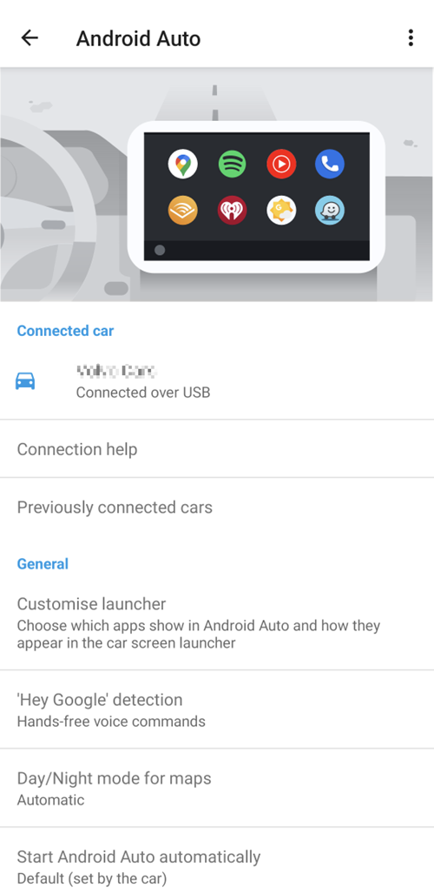

# Android Auto

**AAPS**는 현재 상태 정보를 메시지로 차의 Android Auto에 직접 보낼 수 있습니다.

## 요구 사항

**AAPS**는 Android Auto의 한 기능을 사용합니다. 이 기능은 휴대폰 앱의 메시지를 차 오디오 시스템의 화면으로 보냅니다.

이것은 다음을 의미합니다:

* Android가 **AAPS**의 알림 표시를 허용해야 하며
* **AAPS**는 공식 앱이 아니므로 Android Auto에서 "unknown sources"(알 수 없는 출처)의 사용을 허용하십시오.

(androidauto-check-that-aaps-can-show-notifications)=

## AAPS가 알림을 표시할 수 있는지 확인

**AAPS**는 현재 혈당, IOB, COB가 담긴 상태 알림을 항상 표시합니다. 이 알림이 Android Auto가 차에서 표시하는 알림입니다. **AAPS**에서 켤 것은 없습니다. 하지만 Android가 **AAPS**의 알림 표시를 허용해야 합니다.

휴대폰에서 **Settings**(설정) > **Apps**(앱) > **AAPS** > **Notifications**(알림)을 열고 **All AAPS notifications**(모든 AAPS 알림)가 켜져 있는지 확인하십시오.

아래로 스크롤하여 **지속 상태**가 켜져 있는지 확인하십시오. 이것이 상태 알림의 채널입니다.

차로 가기 전에 휴대폰에 **AAPS** 상태 알림이 보이는지 지금 확인하십시오!

(androidauto-allow-the-use-of-unknown-sources-with-android-auto)=

## Android Auto에서 "unknown sources"(알 수 없는 출처)의 사용 허용

**AAPS**는 공식 Android Auto 앱이 아니므로 Android Auto에서 "unknown sources"(알 수 없는 출처)에 대한 알림을 활성화해야 합니다. 이 작업은 개발자 모드를 사용하여 합니다. 여기에서 방법을 보여 드립니다.

차로 가서 휴대폰을 차의 오디오 시스템에 연결하십시오.

이제 이 화면과 비슷한 화면이 보입니다.

**설정** 아이콘을 눌러 설정을 시작하십시오.

페이지 맨 아래까지 스크롤하고 **see more in the phone**(휴대폰에서 더 보기)을 선택하십시오.

이제 휴대폰에서 개발자 모드를 활성화합니다.

첫 화면은 이렇게 보입니다. 페이지 맨 아래까지 스크롤하십시오.

그곳에 Android Auto의 버전이 표시됩니다. Android Auto의 버전을 10번(열 번) 누르십시오. 이 숨겨진 조작으로 이제 개발자 모드가 활성화되었습니다.

"Allow development settings?"(개발 설정을 허용하시겠습니까?) 대화 상자에서 개발자 모드를 활성화한다고 확인하십시오.

**developer settings**(개발자 설정)에서 "Unknown sources"(알 수 없는 출처)를 활성화하십시오.

이제 원하면 개발자 모드를 종료해도 됩니다. 이렇게 하려면 오른쪽 위의 점 세 개 메뉴를 누르십시오.

## 차에서 알림 표시

차의 Android Auto에서 오른쪽 아래에 있는 **숫자 아이콘**을 누르십시오.

CGM 데이터는 다음과 같이 표시됩니다:

(android-auto-troubleshooting)=

## 문제 해결:

* 알림이 보이지 않으면, Android에서 [AAPS의 알림 표시를 허용했는지](#androidauto-check-that-aaps-can-show-notifications), 그리고 [Android Auto에 알림 접근 권한이 있는지](#androidauto-allow-the-use-of-unknown-sources-with-android-auto) 확인하십시오.