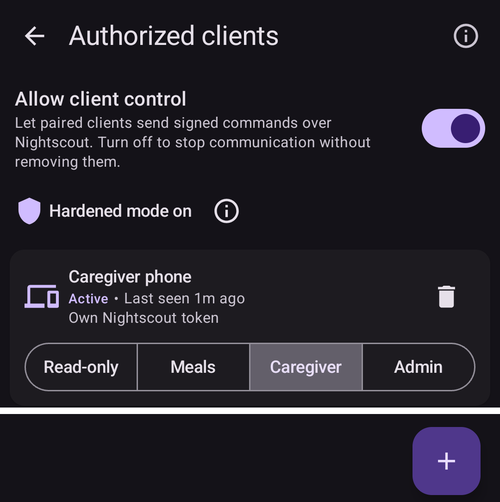
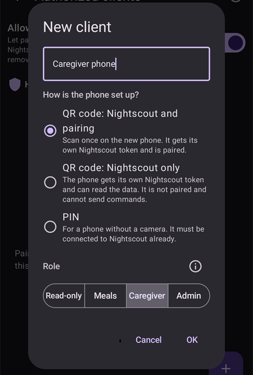
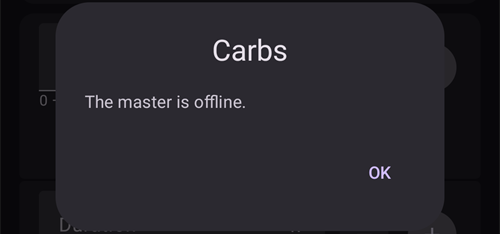

(client-master-control)=
# 마스터 ↔ 클라이언트 제어 (서명된 원격 제어)

**AAPS** 버전 4부터 **AAPSClient**를 실행하는 팔로워 휴대폰은 Nightscout를 통해 처치를 *알리는* 것보다 훨씬 많은 일을 할 수 있습니다. 메인 휴대폰과 **페어링**하면 **서명된 명령**을 보낼 수 있습니다. 메인 휴대폰(**마스터**)은 이 명령을 검사하고, 확인하고, 실행합니다. 마스터의 펌프로 **인슐린 볼러스**를 주입하는 것도 포함됩니다.

이 페이지는 작동 방식과 설정 및 사용 방법을 설명합니다.

```{contents} Table of contents
:depth: 2
:local: true
```

```{admonition} Wording used on this page
:class: note
- **마스터** = 펌프를 가지고 루프를 실행하는 메인 **AAPS** 휴대폰(`full` 앱)입니다.
- **클라이언트** = 펌프가 없는 **AAPSClient** 휴대폰입니다. 마스터를 팔로우하며, 이제 마스터를 *제어*할 수도 있습니다.
- 두 휴대폰은 **같은 Nightscout** 사이트에 연결되어 있어야 합니다. 모든 통신은 여전히 Nightscout를 통해 이루어집니다. 휴대폰끼리 직접 연결할 필요는 없습니다.
```

---

## 작동 방식

```{admonition} Coming from AAPS v3?
:class: note
**AAPS** v3에서 **AAPSClient**는 서명되지 않은 케어포털 처치만 Nightscout에 기록할 수 있었고, 볼러스를 주입할 수 없었습니다. 이제 원격 제어를 하려면 한 번 [페어링](#client_master_master_setup)해야 합니다. [AAPS v4의 변경 사항](#v4changes-remote-control)도 참조하십시오.
```

**AAPS** v4는 전용 **Client-Control** 채널을 사용합니다. 이 채널은 여전히 Nightscout 사이트(`settings` 컬렉션)를 통해 전달됩니다. 하지만 모든 메시지는 두 휴대폰만 아는 비밀 키로 **암호화 서명**됩니다. 비밀 키는 **페어링** 중에 한 번 전달되고, 그 직후 새 비밀 키로 바뀝니다. 따라서 비밀 키는 절대 평문으로 전송되지 않습니다.

기본 원칙은 **마스터가 결정한다**는 것입니다:

1. 클라이언트는 *요청*을 보냅니다(“볼러스 2 U”, “운동 장면 시작”, “이 임시 목표 설정”…).
2. **마스터**는 **자신의** 실시간 데이터(프로파일, IOB, COB, 현재 임시 목표, 펌프)로 동작을 다시 계산하고 **제한**합니다. 그리고 사용자가 보게 될 **정확한 확인 내용을 작성**합니다.
3. 클라이언트(또는 워치)는 **마스터의** 확인 텍스트를 표시합니다. 자체 확인 텍스트를 만들지 않습니다.
4. 확인하면 마스터가 **한 번 실행**하고 결과를 클라이언트에 다시 알립니다.

사용자에게 의미하는 것:

- **서명된 명령**: 페어링한 클라이언트만 명령을 보낼 수 있습니다(클라이언트별 페어링 비밀 키와 서명). 오래된 명령이나 재전송된 명령은 거부됩니다.
- **클라이언트마다 역할**: 각 클라이언트가 무엇을 할 수 있는지 *읽기 전용*부터 *관리자*까지 직접 정합니다. [클라이언트 역할](#client-master-control-roles)을 참조하십시오.
- **클라이언트에서 인슐린 볼러스**: 마스터가 자기 펌프로 주입하고, 클라이언트는 주입 진행 상황을 표시합니다.
- **마스터가 결정합니다**: 마스터는 모든 동작을 자신의 제한에 맞춰 제한하고, 클라이언트에 표시되는 확인 내용을 작성합니다.
- **페어링된 클라이언트만 치료를 변경합니다**: 클라이언트 제어가 켜져 있는 동안 마스터는 Nightscout에 직접 입력된 처치나 변경을 더 이상 받지 않습니다. [강화 모드](#client-master-control-hardened-mode)를 참조하십시오.
- **각 클라이언트는 자기 Nightscout 토큰을 받습니다**. 이 토큰에는 클라이언트에 필요한 권한만 있습니다. [클라이언트의 자기 Nightscout 토큰](#client-master-control-own-token)을 참조하십시오.
- **마스터 오프라인**: 동작이 차단되고 명확한 메시지가 표시됩니다.
- **클라이언트 접근 취소**는 (클라이언트마다) 한 번 탭으로 됩니다. 또는 마스터의 스위치로 모든 클라이언트를 멈출 수 있습니다.

클라이언트에서 실행할 수 있는 동작: **볼러스**, **탄수화물 / eCarbs**, **임시 목표**(설정 및 취소), **프로파일 전환**, **루프 / 실행 모드** 변경, **임시 기저**(설정 및 취소), **확장 볼러스**(설정 및 취소), **인슐린 선택**, **[장면](../DailyLifeWithAaps/Scenes.md)**. 양방향 **설정**의 일부도 마스터와 클라이언트 사이에서 동기화됩니다.

---

## 역할과 전제 조건

```{admonition} Before you start
:class: important
- **마스터**는 일반 `full` **AAPS** 빌드를 실행하며 펌프에 연결되어 있습니다.
- **마스터**는 Nightscout와 함께 **NSClientV3**를 사용하며 *연결됨*으로 표시됩니다. 마스터에 Nightscout의 **관리자 토큰**을 주십시오. 그러면 마스터가 각 클라이언트용 토큰을 직접 만들어 QR 코드로 클라이언트에 보여 줄 수 있습니다.
- **클라이언트**는 **[AAPSClient](AapsClient.md)**를 실행합니다(다른 환자용으로 **AAPSClient2** / **AAPSClient3**도 가능합니다. [AAPSClient, AAPSClient2, AAPSClient3 정보](#remotecontrol-aapsclient-versions)를 참조하십시오). 클라이언트는 **같은** Nightscout를 사용해야 합니다. 마스터의 QR 코드로 설정하면 클라이언트는 Nightscout 주소와 토큰을 마스터에서 받습니다. 그렇지 않으면 먼저 클라이언트에서 **NSClientV3**를 직접 설정하십시오.
- 두 휴대폰 모두 **웹소켓**이 필요합니다. 명령은 웹소켓 연결을 통해서만 마스터에 도착합니다. 클라이언트 제어가 켜져 있는 동안 **AAPS**는 마스터와 페어링된 클라이언트에서 웹소켓을 켜 둡니다.
```

페어링과 동기화는 서로 다른 것입니다:

- **동기화**(데이터: 혈당, 처치, 프로파일)는 전과 같이 설정합니다. [동기화](#RemoteControl_aapsclient)를 참조하십시오. 마스터의 QR 코드로 클라이언트에서 이 설정을 대신 할 수 있습니다.
- **페어링**(제어: 여기에서 설명하는 서명된 명령 채널)은 아래의 새 단계입니다.

---

## 설정하기

(client_master_master_setup)=
### 1. 마스터에서 — 제어를 활성화하고 클라이언트 추가

마스터에서 **관리** 화면을 열고 **허가된 클라이언트**를 선택하십시오.

**클라이언트 제어 허용**을 켜십시오(기본값은 **꺼짐**입니다). 이것이 마스터의 비상 스위치입니다. 이 스위치가 꺼져 있으면 어떤 클라이언트도 명령을 보낼 수 없습니다. 하지만 페어링된 클라이언트는 유지되므로 나중에 다시 켤 수 있습니다. 이 스위치를 켜면 [강화 모드](#client-master-control-hardened-mode)도 켜집니다. "*강화 모드 켜짐*"으로 표시되며, **(i)**를 누르면 설명이 나옵니다. [간단 모드](#preferences-simple-mode)에서는 클라이언트 제어가 항상 켜져 있으므로 스위치가 표시되지 않습니다.



**+** 버튼(오른쪽 아래)을 눌러 클라이언트를 추가하십시오. **새 클라이언트** 대화 상자에서:

1. 목록에서 알아볼 수 있도록 **기기 이름**을 입력하십시오.
2. **휴대폰을 설정하는 방법**을 선택하십시오(아래 표 참조).
3. **[역할](#client-master-control-roles)**을 선택하십시오. 미리 선택된 것은 없습니다. 알맞은 역할은 누가 그 휴대폰을 사용하는지에 따라 다릅니다.



| 방법                          | 새 휴대폰이 받는 것                                     | 사용하는 경우                                                                   |
| --------------------------- | ----------------------------------------------- | ------------------------------------------------------------------------- |
| **QR 코드: Nightscout 및 페어링** | Nightscout 주소, 자기 Nightscout 토큰, 페어링을 한 번의 스캔으로 | 새 휴대폰에 카메라가 있는 경우: 가장 빠른 방법이며 입력할 것이 없습니다                                 |
| **QR 코드: Nightscout만**      | Nightscout 주소와 자기 Nightscout 토큰, 페어링 없음         | 휴대폰이 데이터를 **표시**만 하고 명령을 절대 보내지 않아야 하는 경우                                 |
| **PIN**                     | 페어링만; 기존 Nightscout 설정은 그대로 유지됩니다               | 휴대폰에 카메라가 없는 경우(또는 마스터가 토큰을 만들 수 없는 경우); 휴대폰이 이미 Nightscout에 연결되어 있어야 합니다 |

두 가지 QR 코드 방법은 마스터의 **NSClientV3** 설정에 **관리자 토큰**이 있어야 합니다. 마스터가 Nightscout에서 클라이언트의 토큰을 만들기 때문입니다. 관리자 토큰이 없으면 QR 코드 옵션이 표시되지만 선택할 수 없고, 대화 상자에 그 이유가 나옵니다. **PIN**은 항상 작동합니다.

#### QR 코드로

**확인**을 누르십시오. 마스터가 클라이언트의 Nightscout 토큰을 만들고 **QR 코드**를 표시합니다. 페어링도 하는 코드는 약 **2분** 동안 유효합니다. 화면에 남은 시간이 표시되고, 클라이언트가 페어링되면 화면이 저절로 닫힙니다. [클라이언트에서](#client_master_client_setup)에 설명된 대로 새 휴대폰에서 스캔하십시오.

```{admonition} The QR code is a secret
:class: warning
QR 코드를 보는 사람은 누구나 Nightscout를 읽을 수 있습니다. 페어링하는 코드에는 페어링 정보도 들어 있습니다. 새 휴대폰에만 보여 주십시오. 코드가 화면에 있는 동안 **AAPS**는 스크린샷을 차단합니다.
```


#### PIN으로

**확인**을 누르십시오. 마스터가 8자리 **페어링 PIN**을 4자리씩 두 묶음으로 표시합니다(예: `1234 5678`). 이 PIN은 **한 번만** 사용할 수 있으며 **약 2분 후에 만료됩니다**. QR 코드와 마찬가지로, 마스터는 이미 목록에 있는 클라이언트 이름을 거부합니다: 각 클라이언트는 자기 이름으로 된 Nightscout 토큰을 따로 받습니다.


```{admonition} The pairing PIN is a secret
:class: warning
PIN은 Nightscout를 통해 교환되는 페어링 비밀 키를 보호합니다. PIN은 페어링하는 기기와만 공유하십시오. 공개적으로 게시하지 말고, 사용하지 않으면 만료되게 두십시오. **+**를 다시 누르면 언제든지 새 PIN을 만들 수 있습니다.
```

(client_master_client_setup)=
### 2. 클라이언트에서 — 마스터와 페어링

#### QR 코드 스캔하기

마스터의 QR 코드는 두 곳에서 스캔할 수 있습니다:

- 클라이언트의 **설정 마법사**에서 "**마스터에서 설정**" 단계. 이 단계는 Nightscout 단계 앞에 있습니다. 한 번 스캔하면 Nightscout가 설정되고, 페어링하는 코드라면 페어링도 됩니다. 그러면 설정이 끝납니다: 마법사가 닫히고 홈 화면이 열립니다;
- 나중에 언제든지 **관리 → 마스터와 페어링 → QR 코드 스캔**에서.

처음에는 **AAPSClient**가 **카메라** 권한을 요청합니다. 거부하면 카메라가 필요하다는 안내가 화면에 나옵니다. **다시 시도**로 허용하거나, 대신 PIN으로 페어링할 수 있습니다.

카메라를 코드에 맞추십시오. 클라이언트는 코드가 무엇을 하는지 보여 줍니다. Nightscout 주소와, 페어링하는 코드라면 페어링할 마스터를 표시하고 "**이 코드를 사용하시겠습니까?**"라고 묻습니다. **사용**을 누르십시오. 클라이언트는 **NSClientV3**를 켜고, Nightscout 주소와 토큰을 코드의 값으로 바꾸고, 웹소켓을 켭니다. 페어링하는 코드는 휴대폰도 페어링합니다. 휴대폰은 Nightscout에 연결되면 곧바로 마스터에 인사(Hello)를 보냅니다.


```{admonition} Scanning is available on Android
:class: note
A computer without camera: use the PIN there.
```

#### PIN 입력하기

클라이언트에서 **관리 → 마스터와 페어링**을 열고(또는 Nightscout 단계 다음에 있는 마법사 단계 **마스터와 페어링**), 마스터에 표시된 **8자리 PIN을 입력**한 다음 **페어링**을 누르십시오. 클라이언트는 PIN을 사용하여 Nightscout를 통해 페어링 제안을 안전하게 가져옵니다. 그런 다음 "**이 마스터와 페어링하시겠습니까?**"라고 묻고 마스터의 식별자를 표시합니다. **페어링**을 눌러 확인하십시오(스크린샷은 [마스터와 페어링](#aapsclient-pairing-with-the-master)을 참조하십시오).


#### 페어링 후

클라이언트가 페어링되면 마스터에 **Hello**를 보내고, 마스터의 **허가된 클라이언트** 목록에 **활성**으로 표시됩니다. *“마지막 연결”* 시간도 함께 표시됩니다. 클라이언트는 페어링에서 자기 [역할](#client-master-control-roles)을 알게 되므로 바로 알맞은 버튼을 표시합니다. 설정 마법사에서 한 페어링은 마법사를 끝냅니다. 같은 단계에서 두 휴대폰은 페어링 비밀 키를 한 번도 전송되지 않은 새 비밀 키로 바꿉니다([보안 참고 사항](#client-master-control-security) 참조). 그리고 PIN으로 설정한 클라이언트는 자기 Nightscout 토큰을 받습니다([클라이언트의 자기 Nightscout 토큰](#client-master-control-own-token) 참조). 클라이언트는 한 번에 **하나의** 마스터와만 페어링할 수 있습니다. 다른 마스터와 페어링하려면 먼저 **페어링 해제**하십시오.


### 3. 클라이언트 관리

마스터의 **허가된 클라이언트** 화면에서 언제든지 다음을 할 수 있습니다:

- 클라이언트 이름 아래의 버튼 네 개로 클라이언트의 **역할을 변경**합니다. 새 역할은 다시 페어링하지 않아도 바로 적용됩니다.
- 클라이언트가 **어떤 Nightscout 토큰으로 기록하는지 확인**합니다: "*자기 Nightscout 토큰*"이 올바른 상태입니다. 빨간 줄 "*Nightscout 토큰 …을(를) 사용합니다. 이 토큰은 클라이언트에 필요한 것보다 많은 권한을 가집니다*"는 클라이언트가 아직 더 많은 권한을 가진 토큰(보통 관리자 토큰)을 사용한다는 뜻입니다. [클라이언트의 자기 Nightscout 토큰](#client-master-control-own-token)을 참조하십시오.
- 클라이언트 하나의 **접근 권한을 취소**합니다. 옆에 있는 **휴지통** 아이콘을 누르십시오. 그 클라이언트는 다시 페어링할 때까지 명령을 보낼 수 없습니다. 클라이언트의 자기 Nightscout 토큰도 삭제되므로 Nightscout를 읽을 수도 없습니다.
- 페어링을 잃지 않고 **모든 제어를 중지**합니다. **클라이언트 제어 허용**을 끄십시오.

**QR 코드: Nightscout만**으로 설정한 휴대폰은 클라이언트 아래 "**Nightscout 읽기만**" 항목에 표시됩니다. 각 휴대폰에 대해 QR 코드를 다시 표시하거나(같은 휴대폰을 다시 설정하기 위해), 토큰을 삭제하여 Nightscout 접근을 끝낼 수 있습니다.


---

(client-master-control-roles)=
## 클라이언트 역할

페어링된 각 클라이언트에는 **역할**이 있습니다. 마스터는 모든 명령에서 역할을 검사하고, 클라이언트는 역할이 허용하는 것만 표시합니다. 새 역할은 다시 페어링하지 않아도 바로 적용됩니다. 역할은 단계적으로 쌓입니다. 각 역할은 앞의 역할이 할 수 있는 모든 것을 할 수 있습니다.

| 역할        | 클라이언트가 할 수 있는 것                                                                                                     |
| --------- | ------------------------------------------------------------------------------------------------------------------- |
| **읽기 전용** | 데이터 표시만. 페어링 상태는 유지되므로 더 높은 역할을 주면 바로 사용할 수 있습니다.                                                                   |
| **식사**    | 볼러스 주입, 볼러스 마법사와 빠른 마법사 사용, 탄수화물 입력, 진행 중인 볼러스 중지. 여기에서 입력한 탄수화물 때문에 루프가 인슐린을 더 줄 수 있습니다.                           |
| **보호자**   | 사용자가 **AAPS**에서 하는 모든 것: 임시 목표, 프로파일 및 인슐린 전환, 루프 모드, 임시 기저, 확장 볼러스, 장면, 케어포털 이벤트, 보정, 기록 삭제. 설정이나 프리셋은 변경할 수 없습니다. |
| **관리자**   | 설정과 프리셋을 포함한 모든 것(빠른 마법사, 임시 목표 프리셋, 장면, 프로파일, 자동화, 인슐린).                                                           |

**허가된 클라이언트** 화면 위쪽의 **(i)**에도 같은 설명이 나옵니다. 클라이언트에서 **관리 → 마스터와 페어링**에 휴대폰 자신의 역할이 표시됩니다.

---

(client-master-control-hardened-mode)=
## 강화 모드

**클라이언트 제어 허용**이 켜져 있으면 마스터는 **강화 모드**입니다. 마스터는 페어링된 클라이언트의 변경만 받습니다. Nightscout에서 직접 만든 처치, 임시 목표, 프로파일 변경, 실행 모드 변경, 삭제는 받지 **않습니다**. 예를 들어 Nightscout 웹사이트나 다른 앱에서 만든 것입니다.

- 강화 모드가 켜져 있는 동안 Nightscout에서 데이터를 받는 설정(**NSClientV3 → 동기화**)은 숨겨집니다. **AAPS**는 이 설정이 꺼져 있는 것처럼 동작합니다.
- 마스터는 혈당을 포함한 모든 데이터를 계속 Nightscout에 **업로드**하고, **웹소켓**을 켜 둡니다.
- 마스터가 **혈당을 Nightscout에서** 받는 경우, 혈당은 계속 그곳에서 받습니다.
- **새** 마스터에 이력을 불러오려면 **NSClientV3**의 **전체 동기화**를 사용하십시오. 프로파일을 포함하여 Nightscout에 있는 모든 것을 가져옵니다.
- [SMS 명령](SMSCommands.md)에는 영향이 없습니다.

페어링된 클라이언트는 마스터의 강화 모드를 따릅니다. 웹소켓을 켜 두고, 같은 Nightscout 설정이 클라이언트에서도 숨겨집니다. 페어링되지 않은 클라이언트는 자기 설정을 유지합니다.

[간단 모드](#preferences-simple-mode)에서는 강화 모드가 항상 켜집니다. 강화 모드를 끄려면 간단 모드를 끝내고 마스터에서 **클라이언트 제어 허용**을 끄십시오.

```{admonition} Why hardened mode
:class: note
페어링된 클라이언트가 보내는 모든 것은 마스터가 서명을 검사하고 확인합니다. Nightscout 웹사이트에 입력한 처치는 그렇지 않습니다. Nightscout에 쓰기 권한이 있는 사람은 누구나 처치를 추가할 수 있습니다. 강화 모드에서는 서명된 명령만 마스터의 동작을 바꿀 수 있습니다.
```

---

(client-master-control-own-token)=
## 클라이언트의 자기 Nightscout 토큰

클라이언트에는 관리자 토큰이 필요하지 않습니다. 클라이언트는 Nightscout를 읽고, Nightscout를 통해 마스터에 명령을 보내기만 합니다. 자기가 직접 업로드하는 것은 없습니다. 그래서 마스터는 각 클라이언트에 다음 권한만 있는 자기 Nightscout 토큰을 줍니다:

- 모든 것 읽기,
- 마스터로 가는 채널인 `settings` 컬렉션에 쓰기,
- Nightscout 알람 스누즈.

토큰은 **`aaps-client`**라는 Nightscout 역할에 속합니다. 마스터는 이 역할이 처음 필요할 때 만듭니다. Nightscout 사이트의 **Admin tools**(관리 도구)에서 이 역할과 토큰(`aaps-`와 클라이언트 이름으로 된 이름)을 볼 수 있습니다. 그곳에서 역할이 바뀌면, 마스터가 다음에 토큰을 만들거나 **허가된 클라이언트**를 열 때 원래대로 되돌립니다.

클라이언트가 토큰을 받는 방법:

- **QR 코드로 설정**: 토큰이 코드 안에 들어 있습니다.
- **PIN으로 페어링**(또는 이 기능이 생기기 전에 페어링): 페어링 후 마스터가 페어링된 채널을 통해 클라이언트에 자기 토큰을 암호화하여 보냅니다. 클라이언트는 먼저 그 토큰으로 로그인이 되는지 확인한 다음, 기존 토큰 대신 그 토큰을 사용합니다. 이렇게 하려면 마스터에 관리자 토큰이 있어야 합니다. 관리자 토큰이 없으면 클라이언트는 기존 토큰을 유지하고, 마스터의 클라이언트 카드에 빨간 줄이 표시됩니다.

**클라이언트는 자기 토큰을 유지합니다.** 마스터가 클라이언트가 자기 토큰으로 기록하는 것을 한 번 보면, 그 뒤로는 그 토큰으로 온 명령만 받습니다. 다른 토큰으로 기록된 명령(예: 나중에 클라이언트에 입력한 관리자 토큰이나 다른 클라이언트의 토큰)은 클라이언트가 페어링되어 있어도 거부됩니다. 그러면 클라이언트에 "*마스터가 거부했습니다: 이 휴대폰은 자기 토큰이 아닌 다른 토큰으로 Nightscout에 기록합니다*"라고 표시됩니다. 마스터의 클라이언트 카드에도 빨간색으로 표시됩니다. 클라이언트는 계속 온라인으로 표시되므로 무엇이 잘못되었는지 볼 수 있습니다. 해결하려면 마스터에서 클라이언트를 삭제하고 다시 추가하십시오.

마스터는 자기가 만들지 않은 Nightscout 토큰(`aaps-client` 이외의 역할을 가진 토큰)은 절대 삭제하거나 변경하지 않습니다. 그 토큰은 사용자의 것입니다. 클라이언트를 삭제하면 그 클라이언트의 자기 토큰을 삭제합니다.

---

## 원격 제어 사용하기

### 클라이언트에서 동작 실행하기

클라이언트를 메인 휴대폰과 똑같이 사용하십시오. **탄수화물**, **인슐린**, **임시 목표**, **프로파일**, **장면**, **관리** 시트 등을 열고 값을 입력합니다.

확인하면 클라이언트에 잠시 **“마스터에 연결 중…”**이 표시됩니다. **마스터**가 동작을 계산하고 제한한 다음, 클라이언트는 **마스터 자신의 확인 내용**을 표시합니다. 마스터가 자기 화면에 표시할 것과 똑같은 줄, 값, 색상입니다. 내용을 검토하고 **확인**을 눌러 진행하십시오.


간단한 탄수화물 입력도 마찬가지입니다. 확인을 위해 표시되는 양은 마스터가 계산한 양입니다:


확인하면 마스터가 동작을 한 번 실행하고, 결과가 클라이언트에 다시 반영됩니다.

### 클라이언트에서 인슐린 볼러스

이것이 v4의 주요 새 기능입니다. 클라이언트에서 시작한 볼러스는 **마스터가 자기 펌프로 주입합니다**. 마스터는 자신의 제한에 맞춰 볼러스를 제한하고, 클라이언트는 주입하는 동안 **실시간 주입 진행 상황**을 표시합니다(펌프가 실패를 보고하면 알람도 표시합니다).

```{admonition} Boluses are always confirmed and capped on the master
:class: note
클라이언트는 주입량을 절대 혼자 결정하지 않습니다. 마스터가 다시 계산하고 제한합니다. 사용자가 마스터가 작성한 양을 확인한 다음에만 주입됩니다.
```

(clientmastercontrol-when-the-master-is-offline)=
### 마스터가 오프라인일 때

마스터에 연결할 수 없으면(휴대폰이 꺼져 있거나 절전 상태, Nightscout에 연결되지 않음, 또는 웹소켓이 끊김) 클라이언트의 제어 동작은 **아무것도 보내기 전에 차단**되고, 명확한 메시지가 표시됩니다. 절반만 적용되는 것은 없습니다.



클라이언트는 연결 가능 여부를 자동으로 다시 확인하고, 마스터가 다시 온라인이 되면 제어를 다시 활성화합니다.

(clientmastercontrol-wear-os-on-a-client)=

### 클라이언트의 Wear OS(워치)

**클라이언트** 휴대폰과 페어링된 워치는 동작을 클라이언트를 통해 마스터로 전달합니다(워치 → 클라이언트 → 마스터). 워치는 휴대폰과 똑같이 **마스터의** 확인 줄과 실제 결과를 표시합니다. 워치 설정 방법은 바뀌지 않았습니다. [Wear OS](../WearOS/WearOsSmartwatch.md)를 참조하십시오.


<!-- 📷 SCREENSHOT NEEDED (optional): watch confirmation screen relayed from the master,
     and/or the "Contacting master" state on the watch. Requires a paired Wear OS device. -->

---

(client-master-config-prefs)=
## 구성과 설정 변경하기

페어링은 일회성 동작을 전달하는 것 이상을 합니다. 마스터와 클라이언트 사이에서 **구성**과 많은 **설정**을 같게 유지합니다.

### 구성(어떤 플러그인이 활성화되어 있는지)

활성 **플러그인**(APS 알고리즘, 민감도, 평활화, …)은 **마스터**에서 선택하고, 페어링된 모든 클라이언트에 **똑같이 적용**됩니다. 클라이언트에서는 이 선택 항목이 [구성](#configuration_sync_icon) 화면에서 작은 **휴대폰 아이콘**으로 표시됩니다. 마스터에서 변경하면 클라이언트가 자동으로 따라가며, 그 반대도 마찬가지입니다.

클라이언트에서 휴대폰 아이콘은 *평활화*, *보정*, *민감도 감지*, *APS*(마스터에서 동기화됨)에 표시되지만 *통신*에는 표시되지 않습니다:


기기마다 고유한 연결 정보, 특히 **NSClient Nightscout URL / 접근 토큰**은 동기화되지 *않습니다*. 휴대폰마다 자기 값을 가집니다. 클라이언트에서는 마스터의 QR 코드에서 받거나 직접 설정합니다.

### 프로파일

**프로파일 목록**도 마스터와 페어링된 클라이언트 사이에서 동기화됩니다. 페어링된 클라이언트에서 **관리 → 프로파일**은 마스터와 같은 프로파일을 표시합니다. 프로파일을 **편집**하거나 **활성화**할 수 있으며, 다른 모든 명령처럼 변경은 **마스터**로 보내져 그곳에서 적용된 다음 다시 동기화됩니다.

새로 설치한 클라이언트에서 처음으로 프로파일을 활성화하면 클라이언트에 "*아직 사용 중인 인슐린이 없습니다*"가 표시되고 **인슐린을 선택**하라고 할 수 있습니다. 마스터에서 활성화된 인슐린을 선택하십시오(마스터의 **관리 → 인슐린 설정**에 표시됩니다).

**페어링되지 않은** 클라이언트에서도 프로파일 화면을 사용할 수 있지만 **보기 전용**입니다. 클라이언트는 Nightscout를 통해 받은 프로파일을 표시합니다(자체 계산에 필요합니다). 하지만 편집 버튼이나 활성화 버튼은 없습니다. 변경을 보낼 마스터가 없기 때문입니다.

### 설정

**설정**의 일부는 **양방향**입니다. **마스터나 페어링된 클라이언트**에서 변경할 수 있고, 변경은 다른 쪽으로 동기화됩니다. 클라이언트에서 이런 설정을 변경하면 서명된 채널을 통해 마스터로 보내져 그곳에서 적용되고, 기준이 되는 값이 다시 돌아옵니다. 따라서 클라이언트에서 보는 값은 항상 마스터가 저장한 값입니다. 같은 설정을 두 기기에서 거의 동시에 변경하면 **가장 최근의 변경이 적용됩니다**. 슬라이더가 있는 설정은 손가락을 떼면 새 값이 보내집니다.

설정 화면 안에서도 같은 작은 **휴대폰 아이콘**이 동기화되는 개별 설정을 표시합니다. 아래 예에서 *흡수 종료 시간*은 동기화되고(휴대폰 아이콘), 아이콘이 없는 설정은 그 기기에만 적용됩니다:


```{admonition} The master must be online to change synced settings from a client
:class: note
마스터가 저장된 값의 기준이므로, 클라이언트에서 마스터가 관리하는 구성 항목이나 양방향 설정을 편집하려면 마스터에 **연결할 수 있어야** 합니다. 마스터가 오프라인이면 클라이언트에서 이 제어 기능이 비활성화됩니다([마스터가 오프라인일 때](#clientmastercontrol-when-the-master-is-offline) 참조).
```

---

(client-master-control-security)=
## 보안 참고 사항

```{admonition} How the channel is protected
:class: tip
- **페어링 비밀 키**: 마스터는 이 키를 클라이언트에 한 번 전달합니다. PIN으로 보호된 Nightscout 문서나 QR 코드 안에 담아 전달하며, 두 휴대폰 모두 이 키를 암호화하여 저장합니다.
- **페어링 직후 새 비밀 키**: 페어링 후 클라이언트의 첫 메시지가 키 교환을 시작합니다. 그 뒤로 두 휴대폰은 한 번도 전송되지 않은 비밀 키를 사용합니다. 누군가 보았을 수도 있는 비밀 키(사진으로 찍힌 QR 코드, Nightscout에서 읽은 PIN 제안)는 그 뒤로 쓸모가 없습니다. 이 기능이 생기기 전에 페어링된 휴대폰도 업데이트 후 한 번 같은 과정을 거칩니다.
- **모든 명령은 서명됩니다**(HMAC). 마스터는 서명이 페어링된 클라이언트와 맞지 않는 것은 모두 거부합니다.
- **재전송 방지**: 클라이언트별로 계속 증가하는 카운터로 재전송을 막고, 모든 명령은 짧은 유효 시간이 지나면 **만료됩니다**.
- **Nightscout에서 최소 권한**: 각 클라이언트는 [자기 Nightscout 토큰](#client-master-control-own-token)을 가지며, 이 토큰은 읽기와 클라이언트 제어 채널에 쓰기만 할 수 있습니다. 클라이언트가 이 토큰을 한 번 사용하면, 마스터는 그 토큰으로 온 명령만 받습니다. 클라이언트를 삭제하면 토큰도 삭제됩니다.
- **서명된 변경만**: [강화 모드](#client-master-control-hardened-mode)에서 마스터는 Nightscout에 직접 입력된 치료 변경을 무시합니다.
- **마스터는 공유하는 것에 서명합니다**: 마스터가 클라이언트를 위해 Nightscout에 올리는 설정, 클라이언트 목록, "마스터 작동 중" 신호에는 마스터의 서명이 있습니다. 클라이언트는 서명이 마스터의 것일 때만 이것을 받아들입니다. 따라서 다른 클라이언트의 토큰으로는 이것을 바꿀 수 없습니다. 클라이언트는 페어링할 때, 또는 Nightscout를 읽기만 하는 휴대폰은 QR 코드에서 마스터의 키를 알게 됩니다. 거부된 문서는 NSClient 로그에 "*✕ SETTINGS … refused*"로 표시됩니다.
- **사용자가 계속 통제합니다**: 각 클라이언트에 필요한 [역할](#client-master-control-roles)을 주고, 한 번 탭으로 클라이언트의 접근 권한을 취소하거나, **클라이언트 제어 허용**으로 모든 것을 비활성화할 수 있습니다.
```

```{admonition} After restoring a backup
:class: warning
명령 카운터를 뒤로 되돌리는 백업에서 클라이언트를 복원하면, 마스터는 그 클라이언트의 다음 명령을 재전송으로 보고 거부합니다. 복구하려면 그냥 **페어링 해제 후 다시 페어링**하십시오.
```

---

(client-master-control-troubleshooting)=

## Troubleshooting

| 증상                                                                       | 확인할 것                                                                                                                                                                                       |
| ------------------------------------------------------------------------ | ------------------------------------------------------------------------------------------------------------------------------------------------------------------------------------------- |
| 클라이언트에 **마스터가 오프라인**이라고 표시됨                                              | 마스터 휴대폰이 깨어 있고 **AAPS**가 실행 중인지; 두 휴대폰 모두 **NSClientV3**에서 연결되어 있는지; 두 휴대폰 모두 **웹소켓**이 활성화되어 있는지; 같은 Nightscout 사이트인지 확인하십시오.                                                               |
| 클라이언트에 **페어링되지 않음**이라고 표시됨                                               | **관리 → 마스터와 페어링**에서 다시 페어링하십시오. 마스터의 **허가된 클라이언트** 목록에서 클라이언트가 **활성**인지 확인하십시오.                                                                                                             |
| 마스터가 명령을 **거부**함                                                         | 마스터는 현재 상태로 다시 검증합니다. 예: 선택한 프로파일이 더 이상 없거나, 펌프 종류가 맞지 않습니다. 마스터에서 다시 확인하십시오.                                                                                                               |
| 명령은 작동하지만 **느림**                                                         | 두 휴대폰 모두 **웹소켓**을 활성화하십시오(그렇지 않으면 앱이 더 느린 폴링 방식을 사용합니다).                                                                                                                                    |
| *"페어링 비밀 키를 저장할 수 없어서 페어링이 취소되었습니다"*로 페어링이 취소됨                           | 아무것도 바뀌지 않았습니다. 페어링을 다시 시작하십시오. 계속 실패하면 **AAPSClient**를 다시 시작하고 한 번 더 시도하십시오.                                                                                                               |
| 페어링 후 아무 일도 일어나지 않음                                                      | 마스터에서 **클라이언트 제어 허용**이 켜져 있는지, 마스터가 Nightscout에 연결되어 있는지 확인하십시오.                                                                                                                            |
| **새 클라이언트** 대화 상자에서 QR 코드 옵션을 선택할 수 없음                                   | 대화 상자에 그 이유가 표시됩니다. *관리자 토큰이 아님*: 마스터에 Nightscout의 관리자 토큰을 주거나, **PIN**으로 클라이언트를 추가하십시오. *연결되지 않음*: 마스터의 **NSClientV3**에 *연결됨*이 표시될 때까지 기다리십시오.                                             |
| *"Nightscout에 이 이름의 토큰이 이미 있으며 권한이 다릅니다"*                                | 사용자의 Nightscout 토큰 중 하나가 `aaps-`와 이 이름으로 되어 있습니다. 클라이언트에 다른 이름을 선택하십시오.                                                                                                                     |
| *"이 이름의 클라이언트가 이미 목록에 있습니다"*                                             | 다른 이름을 선택하거나 먼저 그 클라이언트를 삭제하십시오.                                                                                                                                                            |
| 클라이언트에 *"이 코드는 다른 AAPS 버전에서 만들어졌습니다"*라고 표시됨                              | 마스터와 클라이언트는 **같은** 버전의 **AAPS**를 실행해야 합니다. 오래된 쪽을 업데이트하십시오.                                                                                                                                 |
| 클라이언트에 *"이 코드는 만료되었습니다"*라고 표시됨                                           | 페어링하는 코드는 약 2분 동안 유효합니다. 새 코드를 받으려면 마스터에서 클라이언트를 다시 추가하십시오.                                                                                                                                 |
| 클라이언트에 *"이 휴대폰은 이미 페어링되어 있습니다"*라고 표시됨                                    | 먼저 페어링을 해제한 다음(**관리 → 마스터와 페어링 → 페어링 해제**) 다시 스캔하십시오. **Nightscout만** 코드는 페어링된 휴대폰에서도 작동합니다.                                                                                                |
| 클라이언트에 *"마스터가 거부했습니다: 이 휴대폰은 자기 토큰이 아닌 다른 토큰으로 Nightscout에 기록합니다"*라고 표시됨 | 클라이언트가 전에는 자기 Nightscout 토큰을 사용했지만 지금은 다른 토큰으로 기록합니다. 예를 들어 Nightscout 설정에 토큰을 입력한 뒤에 이렇게 됩니다. 마스터에서 클라이언트를 삭제하고 다시 추가하십시오([클라이언트의 자기 Nightscout 토큰](#client-master-control-own-token) 참조). |
| 클라이언트의 NSClient 로그에 *"✕ SETTINGS … refused"*가 표시되고, 설정이 더 이상 마스터를 따르지 않음 | 다른 누군가가 마스터의 설정 문서를 기록했거나, 마스터에 새 키가 생겼습니다(예: 데이터를 지운 뒤). 페어링된 클라이언트는 다음에 Nightscout에 연결할 때 새 키를 스스로 받습니다. Nightscout를 읽기만 하는 휴대폰은 마스터의 QR 코드가 다시 필요합니다(**Nightscout 읽기만 → QR 코드 표시**).     |
| 클라이언트 카드에 *"Nightscout 토큰 …을(를) 사용합니다"*가 빨간색으로 표시됨                       | 클라이언트가 아직 필요보다 많은 권한을 가진 토큰으로 기록합니다. 마스터는 페어링 후 클라이언트에 자기 토큰을 보내지만, 마스터에 관리자 토큰이 있을 때만 그렇습니다. 마스터의 토큰을 확인하거나, QR 코드로 클라이언트를 다시 설정하십시오.                                                      |
| 클라이언트가 더 이상 Nightscout를 읽을 수 없음                                          | 토큰이 삭제되었습니다. 예를 들어 마스터에서 클라이언트를 삭제했기 때문입니다. 클라이언트를 다시 추가하십시오.                                                                                                                               |
| Nightscout 웹사이트에서 입력한 처치가 적용되지 않음                                        | [강화 모드](#client-master-control-hardened-mode)에서는 정상입니다. 대신 페어링된 클라이언트에서 입력하십시오.                                                                                                             |

Nightscout / 동기화 문제는 먼저 [NSClient 문제 해결](../GettingHelp/TroubleshootingNsClient.md)을 참조하십시오.

---


<!-- =====================================================================
     SCREENSHOTS STILL TO ADD:
       1. (optional) Wear OS confirmation relayed from the master
     Already included:
       - authorized_clients_master.png       (master: Allow client control, hardened mode, client card, + button)
       - authorized_clients_roles.png        (master: client card with roles, Read Nightscout only section)
       - new_client_master.png               (master: New client dialog, three ways and role row)
       - qr_code_master.png                  (master: pairing QR code with countdown, code blurred; console screenshot)
       - aapsclient_wizard_from_master.png   (client: Set up from the master wizard step)
       - pair_with_master_unpaired.png       (client: pairing screen, unpaired PIN entry)
       - pairing_pin_master.png              (master: one-time pairing PIN — expired demo PIN)
       - pair_with_master_client.png         (client: pairing screen, paired state)
       - confirmation_master_authored.png    (client: master-authored scene confirmation)
       - carbs_confirmation_client.png       (client: master-authored carbs confirmation)
       - master_offline_error.png            (client: master-offline message)
     Maintainers: relocate page + images and fix cross-links as needed.
     ===================================================================== -->
