# AAPS 팔로우하기 (AAPS 시스템과 상호 작용 없음)

[AAPS 원격 제어](../RemoteFeatures/RemoteControl.md)에 설명된 **AAPS**를 원격으로 제어_하고_ 팔로우하는 여러 방법 외에도, 커뮤니티가 개발한 앱과 장치가 몇 가지 더 있습니다. 이것들은 **AAPS**와 상호 작용하지 않고 숫자(혈당 값과 기타 정보)만 팔로우합니다.

**AAPS**를 팔로우하는 다양한 방법은 [Nightscout follower](https://nightscout.github.io/nightscout/downloaders/#) 웹페이지에 잘 정리되어 있습니다.

```{contents} Table of contents
:depth: 1
:local: true
```

**AAPS**와 함께 가장 많이 사용하는 방법을 아래에서 자세히 설명합니다.

## 스마트폰 앱

```{contents} These are some of the main “follower” apps used by **AAPS** users. All of these apps are “free”: 
:depth: 1
:local: true
```

### Dexcom Follow ([Android](https://play.google.com/store/apps/details?id=com.dexcom.follow.region2.mgdl) 및 [iOS](https://apps.apple.com/fr/app/dexcom-follow-mg-dl-dxcm2/id1032203080))

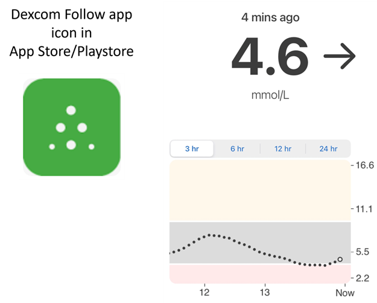

* Dexcom Follow는 다양한 휴대폰(Android와 iPhone 모두)과 호환됩니다. 공식 Dexcom 앱으로 센서 데이터를 받지 않는 경우에도 Dexcom Follow를 사용할 수 있습니다.

* 많은 보호자가 Dexcom Follow에 익숙하며, 더 복잡한 앱보다 깔끔한 화면을 선호합니다.

* Dexcom Follow는 교사나 조부모, 그리고 당뇨병과 혈당에 대해 잘 모르는 사람에게 매우 좋습니다. 사용자 지정 알림이 있습니다(혈당 수준, 재생할 소리 등). 필요하면 알람을 완전히 끌 수 있습니다. 아직 안정되지 않아 잘못된 저혈당 값을 여러 번 만드는 센서가 있을 때 매우 유용합니다.

#### Dexcom Follow 설정: 방법 안내

센서 데이터를 받기 위해 비공식 Dexcom 앱 BYODA를 사용하는 경우, BYODA 앱 안에서 팔로워에게 초대를 보낼 수 있을 수도 있습니다.

이제 타사 앱에서는 Dexcom 팔로워에게 초대 이메일을 보낼 수 없습니다. xDrip에서는 초대 요청을 해도 “invite not sent” 메시지만 나옵니다.

공식 Dexcom 앱을 설치하고 초대를 보낸 다음, 공식 앱을 삭제해야 합니다.

방법은 다음과 같습니다:

1)  _아무_ 스마트폰(Android/iPhone)에나 공식 “Dexcom” 앱을 설치하십시오. 더 편하다면 팔로워 휴대폰이어도 됩니다. 2)  Dexcom 사용자 이름과 비밀번호로 로그인하십시오. 이미 Dexcom/Clarity 고객이라면 Dexcom Clarity에 사용하는 로그인 정보와 같습니다. Dexcom 로그인 정보가 없다면 이 단계에서 새로 만들 수 있습니다.   
3)  소개 메뉴를 넘기십시오. 4)  센서 코드에는 “no code”를 추가하십시오. 5)  Transmitter SN 아래에서 “enter manually”를 선택하고 유효한 트랜스미터 코드를 아무것이나 입력하십시오(알고 있다면 만료된 트랜스미터 코드 중 하나를 사용하십시오. 그러면 현재 사용 중인 트랜스미터의 작동을 방해하지 않습니다. 코드는 숫자와 문자로 된 특정 형식 “NLNNNL”을 따르며 일부 조합만 사용하므로, 유효하다고 이미 알고 있는 코드를 사용하는 것이 가장 쉽습니다). 6)  앱이 트랜스미터와 센서를 찾기 시작하면 팔로워를 초대할 수 있습니다: 앱 왼쪽 위의 작은 점 세 개를 선택하고 새 팔로워를 추가하십시오. 팔로워 중 한 명이 휴대폰을 바꿔서 새 초대가 필요한 경우에도 이 기능을 사용할 수 있습니다. 여기에서 팔로워 목록에서 그 사람을 삭제하고, 새 휴대폰에서 사용할 새 초대 이메일을 다시 보낼 수 있습니다. 7)  팔로워 휴대폰에서 App Store(iPhone) 또는 Play(Android)에서 Dexcom Follow를 다운로드하여 설치하십시오. Dexcom Follow 앱을 설정하면 이메일을 열어 팔로워 초대를 찾으라는 안내가 나옵니다.    
8)  이제 공식 Dexcom G6 앱을 삭제해도 됩니다.

Dexcom Follow를 사용하려면, 사용하는 앱에 따라 BYODA에서 직접 또는 xDrip에서 **AAPS** 휴대폰의 센서 데이터를 내보냅니다.


### [Nightguard](https://apps.apple.com/fr/app/nightguard/id1116430352) (iOS)

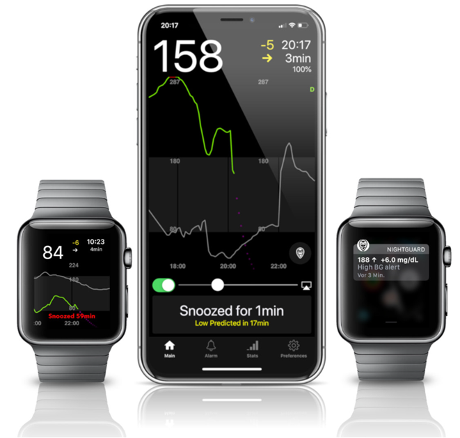

장점 (사용자 보고):

* [App Store](https://apps.apple.com/us/app/nightguard/id1116430352)에서 받을 수 있으며, 화면이 간단하고 사용하기 쉽습니다.

* 버튼을 밀거나 휴대폰을 흔들어 5분에서 24시간까지 여러 간격으로 알람을 일시 중지할 수 있음

* 알람 사용자 지정 (고혈당, 저혈당 알림, 15-45분 동안 데이터가 없을 때 측정값 누락 알림).

* 연속 2-5개 측정값에서 빠른 상승/하강 (직접 선택). 두 개의 개별 측정값 사이의 증분도 선택할 수 있음

* 스마트 일시 중지: 혈당이 올바른 방향으로 움직이고 있으면 알리지 않음

* Care 탭이 있으며, 이 탭에서 일정 시간 동안 새 임시 목표를 설정하거나, 임시 목표를 삭제하거나, 탄수화물을 입력할 수 있는 것으로 보입니다.

단점 (사용자 보고)

* iOS에서만 사용 가능

* 어떤 임시 목표 값을 설정해도 임시 목표가 5 mmol로 표시됨

* TB는 표시하지만 임시 기저 주입량은 표시하지 않음

### [Nightwatch](https://play.google.com/store/apps/details?id=se.cornixit.nightwatch) (Android)

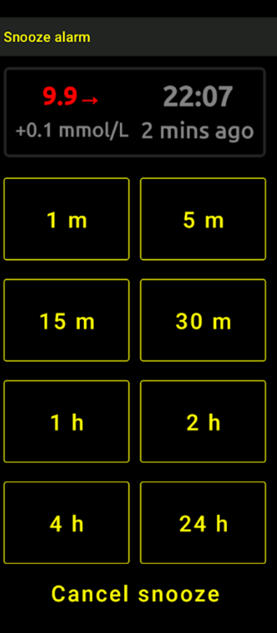


* Nightwatch는 자신을 Nightscout 클라이언트라고 소개하며, Android 휴대폰이나 태블릿에서 사용자의 Nightscout 혈당 값을 모니터링합니다.

* 앱은 [Google Play](https://play.google.com/store/apps/details?id=se.cornixit.nightwatch)에서 다운로드할 수 있으며, 혈당 데이터를 실시간으로 표시합니다.

* 사용자 지정한 큰 소리의 저혈당 및 고혈당 알람으로 사용자에게 알릴 수 있습니다.

* 혈당 데이터는 mmol/L 또는 mg/dL로 볼 수 있습니다.

* Android 5.0 이상이 필요합니다.

* 어두운 UI, 큰 숫자와 버튼을 갖추고 있어 밤에 사용하기 좋습니다.

### xDrip (Android)

xDrip을 팔로워로 사용할 수 있습니다.

#### Nightscout 사용

xDrip을 Nightscout 팔로워로 설정하십시오. 혈당과 처치를 받습니다. 기저는 받지 않습니다.

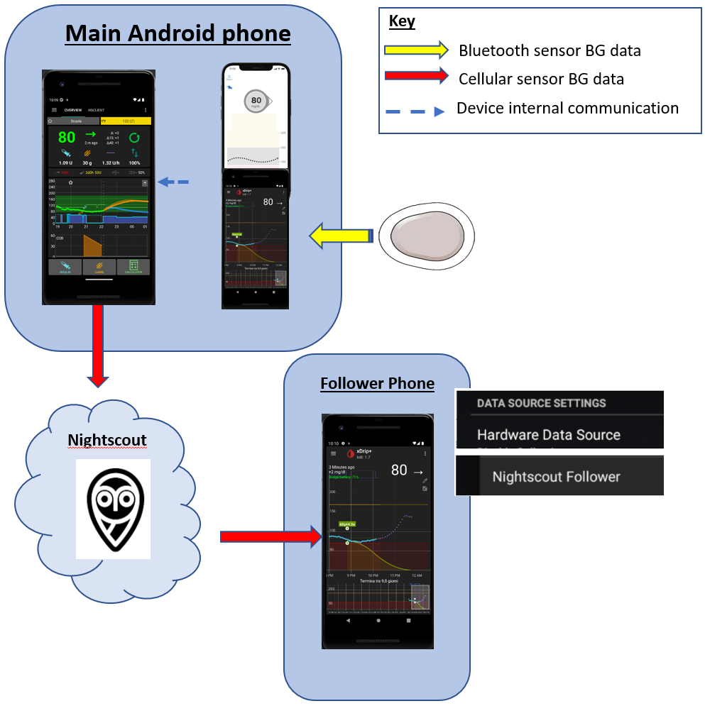

#### Nightscout 없이 - xDrip 혈당 데이터 소스

**AAPS** 데이터 소스가 xDrip인 경우(또는 xDrip이 BYODA, Juggluco 같은 다른 앱에서도 혈당을 받을 수 있는 경우), 마스터 휴대폰에서 xDrip을 사용하여 xDrip 팔로워와 데이터를 공유할 수 있으며, 혈당, 처치, 기저 주입량을 표시합니다.

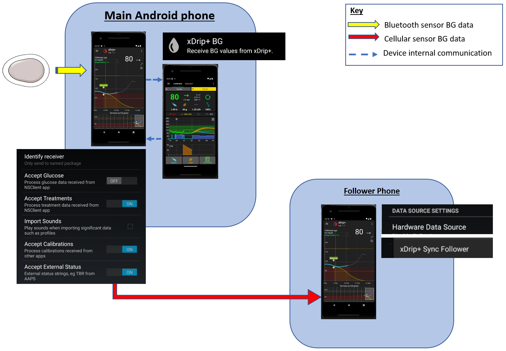

#### Nightscout 없이 - xDrip 혈당 동반 앱

**AAPS** 데이터 소스가 xDrip이 아니지만 Companion App 데이터 소스로 혈당 데이터를 표시할 수 있다면, 마스터 휴대폰에서 xDrip을 사용하여 xDrip 팔로워와 데이터를 공유할 수 있으며, 혈당, 처치, 기저 주입량을 표시합니다.

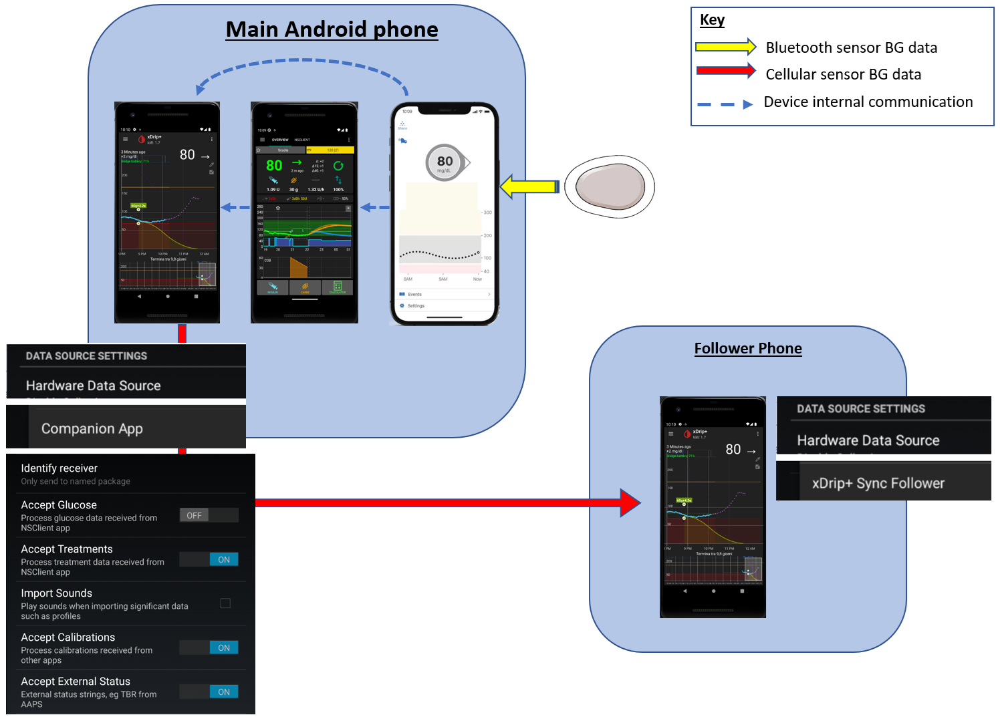

### xDrip4iOS (iOS)


xDripSwift는 원래의 xDrip 앱을 iOS로 옮겨 만들었으며, 이후 "xDrip for iOS", 즉 **xDrip4iOS**로 발전했습니다.

```{admonition} Further detail about how to attempt to obtain the original **xDrip4iOS** app
:class: dropdown
[xDrip4iOS Facebook 그룹](https://www.facebook.com/groups/853994615056838/announcements)이 xDrip4iOS와 Shuggah의 주요 커뮤니티 지원 창구입니다. **xDrip4iOS**는 여러 CGM 시스템과 트랜스미터에 연결하여 혈당 값, 차트, 통계를 표시하고 알람을 제공할 수 있습니다. Nightscout에 업로드하거나 [Nightscout용 팔로워 앱](https://xdrip4ios.readthedocs.io/en/latest/connect/follower/)으로 사용할 수도 있습니다. 

"내 iPhone에서 **xDrip4iOS**를 어떻게 받을 수 있습니까?"
두 가지 방법이 있습니다:

1. Mac과 Apple Developer 계정(연 99 EUR/USD)이 있다면 [안내](https://xdrip4ios.readthedocs.io/en/latest/install/build/)에 따라 직접 xDrip4iOS를 빌드할 수 있습니다.

원한다면 그 후 "releaser"가 되어 다른 사람 최대 100명과 [개인 Testflight xDrip4iOS를 공유](https://xdrip4ios.readthedocs.io/en/latest/install/personal_testflight/)하여 그들을 도울 수 있습니다.

2. [xDrip4iOS Facebook 그룹](https://www.facebook.com/groups/853994615056838/announcements)에 가입하고, 고정된 게시물에서 현재 앱을 받는 방법을 읽으십시오. **앱 초대를 요청하지 마십시오** (그룹 규칙을 읽으십시오).
```


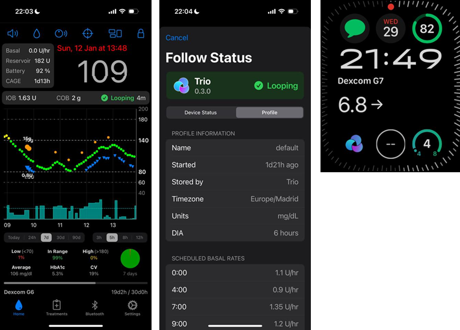

"**Shuggah**는 무엇입니까?" 우크라이나 개발자 그룹이 xDrip4iOS의 프로젝트 코드(GitHub에 공개되어 있음)를 복사하여 사업자 계정으로 App Store에 출시했습니다. Shuggah 출시는 xDrip4iOS 개발자들과 전혀 관련이 없습니다.

[xDrip4iOS Facebook 그룹](https://www.facebook.com/groups/853994615056838/announcements)은 xDrip4iOS와 그에 맞는 Apple Watch 앱을 지원합니다.

### [Sugarmate](https://apps.apple.com/fr/app/sugarmate/id1111093108) (iOS)

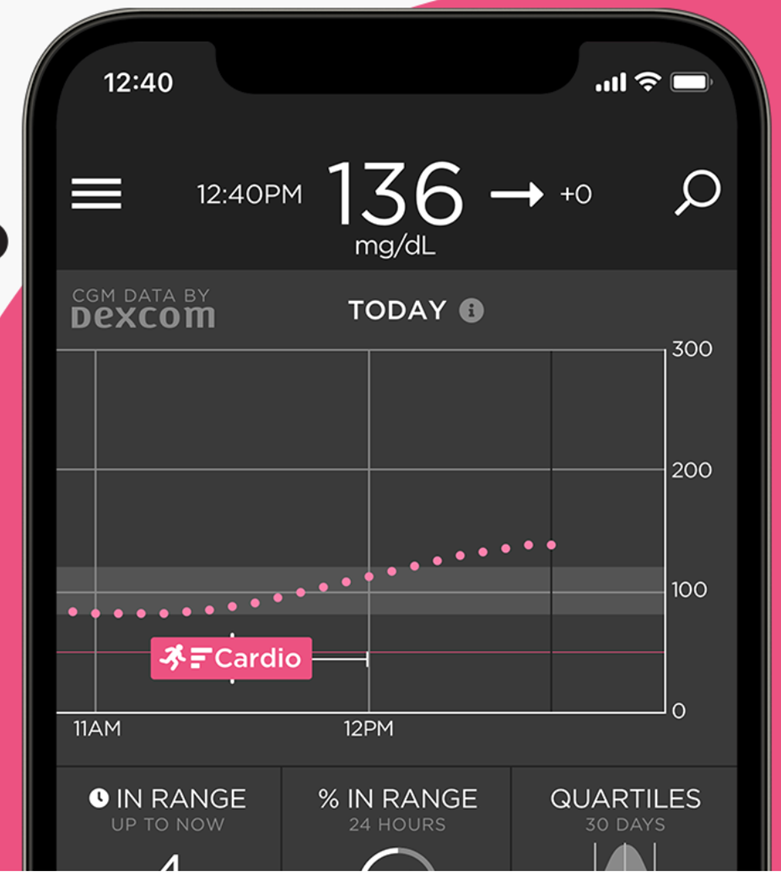

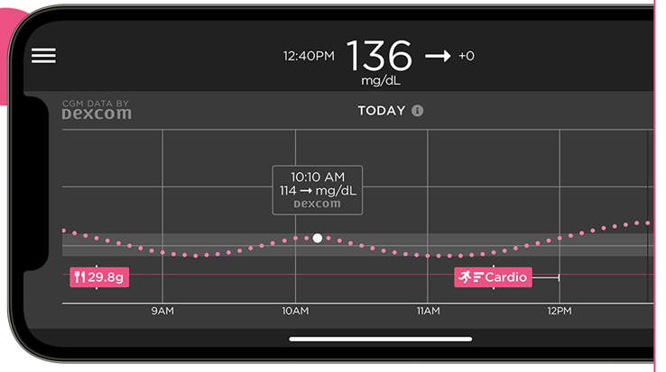


[Sugarmate](https://sugarmate.io/)는 App Store에서 iPhone에 다운로드할 수 있습니다. Sugarmate는 다음과 호환됩니다:
* Apple iPhone (소프트웨어 버전 13.0 이상 필요)
* Apple iPad (소프트웨어 버전 13.0 이상 필요)
* Google Android (웹 앱을 홈 화면에 저장)

Sugarmate 사용자들은 미국에서 Apple CarPlay와 함께 사용하여 운전 중에 혈당 값을 표시할 수 있다고 보고했습니다. 미국 이외의 나라에서도 가능한지는 아직 확인되지 않았습니다. 이에 대해 더 알고 있다면 [pull request](../SupportingAaps/HowToEditTheDocs.md)를 만들어 이 문서에 자세한 내용을 추가해 주십시오. 빠르고 쉽게 할 수 있습니다.


### [Spike](https://spike-app.com/) (iOS)

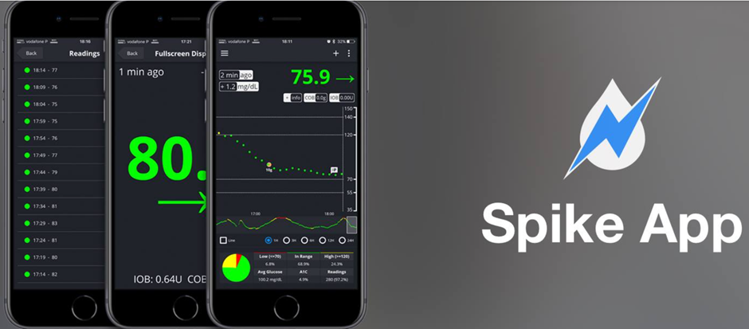

Spike는 기본 수신기나 팔로워 앱으로 사용할 수 있으며, 혈당, 알람, IOB 등을 제공합니다.

웹사이트와 앱은 더 이상 개발되지 않습니다. 지원은 [Facebook](https://www.facebook.com/groups/1973791946274873)과 [Gitter](https://gitter.im/SpikeiOS/Lobby)에서 받을 수 있습니다.

## **AAPS**가 휴대폰에서 실행될 때 **AAPS 모니터링**용 스마트워치 (전체 프로파일 데이터 또는 혈당만).

[여기](../Getting-Started/Watches.md)를 참조하십시오.


## AAPS 팔로우용 장치

```{contents} Devices include:
:depth: 1
:local: true
```

### M5Stack

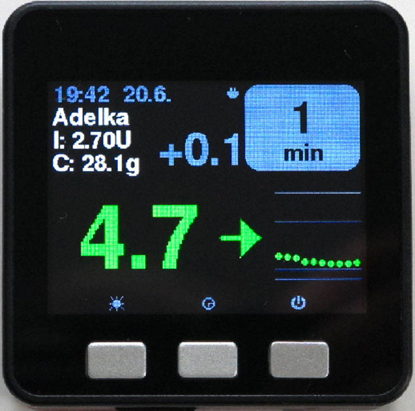

M5Stack은 여러 용도로 프로그래밍할 수 있는 작은 상자입니다. Martin의 프로젝트 [M5Stack NightscoutMon](https://github.com/mlukasek/M5_NightscoutMon/wiki)은 센서 혈당 값과 추세, IOB, COB를 표시합니다. 플라스틱 상자 안에 컬러 디스플레이, micro SD 카드 슬롯, 버튼 3개, 스피커, 내장 배터리가 있습니다. 훌륭한 혈당 모니터이며, Nightscout 계정이 있으면 비교적 쉽게 설정할 수 있습니다. 보통 집 Wi-Fi에서 사용하지만, 일부 사용자는 휴대폰 Wi-Fi 핫스팟에 연결하여 오토바이를 탈 때 디스플레이로 사용한다고 보고합니다.

### SugarPixel

SugarPixel은 연속 혈당 측정을 위한 보조 혈당 표시 및 알림 장치로, 사용자 스마트폰의 Dexcom 앱 또는 Nightscout 앱과 연결됩니다. 이 장치는 실시간 혈당 값을 표시합니다. 이 CGM 하드웨어 모니터는 무작위 톤으로 만든 소리 알림(매우 큼), 청각 장애인을 위한 진동 알림, 사용자 지정 디스플레이 옵션, 기본 제공 다중 사용자 팔로우 기능이 장점입니다.

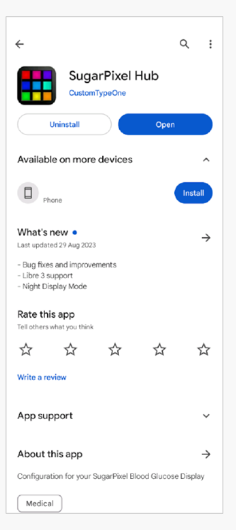

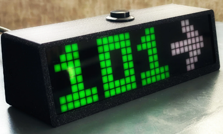

* SugarPixel은 사용자에게 맞게 mg/dL과 mmol/L로 여러 디스플레이 옵션을 제공하며, 혈당 값을 색으로 구분합니다.
* 기본 화면은 혈당, 추세 화살표, 증분을 표시합니다. 증분은 마지막 측정값과 비교한 + 또는 - 변화입니다.
* SugarPixel은 BG and Time 화면으로 어두운 곳에서도 사용할 수 있게 설정할 수 있으며, 침대 옆 탁자에서 사용자의 혈당 값과 현재 시간을 볼 수 있습니다.
* SugarPixel의 color 화면은 전체 디스플레이를 사용하여 혈당 값을 나타내는 한 가지 색을 표시합니다. 그래서 사용자가 뒷마당, 테라스, 수영장에서 놀 때에도 창문을 통해 멀리서 혈당 값을 볼 수 있습니다.
* Big BG 화면은 안경이나 콘택트렌즈를 쓰는 사람이 침대 옆 탁자에 두고 사용할 때 유용합니다.

### Ulanzi TC001의 Nightscout Clock

**Nightscout Clock**은 **Ulanzi TC001** 장치에서 실행되는 오픈 소스 소프트웨어입니다. Dexcom 서버 또는 Nightscout에 연결하여 실시간 혈당 값을 표시합니다.

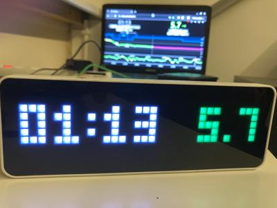

* 이 시계는 mmol/L과 mg/dL 단위를 모두 지원하며, 소리 알람이 있습니다.
* 여러 가지 화면을 사용할 수 있습니다. 개요는 [Github nightscout-clock](https://github.com/ktomy/nightscout-clock?tab=readme-ov-file#more-information-for-people-who-needs-it)을 참조하십시오.
* 장치 설정과 구성은 몇 가지 간단한 단계로 끝납니다. 설정이 끝나면 전원과 Wi-Fi만 있으면 작동합니다.
* Ulanzi TC001 장치는 SugarPixel보다 구입 가격이 훨씬 저렴합니다.
* 소프트웨어와 설치 안내는 [Github nightscout-clock](https://github.com/ktomy/nightscout-clock?tab=readme-ov-file)에서 찾을 수 있습니다.
* Artiom Kenibasov가 개발하고 관리하며, [Facebook AAPS Users 그룹](https://www.facebook.com/groups/cgminthecloud/posts/8776932509094594/)에서 지원합니다.

### PC (TeamViewer)
일부 사용자는 고급 원격 문제 해결을 위해 [TeamViewer](https://www.teamviewer.com/) 같은 완전한 원격 접속 도구가 유용하다고 합니다.
