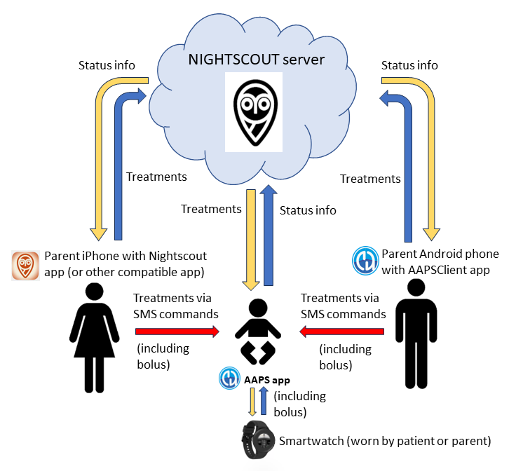
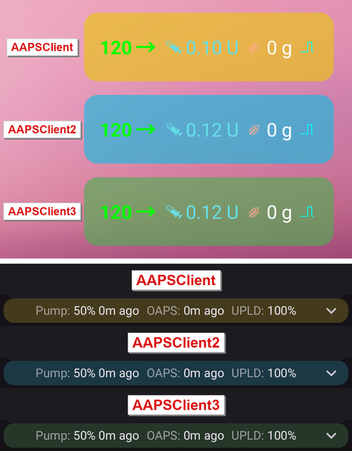
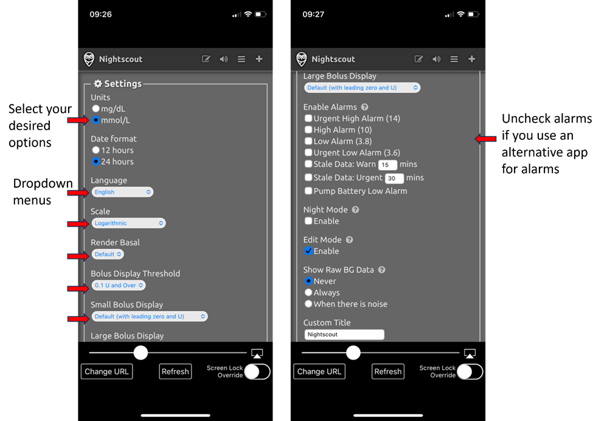
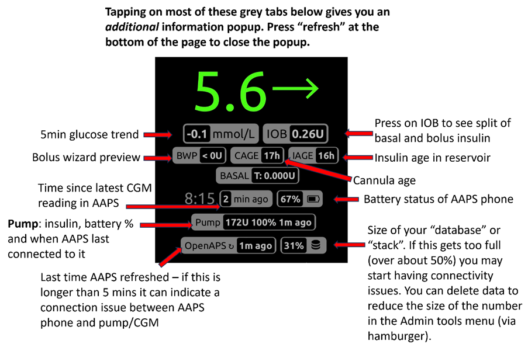
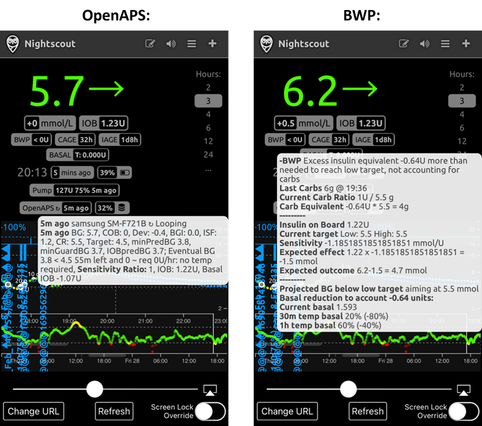

# AAPS 원격 제어

```{contents} In this page
:backlinks: entry
:depth: 2
```

**AAPS**를 원격으로 관리하는 매우 효과적인 도구가 네 가지 있습니다:

1) [SMS commands](#RemoteControl_SMS-Commands) (follower phone can be either Android or iOS), 2) [AAPSClient](#RemoteControl_aapsclient) (follower device is an Android phone or tablet, or a Windows, Mac or Linux computer; on an iPhone you [build the app yourself](#aapsclient-iphone)) 3) [Nightscout](#RemoteControl_nightscout) (Android, iOS or other computer/device), mainly for following: see the note on [client control](#client-master-control) in that section.  
4) [Smartwatches](#RemoteControl_smartwatches) (Android)

처음 세 가지는 주로 보호자/부모에게 맞지만, 스마트워치는 보호자/부모**와** 당뇨병이 있는 성인 본인 모두에게 매우 유용합니다.



(RemoteControl_SMS-Commands)=

## 1) SMS 명령

전용 [SMS 명령](../RemoteFeatures/SMSCommands.md) 페이지를 참조하십시오.

(RemoteControl_aapsclient)=
## 2) AAPSClient

**AAPSClient**는 **AAPS**와 겉모습이 매우 비슷하며, 보호자에게 **AAPS**에 원격으로 명령을 보낼 수 있는 같은 화면과 버튼을 제공합니다:


(remotecontrol-aapsclient-versions)=
### AAPSClient, AAPSClient2, AAPSClient3에 대하여

클라이언트 앱에는 세 가지 버전이 있습니다: **AAPSClient**, **AAPSClient2**, **AAPSClient3**. 모두 같은 방식으로 작동합니다. 유일한 차이는 같은 팔로워 휴대폰에 함께 설치할 수 있다는 점입니다.

한 사람을 팔로우하는 보호자는 **AAPSClient**만 있으면 됩니다. 두 번째 사람(자신의 **Nightscout** 사이트와 자신의 **AAPS** 휴대폰이 있는 사람)을 팔로우하고 원격 제어하려면 **AAPSClient2**도 설치하고, 세 번째 사람에게는 **AAPSClient3**를 설치하십시오. 각 앱은 팔로우하는 사람의 **Nightscout** 사이트와 **AAPS** 휴대폰으로 따로 설정하고 [페어링](#aapsclient-pairing-with-the-master)합니다.

앱을 구분할 수 있도록 일부 요소의 색이 다릅니다: **AAPSClient**는 노란색, **AAPSClient2**는 파란색, **AAPSClient3**는 초록색입니다. 그 요소는 앱 아이콘, 위젯 배경, 앱 홈 화면의 **AAPS** 상태 섹션입니다. <br/> 참고: 위젯 배경의 불투명도는 위젯 구성에서 설정할 수 있습니다. 불투명도가 낮으면 색을 알아보기 어렵습니다.



### 다운로드 및 설치

**AAPSClient**는 휴대폰 한 대 또는 여러 팔로워 휴대폰(예: 부모 1의 팔로워 휴대폰과 부모 2의 팔로워 휴대폰)에 설치할 수 있습니다. 그러면 두 보호자 모두 환자의 **AAPS** 휴대폰에 접근하고 원격으로 제어할 수 있습니다.

**AAPSClient**를 다운로드하려면 [GitHub 저장소](https://github.com/nightscout/AndroidAPS/releases/)로 가서 다음 asset을 누르십시오: **“app-AAPSClient-release_x.x.x.x”** (아래 스크린샷에 보이는 것보다 새 버전일 수 있습니다):


그런 다음 컴퓨터에서 _downloads_(다운로드)로 가십시오. Windows에서는 _downloads_(다운로드)가 오른쪽 리본에 표시됩니다:


다운로드가 끝나면 _show in folder_(폴더에 표시)를 눌러 파일을 찾으십시오.

**AAPSClient** apk는 이제 다음 중 한 가지 방법으로 옮길 수 있습니다:

USB 케이블로 팔로워 휴대폰에 옮기거나, Google Drive 폴더에 끌어다 놓은 다음 팔로워 휴대폰에서 "app-AAPSClient-release" 파일을 눌러 추가합니다.

본인은 **AAPS**를 사용하고 다른 사람을 모니터링하기 위해 **AAPSClient**도 필요하다면, 위에서 설명한 대로 GitHub 저장소에서 다운로드하는 대신 **AAPSClient**를 직접 빌드해야 합니다. 그 이유는 서로 다른 키로 서명된 **AAPS**와 **AAPSClient**를 같은 휴대폰에 함께 설치할 수 없기 때문입니다. <br/> **AAPSClient**를 직접 빌드하려면 [일반 AAPS 빌드](../SettingUpAaps/BuildingAaps.md)와 같은 과정을 따르십시오. **Generate signed App Bundle or APK** 페이지에서 **fullRelease** 대신 **aapsclientRelease**를 선택하십시오.

한 팔로워 휴대폰에 여러 클라이언트 앱(**AAPSClient**, **AAPSClient2**, **AAPSClient3**)을 설치할 때도 같은 규칙이 적용됩니다: 모두 **같은 키**로 서명되어야 합니다. 그렇지 않으면 Android가 두 번째 앱의 설치를 거부합니다(오류 `INSTALL_FAILED_DUPLICATE_PERMISSION`).

### 동기화: AAPSClient와 AAPS 설정

__AAPSClient__ apk를 팔로워 휴대폰에 설치했으면, Nightscout 15를 위해 두 휴대폰 모두 **NSClientV3**를 같은 방법으로 설정했는지 확인하십시오([업데이트 안내](../Maintenance/UpdateToNewVersion.md) 참조). 아래 예는 NSClientV3와 Nightscout 15를 사용한 동기화 설정입니다. __AAPS__에서는 다른 데이터 소스(예: xDrip)도 사용할 수 있습니다.

**구성** > **통신**에서 사용자는 __NSClientV3__(v3 API 사용)를 통해 데이터를 Nightscout와 동기화하며, __AAPS__와 팔로워 휴대폰 모두 같은 방법으로 설정합니다.


사용자는 각 휴대폰에 NSClientV3를 설정하여 AAPS 휴대폰과 AAPS Client 휴대폰 __둘 다__ 서로 동기화되도록 해야 합니다. 팔로워 휴대폰에서는 그 대신 **AAPS**가 보여 주는 QR 코드를 스캔하여 설정할 수 있습니다. 아래의 [AAPSClient와 AAPS 페어링](#remotecontrol-pairing)을 참조하십시오:

- NSClientV3 **설정**에 **Nightscout URL**을 입력하십시오

- 같은 설정에 **Nightscout 액세스 토큰**을 입력하십시오. [여기](https://nightscout.github.io/nightscout/security/#create-a-token)의 안내를 따르십시오. **AAPS** 휴대폰에서는 **admin 토큰**을 사용하십시오: 이 토큰으로 **AAPS**가 팔로워 휴대폰마다 자체 토큰을 만듭니다.

- **두 휴대폰 모두**에서 **웹소켓 사용**을 켜십시오. **AAPS** 휴대폰에서 원격 제어를 하려면 웹소켓이 **필수**입니다: 웹소켓이 없으면 **AAPS**가 **AAPSClient**의 명령을 받을 수 없습니다. 두 휴대폰 모두에서 웹소켓은 동기화도 빠르게 하지만, 배터리를 조금 더 사용합니다.


사용자는 각 휴대폰의 **NSClientV3** 화면에서 __AAPSClient__와 __AAPS__ 모두 ‘연결됨’으로 표시되는지 확인해야 합니다. 이 단계에서 **AAPSClient**는 **AAPS**를 팔로우하지만(혈당, 처치, 프로파일) 아직 제어할 수는 없습니다: 아래 설명대로 두 휴대폰을 페어링하십시오.

(remotecontrol-pairing)=
### AAPSClient와 AAPS 페어링 (원격 제어)

**AAPS** 버전 4부터 **AAPSClient**는 안전한 **페어링된** 연결을 통해 **AAPS**를 제어합니다. 동기화만으로는 충분하지 않습니다: 휴대폰을 페어링하기 전까지 **AAPSClient**에는 보기 전용 **프로파일**과 **마스터와 페어링**이 있는 **관리**만 표시됩니다.

1. **AAPS** 휴대폰에서 **관리 → 허가된 클라이언트**를 열고 **클라이언트 제어 허용**을 켜십시오(기본값은 꺼짐이며, 간단 모드에서는 항상 켜짐).
2. **+**를 누르고, 팔로워 휴대폰의 이름을 입력하고, 설정 방법을 고른 다음 **역할**을 선택하십시오:
   - **QR 코드: Nightscout 및 페어링** — **AAPS**가 QR 코드를 보여 줍니다. 한 번 스캔하면 팔로워 휴대폰에 Nightscout가 설정되고 페어링도 됩니다. 이 방법을 사용하려면 **AAPS** 휴대폰의 NSClientV3 설정에 admin 토큰이 있어야 합니다.
   - **PIN** — 카메라가 없고 이미 Nightscout에 연결된 팔로워 휴대폰용: 일회용 **PIN**을 적어 두십시오(약 2분 동안 유효).
3. **AAPSClient** 휴대폰에서 코드를 스캔하거나(설정 마법사에서, 또는 **관리 → 마스터와 페어링 → QR 코드 스캔**에서), **관리 → 마스터와 페어링**을 열고 PIN을 입력하십시오. 확인.

그러면 팔로워 휴대폰이 **허가된 클라이언트** 목록에 **활성**으로 나타나고, **AAPSClient**에 **처치**, **장면**, **관리**가 표시됩니다. 팔로워 휴대폰은 필요한 권한만 있는 자체 Nightscout 토큰을 받습니다. 스크린샷과 문제 해결을 포함한 전체 절차는 [마스터 ↔ 클라이언트 제어](#client_master_master_setup)에 있습니다.

설정이 작동하는지 확인하십시오: **AAPSClient**에서 탄수화물을 입력하고, 표시된 양을 확인한 다음, 두 휴대폰의 **처치**에 그 항목이 나타나는지 확인하십시오.

(remotecontrol-nightscout-access-token)=

### 'Nightscout 액세스 토큰' 구성 문제 해결

정확한 'Nightscout 액세스 토큰' 구성은 Nightscout 제공 업체가 유료 호스팅 사이트인지 아닌지에 따라 다를 수 있습니다.

**AAPS**가 'Nightscout 액세스 토큰'을 받아들이지 않아 어려움을 겪고 있고 유료 호스팅 Nightscout 사이트를 사용 중이라면, 먼저 Nightscout 제공 업체에 'Nightscout 액세스 토큰' 문제를 해결하는 방법을 문의하는 것이 좋습니다. 그래도 안 되면 **AAPS** 그룹에 문의하십시오. 다만 그 전에 [여기](https://nightscout.github.io/nightscout/security/#create-a-token)의 안내를 올바르게 따랐는지 다시 확인하십시오.

### AAPSClient가 제공하는 것

페어링이 끝나면 **AAPSClient**는 보호자에게 **AAPS**와 거의 같은 화면을 제공합니다:

- **처치**: 인슐린 볼러스, 탄수화물, 볼러스 마법사.
- **장면**: [장면](../DailyLifeWithAaps/Scenes.md) 시작 및 중지.
- **관리**: 프로파일, 인슐린 설정, 임시 목표, 빠른 마법사, 자동화, 음식, 위치 순환, 페어링, 실행 중인 임시 기저.
- **메인 메뉴**: 처치 이력, 이력 브라우저, 통계, 정비, 구성.

**AAPSClient**에는 펌프와 목표가 없습니다. 자세한 설명은 [AAPSClient 앱](AapsClient.md)을 참조하십시오.

**AAPSClient**로 보호자는 **AAPS**에서 직접 할 수 있는 조정 대부분을 모바일 또는 인터넷 네트워크를 통해 원격으로 할 수 있으며, **인슐린 볼러스도 포함됩니다**. 모든 명령은 서명되어 Nightscout를 통해 **AAPS** 휴대폰으로 보내집니다. 이 휴대폰은 명령을 자체 데이터와 비교하여 확인하고, 한도를 적용하고, 자체 확인 화면을 보여 준 다음에야 실행합니다. **AAPSClient**는 [SMS 명령](../RemoteFeatures/SMSCommands.md)보다 훨씬 빠를 _수 있습니다_. 특히 인증이 필요한 명령에서 그렇습니다.

다른 방법(예: Nightscout 웹사이트)으로 Nightscout에 입력한 처치는 클라이언트 제어가 켜져 있는 동안 적용되지 않습니다: 이때 **AAPS**는 [강화 모드](#client-master-control-hardened-mode)이며 페어링된 클라이언트의 변경만 받습니다. 클라이언트 제어가 꺼져 있으면, [NSClient 설정의 동기화 섹션](#Preferences-nsclient-synchronization)에서 해당하는 **받기** 옵션을 켠 경우에만 적용됩니다.

**AAPSClient**를 통한 원격 제어는 동기화가 잘 작동하는 경우에만 권장합니다(_즉_ 임시 목표, 임시 기저 등이 저절로 바뀌는 것 같은 원하지 않는 데이터 변경이 보이지 않는 경우).

### 스마트워치 옵션이 있는 AAPSClient

스마트워치는 아이의 **AAPS** 관리를 돕는 데 매우 유용한 도구가 될 수 있습니다. 몇 가지 다른 구성이 가능합니다. 보호자의 휴대폰에 **AAPSClient**가 설치되어 있으면, 부모의 휴대폰에 연결된 호환 스마트워치에 [**AAPSClient WearOS** 앱](https://github.com/nightscout/AndroidAPS/releases/)을 다운로드하여 설치할 수 있습니다. 현재 혈당과 루프 상태를 표시합니다. **AAPSClient**가 **AAPS**와 페어링되면, 워치 동작(볼러스, 탄수화물, 임시 목표, 프로파일 변경 포함)은 **AAPSClient**를 거쳐 **AAPS**로 전달되고, 그곳에서 확인한 다음 실행됩니다: [클라이언트의 Wear OS](#clientmastercontrol-wear-os-on-a-client)를 참조하십시오. 스마트워치에 대해서는 [여기](#remotecontrol-smartwatches)에서 더 읽어 보십시오.

(RemoteControl_nightscout)=
## 3) Nightscout

Nightscout는 “클라우드”에 있는 서버이지만, iPhone의 App Store에서 바로 다운로드할 수 있는 전용 **Nightscout** 앱도 있습니다. Android 팔로워 휴대폰에는 전용 Nightscout 앱이 없으므로 [**AAPSClient**](#RemoteControl_aapsclient)를 사용하는 것이 더 좋습니다. 처치를 보내지 않고 팔로우만 하려면 Play 스토어에서 [Nightwatch](https://play.google.com/store/apps/details?id=se.cornixit.nightwatch) 앱을 다운로드하여 설치할 수 있습니다.

iPhone에 **Nightscout** 앱을 설치했으면 앱을 열고 설정 안내에 따라 Nightscout 주소를 입력하십시오(아래 왼쪽 참조). 주소 형식은 Nightscout를 호스팅하는 방식에 따라 다를 수 있습니다. (_예:_ http://youraddresshere.herokuapp.com). 그런 다음 Nightscout API secret을 입력하십시오(아래 오른쪽 참조). API 비밀번호를 묻지 않으면 앱 위쪽의 자물쇠를 눌러 입력해야 합니다:


설정에 대한 자세한 정보는 [Nightscout](https://nightscout.github.io/nightscout/discover/)에서 직접 볼 수 있습니다

처음 로그인하면 화면이 매우 단순합니다. 오른쪽 위의 “햄버거” 메뉴를 선택하고 아래로 스크롤하여 표시 옵션을 사용자 지정하십시오:


“Settings”(설정)까지 아래로 스크롤하십시오. 혈당 표시의 기본값이 로그 눈금이므로 “scale”을 “linear”(선형)로 바꾸는 것이 좋을 수 있습니다. 또한 펌프 기저가 표시되도록 “render basal” 아래에서 “default”를 선택하십시오.


원하는 옵션을 선택하십시오. 알람에 다른 앱을 사용한다면 알람을 선택 해제하십시오.



“show plugins”가 나올 때까지 계속 아래로 스크롤하십시오.

“careportal”이 선택되어 있는지 확인해야 하며, 다른 여러 항목도 선택할 수 있습니다(가장 유용한 것: IOB, care portal, pump, cannula age, insulin age, basal profile, OpenAPS).

중요: 이 변경 사항이 적용되려면 이제 아래쪽의 “save”(저장)를 눌러야 합니다.


“save”를 누르면 앱이 Nightscout 메인 화면으로 돌아가며, 대략 다음과 같이 보입니다:

1. 현재 혈당 값
2. AAPS 시스템 상태 정보 - 화면의 각 탭을 누르면 더 자세한 내용이 표시됩니다. 햄버거 메뉴에서 이 표시 옵션을 추가하거나 제거할 수 있습니다.
3. 처치(탄수화물, 볼러스)가 함께 표시된 최근 혈당 곡선
4. 장기간 혈당 곡선
5. 표시 옵션 설정, 보고서 생성, 프로파일 편집, Nightscout 관리 도구를 위한 "햄버거" 메뉴
6. 처치를 입력하는 "**+**" 메뉴(**AAPS**가 언제 처치를 적용하는지는 [아래](#RemoteControl_nightscout-treatments) 참조).
7. 표시할 기간 선택
8. 기저 인슐린 프로파일
9. 초록색 선 = 과거 혈당 파란색 선 = 예측 혈당


Nightscout 앱의 왼쪽 위 메뉴를 자세히 보면:

1. 케어포털 사후 편집
2. 알람 켜기/끄기
3. 햄버거 - 설정용
4. Careportal - Log treatment(처치 기록) (**AAPS**가 언제 이것을 적용하는지는 [아래](#RemoteControl_nightscout-treatments) 참조)


이 화면의 회색 탭에는 **AAPS** 시스템 상태에 대한 정보가 매우 많습니다(탭을 누르면 더 많은 정보가 나타납니다):

1. 5분 혈당 추세
2. 볼러스 마법사 미리 보기
3. 현재 프로파일과 기저 정보를 보려면 Basal을 누르십시오
4. AAPS에서 마지막 CGM 측정값 이후 지난 시간
5. **펌프**: 인슐린, 배터리 %, AAPS가 마지막으로 연결한 시간
6. AAPS가 마지막으로 새로 고친 시간 - 5분보다 길면 AAPS 휴대폰과 펌프/CGM 사이에 연결 문제가 있을 수 있습니다
7. 기저와 볼러스 인슐린의 구분을 보려면 IOB를 누르십시오
8. 레저버 안의 인슐린 사용 기간
9. 캐뉼라 사용 기간
10. AAPS 휴대폰의 배터리 상태
11. 데이터베이스 크기. 너무 가득 차면(DIY Nightscout만 해당 - 호스팅 서비스는 무시하십시오) 연결 문제가 생기기 시작할 수 있습니다. Admin tools(관리 도구) 메뉴(햄버거 메뉴를 통해)에서 데이터를 삭제하여 이 숫자를 줄일 수 있습니다.





팝업을 닫으려면 페이지 아래쪽의 "refresh"를 누르십시오.

(RemoteControl_nightscout-treatments)=
### Nightscout 앱으로 AAPS에 처치 보내기

**AAPS** 4에서 **AAPS**를 원격으로 제어하는 지원 방법은 **페어링된 AAPSClient**입니다. [마스터 ↔ 클라이언트 제어](#client-master-control)를 참조하십시오: 각 클라이언트에는 할 수 있는 일을 제한하는 [역할](#client-master-control-roles)이 있으며, 모든 명령은 클라이언트가 서명한 후 **AAPS** 휴대폰이 확인하고 승인합니다. 클라이언트 제어가 켜져 있는 동안 **AAPS** 휴대폰은 [강화 모드](#client-master-control-hardened-mode)입니다: Nightscout 웹사이트나 Nightscout 앱에서 입력한 처치, 임시 목표, 프로파일 전환은 적용되지 **않습니다**. 이때 Nightscout 앱은 팔로우만 하는 도구입니다.

```{admonition} Only when client control is off
:class: warning
**관리 → 허가된 클라이언트**에서 **클라이언트 제어 허용**이 꺼져 있으면(그리고 간단 모드도 꺼져 있으면), **AAPS**는 [NSClientV3 설정의 동기화 섹션](#Preferences-nsclient-synchronization)의 **받기** 아래에서 켠 데이터 유형에 대해서만 Nightscout의 케어포털 항목을 적용합니다: 탄수화물, 임시 목표, 프로파일 전환, 기타 케어포털 항목. 이 방법으로는 인슐린이 절대 주입되지 않습니다: Nightscout에 입력한 "교정 볼러스"는 *알림*으로만 기록되며, **AAPS**는 주입하지 않고 활성 인슐린(IOB)으로만 계산합니다. 이 설정은 원격 제어에 권장하지 않습니다. 대신 페어링된 **AAPSClient**를 사용하십시오.
```

**Nightscout** 옵션에 대해서는 [여기](https://nightscout.github.io/)에서 더 읽어 보십시오

### Nightscout 앱을 최대한 활용하기 위한 팁

1). 페이지에서 “막혀서” 메인 화면을 다시 보고 싶다면 “refresh”(새로고침, 아래쪽 가운데)를 누르십시오. 혈당 그래프가 있는 **Nightscout** 홈페이지로 돌아갑니다.

휴대폰에서 실행 중인 현재 프로파일을 보려면 그래프 위 화면의 여러 아이콘을 누르십시오. “basal”을 누르면 더 많은 정보(현재 탄수화물 비율, 민감도, 시간대 등)를 볼 수 있고, “OpenAPS”는 프로파일과 현재 목표 등에 대한 정보를 보여 줍니다. 휴대폰 배터리 %와 펌프 배터리 %도 모니터링할 수 있습니다. BWP는 IOB와 COB를 바탕으로 알고리즘이 앞으로 어떻게 될 것으로 예상하는지 정보를 보여 줍니다.

#### 메뉴의 다른 아이콘: 연필(편집)은 무슨 뜻입니까?

(기술적으로는) 편집 연필을 사용하여 지난 48시간 동안의 볼러스나 교정 처치를 옮기거나 삭제할 수 있습니다.

자세한 내용은 [여기](https://nightscout.github.io/nightscout/discover/#edit-mode-edit)를 참조하십시오

이 기능은 입력했지만 볼러스를 주입하지 않은 탄수화물을 삭제하는 데 쓸모가 있을 수도 있지만, 실제로는 현재 **AAPS**와 잘 작동하지 않습니다. 이런 변경은 **AAPS** 앱에서 직접 하는 것을 권장합니다.

(RemoteControl_smartwatches)= (remotecontrol-smartwatches)=

## 4) 스마트워치

### 옵션 1) Wear OS 워치로 AAPS 제어하기


[워치에 **AAPS**를 설정](../WearOS/BuildingAapsWearOS.md)했다면, 스마트워치 페이스와 그 기능에 대한 자세한 내용은 [스마트워치에서 Wear AAPS 사용하기](../WearOS/WearOsSmartwatch.md)에서 볼 수 있습니다.

간단히 정리하면, 스마트워치에서 다음 기능을 실행할 수 있습니다:

* 임시 목표 설정

* 볼러스 계산기 사용 (계산 변수는 휴대폰의 설정에서 정할 수 있음)

* eCarbs 입력

* 볼러스 주입 (인슐린 + 탄수화물)

* 워치 설정

* status

* 펌프 상태 확인

* 루프 상태 확인

* 프로파일 확인 및 변경, CPP (Circadian Percentage Profile = 시간 이동 + 퍼센트)

* TDD 표시 (Total daily dose = 하루 볼러스 + 기저)

* 보호자와 1형 당뇨병 아이가 서로 다른 장소에 있을 때 원격 볼러스 (**AAPS** 워치와 **AAPS** 휴대폰이 둘 다 네트워크에 연결되어 있으면 가능)

#### 다른 앱(예: WhatsApp)을 사용한 보호자와 워치 사이의 연락

워치에 WhatsApp 같은 앱을 추가하여 (예를 들어) 보호자와 아이가 메시지를 주고받을 수 있습니다. 휴대폰에 Google 계정을 하나만 연결해 두는 것이 중요합니다. 그렇지 않으면 워치가 이 데이터를 가져오지 못합니다. Samsung 계정을 만들려면 13세 이상이어야 하며, Android 휴대폰에서 사용하는 것과 같은 이메일 주소로 설정해야 합니다.

Galaxy 4 워치에서 메시지용 WhatsApp을 설정하는 방법을 설명하는 동영상은 [여기](https://gorilla-fitnesswatches.com/how-to-get-whatsapp-on-galaxy-watch-4/)에 있습니다(WhatsApp의 모든 기능을 사용할 수는 없습니다)

**AAPS** 휴대폰의 **Galaxy wearable** 앱과 워치 양쪽에서 설정을 조정하면, WhatsApp 메시지가 오면 약한 진동으로 알리고 현재 워치 페이스 위에 WhatsApp 메시지를 표시할 수 있습니다.

### 옵션 2) 휴대폰의 **AAPS**를 원격 제어하기 위한 워치의 **AAPS**

**AAPSClient**나 SMS 명령으로 팔로워 휴대폰을 사용하는 것과 비슷하게(위 섹션 참조), 스마트워치를 사용하여 **AAPS**를 원격으로 제어하고 전체 프로파일 데이터를 볼 수 있습니다. 팔로워 휴대폰을 사용하는 것과의 주요 차이는, 스마트워치와 **AAPS** 휴대폰이 Bluetooth로 연결되어 Nightscout도 인증 코드도 필요 없다는 점입니다. 참고로, Bluetooth로 연결된 스마트워치와 **AAPS** 휴대폰이 둘 다 Wi-Fi/모바일 데이터 네트워크에도 연결되어 있으면, 워치는 그 네트워크로도 **AAPS** 휴대폰과 통신하므로 통신 거리가 더 길어집니다. 여기에는 **AAPS** 워치를 가진 보호자와 (**AAPS** 휴대폰을 가진) 1형 당뇨병 아이가 서로 다른 장소에 있을 때 원격으로 볼러스를 주입하는 것도 포함됩니다. 아이가 학교에 있을 때 유용할 수 있습니다.

따라서 원격 제어 스마트워치는 다음과 같은 상황에서 흔히 유용합니다:

a)  **AAPSClient** 또는 **SMS** 명령이 작동할 수 없는 경우; 또는

b)  사용자가 인증 코드 입력을 피하고 싶은 경우(SMS 명령에서는 필요).

스마트워치로 **AAPS**를 제어하려면 **Wear OS 3 이상**이 필요합니다. 워치의 기술 사양을 확인하고 [스마트워치와 AAPS](../Getting-Started/Watches.md) 페이지를 참조하십시오. 잘 모르겠다면 검색하거나 **AAPS** Facebook/Discord 그룹에 물어보십시오.

인기 있는 Samsung Galaxy Watch 4 (40mm)에 **AAPS**를 설정하는 구체적인 방법 안내는 아래에 있습니다. [Garmin](https://apps.garmin.com/en-US/apps/a2eebcac-d18a-4227-a143-cd333cf89b55?fbclid=IwAR0k3w3oes-OHgFdPO-cGCuTSIpqFJejHG-klBTm_rmyEJo6gdArw8Nl4Zc#0) 워치도 많이 선택합니다. 다른 사람에게 도움이 될 만한 다른 스마트워치를 설정해 본 경험이 있다면, 이 페이지에 추가하여([문서 편집](../SupportingAaps/HowToEditTheDocs.md)) 더 넓은 **AAPS** 커뮤니티와 경험을 나누어 주십시오.

### 옵션 3) 휴대폰의 **AAPS**를 원격 제어하기 위한 워치의 AAPSClient


워치용 소프트웨어인 **AAPSClient** Wear apk는 [GitHub](https://github.com/nightscout/AndroidAPS/releases/)에서 바로 다운로드할 수 있습니다.

소프트웨어를 다운로드하려면 휴대폰의 클라이언트 앱에 맞는 워치 앱을 누르십시오: **wear-aapsclient-release_**_version_은 **AAPSClient**용, **wear-aapsclient2-release_**_version_은 **AAPSClient2**용입니다([AAPSClient, AAPSClient2, AAPSClient3에 대하여](#remotecontrol-aapsclient-versions) 참조):


그런 다음 "save as"(다른 이름으로 저장)를 눌러 컴퓨터의 편한 위치에 파일을 저장하십시오:


**AAPSClient** wear apk는 [AAPS 휴대폰으로 Wear 앱 옮기기](#remote-control-transferring-the-aaps-wear-app-onto-your-aaps-phone)에 설명된 대로 **AAPS** Wear 앱과 같은 방법으로 휴대폰에 옮긴 다음 워치에 사이드로드할 수 있습니다  


