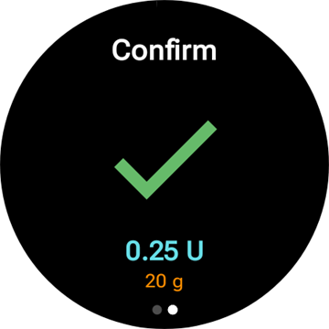
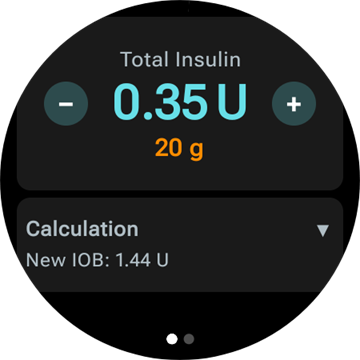
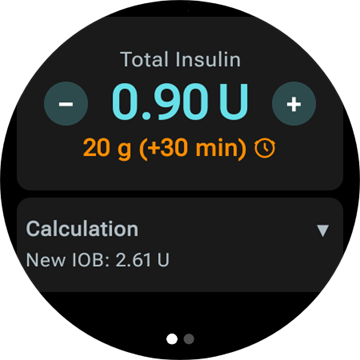
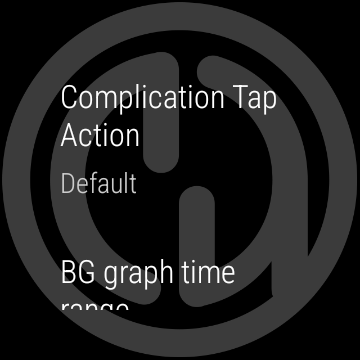
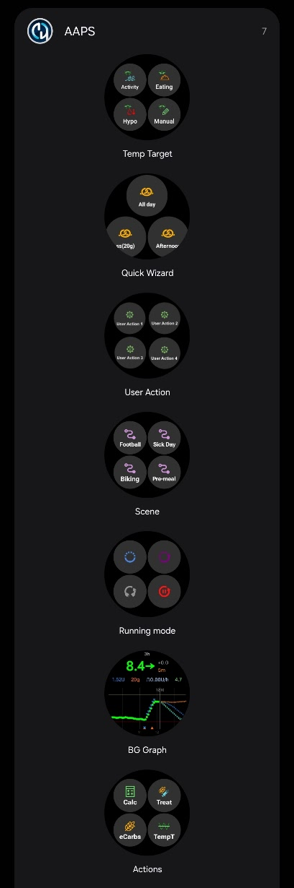
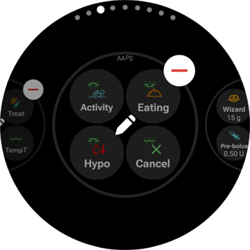
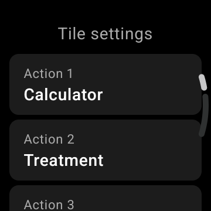
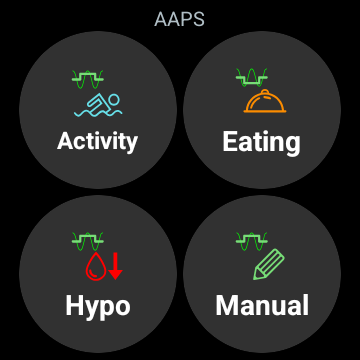
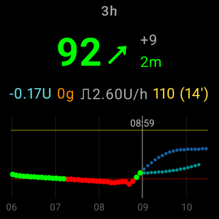

# Wear OS 스마트워치로 AAPS 사용하기

(Watchfaces-aaps-watchfaces)=

## AAPS 워치 페이스

```{warning}
기존 **AAPS** 워치 페이스는 Wear OS 5 이하에서만 작동하며, Wear OS 5에서도 이미 제한이 있습니다. **Wear OS 6 이상**에서는 워치 앱이 대신 Google의 Watch Face Format으로 된 워치 페이스 하나를 설치합니다. 그림으로 된 사용자 지정 워치 페이스이거나 **컴플리케이션 워치 페이스**입니다. Wear OS 버전마다 무엇이 작동하지 않는지는 [Wear OS 워치 페이스 변경 사항](#wearos-watchface-changes)을, Wear OS 6에 대해서는 [AAPS가 설치하는 워치 페이스](#wearos-aaps-v4-watchface)를 참조하십시오.
```

Wear OS 5 이하에서는 여러 기존 워치 페이스가 **AAPS** 워치 앱에 들어 있습니다. 이 워치 페이스는 혈당 값과 증분, IOB, 현재 기저 주입량, 측정값 그래프를 표시합니다. 이 워치 페이스에서는 두 가지 탭 동작이 작동합니다:

* 혈당 값을 두 번 탭하면 **AAPS** 메인 메뉴가 열립니다
* 그래프를 두 번 탭하면 그래프의 시간 범위가 바뀝니다

모든 Wear OS 버전에서, 이 페이지에서 설명하는 [컴플리케이션](#Watchfaces-complications)과 [타일](#WearOsSmartwatch-wear-os-tiles)은 이를 위한 공간이 있는 모든 워치 페이스에서 작동합니다.

## 구성

[**구성** > **통신**](#Config-Builder-wear)에서 **워치**를 활성화하십시오.

워치에서 볼러스를 주입하거나 다른 동작을 하려면 **워치 제어**를 켜십시오. 워치용 볼러스 마법사 옵션도 같은 곳에서 설정합니다: [설정 > 워치](#preferences-wear)를 참조하십시오. **워치 제어**가 꺼져 있는 동안 휴대폰은 워치에서 보낸 모든 처치와 모드 변경을 거부하며, 워치에는 *"휴대폰의 워치 설정에서 워치 제어가 꺼져 있습니다."*가 표시됩니다.

**워치** 카드에서 **플러그인 열기**를 누르면 워치 화면이 열립니다:


맨 위 줄에는 연결된 워치의 이름 또는 **(연결된 워치가 없습니다)**가 표시됩니다. 이 화면에서 다음을 할 수 있습니다.

* KEEP 워치가 한동안 연결되지 않았고, 정보를 워치로 보내고 싶을 때 도움이 될 수 있습니다.
* 휴대폰에서 바로 워치의 설정을 엽니다.
* **AAPS**가 워치에 설치할 워치 페이스를 선택합니다(**워치에 설치된 워치 페이스**: 사용자 지정 워치 페이스 또는 컴플리케이션 워치 페이스). 이 카드는 **Wear OS 6** 이상의 워치가 연결되어 있을 때만 표시됩니다. [AAPS가 설치하는 워치 페이스](#wearos-aaps-v4-watchface)를 참조하십시오.
* **사용자 지정 워치 페이스**를 관리합니다(워치가 연결되어 있을 때 카드가 표시됨): **워치 페이스 불러오기**는 사용자 지정 워치 페이스를 워치로 보내고, **워치 페이스 정보**는 불러온 워치 페이스의 세부 정보와 포함된 필드를 보여주고, **더 많은 워치 페이스**는 브라우저에서 [교환 사이트](../ExchangeSiteCustomWatchfaces/index.md)를 열고, **템플릿 내보내기**는 편집할 수 있는 템플릿을 저장합니다. 버튼 아래에 불러온 워치 페이스의 미리 보기가 표시됩니다. [AAPS 워치 페이스로 바꾸기](#WearOS_changing-to-AAPS-watchface)를 참조하십시오.

워치에서 AAPS 알림이 차단되지 않았는지 확인하십시오. 동작(예: 볼러스, 임시 목표)의 확인은 알림으로 옵니다. 알림을 밀고 체크 표시를 눌러야 합니다.

## AAPS 메인 메뉴 열기


**AAPS** 메인 메뉴를 열려면 다음 중 하나를 사용하십시오:

* 워치의 앱 목록에서 **AAPS**를 엽니다
* 메뉴를 여는 **AAPS** 컴플리케이션을 탭합니다. [컴플리케이션 관련 설정](#WearOsSmartwatch-complication-settings)을 참조하십시오
* **탭 동작**이 **메인 메뉴**로 설정된 **혈당 그래프** 타일을 탭합니다. [타일 설정](#WearOsSmartwatch-wear-os-tiles)을 참조하십시오
* 기존 **AAPS** 워치 페이스에서 혈당 값을 두 번 탭합니다

(WearOsSmartwatch-loop-status)=

## 루프 상태 화면

**루프 상태** 화면은 휴대폰을 꺼내지 않고도 루프가 무엇을 하고 있는지 요약해서 보여줍니다. AAPS 메인 메뉴(**루프 상태** 또는 **상태 → 루프**)에서 열거나, **혈당** 컴플리케이션을 탭하여 엽니다. **상태** 메뉴에는 **펌프** 페이지와 총 일일 용량을 보여주는 **TDD** 페이지도 있습니다.


이 화면은 카드 목록입니다. 아래로 스크롤하면 모든 카드를 볼 수 있습니다:

* **실행 모드** — 현재 모드(폐쇄 루프, 개방 루프, LGS, 일시 중지됨, 연결 해제됨…)와, 임시 모드인 경우 남은 시간.
* **루프 결과** — 루프가 마지막으로 실행된 시간과, 루프가 요청한 임시 기저 또는 SMB.
* **장면** — [장면](#scenes-from-watch)이 활성화되어 있을 때만 표시: 장면 이름, 남은 시간(종료 시간이 없는 장면은 **종료할 때까지**), 그리고 장면이 끝나면 시작되는 **후속 장면**.
* **목표** — 목표와, 임시 목표가 실행 중이면 그 임시 목표.
* **프로파일** — 활성 프로파일의 이름. **퍼센트**와 **시간 이동**이 기본값이 아니면 함께 표시됩니다. 임시 프로파일 전환은 강조 표시되며, 남은 시간과 끝난 뒤 **되돌아갈 프로파일**을 보여줍니다.
* **민감도** — 휴대폰 메인 화면의 민감도 칩과 같은 줄: autosens 값과 프로파일, 가변, 유효 ISF.

실행 모드, 임시 목표 또는 프로파일 전환 옆의 작은 장면 아이콘은 **활성 장면이 설정함**을 뜻합니다. **실행 모드** 선택 화면에도 같은 아이콘이 표시됩니다.


(WearOsSmartwatch-bolus-calculator)=

## 워치의 볼러스 계산기

**AAPS** 메인 메뉴, [동작 타일](#WearOsSmartwatch-wear-os-tiles), 또는 마법사를 열도록 설정된 컴플리케이션에서 **계산기**를 여십시오. 몇 개의 페이지를 차례로 거칩니다. 다음으로 가려면 오른쪽에서 왼쪽으로 미십시오:

| Carbs                                                         | KEEP                                                          | KEEP                                                         | 계산                                                                     | KEEP                                                          |
| ------------------------------------------------------------- | ------------------------------------------------------------- | ------------------------------------------------------------ | ---------------------------------------------------------------------- | ------------------------------------------------------------- |
|  |  |  |  |  |

1. **탄수화물**: **+10**, **+5**, **−**, **+** 버튼으로 탄수화물을 입력합니다.
2. **요청**: 휴대폰이 처리를 넘겨받기 전의 마지막 페이지입니다. 입력한 내용을 보여줍니다: 탄수화물, 그리고 사용하는 경우 식사 유형, 탄수화물 시간, 퍼센트. [선택 페이지](#WearOsSmartwatch-calculator-optional-pages)를 참조하십시오. 체크 표시를 탭하면 휴대폰으로 보내지고, 휴대폰이 계산을 실행합니다.
3. **결과**: **AAPS**가 제안하는 볼러스와 그 아래의 탄수화물: 지금 먹는 탄수화물과 나중의 eCarbs, 탄수화물 시간, 식사 알림의 종 아이콘. **−**와 **+**로 용량을 조정합니다. 아래를 참조하십시오. 아래로 스크롤하면 **계산** 카드가 있습니다. 탭하면 휴대폰과 같은 계산의 모든 줄을 볼 수 있습니다.
4. **확인**: 두 번째 페이지로 밀고 체크 표시를 탭합니다. 휴대폰이 볼러스를 주입하고 탄수화물을 기록합니다.

(WearOsSmartwatch-calculator-optional-pages)=

### 선택 페이지

워치 설정 세 가지가 각각 **탄수화물** 다음에 페이지를 하나씩 추가합니다. 기본값은 꺼짐입니다. **AAPS** 메인 메뉴를 연 다음 **설정** > **인터페이스**로 가서 원하는 설정을 켜십시오. 둘 이상 켜면 페이지는 **식사 유형**, **탄수화물 시간**, **퍼센트** 순서로 나옵니다. 계산기 아래쪽의 점은 페이지가 몇 개인지 보여줍니다.

| 설정                                                                 | 식사 유형                                                              | KEEP                                                                 | 퍼센트                                                               |
| ------------------------------------------------------------------ | ------------------------------------------------------------------ | -------------------------------------------------------------------- | ----------------------------------------------------------------- |
|  |  |  |  |

* **계산기 식사 유형**: **빵**, **케이크** 또는 **피자**. 천천히 소화되는 식사의 탄수화물을 지금 먹는 탄수화물과 나중의 eCarbs로 나눕니다. [식사 유형 선택하기](#WearOsSmartwatch-wizard-meal-type)를 참조하십시오.
* **계산기 탄수화물 시간**: 식사할 때까지 남은 분. 식사 알림을 위한 **알람 설정** 종 아이콘이 있습니다. [탄수화물 시간과 식사 알림](#WearOsSmartwatch-wizard-carb-time)을 참조하십시오.
* **계산기의 퍼센트**: 계산된 볼러스의 퍼센트입니다. 예를 들어 더 적은 용량을 원할 때 70 %로 설정합니다. 시작값은 휴대폰의 [볼러스 마법사 설정](#Preferences-deliver-this-part-of-bolus-wizard-result)에 있는 **볼러스 비율**이며, 바꾸지 않았다면 100 %입니다. [결과 페이지에서 볼러스 조정하기](#WearOsSmartwatch-wizard-result) 아래의 참고도 확인하십시오.

(WearOsSmartwatch-wizard-result)=

### 결과 페이지에서 볼러스 조정하기

결과 페이지는 **AAPS**가 제안하는 볼러스를 **−** 버튼, **+** 버튼과 함께 보여줍니다. 이 버튼으로 휴대폰으로 돌아가지 않고, 확인하기 전에 용량을 조정할 수 있습니다.

| 제안된 값                                                                  | 늘림                                                                     | 줄임                                                                       |
| ---------------------------------------------------------------------- | ---------------------------------------------------------------------- | ------------------------------------------------------------------------ |
|  |  |  |

* 한 번 누를 때마다 볼러스가 **펌프의 한 단계**만큼 바뀝니다. 그래서 제시되는 양은 항상 펌프가 실제로 주입할 수 있는 양과 맞습니다.
* 버튼을 **길게 누르면** 값이 계속 바뀝니다. 오래 누를수록 더 빨리 바뀝니다.
* **0 U** 아래로 내려가거나 **최대 볼러스** 설정보다 높게 올라갈 수 없습니다.

현재 합계가 결과 페이지에 표시되므로, 확인하려는 양을 항상 볼 수 있습니다. 변경량은 탄수화물 다음에 표시되며(예: *(+0.20 U)*), 사용한 버튼은 늘리면 녹색, 줄이면 빨간색으로 바뀝니다.

**AAPS**가 용량을 제한해야 했다면(예: 계산된 볼러스가 **최대 볼러스** 설정보다 큰 경우), 합계 아래에 주황색 경고 줄이 이를 알려줍니다(예: *"볼러스 제한 적용됨"*). 제한된 탄수화물 양도 마찬가지입니다.

```{admonition} 계산기의 퍼센트와 같지 않습니다 :class: note **계산기의 퍼센트** 설정은 결과 페이지가 나타나기 **전에** 계산된 볼러스의 *퍼센트*를 입력하게 합니다. **−**와 **+** 버튼은 결과 페이지**에서** *최종 양*을 조정합니다. 둘 다 사용할 수 있습니다.

    <br />(WearOsSmartwatch-wizard-meal-type)=
    
    ### 식사 유형 선택하기
    
    워치 계산기는 휴대폰 마법사의 [탄수화물 유형](#AapsScreens-carbs-type)처럼, 천천히 소화되는 식사의 탄수화물을 지금 먹는 탄수화물과 나중의 eCarbs로 나눌 수 있습니다. 워치의 **설정** > **인터페이스**에서 **계산기 식사 유형**을 켜십시오. 이 설정은 기본값이 꺼짐이며, 꺼져 있으면 **식사 유형** 페이지를 건너뜁니다.
    
    * 탄수화물을 입력하면 **식사 유형** 페이지에 아이콘 세 개가 표시됩니다: **빵**, **케이크**, **피자**. 아이콘을 탭하면 그 이름과 나오는 탄수화물이 아이콘 아래에 표시됩니다. 예를 들어 빵은 *65 g*, 피자는 *52+22 g*(지금 52 g, 나중에 eCarbs 22 g)입니다. **빵**이 기본값이며 모든 탄수화물을 지금 먹는 것으로 둡니다.
    * 요청 페이지와 확인 페이지도 탄수화물을 같은 방식(*52+22 g*)으로 표시합니다. 결과 페이지에는 eCarbs가 언제 시작하고 얼마나 오래 지속되는지도 표시됩니다.
    * 볼러스는 지금 먹는 탄수화물에 대해서만 계산됩니다. 나누는 방식은 휴대폰 마법사와 같은 숫자를 사용합니다.
    
    (WearOsSmartwatch-wizard-carb-time)=
    
    ### 탄수화물 시간과 식사 알림
    
    워치의 **설정** > **인터페이스**에서 **계산기 탄수화물 시간**을 켜면, 탄수화물 다음에 **탄수화물 시간** 페이지가 나옵니다. 휴대폰 마법사의 [탄수화물 시간](#aaps-screens-bolus-wizard)처럼, 식사할 때까지 남은 분입니다. **지금**이 기본값입니다. **−**와 **+**로 5분 단위로 바꿀 수 있으며, 지금보다 최대 1시간 전 또는 후까지 가능합니다. 과거 시간은 이미 먹은 탄수화물을 위한 것입니다.
    
    미래 시간을 고르면 값 아래에 **알람 설정** 종 아이콘이 나타납니다. 기본값은 켜짐이며, 탭하면 꺼집니다. 요청 페이지와 결과 페이지에 탄수화물 시간(예: *+30분*)과 종 아이콘이 표시됩니다. 휴대폰은 그 시간에 탄수화물을 기록하고, 식사 유형의 eCarbs도 함께 옮기며, **식사할 시간** 알림을 시작합니다.
    
    | 결과 | 혈당 그래프 | 진행 중 | 식사할 시간 |
    | --- | --- | --- | --- |
    |  |  |  |  |
    
    알림은 워치에도 있으므로, 휴대폰이 손이 닿지 않는 곳에 있어도 울립니다:
    
    * **혈당 그래프** 화면, **혈당 그래프** 타일, **컴플리케이션 워치 페이스**의 그래프에는 알림이 울리는 위치에 주황색 점선이 그려지고, 그 옆에 남은 분이 표시됩니다.
    * 알림이 진행되는 동안 **정지**와 **+5분** 버튼이 있는 소리 없는 **식사할 시간** 알림이 알림 목록에 머뭅니다. 밀어서 없애도 알림 시간이 끝날 때까지 다시 나타납니다.
    * 시간이 되면 워치가 진동하며, 응답할 때까지 5분 동안 30초마다 다시 진동합니다. 알림에는 **음소거**와 **+5분**이 있으며, 밀어서 없애도 음소거됩니다.
    
    **정지**, **음소거**, **+5분**은 워치, 휴대폰, **AAPSClient**에서 모두 같은 일을 하며, 모두 같은 알림을 표시합니다.
    
    (Watchfaces-complications)=
    
    ## 컴플리케이션
    
    _컴플리케이션_(complication)은 전통적인 시계 제작에서 온 용어로, 메인 워치 페이스에 더한 것을 말합니다. 또 다른 작은 창이나 보조 다이얼(날짜, 요일, 달의 위상 등) 같은 것입니다. Wear OS 2.0은 이 개념을 가져와 날씨, 알림, 피트니스 카운터 등 사용자 지정 데이터 제공자를 컴플리케이션을 지원하는 모든 워치 페이스에 추가할 수 있게 합니다.
    
    AAPS Wear OS 앱은 빌드 `2.6`부터 컴플리케이션을 지원하며, 컴플리케이션을 지원하는 모든 타사 워치 페이스에서 AAPS 관련 데이터(추세가 있는 혈당, IOB, COB 등)를 표시하도록 설정할 수 있습니다.
    
    컴플리케이션은 AAPS 기능으로 가는 **바로 가기** 역할도 합니다. 컴플리케이션을 탭하면 AAPS 관련 메뉴와 대화 상자를 열 수 있습니다(컴플리케이션 종류와 설정에 따라 다릅니다).
    
    
    
    ### 컴플리케이션 종류
    
    AAPS Wear OS 앱은 미리 정해진 형식에 따라 원시 데이터만 제공합니다. 컴플리케이션을 어디에, 어떻게 그릴지는 배치, 테두리, 색상, 글꼴을 포함하여 타사 워치 페이스가 결정합니다. 여러 Wear OS 컴플리케이션 종류 중에서 AAPS는 다음을 사용합니다:
    
    * `SHORT TEXT` - 각각 7자인 두 줄의 텍스트가 들어 있습니다. 값과 라벨이라고도 부릅니다. 보통 원이나 작은 알약 모양 안에 그려지며, 위아래로 또는 나란히 배치됩니다. 공간이 매우 좁은 컴플리케이션입니다. AAPS는 공간에 맞추기 위해 불필요한 문자를 없앱니다. 값을 반올림하고, 값의 앞뒤에 있는 0을 없애는 등의 방법을 씁니다.
    * `LONG TEXT` - 각각 약 20자인 두 줄의 텍스트가 들어 있습니다. 보통 직사각형이나 긴 알약 모양 안에 그려지며, 위아래로 배치됩니다. 더 자세한 정보와 문자로 된 상태를 표시할 때 사용합니다.
    * `RANGED VALUE` - 퍼센트처럼 미리 정해진 범위의 값에 사용합니다. 아이콘과 라벨이 있으며, 보통 원형 진행 다이얼로 그려집니다.
    * `LARGE IMAGE` - 배경으로 사용할 수 있는 사용자 지정 배경 이미지입니다(워치 페이스가 지원하는 경우).
    * `SMALL IMAGE` / `MONOCHROMATIC IMAGE` - 작은 아이콘입니다. `SMALL IMAGE` 슬롯에서는 AAPS가 자체 색상으로 그리고, `MONOCHROMATIC IMAGE` 슬롯에서는 워치 페이스가 색을 입힙니다.
    
    ### 컴플리케이션 설정하기
    
    워치 페이스에 컴플리케이션을 추가하려면, 길게 누른 다음 아래의 톱니바퀴 아이콘을 눌러 설정하십시오. 워치 페이스의 설정 방식에 따라 자리 표시자를 탭하거나, 워치 페이스의 컴플리케이션 설정 메뉴로 들어가십시오. AAPS 컴플리케이션은 AAPS 메뉴 항목 아래에 모여 있습니다.
    
    워치 페이스에서 컴플리케이션을 설정할 때 Wear OS는 워치 페이스에서 선택한 위치에 들어갈 수 있는 컴플리케이션만 골라서 목록으로 보여줍니다. 목록에서 특정 컴플리케이션을 찾을 수 없다면, 아마도 그 종류를 해당 위치에 사용할 수 없기 때문입니다.
    
    ### AAPS가 제공하는 컴플리케이션
    
    AAPS는 아래 컴플리케이션을 제공합니다. "열기"는 **컴플리케이션 탭 동작**을 **기본**으로 두었을 때 탭하면 열리는 화면입니다. [컴플리케이션 관련 설정](#WearOsSmartwatch-complication-settings)을 참조하십시오.
    
    **혈당**
    
    * **혈당** (`SHORT TEXT`, _루프 상태_ 열기): 첫 줄에는 추세 화살표가 있는 혈당 값, 둘째 줄에는 측정값의 경과 시간과 증분.
    * **혈당 (크게)** (`SHORT TEXT`, _혈당 그래프_ 열기): 첫 줄에는 혈당 값만 있어서 워치 페이스가 크게 그릴 수 있습니다. 경과 시간과 추세 화살표는 둘째 줄에 있습니다.
    * **혈당 그래프** (`SMALL IMAGE` / `LARGE IMAGE`, _혈당 그래프_ 열기): 이미지 슬롯이 있는 워치 페이스를 위한, 그림으로 된 혈당 그래프. **컴플리케이션 워치 페이스**에 있는 그래프입니다.
    * **전체 상태** (`LONG TEXT`, _메뉴_ 열기): 대부분의 데이터를 한 줄에: 추세 화살표가 있는 혈당 값, 증분, 측정값의 경과 시간, 그리고 활성 탄수화물, 활성 인슐린, 기저 주입량.
    * **전체 상태 (반전)** (`LONG TEXT`, _메뉴_ 열기): 같은 내용이지만 두 줄의 순서가 바뀝니다. `LONG TEXT` 슬롯의 두 줄 중 한 줄만 표시하는 워치 페이스를 위한 것입니다.
    
    **인슐린과 탄수화물**
    
    * **IoB 아이콘** (`SHORT TEXT`, _볼러스_ 열기): 주사기 아이콘이 있는 활성 인슐린.
    * **IoB 상세** (`SHORT TEXT`, _볼러스_ 열기): 첫 줄에는 전체 활성 인슐린, 둘째 줄에는 볼러스 부분과 기저 부분.
    * **CoB 아이콘** (`SHORT TEXT`, _마법사_ 열기): 탄수화물 아이콘이 있는 활성 탄수화물.
    * **CoB 상세** (`SHORT TEXT`, _마법사_ 열기): 첫 줄에는 지금의 활성 탄수화물, 둘째 줄에는 아직 들어올 탄수화물(eCarbs).
    * **CoB & IoB** (`SHORT TEXT`, _마법사_ 열기): 첫 줄에는 활성 인슐린, 둘째 줄에는 활성 탄수화물.
    
    **기저와 목표**
    
    * **기저 주입량** (`SHORT TEXT`, _메뉴_ 열기): 현재 기저 주입량.
    * **BR & IoB** (`SHORT TEXT`, _메뉴_ 열기): 첫 줄에는 활성 인슐린, 둘째 줄에는 기저 주입량.
    * **BR & 목표** (`SHORT TEXT`, _임시 목표_ 열기): 첫 줄에는 목표(임시 목표가 실행 중이면 남은 시간 포함), 둘째 줄에는 기저 주입량.
    * **목표** (`SHORT TEXT`, _임시 목표_ 열기): 첫 줄에는 목표, 임시 목표가 실행 중이면 둘째 줄에 남은 시간.
    * **BR, CoB & IoB** (`SHORT TEXT`, _메뉴_ 열기): 첫 줄에는 기저 주입량, 둘째 줄에는 활성 탄수화물과 활성 인슐린.
    
    **루프와 휴대폰**
    
    * **실행 모드** (`SMALL IMAGE` / `ICON`, _실행 모드 선택 화면_ 열기): 현재 루프 모드를 아이콘으로 표시: 폐쇄 루프, 개방 루프, 저혈당 주입 정지, 일시 중지됨, 연결 해제됨 또는 비활성화됨. 탭하면 지금 가능한 모드 변경을 고르는 선택 화면이 열립니다. 예: **루프 일시 중지**, **펌프 연결 해제**, **루프 재개**, **펌프 재연결**. 같은 선택 화면이 **AAPS** 메인 메뉴의 **실행 모드**에도 있습니다.
    * **업로더/휴대폰 배터리** (`RANGED VALUE` / `SHORT TEXT` / `ICON`, _상태_ 열기): **AAPS** 휴대폰의 배터리. 배터리 아이콘이 있는 게이지, 숫자, 또는 아이콘만으로 표시합니다. 다른 **AAPS** 데이터와 함께 업데이트되며, 보통 새 측정값이 올 때마다 5분마다 업데이트됩니다.
    
    컴플리케이션, 메인 메뉴 또는 실행 모드 타일에서 연 **실행 모드** 선택 화면:
    
    
    
    (WearOsSmartwatch-complication-settings)=
    
    ### 컴플리케이션 관련 설정
    
    워치의 **AAPS** 메인 메뉴에서 **설정** > **컴플리케이션**을 여십시오:
    
    
    
    * **컴플리케이션 탭 동작** (기본값 `기본`): **AAPS** 컴플리케이션을 탭하면 무엇이 열리는지, 모든 컴플리케이션에 한 번에 적용됩니다:
      * _기본_: 컴플리케이션 자체가 여는 화면, 위 목록 참조
      * _메뉴_: **AAPS** 메인 메뉴
      * _계산기_: 볼러스 계산기
      * _처치_: 처치 대화 상자, 인슐린과 탄수화물
      * _eCarbs_: eCarbs 대화 상자
      * _상태_: 상태 메뉴
      * _실행 모드_: 실행 모드 선택 화면. 휴대폰의 워치 설정에서 **워치 제어**를 켜야 합니다. 그렇지 않으면 대신 메인 메뉴가 열립니다.
      * _없음_: 탭해도 아무 일도 일어나지 않습니다
    * **혈당 그래프 시간 범위** (기본값 `3시간`): **혈당 그래프** 컴플리케이션이 몇 시간을 표시할지, 1, 3 또는 6. 혈당 그래프 타일에는 따로 설정이 있습니다.
    * **컴플리케이션에서 유니코드 사용** (기본값 `켜짐`): 컴플리케이션이 증분에 `Δ`, 구분자에 `⁞`, 기저 주입량에 `⎍` 같은 유니코드 기호를 사용합니다. 기호가 어떻게 보이는지는 워치 페이스의 글꼴에 따라 다릅니다. 워치 페이스가 기호를 네모나 빈칸으로 그리면 이 설정을 `꺼짐`으로 하십시오.
    
    (WearOsSmartwatch-wear-os-tiles)=
    
    ## Wear OS 타일
    
    타일은 워치 페이스에서 밀어서 이동하는 페이지입니다. **AAPS**는 타일 7개를 제공하며, 각 타일에는 버튼이 최대 4개 있습니다. 버튼을 탭하면 워치에서 해당 대화 상자가 열리거나 확인을 요청하고, 그다음 휴대폰이 작업을 수행합니다. 타일은 바로 가기이지 상태 표시가 아닙니다. 휴대폰 앱의 상태를 담고 있지 않습니다.
    
    타일을 사용하기 전에 [설정 > 워치](#preferences-wear)에서 **워치 제어**를 켜십시오.
    
    ### 타일 추가하기
    
    워치와 휴대폰에 따라 두 가지 방법이 있습니다:
    
    1. 워치에서: 워치 페이스에서 마지막 타일을 지나 **Add tile**(타일 추가)까지 밀고 **AAPS** 타일을 고르십시오. 대부분의 워치에서는 타일을 길게 눌러도 추가 및 삭제 화면이 열립니다.
    2. 휴대폰에서, 워치의 동반 앱(삼성은 **Galaxy Wearable**, 다른 브랜드는 **Wear OS**)에서: **Tiles**(타일)를 열고 **Add**(추가)를 탭한 다음 원하는 **AAPS** 타일을 고르십시오. 타일의 순서는 끌어서 바꿀 수 있습니다.
    
    
    
    ### 타일 설정
    
    **동작**, **임시 목표**, **혈당 그래프**, **장면** 타일은 워치에 설정이 있습니다. **AAPS** 메인 메뉴를 연 다음 **설정** > **타일**로 가서 타일을 고르십시오. Pixel 워치를 제외하면, 타일을 길게 눌러도 그 타일의 설정이 열립니다. 나머지 세 타일은 휴대폰에서 내용이 채워지며, 워치에서 설정할 것이 없습니다.
    
    | 메인 메뉴 | 설정 | 타일 |
    | --- | --- | --- |
    |  |  |  |
    
    타일 설정은 타일의 네 자리 목록입니다. 자리를 탭하여 무엇을 표시할지 고르거나, 비워 두려면 **없음**을 고르십시오.
    
    | 타일 길게 누르기 | 임시 목표 타일의 설정 |
    | --- | --- |
    |  |  |
    
    모든 타일에는 자리가 네 개 있습니다. 항목이 그보다 많은 타일은 처음 네 개를 표시합니다.
    
    ### 동작 타일
    
    
    
    **AAPS** 워치 앱의 대화 상자로 가는 바로 가기입니다. 타일 설정에서 다음 중 최대 4개를 고르십시오:
    
    * **Calc**: 볼러스 계산기. 탄수화물 입력, 선택 사항인 퍼센트 [1], 선택 사항인 식사 유형 [2]
    * **처치**: 인슐린과 탄수화물을 한 번에
    * **인슐린**: 단위(U)로 입력하는 볼러스
    * **탄수화물**: 탄수화물, 확장 탄수화물도 가능. 현재 COB까지 **음수** 양도 받을 수 있어서, 앞서 입력한 탄수화물을 고칠 수 있습니다. 탄수화물 제거는 워치의 혈당 그래프에 표시됩니다.
    * **eCarbs**: 확장 탄수화물
    * **임시 목표**: 목표와 기간을 직접 정하는 임시 목표
    * **프로파일 전환**: 퍼센트, 시간 이동, 기간이 있는 프로파일 전환
    
    
    
    버튼이 여는 대화 상자. 대화 상자의 다음 페이지로 가려면 오른쪽에서 왼쪽으로 밀고, 마지막 페이지에서 체크 표시를 탭하여 요청을 휴대폰으로 보내십시오:
    
    | 처치 | 인슐린 | 탄수화물 | eCarbs | 임시 목표 | 프로파일 전환 |
    | --- | --- | --- | --- | --- | --- |
    |  |  |  |  |  |  |
    
    [1] 워치의 **설정** > **인터페이스**에서 **계산기의 퍼센트**를 켜면 볼러스 계산기에 퍼센트 입력이 표시됩니다. 기본 퍼센트는 휴대폰의 ["볼러스 비율"](#Preferences-deliver-this-part-of-bolus-wizard-result) 설정에서 가져옵니다. 나머지 계산기 설정은 휴대폰의 **설정** > **볼러스 마법사 설정**에 있는 설정을 따릅니다.
    
    [2] 워치의 **설정** > **인터페이스**에서 **계산기 식사 유형**을 켜면 **식사 유형** 페이지가 표시됩니다. 여기서 **빵**, **케이크** 또는 **피자**를 골라 천천히 소화되는 식사의 탄수화물을 지금 먹는 탄수화물과 나중의 eCarbs로 나눕니다. [식사 유형 선택하기](#WearOsSmartwatch-wizard-meal-type)를 참조하십시오.
    
    ### 임시 목표 타일
    
    
    
    휴대폰의 프리셋에 있는 임시 목표입니다. 각 프리셋의 기간과 목표는 휴대폰의 **설정** > [기본 임시 목표](#Preferences-default-temp-targets)에서 설정하십시오. 타일 설정에서 다음 중 최대 4개를 고르십시오:
    
    * **활동**: 운동할 때
    * **식사**: 곧 식사할 때. 목표를 낮추어 식사 때 활성 인슐린이 더 많게 합니다
    * **저혈당**: 저혈당 처치 동안 목표를 높입니다
    * **수동**: 목표와 기간을 직접 정합니다
    * **취소**: 실행 중인 임시 목표를 멈춥니다. 이 버튼은 임시 목표가 실행 중일 때만 표시됩니다.
    
    ### 빠른 마법사 타일
    
    
    
    휴대폰의 [빠른 마법사](#quickwizards) 항목 중 **워치에 표시**가 켜져 있는 항목이, 유효 시간 안에 표시됩니다. 탄수화물 항목은 탄수화물을 g으로, 인슐린 항목은 고정 용량을 U로 표시합니다. 탭하면 워치에서 확인한 후 항목이 실행됩니다. 워치에서 설정할 것은 없습니다. 휴대폰에서 항목을 편집하고, 타일에 표시할 각 항목의 **장치 선택**에서 **워치에 표시**를 켜십시오. 모든 항목의 유효 시간 밖에서는 타일에 **가능한 환경설정 없음**이 표시됩니다.
    
    
    
    ### 장면 타일
    
    
    
    휴대폰의 [장면](#scenes-from-watch)입니다. 타일 설정에서 네 자리 각각을 **자동**, **없음** 또는 장면 하나로 설정합니다. **자동** 자리는 휴대폰 목록에서 다른 자리가 아직 차지하지 않은 다음 장면을 가져옵니다. 휴대폰에 더 이상 없는 장면으로 설정된 자리는 **사용할 수 없음**을 표시합니다.
    
    
    
    ### 실행 모드 타일
    
    
    
    현재 모드에서 바꿀 수 있는 [실행 모드](#aaps-screens-running-mode)가 휴대폰과 같은 아이콘으로 표시됩니다: 폐쇄 루프, 저혈당 주입 정지, 개방 루프, 루프 비활성화, 루프 일시 중지, 펌프 연결 해제, 또는 이 중 하나가 실행 중일 때는 재개와 재연결. **루프 일시 중지**와 **펌프 연결 해제**는 먼저 기간을 묻습니다. 어떤 모드를 제공할지는 휴대폰이 정합니다. 워치는 처음 네 개를 표시하며, 목록에 **루프 일시 중지**가 있으면 **루프 비활성화**는 빼고 표시합니다.
    
    ### 사용자 동작 타일
    
    
    
    트리거가 **사용자 동작**인 휴대폰의 [자동화](#automations-automation-triggers)마다 버튼이 하나씩 있습니다. 탭하면 확인을 요청하고, 그다음 휴대폰이 자동화의 동작을 실행합니다. 버튼 이름은 자동화 이름을 따르므로, 자동화 이름을 짧게 지으십시오. 워치에서 설정할 것은 없습니다.
    
    ### 혈당 그래프 타일
    
    
    
    화살표, 증분, 경과 시간이 있는 혈당 값, 그 아래에 IOB, COB, 기저 주입량, 목표, 그리고 예측, 볼러스, 탄수화물, SMB가 있는 혈당 그래프입니다. 워치에 설정이 두 가지 있습니다: **시간 범위**(1, 3 또는 6시간)와 **탭 동작**입니다. 탭 동작은 전체 **혈당 그래프**, **메인 메뉴** 또는 **루프 상태** 화면을 엽니다.
    
    
    
    
    
    ## 상시 표시
    
    이 섹션과 다음 섹션은 Wear OS 5 이하의 기존 **AAPS** 워치 페이스에 해당합니다. Wear OS 6에서는 **컴플리케이션 워치 페이스**에 자체 상시 표시 화면이 있습니다. [AAPS가 설치하는 워치 페이스](#wearos-aaps-v4-watchface)를 참조하십시오.
    
    Android Wear OS 스마트워치에서 배터리를 오래 사용하기는 어렵습니다. 일부 스마트워치는 충전 없이 30시간까지 사용할 수 있습니다. 전력을 가장 잘 아끼려면 사용하지 않을 때 화면을 꺼야 합니다. 대부분의 워치는 “상시 표시”(Always on) 화면을 지원합니다.
    
    AAPS 버전 3부터 상시 표시 모드에서 “UI 단순화”를 사용할 수 있습니다. 이 UI에는 혈당, 추세 방향, 시간만 표시됩니다. 이 UI는 전력에 최적화되어 업데이트가 덜 자주 일어나고, 정보를 적게 표시하며, OLED 디스플레이에서 전력을 아끼기 위해 켜지는 픽셀 수를 줄입니다.
    
    단순화된 UI 모드는 Digital Style 워치 페이스와 사용자 지정 워치 페이스에서 사용할 수 있습니다. 단순화된 UI는 선택 사항이며, 워치 페이스 설정에서 설정합니다(워치 페이스를 길게 누르고 “편집” 또는 톱니바퀴 아이콘을 누르십시오). “UI 단순화” 설정을 선택하고 “항상 켜짐 모드” 또는 “항상 켜짐 및 충전 중”으로 설정하십시오.
    
    ### 야간 모드
    
    충전 중에 화면이 “상시 표시” 상태를 유지하며 밤새 혈당을 보여주면 도움이 됩니다. 그러나 기본 워치 페이스는 너무 밝고 정보가 너무 많아서, 잠이 덜 깬 눈으로는 자세한 내용을 읽기 어렵습니다. 그래서 설정에서 켜면 충전 중에만 워치 페이스의 UI를 단순하게 하는 옵션을 추가했습니다.
    
    단순화된 UI 모드는 Digital Style 워치 페이스와 사용자 지정 워치 페이스에서 사용할 수 있습니다. 단순화된 UI는 선택 사항이며, 워치 페이스 설정에서 설정합니다(워치 페이스를 길게 누르고 “편집” 또는 톱니바퀴 아이콘을 누르십시오). “UI 단순화” 설정을 선택하고 “충전 중” 또는 “항상 켜짐 및 충전 중”으로 설정하십시오.
    
    Android 개발자 옵션을 사용하면 충전 중에 워치 화면이 계속 켜져 있게 할 수 있습니다. 개발자 옵션을 사용할 수 있게 하려면 [공식 문서](https://developer.android.com/training/wearables/get-started/debugging)를 참조하십시오. 개발자 옵션에서 “Stay awake when charging”(충전 중 화면 켜짐 유지)을 “on”(켜짐)으로 설정하십시오.
    
    참고: 모든 디스플레이가 상시 표시를 잘 견디지는 못합니다. 특히 오래된 OLED 디스플레이에서는 화면 번인이 생길 수 있습니다. 워치는 보통 번인을 막기 위해 화면을 어둡게 합니다. 사용 설명서, 제조사 또는 인터넷에서 조언을 확인하십시오.
    
    
    
    
    
    (WearOsSmartwatch-phone-alarms)=
    
    ## 워치에 표시되는 휴대폰 알람
    
    
    
    워치는 휴대폰의 알람을 표시합니다. 그래서 휴대폰이 왜 소리를 내는지 알 수 있고 손목에서 응답할 수 있습니다. 워치가 진동하며, 응답할 때까지 5분 동안 30초마다 다시 진동합니다. 알림에는 알람의 제목과 내용이 표시되며, [식사할 시간](#WearOsSmartwatch-wizard-carb-time) 알림과 같은 응답이 있습니다:
    
    * **음소거** 또는 밀어서 없애기: 알람이 멈추고, 휴대폰의 알람 화면이 닫힙니다.
    * **5분 음소거**: 알람이 멈추고 5분 뒤에 휴대폰과 워치에서 다시 울립니다.
    
    두 종류의 알람이 워치에 전달됩니다:
    
    * 휴대폰의 알람 화면(펌프 오류, 자동화 알람, 혈당 알람): **음소거**와 **5분 음소거**.
    * *펌프에 연결할 수 없습니다* 또는 Nightscout 알람처럼 소리가 있는 긴급 알림: **음소거**만. 휴대폰에는 이런 알림에 **닫기**만 있으며, 원인이 계속되는 동안 저절로 다시 나타납니다.
    
    *식사할 시간* 알림은 이 방법으로 보내지지 않습니다. 워치가 직접 울립니다.
    
    ## 경고 스누즈 바로 가기
    
    워치가 [알람을 직접 표시](#WearOsSmartwatch-phone-alarms)합니다. 바로 가기는 한 번 눌러 알람을 끄는 두 번째 방법입니다. AAPS의 경고/알람을 스누즈하는 바로 가기를 만들 수 있습니다. 휴대폰을 꺼내지 않고 워치로 소리를 끄면 편리하고 더 빠릅니다. 참고: 휴대폰에서 알람 메시지를 확인하고 그에 맞게 처리해야 하지만, 나중에 확인해도 됩니다. 워치에 버튼이 두 개 있으면, 버튼 하나를 `AAPS Snooze Alert` 프로그램에 할당할 수 있습니다.
    
    Samsung Watch 4에서 버튼을 연결하려면 `Settings > Advanced Features > Customize Buttons > Double press > AAPS Snooze Alert`(설정 > 고급 기능 > 버튼 사용자 지정 > 두 번 누르기 > AAPS 스누즈 알림)로 가십시오.
    
    컴플리케이션이 있는 워치 페이스에서는 **AAPS 스누즈 알림**으로 설정한 **App shortcut**(앱 바로 가기) 컴플리케이션을 탭해도 같은 일을 합니다. [컴플리케이션 워치 페이스의 다른 설정](#wearos-complications-watchface-setup)에서는 오른쪽 위 슬롯을 이 용도로 씁니다.
    
    ### xDrip 스누즈
    
    xDrip을 사용하고 워치에 xDrip이 설치되어 있으면, 'AAPS Snooze Alert' 바로 가기는 모든 xDrip 알람도 스누즈합니다. 
    
    
    ## 성능과 배터리 수명 팁
    
    Wear OS 워치는 전력 제약이 매우 큰 장치입니다. 워치 케이스의 크기 때문에 들어가는 배터리의 용량이 제한됩니다. 하드웨어와 소프트웨어 모두 최근에 발전했지만, Wear OS 워치는 여전히 매일 충전해야 합니다.
    
    배터리 사용 시간이 하루(새벽부터 해 질 녘까지)보다 짧다면, 다음은 문제를 해결하기 위한 몇 가지 팁입니다.
    
    배터리를 많이 쓰는 주요 부분:
    
    * 백라이트가 켜진(LED) 또는 최대 밝기 모드인(OLED) 활성 화면
    * 화면 그리기
    * 블루투스 무선 통신
    
    통신은 줄일 수 없고(최신 데이터가 필요함) 가장 최근 데이터를 그리고 싶으므로, 대부분의 최적화는 _화면 표시 시간_ 부분에서 할 수 있습니다:
    
    * 기본 워치 페이스는 보통 스토어에서 내려받은 사용자 지정 워치 페이스보다 더 잘 최적화되어 있습니다.
    * 비활성 / 어두운 모드에서 그리는 데이터 양을 제한하는 워치 페이스를 사용하는 것이 좋습니다.
    * 타사 날씨 위젯처럼 외부 소스의 데이터를 사용하는 다른 컴플리케이션을 함께 쓸 때는 주의하십시오.
    * 단순한 워치 페이스부터 시작하십시오. 컴플리케이션을 한 번에 하나씩 추가하고 배터리 수명에 어떤 영향을 주는지 관찰하십시오.
    * 워치 페이스에 어두운 테마를 사용하십시오. OLED 디스플레이에서는 켜진 픽셀이 적을수록 전력 소모와 번인이 줄어듭니다.
    * 워치에서 무엇이 더 잘 작동하는지 확인하십시오: AAPS 기본 워치 페이스 또는 AAPS 컴플리케이션을 사용하는 다른 워치 페이스.
    * 활동 패턴이 다른 며칠 동안 관찰하십시오. 대부분의 워치는 손목을 들어 볼 때, 움직일 때, 그 밖의 사용 관련 동작이 있을 때 화면을 켭니다.
    * 성능에 영향을 주는 전체 시스템 설정을 확인하십시오: 알림, 백라이트/활성 화면 시간 제한, GPS가 켜지는 시점.
    * [테스트된 휴대폰과 워치 목록](#Phones-list-of-tested-phones)을 확인하고, 다른 사용자의 경험과 보고된 배터리 수명에 대해 [커뮤니티에 물어보십시오](../GettingHelp/WhereCanIGetHelp.md).
    * **워치 페이스나 컴플리케이션에 표시된 데이터가 최신이라고 보장할 수 없습니다**. 결국 워치 페이스나 컴플리케이션을 언제 업데이트할지는 Wear OS가 결정합니다. AAPS 앱이 업데이트를 요청해도, 시스템은 배터리를 아끼기 위해 업데이트를 미루거나 무시할 수 있습니다. 확실하지 않을 때나 워치의 배터리가 부족할 때는 항상 휴대폰의 AAPS 메인 앱에서 다시 확인하십시오.
    
    (Watchfaces-troubleshooting-the-wear-app)=
    
    ## 워치 앱 문제 해결
    
    워치에 데이터가 없거나 오래된 데이터가 표시되면, 먼저 워치와 휴대폰 사이의 연결을 확인하십시오. [AAPS 워치 - AAPS 휴대폰 통신 문제 해결](#wear-os-watch-phone-communication)을 참조하십시오. Wear OS 5 워치는 [Wear OS 5에 대한 일반 문제 해결 권장 사항](#wear-os-5-troubleshooting)도 참조하십시오. 업데이트되지 않는 컴플리케이션은 업데이트되지 않는 타일이나 워치 페이스와 원인이 같으므로, 그것부터 확인하십시오.
    
    ## 추가 AAPS 사용자 지정 워치 페이스도 있습니다
    
    [여기](../ExchangeSiteCustomWatchfaces/index.md)에서 다른 사용자가 만든 사용자 지정 워치 페이스 Zip 파일을 내려받을 수 있습니다.
    
    ## 나만의 워치 페이스 만들기
    
    나만의 워치 페이스를 만들려면 [이 안내](../ExchangeSiteCustomWatchfaces/CustomWatchfaceReference.md)를 따르십시오.
    
    사용자 지정 워치 페이스를 만들었다면, 나만의 **AAPS** 사용자 지정 워치 페이스를 다른 사람과 공유할 수 있습니다. GitHub에 풀 리퀘스트로 zip 파일을 "ExchangeSiteCustomWatchfaces" 폴더에 올리면 됩니다. 풀 리퀘스트를 병합할 때 문서 팀이 CustomWatchface.png 파일을 꺼내 Zip 파일의 파일 이름을 앞에 붙입니다.
    
    (WearOsSmartwatch-complications-watchface-download)=
    
    ## 나만의 컴플리케이션 워치 페이스 만들기
    
    **AAPS**가 Wear OS 6에 설치하는 **컴플리케이션 워치 페이스**([AAPS가 설치하는 워치 페이스](#wearos-aaps-v4-watchface) 참조)는 Samsung의 **Watch Face Studio**로 만들었습니다. 프로젝트 파일은 무료로 내려받을 수 있으므로, 취향에 맞게 바꾸거나 **AAPS**가 설치하지 않는 Wear OS 5 이하의 워치에서 사용할 수 있습니다:
    
    [컴플리케이션 워치 페이스 (AAPS V4), zip](https://github.com/openaps/AndroidAPSdocs/raw/refs/heads/master/docs/_static/wearos/Complications_watchface_AAPS_V4.zip)
    
    zip에는 파일 네 개가 들어 있습니다:
    
    * `AAPS V4_0_2.wfs`: 프로젝트. [Watch Face Studio](https://developer.samsung.com/watch-face-studio/download.html)에서 열고, 원하는 대로 바꾼 다음, 거기서 워치에 설치하십시오.
    * `com.watchfacestudio.aapsv4.apk`: 그대로의 워치 페이스. ADB 디버깅으로 워치를 연결한 상태에서 [adb](https://developer.android.com/tools/releases/platform-tools)로 바로 설치할 수 있습니다: `adb install com.watchfacestudio.aapsv4.apk`
    * `README.txt`: 권장하는 컴플리케이션 설정 두 가지. [Wear OS 페이지](#wearos-complications-watchface-setup)와 같습니다.
    * `AAPS V4.png`: 미리 보기.
    
    ```{admonition} 사용자 지정 워치 페이스가 아닙니다
    :class: note
    이 zip은 **워치** 플러그인의 **워치 페이스 불러오기**용 사용자 지정 워치 페이스가 아니며, 휴대폰은 이것을 설치할 수 없습니다. 위와 같이 압축을 풀고 Watch Face Studio나 adb로 워치에 설치해야 합니다.