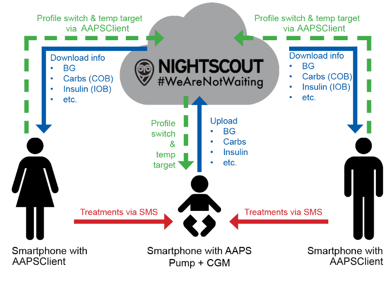

# 원격 모니터링

__AAPS__는 1형 당뇨병 어린이를 원격으로 모니터링하는 여러 기능을 제공합니다. 또한 __AAPS__에 원격으로 지시를 보내는 원격 명령도 사용할 수 있습니다. 마찬가지로 __AAPSClient__를 원격 모니터링에 사용하여 배우자나 친구의 __AAPS__를 팔로우할 수도 있습니다.

## Functions

- 아이의 펌프는 아이의 휴대폰에서 __AAPS__가 제어합니다.
- 보호자는 Android 휴대폰에서 **AAPSClient apk**를 사용하여 혈당, 활성 탄수화물, 활성 인슐린 등 모든 중요한 데이터를 원격으로 팔로우하며 볼 수 있습니다(**AAPSClient**의 iPhone 버전은 개발 중입니다. [AAPSClient](AapsClient.md) 참조). __AAPS__에서 바꾼 설정은 __AAPSClient__와 동기화되며, 반대 방향도 마찬가지입니다.
- xDrip 동반 모드(companion mode)가 설정되어 있으면 보호자는 Android 휴대폰에서 **팔로워 모드의 xDrip 앱**을 사용하여 알람을 받을 수 있습니다.
- [SMS 명령](../RemoteFeatures/SMSCommands.md)을 사용한 __AAPS__ 원격 제어는 2단계 인증으로 보호됩니다.
- __AAPSClient__를 통한 원격 제어는 **AAPS** 4에서 도입된 서명된 명령 채널을 사용합니다: 클라이언트는 먼저 마스터와 **페어링**되어야 하며(QR 코드 또는 PIN 사용), 모든 명령은 마스터가 확인하고 실행합니다. 보호자의 휴대폰마다 읽기 전용부터 전체 제어까지 자체 [역할](#client-master-control-roles)을 받을 수 있습니다. [마스터 ↔ 클라이언트 제어](#client-master-control)를 참조하십시오.

## Tools and apps for remote monitoring

- 웹 브라우저의 [Nightscout](https://nightscout.github.io/) (주로 데이터 표시).
- [__AAPSClient__](AapsClient.md)는 __AAPS__의 축소 버전으로, 마스터 __AAPS__를 팔로우할 수 있고, **페어링**된 후에는 원격 명령을 보낼 수 있습니다: 탄수화물, __임시 목표__, __프로파일 전환__, 그리고 볼러스까지 보낼 수 있습니다([마스터 ↔ 클라이언트 제어](#client-master-control) 참조). 앱은 3개입니다: [AAPSClient, AAPSClient2, AAPSClient3 다운로드](https://github.com/nightscout/AndroidAPS/releases/). 따라서 보호자는 같은 휴대폰에서 최대 세 명까지 팔로우할 수 있습니다(예: 각자 자기 Nightscout 계정과 마스터 __AAPS__를 가진 1형 당뇨병 아이 두 명).
- 원래 Dexcom 앱을 사용하는 경우 Dexcom Follow (혈당 값만).
- 팔로워 모드의 [xDrip](../CompatibleCgms/xDrip.md) (주로 혈당 값과 **알람**).
- iOS의 [Sugarmate](https://sugarmate.io/) 또는 [Spike](https://spike-app.com/) (주로 혈당 값과 **알람**).
- 일부 사용자는 고급 원격 문제 해결을 위해 [TeamViewer](https://www.teamviewer.com/) 같은 완전한 원격 접속 도구가 유용하다고 합니다.

## 스마트워치 옵션

스마트워치는 1형 당뇨병 아이의 __AAPS__를 관리하는 데 매우 유용한 도구가 될 수 있습니다. 몇 가지 옵션이 있습니다:

- 옵션 1 - 보호자의 휴대폰에 __AAPSClient__가 설치되어 있으면, 보호자의 휴대폰에 연결된 호환 스마트워치에 [AAPSClient WearOS 앱](https://github.com/nightscout/AndroidAPS/releases/)을 설치할 수 있습니다. 현재 __혈당__, 루프 상태, 볼러스 이력을 표시하고, 탄수화물 입력, __임시 목표__ 및 __프로파일__ 변경을 할 수 있습니다. 클라이언트가 마스터와 **페어링**되어 있으면 워치에서 **볼러스**도 시작할 수 있습니다: 명령은 클라이언트를 거쳐 마스터로 전달되고, 마스터가 확인하고 주입합니다([마스터 ↔ 클라이언트 제어](#client-master-control) 참조).
- 옵션 2 - [AAPS WearOS 앱](../WearOS/WearOsSmartwatch.md)도 빌드하여 호환 스마트워치에 설치할 수 있습니다. 워치는 아이의 휴대폰에 연결되지만 보호자가 착용합니다. 여기에는 위의 모든 기능이 포함되며, 아이의 몸에서 휴대폰을 꺼낼 필요 없이 인슐린 볼러스를 직접 주입할 수도 있습니다.
- 옵션 3 - 표시만: **AAPS**가 직접 지원하지 않는 워치(Xiaomi, Amazfit, 또는 컴플리케이션을 표시하는 Wear OS 워치)도 WatchDrip+ 또는 GlucoDataHandler 같은 동반 앱을 통해 혈당, IOB, COB, 루프 상태를 표시할 수 있습니다. 이 데이터는 워치가 연결된 **AAPS** 또는 **AAPSClient** 휴대폰의 **외부 연동 앱** 플러그인이 보냅니다. [외부 연동 앱](#watches-external-companion-apps)을 참조하십시오.

## Things to consider

- 업로드와 다운로드에 걸리는 시간 때문에 마스터와 팔로워 사이에 시간 차이가 있다는 점을 생각하십시오. 또한 __AAPS__ 마스터 휴대폰은 루프가 실행된 후에만 업로드합니다.
- 원격 제어가 작동하지 않을 때(_예_: 네트워크 문제 또는 블루투스 연결 끊김) 비상 계획은 무엇입니까? 갑자기 새 명령을 보낼 수 없게 되면 **AAPS**가 어떻게 될지 항상 생각하십시오. **AAPS**는 펌프의 기저, ISF, ICR을 현재 프로파일 값으로 덮어씁니다. 더 강한 인슐린 프로파일로 전환할 때는 원격 연결이 끊어질 경우에 대비하여 임시 프로파일 전환(_즉_, 정해진 기간이 있는 전환)만 사용하십시오. 그러면 시간이 끝났을 때 펌프가 원래 프로파일로 돌아갑니다.
