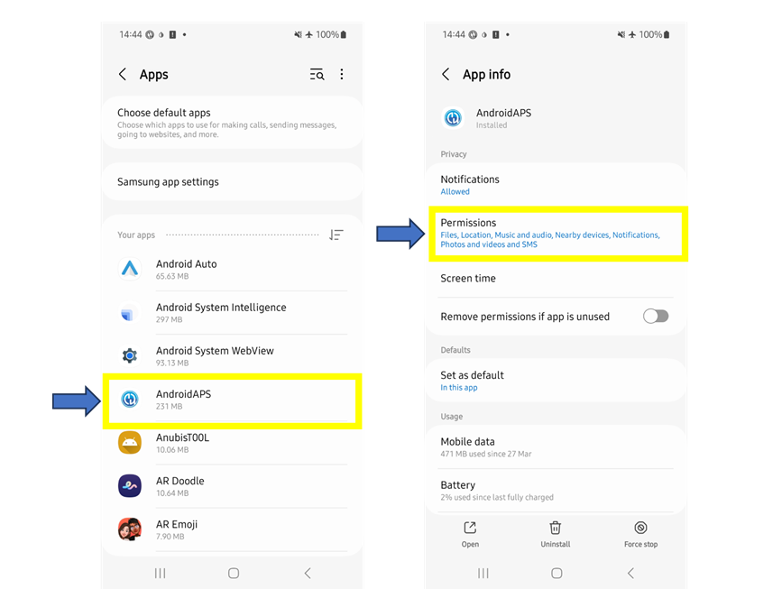
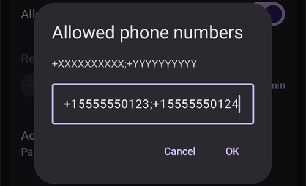
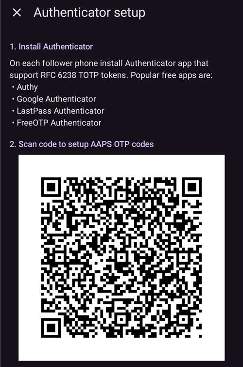
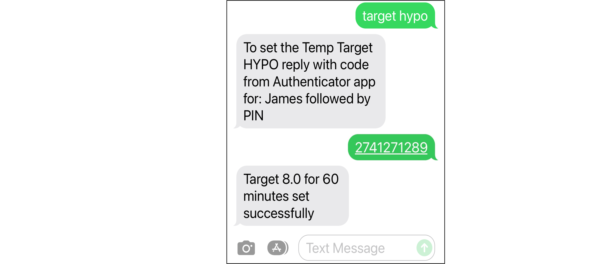

# SMS 명령

```{contents} Table of contents
:depth: 2
```

대부분의 원격 조정(임시 목표, 탄수화물, 프로파일 전환, 그리고 클라이언트가 페어링된 후에는 볼러스)은 인터넷에 연결된 Android 휴대폰의 [**AAPSClient** 앱](../RemoteFeatures/RemoteMonitoring.md)으로 할 수 있습니다. [마스터 ↔ 클라이언트 제어](#client-master-control)를 참조하십시오(**AAPSClient**의 iPhone 버전은 개발 중입니다. [AAPSClient](AapsClient.md) 참조). SMS 명령은 인터넷 없이도 작동하는 대안으로 남아 있으며, iPhone을 팔로워로 사용하고 아직 **AAPSClient**가 없는 경우에는 유일한 원격 옵션입니다.

**SMS 명령은 매우 유용합니다:**
1. 일상적인 원격 제어에

2. 페어링된 **AAPSClient** 없이 원격으로 인슐린 볼러스를 하고 싶을 때

3. 문자 메시지는 전달되지만 데이터/인터넷 수신이 제한되는, 인터넷 수신이 좋지 않은 지역에서 외딴 지역에 갈 때(예: 캠핑, 스키) 매우 유용합니다.

4. 다른 원격 제어 방법(**AAPSClient**)이 일시적으로 작동하지 않을 때

## 안전 우선

**AAPS**에서 **SMS 통신기**를 활성화하는 경우, 원격 명령을 보내도록 설정된 휴대폰을 도난당하거나 다른 사람이 사용할 수 있다는 점을 생각하십시오. 휴대폰은 항상 적어도 PIN으로 잠그십시오. 강력한 비밀번호와/또는 생체 인식 잠금을 강력히 권장합니다. 그리고 이것이 APK 마스터 비밀번호(**AAPS** 설정을 내보낼 때 필요한 비밀번호)와 다르도록 하십시오.

또한 SMS 명령에 [두 번째 전화번호](#SMSCommands-authorized-phone-numbers)를 허용하는 것을 권장합니다. 이렇게 하면 주 원격 휴대폰이 안전하지 않게 되었을 때 두 번째 번호로 SMS 통신기를 [비활성화](#SMSCommands-other)할 수 있습니다.

볼러스 명령 사이의 기본 최소 시간 간격은 15분이며, 펌프가 볼러스를 받아들인 순간부터 계산합니다. 안전을 위해 이 간격을 더 짧게 바꾸려면 허용된 전화번호를 적어도 두 개 추가해야 합니다. 이전 볼러스 후 15분 안에 다시 원격 볼러스를 하려고 하면 “원격 볼러스를 사용할 수 없습니다. 나중에 다시 시도하십시오”라는 응답을 받게 됩니다.

볼러스나 프로파일 변경 같은 원격 명령이 실행되면 AAPS가 문자 메시지로도 알려 줍니다. 수신 휴대폰 중 하나를 도난당할 경우에 대비하여, 확인 문자 메시지가 적어도 두 개의 다른 전화번호로 전송되도록 설정하는 것을 권장합니다.

**SMS 명령으로 볼러스를 하는 경우, 탄수화물은 따로 입력해야 합니다(두 번째 SMS, AAPSClient 등)!** 그렇게 하지 않으면 IOB는 맞지만 COB가 너무 낮게 됩니다. **AAPS**가 활성 인슐린이 너무 많다고 판단하여 교정 볼러스를 주입하지 않을 수 있습니다.

민감한 명령에는 안전을 높이기 위해 시간 기반 일회용 비밀번호를 사용하는 인증 앱을 반드시 사용해야 합니다.

보호자 휴대폰이 더 이상 SMS 명령을 보내지 못하게 하려면 **AAPS**에서 비상 버튼 “[인증 초기화](#sms-commands-authenticator-setup)”를 사용하거나 SMS 명령 “[SMS stop](#SMSCommands-other)”을 보내십시오. 인증을 초기화하면 모든 보호자 휴대폰이 무효가 됩니다. 다시 설정해야 합니다.

## SMS 명령 설정

```{contents} The overall process is as follows
:depth: 1
:local: true
```

(sms-commands-authenticator-setup)=
### Authenticator setup

안전을 높이기 위해 2단계 인증을 사용합니다.

보호자 휴대폰에서 인증 앱을 다운로드(App Store 또는 Google Play에서)하여 설치하십시오. 많이 쓰는 무료 앱은 다음과 같습니다:
  - [Authy](https://authy.com/download/)
  - Google Authenticator - [Android](https://play.google.com/store/apps/details?id=com.google.android.apps.authenticator2) / [iOS](https://apps.apple.com/de/app/google-authenticator/id388497605)
  - [LastPass Authenticator](https://lastpass.com/auth/)
  - [FreeOTP Authenticator](https://freeotp.github.io/)

이 인증 앱은 모바일 뱅킹이나 쇼핑에서처럼 시간 제한이 있는 6자리 일회용 비밀번호를 만듭니다. RFC 6238 TOTP 토큰을 지원하기만 하면 다른 인증 앱을 사용해도 됩니다. Microsoft Authenticator는 작동하지 않습니다.

### 휴대폰 설정 확인

휴대폰에서 **Apps > AAPS > Permissions**(앱 › AAPS › 권한)로 이동하십시오. **SMS**와 **Phone**(전화)이 허용되어 있는지 확인하십시오.



```{admonition} "App was denied access to SMS"
:class: tip
Android는 **AAPS**처럼 앱 스토어에서 설치하지 않은 앱의 **SMS** 권한을 차단할 수 있습니다. **SMS** 권한을 허용할 때 이 메시지가 보이면 휴대폰의 **Settings > Apps > AAPS**(설정 › 앱 › AAPS)를 열고, **⋮** 메뉴(오른쪽 위)를 누른 다음 **Allow restricted settings**(제한된 설정 허용)를 선택하십시오. 그런 다음 **SMS** 권한을 다시 허용하십시오.
```


### 날짜와 시간 동기화

두 휴대폰의 시간이 동기화되어 있어야 합니다. 네트워크에서 시간을 자동으로 설정하는 것이 가장 좋습니다. 시간 차이가 있으면 인증 문제가 생길 수 있습니다.

**AAPS** 휴대폰과 보호자 휴대폰 모두에서 날짜와 시간이 동기화되어 있는지 확인하십시오. 정확한 방법은 기기마다 다르므로, 여러 설정을 시도해 보아야 할 수도 있습니다.

예시(Samsung S23): **Settings > General management > Date and time**(설정 › 일반 › 날짜 및 시간): **Automatic date and time**(자동 날짜 및 시간)이 체크되어 있는지 확인하십시오.

휴대폰이 자녀 계정으로 설정되어 있으면 가족 계정의 관리자 권한이 필요하기 때문에 일부 옵션이 회색으로 비활성화되어 있을 수 있습니다. 보호자/부모의 iPhone에서는 이 날짜와 시간 설정을 “자동으로 설정”이라고 합니다. 휴대폰이 동기화되었는지 확실하지 않아도 걱정하지 마십시오. SMS 명령을 설정한 후, 문제가 생기는 것 같으면 그때 문제를 해결하면 됩니다(필요하면 도움을 요청하십시오).

### AAPS 설정

휴대폰 설정을 확인했으면 이제 **AAPS** 앱에서 [**구성** → **통신**](../SettingUpAaps/ConfigBuilder.md)으로 이동하여 **SMS 통신기** 플러그인을 활성화하십시오.

**SMS 통신기** 설정을 여십시오.

**SMS로 원격 명령 허용**을 활성화하십시오. **토큰 끝에 붙이는 추가 필수 PIN**과 **인증 설정** 옵션은 이 설정을 활성화한 후에만 나타납니다:


(SMSCommands-authorized-phone-numbers)=
#### 허용된 전화번호

보호자의 전화번호를 입력하십시오. 다음 예시처럼 국가 번호를 넣고 전화번호의 첫 번째 “0”은 빼십시오:
* 영국 전화번호: +447976304596
* 미국 전화번호: +11234567890
* 프랑스 전화번호:  +33612344567
* _등._

지역에 따라 번호 앞의 “+”가 필요할 수도 있고 필요하지 않을 수도 있습니다. 이것을 확인하려면 샘플 문자를 보내십시오. 받은 형식이 **SMS 통신기** 플러그인 화면(**구성** → **통신** → **SMS 통신기** → **플러그인 열기**)에 표시됩니다.

추가할 전화번호가 두 개 이상이면 세미콜론으로 구분하고, **번호 사이에 공백을 넣지 마십시오**(매우 중요합니다!). **확인**을 선택하십시오:



#### 원격 볼러스 최소 간격

- SMS로 보낸 두 볼러스 사이의 최소 간격(분)을 정할 수 있습니다.
- 안전을 위해 이 값을 수정하려면 허용된 전화번호를 적어도 두 개 추가해야 합니다.

#### 토큰 끝에 붙이는 추가 필수 PIN

안전을 위해 응답 코드 뒤에 PIN을 붙여야 합니다. SMS 명령을 보낼 때 인증 코드 끝에 본인(과 다른 보호자)이 사용할 PIN을 정하십시오.

PIN 조건은 다음과 같습니다:

* 6자리 이상
* 숫자만

더 안전한 PIN을 위해 같은 숫자를 여러 번(_예_: 111111) 또는 연속된 숫자(_예_: 123456)를 사용하지 마십시오.


#### Authenticator setup

* **인증 설정**을 누르고 화면의 단계별 안내를 따르십시오.
* _보호자 휴대폰_에서 설치한 인증 앱을 열고, 새 연결을 설정한 다음
* 보호자 휴대폰으로 **코드를 스캔하여 AAPS OTP 코드 설정** 아래에 표시된 QR 코드를 스캔하십시오.



* **일회성 비밀번호 테스트** 아래의 **확인할 코드**에 보호자 휴대폰의 인증 앱에서 받은 일회용 비밀번호와 그 뒤에 PIN을 입력하십시오:

예시:
* 인증 앱의 토큰은 457051입니다
* 필수 PIN은 2401입니다
* 확인할 코드: 4570512401

입력이 올바르면 빨간색 “잘못된 PIN” 텍스트가 자동으로 초록색 “확인”으로 바뀝니다. **누를 버튼은 없습니다!** 이제 과정이 끝났습니다. 코드를 입력한 후 눌러야 하는 “확인” 버튼은 없습니다:


이제 SMS 명령 설정이 끝났습니다.

저장된 인증 앱을 삭제하려면 **인증 설정** 화면 아래쪽의 **인증 초기화** 버튼을 사용하십시오. (인증을 초기화하면 이미 저장된 모든 인증 앱이 무효가 됩니다. 다시 설정해야 합니다.)

## SMS 명령 사용

### SMS 명령 사용 첫 단계

1)  모든 것이 올바르게 설정되었는지 확인하려면, 보호자 휴대폰에서 **AAPS** 휴대폰으로 “bg”라는 SMS 메시지를 보내 연결을 테스트하십시오. 다음과 비슷한 응답을 받아야 합니다:


응답을 받지 못하면 아래의 [문제 해결](#SMSCommands-troubleshooting) 섹션을 확인하십시오.

2)  이제 인증이 필요한 SMS 명령을 보내 보십시오. _예_: “target hypo”. 보호자 휴대폰은 답장 문자를 받습니다. 이 문자는 인증 앱의 **6자리 인증 비밀번호**와 그 뒤에 보호자/팔로워만 아는 추가 비밀 **PIN**을 입력하라고 요청합니다(PIN이 6자리라면 모두 12자리 숫자입니다).

SMS 명령을 처음 보낼 때는 **AAPS** 휴대폰이 있는 곳에서 시도하여 어떻게 작동하는지 확인하십시오:


보호자 휴대폰은 원격 SMS 명령이 성공적으로 실행되었는지 확인하는 답장 SMS를 **AAPS**에서 받습니다.

명령이 성공하면 이를 확인하는 답장을 받습니다. 문제가 있으면 오류 메시지를 받습니다. 흔한 오류는 아래의 [문제 해결](#SMSCommands-troubleshooting)을 참조하십시오.

**힌트**: SMS를 많이 보낼 경우, 휴대폰 요금제(사용하는 휴대폰마다)에 무제한 SMS가 있으면 유용할 수 있습니다.

### SMS 명령으로 식사 볼러스 주입하기

원격 인슐린 볼러스는 **SMS 명령** 또는 페어링된 **AAPSClient**로 할 수 있습니다([마스터 ↔ 클라이언트 제어](#client-master-control) 참조). Nightscout 웹사이트로는 할 수 없습니다. 탄수화물도 SMS 또는 **AAPSClient**로 입력할 수 있습니다. SMS로는 탄수화물 명령과 인슐린 명령을 하나의 SMS 메시지로 함께 보낼 수 없습니다. 이 명령들은 다음과 같이 따로 보내야 합니다:

1)  SMS 명령으로 인슐린 볼러스를 보냅니다(_예_: “bolus 2”는 2 U 볼러스를 명령합니다). 이것은 **AAPS**의 **처치** → **인슐린**과 같습니다. 2)  탄수화물을 보냅니다(_예_: “carbs 20”은 탄수화물 20g을 입력합니다). 이것은 **AAPS**의 **처치** → **탄수화물**과 같습니다.

현재 혈당이나 혈당 추세를 고려하지 않기 때문에, 저혈당을 피하려면 탄수화물 비율에 따라 필요한 양보다 **적은 인슐린**으로 볼러스하여 보수적으로 시작하는 것이 좋습니다.

**이 명령들을 보내는 순서가 중요합니다**. 어떤 방법으로든 많은 탄수화물을 입력하고 SMB가 활성화되어 있으면, **AAPS**가 즉시 인슐린의 일부를 볼러스로 주입할 수 있습니다. 따라서 탄수화물을 입력한 _후_에 인슐린 볼러스를 보내려고 하면, 답답한 지연과 “bolus in progress”(볼러스 진행 중) 메시지를 받을 수 있으며, SMB로 무엇이 주입되었는지 확인해야 합니다. 또는 SMB가 주입되고 있다는 것을 모르고 이후에 보낸 볼러스도 성공하면, 식사 전체에 대해 너무 많은 인슐린이 주입될 수 있습니다. 따라서 원격으로 식사 볼러스를 할 때는 항상 탄수화물 입력 _전_에 인슐린 볼러스를 보내십시오. 원하면 **AAPSClient**와 SMS 명령을 함께 사용할 수 있습니다: 페어링된 **AAPSClient**에서 입력한 탄수화물은 인증 코드가 필요 없으므로 SMS 명령보다 빠릅니다. 클라이언트 제어가 켜져 있는 동안에는 Nightscout 웹사이트에서 입력한 탄수화물이나 다른 처치가 적용되지 **않습니다**. 이때 **AAPS**는 [강화 모드](#client-master-control-hardened-mode)에 있습니다.

(SMSCommands-commands)=
## 명령

```{contents} List of command groups
:depth: 1
:local: true
```

명령은 영어로 보내야 합니다. 응답 문자열이 이미 [번역](#translations-translate-strings-for-AAPS-app)되어 있으면 응답은 사용하는 언어로 옵니다. 명령은 대소문자를 구분하지 않으므로 소문자나 대문자를 사용할 수 있습니다.


아래의 **SMS 명령 표**에 사용할 수 있는 모든 SMS 명령이 있습니다. 이해를 돕기 위해 _예시 값_을 적었습니다. 명령에 사용할 수 있는 값의 범위(목표, 프로파일 퍼센트 등)는 **AAPS** 앱에서 허용되는 범위와 같습니다.

(authentication-or-not)=
### 인증이 필요합니까?

어떤 SMS 명령은 바로 응답하고, 어떤 SMS 명령은 인증 앱을 통한 강력한 **인증**이 필요합니다. “**BG**”(현재 혈당을 요청함) 같은 간단한 조회는 입력하기 쉽고, 인증이 필요 없으며, 아래와 같은 **AAPS** 상태 정보를 반환합니다:


보안이 더 필요한 명령은 코드를 입력해야 합니다. 예:



아래 표의 *인증* 열은 각 명령에 이런 강력한 인증이 필요한지 보여 줍니다.

### CGM data

| 명령         | 인증  | 기능 & *응답*                                                                                                                                           |
| ---------- | --- | --------------------------------------------------------------------------------------------------------------------------------------------------- |
| BG         | 아니요 | 반환: 마지막 혈당, 증분, IOB(볼러스와 기저), COB<br/>*Last BG: 5.6 4분 전, Delta: -0,2 mmol, IOB: 0.20U (Bolus: 0.10U Basal: 0.10U)*                           |
| CAL 5.6/90 | Yes | CGM을 5.6/90 값으로 보정합니다<br/>(사용하는 혈당 단위에 맞는 값을 사용하십시오)<br/>**AAPS**에서 제대로 설정된 경우에만 작동합니다.<br/>*보정을 보냈습니다. xDrip+에서 수신이 켜져 있어야 합니다.* |

### Pump

| 명령                   | 인증  | 기능 & *응답*                                                                                            |
| -------------------- | --- | ---------------------------------------------------------------------------------------------------- |
| PUMP                 | 아니요 | LastConn: 1 min ago<br/>Temp: 0.00U/h @11:38 5/30min<br/>IOB: 0.5U Reserv: 34U Batt: 100 |
| PUMP DISCONNECT *30* | Yes | *30*분 동안 펌프 연결 해제                                                                                    |
| PUMP CONNECT         | Yes | Pump reconnected                                                                                     |

### 기저

| 명령                | 인증  | 기능 & *응답*           |
| ----------------- | --- | ------------------- |
| BASAL 0.3         | Yes | 30분 동안 기저 0.3U/h 시작 |
| BASAL 0.3 20      | Yes | 20분 동안 기저 0.3U/h 시작 |
| BASAL 30%         | Yes | 30분 동안 기저 30% 시작    |
| BASAL 30% 50      | Yes | 50분 동안 기저 30% 시작    |
| BASAL STOP/CANCEL | Yes | 임시 기저 중지            |

어떤 펌프는 임시 기저를 퍼센트로만 받고, 다른 펌프는 U/h로만 받습니다. 다른 형식을 사용하면 **AAPS**가 *"이 펌프는 임시 기저를 퍼센트로만 받으며, U/h로는 받지 않습니다."*(또는 그 반대)라고 답하고 아무것도 설정하지 않습니다. 기간은 펌프의 임시 기저 기간 단위의 배수여야 합니다.


### 루프

| 명령                | 인증  | 기능 & *응답*                                                                                                                                                                                             |
| ----------------- | --- | ----------------------------------------------------------------------------------------------------------------------------------------------------------------------------------------------------- |
| LOOP STATUS       | 아니요 | 응답은 실제 상태에 따라 다릅니다:<br/> - 루프가 비활성화되었으면 *루프가 비활성화되었습니다*<br/> - 루프가 폐쇄, 개방 또는 LGS이면 *루프가 활성화되어 있습니다*<br/> - 펌프 연결이 해제되었으면 *펌프 연결이 해제되었습니다*<br/> - 루프가 일시 중지되었으면 *일시 중지됨 (10분)* |
| LOOP STOP/DISABLE | Yes | 펌프가 미리 설정된 기저 주입량으로 돌아갑니다.<br/>*루프가 비활성화되었습니다*                                                                                                                                                  |
| LOOP SUSPEND 20   | Yes | *루프 일시 중지됨*                                                                                                                                                                                           |
| LOOP RESUME       | Yes | *루프가 재개되었습니다*                                                                                                                                                                                         |
| LOOP CLOSED       | Yes | *현재 실행 모드: 폐쇄 루프*                                                                                                                                                                                     |
| LOOP LGS          | Yes | *현재 실행 모드: 저혈당 주입 정지*                                                                                                                                                                                 |

### 볼러스

마지막 볼러스 명령 또는 원격 명령 후 15분 안에는 원격 볼러스가 허용되지 않습니다(이 값은 전화번호 2개를 추가한 경우에만 수정할 수 있습니다)! 이 경우 응답은 *원격 볼러스를 사용할 수 없습니다. 나중에 다시 시도하십시오.*입니다. 펌프가 지금 볼러스를 주입하는 중일 때도 이 응답을 보냅니다.

| 명령                   | 인증  | 기능 & *응답*                                                                                                                            |
| -------------------- | --- | ------------------------------------------------------------------------------------------------------------------------------------ |
| BOLUS 1.2            | Yes |                                                                                                                                      |
| BOLUS 0.60 MEAL      | Yes | 지정한 0.60U 볼러스를 주입하고<br/>**동시에** [식사 직전 임시 목표](#TempTargets-eating-soon-temp-target)를 설정합니다                                     |
| CARBS 5              | Yes | 볼러스 없이 탄수화물 5g 입력                                                                                                                    |
| CARBS 5 17:35/5:35PM | Yes | 17:35에 탄수화물 5g 입력.<br/>사용할 수 있는 시간 형식은<br/> 휴대폰의 시간 설정(12시간/24시간)에 따라 다릅니다.                                              |
| EXTENDED 2 120       | Yes | 120분 동안 확장 볼러스 2U 시작.<br/>[호환 펌프](#Extended-Carbs-extended-bolus-and-switch-to-open-loop-dana-and-insight-pump-only)에서만 가능합니다. |
| EXTENDED STOP/CANCEL | Yes | 확장 볼러스 중지                                                                                                                            |

### Profile

| 명령             | 인증  | 기능 & *응답*                                                                                       |
| -------------- | --- | ----------------------------------------------------------------------------------------------- |
| PROFILE STATUS | 아니요 | 현재 프로파일과 퍼센트                                                                                    |
| PROFILE LIST   | 아니요 | **AAPS**의 현재 프로파일 목록, 예:<br/>1. Profile1<br/> 2. Profile2                           |
| PROFILE 1      | Yes | 목록의 프로파일 1로 전환합니다.<br/>**PROFILE LIST**가 반환한 번호를 사용하십시오.<br/>저장한 프로파일 이름은 사용하지 마십시오 |
| PROFILE 2 30   | Yes | Profile2 30%로 프로파일 전환                                                                           |

퍼센트는 앱에서처럼 30%에서 250% 사이여야 합니다. 이 범위를 벗어난 값은 인증 코드를 묻기 전에 거부됩니다.

### Temporary Targets

| 명령                        | 인증  | 기능 & *응답*                   |
| ------------------------- | --- | --------------------------- |
| TARGET MEAL/ACTIVITY/HYPO | Yes | 임시 목표 MEAL/ACTIVITY/HYPO 설정 |
| TARGET STOP/CANCEL        | Yes | 임시 목표 취소                    |


(SMSCommands-other)=
### 기타

| 명령               | 인증  | 기능 & *응답*                                                                                                                                                                                                        |
| ---------------- | --- | ---------------------------------------------------------------------------------------------------------------------------------------------------------------------------------------------------------------- |
| RESTART          | Yes | AAPS를 다시 시작합니다. 보통 다시 시작하면 해결되는 문제가 있을 때 유용합니다.                                                                                                                                                                  |
| SMS DISABLE/STOP | Yes | SMS 원격 서비스를 비활성화하려면 코드로 답장하십시오.<br/>다시 활성화하는 것은<br/>**AAPS** 마스터 휴대폰에서만 직접 할 수 있습니다.                                                                                                                 |
| HELP             | 아니요 | 조회할 수 있는 모든 기능을 반환합니다:<br/>BG, LOOP, PUMP, BASAL, BOLUS, EXTENDED, CAL, PROFILE, TARGET, SMS, CARBS, HELP, RESTART<br/>이 항목에서 사용할 수 있는 모든 옵션을 보려면<br/>***HELP ***FUNCTION****** 명령을 추가로 보내십시오. |
| HELP BOLUS       |     | *BOLUS 1.2<br/>BOLUS 1.2 MEAL*                                                                                                                                                                             |

(SMSCommands-troubleshooting)=
## 문제 해결과 FAQ

```{contents} List of questions and issues
:depth: 1
:local: true
```

### SMS 명령으로 _할 수 없는_ 것은 무엇입니까?

1)  **_임시_ 프로파일 전환은 설정할 수 없습니다**(예를 들어 "profile exercise"를 60분 동안 설정하는 것). 하지만 “profile exercise”로 영구 전환할 수는 있습니다. 대신 임시 프로파일 전환은 **AAPSClient**로 설정할 수 있습니다.

2)  **자동화를 취소**하거나 **사용자가 정한 목표를 설정**할 수는 없지만, 비슷한 해결 방법이 있습니다: 예를 들어, 일반 프로파일 목표가 5.5라고 생각해 보십시오. 학교 체육 수업 때문에 AAPS에 오후 2시 30분부터 3시 30분까지 항상 높은 목표 7.0을 설정하는 자동화를 만들었고, 이 자동화의 조건 중 하나는 “임시 목표가 없음”입니다. 이번 주에 체육 수업이 취소되고 피자를 먹는 시간으로 바뀌었다는 연락을 갑자기 받았지만, 아이는 이미 **AAPS** 휴대폰을 가지고 학교에 있습니다. 자동화가 높은 임시 목표 7.0을 시작한 후 이를 취소하면(**AAPS** 휴대폰에서든 원격으로든), 자동화 조건은 여전히 맞기 때문에 **AAPS**는 1분 후에 높은 목표를 다시 설정합니다.

**AAPS 휴대폰을 사용할 수 있다면**, 자동화의 체크를 해제하거나 수정할 수 있습니다. 그렇게 하고 싶지 않다면 메인 화면의 목표를 누르거나 **관리** → **임시 목표**에서 60분 동안 새 임시 목표 5.6을 설정하면 됩니다. 이렇게 하면 자동화가 높은 목표 7.0을 설정하지 않습니다.

**AAPS 휴대폰을 사용할 수 없다면** SMS 명령으로 비슷하게 해결할 수 있습니다: 예를 들어 “target meal” 명령으로 45분 동안 목표 5.0을 설정합니다(다른 기본 목표는 activity 또는 hypo에서 8.0입니다. 표 참조). 하지만 SMS 명령으로는 _특정_ 목표 값(예: 60분 동안 5.6)을 지정할 수 없습니다. 이렇게 하려면 **AAPSClient**를 사용해야 합니다.

### 방금 보낸 명령을 취소하고 싶으면 어떻게 됩니까?

**AAPS**는 가장 최근의 명령만 실행합니다. 따라서 “bolus 1.5”를 입력한 후 인증하지 않고 새 명령 “bolus 1”을 보내면, 이전의 1.5 명령은 무시됩니다. **AAPS**는 인증 코드를 입력하라는 요청 전에 SMS 명령이 무엇인지 확인하는 응답을 보호자 휴대폰에 항상 보내고, 동작 후에도 응답을 보냅니다.

### SMS 명령에 응답을 받지 못한 이유는 무엇입니까?

다음 이유 중 하나일 수 있습니다:

1)  메시지가 휴대폰에 전달되지 않았습니다(네트워크 문제). 2)  **AAPS**가 아직 요청을 처리하는 중입니다(_예_: 볼러스는 볼러스 속도에 따라 주입하는 데 시간이 걸릴 수 있습니다). 3)  명령을 받았을 때 **AAPS** 휴대폰과 펌프의 블루투스 연결이 좋지 않아 명령이 실패했습니다(이 경우 보통 **AAPS** 휴대폰에 알람이 울립니다).

### SMS 명령에 대한 응답이 전혀 없음

보호자 휴대폰 및/또는 **AAPS** 휴대폰에서 다음 옵션을 비활성화해 보십시오:
* **Send as chat message**(채팅 메시지로 보내기) 
* Android 메시지 앱 또는 Google 메시지 앱을 사용하는 경우 RCS 메시지를 비활성화하십시오:
  - 메시지 앱에서 해당 SMS 대화를 엽니다
  - 오른쪽 위의 옵션 메뉴(점 세 개)를 선택합니다
  - "Details"(세부정보)를 선택합니다
  - "Only send SMS and MMS messages"(SMS 및 MMS 메시지만 보내기) 활성화 

### 명령 실행 오류

명령이 성공하지 못하는 이유는 여러 가지가 있을 수 있습니다:

* SMS 명령 설정이 완료되지 않았거나 올바르지 않음
* 잘못된 형식의 명령을 보냄(예: “pump disconnect 45” 대신 “disconnect pump 45”)
* 잘못되었거나 만료된 인증 코드를 사용함(현재 코드가 곧 만료될 것 같으면 몇 초 기다려 새 코드를 사용하는 것이 보통 좋습니다)
* 코드+PIN은 맞았지만 SMS 발신/수신이 지연되어, **AAPS**가 인증 코드가 만료되었다고 계산함
* **AAPS** 휴대폰이 펌프의 범위를 벗어났거나 펌프와 연결되지 않음
* 시스템이 이미 볼러스를 주입하는 중임

흔한 오류는 아래 예시에 있습니다:


### 인증된 명령은 어떻게 중지할 수 있습니까?

할 수 없습니다. 하지만 빠르게 하면 **AAPS** 휴대폰에서 볼러스 팝업의 취소로 SMS로 보낸 볼러스를 취소할 수 있습니다. 실수를 했을 때 많은 SMS 명령(볼러스와 탄수화물 입력 제외)은 쉽게 되돌리거나, 원하지 않은 결과를 줄이는 조치를 할 수 있습니다.

볼러스와 탄수화물 입력의 실수에도 조치를 할 수 있습니다. 예를 들어, 탄수화물 20g을 입력했지만 아이가 10g만 먹었고, 본인(또는 곁에 있는 보호자)이 **AAPS** 휴대폰에서 직접 처치를 삭제할 수 없다면, 높은 임시 목표를 설정하거나 낮춘 프로파일을 설정하여 **AAPS**가 덜 공격적으로 작동하게 할 수 있습니다.

### 여러 SMS

같은 메시지를 계속 받는다면(_예_: 프로파일 전환), 실수로 다른 앱과 반복 순환이 생기도록 설정했을 수 있습니다. 예를 들어 xDrip일 수 있습니다. 그렇다면 xDrip(또는 다른 앱)이 처치를 Nightscout에 업로드하지 않도록 하십시오.

다른 앱이 여러 휴대폰에 설치되어 있으면 모든 휴대폰에서 업로드를 비활성화하십시오.

(sms-commands-too-many-messages)=
### SMS 명령에서 문자 메시지가 너무 많이 옵니다. 횟수를 줄이거나 오지 않게 할 수 있습니까?

SMS 명령을 사용하면 **AAPS** 휴대폰에서 보호자 휴대폰으로 자동 메시지가 많이 갈 수 있습니다. **AAPS**에 자동화가 설정되어 있으면, 예를 들어 “펌프의 기저 프로파일이 업데이트되었습니다” 같은 메시지도 받게 됩니다. SMS를 많이 보낼 경우, **AAPS** 휴대폰 요금제(와 사용하는 각 보호자 휴대폰)에 무제한 SMS가 있으면 유용할 수 있습니다. 또한 모든 휴대폰에서 SMS 알림, 알람 또는 진동을 끄는 것이 좋습니다. SMS 명령을 사용하면서 이런 업데이트를 받지 않을 수는 없습니다. 그래서 아이와 직접 연락할 때는(아이가 충분히 컸다면) SMS 대신 다른 방법을 사용하는 것이 좋을 수 있습니다. **AAPS** 보호자들이 많이 쓰는 다른 연락 앱으로는 WhatsApp, LINE, Telegram, Facebook Messenger가 있습니다.

프로파일 변경이 Nightscout에서 시작된 경우 "펌프의 기저 프로파일이 업데이트되었습니다" SMS를 끌 수 있습니다. 이렇게 하려면 AAPS 디렉터리의 `extra` 폴더에 **정확히** `do_not_send_sms_on_profile_change`라는 이름의 파일을 만드십시오.
