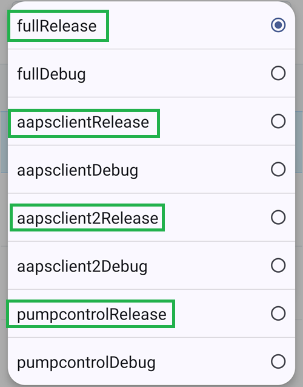

(github-build-apk)=

# 브라우저 빌드 – 4단계: APK 빌드

```{note}
이 페이지는 [브라우저 빌드](BrowserBuild.md)의 **4단계**입니다. 먼저 [3단계 – Google Drive 인증하기](BrowserBuildGoogleDrive.md)를 마치십시오.
```

## AAPS-CI GitHub Actions로 AAPS APK 빌드하기
 - 일반 사용자에게 적합합니다.

```{tab-set}

:::{tab-item} 위키
### 서명된 APK를 빌드하는 워크플로 실행

1. GitHub에 있는 AndroidAPS 복사본에서 Actions를 선택하십시오.
2. All Workflows를 펼치십시오.
3. AAPS-CI를 선택하십시오.


4. 아래로 스크롤하여 Run Workflow를 누르십시오.


5. **Use workflow from**(워크플로 기준 브랜치)은 master 브랜치로 두십시오. **Select AAPS Version**(AAPS 버전 선택)에서 빌드할 **AAPS** 버전을 선택하십시오(보통 최신 버전). [변형](#browserbuild-variant)(fullRelease)을 선택하고 Run workflow를 누르십시오.


6. Workflow run was successfully requested 메시지가 표시됩니다. 브라우저 페이지를 새로 고치면 빌드 진행 상황을 볼 수 있습니다. 작업이 끝나면 AAPS CI 작업에 녹색 체크 표시가 나타납니다. 업데이트된 Android APS 버전을 성공적으로 빌드했습니다.


### AAPS APK 설치

1. Google Drive를 여십시오.
2. AAPS 폴더로 들어가 새 버전 폴더를 선택하면 휴대폰용 버전과 Android Wear용 버전이 모두 있습니다.


:::  

:::{tab-item} 동영상
<div align="center" style="max-width: 360px; margin: auto; margin-bottom: 2em;">
  <div style="position: relative; width: 100%; aspect-ratio: 9/16;">
    <iframe
      src="https://geo.dailymotion.com/player/x9rdwms.html?video=x9rdwms&loop=true&mute=true"
      loading="lazy"
      style="position: absolute; top: 0; left: 0; width: 100%; height: 100%;"
      frameborder="0"
      allowfullscreen>
    </iframe>
  </div>
</div>
:::  

```

## 빌드 버전 선택

**브라우저 방식으로는 AAPS 3.3.2.1 이상 버전만 빌드할 수 있습니다.**

**Select AAPS Version**(AAPS 버전 선택)을 누르고 빌드할 버전을 고르십시오. 최신 버전이 목록의 맨 위에 있습니다.


(browserbuild-variant)=

## 빌드 변형 선택

*참고: Android 앱과 Android Wear 앱이 모두 자동으로 빌드됩니다.*

  - 필요한 변형을 선택하십시오:
    - fullRelease: 모든 기능을 갖춘 일반 펌프 사용용입니다.
    - [aapsclientRelease, aapsclient2Release, aapsclient3Release](#RemoteControl_aapsclient): 보호자용입니다([Nightscout](../SettingUpAaps/Nightscout.md)가 필요합니다). `aapsclient3Release`는 **AAPSClient3**을 빌드하며, **AAPS** 버전 4.0부터 사용할 수 있습니다([AAPSClient, AAPSClient2, AAPSClient3 정보](#remotecontrol-aapsclient-versions) 참조).
    - pumpcontrolRelease: 펌프 앱/컨트롤러를 대체하는 용도입니다.



이름이 “Debug”로 끝나는 변형은 APK가 디버그 모드로 빌드된다는 뜻이며, 개발자가 문제를 해결할 때 유용합니다.

<!-- If you want to test the items in a pull request has been moved to dev page /AdvancedOptions/DevBranch.md -->

----

빌드가 성공하면 APK가 Google Drive에 저장됩니다. [AAPS 전송 및 설치](TransferringAndInstallingAaps.md)로 계속하십시오.

```{note}
2026년 9월부터 Google의 [Android 개발자 인증](#android-developer-verification) 때문에, 국가에 따라 파일을 눌러 APK를 설치하는 것이 막힐 수 있습니다. 무료 해결 방법은 그 페이지에 설명되어 있습니다.
```

빌드가 실패하면 먼저 [빌드 로그에서 무엇이 잘못되었는지 확인](#aaps-ci-read-the-logs)한 다음, [브라우저 빌드: 문제 해결](../GettingHelp/BrowserBuildTroubleshooting.md)을 참조하십시오. 특정 커밋을 빌드에 포함하려면 [커밋 cherry-pick 하기](#github-cherry-pick)를 참조하십시오.
