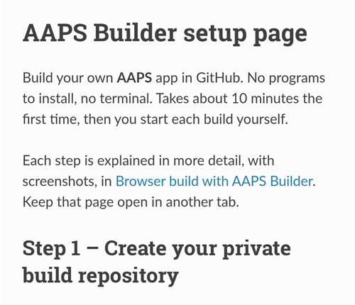
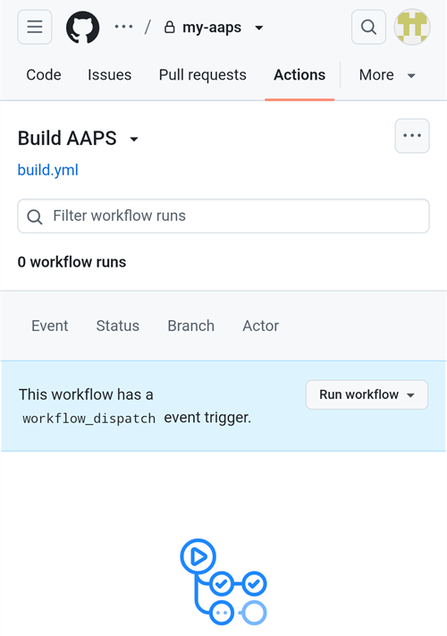

(aaps-builder)=

# AAPS Builder로 브라우저 빌드

```{note}
**Android 휴대폰**에서 AAPS를 빌드할 때 권장하는 방법입니다. 컴퓨터 브라우저에서도 사용할 수 있습니다. 컴퓨터나 iPhone에서 빌드하는 다른 방법은 [브라우저 빌드](BrowserBuild.md) 개요를 참조하십시오.
```

```{contents} In this page
:backlinks: entry
:depth: 2
```

**AAPS Builder**는 무료 코드 호스팅 웹사이트인 GitHub에서 AAPS 앱을 대신 빌드합니다. 휴대폰에 설치할 것이 없고, 열어야 할 준비 파일도 없습니다.

설정 페이지가 과정을 안내합니다. 처음에는 약 10분이 걸립니다:

1. GitHub 계정에 AAPS Builder의 **비공개 복사본**을 만드십시오: 설정 페이지가 모든 내용이 입력된 GitHub를 열어 주므로 확인만 하면 됩니다. 빌드 워크플로, 즉 GitHub에 AAPS를 빌드하는 방법을 알려 주는 파일이 이미 그 안에 있습니다.
2. **서명 키**(키 저장소)를 만들거나 업로드하십시오.
3. 키를 GitHub **secret**으로 저장소에 넘겨주십시오.
4. 앱을 **빌드**하십시오. 빌드 한 번에 15~30분이 걸립니다.
5. 휴대폰에 앱을 **다운로드하고 설치**하십시오.

AndroidAPS를 fork할 필요가 **없습니다**: AAPS 소스 코드는 빌드할 때마다 공식 AndroidAPS 저장소에서 다운로드됩니다. Google Drive도 **필요 없습니다**: 앱을 GitHub에서 바로 다운로드합니다.

```{admonition} Where the code comes from
:class: note

빌드 워크플로는 AAPS 개발자들이 [nightscout/aaps-builder](https://github.com/nightscout/aaps-builder) 저장소에서 관리하며, 자신의 저장소는 그 복사본입니다. 복사본에 있는 [워크플로](https://github.com/nightscout/aaps-builder/blob/main/.github/workflows/build.yml)는 짧습니다: 그 저장소에 있는 [빌드 단계](https://github.com/nightscout/aaps-builder/blob/main/.github/workflows/aaps-builder.yml)를 실행하므로, 자신의 저장소를 바꾸지 않아도 개선 사항이 반영됩니다. 두 파일 모두 읽어 볼 수 있습니다. 빌드할 때 워크플로는 공식 AAPS 소스 코드와 GitHub 자체의 빌드 도구만 다운로드합니다. 키 저장소는 브라우저와 자신의 비공개 저장소 밖으로 절대 나가지 않습니다.
```

(aaps-builder-before-you-start)=

## 시작하기 전에

필요한 것:

- **GitHub 계정**(무료). 계정이 없으면 먼저 [github.com](https://github.com/signup)에서 만드십시오.
- **웹 브라우저**: 휴대폰의 Chrome 또는 컴퓨터의 아무 브라우저. 시작하기 전에 그 브라우저에서 github.com에 로그인하십시오.
- **휴대폰에 GitHub 앱이 있습니까?** 그대로 두어도 됩니다. 그러면 설정 페이지의 일부 버튼이 Chrome 대신 앱을 엽니다. 빌드는 앱에서도 되지만, 앱은 완성된 AAPS를 **다운로드할 수 없습니다**: [5단계](#aaps-builder-step5)에서 다운로드를 위해 Chrome으로 전환하는 방법을 설명합니다.
- 전에 AAPS를 빌드했고 재설치 없이 업데이트하려면 **기존 키 저장소**(`.jks` 파일)와 그 비밀번호, 별칭(alias).

```{warning}
**빌드 저장소는 반드시 비공개로 두어야 합니다.** 빌드가 만드는 모든 것은 저장소를 볼 수 있는 사람이면 누구나 볼 수 있습니다. 설정 페이지가 비공개 저장소를 대신 만들어 줍니다. 절대 공개로 바꾸지 마시고, 대신 AAPS Builder를 **fork**하지도 마십시오: fork는 항상 공개입니다.

비공개 저장소에는 매달 2000분의 무료 GitHub Actions 시간이 주어지며, 여러 번 빌드하기에 충분합니다.
```

```{warning}
**새 키 또는 기존 키: 이것이 AAPS를 업데이트할 수 있는지를 결정합니다.**

- **휴대폰에 이미 AAPS가 있고, 그 빌드에 사용한 키 저장소를 아직 가지고 있는 경우**: 설정 페이지에서 **I already have a keystore**(이미 키 저장소가 있음)를 선택하고 키 저장소를 업로드하십시오. 다음 빌드로 기존 AAPS를 그대로 업데이트할 수 있습니다. 이전 브라우저 빌드(자신의 fork)로 AAPS를 빌드했습니까? 키 저장소는 fork 안에 있습니다: [먼저 그 복사본을 받으십시오](#aaps-builder-from-fork).
- **AAPS를 처음 빌드하거나, 키 저장소 또는 그 비밀번호를 잃어버린 경우**: **Create a new key**(새 키 만들기)를 선택하십시오. 새 키로 서명한 앱은 다른 키로 서명한 AAPS를 **업데이트할 수 없습니다**. 설정을 내보내고, 그 파일을 휴대폰 밖으로 복사하고, 이전 AAPS를 삭제하고, 새 AAPS를 설치한 다음 설정을 가져와야 합니다: [새 키 저장소로 AAPS 재설치하기](#reinstall-aaps)를 참조하십시오.

그 후에는 항상 같은 키를 계속 사용하십시오. 새 키를 만들 때는 페이지에서 제공하는 백업을 다운로드하고, 그 비밀번호와 별칭(`key0`)과 함께 휴대폰 밖의 안전한 곳에 보관하십시오.
```

(aaps-builder-from-fork)=

## 이전 브라우저 빌드에서 전환하는 경우 (fork)

이전 브라우저 빌드 방법(GitHub에 있는 자신의 AndroidAPS 복사본, 즉 fork와 준비 파일, Google Drive를 사용하는 방법)으로 AAPS를 빌드한 적이 없다면 이 섹션을 건너뛰십시오.

키 저장소는 fork 안에 secret으로 저장되어 있습니다. GitHub가 secret을 다시 보여 주지 않으므로, 새 저장소로 복사할 수 없습니다. 먼저 키 저장소의 복사본을 받은 다음, [2단계](#aaps-builder-step2)에서 **I already have a keystore**와 함께 사용하십시오.

```{warning}
**Create a new key**를 선택하지 마십시오. 새 키로 빌드한 AAPS는 휴대폰에 있는 AAPS를 업데이트할 수 없습니다.
```

어느 경우에 해당합니까?

- **옵션 2를 사용한 경우**(Android Studio에서 만든 자신의 키 저장소를 업로드한 경우) `.jks` 파일과 그 비밀번호, 별칭을 아직 가지고 있다면: 여기서 할 일이 없습니다. 2단계에서 그 파일을 사용하십시오.
- **옵션 1을 사용한 경우**(준비 파일이 키를 만든 경우), 또는 키 저장소 파일이 더 이상 없는 경우: 아래와 같이 fork에서 키 저장소를 내보내십시오.

fork에서 키 저장소를 내보내려면:

1. fork에서 **Settings** → **Secrets and variables** → **Actions**를 열고 이름이 `ZIP_PASSWORD`인 secret을 추가하십시오. 영문자와 숫자만으로 된 비밀번호를 정하십시오. 이 비밀번호는 지금 만들 파일을 보호합니다.
2. fork의 **Actions** 탭을 열고 **CI Keystore Export**를 누른 다음 **Run workflow**를 누르십시오. 자세한 내용: [키 저장소 내보내기](#ci-keystore-export).
3. 실행에 초록색 체크 표시가 나타나면 Google Drive를 여십시오: `keystore.zip` 파일이 **AAPS** → **KeyStore** 폴더에 있습니다. Google Drive 단계에서 실행이 실패하면 fork의 Google Drive 액세스가 만료된 것입니다: [Google 갱신 토큰(Refresh Token) 만료](#aaps-ci-google-token-expired)를 참조하십시오.
4. `keystore.zip`을 다운로드하고 `ZIP_PASSWORD`로 여십시오: 컴퓨터에서, 또는 휴대폰에서 비밀번호로 보호된 ZIP 파일을 열 수 있는 파일 관리자 앱으로 열 수 있습니다. 안에 들어 있는 것:
   - `keystore.jks`: 키 저장소,
   - `keyStoreInfo.txt`: `KEYSTORE_PASSWORD`, `KEY_PASSWORD`, `ALIAS`(보통 `key0`).
5. `keystore.jks`를 휴대폰으로 복사하십시오(또는 Google Drive로 복사하여 그곳에서 선택할 수 있게 하십시오).

설정 페이지의 [2단계](#aaps-builder-step2)에서:

1. **I already have a keystore**(이미 키 저장소가 있음)를 누르십시오.
2. **Keystore file**에서 `keystore.jks`를 선택하십시오.
3. **Keystore password**에 `keyStoreInfo.txt`에 있는 `KEYSTORE_PASSWORD`를 입력하십시오.
4. **Key alias**(키 별칭)에서 `keyStoreInfo.txt`에 있는 `ALIAS`를 고르거나 입력하십시오.
5. `KEY_PASSWORD`가 `KEYSTORE_PASSWORD`와 다르면 **Key password is the same as the keystore password**의 체크를 해제하고 `KEY_PASSWORD`를 입력하십시오.

`keystore.zip`과 그 `ZIP_PASSWORD`를 휴대폰 밖의 안전한 곳에 보관하십시오: 이것이 키의 백업입니다.

AAPS Builder의 빌드도 Google Drive에 저장하려면 [6단계](#aaps-builder-google-drive)를 하십시오: 설정 페이지가 새 `GDRIVE_OAUTH2`를 받아 줍니다. AAPS Builder로 빌드한 AAPS가 휴대폰에 설치될 때까지는 fork를 남겨 두어도 됩니다.

## 설정 페이지 열기

**→ [AAPS Builder 설정 페이지 열기](#aaps-builder-setup)**

설정 페이지는 이 문서의 일부이며, 사용자의 언어로 표시됩니다. 이 페이지도 다른 탭에 열어 두십시오: 아래 섹션에서 설정 페이지의 각 단계를 스크린샷과 함께 더 자세히 설명합니다.

설정 페이지는 각 GitHub 페이지를 Chrome의 새 탭에서 엽니다. 설정 페이지로 돌아오려면 Chrome 주소 표시줄 옆의 탭 버튼(숫자가 있는 사각형)을 누르고 AAPS Builder 설정 페이지를 선택하십시오.


설정 페이지는 모두 브라우저 안에서만 실행됩니다: 키와 비밀번호는 직접 붙여 넣는 GitHub secret 외에는 어디로도 보내지지 않습니다. GitHub에는 GitHub 사용자 이름만 보내지며, 이는 그 이름이 있는지 확인하기 위한 것입니다. GitHub 사용자 이름과 저장소 이름을 기억하므로, 언제든 다시 돌아와 secret 페이지나 빌드를 다시 열 수 있습니다.



(aaps-builder-step1)=

## 1단계 – 비공개 빌드 저장소 만들기

이 단계에서는 GitHub 계정에 빌드 워크플로가 이미 들어 있는 AAPS Builder의 비공개 복사본을 만듭니다. 이 저장소와 이 저장소가 빌드하는 앱은 본인만 볼 수 있습니다.

1. 이 브라우저에서 github.com에 로그인되어 있는지 확인하십시오.

2. **Your GitHub username**(GitHub 사용자 이름)에 이메일이 아니라 GitHub 사용자 이름을 입력하십시오. 페이지가 GitHub에서 이름을 확인합니다: **✓ GitHub user found**(GitHub 사용자를 찾음)가 표시되면 올바른 것입니다.

3. **Name of your repository**(저장소 이름)에서는 제안된 `my-aaps`를 그대로 두십시오. 이미 다른 이름으로 저장소를 만들었다면 그 이름을 정확히 입력하십시오.

   ```{note}
   **이미 AAPS Builder 저장소가 있습니까**(이전 버전의 설정 페이지로 만든 저장소)? 새로 만들지 마십시오: 그 이름을 정확히 입력하고, **Create my private repository**는 건너뛰고, [AAPS 업데이트](#aaps-builder-updates)에 설명된 대로 워크플로를 한 번 업데이트하십시오. secret은 그대로 유지됩니다. 그래도 새 저장소를 원하면 아직 없는 이름(예: `my-aaps-2`)을 정하고, 2단계에서 같은 키 저장소를 사용하십시오.

   AndroidAPS fork의 이름을 입력하지 마십시오: fork는 공개이며, 이미 자체 **AAPS CI** 워크플로로 빌드합니다.
   ```

   

4. **Your repository:**(내 저장소) 줄을 확인하십시오: `github.com/<your username>/my-aaps`가 표시됩니다. 설정 페이지는 마지막 방문 때의 이름을 기억합니다: 버튼을 사용하기 전에 매번 확인하십시오.

5. **Create my private repository**(내 비공개 저장소 만들기)를 누르십시오.

   

6. GitHub가 새 탭에서 **Create a new repository**(새 저장소 만들기)를 엽니다. 모든 내용이 이미 입력되어 있습니다: **Start with a template**(템플릿으로 시작) 아래에는 템플릿 `nightscout/aaps-builder`가 있고 **Include all branches**(모든 브랜치 포함)는 꺼져 있으며, **General**(일반) 아래에는 **Owner**(소유자)로 자신의 계정과 정한 이름이 있습니다.

   

   아무것도 바꾸지 마십시오.

7. 아래로 스크롤하십시오: **Configuration**(구성) 아래의 **Choose visibility**(공개 범위 선택)는 이미 **Private**(비공개)입니다. 초록색 **Create repository**(저장소 만들기) 버튼을 누르십시오.

   

   GitHub에 새 저장소가 표시됩니다: `.github` 폴더(빌드 워크플로가 들어 있음)와 `README.md` 파일이 있습니다. 2단계를 하려면 **설정 페이지 탭으로 돌아가십시오**: Chrome 주소 표시줄 옆의 탭 버튼을 누르고 설정 페이지를 선택하십시오.

   

```{warning}
**새 저장소가 비어 있고** 파일이 없습니까? 템플릿으로 만들어지지 않은 것이며, 빌드할 수 없습니다. 그 저장소를 삭제한 다음(**Settings** → 페이지 맨 아래 → **Delete this repository**(이 저장소 삭제)), 설정 페이지에서 **Create my private repository**를 다시 누르십시오.
```

```{tip}
GitHub says **my-aaps already exists in this account**? You already have your repository: close the GitHub tab and go on with the setup page. If your key is already in it, continue with [step 4](#aaps-builder-step4). See [troubleshooting](#aaps-builder-ts-repo-exists).
```

(aaps-builder-step2)=

## 2단계 – 서명 키

앱은 반드시 자신의 키로 서명해야 합니다. 두 탭 중 하나를 선택하십시오. 먼저 [새 키 또는 기존 키에 대한 경고](#aaps-builder-before-you-start)를 읽으십시오.


### 이미 키 저장소가 있는 경우

1. **I already have a keystore**(이미 키 저장소가 있음)를 누르십시오.
2. **Keystore file**(키 저장소 파일)에서 `.jks` 파일(또는 `.keystore`, `.p12`, `.pfx`)을 선택하십시오. 휴대폰에서는 먼저 파일을 휴대폰이나 Google Drive로 복사하십시오.
3. **Keystore password**(키 저장소 비밀번호)에 키 저장소 비밀번호를 입력하십시오.
4. **Key alias**(키 별칭)에서 목록에 있는 별칭을 고르거나, 목록이 없으면 입력하십시오. Android Studio로 만든 키 저장소라면 보통 `key0`입니다.
5. 키 비밀번호가 키 저장소 비밀번호와 다르면 **Key password is the same as the keystore password**(키 비밀번호가 키 저장소 비밀번호와 같음)의 체크를 해제하고 키 비밀번호를 입력하십시오.
6. **Check and continue**(확인 후 계속)를 누르십시오.

페이지가 기기 안에서 비밀번호와 별칭을 확인합니다. **Keystore OK! Continue with step 3.**(키 저장소 정상, 3단계로 계속)이 표시되면 모두 올바른 것입니다. 비밀번호를 빌드할 때 확인한다고 표시되면 그냥 계속하십시오: 문제가 있으면 빌드에서 알려 줍니다.

### 새 키 만들기

1. **Create a new key**(새 키 만들기)를 누르십시오.

2. 비밀번호를 정하고 두 번 입력하십시오. 규칙: 8자 이상이며, 영문자 a–z와 A–Z, 숫자 0–9, 그리고 `! ? #` 같은 기호만 사용할 수 있습니다. 공백, 악센트가 있는 문자, `|` 문자는 사용할 수 없습니다.

3. **Create key**(키 만들기)를 누르십시오. 몇 초 뒤에 **Key created**(키가 만들어짐)가 나타납니다.

   

4. **Download backup (aaps-keystore.jks)**(백업 다운로드)를 누르십시오. Chrome이 **Download file again?**(파일을 다시 다운로드하시겠습니까?)라고 물으면, 같은 이름의 이전 백업이 이미 휴대폰에 있는 것입니다: **Download again**(다시 다운로드)을 누르십시오. 그러면 Chrome은 새 키를 `aaps-keystore (1).jks`로 저장합니다: 이 파일이 이 키에 맞는 파일이니 잘 보관하고 이전 파일과 혼동하지 마십시오.

   다음 세 가지를 휴대폰 밖의 안전한 곳(예: 자신의 클라우드 저장소)에 함께 보관하십시오:

   - `aaps-keystore.jks` 파일,
   - 비밀번호,
   - 키의 별칭: **`key0`**.

   AAPS를 다른 방법(예: Android Studio)으로 빌드할 때는 세 가지가 모두 필요합니다. 이전 버전의 설정 페이지로 만든 키는 별칭이 `aaps`입니다.

   

(aaps-builder-step3)=

## 3단계 – 저장소에 키 넘겨주기

3단계는 2단계를 마치면 열립니다. 키, 키의 비밀번호와 별칭은 하나의 값, 즉 `KEYSTORE_SET` secret으로 묶입니다.

1. **Open the secrets page**(secret 페이지 열기)를 누르십시오.


2. GitHub에서 저장소의 **New secret**(새 secret) 페이지가 열립니다. 휴대폰에서는 이 페이지가 설정 메뉴 아래에 있습니다: 아래로 스크롤하십시오.


3. 설정 페이지 탭으로 전환하여 **Copy name**(이름 복사)을 누르십시오. GitHub 탭으로 다시 전환하여 작은 **Name**(이름) 칸에 붙여 넣으십시오. 이름은 `KEYSTORE_SET`입니다.

4. 설정 페이지 탭으로 전환하여 **Copy secret**(secret 복사)을 누르십시오. GitHub 탭으로 다시 전환하여 큰 **Secret** 상자에 붙여 넣으십시오(휴대폰에서는 길게 누르십시오). secret은 수천 자로 된 매우 긴 코드입니다: 설정 페이지는 버튼 옆에 그 처음 몇 글자를 보여 줍니다. 그곳에 `KEYSTORE_SET`이라는 단어를 붙여 넣지 마십시오.

5. **Add secret**(secret 추가)을 누르십시오. 이제 **Repository secrets**(저장소 secret) 아래에 `KEYSTORE_SET`이 표시됩니다.


이 작업은 한 번만 하면 됩니다.

```{tip}
GitHub에 **Page not found**(페이지를 찾을 수 없음, 404)가 표시됩니까? 먼저 이 브라우저에서 github.com에 로그인되어 있는지 확인하십시오: 로그인하지 않으면 GitHub는 비공개 저장소에 대해 404를 표시합니다. 그렇지 않다면 1단계의 사용자 이름 또는 저장소 이름이 자신의 저장소와 맞지 않는 것입니다. github.com에서 이름을 확인하고, 1단계에서 이름을 고친 다음 버튼을 다시 누르십시오.
```

(aaps-builder-step4)=

## 4단계 – 앱 빌드

1. 설정 페이지에서 **Open the build page**(빌드 페이지 열기)를 누르십시오. GitHub에서 저장소의 **Build AAPS**(AAPS 빌드) 페이지가 열립니다.

   

   **GitHub 앱**이 대신 열리면: **RUN WORKFLOW**를 누르고, 버전과 변형을 확인한 다음 **RUN WORKFLOW**를 다시 누르십시오. 앱에 여전히 **Nothing to see here**(표시할 항목 없음)가 보일 수 있습니다: 목록을 아래로 당겨 새로 고치면 빌드가 보입니다. 그런 다음 아래 4단계로 계속하십시오.

2. GitHub가 요청하면 초록색 버튼을 눌러 워크플로를 활성화하십시오.

   워크플로 목록에 두 항목이 있습니다: **Build AAPS**를 사용하십시오. **AAPS Builder**는 무시하십시오: 빌드 단계를 담고 있으며 **Run workflow** 버튼이 없습니다.

3. **Run workflow**(워크플로 실행)를 누르십시오. 작은 양식이 열립니다:
   - **Version**(버전): 최신 AAPS 릴리스를 빌드하려면 `latest`를 그대로 두거나, `4.0.0` 같은 릴리스 번호를 입력하십시오.
   - **Variant**(변형): 펌프로 평소처럼 사용하려면 `fullRelease`를 그대로 두십시오. 다른 변형은 [빌드 변형](#browserbuild-variant)에서 설명합니다. `aapsclient3Release`는 **AAPSClient3**을 빌드하며, **AAPS** 버전 4.0부터 사용할 수 있습니다([AAPSClient, AAPSClient2, AAPSClient3 정보](#remotecontrol-aapsclient-versions) 참조).
   - 초록색 **Run workflow** 버튼을 누르십시오.

   

4. 빌드가 시작되고 **In progress**(진행 중)가 표시됩니다. 빌드는 두 부분, 먼저 **AAPS / Check**, 그다음 **AAPS / Build AAPS**로 이루어집니다.

   

5. 15~30분 기다리십시오. 초록색 체크 표시는 빌드가 끝났다는 뜻입니다. 빨간색 X 표시는 실패했다는 뜻입니다: 빌드를 열어 메시지를 읽은 다음 [문제 해결](#aaps-builder-troubleshooting)을 참조하십시오.

   

   ```{tip}
   **빌드가 끝났을 때 이메일 받기:** GitHub는 빌드가 실패했을 때만 이메일을 보냅니다. 성공했을 때도 이메일을 받으려면: github.com에서 프로필 사진 → **Settings**(설정) → **Notifications**(알림) → **System**(시스템) → **Actions**를 열고 **Only notify for failed workflows**(실패한 워크플로만 알림)의 체크를 해제하십시오.
   ```

**Build AAPS** 또는 **Run workflow** 버튼이 없는 경우:

- 저장소를 열고 `.github` 폴더에 `workflows/build.yml` 파일이 있는지 확인하십시오. 저장소가 비어 있으면 템플릿으로 만들어지지 않은 것입니다: 그 저장소를 삭제하고(**Settings** → 페이지 맨 아래 → **Delete this repository**) 버튼을 사용해 [1단계](#aaps-builder-step1)를 다시 하십시오.
- The file is there, but GitHub shows **This workflow does not exist**: see [troubleshooting](#aaps-builder-ts-workflow-not-found).
- **Actions** 탭을 여십시오. 워크플로가 비활성화되어 있다고 표시되면 초록색 버튼을 눌러 활성화한 다음, 목록에서 **Build AAPS**를 누르십시오.

(aaps-builder-step5)=

## 5단계 – 휴대폰에 앱 설치

```{warning}
**업데이트하기 전에는 매번** AAPS에서 [설정을 내보내고](#ExportImportSettings-Automating-Settings-Export) 그 파일을 **휴대폰 밖**(Google Drive, Dropbox 등)으로 복사하십시오. 이전에 내보낸 파일 몇 개와 APK 파일도 그곳에 함께 보관하십시오. 그러면 언제든지 이전 상태로 되돌릴 수 있습니다.
```

1. 휴대폰에서 설정 페이지를 **Chrome**으로 여십시오. 요청하면 github.com에 로그인하십시오.
2. **Open my builds**(내 빌드 열기)를 누른 다음, 초록색 체크 표시가 있는 가장 최근 빌드를 누르십시오.

   ```{admonition} The GitHub app opened instead of Chrome?
   :class: note

   GitHub 앱은 빌드를 다운로드할 수 없습니다. 앱에서 가장 최근 빌드를 연 다음 **Artifacts ↗**를 누르거나, 위쪽의 공유 아이콘을 누르고 **Chrome**을 선택하십시오(또는 **Copy link**(링크 복사)를 누른 다음 링크를 Chrome 주소 표시줄에 붙여 넣으십시오). 빌드가 Chrome에서 열립니다: 그곳에서 다음 단계를 계속하십시오.

   GitHub 링크가 앱에서 열리지 않게 하려면: Android **Settings**(설정) → **Apps**(애플리케이션) → **GitHub** → **Open by default**(기본으로 열기) → **Open supported links**(지원되는 링크 열기)를 끄십시오.
   ```

   

3. 아래로 스크롤하여 빌드 요약으로 가서 **Download AAPS**(AAPS 다운로드) 링크를 누르십시오.

   

   ```{tip}
   빌드 단계 그림이 아니라 글자 위에서 손가락으로 스크롤하십시오: 그림 위에서 스크롤하면 페이지 대신 그림이 움직입니다.
   ```

   더 아래의 **Artifacts**(아티팩트)까지 스크롤하여 `aaps-….apk` 옆의 다운로드 아이콘을 눌러도 됩니다.

   

4. 다운로드가 끝나면 Chrome 메뉴 **⋮** → **Downloads**(다운로드)를 열고 `aaps-….apk`를 누른 다음 **Install**(설치)을 선택하십시오. 요청하면 이 출처의 앱 설치를 허용하십시오.

   

`aaps-wear-….apk`는 스마트워치 앱입니다. 스마트워치를 사용하지 않으면 건너뛰십시오.

앱은 빌드 페이지에 **14일** 동안 보관됩니다. 저장소의 **Code**(코드) 아래에는 표시되지 않습니다. 설정 내보내기 파일과 함께 휴대폰 밖의 안전한 곳에 복사해 두십시오.

앱을 설치하는 다른 방법은 [AAPS 전송 및 설치](TransferringAndInstallingAaps.md)를 참조하십시오.

```{note}
2026년 9월부터 Google의 [Android 개발자 인증](#android-developer-verification) 때문에, 국가에 따라 파일을 눌러 APK를 설치하는 것이 막힐 수 있습니다. 무료 해결 방법은 그 페이지에 설명되어 있습니다.
```

(aaps-builder-google-drive)=

## 6단계(선택 사항) – 앱을 Google Drive에도 저장

각 빌드를 Google Drive의 `AAPS/<version>` 폴더에 저장하게 할 수도 있습니다. 이것은 선택 사항입니다: 앱은 언제나 빌드 페이지에서 받을 수 있습니다.

이 기능에는 secret이 하나 더 필요합니다: `GDRIVE_OAUTH2`. 설정 페이지의 6단계가 휴대폰이나 컴퓨터에서 Google로부터 이 값을 대신 받아 줍니다. 그러면 **AAPS**는 Google Drive에서 자신이 만든 파일만 보고 바꿀 수 있으며, 다른 것은 볼 수 없습니다.

1. 설정 페이지에서 **Connect Google Drive**(Google Drive 연결)를 누르십시오. Google이 새 탭에서 열립니다.

2. Google 계정을 선택하고 액세스를 허용하십시오. Google에서 앱이 확인되지 않았다고 표시하면 **Advanced**(고급)를 누른 다음 **Go to …**(…(으)로 이동)를 누르십시오.

   

   

3. 그러면 새 탭에 **This site can't be reached**(사이트에 연결할 수 없음) 또는 **127.0.0.1 refused to connect**(127.0.0.1에서 연결을 거부함) 같은 오류가 표시됩니다. **이것은 정상입니다:** Google의 응답은 그 탭의 주소에 들어 있습니다. Tap the address bar, then the copy icon next to the address (on a computer: select the whole address and copy it). 주소는 `http://127.0.0.1:47913/`로 시작합니다.

   

   

4. 몇 분 안에 설정 페이지 탭으로 돌아가십시오: Google의 응답은 짧은 시간 동안 한 번만 유효합니다. 주소를 **Paste the copied address here**(복사한 주소를 여기에 붙여 넣기)에 붙여 넣고 **Get GDRIVE_OAUTH2**(GDRIVE_OAUTH2 받기)를 누르십시오. 페이지에 **GDRIVE_OAUTH2 is ready**(GDRIVE_OAUTH2 준비됨)가 표시됩니다.

   

   

5. **Open the secrets page**(secret 페이지 열기)를 누르십시오. **Copy name**을 누른 다음 작은 **Name** 칸에 붙여 넣으십시오(이름은 `GDRIVE_OAUTH2`입니다). **Copy secret**을 누르고, 큰 **Secret** 상자에 붙여 넣은 다음 **Add secret**을 누르십시오.

   

다음 빌드부터는 APK가 Google Drive에도 저장됩니다.

다른 브라우저 빌드 방법의 준비 파일로 받은 `GDRIVE_OAUTH2` 값이 이미 있습니까? 그 값도 사용할 수 있습니다: `GDRIVE_OAUTH2` secret으로 추가하십시오.

6개월 동안 빌드하지 않거나 Google 비밀번호를 바꾸면 Google이 액세스를 중단합니다. 그러면 빌드에서 이를 알려 줍니다: 이 단계를 다시 하십시오. [Google 갱신 토큰(Refresh Token) 만료](#aaps-ci-google-token-expired)를 참조하십시오.

(aaps-builder-updates)=

## AAPS 업데이트

저장소는 스스로 아무것도 빌드하지 않습니다: 언제, 어떤 버전과 어떤 변형으로 빌드할지는 본인이 정합니다. 새 AAPS 버전이 출시되면:

1. 5단계에 설명된 대로 [설정을 백업하십시오](#aaps-builder-step5).
2. [4단계](#aaps-builder-step4)와 같이 새 버전을 빌드하십시오. `latest`를 그대로 두거나 릴리스 번호를 입력하십시오.
3. [5단계](#aaps-builder-step5)와 같이 다운로드하여 설치하십시오.

**빌드 단계의 업데이트**는 저절로 반영됩니다: 빌드할 때마다 저장소는 AAPS 개발자들이 nightscout/aaps-builder에 공개한 빌드 단계를 실행합니다. 저장소에서 바뀌는 것은 없으며, 자동 빌드도 없습니다.

**워크플로 파일의 업데이트**는 드뭅니다: **Run workflow** 양식이 바뀔 때(예: 새 빌드 변형), 또는 저장소를 이전 버전의 설정 페이지(짧은 워크플로 파일만 있는 빈 저장소)나 이전 템플릿으로 만든 경우 한 번만 필요합니다. [문서 업데이트 및 변경 사항](../Maintenance/DocumentationUpdate.md) 페이지에 그런 경우가 안내됩니다. `KEYSTORE_SET` secret은 그대로 둡니다. 설정 페이지에서 1단계 끝에 있는 **Updating your copy**(복사본 업데이트)를 여십시오:

1. **Open the newest workflow**(최신 워크플로 열기)를 누르십시오. 컴퓨터에서는 파일 오른쪽 위의 **복사 아이콘**("Copy raw file")을 클릭하십시오. 휴대폰에서는 대신 **일반 텍스트 버전**을 열고, 텍스트를 길게 누른 다음 **Select all**(모두 선택)과 **Copy**(복사)를 누르십시오.
2. Tap **Open my workflow file**, then the **⋯** menu at the top right of the file and **Edit file… In place** (on a computer, click the pencil).
3. 전체 텍스트를 복사한 워크플로로 바꾸십시오(휴대폰에서는 길게 눌러 **Select all**, 그다음 **Paste**(붙여넣기)).
4. **Commit changes…**를 누른 다음 **Commit changes**(변경 사항 커밋)를 누르십시오.

파일의 첫 줄에 버전이 표시됩니다.

## Troubleshooting

Something went wrong? See [AAPS Builder troubleshooting](#aaps-builder-troubleshooting).

```{toctree}
:hidden:

AAPS Builder 설정 페이지 <BrowserBuildAapsBuilderSetup.md>
```
