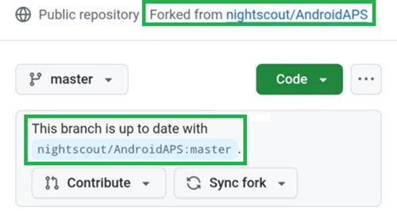

(github-fork)=

# 브라우저 빌드 – 1단계: GitHub fork 만들기

```{note}
이 페이지는 [브라우저 빌드](BrowserBuild.md)의 **1단계**입니다.
```

개인 Android Java 키와 Google Drive 정보를 GitHub에 비밀(secrets)로 저장해야 합니다(방법은 뒤에서 설명합니다).

이 작업은 AndroidAPS의 공개 저장소 안에서는 할 수 없으므로, 소스 코드의 개인 복사본(fork라고 합니다)을 만들어야 합니다.

## GitHub 계정

아직 GitHub 계정이 없다면 [GitHub 계정을 만들어야](https://github.com/signup) 합니다.  
이메일로 가입하거나 Google 계정으로 가입할 수 있습니다. 등록 및 인증 과정을 따르십시오.

계정이 있으면 [GitHub에 로그인하십시오](https://github.com/login).

## AndroidAPS fork 만들기

[이 링크](https://github.com/nightscout/AndroidAPS)로 공식 AndroidAPS 저장소를 여십시오.

fork 아이콘을 누르십시오. 그러면 자신의 계정 안에 복사본이 만들어집니다.


다음 화면에서 아래로 스크롤하여 **Create Fork**(fork 만들기)를 누르십시오.


*참고: 개발자 버전이나 사용자 지정 버전을 빌드하려면 "Copy the master branch only"(master 브랜치만 복사)를 **선택 해제**할 수 있습니다.*


```{note}
fork를 만들 수 없고 다음이 보입니까?<br/><br/>
**`No available destinations to fork this repository.`**<br/><br/>
<br/><br/>
이는 AndroidAPS의 fork가 이미 있다는 뜻입니다.<br/>
fork가 최신 상태인지 확인하고 준비 단계로 계속 진행하십시오.
```

```{warning}
**secret을 백업하지 않은 상태에서는 절대 fork를 삭제하지 마십시오!**
```

이제 GitHub에 AndroidAPS의 개인 복사본이 표시됩니다. 이 웹 브라우저 탭은 열어 두십시오.



----

**다음: [2단계 – 서명 키 저장소 만들기](BrowserBuildKeystore.md) →**
