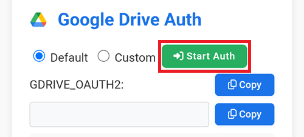

(aaps-ci-google-drive-auth)=

# 브라우저 빌드 – 3단계: Google Drive 인증하기

```{note}
이 페이지는 [브라우저 빌드](BrowserBuild.md)의 **3단계**입니다. 먼저 [2단계 – 서명 키 저장소 만들기](BrowserBuildKeystore.md)를 마치십시오.
```

```{warning}
앞의 안내 중 어느 것(옵션 1 또는 옵션 2)을 따랐든, 브라우저 빌드를 사용하려면 반드시 Google Drive 인증을 추가해야 합니다.
```

참고: 동영상에서 이 부분을 이미 따라 했다면, 이제 [4단계 – APK 빌드](BrowserBuildAPK.md)로 건너뛸 수 있습니다.

```{warning}
Google 인증이 시작되지 않거나 준비 페이지가 실패하면, 준비 페이지를 닫고 2단계와 같은 방법으로 `aaps-ci-preparation.html`을 다시 연 다음 이 단계를 처음부터 다시 하십시오. [문제 해결](#aaps-ci-preparation-web)을 참조하십시오.
```

준비 페이지 탭으로 돌아가십시오.

Google Drive Auth 섹션까지 아래로 스크롤하고 Start Auth(인증 시작)를 누르십시오.



Google 계정을 선택하십시오.


아래로 스크롤하여 액세스를 허용하십시오. 웹 페이지는 Google Drive 인증 키를 받기 위해 이 액세스가 필요합니다.

Continue(계속)를 누르십시오.


`GDRIVE_OAUTH2` 필드가 채워지면 위쪽 Copy(복사) 버튼을 누르십시오.


GitHub 탭으로 다시 전환하십시오.

Repository secrets까지 아래로 스크롤하고 New repository secret을 누르십시오.

옵션 1을 따랐다면 다음 화면이 보여야 합니다.


옵션 2를 따랐다면 키가 더 많이 있습니다.


Name 필드에 방금 복사한 텍스트를 붙여 넣으십시오. 텍스트 상자를 길게 누르면 붙여 넣기 메뉴가 나타납니다.


준비 페이지 탭으로 전환하십시오.

두 번째 Copy(복사) 버튼을 누르십시오.


GitHub 탭으로 다시 전환하십시오.

1. Secret 필드에 방금 복사한 텍스트를 붙여 넣으십시오. 텍스트 상자를 길게 누르면 붙여 넣기 메뉴가 나타납니다.

2. Add secret을 누르십시오.


이제 secret 항목이 2개(옵션 1) 또는 5개(옵션 2) 있어야 합니다.


이제 빌드가 끝나면 GitHub가 AAPS apk 파일을 Google Drive에 저장할 수 있습니다.

----

**다음: [4단계 – APK 빌드](BrowserBuildAPK.md) →**
