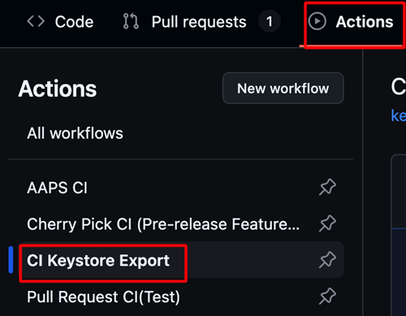

(aaps-ci-preparation)=

# 브라우저 빌드 – 2단계: 서명 키 저장소 만들기

```{note}
이 페이지는 [브라우저 빌드](BrowserBuild.md)의 **2단계**입니다. 먼저 [1단계 – GitHub fork 만들기](BrowserBuildFork.md)를 마치십시오.
```

AAPS는 **Java KeyStore (JKS)**에 저장된 개인 키로 서명해야 합니다. 이것은 전체 과정에서 가장 중요한 결정입니다. 나중에 AAPS를 다시 설치하지 않고 **업그레이드**할 수 있는지가 이 결정에 달려 있기 때문입니다.

```{note}
다음 단계에서는 개인 정보(키 저장소, 그리고 나중에 Google Drive 액세스)를 GitHub 안에 **secret**으로 저장합니다. secret은 자신의 빌드만 읽을 수 있는 암호화된 값입니다. 다른 누구도, fork를 보는 사람조차도 이 값을 볼 수 없습니다. 이렇게 해서 빌드가 오직 자신의 것으로 유지됩니다.
```

## 키 저장소 방법 선택하기

두 옵션을 모두 읽고 자신의 상황에 맞는 것을 고르십시오.

### 옵션 1 – 새 키 저장소 생성하기 (새 사용자)

다음 중 **하나라도** 해당하면 이 옵션을 선택하십시오:

- AAPS를 **처음** 빌드합니다.
- 이전에 Android Studio(컴퓨터)로 빌드할 때 만든 키 저장소가 없습니다.
- 키 저장소 비밀번호나 별칭(alias)을 잊어버렸습니다.

```{warning}
**옵션 1**로 AAPS를 빌드하면 완전히 새로운 키 저장소가 만들어집니다. 따라서 **기존 AAPS를 그 자리에서 업그레이드할 수 없습니다**. 이 새 빌드로 옮기려면 설정을 내보내고, 기존 AAPS를 제거하고, 새 AAPS를 설치한 다음 설정을 다시 가져와야 합니다. [새 키 저장소로 AAPS 재설치하기](#reinstall-aaps)의 단계를 따르십시오.
```

**→ [옵션 1 – 새 키 저장소 생성하기로 계속](BrowserBuildO1.md)**

### 옵션 2 – 기존 키 저장소 업로드하기 (기존 / 이전 사용자)

이전에 컴퓨터의 Android Studio에서 AAPS를 빌드할 때 사용한 `.jks` 키 저장소를 **이미 가지고 있고**, **또한** 그 비밀번호와 별칭(보통 `key0`)을 알고 있다면 이 옵션을 선택하십시오.

이 옵션을 사용하면 현재 설치된 AAPS를 계속 업그레이드할 수 있습니다. 앞으로의 업데이트도 같은 키 저장소를 사용합니다.

**→ [옵션 2 – 기존 키 저장소 업로드하기로 계속](BrowserBuildO2.md)**

----

```{note}
다음 페이지에서 기기(컴퓨터 또는 iPhone)를 선택합니다. 각 기기 페이지는 그 기기에 맞는 방법으로 준비 파일을 다운로드하고 여는 방법과 키 저장소를 만드는 방법을 단계별로 안내합니다. 빌드된 AAPS 앱은 Google Drive에 저장됩니다.
```

**다음: 위에서 [옵션 1](BrowserBuildO1.md) 또는 [옵션 2](BrowserBuildO2.md)를 선택한 다음, 자신의 기기에 맞는 페이지를 따르십시오.**

----

(ci-keystore-export)=

## 키 저장소 내보내기 (선택 사항)

저장된 키 저장소를 내보내려면 이 방법을 사용하십시오.

이 스크립트는 이전에 설정한 키 저장소 정보(옵션 1 또는 옵션 2)를 비밀번호로 보호된 ZIP 파일로 Google Drive의 `/AAPS/KeyStore` 디렉터리에 내보냅니다.

```{warning}
이 내보내기 방법을 사용하기 전에 키 저장소와 Google Drive 설정을 마쳤는지 확인하십시오.
```

### 단계:

1. **ZIP 비밀번호 secret 추가하기:**
   - 저장소의 **Settings** → **Secrets and variables** → **Actions**로 가십시오
   - **New repository secret**(새 저장소 secret)을 클릭하십시오
   - **Name**(이름) 필드에 `ZIP_PASSWORD`를 입력하십시오
   - **Secret** 필드에 직접 정한 ZIP 암호화 비밀번호를 입력하십시오
   - 비밀번호에는 영문자와 숫자만 사용하십시오(특수 기호 사용 안 함)
   - **Add secret**(secret 추가)을 클릭하십시오

   

2. **내보내기 워크플로 실행하기:**
   - 저장소의 **Actions** 탭으로 가십시오
   - **CI Keystore Export**를 선택하십시오
   - **Run workflow**(워크플로 실행)를 클릭하십시오
   - 내보낸 키 저장소 ZIP 파일이 Google Drive에 저장됩니다

   

   

```{toctree}
:hidden:

옵션 1 – 새 키 저장소 생성하기 <BrowserBuildO1.md>
옵션 2 – 기존 키 저장소 업로드하기 <BrowserBuildO2.md>
```
