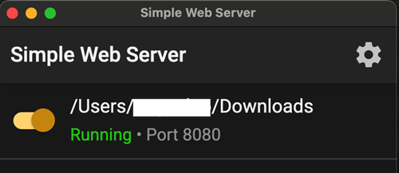

(aaps-ci-option2-computer)=

# 옵션 2 · 컴퓨터 – 기존 키 저장소 업로드하기

```{note}
**컴퓨터**(Windows / Mac / Linux)에서 하는 [옵션 2](BrowserBuildO2.md)(기존 키 저장소 업로드)입니다.
```

## 1. 준비 파일 다운로드하기

:::{include} BrowserBuildDownloadPrep.md
:::

## 2. 로컬 서버를 시작하고 키 저장소 업로드하기

컴퓨터 사용(Windows/Mac/Linux 지원)

<!--crowdin: exclude-->
<div align="center" style="max-width: 360px; margin: auto; margin-bottom: 2em;">
  <div style="position: relative; width: 100%; aspect-ratio: 9/16;">
    <iframe
      src="https://geo.dailymotion.com/player/x9rdyc6.html?video=x9rdyc6&loop=true&mute=true"
      loading="lazy"
      style="position: absolute; top: 0; left: 0; width: 100%; height: 100%;"
      frameborder="0"
      allowfullscreen>
    </iframe>
  </div>
</div>

Simple Web Server 설치하기<br/><br/> Windows 또는 Mac 사용자는 Microsoft Store 또는 Mac App Store에서 설치할 수 있습니다. 브라우저가 스토어 앱을 열지 묻는다면 허용하십시오.<br/><br/> <br/><br/>

Mac의 예:

- get(받기) → install(설치) → open(열기)<br/><br/> <br/><br/>

- Get Started(시작하기)를 클릭하십시오<br/><br/> <br/><br/>

- New Server(새 서버)를 클릭하십시오<br/><br/> <br/><br/>

- Folder Path(폴더 경로)에서 aaps-ci-preparation.html이 있는 폴더를 선택한 다음 Create Server(서버 만들기)를 클릭하십시오.<br/><br/> <br/><br/>

- 이 화면이 보이면 서버가 시작된 것입니다.<br/><br/> <br/><br/>

- Simple Web Server를 닫지 마십시오. Please switch to your browser and open<br/><br/> [http://127.0.0.1:8080/aaps-ci-preparation.html](http://127.0.0.1:8080/aaps-ci-preparation.html)<br/><br/>

- 다음 단계는 아래 동영상을 2분 18초부터 참조하십시오.<br/><br/>
  <!--crowdin: exclude-->
  <div align="center" style="max-width: 360px; margin: auto; margin-bottom: 2em;">
    <div style="position: relative; width: 100%; aspect-ratio: 9/16;">
      <iframe
        src="https://geo.dailymotion.com/player/x9rdvt0.html?video=x9rdvt0&startTime=138&loop=true&mute=true"
        loading="lazy"
        style="position: absolute; top: 0; left: 0; width: 100%; height: 100%;"
        frameborder="0"
        allowfullscreen>
      </iframe>
    </div>
  </div>

----

**다음: [3단계 – Google Drive 인증하기](BrowserBuildGoogleDrive.md) →**
