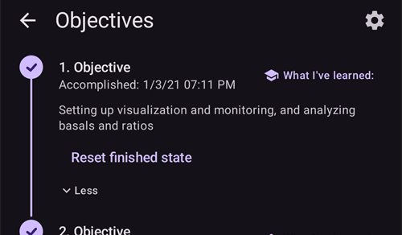

# 목표 완료하기

**AAPS**에는 완료해야 하는 일련의 **목표**가 있습니다. 목표는 사용자가 기본적인 개방 루프에서 하이브리드 폐쇄 루프와 **AAPS**의 전체 기능까지 단계적으로 나아가도록 돕습니다. **목표**를 완료하면 다음을 확실히 할 수 있습니다:

* **AAPS** 설정에서 모든 것을 올바르게 구성했습니다.
* **AAPS**의 핵심 기능을 배웠습니다.
* 시스템이 무엇을 할 수 있는지 기본적으로 이해하여 **AAPS**를 사용할 때 자신감을 가질 수 있습니다.

**AAPS**를 처음 설치하면 다음 목표로 넘어가기 전에 각 목표를 완료해야 합니다. 각 **목표**를 진행하면서 새 기능이 단계적으로 잠금 해제됩니다.

**목표 1~8**은 휴대폰에서 **AAPS**를 구성하는 것부터 "기본" 하이브리드 폐쇄 루프까지 안내합니다. 완료하는 데 약 6주가 걸립니다. 가상 펌프를 사용하여(그동안 다른 방법으로 인슐린을 주입하면서) **목표 5**까지 진행할 수 있습니다. **목표 9와 10**은 당뇨를 더 잘 관리하기 위해 더 고급 **AAPS** 기능을 시험해 보도록 만들어졌습니다. 완료하는 데 최대 3개월, 어쩌면 더 오래 걸립니다. 예상 소요 시간에 대한 자세한 내용은 여기에서 볼 수 있습니다: [얼마나 걸립니까?](#preparing-how-long-will-it-take)

**목표**를 진행하는 것 외에도, 필요하면 진행 상황을 지우고 [이전 목표로 돌아갈](#CompletingTheObjectives-go-back-in-objectives) 수도 있습니다.

## 설정 백업하기

```{admonition} Note
:class: note

각 **목표**를 완료한 후에는 **AAPS** 설정을 내보내는 것을 권장합니다!
```

**AAPS**에서 이룬 진행 상황을 잃지 않도록 각 목표를 완료한 후 [설정을 내보내는](../Maintenance/ExportImportSettings.md) 것을 강력히 권장합니다. 내보내기를 하면 **설정 파일**(.json)이 만들어집니다. 이 파일은 하나 이상의 안전한 곳(예: Google Drive, 하드 디스크, 이메일 첨부 파일 _등_)에 백업해야 합니다. 이렇게 하면 **AAPS**에서 이룬 진행 상황이 저장됩니다. 휴대폰을 잃어버리거나 실수로 진행 상황을 지운 경우, 최근 설정 파일을 가져와서 json 파일을 **AAPS**에 다시 불러올 수 있습니다. 어떤 이유로든(업그레이드, 분실, 고장 _등_) 새 **AAPS** 휴대폰이 필요할 때에도 백업한 **설정 파일**이 있어야 합니다.

**설정** 파일에는 **목표** 진행 상황뿐만 아니라 **최대 볼러스** _등_ 모든 **AAPS** 설정이 저장됩니다.

설정을 백업하지 않았는데 **AAPS** 휴대폰에 문제가 생기면 **목표**를 처음부터 다시 시작해야 합니다. **목표**를 진행하는 데에는 시간이 걸립니다. 예를 들어 휴대폰을 잃어버려서 목표를 다시 완료해야 하는 상황은 피하는 것이 가장 좋습니다.

(objectives-objective1)=
## 목표 1: 시각화와 모니터링 설정, 기저와 비율 분석

**목표 1**에서는 **AAPS**의 기본 기술 설정을 해야 합니다. 이 단계를 완료할 때까지는 다음으로 진행할 수 없습니다.

- [구성 → 혈당 출처](#Config-Builder-bg-source)에서 올바른 CGM/FGM을 선택하십시오. 자세한 내용은 [혈당 출처](../Getting-Started/CompatiblesCgms.md)를 참조하십시오.
- 펌프가 **AAPS**와 통신할 수 있도록 [구성 → 펌프](#Config-Builder-pump)에서 올바른 펌프를 선택하십시오. 루프용 **AAPS** 드라이버가 없는 펌프 모델을 사용하거나, 다른 시스템으로 인슐린을 주입하면서 초기 **목표**를 진행하려면 **가상 펌프**를 선택하십시오. 자세한 내용은 [인슐린 펌프](../Getting-Started/CompatiblePumps.md)를 참조하십시오.
- Nightscout를 사용하는 경우:
  - [Nightscout](../SettingUpAaps/Nightscout.md) 페이지의 안내에 따라 **Nightscout**가 **AAPS** 데이터를 받아서 표시할 수 있는지 확인하십시오.
  - **NSClientV3**의 URL 끝에는 **"/api/v1/"이 _없어야_** 합니다. [설정 → NSClientV3](#Preferences-nsclient)을 참조하십시오.
- Tidepool을 사용하는 경우:
  - [Tidepool](../SettingUpAaps/Tidepool.md) 페이지의 안내에 따라 **Tidepool**이 **AAPS** 데이터를 받아서 표시할 수 있는지 확인하십시오.

참고: ***AAPS**가 센서 혈당을 인식하려면 다음 센서 혈당 값이 들어올 때까지 기다려야 할 수 있습니다.*

(objectives-objective2)=
## 목표 2: AAPS를 사용하는 방법 배우기

**목표 2**에서는 아래 스크린샷과 같이 여러 '작업'을 수행해야 합니다. 각 작업에는 상태(**1**)가 표시됩니다. **AAPS**가 동작을 기록하면 주황색 "**아직 완료되지 않았습니다.**"가 "**완료되었습니다, 잘 하셨습니다!**"로 바뀝니다. 특정 동작을 아직 잘 모르는 경우, 작업 아래의 **힌트**(**2**)를 눌러 관련 문서를 여십시오.


**목표 2**를 완료하기 위한 작업은 다음과 같습니다:
- **프로파일**을 10분 동안 90%로 설정합니다.
  - _힌트_: 메인 화면에서 프로파일 이름을 눌러 **프로파일** 화면을 연 다음, **활성화**(▶) 버튼을 사용하여 퍼센트와 기간을 설정하십시오. 자세한 내용은 [프로파일 전환과 프로파일 퍼센트](../DailyLifeWithAaps/ProfileSwitch-ProfilePercentage.md)를 참조하십시오.
  - _참고_: **AAPS**는 0.05U/hr 미만의 기저 주입량을 받아들이지 않습니다. **프로파일**에 0.05U/hr 이하의 주입량이 있으면, 이 작업을 완료하기 전에 기저 주입량이 더 높은 임시 **프로파일**을 만들어야 합니다. 이 작업을 완료한 후 평소의 **프로파일**로 다시 전환하십시오.
- **AAPS**에서 1시간 동안 [펌프 연결을 해제](#AapsScreens-loop-status)하여 "샤워하기"를 시뮬레이션합니다.
  - _힌트_: 메인 화면에서 루프 아이콘을 눌러 루프 대화 상자를 연 다음, **펌프 연결 해제** 아래에서 기간을 선택하십시오.
- 펌프를 다시 연결하여 "샤워"를 끝내십시오.
  - _힌트_: "연결 해제됨" 아이콘을 눌러 루프 대화 상자를 다시 열고 **펌프 재연결**을 선택하십시오.
- 기간이 10분인 사용자 지정 [**임시 목표**](../DailyLifeWithAaps/TempTargets.md)를 설정합니다.
  - _힌트_: 메인 화면에서 목표 범위를 눌러 임시 목표 화면을 여십시오.
- **루프** 플러그인의 내용을 표시합니다.
  - _힌트_: **구성 → 루프**를 열고 "**플러그인 열기**"를 누르십시오.
- 혈당 차트에서 스크롤 또는 확대/축소를 사용하여 더 길거나 더 짧은 시간 범위를 보십시오.


(objectives-objective3)=
## Objective 3: Prove your knowledge

**목표 3**에서는 **AAPS** 지식을 확인하기 위한 객관식 시험을 통과해야 합니다.

일부 사용자는 **목표 3**을 가장 완료하기 어려운 목표라고 생각합니다. 질문과 함께 **AAPS** 문서를 읽으십시오. **AAPS** 문서를 찾아본 뒤에도 정말 막혔다면 [Facebook](https://www.facebook.com/groups/AndroidAPSUsers) 또는 [Discord](https://discord.gg/4fQUWHZ4Mw) 그룹에서 "Objective 3"(목표 3)를 검색하십시오. 같은 질문이 이전에 나왔고 그룹에서 답을 했을 가능성이 높습니다. 이 그룹들은 친절한 힌트를 주거나 **AAPS** 문서의 관련 부분을 알려 줄 수 있습니다.

그동안:
- 개방 루프에서 받는 알림 / 결정해야 하는 횟수(임시 기저 주입량)를 줄이려면 **프로파일**에서 목표 범위를 넓게 설정하십시오. _예:_ 90 - 150 mg/dL 또는 5.0 - 8.5 mmol/L.
- 밤에는 상한을 더 넓게 설정하거나, 개방 루프를 아예 끄는 것이 좋을 수 있습니다.

**목표 3**을 진행하려면 질문 행을 눌러 여십시오. 각 질문을 주의 깊게 읽고 답을 선택하십시오.

질문마다 정답이 둘 이상일 수 있습니다! 틀린 답을 선택하면 그 질문은 1시간 동안 잠기며, 그 후에 다시 답할 수 있습니다. 다음에 다시 답할 때는 답의 순서가 바뀌어 있을 수 있습니다. 이는 답을 주의 깊게 읽고 각 답이 맞는지 틀리는지를 제대로 이해하도록 하기 위한 것입니다.

```{admonition} __What happens if new question(s) are added to an Objective when I update to a newer version of AAPS?__
:class: note
**AAPS**에 새 기능이 추가되면 때때로 **목표**, 특히 **목표 3**에 새 질문을 추가해야 할 수 있습니다. 따라서 **목표 3**에 새로 추가된 질문은 "미완료"로 표시됩니다. **AAPS**가 이 질문에 답하도록 요구하기 때문입니다. 걱정하지 마십시오. 각 **목표**는 서로 독립되어 있으므로, 다른 **목표**가 완료 상태로 남아 있으면 **AAPS의 기존 기능을 잃지 않습니다**.
```

## 목표 4: 개방 루프 시작

**목표 4**의 목적은 **AAPS**가 얼마나 자주 사용자의 기저 주입량을 혈당 수치와 비교하여 평가하고, 임시 기저 주입량 조정을 권장하는지 알아보는 것입니다. 이 **목표**에서는 처음으로 개방 루프를 활성화하고, 제안된 임시 기저 주입량 변경을 20번 승인합니다. 필요하면 이 변경을 펌프에 직접 적용합니다. [**임시 목표**](../DailyLifeWithAaps/TempTargets.md)의 영향도 관찰합니다. **AAPS**에서 임시 기저 주입량 변경을 설정하는 방법을 아직 잘 모른다면 **관리** 시트의 펌프 동작을 보십시오([동작 탭은 어디로 갔습니까?](#screens-action-tab)).

이 목표를 완료하는 데 필요한 최소 시간: **7일**. 이것은 필수 대기 시간입니다. 모든 기저 주입량 변경을 이미 실행했더라도 다음 **목표**로 넘어갈 수 없습니다.

- 메인 화면에서 [루프 아이콘](#AapsScreens-loop-status)을 누르고 실행 모드로 **개방 루프**를 선택하여 개방 루프를 선택하십시오.
- 7일 동안 임시 기저 주입량 제안을 최소 20번 직접 실행하십시오. 제안을 (실제) 펌프에 입력하고, AAPS에서 제안을 수락했다고 확인하십시오. 이 기저 주입량 조정이 **AAPS**와 **Nightscout**에 표시되는지 확인하십시오.
- 필요할 때 [**임시 목표**](../DailyLifeWithAaps/TempTargets.md)를 사용하십시오. 저혈당을 처치한 후에는 미리 정의된 "저혈당 임시 목표"를 사용하여, 혈당이 반등할 때 시스템이 과잉 교정하지 않도록 하십시오.
- 이 시점에 아직 [간단 모드](#preferences-simple-mode)를 사용하고 있다면, 지금 끄는 것이 좋습니다.

개방 루프에서 제안되는 기저 주입량 변경 횟수를 줄이려면 [**목표 3**](#objectives-objective3)에 설명된 팁을 계속 사용할 수 있습니다. 또한 **설정 → 루프**의 "**개방 루프 최소 변경량**" 설정으로 권장 기저 주입량 변경의 최소 퍼센트를 바꿀 수 있습니다. 값이 클수록 변경 알림을 더 적게 받습니다.


```{admonition} Note
:class: note

시스템의 권장 사항을 하나하나 모두 실행할 필요는 없습니다!
```
(objectives-objective5)=
## 목표 5: 임시 기저 추천을 포함하여 개방 루프 이해하기

**목표 5**에서는 임시 기저 권장 값이 어떻게 계산되는지 이해하기 시작합니다. 여기에는 [기저 결정 로직](#aaps-screens-how-predictions-become-a-dosing-decision), [**AAPS 개요**의 예측 선](#aaps-screens-prediction-lines)(또는 Nightscout)을 관찰하여 영향을 분석하는 것, 그리고 **OpenAPS SMB** 플러그인 화면(**구성 → APS → 플러그인 열기**)에 표시되는 자세한 계산을 살펴보는 것이 포함됩니다.

이 목표를 완료하는 데 예상되는 시간: **7일**.

이 **목표**에서는 [OpenAPS 기능](#Open-APS-features-max-u-h-a-temp-basal-can-be-set-to)에 설명된 대로 "최대 기저 주입량"(max-basal) 값을 정하고 설정해야 합니다. 이 값은 [설정 → OpenAPS SMB](#Preferences-openaps-smb-settings)에서 설정할 수 있습니다. [간단 모드](#preferences-simple-mode)에서는 **AAPS**가 이 값을 자동으로 설정하므로 바꿀 필요가 없습니다. 아직 가상 펌프를 사용하는 경우, 이 안전 설정을 **AAPS**와 인슐린 펌프 양쪽에 모두 설정했는지 확인하십시오.

**AAPS**의 계산과 설정에 익숙해질 때까지 [**프로파일** 혈당 목표](#profile-glucose-targets)를 평소보다 높게 설정하는 것이 좋을 수 있습니다. **프로파일**의 **혈당 목표**를 더 좁은 범위(예: 폭이 1 mmol/L 이하 [20 mg/dL 이하])로 조정해 보고 그 결과를 관찰해 볼 수 있습니다.


```{admonition} If you have been using a virtual pump, change to a real insulin pump now!
:class: note

가상 펌프로 개방 루프를 사용하는 경우 **여기에서 멈추십시오**. 인슐린을 주입하는 "실제" 펌프로 바꾼 후에만 이 **목표**의 마지막에서 **확인**을 누르십시오.

```


(objectives-objective6)=
## 목표 6: 저혈당 주입 정지(LGS)로 폐쇄 루프 시작


```{admonition} Closed loop will not correct high **BG** values in **Objective 6** as it is limited to **Low Glucose Suspend** only!
:class: note
높은 혈당 값은 여전히 직접 교정해야 합니다(펌프나 펜으로 수동 교정)!
```

**목표 6**에서는 [max IOB](#Open-APS-features-maximum-total-iob-openaps-cant-go-over)가 0으로 설정된 상태에서 루프를 닫고 **저혈당 주입 정지**(LGS) 모드를 활성화합니다. 이 **목표**를 완료하려면 LGS 모드로 5일 동안 지내야 합니다. 이 기간 동안 **프로파일** 설정이 정확한지, LGS 이벤트가 너무 자주 발생하지 않는지 확인하십시오.

이 목표를 완료하는 데 필요한 최소 시간: **5일**. 이것은 필수 대기 시간입니다. 이 시간이 지나기 전에는 다음 **목표**로 넘어갈 수 없습니다.

**LGS** 모드로 루프를 닫기 전에 현재 **프로파일**(기저, ISF, IC)을 충분히 테스트하는 것이 매우 중요합니다. **프로파일** 설정이 잘못되면 저혈당 상황이 생길 수 있고, 이를 직접 처치해야 합니다. 정확한 **프로파일**은 5일 동안 저혈당 처치가 필요한 경우를 줄이는 데 도움이 됩니다.

**저혈당이 여전히 자주 또는 심하게 생기면 [인슐린 종류의 DIA](#Config-Builder-insulin-dia), 기저, ISF, 탄수화물 비율을 다듬는 것을 고려하십시오.** 이에 대한 논의가 많은 [Facebook](https://www.facebook.com/groups/AndroidAPSUsers) 또는 [Discord](https://discord.gg/4fQUWHZ4Mw) 그룹을 참조하십시오.


**목표 6** 동안 **AAPS**는 maxIOB 설정을 0으로 덮어씁니다. **이 덮어쓰기는 목표 7로 넘어가면 끝납니다.**

즉, **목표 6**에 있을 때 센서 혈당 수치가 떨어지면 **AAPS**가 기저 인슐린 주입을 줄여 줍니다. 하지만 센서 혈당 수치가 오르는 경우, **AAPS**는 이전 **LGS** 때문에 **기저 IOB**가 음수일 때에만 기저 주입량을 **프로파일** 값보다 높입니다. 그 밖의 경우에는 혈당 수치가 오르더라도 **AAPS**는 기저를 현재 프로파일 값보다 높이지 않습니다. 이렇게 조심하는 이유는 **AAPS** 사용법을 배우는 동안 저혈당을 피하기 위해서입니다.

**따라서 높은 혈당 값은 수동 인슐린 교정 볼러스로 처리해야 합니다.**

- IOB가 음수이면(아래 스크린샷 참조) **목표 6**에서 임시 기저 주입량(TBR) > 100%가 실행될 수 있습니다.


- 안전을 위해, 그리고 안전 여유를 두기 위해 목표 범위를 평소 목표보다 조금 높게 설정하십시오.
- 메인 화면에서 루프 아이콘을 누르고 실행 모드로 **저혈당 주입 정지**를 선택하여 '저혈당 주입 정지' 모드를 활성화하십시오.
- 개요 화면의 청록색 기저 텍스트나 개요 그래프의 청록색 기저 표시를 보고 활성 임시 기저를 확인하십시오.
- 저혈당을 처치한 후 반등 시 기저를 늘릴 수 없으므로 일시적으로 혈당이 급상승할 수 있습니다.

(objectives-objective7)=
## 목표 7: 폐쇄 루프 조정, maxIOB를 0보다 높이고 혈당 목표를 점차 낮추기

**목표 7**을 완료하려면 루프를 닫고 [maxIOB](#Open-APS-features-maximum-total-iob-openaps-cant-go-over)를 올려야 합니다. **목표 6**에서는 저혈당 주입 정지 모드 때문에 **maxIOB**가 자동으로 0이 되었습니다. 이제는 더 이상 그렇지 않습니다. **AAPS**는 높은 혈당 값을 교정하기 위해 사용자가 정한 maxIOB 값을 사용하기 시작합니다. [간단 모드](#preferences-simple-mode)에서는 **AAPS**가 maxIOB를 자동으로 설정하므로 바꿀 필요가 없습니다.

이 목표를 완료하는 데 필요한 최소 시간: **1일**. 이것은 필수 대기 시간입니다. 이 기간이 지나기 전에는 다음 **목표**로 넘어갈 수 없습니다.

- 메인 화면에서 [루프 아이콘](#AapsScreens-loop-status)을 누르고 실행 모드로 **폐쇄 루프**를 선택하여 **폐쇄 루프**를 선택하십시오. 1일 동안 **폐쇄 루프**로 지내십시오.

- 'SMB 최대 IOB'(OpenAPS에서는 'max-iob')를 0보다 천천히 높이면서, 자신에게 가장 잘 맞는 설정을 찾으십시오.

이 설정의 기본 권장 값은 "**평균 식사 볼러스 + 3 x 하루 최대 기저**"입니다. 여기서 "하루 최대 기저"는 하루 중 모든 시간대에서 시간당 가장 높은 값입니다.


이 권장 사항은 출발점으로 보아야 합니다. 이 규칙을 사용하는데 혈당이 오를 때 AAPS가 인슐린을 너무 많이 주입한다면 다음이 필요할 수 있습니다:
* "SMB 최대 IOB" 값을 낮추십시오;
* **프로파일** 설정을 검토하십시오. 한 번에 하나씩만 조정하십시오.

또는 인슐린 저항성이 매우 높다면 **maxIOB** 값을 아주 조심스럽게 올리십시오.

어느 정도의 **maxIOB**가 자신의 루프 패턴에 맞는지 확신이 들면, **혈당 목표**를 원하는 수준으로 낮추십시오.

(objectives-objective8)=
## 목표 8: 필요하면 기저와 비율을 조정한 다음 Autosens 활성화

이 **목표**에서는 **프로파일**의 성능을 다시 점검하고, 잘못된 설정을 알려 주는 지표로 [Autosens](#Open-APS-features-autosens) 기능을 사용합니다.

이 목표를 완료하는 데 필요한 최소 시간: **7일**. 이것은 필수 대기 시간입니다. 이 기간이 지나기 전에는 다음 **목표**로 넘어갈 수 없습니다.

7일 동안 [Autosens](../DailyLifeWithAaps/KeyAapsFeatures.md)를 활성화하고([간단 모드](#preferences-simple-mode)에서는 기본으로 활성화되어 있음), 운동이나 호르몬 등으로 인슐린 민감도가 오르내리는 것을 보여 주는 [**개요** 그래프의 흰색 선](#AapsScreens-section-g-additional-graphs)을 지켜보십시오. **OpenAPS SMB** 플러그인 화면(**구성 → APS → 플러그인 열기**)을 계속 살펴보십시오. 이 화면에서 **AAPS**가 민감도, 기저, 목표를 그에 맞게 조정하는 것을 볼 수 있습니다.

지금이 [민감도 감지](#Config-Builder-sensitivity-detection) 설정을 검토하기에 좋은 때입니다. 메인 화면의 [추가 그래프](#AapsScreens-section-g-additional-graphs)에서 민감도를 볼 수 있습니다.

또한 [Autotune](#autotune-how-autotune-calculates-adjustments)을 한 번 사용하여 기저가 여전히 정확한지 확인하거나, 전통적인 기저 테스트를 할 수 있습니다.

(objectives-objective9)=
## 목표 9: 낮 시간 사용을 위한 추가 oref1 기능(예: 슈퍼 마이크로 볼러스(SMB)) 활성화

**목표 9**에서는 핵심 기능의 하나인 **"슈퍼 마이크로 볼러스(SMB)"**를 익히고 사용합니다. 필수 자료를 읽고 나면 SMB가 무엇인지, 어떻게 작동하는지, 그리고 SMB를 준 후 왜 기저를 일시적으로 0으로 설정하는지(0 임시 기저, zero-temping) 잘 이해하게 됩니다.

이 목표를 완료하는 데 필요한 최소 시간: **28일**. 이것은 필수 대기 시간입니다. 이 시간이 끝나기 전에는 다음 목표로 넘어갈 수 없습니다.

- **SMB**와 **0 임시 기저(zero-temping)** 개념을 이해하려면 [이 문서의 SMB 섹션](#Open-APS-features-super-micro-bolus-smb)과 [openAPS 문서의 oref1 설명](https://openaps.readthedocs.io/en/latest/docs/Customize-Iterate/oref1.html)을 꼭 읽어야 합니다.
- 다 읽은 후 **SMB**가 더 효과적으로 작동하도록 [maxIOB를 올릴](#Open-APS-features-maximum-total-iob-openaps-cant-go-over) 수 있습니다. 이제 maxIOB에는 쌓인 기저뿐만 아니라 모든 **IOB**가 포함됩니다. 이 임계값은 IOB가 이 값 아래로 떨어질 때까지 **SMB**를 멈춥니다(_예:_ **maxIOB**가 7U로 설정되어 있고 식사를 위해 8U 볼러스를 주입하면, **IOB**가 7U 아래로 떨어질 때까지 SMB가 멈추고 주입되지 않습니다). 좋은 시작 값은 **maxIOB** = **평균 식사 볼러스 + 3 x 하루 최대 기저**입니다. 여기서 "하루 최대 기저"는 하루 중 모든 시간대에서 시간당 가장 높은 값입니다. 참고로 [목표 7](#objectives-objective7)을 보십시오.
- 탄수화물 흡수 속도를 평가하고, 너무 느리거나 너무 빠르다고 생각되면 [설정 → 흡수 설정 → min_5m_carbimpact](#Preferences-min_5m_carbimpact)에서 "min_5m_carbimpact" 매개 변수를 바꾸는 것을 고려하십시오.

(objectives-objective10)=
## 목표 10: 자동화

**목표 10**을 시작하면 **자동화**를 사용할 수 있습니다.

이 목표를 완료하는 데 필요한 최소 시간: **28일**. 이것은 필수 대기 시간입니다. 이 시간이 끝나기 전에는 다음 목표로 넘어갈 수 없습니다.

먼저 [자동화](../DailyLifeWithAaps/Automations.md) 문서 페이지를 읽으십시오.

가장 기본적인 자동화 규칙을 설정하십시오. 예를 들어 몇 분 후에 Android 알림을 실행하는 규칙입니다:
- **관리 → 자동화**를 열고 **+** 버튼(**규칙 추가하기**)을 누르십시오.
- **작업명**을 입력하십시오. 예: "나의 첫 자동화 알림".
- **조건** 아래에서 "**편집**"을 누르십시오.
  - "**트리거 추가**"를 누르고 "**시간**"을 선택하십시오. **AAPS**가 오늘 현재 시간으로 항목을 만듭니다.
  - 몇 분 후에 실행되도록 시간을 바꾸십시오.
  - **저장** 아이콘(오른쪽 위)을 눌러 규칙으로 돌아가십시오.
- **동작** 아래에서 "**추가**"를 누르고 "**알림**"을 선택하십시오.
  - 동작 카드에 메시지를 입력하십시오. 예: "나의 첫 자동화".
- **저장** 아이콘(오른쪽 위)을 누르고 규칙이 **활성화됨** 상태인지 확인하십시오.
- 설정한 시간에 알림이 올 때까지 기다리십시오(휴대폰에 따라 몇 분 늦을 수 있습니다)

그다음 더 유용한 **자동화**를 설정해 볼 수 있습니다. 문서 페이지에 몇 가지 예가 있으며, [Facebook](https://www.facebook.com/groups/AndroidAPSUsers) 그룹에서 "Automation" 스크린샷을 검색할 수도 있습니다. [Discord](https://discord.gg/4fQUWHZ4Mw) 커뮤니티에도 전용 채널이 있습니다.

예를 들어 매일 아침 학교나 직장에 가기 전에 같은 시간에 같은 아침 식사를 한다면, "아침 식사 전 목표" 같은 **자동화**를 만들어 아침 식사 30분 전에 조금 낮은 **임시 목표**를 설정할 수 있습니다. 이 경우 조건에는 보통 "반복 시간"이 들어가며, 특정 요일(월, 화, 수, 목, 금)과 특정 시간(오전 06:30)을 선택합니다. 동작은 평소보다 낮은 목표 값과 30분 지속 시간으로 "임시 목표 시작"을 하는 것입니다.

## 모든 목표를 완료한 경우

모든 **목표**를 완료하면, 목록에 각 목표가 체크 표시와 완료 날짜와 함께 표시됩니다. **목표** 항목은 하단 내비게이션에서 사라집니다. **구성 → 제한 → 목표 → 플러그인 열기**로 목록을 계속 열 수 있습니다.


목표 아래의 "**펼치기**"를 누르면 그 목표의 작업을 다시 볼 수 있습니다:



(CompletingTheObjectives-go-back-in-objectives)=
## 이전 목표로 돌아가기

어떤 이유로든 **목표**를 되돌리려면, "**펼치기**"로 완료한 **목표**를 열고 "**완료 상태 초기화**"를 누르십시오:


같은 방법으로, 지금 진행 중인 **목표**는 "**시작 상태 초기화**"로 다시 시작할 수 있습니다.
