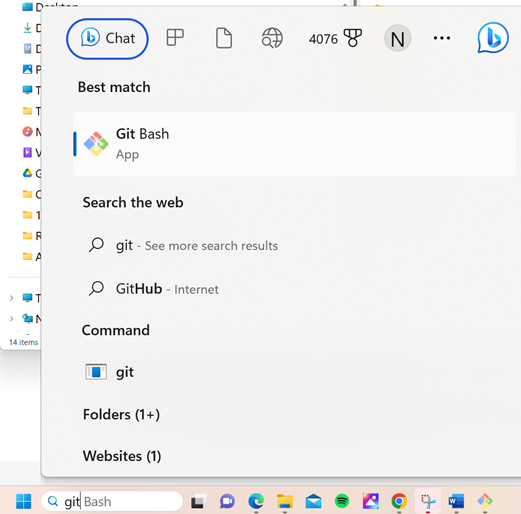
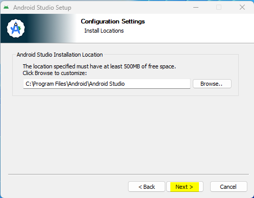
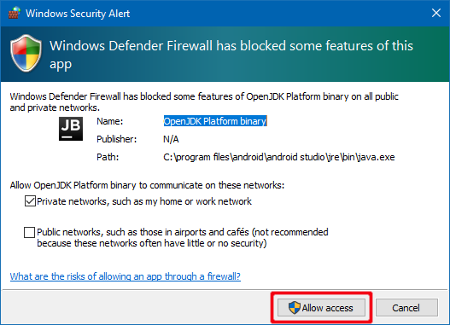
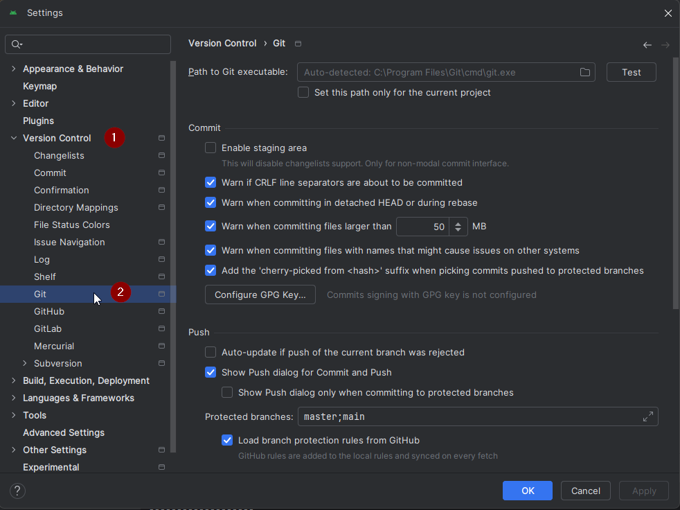
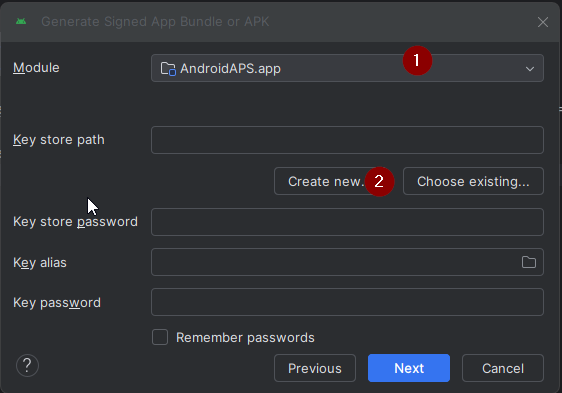

<!-- Android Studio Build, FKA Computer Build. Preserve filenames to avoid breaking URLs. -->

# Android Studio 빌드

AAPS 앱을 빌드하는 전통적인 방법입니다.

[브라우저 빌드](./BrowserBuild.md) 방법을 사용하면 컴퓨터 없이 앱을 빌드할 수 있습니다.

## 다운로드 대신 직접 빌드

**의료기기 관련 규정 때문에 AAPS 앱(apk 파일)은 다운로드할 수 없습니다. 본인이 사용하기 위해 앱을 빌드하는 것은 합법이지만, 다른 사람에게 복사본을 주어서는 안 됩니다!**

자세한 내용은 [FAQ 페이지](../UsefulLinks/FAQ.md)를 참조하십시오.

---

(Building-APK-recommended-specification-of-computer-for-building-apk-file)=
## AAPS 빌드를 위한 컴퓨터와 소프트웨어 사양

* APK를 빌드하려면 특정 **[Android Studio](https://developer.android.com/studio/)** 버전이 필요할 수 있습니다. 아래 표를 참조하십시오:

| AAPS Version            | 권장<br/>Android Studio<br/>버전 | 대체<br/>Android Studio<br/>버전 | Gradle | JVM |
| ----------------------- | ---------------------------------------- | ---------------------------------------- | ------ |:--- |
| 2.6.2                   | 3.6.1                                    |                                          | 5.6.4  | 11  |
| 2.8.2.1                 | 4.1.1                                    |                                          | 6.1.1  | 13  |
| [3.1.0.3](#version3100) | 2020.3.1                                 | Quail 4까지 테스트됨                           | 7.3.3  | 17  |
| [3.2.0.4](#version3204) | Hedgehog (2023.1.1)                      | Quail 4까지 테스트됨                           | 8.2    | 17  |
| [3.3.1.3](#version3300) | Ladybug Feature Drop (2024.2.2)          | Quail 4까지 테스트됨                           | 8.10   | 21  |
| [3.3.2](#version3300)   | Meerkat (2024.3.1)                       | Quail 4까지 테스트됨                           | 8.11.1 | 21  |
| [3.3.2.1](#version3321) | Narwhal (2025.1.2)                       | Quail 4까지 테스트됨                           | 8.13   | 21  |
| [3.4.2.6](#version3426) | Panda 2 (2025.3.2)                       | Quail 4까지 테스트됨                           | 9      | 21  |
| [4.0.0](#version400)    | Rabbit 2 (2026.2.2)                      | 최신                                       | 9.8    | 21  |

"권장 버전"에는 알맞은 JVM 버전이 함께 들어 있습니다. 권장 버전은 **AAPS**를 빌드할 때 사용할 수 있는 최소 버전이기도 합니다. "권장" 버전보다 오래된 버전으로는 빌드할 수 **없습니다**. 다른 버전을 사용하면 JVM 버전과 관련된 문제가 생길 수 있습니다. 이 문제를 해결하려면 [Android Studio 문제 해결](#troubleshooting_androidstudio-uncommitted-changes) 페이지를 참조하십시오. 현재 Android Studio 버전이 표에 없으면 먼저 Android Studio를 업데이트해야 합니다.

Gradle 버전은 소스 코드에 연결되어 있으므로, 소스 코드를 다운로드하거나 업데이트할 때 항상 올바른 Gradle 버전을 받게 됩니다. 여기서는 참고용으로만 적었으며, 따로 조치할 필요는 없습니다.

* Android Studio는 [Windows 32비트 시스템](#troubleshooting_androidstudio-unable-to-start-daemon-process)을 지원하지 않습니다. **64비트 CPU와 64비트 OS가 모두 필수 조건입니다.** 이 점을 꼭 기억하십시오. 시스템이 이 조건을 충족하지 않으면 해당 하드웨어나 소프트웨어 또는 시스템 전체를 바꿔야 합니다.

<table class="tg">
<tbody>
  <tr>
    <th class="tg-baqh">OS (64비트만)</th>
    <td class="tg-baqh">Windows 10 이상</td>
    <td class="tg-baqh">macOS 12 이상</td>
    <td class="tg-baqh">Gnome, KDE 또는 Unity DE를 지원하는 모든 Linux 배포판;&nbsp;&nbsp;GNU C Library (glibc) 2.31 이상</td>
  </tr>
  <tr>
    <th class="tg-baqh"><p align="center">CPU (64비트만)</th>
    <td class="tg-baqh">2017년 이후의 x86_64 CPU(Intel 8세대 Core i5, AMD Ryzen 또는 그 이후) 및 BIOS에서 <a href="https://developer.android.com/studio/install" target="_blank" rel="noopener noreferrer">가상화 지원</a>(Intel VT-x 또는 AMD-V) 활성화</td>
    <td class="tg-baqh">Apple Silicon(M1 이상) 또는 6세대 Intel Core 이상(Intel Mac 지원은 단계적으로 중단되고 있음)</td>
    <td class="tg-baqh">2017년 이후의 x86_64 CPU(Intel 8세대 Core i5, AMD Ryzen 또는 그 이후) 및 BIOS에서 가상화 지원(Intel VT-x 또는 AMD-V) 활성화</td>
  </tr>
  <tr>
    <th class="tg-baqh"><p align="center">RAM</th>
    <td class="tg-baqh" colspan="3"><p align="center">16GB 이상(Android Studio만 쓰는 경우 최소 8GB가 절대 하한이며, 32GB 권장)</td>
  </tr>
  <tr>
    <th class="tg-baqh"><p align="center">디스크</th>
    <td class="tg-baqh" colspan="3"><p align="center">최소 32GB의 여유 공간. SSD를 권장합니다.</td>
  </tr>
  <tr>
    <th class="tg-baqh"><p align="center">해상도</th>
    <td class="tg-baqh" colspan="3"><p align="center">최소 1280 x 800(1920 x 1080 권장)<br></td>
  </tr>
  <tr>
    <th class="tg-baqh"><p align="center">인터넷</th>
    <td class="tg-baqh" colspan="3"><p align="center">광대역</td>
  </tr>
</tbody>
</table>

**AAPS APK 파일을 빌드할 때 시간이 덜 걸리므로 HDD(하드 디스크 드라이브) 대신 SSD(솔리드 스테이트 디스크)를 사용할 것을 강력히 권장합니다(필수는 아님).**  **AAPS** APK 파일을 빌드할 때 HDD를 사용해도 됩니다. 그렇게 하면 빌드 과정이 오래 걸릴 수 있지만, 일단 시작되면 그대로 두어도 됩니다.

## 빌드 과정 중 도움과 지원

**AAPS** 앱을 빌드하는 과정에서 어려움이 생기면 별도의 [**Android Studio 문제 해결**](../GettingHelp/TroubleshootingAndroidStudio.md) 섹션이 있으니 먼저 참조하십시오.

빌드 안내에 틀리거나 빠졌거나 헷갈리는 내용이 있다고 생각되거나 여전히 해결이 어려우면 [Facebook](https://www.facebook.com/groups/AndroidAPSUsers) 또는 [Discord](https://discord.gg/4fQUWHZ4Mw)의 다른 **AAPS** 사용자 그룹에 문의하십시오. 직접 무언가를 바꾸고 싶다면(스크린샷 업데이트 _등_) [Pull Request(PR)](../SupportingAaps/HowToEditTheDocs.md)를 제출하십시오.

## AAPS 앱 빌드 단계별 안내

```{admonition} WARNING
:class: warning
이전에 AAPS를 빌드한 적이 있다면 아래 단계를 모두 다시 할 필요는 없습니다.
바로 [업데이트 안내](../Maintenance/UpdateToNewVersion.md)로 가십시오!
```

```{contents} The overall steps for building the **AAPS** apk file
:depth: 1
:local: true
```

이 안내에는 **AAPS** apk 파일을 빌드하는 _예시_ 스크린샷이 있습니다. **AAPS** apk를 빌드하는 데 사용하는 소프트웨어인 **Android Studio**는 정기적으로 업데이트되므로, 이 스크린샷이 사용자의 설치 화면과 똑같지 않을 수 있습니다. 하지만 그래도 따라 할 수 있을 것입니다.

**Android Studio**는 Windows, Mac OS X, Linux에서 실행되므로 플랫폼마다 단계에 작은 차이가 있을 수 있습니다.

(install-git-if-you-dont-have-it)=
### Git 설치

```{admonition} Why Git? 
:class: dropdown

Git은 "_버전 관리 시스템_"(VCS, Versioning Control System)이라고 합니다.\
Git은 코드의 변경 사항을 추적하고 다른 사람과 협업할 수 있게 해 주는 프로그램입니다. Git을 사용하여 GitHub 웹사이트에서 **AAPS** 소스 코드의 복사본을 로컬 컴퓨터로 가져옵니다. 그런 다음 컴퓨터에서 Android Studio를 사용하여 **AAPS** 애플리케이션(apk)을 빌드합니다. 
```

(BuildingAaps-steps-for-installing-git)=
#### Git 설치 단계

1.  **Git**이 이미 설치되어 있지 않은지 확인하십시오. Windows 검색창에 "git"을 입력하여 확인할 수 있습니다. **"Git bash"** 또는 다른 형태의 Git이 보이면 이미 설치되어 있으므로 바로 [Android Studio 설치](#Building-APK-install-android-studio)로 넘어가면 됩니다:




2. Git이 설치되어 있지 않다면 [**여기**](https://git-scm.com/downloads)의 "Download" 섹션에서 사용하는 시스템에 맞는 최신 버전을 다운로드하여 설치하십시오. 최신 Git 버전이면 모두 사용할 수 있습니다. Mac, Windows, Linux 중 사용하는 시스템에 맞는 버전을 선택하십시오.

**Mac 사용자 참고:** Git 웹페이지에서 설치를 돕는 "homebrew"라는 추가 프로그램을 설치하도록 안내할 것입니다. homebrew로 Git을 설치하면 설정을 바꿀 필요가 없습니다.

(Make_a_note_of_Git_path)=

* 설치 중에 "select destination location"(설치 위치 선택)을 묻는 화면이 나오면 Git이 설치되는 _위치_("**설치 경로**")를 적어 두십시오. 다음 단계에서 확인해야 합니다. "C:\Program Files\Git\cmd\git.exe"와 비슷한 경로입니다

*  Git 설치의 여러 단계를 진행할 때는 기본 옵션을 모두 그대로 수락하십시오.

*  설치 후 Git이 설치된 위치를 적어 두는 것을 잊었다면 다음과 같이 찾을 수 있습니다: PC 검색창에 "git"을 입력하고 "Git bash"를 마우스 오른쪽 버튼으로 클릭한 다음 "open file location"(파일 위치 열기)을 선택하고, 마우스를 "Git bash" 아이콘 위에 올리면 설치 위치가 표시됩니다.

* 다음 단계 전에 컴퓨터를 다시 시작하십시오.

(Building-APK-install-android-studio)=
### Android Studio 설치

- **Android Studio가 여러 업데이트를 다운로드하므로 다음 단계를 진행하는 동안 계속 인터넷에 연결되어 있어야 합니다.**

```{admonition} What is Android Studio?
:class: dropdown
Android Studio는 컴퓨터에서 실행되는 프로그램입니다. Android Studio로 인터넷에서 소스 코드를 다운로드하고(Git 사용) 스마트폰(및 스마트워치) 앱을 빌드할 수 있습니다. PC에서 Android Studio로 새 앱이나 업데이트된 앱을 빌드해도, 스마트폰에서 지금 루프에 사용 중인 **AAPS** 버전이 "망가지지" 않습니다. 두 과정은 완전히 별개입니다. 
```

Android Studio를 설치할 때 가장 중요한 것 중 하나는 **인내심을 갖는 것입니다!** 설치와 설정 중에 Android Studio는 많은 것을 다운로드하므로 시간이 걸립니다.

```{admonition} Different UI
:class: warning
중요 참고: Android Studio는 최근 릴리스에서 UI를 바꾸었습니다. 이 안내는 *새 UI*로 단계를 보여 줍니다. 스크린샷은 "Ladybug"로 찍었으므로 새 버전에서는 조금 다르게 보일 수 있습니다. 아직 이전 UI를 사용하고 있다면, 먼저 [이 안내](#computerbuild-NewUI)에 따라 Android Studio를 새 UI로 바꾸는 것이 좋습니다.
```

Android Studio 버전은 매우 중요합니다. 알맞은 Android Studio 버전을 고르려면 [위의 안내](#Building-APK-recommended-specification-of-computer-for-building-apk-file)를 참조하십시오.

[Android Studio 현재 버전](https://developer.android.com/studio)을 다운로드하거나 [**Archives**](https://developer.android.com/studio/archive)(보관 페이지)에서 이전 버전을 다운로드하고, 다운로드 약관에 동의하십시오.


다운로드가 끝나면 다운로드한 프로그램을 실행하여 컴퓨터에 설치하십시오. Windows에서 다운로드한 앱에 관한 경고를 수락/확인해야 할 수도 있습니다!

다음 스크린샷처럼 "Next"(다음)를 클릭하여 Android Studio를 설치하십시오. 설정을 바꿀 필요는 **없습니다**!


하드 디스크 공간을 아끼려면 Android Virtual Device의 체크를 해제해도 됩니다. **AAPS** 빌드에는 사용되지 않습니다.




이제 "Install"(설치)을 클릭하십시오:


완료되면 "Next"(다음)를 누르십시오


마지막 단계에서 "Finish"를 클릭하여 Android Studio를 처음 시작하십시오.


Android Studio 개선에 참여할지 묻는 화면이 나옵니다. 원하는 옵션을 선택하십시오. 이후 단계에는 아무 영향이 없습니다.


Android Studio 설치 환영 화면이 나타납니다. "Next"(다음)를 누르십시오.


설치 유형으로 "Standard"(표준)를 선택하십시오.


"Next"(다음)를 다시 클릭하여 설정을 확인하십시오.


이제 라이선스 계약에 동의해야 합니다. 왼쪽에 있는 두 섹션(1 + 3)을 차례로 선택하고, 각각 오른쪽에서 "Accept"(동의)(2 + 4)를 선택해야 합니다.

그러면 "Finish"(완료)(5) 버튼을 클릭할 수 있습니다.


이제 몇 가지 Android 패키지를 다운로드하고 설치합니다. 기다려 주십시오.

완료되면 다음 화면이 나타나며, 여기서 다시 "Finish"(완료)를 선택할 수 있습니다.


이제 Android Studio의 Welcome(환영) 화면이 표시됩니다.


(Building-APK-download-AAPS-code)=
### AAPS 코드 다운로드

```{admonition} Why can it take a long time to download the AAPS code?
:class: dropdown

**AAPS**를 처음 다운로드할 때 Android Studio는 인터넷으로 Github 웹사이트에 연결하여 **AAPS** 소스 코드를 다운로드합니다. 약 1분 정도 걸립니다. 

그런 다음 Android Studio는 **Gradle**(Android 앱용 개발 도구)을 사용하여 컴퓨터에서 빌드하는 데 필요한 다른 구성 요소를 찾습니다. 
```

Android Studio 시작 화면(Welcome)에서 왼쪽의 "**Projects**"(1)가 강조 표시되어 있는지 확인하십시오.

그런 다음 오른쪽의 "**Clone Repository**"(저장소 복제)(2)를 클릭하십시오:


이제 Android Studio에 코드를 어디에서 가져올지 알려 줍니다:


* 왼쪽에서 "Repository URL"(1)이 (기본으로) 선택되어 있어야 합니다.
* 버전 관리로 "Git"(2)이 (기본으로) 선택되어 있어야 합니다.
* 이제 이 URL을 복사하십시오:
    ```
    https://github.com/nightscout/AndroidAPS.git
    ```
    URL 입력란(3)에 붙여 넣으십시오.

* 복제한 코드를 저장할 (기본) 디렉터리가 컴퓨터에 아직 없는지 확인하십시오(4). 다른 디렉터리로 바꿔도 되지만, 어디에 저장했는지 꼭 기억하십시오!
* 이제 "Clone"(복제) 버튼(5)을 클릭하십시오.

```{admonition} INFORMATION
:class: note
디렉터리를 적어 두십시오. 이곳에 소스 코드가 저장됩니다!
```

이제 저장소를 복제하고 있다는 화면이 표시됩니다:


도중에 Android Studio가 닫혔다가 다시 시작됩니다. 프로젝트를 신뢰할지 묻는 화면이 나올 수 있습니다. "Trust project"(프로젝트 신뢰)를 클릭하십시오:

  


Windows 사용자만 해당: 방화벽이 권한을 요청하면 접근을 허용하십시오:

 

저장소 복제가 끝나면 Android Studio가 복제된 프로젝트를 엽니다.

(computerbuild-NewUI)=
```{admonition} New UI
:class: note
Android Studio는 최근 UI를 바꾸었습니다. Android Studio를 새로 설치하면 기본으로 새 UI를 사용합니다!

Android Studio 화면이 다르게 보이는 경우에만 새 UI로 전환해야 할 수 있습니다:
왼쪽 위의 햄버거 메뉴를 클릭한 다음 **Settings**(Apple 컴퓨터에서는 **Preferences**)를 선택하십시오.
**Appearance & Behavior**에서 **New UI**로 가서 **Enable new UI**(새 UI 사용)를 체크하십시오. 그런 다음 Android Studio를 다시 시작하여 사용하십시오.

**New UI** 옵션이 보이지 않아도 걱정하지 마십시오. 이미 새 UI를 사용하고 있는 것입니다!
```


Android Studio가 열리면 참을성 있게 기다리십시오(몇 분 걸릴 수 있습니다). 특히 팝업에서 제안하는 프로젝트 업데이트는 **하지 마십시오**.

Android Studio가 자동으로 "Gradle project sync"(Gradle 프로젝트 동기화)를 시작하며, 끝나는 데 몇 분이 걸립니다. (아직) 실행 중인 것을 볼 수 있습니다:


```{admonition} NEVER UPDATE GRADLE!
:class: warning

Android Studio가 gradle 시스템 업데이트를 권할 수 있습니다. **gradle을 절대 업데이트하지 마십시오!** 문제가 생깁니다.
```

Windows 컴퓨터만 해당: Windows Defender가 실행 중이라는 알림이 나올 수 있습니다. **Automatically**(자동)를 클릭하고 확인하십시오. 빌드가 더 빨라집니다!


Gradle 동기화가 실행되는 동안 다음 단계를 미리 진행해도 됩니다.

(Building-APK-set-git-path-in-preferences)=
### Android Studio 설정에서 Git 경로 설정하기

이제 Android Studio에 [앞에서](#install-git-if-you-dont-have-it) 설치한 Git의 위치를 알려 줍니다.

* Windows 사용자만 해당: [Git 설치](#install-git-if-you-dont-have-it) 후 컴퓨터를 다시 시작했는지 확인하십시오. 그렇지 않다면 지금 컴퓨터를 다시 시작한 뒤 Android Studio를 다시 여십시오

**Android Studio** 왼쪽 위에서 햄버거 메뉴를 열고 **File** > **Settings**(Windows) 또는 **Android Studio** > **Preferences**(Mac)로 이동하십시오. 다음 창이 열립니다. **Version Control**(버전 관리)(1) 드롭다운을 클릭하여 펼치고 **Git**(2)을 선택하십시오.



"Test" 버튼(1)을 클릭하여 **Android Studio**가 올바른 **Path to Git executable**(Git 실행 파일 경로)을 자동으로 찾을 수 있는지 확인하십시오:


자동 설정이 성공하면 경로 옆에 현재 **Git** 버전이 표시됩니다.

   


**git.exe**를 자동으로 찾지 못하거나 "Test"를 클릭했을 때 오류가 나면 다음 중 하나를 할 수 있습니다:
* [앞에서](#BuildingAaps-steps-for-installing-git) 적어 둔 경로를 직접 입력하거나,
* 폴더 아이콘(1)을 클릭하고 [앞에서](#BuildingAaps-steps-for-installing-git) **git.exe**를 설치한 디렉터리로 직접 이동하거나
* **Test** 버튼으로 설정을 확인하십시오!

  

(Building-APK-generate-signed-apk)=
### AAPS "서명된" APK 빌드

```{admonition} Why does the AAPS app need to be "signed"?
:class: dropdown

Android는 모든 앱에 _서명_을 요구합니다. 이렇게 하면 나중에 원래 앱을 배포한 신뢰할 수 있는 같은 출처에서만 앱을 업데이트할 수 있습니다. 이 주제에 대한 자세한 내용은 [이 링크](https://developer.android.com/studio/publish/app-signing.html#generate-key)를 참조하십시오. 

여기서는 서명 파일, 즉 "키 저장소" 파일을 생성하고 **AAPS** 앱을 빌드할 때 그 파일을 사용한다는 뜻일 뿐입니다.
```


**중요: 다음으로 진행하기 전에 gradle 동기화가 성공적으로 끝났는지 확인하십시오!**


왼쪽 위의 햄버거 메뉴를 클릭하여 메뉴 막대를 여십시오. **Build**(1)를 선택한 다음 **Generate Signed App Bundle / APK**(서명된 App Bundle / APK 생성)(2)를 선택하십시오.


"Android App Bundle" 대신 "APK"(1)를 선택하고 "Next"(다음)(2)를 클릭하십시오:


다음 화면에서 "Module"이 "AndroidAPS.app"(1)으로 설정되어 있는지 확인하십시오. ".app" 앞부분은 코드를 복제한 폴더의 이름입니다.

(Building-APK-wearapk)=
```{admonition} INFORMATION!
:class: note
워치용 apk를 만들려면 이제 AndroidAPS.wear를 선택해야 합니다!
```


"Create new..."(새로 만들기)를 클릭하십시오 (2)을 클릭하여 키 저장소 만들기를 시작합니다.

```{admonition} INFORMATION!
:class: note
키 저장소는 한 번만 만들면 됩니다.
이전에 AAPS를 빌드한 적이 있다면 새 키 저장소를 만들지 말고, 기존 키 저장소를 선택하고 비밀번호를 입력하십시오!
```

**_참고:_** 키 저장소는 앱 서명 정보를 저장하는 파일입니다. 이 파일은 암호화되어 있으며, 정보는 비밀번호로 보호됩니다.


* "폴더" 기호(1)를 클릭하여 컴퓨터에서 키 저장소를 저장할 경로를 선택하십시오.

  소스 코드를 저장한 디렉터리는 사용하지 **마십시오**. 새 컴퓨터로도 옮길 디렉터리를 사용하십시오.

```{admonition} WARNING!
:class: warning
키 저장소가 저장된 위치를 꼭 적어 두십시오. 다음 AAPS 업데이트를 빌드할 때 필요합니다!
```

* 이제 간단한 비밀번호를 정하고(적어 두십시오) 비밀번호 상자(2)에 입력한 뒤 다시 입력하여 확인하십시오(2).

  키 저장소와 키의 비밀번호는 복잡하지 않아도 됩니다. 나중에 비밀번호를 잃어버리면 [새 키 저장소로 AAPS 재설치하기](#reinstall-aaps)를 참조하십시오.

```{warning}
**비밀번호에 특수 문자를 쓰지 마십시오.** 키 저장소 비밀번호와 키 비밀번호에는 문자와 숫자만 사용하십시오. 특히 `$`, 백틱, `"` 또는 `\`를 사용하지 마십시오. 나중에 [브라우저 빌드](#aaps-ci-option2)로 바꾸고 이 키 저장소를 다시 사용하면, 이 문자들 때문에 서명 단계가 실패할 수 있습니다. [브라우저 빌드: 문제 해결](#aaps-ci-password-special-characters)을 참조하십시오.
```

* 키의 기본 별칭(3)은 "key0"입니다. 바꾸지 말고 그대로 두십시오.

* 이제 키의 비밀번호가 필요합니다. 간단하게 하려면 위에서 키 저장소에 사용한 비밀번호를 그대로 사용해도 됩니다. 비밀번호(4)를 입력하고 다시 입력하여 확인하십시오.

```{admonition} WARNING!
:class: warning
이 비밀번호들을 적어 두십시오! 다음 AAPS 업데이트를 빌드할 때 필요합니다!
```

* 유효 기간은 기본으로 25년입니다. 그대로 두십시오.

* 이름과 성(5)을 입력하십시오. 다른 정보는 입력하지 않아도 되지만, 입력해도 괜찮습니다(6-7).

* "OK"(확인)(8)를 클릭하여 계속하십시오:


**Generate signed App Bundle or APK** 페이지에 이제 키 저장소 경로가 표시됩니다. 이제 Key Store 비밀번호(1)와 Key 비밀번호(2)를 다시 입력하고, 비밀번호 기억 상자(3)에 체크하십시오. 그러면 다음에 APK를 빌드할 때(즉, 새 AAPS 버전으로 업데이트할 때) 다시 입력하지 않아도 됩니다. "Next"(다음)(4)를 클릭하십시오:


다음 화면에서 빌드 변형 "fullRelease"(1)를 선택하고 "Create"(만들기)(3)를 클릭하십시오. (2)에 표시된 대상 폴더를 기억해 두십시오. 나중에 빌드된 apk 파일을 그곳에서 찾게 됩니다!

   

이제 Android Studio가 **AAPS** apk를 빌드합니다. 오른쪽 아래에 "Gradle Build running"(2)이 표시됩니다. 이 과정은 컴퓨터와 인터넷 연결에 따라 시간이 걸리므로 **참을성 있게 기다리십시오!** 빌드 진행 상황을 보려면 Android Studio 아래쪽의 작은 망치 모양 "build"(1)를 클릭하십시오:


이제 빌드 진행 상황을 볼 수 있습니다:


빌드가 끝나면 Android Studio에 "BUILD SUCCESSFUL"이라는 정보가 표시됩니다. 팝업 알림이 표시될 수 있으며, 이를 클릭하여 "locate"(위치 찾기)를 선택할 수 있습니다. 이 알림을 놓쳤다면 알림 아이콘(1)을 클릭하여 Notifications를 열고 **locate**(위치 찾기)(2)를 클릭하십시오:


**_빌드가 성공하지 않았다면 [Android Studio 문제 해결 섹션](../GettingHelp/TroubleshootingAndroidStudio.md)을 참조하십시오._**

Notifications(알림) 상자에서 파란색 링크 "locate"(위치 찾기)를 클릭하십시오:

 파일 관리자가 열리고 방금 빌드한 apk 파일이 표시됩니다.

   

축하합니다! 이제 **AAPS** apk 파일을 빌드했습니다. 문서의 다음 섹션에서 이 파일을 스마트폰으로 옮깁니다.

```{tip}
나중에 Android Wear 스마트워치를 사용할 생각이 있다면, 지금이 AAPS Wear apk를 빌드하기에 가장 좋은 때입니다. 그래야 AAPS apk와 확실히 맞출 수 있습니다.
```

다음 단계인 [**AAPS** 전송 및 설치](../SettingUpAaps/TransferringAndInstallingAaps.md)로 넘어가십시오.


