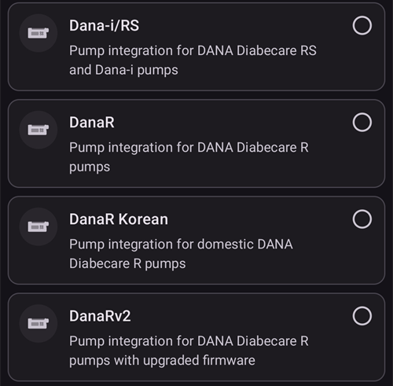
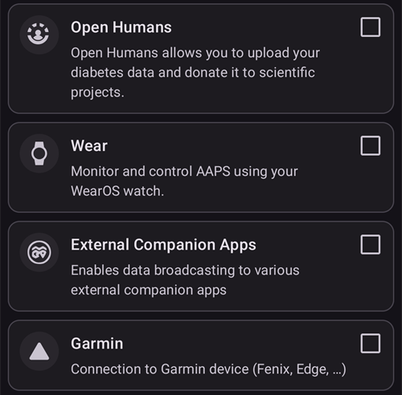

# 구성 (구성 관리자)

```{admonition} Coming from AAPS v3?
:class: note
The **Config Builder** is now called **Configuration** and is in the **menu** (☰). See [What changed in AAPS v4](#v4-changes).
```

**Configuration** is where you choose which plugins are active (CGM, pump, APS algorithm, sensitivity, sync, …) and open each plugin and its settings. 단계별 안내는 [아래](#configuration-v4)에 있습니다. 이 페이지의 나머지 부분은 각 섹션을 자세히 설명합니다.

(configuration-v4)=
## Configuration in AAPS v4

In **AAPS** v4, tap the **menu** (☰) in the **top-left** corner of the main screen and choose **Configuration** (_“Set up your configuration (CGM, pump, …) and enable features”_).


Plugins are grouped by **category** — for example _Smoothing_, _Calibration_, _Sensitivity detection_, _APS_, _Communication_ and _General_. 각 행에는 범주 이름과 **현재 활성화된** 플러그인이 표시됩니다(예: _APS → OpenAPS SMB_). 행을 누르면 범주가 열립니다.


Inside a category you see the plugins available for it. 하나만 선택하는 범주에서는 활성 플러그인을 하나 고릅니다. 일부 범주는 여러 개를 선택할 수 있습니다(_“해당하는 것을 모두 선택하십시오.”_). Each plugin offers two actions:

- **Open plugin** — opens the plugin's own screen.
- **Settings** — opens the plugin's preferences (settings may be grouped into expandable sections).


(configuration_sync_icon)=
### The mobile icon — “synced from the master”

A small **mobile (phone) icon** next to a category or setting means that item is **synchronized from the master** — its value/selection is delivered to this device over the NSClientV3 (Nightscout) channel.

**클라이언트**(**AAPSClient**)에서는 이 항목들이 **마스터와 같은 상태로 유지됩니다**. The icon is only shown on a client, so it does not appear in the screenshot above, which was taken on the main **AAPS** app. On a client it typically appears on _Smoothing_, _Calibration_, _Sensitivity detection_ and _APS_. 마스터와 클라이언트가 어떻게 같은 상태를 유지하는지, 그리고 어느 쪽에서 어떤 설정을 바꿀 수 있는지는 [마스터 ↔ 클라이언트 제어](#client-master-config-prefs)에서 설명합니다.

같은 아이콘은 **설정 안에서도** 동기화되는 개별 설정 옆에 표시됩니다. In the example below _Absorption cutoff_ carries the icon; settings without the icon are configured per device:


Items **without** the icon are configured **per device**. 가장 중요한 예는 **NSClientV3(통신)** 연결 자체입니다. **Nightscout URL**, **액세스 토큰**, **웹소켓**은 각 휴대폰에서 따로 설정하므로 휴대폰 아이콘이 **표시되지 않습니다**.

---

(Config-Builder-tab-or-hamburger-menu)=
## Opening a plugin screen

Each plugin screen is opened in one of these ways (the tabs and the eye checkbox of **AAPS** v3 are gone, see [What changed in AAPS v4](#v4-changes)):

- **Configuration** → the plugin's category → **Open plugin**,
- the **Manage** sheet of the bottom navigation, for the screens you use most (Profile, Insulin settings, Pump, Automation, Food...),
- a [QuickLaunch](../DailyLifeWithAaps/QuickLaunch.md) button that you add yourself,
- the **search bar** on the main screen.

```{contents}
:backlinks: entry
:depth: 2
```

(ConfigBuilder_Profile)=

## Profile

This module cannot be disabled as it is a core part of **AAPS**.

See [Your AAPS Profile](../SettingUpAaps/YourAapsProfile.md) for a basic understanding of what goes inside your **Profile**.

(insulin)=
(Config-Builder-insulin)=
## 인슐린


In **AAPS** 4 the insulin is no longer a plugin selected in **Configuration**. Open **Manage → Insulin settings** to set up the insulin you are using.

인슐린 편집기에서는 다음을 할 수 있습니다:

- give the insulin an **Insulin nickname** so it is easy to recognise,
- set the **Peak** (time to maximum insulin activity, in minutes) and the **DIA** (Duration of Insulin Action, in hours), either by typing the value or using the **–** / **+** buttons,
- tap a **Load peak from** preset button — **Novorapid** (75 min), **Fiasp** (55 min) or **Lyumjev** (45 min) — to fill in the standard peak time for that insulin in one step.

허용 범위는 어떤 인슐린을 사용하든 같습니다:

- **DIA**: 5 to 9 hours (5 to 10 hours if the patient type is set to **Pregnant**). See [Duration of insulin action (DIA) and peak](#Config-Builder-insulin-dia) to choose a value.
- **Peak**: 35 to 120 minutes.

The **IOB** (insulin on board) and **Activity** curves shown at the bottom of the editor update as you change the values, so you can see straight away how your settings shape the insulin action.

More information to understand the Insulin Profile as shown in **AAPS** [here](#AapsScreens-insulin-profile).

(Config-Builder-insulin-change-active)=
### 사용 중인 인슐린 변경(DIA 또는 피크)

The insulin marked **ACTIVE** is the one your running profile uses. 그 항목은 회색으로 표시되어 편집하거나 삭제할 수 없습니다. 이렇게 하면 실행 중인 프로파일에 표시되는 인슐린 이름이 실제로 사용하는 설정과 항상 일치합니다.

사용 중인 DIA나 피크를 바꾸려면:

1. Open **Manage → Insulin settings**. If the screen opens read-only (a **✏️ pencil** in the top bar), tap the pencil and unlock your settings.
2. Tap **+** (_Add new insulin_). **AAPS** creates a copy of the insulin shown on screen.
3. Set the new **Peak** and/or **DIA**, then tap the save icon (top right).
4. Tap **▶** (_Activate insulin_) and confirm. The new insulin becomes **ACTIVE**.

```{admonition} The name includes peak and DIA
:class: note
**AAPS** adds the peak, DIA and concentration to the insulin name automatically (for example _Fiasp 55m 8h U100_), so you can tell your configurations apart at a glance.
```

이전 인슐린은 더 이상 활성 상태가 아니면 삭제할 수 있습니다.

### The "Load peak from" presets

In **AAPS** 4 there is no list of insulin types to choose from. 모든 인슐린은 같은 지수 활동 곡선을 사용합니다. 다른 것은 **피크**와 **DIA**뿐입니다. 인슐린 편집기의 **피크 불러오기** 프리셋은 가장 흔한 인슐린의 권장 피크를 한 번에 입력합니다(**피크 불러오기** 옆의 작은 ⓘ에 인슐린과 피크 값 목록이 표시됩니다). 그 후에도 **피크**와 **DIA**를 조정할 수 있습니다.

효과를 이해하는 경우에만 피크를 권장 값과 다르게 바꾸십시오. [인슐린 곡선 그래프](#AapsScreens-insulin-profile)가 곡선을 이해하는 데 도움이 됩니다.

#### Novorapid


- recommended for Humalog, Novolog and Novorapid (called _Rapid-Acting Oref_ in **AAPS** v3)
- Peak = 75 minutes after injection

#### Fiasp


- recommended for Fiasp (called _Ultra-Rapid Oref_ in **AAPS** v3)
- Peak = 55 minutes after injection

(Config-Builder-lyumjev)=
#### Lyumjev


- recommended for Lyumjev
- Peak = 45 minutes after injection

#### Custom peak

- There is no separate "Free-Peak Oref" insulin type in **AAPS** 4: enter any **Peak** (35 to 120 minutes) directly in the [insulin editor](#Config-Builder-insulin), without using a preset.
- A custom peak is useful if you use an insulin that is not in the list, or a mixture of different insulins.

(Config-Builder-insulin-dia)=
### Duration of insulin action (DIA) and peak

```{warning}
In looping, decreasing DIA or peak will always increase administered insulin. DIA works differently in AAPS than in commercial AID systems, and careless changes to these settings can change insulin dosing in a way which is much larger or smaller than expected.
```

AAPS models the timeline of insulin action with a mathematical formula, configured using **DIA** and the closely related **peak** settings. DIA는 IOB가 0이 될 때까지의 이론적인 시간이고, 피크는 인슐린 효과가 가장 강한 시점입니다. This yields an IOB curve and an activity curve, which is simply the **rate** of IOB decay.

Consider that when AAPS is looping, it's normal to have periods of [zero-temping](#Open-APS-features-super-micro-bolus-smb). 이렇게 빠진 기저 인슐린은 IOB에서 모두 빠집니다. 그래서 실제로는 IOB가 설정된 DIA보다 몇 시간이나 일찍 0에 도달합니다. You can inspect [bolus IOB and basal IOB](#aaps-screens-iob-cob-basal-sens) separately from the main screen.

To configure DIA and peak, tap **Manage** in the main screen, and then tap **Insulin settings**. AAPS는 현재 활성화된 인슐린 구성을 다음과 같이 표시합니다:


In this example, the peak setting is 55 minutes, DIA is 8 hours and [insulin concentration](#Insulin-Concentration) is the standard 100 IU/mL.

위에서 설명한 0 임시 기저의 영향과 AAPS의 IOB 감소 공식 때문에, 대부분의 사용자는 상용 시스템보다 DIA를 확실히 더 높게 설정합니다. In general, many people find that a **DIA** of 9h works well for them. AAPS 경험이 더 쌓이고 프로파일이 잘 조정되면, 아래 정보를 참고하여 자신에게 맞는 DIA와 피크 설정을 찾아볼 수 있습니다.

````{admonition} Details on the impact of DIA and peak configuration
:class: dropdown

Since the basal rate has an indirect influence on IOB decay in AAPS, it follows that too high basal rates can mask too high DIA, and vice versa. It makes sense to first carefully tune basal rates before adjusting DIA and peak. Additionally, consider that the DIA and peak settings interact, in the sense that the effect of DIA depends on peak, and vice versa.

These charts show the exact impact of DIA and peak on the IOB curves, across the range of allowed values.

Adjusting DIA:

```{image} ../images/iob_remaining_static_peak.png
:width: 400px
```

Adjusting peak:

```{image} ../images/iob_remaining_static_dia.png
:width: 400px
```

Finally, a comparison adjusting DIA and peak in parallel. The logic here is that both values are adjusted in the same relative amounts, so that `49/35 ~ 7/5`. Or similarly, `120/93 ~ 9/7`. The intervals will be consistent regardless of the baseline DIA or peak, as long as the relative change is the same for both.

```{image} ../images/iob_remaining_uniform.png
:width: 400px
```

Note that when DIA and peak are adjusted in this fashion, every point in the curve will shift by the same relative amount.

````

#### Further reading on DIA and peak configuration

- [Technical details and historical background from the AAPS predecessor, OpenAPS](https://openaps.readthedocs.io/en/latest/docs/While%20You%20Wait%20For%20Gear/understanding-insulin-on-board-calculations.html#understanding-the-new-iob-curves-based-on-exponential-activity-curves).
- [Why we are regularly wrong in the duration of insulin action (DIA) times we use, and why it matters…](https://www.diabettech.com/insulin/why-we-are-regularly-wrong-in-the-duration-of-insulin-action-dia-times-we-use-and-why-it-matters/) on Diabettech.
- [Exponential Insulin Curves + Fiasp](https://web.archive.org/web/20220630154425/http://seemycgm.com/2017/10/21/exponential-insulin-curves-fiasp/) on See My CGM (archive).
- [Revised Humalog model in a closed loop](https://bionicwookiee.com/2022/04/13/revised-humalog-model-in-a-closed-loop/) and other articles on Bionic Wookie, recommending a DIA of 9h for Lyumjev, Fiasp, NovoRapid, Humalog.

(Config-Builder-bg-source)=
## 혈당 출처
Select the blood glucose source you are using. 자세한 설정 정보는 [혈당 출처](../Getting-Started/CompatiblesCgms.md) 페이지를 참조하십시오.


Scroll down to see the other sources:


- [xDrip+ BG](../CompatibleCgms/xDrip.md) - also for compatible apps such as [Juggluco](../CompatibleCgms/Juggluco.md)
- [NSClient BG](../CompatibleCgms/CgmNightscoutUpload.md) - only if you know what you are doing, see [BG Source](../Getting-Started/CompatiblesCgms.md).
- [MM640g](../CompatibleCgms/MM640g.md)
- Glimp - only version 4.15.57 and newer are supported
- [BYODA (Build Your Own Dexcom App)](#DexcomG6-if-using-g6-with-build-your-own-dexcom-app).
- MicroTech CGM App - for the Aidex / LinX CGM
- [Poctech](../CompatibleCgms/PocTech.md)
- Tomato (MiaoMiao) - Tomato App for MiaoMiao device
- [Glunovo](https://infinovo.com/) - Glunovo App for Glunovo CGM system
- Intelligo - Intelligo App
- Syai/Ottai - for the Syai and Ottai apps (see [Syai Tag](../CompatibleCgms/SyaiTagX1.md) and [Ottai](../CompatibleCgms/OttaiM8.md))
- SI App - patched SI App or Sibionics App for Sibionics CGM
- Sino App - patched app for Sinocare CGM
- Notification Reader - reads glucose values from the notifications shown by official CGM apps (Dexcom, Medtronic, Eversense, etc.)
- Instara - Instara App
- Random BG - generates random BG data for testing. 이 출처는 **가상 펌프**를 사용하는 엔지니어링(개발자) 빌드에서만 활성화할 수 있습니다. 그래서 일반 **AAPS** 설치에서는 사용할 수 없습니다.

## Smoothing


See [Smoothing blood glucose data](../CompatibleCgms/SmoothingBloodGlucoseData.md).

## 보정

Choose how **AAPS** treats the values it receives from your sensor:

- **No calibration**: the sensor values are used as they are. 센서가 이미 공장 보정되어 있고 정확할 때 사용하십시오. 이것이 기본값입니다.
- **Linear calibration**: **AAPS** corrects the sensor values with a slope and an offset that it computes from your fingerstick entries.

How to use **Linear calibration**:

1. **보정** 분류에서 **선형 보정**을 선택하십시오.
2. 새 센서를 삽입하면 센서 교체를 기록하십시오: 보정 화면에서 **센서 교체 기록**을 사용하거나 케어포털에서 CGM 센서 삽입을 입력하십시오. 이렇게 하면 **AAPS**가 센서 세션이 언제 시작되었는지 알 수 있습니다. 측정값에 30분이 넘는 공백이 있으면 **AAPS**가 센서 교체를 표시하라고 요청할 수 있습니다. 이 요청은 마스터에서만 나타나고 클라이언트에서는 나타나지 않습니다.
3. 플러그인을 열고 **보정 추가**를 누르십시오. 손가락 채혈 값을 입력하십시오. **AAPS**는 이 값을 최근 10분 동안의 센서 값과 짝을 짓습니다.

A calibration is accepted only when:

- a sensor change is logged and at least **2 hours** have passed since then (warm-up),
- your glucose is stable. If it changes too fast, the dialog tells you and shows the limit,
- there is a CGM reading from the last 10 minutes,
- it is for the current moment. 이전 손가락 채혈 값은 입력할 수 없습니다.

How the correction works:

- **AAPS** draws a straight line through the pairs of the current sensor: `corrected value = slope × sensor value + offset`.
- Newer pairs count more than older ones: a pair that is 2 days old counts about 37 %, a 4-day-old pair about 14 %. 따라서 센서 값이 점점 어긋나면 직선도 그에 따라 바뀝니다.
- At least **2 pairs** are needed.
- If the pairs are close together (less than 54 mg/dL / 3 mmol/L apart), only the values are shifted (offset, no slope).
- The slope is kept between 0.55 and 1.6. A slope outside this range is limited to the nearest value.
- Safety limit: if the correction at 100 mg/dL (5.5 mmol/L) would be more than ±30 mg/dL (1.7 mmol/L), no correction is applied. 이것은 잘못된 입력으로부터 사용자를 보호합니다.

What it changes:

- The corrected value is used everywhere: the BG on the main screen, the graph and the loop. 센서 측정값 자체는 바뀌지 않습니다. 보정은 그 위에 적용되며, 현재 센서의 이전 측정값에도 적용됩니다.
- A new sensor change starts from zero. 이전 센서의 짝은 더 이상 반영되지 않습니다.
- On the graph, a calibration is shown as a marker at the fingerstick value.
- Calibrations are synchronized through Nightscout, so your clients show the same corrected values.

Check and remove entries:

- **Open plugin** shows the status (for example _Slope 0.85, mid-range correction -0.4_), a chart of your pairs with the line, and the list of entries.
- If an entry is wrong (for example, you had sugar on your finger), tap the bin icon next to it. 직선이 바로 다시 계산됩니다.

```{admonition} Using xDrip+ as BG source?
:class: note
xDrip+ has its own calibration. Calibrate in one place only, so that the sensor values are not corrected twice.
```

```{admonition} Calibrate with care
:class: warning
A wrong fingerstick value leads to wrong glucose values and therefore to wrong insulin dosing. Wash your hands before measuring, and do not calibrate while your glucose is changing fast.
```


(Config-Builder-pump)=
## Pump
사용하는 펌프를 선택하십시오. See [Compatible pumps](../Getting-Started/CompatiblePumps.md) page for more setup information.


아래로 스크롤하면 모든 펌프 드라이버가 표시됩니다:




When you select another pump, **AAPS** asks you to confirm the change:


- [Dana R](../CompatiblePumps/DanaR-Insulin-Pump.md)
- 다나R 한글 (국내용 DanaR 펌프)
- 다나R v2 (비공식 펌웨어 업그레이드를 한 DanaR 펌프)
- [Dana-i/RS](../CompatiblePumps/DanaRS-Insulin-Pump.md)
- [Accu Chek Insight](../CompatiblePumps/Accu-Chek-Insight-Pump.md)
- [Accu Chek Combo](../CompatiblePumps/Accu-Chek-Combo-Pump-v2.md)
- Omnipod for [Omnipod Eros](../CompatiblePumps/OmnipodEros.md)
- Dash for [Omnipod DASH](../CompatiblePumps/OmnipodDASH.md)
- [Medtronic](../CompatiblePumps/MedtronicPump.md)
- [Diaconn G8](../CompatiblePumps/DiaconnG8.md)
- [EOPatch2](../CompatiblePumps/EOPatch2.md)
- [Medtrum](../CompatiblePumps/MedtrumNano.md)
- [Equil 5.3](../CompatiblePumps/Equil5.3.md)
- [Carelevo](../CompatiblePumps/CareLevo.md)
- Virtual pump: open loop - **AAPS** suggestions only
  - as you make your first steps with **AAPS**, during the first [objectives](../SettingUpAaps/CompletingTheObjectives.md)
  - 아직 드라이버가 없는 펌프용

(config-builder-wrong-pump-data)=
### 메시지: "다른 펌프에서 데이터가 오고 있습니다"

**AAPS** remembers the pump it is connected to (pump type and serial number). 다른 펌프에서 데이터를 받으면(예: 펌프를 같은 모델의 새 펌프로 교체한 경우) 이 메시지를 표시하고 그 펌프의 데이터를 무시합니다:


To use the new pump, change the pump driver: select **Virtual pump**, confirm, then select your pump again. **AAPS** then registers the pump it is connected to now.

(Config-Builder-sensitivity-detection)=

## 민감도 감지


민감도 감지 유형을 선택하십시오. For more details of different designs please [read on here](../DailyLifeWithAaps/SensitivityDetectionAndCob.md). 이 기능은 과거 데이터를 계속 분석하여, 평소보다 인슐린에 더 민감하게(또는 반대로 더 저항성 있게) 반응하는 것을 인식하면 조정합니다. More details about how the sensitivity ratio itself is calculated can be found in [Key AAPS Features > Autosens](#Open-APS-features-autosens).

You can view your sensitivity on the main screen in an [additional graph](#AapsScreens-section-g-additional-graphs), by selecting SENS% and watching the white line. Note, you need to be in [Objective 8](#objectives-objective8) in order to let Sensitivity Detection/[Autosens](#Open-APS-features-autosens) automatically adjust the amount of insulin delivered. 그 목표에 도달하기 전에는 Autosens 퍼센트 / 그래프의 선은 정보로만 표시됩니다.

### Absorption settings
If you use Oref1 with **SMB** you must change **min_5m_carbimpact** to 8. The value is only used during gaps in **CGM** readings or when physical activity "uses up" all the blood glucose rise that would otherwise cause **AAPS** to decay COB. At times when [carb absorption](../DailyLifeWithAaps/CobCalculation.md) can't be dynamically worked out based on your blood's reactions it inserts a default decay to your carbs. 기본적으로 이것은 안전 장치입니다.

(Config-Builder-aps)=
## APS


치료 조정에 사용할 APS 알고리즘을 선택하십시오. You can view the active detail of the chosen algorithm with **Open plugin**.
- OpenAPS AMA
  - 고급 식사 지원(Advanced Meal Assist): 더 이상 권장하지 않는 이전 알고리즘입니다.
  - 간단히 말하면, 식사 볼러스를 한 후 탄수화물을 정확히 입력한다면 시스템이 더 빠르게 높은 임시 기저를 설정할 수 있다는 장점이 있습니다.
- [OpenAPS SMB](#Open-APS-features-super-micro-bolus-smb)
  - 슈퍼 마이크로 볼러스(Super Micro Bolus): 모든 사용자에게 권장하는 최신 알고리즘입니다.
  - In contrast to AMA, SMB does not use temporary basal rates to control glucose levels, but mainly small **Super Micro Boluses**.
  - Note : It is recommended to use this algorithm from the beginning, even though you will not actually get SMBs delivered until [Objective 9](#objectives-objective9).
- [Auto ISF](#Open-APS-features-auto-isf)
  - 고급 사용자를 위한 실험적 알고리즘입니다. 목표를 완료한 후에만 목록에 표시됩니다.

If switching from AMA to SMB algorithm, _min_5m_carbimpact_ must be changed manually to **8** (default value for SMB) in [Settings → Absorption settings](#Preferences-min_5m_carbimpact).

## 루프

This module cannot be disabled as it is a core part of **AAPS**.


## Constraints


### Objectives

**AAPS** has a learning program (a series of objectives) that you have to fulfill step by step. 이 프로그램은 폐쇄 루프 시스템을 안전하게 설정하도록 안내합니다.

See [Objectives](../SettingUpAaps/CompletingTheObjectives.md) page for more information.

## 통신

In this category (called **Synchronization** in **AAPS** v3), you choose if/where you want **AAPS** to send your data to.


아래로 스크롤하면 목록의 나머지가 표시됩니다:



### NSClientV3

Can be used as a [reporting server](../SettingUpAaps/SettingUpTheReportingServer.md) and/or for [remote monitoring](../RemoteFeatures/RemoteMonitoring.md), [remote control](../RemoteFeatures/RemoteControl.md).

See [Synchronization with the reporting server](#SetupWizard-synchronization-with-the-reporting-server-and-more) to set up NSClientV3 synchronization.

### Tidepool

Can be used as a [reporting server](../SettingUpAaps/SettingUpTheReportingServer.md).

See [Tidepool](../SettingUpAaps/Tidepool.md).

### xDrip

Used to **send** data such as glucose values and treatments to xDrip+ on the same phone. Its settings also hold **Send status to xDrip+**, a status line with IOB and COB that xDrip+ and some watch companion apps display.

### Open Humans

See [Open Humans](../SupportingAaps/OpenHumans.md).

(Config-Builder-wear)=
### Wear
Monitor and control **AAPS** from a Wear OS watch. Setting up the watch is explained on [Wear OS smartwatch](../WearOS/WearOsSmartwatch.md). After enabling the plugin, choose its options in [Settings > Wear](#preferences-wear). Using the watch is explained on [Operation of AAPS via your Wear OS smartwatch](../RemoteFeatures/RemoteControlWearOS.md).

(external-companion-apps)=
### 외부 연동 앱

Broadcasts **AAPS** status data on the phone so that other apps installed on it can display it — for example watch or widget companion apps. 브로드캐스트에는 혈당과 추세, IOB, COB, 기저와 임시 기저, 프로파일 이름, 루프 상태, 휴대폰과 펌프 배터리, 레저버 잔량, 볼러스 진행 상황이 포함됩니다. 사용하는 동반 앱이 이 데이터를 요청하는 경우에만 활성화하십시오.

Apps known to read this broadcast are [WatchDrip+](https://bigdigital.home.blog/) (Xiaomi and Amazfit watches), [GlucoDataHandler](https://github.com/pachi81/GlucoDataHandler) (Wear OS complications and widgets, and Android Auto through GlucoDataAuto) and the G-Watch app. Their setup is described on [Smartwatches and AAPS](#watches-external-companion-apps). Some of them also use **Send status to xDrip+** from the **xDrip** plugin above for a status line with IOB and COB.

In earlier versions this plugin was called **Samsung Tizen**, after the [G-Watch app for Samsung Tizen watches](#Watchfaces-tizen) it was first made for.

### Garmin

Garmin 기기(Fenix, Edge...)와 연결
## 처치
Open the **menu** (☰) and select [Treatments history](#aaps-screens-treatments) to see the treatments that have been recorded. Should you wish to edit or delete an entry (e.g. you ate less carbs than you expected) then select 'Remove' and enter the new value (change the time if necessary) through **Treatments → Carbs** in the bottom navigation (see [Carbs](#screens-bolus-carbs)).

## 일반

In **AAPS** 4 the **General** category of **Configuration** only lists **Autotune**. 아래에 설명된 다른 기능은 항상 사용할 수 있으며, 더 이상 여기서 활성화할 필요가 없습니다. 각 단락에 위치가 설명되어 있습니다.


### 개요

The [main screen](#AapsScreens-the-homescreen) of **AAPS** is not a plugin any more and has no settings of its own in **Configuration**. The options that used to be here are in **Settings** (gear icon): [Show notes in dialogs](#Preferences-show-notes-field-in-treatments-dialogs), [Status lights](#Preferences-status-lights) and the [Bolus percentage](#Preferences-deliver-this-part-of-bolus-wizard-result) used by the bolus wizard. The super bolus option of **AAPS** 3.x is [not available as a setting](#Preferences-advanced-settings-overview) in **AAPS** 4.

(Config-Builder-actions)=
### 동작

The Actions tab of **AAPS** 3.x no longer exists. Its buttons are now in the **Manage** sheet — see [Where did the Actions tab go?](#screens-action-tab).

### Automation

**Manage → Automation** lets you manage your [Automations](../DailyLifeWithAaps/Automations.md), starting at [Objective 10](#objectives-objective10).

(Config-Builder-sms-communicator)=
### SMS 통신기
Allows remote caregivers to control some **AAPS** features via SMS, see [SMS Commands](../RemoteFeatures/SMSCommands.md) for more setup information.

### Food
**Manage → Food** displays the food presets defined in the Nightscout food database, see [Nightscout Readme](https://github.com/nightscout/cgm-remote-monitor#food-custom-foods) for more setup information.

Note: Entries cannot be used in the **AAPS** calculator. (View only)

(Config-Builder-autotune)=
### Autotune

You can enable Autotune, see [here](../AdvancedOptions/Autotune.md).

### Maintenance

Open the **menu** (☰) and select **Maintenance** to export / import settings and manage log files.


### 구성 관리자

Now called **Configuration**: this current page.