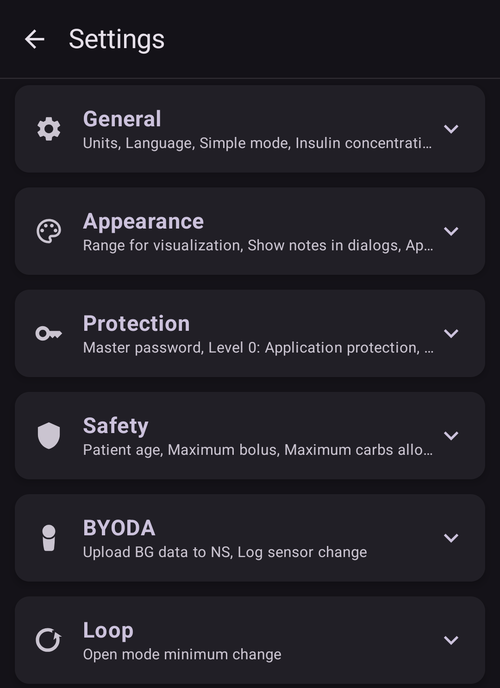
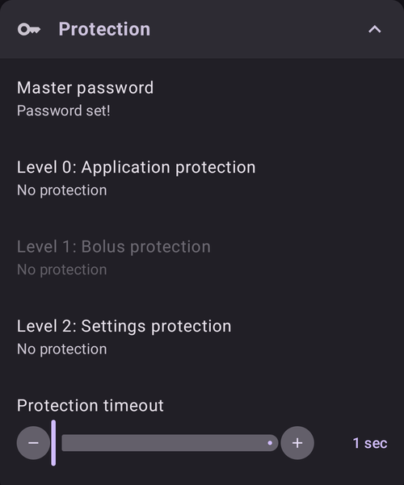
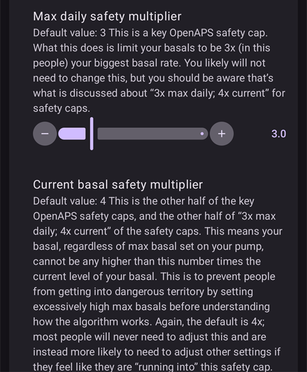
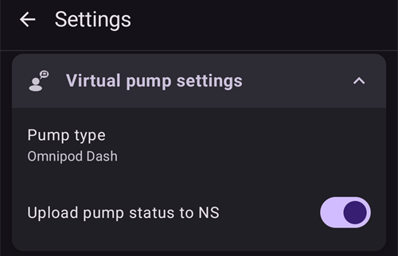
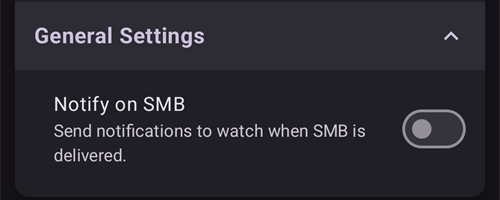
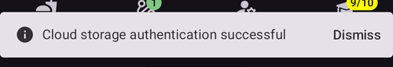

# 설정

**AAPS** v4에서는 설정이 **설정** 화면에 있습니다. 설정 화면으로 가는 방법은 세 가지입니다 — 자세한 내용은 [AAPS 구성 변경하기](../SettingUpAaps/ChangeAapsConfiguration.md)를 참조하십시오:

1. 메인 화면 오른쪽 위의 **설정**(톱니바퀴) 아이콘을 누릅니다: 모든 설정이 펼칠 수 있는 섹션으로 묶여 있습니다.
2. **구성**에서 활성화된 플러그인 아래의 "**설정**"을 누릅니다: 그 플러그인의 설정만 표시됩니다.
3. 메인 화면 위쪽의 **검색 창**을 사용합니다: 찾는 텍스트의 일부를 입력하기만 하면 됩니다. 이 방법으로 개별 설정(설정 화면에 보이지 않는 설정도 포함), 대화 상자와 문서를 찾을 수 있습니다.


- **섹션**은 눌러서 열고 닫습니다. 보이는 섹션은 활성화한 플러그인과 [간단 모드](#preferences-simple-mode)에 따라 달라집니다.



```{contents}
:backlinks: entry
:depth: 2
```

(Preferences-general)=
## 일반


**Units**

- 원하는 대로 단위를 mmol/L 또는 mg/dL로 설정하십시오.

**언어**

- 기본적으로 **AAPS**는 휴대폰의 언어를 따릅니다(권장).

- **AAPS**를 휴대폰과 다른 언어로 사용하려면 여기에서 선택하십시오. Android 13 이상에서는 **AAPS**가 이 언어를 Android에 자체 앱 언어로 등록하므로, 모든 화면, 메인 화면, 위젯과 숫자 표기 방식이 이 언어를 따릅니다.

- 언어를 바꾸면 **AAPS**의 텍스트가 바로 새 언어로 바뀝니다. 일부 텍스트가 여전히 이전 언어로 보이면 **AAPS**를 다시 시작하십시오.
- Android 12에서는 이 설정이 표시되지 않습니다: **AAPS**는 항상 휴대폰의 언어를 사용합니다.
- [간단 모드](#preferences-simple-mode)에서는 숨겨지는 설정입니다.

(preferences-simple-mode)= **간단 모드**

**AAPS**를 처음 설치하면 **간단 모드**가 기본으로 켜져 있습니다. **간단 모드**에서는 많은 설정이 숨겨지고, 설정값이 미리 정해진 값으로 바뀝니다. **AAPS** 사용자 인터페이스와 설정에 익숙해지면 간단 모드를 꺼야 합니다.

**인슐린 농도 지원**

- 다른 인슐린 농도(U50, U200, ...)를 지원합니다. 실제로 U100이 아닌 다른 농도를 사용할 때만 켜고, 경고를 주의 깊게 읽으십시오.
- [간단 모드](#preferences-simple-mode)에서는 숨겨지는 설정입니다.

**화면 켜짐 유지**

- Android가 화면을 항상 켜진 상태로 유지하게 합니다. This is useful for presentations etc. But it consumes a lot of battery power. Therefore, it is recommended to connect the smartphone to a charger cable.

**인스턴스 이름**

- 이 휴대폰을 사용하는 사람의 이름입니다. 보고서와 동기화에서 이 **AAPS** 인스턴스를 구별합니다. 예를 들어 가족 중 1형 당뇨병이 있는 두 아이가 **AAPS**를 사용하는 경우입니다.
- 내보낸 설정 파일의 이름에 사용됩니다.
- [Dual 워치 페이스](../WearOS/WearOsSmartwatch.md)에 표시됩니다.

(Preferences-skin)=
### Skin

**AAPS** 3.x의 스킨 선택(Original, Low resolution, Large display...)은 **AAPS** 4에는 더 이상 없습니다. 새 인터페이스는 화면에 자동으로 맞춰지며, 색 구성은 [외관](#preferences-appearance)에서 바꿀 수 있습니다.

(preferences-appearance)=
## 외관


(Preferences-range-for-visualization)=
### Range for visualization

**AAPS** 메인 화면과 스마트워치의 혈당 그래프에 표시할 높은 선과 낮은 선을 선택하십시오. 표시용일 뿐이며, 혈당 목표 범위가 아닙니다. 예: 70 - 180 mg/dL 또는 3.9 - 10 mmol/L

(Preferences-show-notes-field-in-treatments-dialogs)=
### 대화 상자에 노트 표시

처치(볼러스 마법사, 탄수화물, 인슐린...)에 짧은 텍스트 노트를 추가할 수 있습니다.

[간단 모드](#preferences-simple-mode)에서는 숨겨지는 설정입니다.

### 앱 색 구성

밝은 테마, 어두운 테마, 또는 휴대폰의 시스템 설정 따르기 중에서 선택하십시오.

(Preferences-protection)=
## Protection



(Preferences-master-password)=
### Master password

버전 2.7부터 설정이 암호화되므로, [설정 내보내기](../Maintenance/ExportImportSettings.md)를 하려면 반드시 필요합니다.

**OnePlus 휴대폰에서는 생체 인식 보안이 작동하지 않을 수 있습니다. 이것은 일부 OnePlus 휴대폰에서 알려진 문제입니다.**


(Preferences-settings-protection)=
### Settings protection

- 비밀번호 또는 휴대폰의 생체 인증으로 설정을 보호하십시오(예: [아이가 **AAPS**를 사용하는 경우](../RemoteFeatures/RemoteMonitoring.md)). 이 기능을 켜면 설정과 관련된 화면에 들어갈 때마다 인증을 요청합니다.

- 그러면 관리 화면(**프로파일**, **인슐린 설정**, **임시 목표**, **빠른 마법사**)이 **읽기 전용**으로 열립니다. 항목을 활성화하거나 사용할 수는 있지만, 추가, 편집, 복사, 삭제는 설정 잠금을 풀 때까지 숨겨집니다. [설정 보안이 이제 관리 화면도 잠급니다](#v4changes-read-only-management)를 참조하십시오.

- 마스터 비밀번호는 [내보낸 설정](../Maintenance/ExportImportSettings.md)을 보호하는 데만 쓰고, 설정 편집에는 다른 비밀번호를 쓰려면 사용자 지정 비밀번호를 사용하십시오.

- 사용자 지정 비밀번호를 사용한다면 "설정 비밀번호" 줄을 누르고 [위](#Preferences-master-password)에서 설명한 대로 비밀번호를 설정하십시오.

### 애플리케이션 보안

앱이 보호되어 있으면 **AAPS**를 열 때 비밀번호를 입력하거나 휴대폰의 생체 인증을 사용해야 하며, [보안 시간 제한](#Preferences-password-and-pin-retention)이 지난 후 다시 돌아올 때도 마찬가지입니다.

잘못된 비밀번호를 입력하면 **AAPS**는 즉시 종료됩니다. 하지만 이전에 정상적으로 열었다면 백그라운드에서는 계속 실행됩니다.

### 볼러스 보안

- 어린 아이가 **AAPS**를 사용하고 [SMS로 볼러스](../RemoteFeatures/SMSCommands.md)를 한다면 볼러스 보안이 유용할 수 있습니다.

- **볼러스 보안**은 **설정 보안**(레벨 2)을 설정한 후에만 선택할 수 있습니다.

- 아래 예에서 볼러스 보안은 **마스터 비밀번호**를 사용합니다: **AAPS**는 **인슐린** 같은 처치 대화 상자를 열기 전에 마스터 비밀번호를 묻습니다. **생체 인식**을 선택한 경우 생체 인증이 작동하지 않으면 대신 마스터 비밀번호를 입력할 수 있습니다.


(Preferences-password-and-pin-retention)=
### 비밀번호 및 PIN 보존

**보안 시간 제한**은 비밀번호를 올바르게 입력한 후 설정 또는 볼러스 기능이 잠금 해제된 상태로 유지되는 시간(초)을 정합니다.

## 처치 안전


(preferences-patient-type)=
### 환자 나이

- 안전 제한은 이 설정에서 선택한 나이를 기준으로 정해집니다.
- 최대 볼러스와 같은 이 고정 제한에 자주 걸리기 시작하면, 한 단계 위로 올릴 때입니다.
- 실제 나이보다 높게 선택하는 것은 좋지 않습니다. 인슐린 대화 상자에 잘못된 값을 입력하면(예: 소수점 구분 기호를 빠뜨리면) 과다 주입이 될 수 있기 때문입니다.
- 이 고정 안전 제한의 실제 값을 알고 싶다면, [이 페이지](../DailyLifeWithAaps/KeyAapsFeatures.md)에서 사용 중인 알고리즘 기능 부분으로 내려가 보십시오.

(Preferences-maximum-bolus)=
### 최대 볼러스

- **AAPS**가 한 번에 주입할 수 있는 볼러스 인슐린의 최대량을 인슐린 단위(U)로 정합니다.
- 이 설정은 실수로 입력하거나 사용자 오류로 많은 양의 볼러스가 주입되는 것을 막기 위한 안전 제한입니다.
- 식사나 교정 용량으로 필요할 수 있는 볼러스 인슐린의 최대량과 대략 같은, 합리적인 양으로 설정하는 것을 권장합니다.
- 이 제한은 볼러스 계산기의 결과에도 적용됩니다.

### 최대 허용 탄수화물

- **AAPS** 볼러스 계산기가 인슐린을 계산할 수 있는 탄수화물의 최대량을 그램 단위로 정합니다.
- 이 설정은 실수로 입력하거나 사용자 오류로 많은 양의 볼러스가 주입되는 것을 막기 위한 안전 제한입니다.
- 한 번의 식사에 필요할 수 있는 탄수화물의 최대량과 대략 같은, 합리적인 양으로 설정하는 것을 권장합니다.

## 혈당 출처

선택한 [혈당 출처](#Config-Builder-bg-source)의 설정은 별도의 섹션으로 표시됩니다. 예를 들어 **xDrip+ 혈당**의 경우:


- **혈당 데이터를 NS에 업로드**: **AAPS**가 받은 혈당 값을 Nightscout에 업로드하게 합니다. CGM 앱이 이미 업로드하고 있지 않을 때만 켜십시오.
- **센서 교체 기록**: 센서를 삽입하면 센서 교체 치료 이벤트를 자동으로 만듭니다.

## 메인 화면

**AAPS** 3.x에서는 이 설정들이 "개요" 섹션에 묶여 있었습니다. **AAPS** 4에서는 해당 메인 화면 요소에서 바로 설정합니다.

(Preferences-buttons)=
### QuickLaunch 버튼

메인 화면에 보일 동작 버튼을 정합니다: 메인 화면 아래쪽 가운데의 작은 **톱니바퀴**("QuickLaunch 설정")를 누르고, 빠르게 사용하고 싶은 동작(처치, CGM 동작, 케어포털 항목...)을 **추가**하십시오.


(Preferences-quick-wizard)=
### 빠른 마법사

특정 표준 식사나 간식을 위한 사용자 지정 버튼을 만들어 메인 화면에 표시합니다. 자주 먹는 표준 식사에 유용합니다.

버튼마다 탄수화물과 볼러스 계산 방법을 정합니다. 그다음, 버튼이 메인 화면에 보일 시간대를 정합니다 - 시간대마다 버튼은 하나만 가능합니다. 정해진 시간 범위 밖이거나, 빠른 마법사 버튼에 정한 탄수화물을 감당할 만큼 IOB가 충분하면 버튼은 보이지 않습니다. 식사마다 다른 시간을 정해 두면, 하루 중 시간에 따라 항상 알맞은 표준 식사 버튼이 메인 화면에 표시됩니다.

빠른 마법사 프리셋을 관리하려면 메인 화면 검색 창에 "빠른 마법사"를 입력하고 **빠른 마법사 - 빠른 마법사 프리셋 관리**를 여십시오.

빠른 마법사 버튼을 누르면 **AAPS**는 현재 비율을 바탕으로 (설정한 경우 혈당 값이나 활성 인슐린도 고려하여) 그 탄수화물에 대한 볼러스를 계산하고 제안합니다.

인슐린이 주입되기 전에 제안을 확인해야 합니다.

(Preferences-default-temp-targets)=
### Default temp targets

[임시 목표(TT)](../DailyLifeWithAaps/TempTargets.md)를 사용하면 일정 시간 동안 혈당 목표를 바꿀 수 있습니다. 기본 TT를 설정해 두면 활동, 식사 직전 등을 위해 목표를 쉽게 바꿀 수 있습니다.

메인 화면의 **목표 범위**를 누르면 **임시 목표** 화면이 열립니다. 프리셋 카드(식사 직전, 활동, 저혈당)를 넘겨 가며 **프리셋 설정**에서 각 프리셋의 목표와 기간을 바꾸십시오. 기본 설정값:

* 식사 직전: 목표 90 mg/dL / 5.0 mmol/L, 기간 45분
* 활동: 목표 140 mg/dL / 7.8 mmol/L, 기간 90분
* 저혈당: 목표 160 mg/dL / 8.9 mmol/L, 기간 60분


[여기에서 임시 목표를 활성화하는 방법](#TempTargets-where-can-i-select-a-temp-target)을 알아보십시오.

### 프라임/채우기 기본 인슐린 양

**AAPS**로 튜브를 채우거나 캐뉼라를 프라임하려면, 메인 화면의 펼친 상태 패널에 있는 **프라임/채우기** 버튼을 사용하면 됩니다.

세 개의 채우기 버튼의 기본 양은 카테터 길이에 따라 **프라임/채우기** 설정에서 정할 수 있습니다. 열려면 메인 화면 검색 창에 "프라임"을 입력하십시오.


(Preferences-status-lights)=
### Status lights

상태 등은 다음 항목을 눈으로 볼 수 있게 경고합니다:

- 센서 사용 기간
- 인슐린 사용 기간 (레저버를 사용한 일수)
- 레저버 잔량 (U)
- 캐뉼라 사용 기간
- 펌프 배터리 사용 기간
- 펌프 배터리 잔량 (%)

경고 기준값을 넘으면 값이 노란색으로 표시됩니다. 위험 기준값을 넘으면 값이 빨간색으로 표시됩니다.

기준값을 바꾸려면 메인 화면의 상태 패널을 펼치고(상태 표시줄 오른쪽의 꺾쇠) "상태" 옆의 작은 **설정** 아이콘을 누르십시오:


항목(**캐뉼라**, **인슐린**, **센서** 또는 **펌프 배터리**)을 누르면 그 항목의 경고 기준값과 위험 기준값이 열립니다:


마지막 옵션으로 Nightscout에 정의된 이 설정을 가져올 수 있습니다. 자세한 내용은 [Nightscout 문서](https://nightscout.github.io/nightscout/setup_variables/#age-pills)를 참조하십시오.

(Preferences-deliver-this-part-of-bolus-wizard-result)=
### 볼러스 마법사 설정

메인 화면 검색 창에 "볼러스"를 입력하여 **볼러스 마법사** 설정을 여십시오:


**볼러스 비율**은 볼러스 마법사를 사용할 때 계산된 볼러스의 [기본 비율](#AapsScreens-section-j)을 정합니다.

기본값은 100%입니다: 보정하지 않습니다. 여기에서 다른 값을 설정해도, 볼러스 마법사를 사용할 때마다 값을 바꿀 수 있습니다. 이 설정이 75 %이고 10 U를 볼러스해야 한다면, 볼러스 마법사는 7.5 U만 식사 볼러스로 제안합니다.

[SMB](#objectives-objective9)를 사용할 때 많은 사람들은 필요한 인슐린의 100%를 식사 볼러스로 주입하지 않고 일부만(예: 75 %) 주입한 뒤, 나머지는 UAM(미입력 식사 감지)과 함께 SMB가 처리하게 합니다. 여기에서 100%보다 낮은 값을 사용하면 다음 경우에 유용할 수 있습니다:
* 소화가 느린 사람: 볼러스 전체를 미리 주입하면 인슐린 작용이 소화보다 빨라서 저혈당이 올 수 있습니다.
* **혈당 상승**을 **AAPS**가 스스로 처리할 여유를 더 주기 위해. 두 경우 모두, 필요하다고 판단되면 **AAPS**가 볼러스의 모자란 부분을 SMB로 보충합니다.

**볼러스 조언자 사용**

켜져 있으면, 고혈당 상태에서 볼러스 마법사를 사용할 때 경고가 표시되고, 사전 볼러스를 하고 **혈당**이 범위 안으로 돌아오면 나중에 먹을지 묻습니다.

(Preferences-advanced-settings-overview)=
### 슈퍼 볼러스

**AAPS** 3.x의 슈퍼 볼러스 옵션은 **AAPS** 4에서는 설정으로 제공되지 않습니다.

## 루프

지금 루프 모드를 바꾸려면 [AAPS 화면 > 메인 화면 > 루프 상태](#AapsScreens-loop-status)를 참조하십시오.

(Preferences-minimal-request-change)=
### 개방 루프 최소 변경량

**개방 루프**를 사용하면, **AAPS**가 기저 주입량 조정을 권장할 때마다 알림을 받습니다. 알림 수를 줄이려면 [더 넓은 혈당 목표 범위](#profile-glucose-targets)를 사용하거나 "**개방 루프 최소 변경량**" 설정의 비율을 높이면 됩니다. 알림이 발생하는 데 필요한 상대적 변화를 정합니다.


## 고급 식사 지원 (AMA) 또는 슈퍼 마이크로 볼러스 (SMB)

[구성 > APS](../SettingUpAaps/ConfigBuilder.md)의 설정에 따라 두 가지 알고리즘 중에서 선택할 수 있습니다:

- [고급 식사 지원 (OpenAPS AMA)](#Open-APS-features-advanced-meal-assist-ama) - 2017년 상태의 알고리즘
- [슈퍼 마이크로 볼러스 (OpenAPS SMB)](#Open-APS-features-super-micro-bolus-smb) - 초보자에게 권장하는 최신 알고리즘

[**AAPS** 버전 3.3](#version3300)부터 [동적 ISF](../DailyLifeWithAaps/DynamicISF.md) 기능은 OpenAPS SMB로 옮겨졌습니다.

### OpenAPS AMA

OpenAPS AMA의 모든 설정은 [AAPS 주요 기능 > 고급 식사 지원 (AMA)](#Open-APS-features-advanced-meal-assist-ama)의 해당 부분에 설명되어 있습니다.

(Preferences-openaps-smb-settings)=
### OpenAPS SMB

OpenAPS SMB의 모든 설정은 [AAPS 주요 기능 > 슈퍼 마이크로 볼러스 (SMB)](#Open-APS-features-super-micro-bolus-smb)의 해당 부분에 설명되어 있습니다.

보이는 설정 목록은 [목표](../SettingUpAaps/CompletingTheObjectives.md) 진행 상황과 [간단 모드](#preferences-simple-mode)에 따라 달라집니다. 새로 설치한 경우에는 **동적 민감도 사용**만 표시됩니다. 목표를 완료하면 이 섹션은 다음과 같습니다:


섹션 맨 아래의 **고급 설정**에는 보통 바꿀 필요가 없는 값이 있습니다:




## Absorption settings


(Preferences-min_5m_carbimpact)=
### SMB 최소 5분 탄수화물 영향 (min_5m_carbimpact)

[간단 모드](#preferences-simple-mode)에서는 숨겨지는 설정입니다.

알고리즘은 BGI(혈당 영향)를 사용하여 [탄수화물이 흡수되는](../DailyLifeWithAaps/CobCalculation.md) 때를 판단합니다.

혈당 반응으로 탄수화물 흡수를 동적으로 계산할 수 없을 때는 **AAPS**가 탄수화물에 기본 감소량을 적용합니다. 기본적으로 이것은 안전 장치입니다. 이 값은 **CGM** 값이 끊긴 동안, 또는 신체 활동이 혈당 상승을 모두 "써 버려서" **AAPS**가 COB를 줄일 근거가 없을 때만 사용됩니다.

간단히 말하면: 알고리즘은 현재 인슐린 용량 등의 영향을 받을 때 혈당이 어떻게 변해야 *하는지* "알고" 있습니다. 예상한 변화보다 양의 편차가 있을 때마다 일부 탄수화물이 흡수된 것(감소한 것)으로 봅니다. 큰 변화 = 많은 탄수화물 등.

min_5m_carbimpact는 5분당 기본 탄수화물 흡수 영향을 정합니다. 전체 매개 변수 설명은 [OpenAPS의 기본 설정 및 안전 설정 문서](https://openaps.readthedocs.io/en/latest/docs/While%20You%20Wait%20For%20Gear/preferences-and-safety-settings.html?highlight=carbimpact#min-5m-carbimpact)를 참조하십시오.

AMA의 표준값은 3이고, SMB는 8입니다.

메인 화면의 COB 그래프는 min_5m_carbimpact가 사용될 때 COB 곡선 위쪽에 주황색 점을 표시합니다.


### 흡수 종료 시간

모든 식사가 흡수된 것으로 보는 시간입니다. 남은 탄수화물은 잘라냅니다. 고지방 또는 고단백 식사를 자주 한다면 식사 흡수 시간을 늘려야 합니다.

### 고급 설정 - autosens 비율


- [autosens](#Open-APS-features-autosens) 비율의 최소값과 최대값을 정합니다.
- 보통 표준값(최대 1.2, 최소 0.7)은 바꾸지 않아야 합니다.

## Pump


### BT 워치독

필요하면 BT 워치독을 활성화하십시오(예: Dana 펌프). 펌프에 연결할 수 없으면 블루투스를 1초 동안 끕니다. 블루투스 스택이 멈추는 일부 휴대폰에서 도움이 될 수 있습니다.

## 펌프 설정

여기의 옵션은 [구성 > 펌프](#Config-Builder-pump)에서 선택한 펌프 드라이버에 따라 다릅니다. [펌프별 안내](../Getting-Started/CompatiblePumps.md)에 따라 펌프를 페어링하고 설정하십시오.

예를 들어 **가상 펌프**의 경우 섹션 이름은 **가상 펌프 설정**입니다. 가상 펌프가 흉내 낼 **펌프 종류**와 상태를 Nightscout에 업로드할지를 선택합니다:



## Tidepool

자세한 내용은 [Tidepool](../SettingUpAaps/Tidepool.md) 페이지에 있습니다.

(Preferences-nsclient)=
## NSClientV3


NSClient 플러그인(구성 메뉴에는 **NSClientV3**로 표시됨)은 데이터를 Nightscout와 동기화합니다. Nightscout API v3를 사용합니다.

```{admonition} Data uploaders
:class: warning

NSClientV3를 사용할 때는 모든 업로더가 Nightscout API v3를 사용해야 합니다. 다른 업로더(예: CGM 앱)가 API v3와 호환되지 않으면, 모든 데이터(혈당, 처치, ...)를 **AAPS가 Nightscout에 업로드하게 하고** 그 업로더는 끄십시오.
```

- *Nightscout URL*을 설정하십시오(예: <https://yoursitename.yourplatform.dom>).
- **URL 끝에 /api/v1/이 없어야 합니다.**
- Nightscout에서 *[관리자 토큰(Admin token)](https://nightscout.github.io/nightscout/security/#create-a-token)*을 만들고(V3 API를 사용하려면 [Nightscout 15](https://nightscout.github.io/update/update/)가 필요합니다) **Nightscout 액세스 토큰**에 입력하십시오(API Secret이 아닙니다!). **AAPSClient**에서는 대신 메인 휴대폰의 QR 코드를 스캔할 수 있으며, 그러면 클라이언트 자신의 토큰이 설정됩니다. PIN으로 페어링한 클라이언트는 페어링 후 메인 휴대폰에서 자신의 토큰을 받습니다. [클라이언트의 자기 Nightscout 토큰](#client-master-control-own-token)을 참조하십시오.
- 이 기능으로 Nightscout 웹사이트와 **AAPS** 사이에서 데이터를 읽고 쓸 수 있습니다.
- 목표 1에서 더 진행되지 않으면 여기에 오타가 없는지 다시 확인하십시오.
- "웹소켓 사용"은 켜진 상태로 두십시오(권장).

(Preferences-nsclient-synchronization)=
### Synchronization


동기화 선택은 **AAPS**를 어떻게 사용할지에 따라 달라집니다.

[Nightscout에 업로드하고 Nightscout에서 다운로드할](#Nightscout-aaps-settings) 데이터를 선택할 수 있습니다.

클라이언트 제어가 켜져 있는 동안(간단 모드에서는 항상) 이 설정들은 숨겨집니다: 이때 **AAPS**는 [강화 모드](#client-master-control-hardened-mode)이며, Nightscout에서 직접 한 변경은 받아들이지 않고 모든 데이터를 업로드합니다.

### Alarm options


- 알람 옵션에서는 앱에서 사용할 Nightscout 알람을 선택할 수 있습니다. Nightscout 알람이 발생하면 **AAPS**가 알람을 울립니다.
- 알람이 울리게 하려면 [Nightscout 변수](https://nightscout.github.io/nightscout/setup_variables/#alarms)에 긴급 고혈당, 고혈당, 저혈당, 긴급 저혈당 알람 값을 설정해야 합니다.
- 이 알람은 Nightscout에 연결되어 있을 때만 작동하며, 부모/보호자를 위한 것입니다.
- 휴대폰에 **CGM** 출처(예: xDrip 또는 BYODA)가 있다면 Nightscout 알람 대신 그 앱의 알람을 사용하십시오.
- NS 공지는 Nightscout [공지](https://nightscout.github.io/nightscout/discover/#announcement)를 **AAPS** 알림으로 보여 줍니다.
- 일정 시간 동안 Nightscout에서 데이터를 받지 못할 때 울리는 오래된 데이터 알람과 긴급 오래된 데이터 알람의 기준값을 바꿀 수 있습니다.

### 원격 제어

"**클라이언트 제어 허용**" 스위치는 더 이상 이 설정에 없습니다: 페어링된 클라이언트를 관리하는 **관리 → 허가된 클라이언트**의 맨 위에 있습니다. [마스터 ↔ 클라이언트 제어](../RemoteFeatures/ClientMasterControl.md) 페이지를 참조하십시오. 이 스위치가 켜는 [강화 모드](#client-master-control-hardened-mode)도 설명되어 있습니다.

### Connection settings


- 연결 설정은 Nightscout 연결을 언제 사용할지 정합니다.
- Nightscout 업로드를 Wi-Fi에서만, 또는 특정 Wi-Fi SSID에서만 하도록 제한합니다.
- 특정 Wi-Fi 네트워크만 사용하려면 그 Wi-Fi SSID를 입력할 수 있습니다.
- 여러 SSID는 세미콜론으로 구분할 수 있습니다.
- 모든 SSID를 삭제하려면 필드에 공백 한 칸을 입력하십시오.

(Preferences-advanced-settings-nsclient)=
### 고급 설정 (NSClientV3)


고급 설정의 옵션은 보면 이해할 수 있습니다.

## SMS 통신기

자세한 내용은 [SMS 명령](../RemoteFeatures/SMSCommands.md) 페이지에 있습니다.

(preferences-wear)=
## Wear

이 섹션은 [구성 > 통신](#Config-Builder-wear)에서 **워치** 플러그인을 활성화하면 표시됩니다. 자세한 내용은 [Wear OS 스마트워치](../WearOS/WearOsSmartwatch.md) 페이지와 [Wear OS 스마트워치로 AAPS 사용하기](../RemoteFeatures/RemoteControlWearOS.md) 페이지에 있습니다.


- **워치 제어**: 워치에서 처치와 기타 동작을 보낼 수 있게 합니다. 이 설정이 없으면 워치는 데이터만 표시합니다: 휴대폰은 워치의 모든 명령을 거부하고, 제어 화면을 여는 컴플리케이션을 누르면 대신 워치의 **AAPS** 메뉴가 열립니다.

**워치 마법사 설정**은 워치의 볼러스 마법사 결과에 어떤 계산을 포함할지 정합니다. 워치에서는 탄수화물만 입력합니다. 이 스위치들은 휴대폰의 볼러스 마법사에서 하는 선택을 대신합니다:

- **마법사에 혈당 포함**: 현재 혈당과 목표의 차이에 대한 교정을 더합니다.
- **마법사에 임시 목표 포함**: 이 교정에 프로파일 목표 대신 실행 중인 임시 목표를 사용합니다.
- **마법사에 추세 포함**: 현재 혈당 추세를 고려합니다.
- **마법사에 COB 포함**: 아직 남아 있는 탄수화물에 대한 인슐린을 더합니다.
- **마법사에 IOB 포함**: 아직 남아 있는 인슐린을 뺍니다.


**사용자 지정 워치 페이스 설정**에는 **사용자 지정 워치 페이스 허가**가 있습니다. 사용자 지정 워치 페이스 파일에는 일부 워치 설정의 값이 들어 있을 수 있습니다. 이 스위치가 켜져 있으면 그런 워치 페이스를 불러올 때 워치의 해당 설정이 바뀔 수 있습니다. 꺼져 있으면 워치 페이스는 불러오지만 설정은 그대로 유지됩니다:


**일반 설정**에는 SMB가 주입될 때마다 워치에 알림을 받는 **SMB 알림**이 있습니다:



## Autotune

이 섹션은 [구성 > 일반](#Config-Builder-autotune)에서 **Autotune** 플러그인을 활성화하면 표시됩니다. 설정은 [Autotune](../AdvancedOptions/Autotune.md) 페이지에 설명되어 있습니다.


## Automation


사용할 위치 서비스를 선택하십시오:

- 패시브 위치 사용: 다른 앱이 위치를 요청할 때만 **AAPS**가 위치를 가져옵니다
- 네트워크 위치 사용: Wi-Fi의 위치
- GPS 위치 사용 (주의! 배터리가 많이 소모될 수 있습니다!)

## 로컬 알림


설정은 보면 이해할 수 있습니다.

**방해 금지 모드 무시**(기본값 켜짐): 휴대폰이 무음이거나 방해 금지 모드여도 **AAPS** 알람이 울립니다. **AAPS**가 이 모드를 따라야 한다면 끄십시오: 그러면 알람이 울리지 않으며, 방해 금지 모드에서는 휴대폰과 워치에서 진동만 합니다. 방해 금지 모드 중에 오는 루프 제안은 소리 없이 표시됩니다.

알람이 울리면 알람 화면에 **알람 음소거**(화면은 열린 상태로 남아 메시지를 읽을 수 있음)와 **음소거 후 닫기**가 있습니다. 알림 창에서 알람 알림을 밀어서 없애면 알람이 음소거됩니다. 나중에 **AAPS**를 열면, 응답하지 않은 알람이 다시 표시됩니다.

(preferences-maintenance-settings)=
## 정비 설정


**이메일 수신자**: 로그의 기본 수신자는 <logs@aaps.app>입니다.

**보낼 로그 수**: 로그를 보낼 때 첨부할 최신 로그 파일의 개수입니다.

**데이터 선택**


개발자에게 충돌 보고서를 보내서 **AAPS** 개발을 도울 수 있습니다.

**자동 설정 내보내기**<br/> 이 기능을 켜면 **AAPS**가 사용자의 조작 없이 설정을 내보낼 수 있습니다. 이를 위해 다음에 수동으로 내보낼 때 마스터 비밀번호가 휴대폰에(만) 안전하게 저장됩니다. 저장된 비밀번호는 최대 4주 동안 사용됩니다. 4주가 지나면 비밀번호가 곧 만료된다는 알림을 받습니다. 1주의 유예 기간 동안, 정비 메뉴에서 설정을 수동으로 내보내면 비밀번호를 갱신할 수 있습니다.

1주의 유예 기간이 지나면 저장된 비밀번호가 만료되고, 자동 설정 내보내기는 모두 중단되며 사용자에게 알림을 보내 비밀번호를 다시 입력하도록 요청합니다. [(**자동 설정 내보내기**)](../DailyLifeWithAaps/Automations.md#automating-preference-settings-export)는 처치 아래의 **AAPS** '케어포털' 및 '사용자 항목' 목록에 기록됩니다.

이 옵션을 켠 후에는 반드시 설정을 수동으로 한 번 내보내십시오. 이때 비밀번호를 묻고, **AAPS**가 그 비밀번호를 저장할 수 있습니다.

### Log files

AAPS는 문제 해결을 위해 로그를 저장합니다.

이 기능을 끄지 마십시오: 문제가 생겼을 때 원인을 이해하는 데 도움이 됩니다.

로그를 개발자에게 보내야 한다면, 이메일에 문제를 정확하게 설명하십시오. 로그는 요청을 받은 후에만 보내는 것이 좋습니다. 보통 [GitHub에 문제를 보고](https://github.com/nightscout/AndroidAPS/issues)한 후입니다.

AAPS 로그는 휴대폰 메모리 -> Android -> data -> info.nightscout.androidaps -> files에 있습니다.

로그 처리(로그 설정, 로그 보내기와 지우기)와 파일 관리는 메인 화면 왼쪽 위의 **메뉴**(☰)에서 여는 **정비** 화면에 있습니다:


(preferences-maintenance-logdirectory)=

### 로컬 AAPS 디렉터리 설정하기

**정비** 화면에는 **AAPS 디렉터리**도 있습니다. 이 설정으로 **AAPS**가 설정, 로그와 기타 파일을 저장할 휴대폰의 디렉터리를 선택할 수 있습니다. 디렉터리를 선택하면 그 경로(예: `Documents/AAPS`)가 **AAPS 디렉터리** 아래에 표시되므로, 파일이 어디에 저장되는지 항상 볼 수 있습니다.

휴대폰 메모리의 최상위에 있는 디렉터리를 사용할 것을 강력히 권장합니다. 기본값은 AAPS입니다.


AAPS의 하위 디렉터리를 선택하면 오류 메시지가 표시됩니다. "확인"을 누르고, 올바른 디렉터리(한 단계 위)를 선택하여 다시 시도하십시오. 무엇을 하는지 확실히 알지 못한다면 "닫기"를 선택하지 마십시오.


Android는 예를 들어 **AAPS**를 다시 설치하거나 저장소를 지운 후, 알리지 않고 디렉터리 권한을 없앨 수 있습니다. 그러면 **AAPS**는 **AAPS 디렉터리에 대한 접근 권한이 없어져…**라는 알림을 계속 표시하며, 여기로 돌아와 디렉터리를 다시 선택할 때까지 로컬 설정 내보내기가 작동하지 않습니다. 바로 하십시오. 그렇지 않으면 휴대폰의 백업이 더 이상 갱신되지 않습니다.

(preferences-maintenance-cloud)=

### 클라우드 디렉터리 설정하기

설정, 로그와 CSV 데이터를 클라우드 서비스로 내보낼 수 있습니다.

1. **메뉴**(☰)를 열고 **정비**를 선택한 다음 (**파일 관리** 아래의) **클라우드 디렉터리**를 누르십시오.

   

2. **저장소 유형 선택**에서 **Google Drive**를 선택하십시오.

   

3. Google 로그인 페이지가 열립니다. 백업을 보관할 Google 계정을 선택하십시오([전용 Google 계정](../UsefulLinks/DedicatedGoogleAccountForAaps.md)을 사용할 수 있습니다).

   

4. 올바른 계정인지 확인하고 **계속**(Continue)을 눌러 **AAPS**에 접근 권한을 주십시오. 이전에 클라우드 디렉터리를 설정한 적이 있으면, 페이지에 **AAPS**가 이미 일부 접근 권한을 가지고 있다고 표시됩니다.

   

5. **AAPS**로 돌아오면 메인 화면 아래쪽에 **클라우드 저장소 인증 성공** 메시지가 나타납니다:

   

   이제 **정비** 메뉴에서 **클라우드 디렉터리**에 녹색 점이 표시되고, **로그 보내기**, **설정 내보내기**, **설정 가져오기**, **사용자 항목 엑셀 파일로 내보내기 (csv)** 옆의 **클라우드** 버튼을 사용할 수 있습니다.

   

클라우드로 내보내기를 멈추려면 **정비** 메뉴의 **클라우드 디렉터리** 줄 끝에 있는 **✕**(**설정 지우기**) 아이콘을 누르고(클라우드 서비스가 설정되면 표시됨) **클라우드 설정 지우기**를 확인하십시오. 그러면 로컬 저장소로 돌아가고 인증이 지워집니다.

## Open Humans

연구 프로젝트에 데이터를 기증하여 커뮤니티를 도울 수 있습니다! 자세한 내용은 [Open Humans 페이지](../SupportingAaps/OpenHumans.md)에 설명되어 있습니다.

**설정 → Open Humans**에서 데이터를 업로드할 시점을 정할 수 있습니다
- WiFi 연결 시에만
- 충전 중에만
