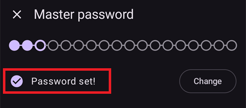
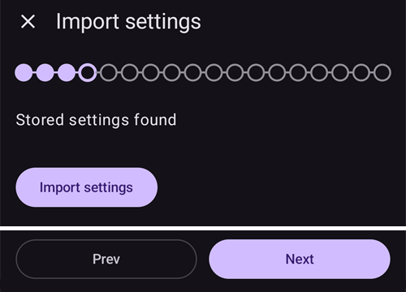
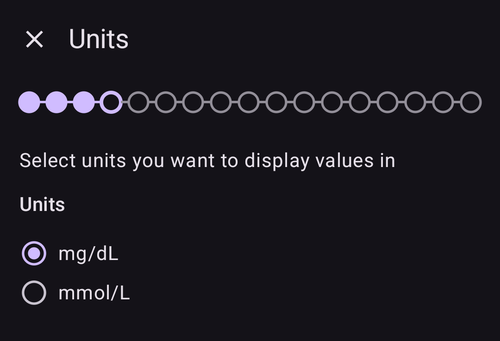
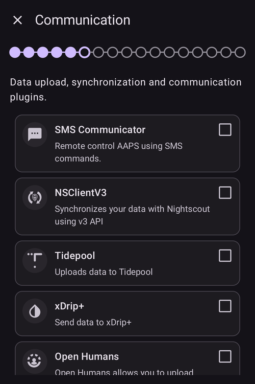
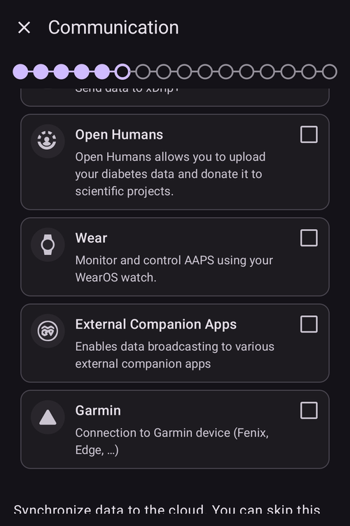

# AAPS 설정 마법사

```{contents} In this page
:backlinks: entry
:depth: 2
```

**AAPS**를 처음 시작하면 "**설정 마법사**"가 안내합니다. 이 마법사로 앱의 기본 구성을 한 번에 빠르게 설정할 수 있습니다. **설정 마법사**는 중요한 것을 잊지 않도록 순서대로 안내합니다. 예를 들어 **권한 설정**은 **AAPS**를 올바르게 설정하는 데 꼭 필요합니다.

하지만 **설정 마법사**를 처음 실행할 때 모든 것을 완전히 구성할 필요는 없습니다. 마법사를 쉽게 나갔다가 나중에 다시 돌아올 수 있습니다. **설정 마법사** 이후에 구성을 더 최적화하거나 변경하는 방법은 세 가지가 있습니다. 이 내용은 다음 섹션에서 설명합니다. 따라서 설정 마법사에서 일부 항목을 건너뛰어도 괜찮습니다. 나중에 쉽게 설정할 수 있습니다.

**설정 마법사**를 사용하는 동안과 사용한 직후에는 **AAPS**에서 눈에 띄는 큰 변화를 느끼지 못할 수 있습니다. **AAPS** 루프를 활성화하려면 **목표**를 따라 기능을 하나씩 활성화해야 합니다. 설정 마법사의 마지막에 **목표 1**을 시작합니다. **AAPS**의 주인은 여러분입니다. 그 반대가 아닙니다.

```{admonition} Preview Objectives
:class: note
목표의 구조를 알고 싶다면 [목표 완료하기](../SettingUpAaps/CompletingTheObjectives.md)를 읽으십시오. 그런 다음 여기로 돌아와 먼저 설정 마법사를 실행하십시오.

```

경험상 처음 시작하는 사람들은 **AAPS**를 가능한 한 빨리 설정하려고 스스로에게 부담을 주는 경우가 많습니다. 배울 것이 많기 때문에 이것은 좌절로 이어질 수 있습니다.

그러니 루프를 구성할 때 충분히 시간을 들이십시오. 잘 작동하는 **AAPS** 루프의 이점은 매우 큽니다.

```{admonition} Ask for Help
:class: note
문서에 오류가 있거나 더 좋은 설명 방법이 떠오르면 [다른 사용자와 소통하기](../GettingHelp/WhereCanIGetHelp.md)에 설명된 대로 커뮤니티에 도움을 요청할 수 있습니다.
```
## 환영 메시지

설정 마법사가 열리면 짧은 환영 메시지가 표시되고, 바로 화면 아래쪽에 "**권한 필요**" 패널이 나타납니다(다음 섹션 참조).

권한을 허용하면 패널이 닫히고 환영 화면에 "**다음**" 버튼이 표시됩니다. "**다음**"을 눌러 계속하십시오:


## 필요한 권한

**AAPS**가 올바르게 작동하려면 몇 가지 권한이 필요합니다. 마법사는 이 권한들을 하나의 "**권한 필요**" 패널에 모아 보여 주며, 각 항목에는 "**허용**" 버튼이 있습니다. 권한을 하나씩 허용하십시오. 완료된 항목 옆의 아이콘은 체크 표시로 바뀝니다.


### 배터리 최적화

스마트폰의 배터리 성능은 아직 꽤 제한적이므로 배터리 소모를 고려해야 합니다. 그래서 스마트폰의 Android 운영 체제는 앱이 실행되어 CPU 시간과 배터리 전력을 쓰는 것을 엄격하게 제한합니다.

하지만 **AAPS**는 정기적으로 실행되어야 합니다. _예를 들어_ 몇 분마다 혈당 값을 받고, 여러분이 정한 설정에 따라 알고리즘을 적용하여 혈당 수준에 어떻게 대응할지 결정해야 합니다. 그러므로 AAPS는 배터리 최적화에서 제외되어야 합니다.

"**배터리 최적화**" 옆의 "**허용**"을 누른 다음, "Let app always run in background?"(앱이 항상 백그라운드에서 실행되도록 하시겠습니까?) 대화 상자에서 "**Allow**"(허용)를 선택하십시오:


(SetupWizard-StoragePermission)=

### AAPS 디렉터리

**AAPS**는 설정과 로그 정보를 스마트폰의 영구 저장소에 저장해야 합니다. 영구 저장소란 스마트폰을 다시 시작한 후에도 데이터가 남아 있다는 뜻입니다. 다른 정보는 영구 저장소에 저장되지 않으므로 그냥 사라집니다.

"**AAPS 디렉터리**" 옆의 "**허용**"을 누르십시오. 그러면 휴대폰의 파일 시스템이 열리고 **AAPS**가 정보를 저장할 위치를 선택할 수 있습니다.

```{tip}
기본 AAPS 디렉터리를 선택하는 것을 권장합니다.</br>
AAPS의 하위 디렉터리는 **선택하지 마십시오**.
```

기본 디렉터리는 **AAPS**이지만, 원하는 전용 디렉터리를 사용해도 됩니다. 필요하면 디렉터리를 만들고, 그 디렉터리로 들어가서 "**USE THIS FOLDER**"(이 폴더 사용)를 선택하십시오:


선택한 디렉터리에 대한 접근 권한을 **AAPS**에 주려면 "**ALLOW**"(허용)로 확인하십시오:


### Notifications

Android에서는 앱이 알림을 보내려면 특별한 권한이 필요합니다.

소셜 미디어 앱 _등_의 알림을 끄는 것은 좋은 기능이지만, **AAPS**가 알림을 보낼 수 있도록 허용하는 것은 꼭 필요합니다.

"**알림**" 옆의 "**허용**"을 누르고, 시스템 요청 창에서 "**Allow**"(허용)를 선택하십시오:


### 알람 및 리마인더

**Android 14 이상**에서는 **AAPS**에 "**알람 및 리마인더**" 권한이 필요합니다. 이 권한이 있어야 **AAPS**가 백그라운드에 있을 때도 알람이 화면을 켤 수 있고, 리마인더(예: **자동화**에서 보낸 리마인더)가 제시간에 울립니다.

이 항목은 필요할 때만 표시됩니다. **AAPS**가 배터리 최적화에서 제외되면(위 참조) Android가 정확한 알람을 자동으로 허용하고 이 항목은 사라집니다. 아직 목록에 있다면 "**알람 및 리마인더**" 옆의 "**허용**"을 누르십시오. 그러면 **AAPS**의 시스템 설정 화면이 열립니다. 스위치를 켜고 **AAPS**로 돌아오십시오. Android 13 이하에서는 이 항목이 나타나지 않으며 아무것도 할 필요가 없습니다.

모든 권한에 체크 표시가 나타나면(세 개, Android 14 이상에서는 네 개) "**권한 필요**" 패널이 자동으로 닫힙니다. 그러면 환영 화면에서 "**다음**"을 눌러 계속할 수 있습니다.

(setup-wizard-bluetooth-battery-optimisation)=
### 블루투스 배터리 최적화

```{admonition} Extra Android setting, not part of the Wizard
:class: note
다음은 설정 마법사 밖에서 하는 추가 Android 구성입니다. 위의 "허용" 버튼 중 하나는 아니지만, 안정적인 펌프 연결을 위해 중요합니다.
```

최신 Android 버전은 시스템 블루투스 앱에도 배터리 최적화를 적용합니다.

**AAPS**의 배터리 최적화를 끄는 것과 함께, 블루투스 시스템 앱의 배터리 최적화도 꺼야 할 가능성이 큽니다. 이 작업을 하지 않으면 펌프 연결이 끊기거나 문제가 생길 수 있습니다.

***참고: xDrip 문서에 이 방법이 설명되어 있습니다: [xDrip 문서](https://navid200.github.io/xDrip/docs/BluetoothBatteryOpt.html)***

Android 16에서는 다음 단계를 따르십시오. 다른 버전에서는 제공된 화면과 조금 다를 수 있습니다:

1. Android 설정을 열고 **Apps**(애플리케이션)를 검색한 다음 앱 설정을 여십시오.

   

2. 앱 설정이 보이지만 모든 앱을 보려면 목록을 펼쳐야 합니다. **See all apps**(모든 앱 보기)를 눌러 펼치십시오.

   

3. 블루투스 앱은 시스템 앱이므로 기본적으로 숨겨져 있습니다. 그래서 시스템 앱이 보이도록 해야 합니다. 오른쪽 위의 **점 세 개**(⋮)를 누르십시오(1). 그런 다음 **Show system**(시스템 표시)을 누르십시오(2).

   

4. `Bluetooth`(블루투스) 앱을 검색하여 `Bluetooth` 및/또는 `Legacy Bluetooth`(레거시 블루투스)를 누르십시오. 둘 다 있으면 두 앱 모두에 이 절차를 따르십시오.

   ***참고: `Bluetooth MIDI Service`(블루투스 MIDI 서비스)는 AAPS가 사용하지 않으므로 무시해도 안전합니다.***

           

   1. Android 12에서는 `Battery`(배터리)를, Android 13 이상에서는 `App battery usage`(앱 배터리 사용량)를 누르십시오.

      

5. Android 12 이상에서는 `Unrestricted`(제한 없음) 옵션을 선택하십시오. Android 15 이상에서는 `Allow background usage`(백그라운드 사용 허용) 설정을 펼쳐야 합니다. 빨간색으로 표시된 부분을 눌러 펼친 다음 6단계를 따라 마치십시오.

       

6. Android 16에서는 `Unrestricted`(제한 없음)를 선택하십시오.

   

## 라이선스 계약

최종 사용자 라이선스 계약에는 **AAPS** 사용의 법적 측면에 관한 중요한 정보가 있습니다. 주의 깊게 읽으십시오.

최종 사용자 라이선스 계약을 이해하지 못하거나 동의할 수 없다면 **AAPS**를 절대 사용하지 마십시오!

이해하고 동의한다면 "**모두 이해하였고 동의합니다.**" 버튼을 누르고 설정 마법사를 따르십시오:


동의하면 "**다음**" 버튼이 나타납니다. "**다음**"을 누르십시오.

다음 화면인 "**권한**"에 권한 목록이 다시 표시됩니다. 처음에 이미 허용했으므로 모든 항목에 체크 표시가 있어야 합니다. 빠진 항목이 있으면 그 옆의 "**허용**"을 누르십시오. "**다음**"을 눌러 계속하십시오:


## Master password

**AAPS**의 구성에는 민감한 데이터(_예:_ Nightscout 서버의 액세스 토큰)가 들어 있으므로, 여기에서 설정하는 비밀번호로 암호화됩니다.

마법사에 "**비밀번호가 설정되지 않았습니다.**"가 표시됩니다. "**설정**"을 누르십시오:


그러면 "**보안**" 화면이 열립니다. "**마스터 비밀번호**"("비밀번호가 설정되지 않았습니다."로 표시됨)를 누르십시오:


두 입력란에 같은 비밀번호를 입력하고 "**확인**"을 누르십시오:


왼쪽 위의 화살표를 눌러 돌아가십시오. 이제 마법사에 "**비밀번호가 설정되었습니다!**"가 표시됩니다:



```{admonition} Do not lose your Master Password
:class: danger
**마스터 비밀번호를 절대 잃어버리지 마십시오**. 비밀번호를 _예를 들어_ Google Drive에 적어 두십시오. Google Drive는 Google이 백업해 주므로 좋은 장소입니다. 스마트폰이나 PC가 고장 나면 실제 사본이 하나도 없을 수 있습니다. 마스터 비밀번호를 잊어버리면 나중에 프로파일 구성과 **목표** 진행 상황을 복구하기 어려울 수 있습니다. See [How to reset the master password?](#FAQ-reset-master-password)
```

다 되면 "**다음**"을 눌러 다음 화면으로 가십시오.

(setup-wizard-import-settings)=
## 설정 가져오기

이 화면은 **AAPS**가 **AAPS** 디렉터리에서 이전에 내보낸 설정을 찾았을 때만 표시됩니다("저장된 설정이 있습니다."). 예를 들어 앱을 다시 설치하거나 새 휴대폰으로 옮길 때입니다.

- 이전 구성을 복원하려면 "**설정 가져오기**"를 누르십시오. [백업 만들기와 복원하기](../Maintenance/ExportImportSettings.md)를 참조하십시오.
- 새 구성으로 시작하려면 "**다음**"을 누르고 마법사를 계속하십시오.



## 단위 (mg/dL <-> mmol/L)

혈당 값의 단위가 mg/dL인지 mmol/L인지 선택한 다음 "**다음**" 버튼을 누르십시오:



## 화면 설정

여기에서 센서 혈당 표시에 사용할 "**저혈당 선**"과 "**고혈당 선**"을 설정합니다. 이 두 선 사이의 혈당 값은 "범위 내"로 표시됩니다. 지금은 기본값(72와 180 mg/dL)을 그대로 두고 나중에 바꿀 수 있습니다.

선택한 값은 그래프 표시에만 영향을 주며, 다른 것에는 영향을 주지 않습니다.

_예를 들어_ 혈당 목표는 프로파일에서 따로 설정합니다.

TIR(범위 내 시간)을 분석하는 범위는 리포팅 서버에서 따로 설정합니다.

필요하면 "−" / "+" 버튼으로 선을 조정한 다음 "**다음**" 버튼을 누르십시오:


(SetupWizard-synchronization-with-the-reporting-server-and-more)=
## 통신

"**통신**" 화면에는 데이터를 업로드하고, 동기화하고, 브로드캐스트하는 데 쓰는 플러그인이 나열됩니다:

- **SMS 통신기** – SMS 명령으로 **AAPS**를 원격 제어
- **NSClientV3** – v3 API를 사용하여 데이터를 Nightscout와 동기화
- **Tidepool** – 데이터를 Tidepool에 업로드
- **xDrip** – 데이터를 xDrip으로 보냄
- **Open Humans** – 당뇨 데이터를 업로드하여 과학 연구 프로젝트에 기증
- **워치** – WearOS 워치에서 **AAPS**를 모니터링하고 제어
- **외부 연동 앱** – 여러 외부 앱으로 데이터 브로드캐스트
- **Garmin** – Garmin 기기와 연결



아래로 스크롤하면 목록의 나머지가 표시됩니다:



이 중 여러 개를 지금 구성할 수도 있지만, 처음 실행할 때는 리포팅 서버만 다루겠습니다. 지금 설정할 수 없다면 일단 건너뛰십시오. 나중에 구성할 수 있습니다.

이 예에서는 Nightscout를 리포팅 서버로 사용합니다. "**NSClientV3**" 오른쪽의 상자를 체크하여 활성화하십시오. Tidepool은 개인 로그인 정보만 있으면 되므로 더 간단합니다.

활성화한 후 NSClientV3 아래의 "**설정**"을 눌러 구성하십시오:


여기에서 Nightscout 리포팅 서버를 구성합니다. NSClientV3 설정은 스크롤할 수 있는 한 페이지로 표시됩니다:


"**Nightscout URL**"을 누르고 개인 Nightscout 서버 주소(직접 설정했거나 서비스 업체에서 받은 URL)를 입력하십시오. "**확인**"으로 확인하십시오.

"**Nightscout 액세스 토큰**"을 누르고 Nightscout 서버의 액세스 토큰을 입력하십시오. 이 토큰이 없으면 접근할 수 없습니다. 아직 토큰이 없다면 리포팅 서버 설정 문서를 확인하십시오.

Leave "**Use websockets**" enabled for real-time communication with Nightscout. Websockets are **mandatory** for remote control from **AAPSClient**, on both phones.

나머지 섹션은 지금은 기본값으로 두어도 됩니다. 나중에 어디에서 찾을 수 있는지 알 수 있도록 여기에서 설명합니다:

**알람 옵션** — Nightscout 알람, 공지, 오래된 데이터 기준값. 지금은 스위치를 꺼 두십시오. 이런 옵션이 있다는 것을 알 수 있도록 열어 보기만 합니다.

**연결 설정** — 데이터를 어떻게 전송할지 선택합니다. 보호자는 "**모바일 데이터 사용**"을 반드시 켜야 합니다. 그렇지 않으면 돌보는 사람(_예:_ 아이)의 휴대폰이 Wi-Fi 범위 밖에서, _예를 들어_ 학교에 가는 길에 업로드할 수 없습니다. 다른 사용자는 데이터나 배터리를 아끼기 위해 모바일 데이터 전송을 끌 수 있습니다. 잘 모르겠다면 모두 켜 두십시오.


**고급 설정** — 앱이 다시 시작될 때 Nightscout에서 보고 싶다면 "**앱 시작 이벤트 기록**"을 켜십시오(보호자에게 유용합니다). "**오류로 공지 생성**"과 "**필요 탄수화물로 공지 생성**"은 켜 두십시오. "**느린 동기화 사용**"은 꺼 두십시오. Nightscout 서버가 많은 데이터를 처리하는 데 느릴 때만 사용합니다.


플러그인 목록으로 돌아가 "**다음**"을 눌러 다음 화면으로 가십시오.

## 클라이언트 제어

**AAPS** 버전 4부터 **AAPSClient**를 실행하는 클라이언트 기기를 이 휴대폰(**마스터**)과 **페어링**하여, Nightscout를 통해 보내는 서명된 명령으로 이 휴대폰을 제어할 수 있습니다. 이것이 **AAPS**를 원격으로 제어하는 새로운 권장 방법입니다. 자세한 설명과 설정은 [마스터 ↔ 클라이언트 제어](../RemoteFeatures/ClientMasterControl.md)를 참조하십시오.

지금 이 화면에서 구성할 것은 없습니다. 나중에 언제든지 **관리 → 허가된 클라이언트**에서 클라이언트를 페어링할 수 있습니다. 그곳에서 **QR 코드**(클라이언트의 Nightscout도 함께 설정됨) 또는 **PIN**으로 클라이언트를 추가하고 **역할**을 지정합니다.

- "**허가된 클라이언트**" — 이 마스터를 제어할 수 있는 페어링된 클라이언트 기기를 관리합니다.
- "**Nightscout 데이터 수신**" — Nightscout에 직접 입력한 처치와 데이터를 받는 기능(예전의 보안이 낮은 방법)은 이제 기본으로 꺼져 있습니다. _예를 들어_ Nightscout나 타사 앱으로 데이터를 입력해야 하는 등, 아직 이 기능이 필요한 경우에만 이 설정을 여십시오.

클라이언트 제어가 이미 켜져 있으면([간단 모드](#preferences-simple-mode)에서는 항상 켜짐) 이 휴대폰은 [강화 모드](#client-master-control-hardened-mode)입니다. 이 모드에서는 페어링된 클라이언트의 변경만 받으므로, 화면에 "**Nightscout 데이터 수신**" 설정 대신 강화 모드에 대한 설명이 표시됩니다.


"**Nightscout 데이터 수신**"을 누르면 "**동기화**" 설정이 열립니다. 여기에서는 Nightscout에서 받는 데이터 종류마다 스위치가 있습니다:


"**다음**"을 눌러 다음 화면으로 가십시오.

(setup-wizard-instance-name)=
## 이 휴대폰은 누가 사용합니까?

여기에 이 휴대폰을 사용하는 사람의 이름을 입력합니다. 이 이름으로 리포트와 동기화에서 이 **AAPS** 인스턴스를 다른 인스턴스와 구별합니다. 예를 들어 가족 중 두 아이가 **AAPS**를 사용하는 경우입니다. 이 이름은 내보낸 설정 파일의 이름에도 쓰이고 워치에도 표시됩니다.

아무것이나 사용해도 됩니다. 나중에 **설정 → 일반 → 인스턴스 이름**에서 바꿀 수 있습니다.

"**다음**"을 눌러 다음 화면으로 가십시오.


## Patient type

여기에서 "환자 유형"을 선택합니다. **AAPS** 소프트웨어는 환자의 나이에 따라 다른 제한을 사용하므로 이 선택은 중요합니다. 이것은 보안과 안전을 위해 중요합니다.

여기에서 식사에 대한 **최대 허용 볼러스**도 설정합니다. 즉, 평소 식사를 처리하는 데 필요한 가장 큰 볼러스입니다. 이것은 식사 볼러스를 할 때 실수로 과다 주입하는 것을 막는 데 도움이 되는 안전 기능입니다.

두 번째 제한도 개념은 비슷하지만, 예상되는 최대 탄수화물 섭취량에 관한 것입니다.

이 값들을 설정한 후 "**다음**"을 눌러 다음 화면으로 가십시오:


## 인슐린

여기에서 펌프에 사용하는 인슐린을 구성합니다. 새 인슐린 프로파일에는 **최소 5시간의 DIA**가 필요합니다.

"**인슐린**" 버튼을 눌러 인슐린 편집기를 여십시오:


편집기에서 인슐린에 **별명**을 붙이고, **피크**(분 단위)와 **DIA**(시간 단위)를 설정할 수 있습니다. 가장 빠른 방법은 "**피크 불러오기**"로 미리 설정된 값을 불러오는 것입니다. **Novorapid**, **Fiasp** 또는 **Lyumjev**를 선택하면 피크가 자동으로 채워집니다. 아래쪽 그래프는 그 결과로 나오는 인슐린 활동 곡선을 미리 보여 줍니다.


사용하는 인슐린에 맞는 미리 설정된 값을 선택하십시오. 예: **Fiasp**:


```{admonition} Use your insulin brand's preset peak
:class: danger
전문가가 아니라면 피크를 바꾸지 마십시오. 보통 각 인슐린 제품의 미리 설정된 값이 잘 맞습니다.
```

**AAPS**를 처음 사용한다면 **DIA**를 9시간으로 설정하십시오. 이유는 [인슐린 작용 시간(DIA)과 피크](#Config-Builder-insulin-dia)를 참조하십시오.

```{admonition} "Insulin configuration changed" dialog
:class: note
페어링된 클라이언트(_예:_ 다른 휴대폰)가 인슐린 구성을 변경했다면 대화 상자가 나타납니다. **확인**을 누르면 그 변경 사항을 불러오고, **취소**를 누르면 편집을 계속합니다(다음에 저장하면 클라이언트의 변경 사항을 덮어씁니다).
```


저장 아이콘(오른쪽 위)을 누른 다음 "**다음**"을 눌러 다음 화면으로 가십시오.

## 혈당 출처

여기에서 **AAPS**가 혈당 데이터를 어디에서 받을지 선택합니다. 사용하는 [혈당 출처](../Getting-Started/CompatiblesCgms.md)의 문서를 읽으십시오.

여러 출처를 사용할 수 있습니다. 목록을 스크롤하여 사용하는 출처를 선택하십시오:


출처를 선택하면 카드가 펼쳐지고 버튼 두 개가 표시됩니다. 데이터를 받는 방법을 조정하는 "**설정**"과 출처 자체의 화면을 여는 "**플러그인 열기**"입니다. 아래 예에서는 **BYODA**가 선택되어 있습니다. 어떤 출처는 이 단계에서 구성할 것이 없으므로, 보통 바로 다음 화면으로 갈 수 있습니다:


선택한 후 "**다음**"을 눌러 다음 화면으로 가십시오.

(setup-wizard-profile)=
## Profile

이제 설정 마법사에서 매우 중요한 부분으로 들어갑니다.

다음 화면에서 프로파일 정보를 입력하기 전에 [프로파일](../SettingUpAaps/YourAapsProfile.md)에 관한 문서를 읽으십시오.

```{admonition} Working profile required - no exceptions here !
:class: danger
**AAPS**가 안전하게 작동하도록 제어하려면 정확한 프로파일이 필요합니다.

프로파일은 반드시 의사와 함께 정하고 상의해야 하며, 기저 주입량, ISF, IC 테스트를 통해 제대로 작동하는 것이 확인되어야 합니다!

로봇은 잘못된 입력을 받으면 실패합니다. 매번 그렇습니다. **AAPS**는 주어진 정보로만 작동할 수 있습니다. 프로파일이 너무 강하면 저혈당 위험이 있고, 너무 약하면 고혈당 위험이 있습니다. 
```

"**프로파일**" 버튼을 눌러 프로파일 편집기를 여십시오:


편집기는 빈 상태로 열립니다("사용 가능한 기록 없음"). 아래쪽의 "**+**" 버튼을 눌러 새 프로파일을 만드십시오:


필요하면 나중에 여러 프로파일을 둘 수 있습니다. 여기서는 하나만 만듭니다.

```{admonition} Profile only for tutorial - not for your usage
:class: note
여기의 예시 프로파일은 데이터를 입력하는 방법을 보여 주기 위한 것일 뿐입니다.

사람마다 필요한 것이 매우 다르므로, 정확한 프로파일이나 잘 최적화된 프로파일로 쓰려는 것이 아닙니다.

실제 루프에는 사용하지 마십시오!
```

새 프로파일(예: "**LocalProfile1**")에는 탭이 네 개 있습니다: **IC**, **ISF**, **BAS**, **TARG**. 프로파일 이름 옆의 연필을 눌러 이름을 바꾸십시오. 모든 탭을 채우십시오. 올바른 값이 들어갈 때까지 탭은 빨간색으로 남고 오류 메시지가 표시됩니다:


"**IC**"를 누르고 [IC](#your-aaps-profile-insulin-to-carbs-ratio) 값을 입력하십시오. "**+**" 버튼으로 시간대를 더 추가하십시오:


"**ISF**"를 누르고 [ISF 값](#your-aaps-profile-insulin-sensitivity-factor)을 입력하십시오:


"**BAS**"를 누르고 [기저 값](#your-aaps-profile-basal-rates)을 입력하십시오:


"**TARG**"를 누르고 혈당 목표 값을 입력하십시오.

개방 루프에서는 이 목표를 더 넓은 범위로 설정해도 됩니다. 그렇지 않으면 **AAPS**가 임시 기저 주입량이나 다른 설정을 바꾸라고 계속 알려서 매우 피곤할 수 있습니다.

나중에 폐쇄 루프를 사용할 때는 보통 상한과 하한에 같은 값 하나만 사용합니다. 그러면 **AAPS**가 목표에 더 쉽게 도달하고 전체적으로 더 좋은 당뇨 관리를 할 수 있습니다.


네 탭이 모두 올바르면 **저장 아이콘**(오른쪽 위)이 활성화됩니다. 저장 아이콘을 눌러 프로파일을 저장하십시오:


왼쪽 위의 "**X**"를 눌러 편집기를 닫으십시오. 그러면 프로파일 요약에 이름, 하루 총 기저량(∑), 단위, IC와 ISF 값이 그래프와 함께 표시됩니다:


```{admonition} Several defined but only one active profile
:class: note
프로파일을 여러 개 정의할 수 있지만, 한 번에 실행되는 활성 프로파일은 하나뿐입니다.
```

오른쪽 아래의 "**▶**"(활성화) 버튼을 누르십시오. "**활성화**" 화면이 열립니다. 아직 사용 중인 인슐린이 없으므로, 먼저 사용하는 인슐린을 선택하라고 요청합니다. 그래야 프로파일 전환에 인슐린이 기록됩니다. 인슐린을 선택할 때까지 "**활성화**" 버튼은 회색으로 비활성화되어 있습니다:


"**인슐린 선택**"을 누르고 앞에서 구성한 인슐린을 선택하십시오. 퍼센트는 100%로 두고 "**활성화**"를 누르십시오:


프로파일 전환 대화 상자가 나타납니다. 이 경우 미리 설정된 그대로 두고 "**확인**"으로 확인하십시오:

```{admonition} Profile switch dialog
:class: note
질병이나 운동처럼 상황에 맞게 프로파일을 바꿔야 할 때 이 일반 대화 상자를 사용하는 방법은 나중에 배우게 됩니다.
```


이제 프로파일이 활성화되었습니다. "**다음**"을 눌러 다음 화면으로 가십시오.

## Insulin pump

이제 인슐린 펌프를 선택합니다. 사용하는 [인슐린 펌프](../Getting-Started/CompatiblePumps.md)의 문서를 읽으십시오.

목록을 스크롤하여 펌프를 선택하십시오. 이 예에서는 "**가상 펌프**"를 사용합니다. 아직 배우는 중이고 실제 펌프를 연결하지 않았을 때 유용합니다:


많은 펌프가 지원됩니다. 아래로 스크롤하여 사용하는 펌프를 찾으십시오:


실제 펌프를 선택하면 **AAPS**가 확인을 요청합니다. 프로파일의 기저 주입량을 펌프로 복사하여 펌프에 저장된 기저 주입량을 덮어쓰기 때문입니다. **AAPS** 프로파일의 기저 주입량이 올바른 경우에만 "**확인**"을 누르십시오. 그렇지 않으면 "**취소**"를 누르고 나중에 펌프로 전환하십시오:


선택한 펌프가 Bluetooth로 통신하는 경우, 마법사를 마치면 **AAPS**가 근처 기기에 연결할 권한을 요청합니다([Bluetooth 권한](#setup-wizard-bluetooth-permission) 참조).

프로파일을 이미 설정했고 펌프 연결 방법을 알고 있다면 지금 펌프를 연결해도 됩니다. 그렇지 않으면 당분간 **가상 펌프**로 두십시오. 언제든지 바꿀 수 있습니다. 또는 왼쪽 위의 화살표로 설정 마법사를 나가서 **AAPS**가 먼저 혈당 값을 보여 주도록 해도 됩니다.

"**다음**"을 눌러 다음 화면으로 가십시오.

## APS algorithm

APS 알고리즘으로 OpenAPS SMB 알고리즘을 사용하십시오. 이름과 달리, 알고리즘의 SMB 기능은 여러분이 AAPS에 익숙해지고 처음 몇 개의 목표를 마칠 때까지 비활성화되어 있습니다. 어쨌든 OpenAPS SMB는 OpenAPS AMA보다 새롭고 일반적으로 더 좋습니다.

SMB 기능은 기저 주입량 비율을 높이는 대신 슈퍼 마이크로 볼러스를 사용하여 혈당 상승에 더 빨리 반응하므로, 처음에는 SMB가 비활성화되어 있습니다. 처음에는 보통 프로파일이 경험을 쌓은 후만큼 좋지 않으므로, 이 기능은 처음에 비활성화되어 있습니다.

```{admonition} Only use the older algorithm **OpenAPS AMA** if you know what you are doing
:class: note
OpenAPS AMA는 가장 기본적인 알고리즘이며, 높은 혈당을 교정하는 마이크로 볼러스를 지원하지 않습니다. 이 알고리즘을 사용하는 것이 더 나은 상황이 있을 수 있지만 권장하지는 않습니다.
```

"**OpenAPS SMB**"를 선택한 다음 "**설정**"을 눌러 세부 내용을 보십시오:


여기에 있는 옵션은 "**동적 민감도 사용**" 하나뿐입니다. 이 옵션은 꺼 두고 지금은 아무것도 바꾸지 마십시오. 설명만 읽으십시오.

**목표**에 의한 제한 때문에 어차피 지금은 "폐쇄 루프"도 "SMB 기능"도 사용할 수 없습니다.

돌아가서 "**다음**"을 눌러 다음 화면으로 가십시오:


## 민감도 감지

표준 민감도 플러그인으로 "**민감도 Oref1**"을 선택된 그대로 두십시오:


"**설정**"을 누르면 흡수 설정을 확인할 수 있습니다. 지금은 기본값(_예:_ 흡수 종료 시간 6시간)으로 충분합니다.


"**다음**"을 눌러 다음 화면으로 가십시오.

## 목표 1 시작하기

이제 목표에 들어갑니다. 목표는 **AAPS**의 다른 기능을 사용하기 위한 자격 과정입니다.

"**목표 열기**"를 누르십시오:


지금은 설정이 이 목표를 완료할 만큼 완전히 준비되지 않았더라도 여기서 목표 1을 시작합니다. 하지만 이것이 시작입니다.

**목표 1**의 "**시작**" 버튼을 누르십시오:


목표가 펼쳐지고 개별 확인 항목이 표시됩니다. 이미 일부 항목은 진행되었고, 다른 항목은 아직 해야 한다는 것을 볼 수 있습니다:


돌아가서 "**완료**"를 눌러 설정 마법사를 마치십시오:


"**완료**"를 누르면 **AAPS** 메인 화면으로 이동합니다. "**알림**" 패널이 열리고 안내 메시지가 표시될 수 있습니다. 예를 들어 방금 한 프로파일 전환에 관한 메시지입니다. 각 메시지 아래의 "**닫기**"를 눌러 지우십시오.

실수로 설정 마법사를 나갔다면 마법사를 다시 시작하거나, [AAPS 루프의 구성](../SettingUpAaps/ChangeAapsConfiguration.md)을 직접 변경할 수 있습니다.

(setup-wizard-bluetooth-permission)=
## Bluetooth permission

블루투스로 연결하는 펌프(예: **Omnipod Dash**)를 선택하면, **AAPS**에 블루투스 권한이 필요하다는 배너가 표시됩니다. 지금은 "**닫기**"를 눌러도 됩니다. 권한은 마법사를 마친 후에 허용합니다:


설정 마법사를 마치면 **AAPS** 메인 화면에 "**권한 필요**" 패널이 표시됩니다. 다른 권한은 이미 허용되어 있습니다. "**블루투스**" 옆의 "**허용**"을 누르십시오:


**AAPS**가 펌프를 찾아 연결할 수 있도록 "**Allow**"(허용)를 선택하십시오:


이제 **AAPS** 루프가 완전히 설정되었다면 다음 섹션 ["목표 완료하기"](../SettingUpAaps/CompletingTheObjectives.md)로 넘어가십시오.
