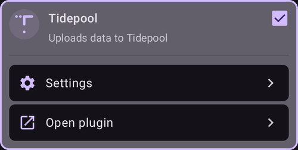
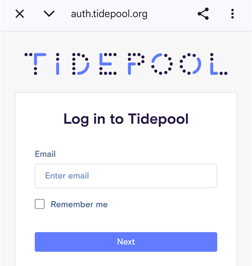
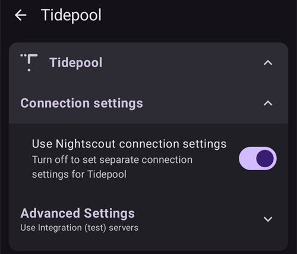

# Tidepool

Tidepool은 혈당, 인슐린, 탄수화물에 관한 데이터(그리고 처치에 추가한 노트)를 모으는 타사 도구이며, 이 데이터를 분석하고 의료진과 공유하는 데 사용할 수 있습니다. AAPS 버전 3.2부터는 목표 1의 일부를 충족하기 위해 Nightscout 대신 Tidepool을 사용할 수 있습니다. 또한 Nightscout와 함께 사용할 수 있는 대체 리포팅 플랫폼으로, 임상 환경과 잘 연동됩니다. 원격 모니터링과 Nightscout의 원격 제어 기능은 원하지만, 의료진이 더 익숙한 리포팅 플랫폼을 원하는 AAPS 사용 어린이에게 적합한 옵션일 수 있습니다.

Tidepool은 리포팅 전용이라는 점을 이해하는 것이 중요합니다. 실시간 팔로우 앱이 아닙니다. 메인 AAPS 휴대폰 외에 팔로워가 필요하다면 Nightscout도 함께 설정해야 합니다.

참고: Tidepool 단체는 iOS Loop 제품을 FDA 승인을 받아 출시했습니다. 이 작업은 Tidepool의 데이터 리포팅 플랫폼이나 AAPS와는 관계가 없습니다.

## 1단계 - Tidepool 계정 만들기

- [tidepool.org](https://www.tidepool.org/)로 이동하십시오.

- “Personal Sign Up”(개인 가입) 또는 “Sign Up”(가입)을 선택하십시오.

- 이메일과 비밀번호를 만들고 기록해 두십시오.

- “Personal Account”(개인 계정)를 선택하고 “Continue”(계속)를 누르십시오.

- 환자 정보 항목을 작성하고 이용 약관에 동의하십시오.

- 이메일로 받은 안내에 따라 이메일 주소를 인증하십시오.

## 2단계 - AAPS를 Tidepool에 연결하기

- 메인 화면 왼쪽 위의 **메뉴**(☰)를 열고 "**구성**"을 선택하십시오.

- "**통신**" 범주를 열고 "**Tidepool**"을 활성화하십시오:

- Tidepool 아래의 "**플러그인 열기**"를 누른 다음, 오른쪽 위의 **로그인** 아이콘(문으로 들어가는 화살표)을 누르십시오.

- 브라우저 창에 Tidepool 로그인 페이지가 열립니다. 위의 1단계에서 만든 이메일 주소와 비밀번호로 로그인하십시오:

- 로그인에 성공하면 브라우저가 닫히고 Tidepool 화면에 "**연결됨**" 상태가 표시됩니다. 그 아래의 로그에 데이터 업로드 기록이 남습니다. 로그인에 실패하면 계정 정보가 올바른지, 그리고 Tidepool에서 이메일 주소를 인증했는지 확인하십시오.

- Tidepool 플러그인의 "**설정**"에서 "**연결 설정**"을 여십시오. 기본으로 "**Nightscout 연결 설정 사용**"이 켜져 있으므로, Tidepool은 Nightscout에 설정한 것과 같은 조건에서 업로드합니다. Tidepool에 다른 조건을 쓰고 싶다면 이 옵션을 끄십시오. 예를 들어 Nightscout는 모바일 데이터도 사용하지만, Tidepool은 Wi-Fi에서 충전 중일 때만 업로드하게 할 수 있습니다.

 

데이터를 Tidepool에 업로드한 후 데이터를 활용하는 방법에 대한 도움말은 다음을 참조하십시오: [https://www.tidepool.org/viewing-your-data](https://www.tidepool.org/viewing-your-data)

(tidepool-menu)=
## Tidepool 버튼

Tidepool 화면의 오른쪽 위:

- **로그인** 또는 **로그아웃** 아이콘 — Tidepool 계정에 연결하거나 연결을 끊습니다. 둘 중 하나만 표시됩니다. 로그아웃 상태에서는 **로그인**, 로그인 상태에서는 **로그아웃**이 표시됩니다. **AAPS**는 로그아웃하기 전에 확인을 요청합니다.
- 톱니바퀴 아이콘 — Tidepool 설정.

Tidepool 화면 아래쪽의 버튼:

- "**지금 업로드**" — 다음 자동 업로드를 기다리지 않고 새 데이터를 바로 업로드합니다.
- "**전체 동기화**" — **AAPS**에 저장된 모든 데이터를 다시 업로드합니다.
- "**모든 데이터 삭제**" — **AAPS**가 Tidepool 계정에 업로드한 데이터를 **모두** 삭제합니다. 이 작업은 되돌릴 수 없습니다. 잘못되었거나 중복된 데이터를 지울 때만 사용하고, 그다음 "**전체 동기화**"를 실행하여 데이터를 다시 업로드하십시오.
- "**기록 지우기**" — Tidepool 화면에 표시된 로그를 비웁니다.

Tidepool에서는 **AAPS** 4가 업로드한 데이터가 기기 이름 **AAPS** 아래에 표시됩니다. 이전 버전에서 Tidepool을 사용했다면 [AAPS v4의 변경 사항](#v4changes-tidepool)을 참조하십시오. 
