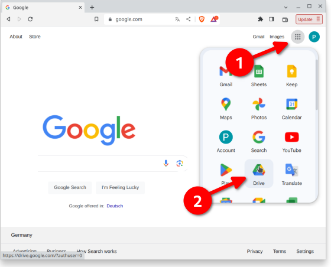
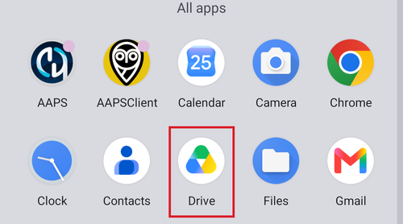
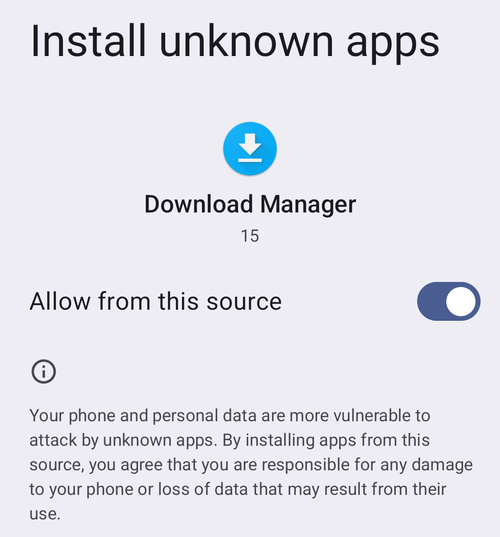

# AAPS를 스마트폰으로 옮기고 설치하기

이전 섹션 [**AAPS** 빌드](../SettingUpAaps/BuildingAaps.md)에서 컴퓨터로 **AAPS** 앱(.apk 파일)을 빌드했습니다.

다음 단계에서는 **AAPS** APK 파일(그리고 BYODA, xDrip 또는 다른 CGM 수신 앱처럼 필요한 다른 앱)을 Android 스마트폰으로 **옮기고**, 앱을 **설치**합니다. 스마트폰에 **AAPS**를 설치한 다음에는 [**AAPS 루프 구성**](../SettingUpAaps/SetupWizard.md)으로 넘어갈 수 있습니다.

이 페이지는 [Android 개발자 인증](#android-developer-verification)도 설명합니다. 이것은 Google이 2026년 9월부터 도입하는 변경으로, 직접 빌드한 앱의 설치에 영향을 줍니다. 또한 변경 후에도 계속 사용할 수 있는 [무료 설치 방법](#android-developer-verification-free-methods)도 설명합니다.

```{contents} Table of contents
:depth: 1
:local: true
```

## APK 파일을 눌러 AAPS 설치하기

현재는 APK 파일을 휴대폰으로 옮긴 다음 파일을 열어("눌러") **AAPS**를 설치합니다. **AAPS** APK 파일을 컴퓨터에서 스마트폰으로 옮기는 방법은 여러 가지가 있습니다. 여기서는 두 가지 방법을 설명합니다:

* 옵션 1 -  Google Drive(Gdrive) 사용하기
* 옵션 2 -  USB 케이블 사용하기

이메일로 옮기면 문제가 생길 수 있으므로 권장하지 않습니다.

```{admonition} Android developer verification
:class: warning
Google은 2026년 9월부터 [Android 개발자 인증](#android-developer-verification)을 도입합니다(브라질, 인도네시아, 싱가포르, 태국에서 먼저 시작하고, 2027년에 전 세계로 확대). 이것이 적용되는 곳에서는 아래 두 옵션에서 설명하는 것처럼 파일을 눌러 APK를 설치하는 방법이 차단됩니다. 이 경우에는 이 페이지 아래쪽의 [무료 설치 방법](#android-developer-verification-free-methods) 중 하나를 사용하십시오.
```

### 옵션 1. Google Drive로 파일 옮기기

웹 브라우저에서 [Google.com](https://www.google.com/)을 열고 Google 계정에 로그인하십시오.

오른쪽 위의 Google 메뉴에서 Drive 앱을 선택하십시오.



왼쪽 위의 **New**(새로 만들기)를 클릭하고(또는 파일과 폴더 아래의 빈 곳을 마우스 오른쪽 버튼으로 클릭하고) **File upload**(파일 업로드)를 선택하십시오.


이제 apk 파일이 Google Drive에 업로드되었을 것입니다.

#### Google Drive 앱으로 apk 파일을 실행하여 설치하기

휴대폰으로 가서 Google Drive 앱을 실행하십시오. 미리 설치된 앱이며, 다른 Google 앱이 있는 곳에서 찾거나 앱 이름으로 검색하여 찾을 수 있습니다.



휴대폰의 Google Drive 앱에서 파일 이름을 눌러 apk 설치를 시작하십시오.


지금은 Google Drive에서 앱을 설치할 수 없다는 보안 알림이 나오면 "Settings"(설정)를 누르고 그 짧은 시간 동안만 허용하십시오. 설치 후에는 다시 허용하지 않도록 설정하십시오. 항상 켜 두면 보안 위험이 있습니다.


설치가 끝나면 이 단계는 완료입니다.

**AAPS** 아이콘이 보이고 앱을 열 수 있어야 합니다.

```{warning}
**중요한 안전 알림**
Google Drive에서 설치를 허용한 설정을 다시 끄셨습니까?
```

이제 [AAPS 루프 구성](../SettingUpAaps/SetupWizard.md)을 계속하십시오.

### 옵션 2. USB 케이블로 파일 옮기기

AAPS apk 파일을 옮기는 두 번째 방법은 [USB 케이블](https://support.google.com/android/answer/9064445?hl=en)을 사용하는 것입니다.

컴퓨터에 있는 파일을 휴대폰의 "downloads"(다운로드) 폴더로 옮기십시오.

휴대폰에서 알 수 없는 출처의 설치를 허용해야 합니다. 방법은 인터넷에서 찾을 수 있습니다(_예:_ [여기](https://www.expressvpn.com/de/support/vpn-setup/enable-apk-installs-android/) 또는 [여기](https://www.androidcentral.com/unknown-sources)).

파일을 끌어다 놓아 옮긴 후, 휴대폰에서 "Downloads"(다운로드) 폴더를 열고 AAPS apk 파일을 누르십시오:


처음에는 Android가 이 휴대폰에서 이 출처의 알 수 없는 앱을 설치할 수 없다고 알립니다. "**Settings**"(설정)를 누르십시오:


"**Allow from this source**"(이 출처 허용)를 켜고 뒤로 가십시오:



apk 파일을 다시 누르고 "**Install**"(설치)을 선택하십시오:


설치가 끝나면 "**Open**"(열기)을 눌러 **AAPS**를 시작하거나, 나중에 열려면 "**Done**"(완료)을 누르십시오:


```{warning}
**중요한 안전 알림**
설치 후에는 "Allow from this source"(이 출처 허용)를 다시 끄십시오. 항상 켜 두면 보안 위험이 있습니다.
```

이제 [AAPS 루프 구성](../SettingUpAaps/SetupWizard.md)을 계속하십시오.

(transferring-installing-play-protect-warning)=
## Google Play Protect 경고

**AAPS**를 설치할 때 Google Play Protect가 이 앱이 안전하지 않고, 이전 Android 버전용으로 빌드되었으며, 최신 개인정보 보호 기능이 없다고 경고할 수 있습니다.


직접 빌드한 앱에서는 예상되는 일입니다. **More details**(세부정보 더보기)를 누른 다음 **Install anyway**(무시하고 설치)를 누르십시오.

설치가 (경고만 나오는 것이 아니라) 인증되지 않은 개발자에 대한 메시지와 함께 **차단**되면 아래의 [Android 개발자 인증](#android-developer-verification)을 참조하십시오.

(android-developer-verification)=

## Android 개발자 인증

Google은 **Android 개발자 인증**을 도입하고 있습니다. 대부분의 Android 휴대폰에서는 인증된 개발자가 Google에 등록한 앱만 설치됩니다. 이것은 APK 파일로 설치하는 앱("사이드로딩")에도 적용됩니다. 직접 빌드한 **AAPS** 앱도 이 방법으로 설치합니다.

### 무엇이 바뀝니까

Google 서비스가 있는 휴대폰("인증된" Android 기기 — Play 스토어와 함께 판매되는 거의 모든 휴대폰)에 **AAPS**를 설치하면, Android는 앱이 Google에 등록된 개발자의 앱인지 확인합니다. 등록되지 않은 경우, APK 파일을 눌러 하는 일반 설치가 차단됩니다.

**확인은 앱을 설치하거나 업데이트할 때 이루어집니다.** 이미 설치되어 실행 중인 앱은 삭제되지 않습니다.

Google은 이것을 단계적으로 도입하고 있습니다:

| 시기           | 내용                                                                      |
| ------------ | ----------------------------------------------------------------------- |
| 2026년 8월     | 무료 "제한 배포" 개발자 계정이 전 세계에 열리고, "고급 절차(advanced flow)"가 휴대폰에 배포되기 시작합니다   |
| 2026년 9월 30일 | **브라질, 인도네시아, 싱가포르, 태국**에서 Google Play와 일부 다른 앱 스토어에서 설치하는 앱에 인증이 적용됩니다 |
| 2027년        | 적용 범위가 **나머지 전 세계**와 APK 파일을 포함한 **모든 설치**로 확대됩니다                       |

자세한 내용은 Google의 [Android 개발자 인증](https://developer.android.com/developer-verification) 페이지에 있으며, [FAQ](https://developer.android.com/developer-verification/guides/faq)도 있습니다. Google은 날짜와 세부 내용을 아직 바꿀 수 있습니다. 이 페이지는 도입이 진행되는 대로 업데이트됩니다.

### 나에게 영향이 있습니까?

- **AAPS 빌드에는 전혀 영향이 없습니다.** [브라우저 빌드](#browser-build), [Android Studio 빌드](ComputerBuild.md), [명령줄(CLI) 빌드](CLIBuild.md)는 이전과 똑같이 작동하며, 키 저장소도 바뀌지 않습니다.
- **현재 AAPS는 계속 실행됩니다.** 인증은 앱을 설치하거나 업데이트할 때만 확인합니다.
- **브라질, 인도네시아, 싱가포르 또는 태국에 사는 경우:** 2026년 9월 30일부터 Google Play와 일부 다른 앱 스토어에서 설치하는 앱에 인증이 적용됩니다. Google에 따르면 APK 파일을 직접 설치하는 것은 이 첫 단계에 포함되지 않으므로 **AAPS**는 평소처럼 설치될 것입니다. 그래도 상황이 바뀌었을 때 당황하지 않도록 지금 아래의 [무료 설치 방법](#android-developer-verification-free-methods) 중 하나를 준비해 두십시오.
- **그 밖의 나라에 사는 경우:** 2027년 전에는 아무것도 바뀌지 않으며, 지금은 아무것도 하지 않는 것도 올바른 선택입니다. 하지만 아무 문제가 없을 때 아래의 [무료 설치 방법](#android-developer-verification-free-methods) 중 하나를 설정해 두십시오. 업데이트가 거부되는 날에야 차단을 알게 되고, 그때 [고급 절차](#android-developer-verification-advanced-flow)의 24시간 대기를 해야 한다면 너무 늦습니다.
- **오래된 휴대폰:** 인증은 Android 7 이상을 실행하는 휴대폰에 적용됩니다. 즉 **AAPS**를 실행할 수 있는 모든 휴대폰에 적용됩니다.

(android-developer-verification-free-methods)=

## AAPS를 설치하는 무료 방법

**AAPS**를 계속 사용하기 위해 Google에 돈을 낼 필요는 **없습니다**. 무료 방법이 여러 가지 있습니다. 자신의 상황에 맞는 방법을 고르십시오.

```{admonition} Which method should I use?
:class: tip
- **컴퓨터**가 있는 경우(**AAPS**를 어떤 방법으로 빌드했든): [ADB](#android-developer-verification-adb)를 사용하거나, 명령줄을 피하고 싶다면 [웹 설치 프로그램](#android-developer-verification-web)을 사용하십시오. 두 방법 모두 인증이 면제되고, 제한이 없으며, Google 계정이 필요 없습니다.
- **컴퓨터가 전혀 없는** 경우: 휴대폰에서 [고급 절차](#android-developer-verification-advanced-flow)를 사용하십시오.
- 일반 "APK 누르기" 설치가 계속 작동하도록 Google에 등록하고 싶은 경우: [무료 제한 배포 계정](#android-developer-verification-limited-account)이 있지만, **AAPS**로는 아직 테스트되지 않았습니다.
```

(android-developer-verification-adb)=

### 옵션 1: ADB로 설치하기(컴퓨터 필요)

ADB(Android Debug Bridge)는 USB 케이블로 컴퓨터에서 휴대폰에 앱을 설치하는 Google의 공식 도구입니다. Google은 **ADB로 설치한 앱은 인증이 필요 없다**고 확인했습니다. 대기 시간도, 기기 수 제한도, 등록도 없습니다.

처음 한 번만 하는 준비:

1. 휴대폰에서 숨겨진 개발자 옵션을 켜십시오: **Settings**(설정) > **About phone**(휴대전화 정보)(일부 휴대폰에서는 **Software information**(소프트웨어 정보))으로 가서, 휴대폰이 개발자가 되었다고 알려 줄 때까지 **Build number**(빌드 번호)를 일곱 번 누르십시오.
1. 기본 **Settings**(설정)로 돌아가서 새로 생긴 **Developer options**(개발자 옵션) 항목을 열고 **USB debugging**(USB 디버깅)을 켜십시오.
1. 컴퓨터에서 ADB를 사용할 수 있는지 확인하십시오:
   - **Android Studio**를 사용한다면 ADB는 이미 함께 설치되어 있습니다.
   - 그렇지 않으면 Google의 무료 [SDK Platform Tools](https://developer.android.com/tools/releases/platform-tools)를 다운로드하고 폴더의 압축을 푸십시오. 설치는 필요 없습니다. ADB는 그 폴더 안의 `adb` 프로그램입니다.

**AAPS** 설치(및 이후 업데이트):

1. USB 케이블로 휴대폰을 컴퓨터에 연결하십시오. APK 파일을 먼저 휴대폰으로 옮길 필요는 없습니다. ADB가 컴퓨터에서 바로 보냅니다.
1. 휴대폰에서 **Allow USB debugging?**(USB 디버깅을 허용하시겠습니까?) 확인 창을 허용하십시오(처음 한 번만).
1. 컴퓨터에서 ADB와 **AAPS** APK 파일이 있는 폴더에서 터미널(명령 프롬프트)을 열고 다음을 실행하십시오:

   ```
   adb install -r app-full-release.apk
   ```

   `app-full-release.apk`를 실제 APK 파일 이름으로 바꾸십시오. `-r` 옵션은 이미 설치된 **AAPS**의 모든 데이터와 설정을 유지하면서 업데이트합니다.

1. `Success`가 표시될 때까지 기다리십시오. 이제 휴대폰에 **AAPS**가 설치되었습니다.

앞으로 모든 업데이트에 같은 명령을 사용합니다. [Wear OS 페이지](../WearOS/WearOsSmartwatch.md)에서도 이미 같은 방법으로 ADB를 사용하여 워치 앱을 설치합니다.

케이블을 사용하고 싶지 않다면: Android 11 이상에서는 **wireless debugging**(무선 디버깅)(역시 **Developer options** 안에 있음)으로 같은 일을 Wi-Fi로 할 수 있습니다. 먼저 휴대폰에 표시되는 코드로 한 번 페어링해야 합니다.

(android-developer-verification-web)=

### 옵션 2: 웹 페이지에서 설치하기(컴퓨터 필요, 명령줄 없음)

명령줄이 어렵다면, 웹 페이지가 브라우저에서 바로 ADB와 똑같은 일을 할 수 있습니다. 이 페이지는 ADB와 같은 방식으로 휴대폰과 통신하므로 **똑같이 인증이 면제**됩니다. 하지만 다운로드할 것도, 압축을 풀 폴더도, 입력할 명령도 없습니다.

[브라우저 빌드](#browser-build)를 사용했고 명령줄을 한 번도 열어 본 적이 없다면 이것이 가장 쉬운 방법입니다.

1. 휴대폰에서 **USB debugging**을 켜십시오(위 [ADB 방법](#android-developer-verification-adb)의 1단계와 2단계 — 처음 한 번만 설정).
1. 브라우저에서 **[AAPS 웹 설치 프로그램](#web-installer)**을 여십시오.
1. USB 케이블로 휴대폰을 연결하고 페이지의 안내를 따르십시오: 연결하고, APK 파일을 고르고, 설치합니다.

알아 둘 세 가지:

- **Chrome, Edge 또는 Opera**에서만 작동합니다. Firefox와 Safari는 USB 기기와 통신할 수 없습니다.
- 한 번에 하나의 프로그램만 휴대폰의 ADB 연결을 사용할 수 있으므로, 연결하기 전에 **Android Studio를 닫으십시오**(ADB를 사용하는 다른 프로그램도 닫으십시오).
- 이렇게 연결된 웹 페이지는 휴대폰을 완전히 제어할 수 있습니다. **위의 주소만 사용하십시오**. 이 주소는 **AAPS** 문서에 있습니다. 검색 엔진으로 찾은 설치 페이지는 절대 사용하지 마십시오. **AAPS** 웹 설치 프로그램은 전부 브라우저 안에서 실행됩니다. APK 파일은 어디에도 업로드되지 않습니다.

```{admonition} No computer? A second phone works too
:class: tip
웹 설치 프로그램은 USB-C to USB-C 케이블로 연결한 **다른 Android 휴대폰의 Chrome**에서도 작동합니다. 그래서 집에 컴퓨터가 없어도 부모가 아이의 휴대폰에 **AAPS**를 설치할 수 있습니다.
```

(android-developer-verification-advanced-flow)=

### 옵션 3: 휴대폰에서 "고급 절차(advanced flow)" 사용하기(컴퓨터 필요 없음)

Google은 인증되지 않은 앱 설치의 위험을 이해하는 숙련된 사용자를 위해 예외 경로를 제공합니다. 이것을 **고급 절차**(advanced flow)라고 합니다. Google은 인증 적용 전인 2026년 8월에 이 기능을 휴대폰에 배포하기 시작했으므로 지금 설정할 수 있습니다. 휴대폰 자체에서 한 번만 하는 설정이며, 완료하는 데 **24시간이 걸립니다**:

1. 숨겨진 개발자 옵션을 켠 다음(위 ADB 방법의 1단계 참조) **Settings** > **Developer options** > **Apps from unverified developers**(인증되지 않은 개발자의 앱)를 여십시오.
1. **Allow apps from unverified developers**(인증되지 않은 개발자의 앱 허용)를 켜십시오. 휴대폰이 본인인지 확인하기 위해 화면 잠금을 요청합니다.
1. 휴대폰은 누군가가 이 설정을 켜라고 요구하고 있는지 묻고, 은행, 정부 기관 또는 경찰은 절대 이것을 요구하지 않는다고 설명합니다. 경고를 읽고 아무도 압박하거나 지시하고 있지 않다고 확인하십시오(사기를 막기 위한 보호 장치입니다).
1. **휴대폰을 다시 시작하십시오.** 이렇게 하면 한 번만 있는 **24시간 대기 시간**이 시작됩니다.
1. 24시간 후 **Settings** > **Developer options** > **Apps from unverified developers**로 다시 가서 설정을 마치십시오.
1. 인증되지 않은 앱을 **7 days**(7일) 동안 허용할지, **indefinitely**(무기한) 허용할지 선택하십시오. **AAPS**에는 **indefinitely**(무기한)를 선택하십시오. 그렇지 않으면 7일이 지난 후 다음 업데이트가 차단됩니다.

이 설정 후에는 **AAPS** APK 설치나 업데이트가 지금처럼 작동합니다. 다만 앱이 인증되지 않은 개발자의 앱이라는 경고가 하나 더 나옵니다. **Install anyway**를 누르십시오.

알아 두면 좋은 점:

- 나중에 **Developer options**를 다시 꺼도 됩니다. 고급 절차는 계속 켜져 있습니다. 또한 Google은 앱(예: 은행 앱)이 고급 절차가 켜져 있는지 알아낼 수 있는 방법을 제공하지 않습니다.
- 고급 절차를 끄면 **AAPS** 설치 **또는 업데이트**가 다시 차단됩니다(설치된 **AAPS**는 계속 실행됩니다). 다시 켤 수 있는 시간은 10분입니다. 그 후에는 24시간 대기 시간이 다시 시작됩니다.
- 휴대폰 시계를 바꿔도 대기 시간은 짧아지지 않으며, ADB로도 건너뛸 수 없습니다.
- Google에 따르면 이 선택은 Google 계정을 따라 다른 기기에도 적용되므로, 새 휴대폰에서 다시 24시간을 기다릴 필요는 없을 것입니다.
- 개발자 옵션에서 **Apps from unverified developers**를 찾을 수 없다면 휴대폰이 아직 이 기능을 받지 못한 것입니다. 이 기능은 **Android Developer Verifier**(Android 개발자 인증 도구)라는 시스템 구성 요소로 제공되며, Google이 Play 스토어를 통해 단계적으로 배포하고 있습니다. Play 스토어에서 **Android Developer Verifier**를 열면 더 빨리 받을 수 있습니다.

```{note}
Google은 이것을 첫 번째 버전이라고 설명하며 화면과 단계를 아직 바꿀 수 있습니다. 최종 버전이 나오면 이 섹션에 스크린샷을 추가하여 업데이트하겠습니다.
```

(android-developer-verification-limited-account)=

### 옵션 4: Google에 등록하기(무료 제한 배포 계정)

Google은 취미와 개인 용도를 위한 **무료** 개발자 계정 유형을 제공합니다. 이것을 **제한 배포 계정**(limited distribution account)이라고 하며, 2026년 8월부터 누구나 만들 수 있습니다:

- **정부 발급 신분증 불필요**, **수수료 없음**(유료 개발자 계정과 다릅니다. 유료 계정은 개인적인 **AAPS** 사용에는 필요 없습니다). 하지만 2단계 인증을 사용하는 Google 계정, 법적 이름과 주소가 들어 있는 Google 결제 프로필, 연락용 이메일 주소는 필요합니다.
- Google의 Android Developer Console에서 앱의 패키지 이름을 등록하고, 앱을 설치할 수 있는 휴대폰을 최대 **20대**까지 허가합니다. 허가는 휴대폰과 콘솔 사이에서 QR 코드나 링크로 서로 확인(핸드셰이크)하여 합니다.
- 등록하면 허가된 휴대폰에서 ADB나 고급 절차 없이 일반 설치(APK 파일 누르기)가 다시 작동합니다.
- 제한 배포 계정은 나중에 정식 계정으로 업그레이드할 수 있지만, 그 반대는 안 됩니다.

```{warning}
많은 사람이 같은 오픈 소스 앱을 빌드할 때 등록이 어떻게 되는지 Google은 설명하지 않았습니다. 직접 빌드한 모든 **AAPS**는 서명 키는 다르지만 같은 패키지 이름(`info.nightscout.androidaps`)을 사용합니다. Google FAQ에 따르면 다른 사람이 이미 사용 중인 패키지 이름은 바로 가질 수 없고 추가 검토가 필요합니다. 이 검토의 결과는 알 수 없으며, 유료 개발자 계정($25와 정부 발급 신분증)도 여기서는 도움이 되지 않습니다. 돈을 내면 기기 20대 제한만 없어지고 패키지 이름 검토는 없어지지 않습니다.

그래서 아직 단계별 안내를 쓸 수 없습니다. 이 섹션은 **AAPS**로 등록을 테스트한 후에 완성하겠습니다. 그동안은 위의 ADB, 웹 설치 프로그램, 고급 절차가 믿을 수 있는 대안입니다.
```

## 바뀌지 않는 것

- 세 가지 [빌드 방법](BuildingAaps.md) 중 어느 것으로든 **AAPS**를 직접 빌드하는 것.
- GitHub 계정, 빌드 저장소(AAPS Builder) 또는 fork, 그리고 키 저장소.
- 설치된 **AAPS** 앱, 설정, [목표](CompletingTheObjectives.md).
- Google 서비스가 없는 휴대폰, 그리고 일반적으로 모든 [ADB 설치](#android-developer-verification-adb).

## 도움을 받을 수 있는 곳

1. 인증 자체에 대한 질문은 Google의 [개발자 인증 FAQ](https://developer.android.com/developer-verification/guides/faq)를 **읽어 보십시오**.
2. 설치가 차단되면 [Discord](https://discord.gg/4fQUWHZ4Mw)의 *#AAPS* 채널이나 다른 [커뮤니티 채널](../GettingHelp/WhereCanIGetHelp.md) 중 하나에서 **질문하십시오**.
3. 도움을 요청할 때는 휴대폰 제조사와 모델, Android 버전, 국가, 설치에 실패할 때 표시된 정확한 메시지를 함께 알려 주십시오.

```{toctree}
:hidden:

AAPS 웹 설치 프로그램 <WebInstaller.md>
```
