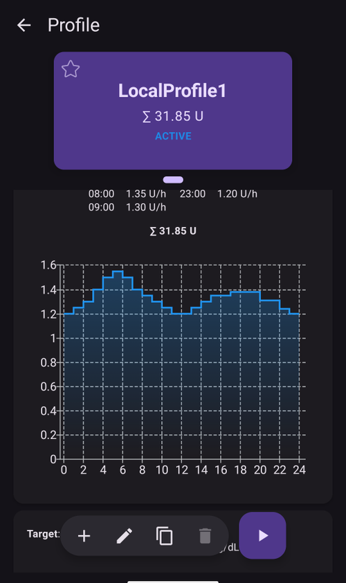

# AAPS 프로파일

**AAPS 프로파일**은 센서 혈당 수치에 따라 **AAPS**가 인슐린을 어떻게 주입할지 정하는 네 가지 핵심 매개변수의 모음입니다. 이것은 **AAPS**의 바탕이 되는 주요 매개변수입니다. **목표**를 진행하면 추가로 바꿀 수 있는 매개변수(SMB 설정 등)가 열립니다. 그러나 이 기능들이 잘 작동하려면 기본이 되는 **프로파일**이 정확해야 합니다. **프로파일**에는 다음이 포함됩니다:
* [혈당 목표](#profile-glucose-targets),
* [기저 주입량](#your-aaps-profile-basal-rates) (BR),
* [인슐린 민감도 계수](#your-aaps-profile-insulin-sensitivity-factor) (ISF),
* [인슐린 대 탄수화물 비율](#your-aaps-profile-insulin-to-carbs-ratio) (IC 또는 ICR).

```{admonition} Where did DIA go?
:class: note
**인슐린 작용 시간(DIA)**은 더 이상 **프로파일**의 일부가 아닙니다. 대신 인슐린마다 설정합니다. [관리 → 인슐린 설정](#Config-Builder-insulin-dia)을 보십시오.
```

**AAPS** 관리의 일부로, 사용자는 **프로파일** 설정이 정확한지 계속 평가하고 꼼꼼히 확인해야 합니다. 설정은 여기에 나온 순서대로 맞추는 것을 권장합니다. 다른 설정을 바꾸기 전에 한 가지 설정을 먼저 정확하게 맞추십시오. 한 번에 크게 바꾸지 말고 조금씩 단계적으로 진행하십시오. 바꿀 때마다 새 프로파일을 활성화하는 것을 잊지 마십시오. 설정을 내보내서 [**프로파일**을 정기적으로 백업](#YourAapsProfile_Profile-backup)하십시오.

**프로파일** 설정은 서로 영향을 줍니다. '잘못된' 설정들이 어떤 상황에서는 함께 잘 작동하지만 다른 상황에서는 그렇지 않을 수 있습니다. 예를 들어 너무 높은 기저가 너무 높은 **CR**과 우연히 같은 시간에 있는 경우입니다. 따라서 각 설정을 하나씩 살펴보고, 여러 상황에서 서로 잘 맞게 작동하는지 확인해야 합니다.

[Autotune](https://autotuneweb.azurewebsites.net/)을 생각의 길잡이로 사용할 수 있습니다. 그러나 무조건 따라서는 안 됩니다. 사용자에게 잘 맞지 않거나 모든 상황에서 잘 작동하지 않을 수 있습니다.

```{admonition} Your diabetes may vary
:class: note
**프로파일**은 사람마다 크게 다릅니다.

기저 주입량(BR), 인슐린 민감도 계수(ISF), 인슐린 대 탄수화물 비율(IC 또는 ICR)의 절대값과 인슐린 필요량의 추세는 사람마다 크게 다릅니다. 이는 몸의 특성, 성별, 나이, 체력 등과 질병, 최근 운동 같은 단기 요인에 따라 달라집니다. 이에 대한 더 많은 안내는 Adam Brown의 책 [“Bright Spots and Landmines”](https://diatribe.org/bright-spots-and-landmines/)를 읽어 보십시오. 아주 좋은 책입니다.

```

마지막 네 가지 매개변수(혈당 목표, 기저 주입량, 인슐린 민감도 계수, 인슐린 대 탄수화물 비율)는 24시간 동안 필요하면 매시간 다른 값으로 설정할 수 있습니다.


아래는 **AAPS**의 _예시_ 프로파일 스크린샷입니다. 아래의 예시 프로파일에는 시간 지점이 매우 많습니다. **AAPS**를 처음 시작할 때는 프로파일이 이보다 훨씬 단순할 것입니다.



(profile-glucose-targets)=
## 혈당 목표

### 설명

**혈당 목표**는 핵심 값이며, **AAPS**의 모든 계산은 이 값을 바탕으로 합니다. 이것은 보통 혈당을 유지하려고 하는 목표 범위와는 다릅니다. 목표는 **AAPS** 계산에 사용됩니다. **AAPS**가 **혈당**이 목표 범위를 벗어날 것으로 예측하면, 다시 그 범위 안으로 돌아오도록 조치합니다.

목표는 다음 범위 안에서 정할 수 있습니다:

|    | _낮은_ 목표                | _높은_ 목표                  |
| -- | ---------------------- | ------------------------ |
| 최소 | 4.4 mmol/L 또는 80 mg/dL | 5 mmol/L 또는 90 mg/dL     |
| 최대 | 10 mmol/L 또는 180 mg/dL | 11.1 mmol/L 또는 200 mg/dL |

### Impact

**프로파일**의 목표가 매우 넓으면(예를 들어 3 mmol/L 이상 [50 mg/dL 이상]), **AAPS**가 거의 동작하지 않는 경우가 많습니다. 이는 **혈당**이 그 넓은 범위 어딘가에 있을 것으로 예측되므로, **AAPS**가 임시 기저를 실행할 가능성이 낮기 때문입니다.

### 설정 방법

**아래 그림**은 **AAPS** 프로파일에서 목표를 설정하는 예를 보여 줍니다.


**혈당** 목표는 개인의 선호와 필요에 따라 설정합니다. 예를 들어 밤에 저혈당이 걱정된다면, 오후 9시부터 오전 7시까지 목표를 117 mg/dL (6.5 mmol/L)로 약간 높게 설정할 수 있습니다. 아침 식사 볼러스 전에 아침에 활성 인슐린(IOB)이 충분히 있도록 하려면, 오전 7시 - 8시에 더 낮은 목표인 81 mg/dL (4.5 mmol/L)을 설정할 수 있습니다.

[개방 루프](#KeyAapsFeatures-OpenLoop)에서, 특히 [처음 목표들](../SettingUpAaps/CompletingTheObjectives.md)을 진행하는 동안에는, **AAPS**가 어떻게 동작하는지 배우고 **프로파일**을 조정하는 동안 넓은 범위의 목표를 사용하는 것이 좋은 방법일 수 있습니다.<br/> [폐쇄 루프](#KeyAapsFeatures-ClosedLoop)에서는(**[목표 6](#objectives-objective6)**부터) **AAPS**가 **혈당** 변동에 빠르게 반응하도록, 하루의 각 시간마다 하나의 목표(_낮은_ 목표 = _높은_ 목표)가 될 때까지 범위를 줄이는 것을 권장합니다.

(your-aaps-profile-basal-rates)=

## 기저 주입량

### 설명

기저 주입량(단위/시간)은 배경 인슐린을 제공하여, 음식이나 운동이 없을 때 혈당을 안정적으로 유지합니다.

인슐린 펌프는 몇 분마다 소량의 초속효성 인슐린을 주입하여, 간이 포도당을 너무 많이 내보내지 않도록 하고 포도당이 몸의 세포로 들어가게 합니다. 기저 인슐린은 식단에 따라 보통 하루 총 인슐린량(TDD)의 40 - 50%를 차지하며, 대개 24시간 동안 인슐린 필요량이 한 번 높아지고 한 번 낮아지는 일주기 리듬을 따릅니다. 더 자세한 정보는 Gary Scheiner의 [“Think like a Pancreas”](https://amzn.eu/d/iVU0RGe) 6장이 매우 유용합니다.

대부분의 제1형 당뇨병 교육자(그리고 제1형 당뇨병이 있는 사람들!)는 ISF와 ICR을 최적화하기 전에 먼저 기저 주입량을 정확하게 맞추어야 한다는 데 동의합니다.

### Impact

기저 주입량이 정확하면 아침에 목표 범위 안에서 일어나고, 식사를 건너뛰거나 하루 중 더 이르게 또는 늦게 먹어도 혈당이 높아지거나 낮아지지 않습니다.

기저 주입량이 너무 높으면 저혈당이 생길 수 있습니다. 반대의 경우도 마찬가지입니다.

**AAPS**는 기본 기저 주입량을 ‘기준선’으로 삼습니다. 기저 주입량이 너무 높으면 ‘0 임시 기저’가 실제보다 더 큰 음의 IOB로 계산됩니다. 그러면 **AAPS**는 IOB를 결국 0으로 만들기 위해 필요한 것보다 더 많은 보정을 이어서 하게 됩니다.

따라서 기저 주입량이 너무 높으면 기본 주입량 자체로도 **저혈당**이 생기고, **AAPS**가 목표로 보정하는 몇 시간 뒤에도 저혈당이 생깁니다.

반대로 기저 주입량이 너무 낮으면 고혈당이 생기고, 혈당을 목표까지 내리지 못할 수 있습니다.

### 설정 방법

**아래 그림**은 **AAPS** 프로파일에서 기저 주입량을 설정하는 예를 보여 줍니다.


기저 주입량은 시행착오를 거쳐 맞추며, 당뇨병 치료팀과 상의하여 해야 합니다.

기저 테스트 방법이 여러 가지 있으며, 보통 24시간에 걸친 <u>간헐적</u> 금식 동안 기저 주입량과 인슐린 필요량을 관찰합니다. 하루 전체의 기저 주입량을 테스트해야 하지만, 24시간 동안 계속 굶는 것은 권장하지 않습니다. 몸이 이를 보상하기 위해 호르몬 같은 기전을 작동시키기 때문입니다. 권장 방법은 서로 다른 3일 동안 8시간씩 금식하는 것입니다.

권장 방법은 루프를 일시 중지하는 것입니다(안전을 위해 [목표 6](#objectives-objective6)을 달성할 때처럼 AAPS를 [**LGS**](#KeyAapsFeatures-LGS)로 설정하여 저혈당을 피할 수 있습니다). 그러면 기본 배경 기저 주입량으로 돌아갑니다. **혈당**이 어떻게 변하는지 관찰하십시오. 혈당이 떨어지면 기저 주입량이 너무 높은 것입니다. 반대의 경우도 마찬가지입니다.<br/> 다른 방법(더 어려울 수 있음)은 루프를 계속 실행하면서 **IOB**가 어떻게 변하는지 보는 것입니다. **IOB**가 음수이면 기저 주입량이 너무 높은 것입니다. 반대의 경우도 마찬가지입니다. 이 방법은 **혈당** 보정에 **ISF**를 사용하므로, 성공하려면 다른 변수도 어느 정도 잘 설정되어 있어야 합니다.<br/> 기저 주입량을 조정하는 또 다른 방법은 모든 COB가 사라진 밤 동안 루프의 동작을 지켜보는 것입니다. 이 방법은 특히 굶기가 어렵거나 인슐린 필요량이 자주 바뀌는 어린이에게 유용합니다. [Tidepool의 Saleh Adi 박사](https://www.youtube.com/watch?v=-fpWnGRhLSo)가 기저 주입량을 최적화하기 위해 밤 동안의 혈당 선을 분석하는 유용한 방법을 알려 줍니다.

폐쇄 루프에서 패턴을 분석하여 기저 프로파일을 조정하는 방법은 [여기](../GettingHelp/ProfileTuning.md)를 보십시오.

기저 테스트 결과에 따라 조치할 때는, **프로파일** 변경을 혈당이 오르거나 떨어지기 1~2시간 전(인슐린 종류에 따라 다름)에 해야 합니다. **기저 주입량** 설정에 확신이 들 때까지 필요한 만큼 테스트를 반복하십시오.

(your-aaps-profile-basal-not-compatible)=
#### 메시지: "기저 주입량이 현재 펌프와 맞지 않아 활성화할 수 없습니다"

펌프마다 한계가 있습니다. 주입할 수 있는 가장 낮은 기저 주입량과 가장 높은 기저 주입량이 있고, 일부 펌프(예: Dana, Accu-Chek Combo, Medtronic, Diaconn G8)는 기저 주입량을 정각에만 바꿀 수 있습니다. **AAPS**는 선택한 퍼센트를 적용한 **후에** 프로파일이 사용 중인 펌프에 맞는지 확인합니다.

기저 주입량이 이 한계를 벗어나면 **활성화** 화면에 이 메시지가 표시되고 **활성화** 버튼은 회색으로 남습니다:


예를 들어 밤의 기저 주입량이 0.10 U/h이고 프로파일 퍼센트가 35 %이면, **AAPS**는 0.035 U/h를 주입해야 합니다. 이것은 Dana 펌프가 주입할 수 있는 양(0.04 U/h)보다 적습니다.

해결하려면 다음 중 하나를 하십시오:

* 다른 퍼센트를 선택하십시오. 기저 주입량이 너무 낮아지면 **더 높은** 퍼센트를, 너무 높아지면 **더 낮은** 퍼센트를 선택합니다. 또는
* [프로파일을 편집](#your-aaps-profile-create-and-edit-profiles)하여 기저 주입량을 바꾸십시오.

프로파일 편집기에서는 기저 주입량을 정각에만 시작할 수 있습니다. 예를 들어 06:30에 시작하는 기저 주입량은 이전 프로파일에서만 올 수 있습니다. 예를 들어 이를 지원하지 않는 펌프로 바꾼 뒤입니다.

(your-aaps-profile-insulin-sensitivity-factor)=

## 인슐린 민감도 계수 (ISF)

### 설명

인슐린 민감도 계수(보정 계수라고도 함)는 인슐린 1단위가 혈당을 얼마나 낮추는지를 나타내는 값입니다.

**mg/dL 단위의 경우:** **ISF**가 40이면 인슐린 1단위가 혈당을 약 40 mg/dL 내립니다(예를 들어 혈당이 140 mg/dL에서 100 mg/dL로 떨어집니다).

**mmol/L 단위의 경우:** **ISF**가 1.5이면 인슐린 1단위가 혈당을 약 1.5 mmol/L 내립니다(예를 들어 8 mmol/L에서 6.5 mmol/L로).

이 예에서 알 수 있듯이 **ISF** 값이 _작을수록_ 인슐린에 덜 민감한 것입니다. 따라서 ISF를 40에서 35 (mg/dL)로, 또는 1.5에서 1.3 (mmol/L)으로 줄이는 것을 흔히 **ISF**를 강하게 한다고 합니다. 반대로 **ISF** 값을 40에서 45 (mg/dL)로, 또는 1.5에서 1.8 (mmol/L)로 높이는 것은 **ISF**를 약하게 하는 것입니다.

### Impact

**더 낮은 / 더 강한 ISF**(예: 50 대신 40)는 인슐린 1단위가 **혈당**을 덜 내린다는 뜻입니다. 그래서 루프는 **더 많은 인슐린**으로 더 공격적이고 강하게 보정합니다. **ISF**가 너무 강하면(값이 작으면) **저혈당**이 생길 수 있습니다.

**더 높은 / 더 약한 ISF**(예: 35 대신 45)는 인슐린 1단위가 **혈당**을 더 많이 내린다는 뜻입니다. 그래서 루프는 **더 적은 인슐린**으로 덜 공격적이고 약하게 보정합니다. **ISF**가 너무 약하면(값이 크면) **고혈당**이 생길 수 있습니다.

**예시:**
* **혈당**이 190 mg/dL (10.5 mmol/L)이고 목표가 100 mg/dL (5.6 mmol/L)입니다.
* 따라서 `190 - 100 = 90 mg/dL` 또는 `10.5 - 5.6 = 4.9 mmol/L`만큼 보정해야 합니다
* `ISF = 30` -> `90 / 30 = 3` 또는 `ISF = 1.63` -> `4.9 / 1.63 = 3`인 경우: 인슐린 3단위
* `ISF = 45` -> `90 / 45 = 2` 또는 `ISF = 2.45` -> `4.9 / 2.45 = 2`인 경우: 인슐린 2단위

**ISF**가 너무 낮으면(따라서 더 공격적이며, 흔한 경우입니다) ‘과잉 보정’이 생길 수 있습니다. **AAPS**가 높은 **혈당**을 보정하는 데 실제보다 더 많은 인슐린이 필요하다고 계산하기 때문입니다. 그러면 아래 그림처럼 혈당이 ‘롤러코스터’처럼 오르내릴 수 있습니다(특히 굶을 때). 이런 경우에는 **AAPS**가 덜 공격적이 되도록 **ISF** 값을 높여야 합니다. 그러면 **AAPS**가 더 적은 보정량을 주입하여, 높은 **혈당**을 과잉 보정해 **저혈당**이 되는 것을 막습니다.


반대로 **ISF**를 너무 높게 설정하면 보정이 부족해져 **혈당**이 목표보다 높게 남습니다. 특히 밤에 잘 보입니다.

### 설정 방법

**AAPS** 프로파일에서 ISF 값을 설정하는 예는 **아래 그림**을 보십시오.


낮 시간 ISF를 정하는 기본 출발점은 1,700(94) 규칙을 사용하여 하루 총 인슐린량(TDD)을 기준으로 하는 것입니다. 자세한 내용은 Gary Scheiner의 [“Think like a Pancreas”](https://amzn.eu/d/iVU0RGe) 7장에 있습니다.

| 1700 (mg/dL로 측정하는 경우) 또는 94 (mmol/L) / TDD = 대략의 ISF.<br/><br/>예: TDD = 40 U<br/>대략의 ISF (mg/dL) = 1700/40 = 43<br/>대략의 ISF (mmol/L) = 94/40 = 2.4 |
| -------------------------------------------------------------------------------------------------------------------------------------------------------------------------- |
|                                                                                                                                                                            |

기저 주입량이 정확하다고 가정하면, 루프를 일시 중지하고 **IOB**가 0인지 확인한 다음, 포도당 정제 몇 개를 먹어 안정된 ‘높은’ 수준에 도달하여 테스트할 수 있습니다.

그런 다음 목표 혈당에 도달하도록 예상한 양의 인슐린(현재 1/ISF 기준)을 주입하십시오.

이 값은 너무 낮게 설정되는 경우가 많으므로 주의하십시오. 너무 낮으면 1 U가 예상보다 혈당을 더 빨리 내립니다.

(your-aaps-profile-insulin-to-carbs-ratio)=

## 인슐린 대 탄수화물 비율 (ICR)

### 설명

**ICR**은 인슐린 1단위가 탄수화물 몇 그램을 처리하는지를 나타냅니다.

**ICR** 대신 **I:C**라는 약어를 쓰거나, 탄수화물 비율 **CR**이라고 부르는 사람도 있습니다.

예를 들어 인슐린 대 탄수화물 비율이 1 대 10(1:10)이면 탄수화물 10그램을 먹을 때마다 인슐린 1U를 주입한다는 뜻입니다. 탄수화물 25g 식사에는 인슐린 2.5U가 필요합니다.

**ICR**이 더 약하면(값이 더 크면), 예를 들어 1:20이면 탄수화물 10g에 인슐린 0.5U만 필요합니다. 탄수화물 25g 식사에는 인슐린 25/20 = 1.25U가 필요합니다.

호르몬 수준과 신체 활동 때문에 하루 중 시간마다 **ICR**이 다른 것은 흔합니다. 많은 사람은 인슐린 저항성이 더 큰 경향이 있어서 아침 식사 시간쯤에 **ICR**이 가장 낮습니다/가장 강합니다. 예를 들어 어떤 성인 사용자의 **ICR**은 아침 1:8, 점심 1:10, 저녁 1:10일 수 있습니다. 그러나 이 패턴이 모두에게 맞는 것은 아닙니다. 어떤 사람은 저녁 시간에 인슐린 저항성이 더 커서 그때 더 강한/더 작은 **ICR**이 필요합니다.

> **참고:**
> 
> 일부 유럽 국가들에서는 얼마나 많은 인슐린이 필요한지 결정하기 위해 빵 단위(bread units)를 사용합니다. 처음에는 1 빵 단위가 탄수화물 12g이었고, 나중에 일부는 10g으로 바꾸었습니다.
> 
> 이 빵단위 모델에서는 탄수화물의 양은 고정되어있고 인슐린의 양이 가변적입니다. ("1 빵단위(bread unit)를 처리하기 위해 얼마나 많은 인슐린이 필요합니까?")
> 
> **ICR**을 사용할 때는 인슐린 양이 고정되고 탄수화물 양이 바뀝니다. ("1유닛의 인슐린이 얼마나 많은 탄수화물(g)을 처리할 수 있습니까?")
> 
> 예시:
> 
> 빵 단위 계수(BU = 탄수화물 12g): 2.4 U/BU -> 빵 단위 1개를 먹을 때 인슐린 2.4단위가 필요합니다.
> 
> 해당하는 **ICR**: 12g / 2.4 U = 5.0 g/U -> 인슐린 1단위로 탄수화물 5.0g을 처리할 수 있습니다.
> 
> BU 계수 2.4 U / 12g   ===>   IC = 12g / 2.4 U = 5.0 g/U
> 
> 환산표는 온라인에서 찾을 수 있습니다. 예: [여기](https://www.mylife-diabetescare.com/files/media/03_Documents/11_Software/FAS/SOF_FAS_App_KI-Verha%CC%88ltnis_MSTR-DE-AT-CH.pdf).

### Impact

**더 낮은 / 더 강한 ICR**은 1단위당 음식이 더 적다는 뜻입니다. 즉 같은 양의 탄수화물에 인슐린을 더 많이 받습니다. ‘더 공격적’이라고도 합니다. IC가 너무 강하면 인슐린을 너무 많이 받게 되어 **저혈당**이 생길 수 있습니다.

**더 높은 / 더 약한 ICR** = 1단위당 음식이 더 많다는 뜻입니다. 즉 같은 양의 탄수화물에 인슐린을 더 적게 받습니다. ‘덜 공격적’이라고도 합니다. IC가 너무 약하면 필요한 것보다 인슐린을 적게 받게 되어 **고혈당**이 생길 수 있습니다.

### 설정 방법

**아래 그림**은 한 사용자의 **ICR**과 이를 **AAPS 프로파일**에서 설정하는 예를 보여 줍니다. 이 값을 입력할 때는 비율의 마지막 부분만 입력합니다. 그래서 인슐린 대 탄수화물 비율 1:3.5는 그냥 “3.5”로 입력합니다.


식사가 소화되고 **IOB**가 0으로 돌아온 뒤에도 **혈당**이 식사 전보다 높게 남아 있다면, **ICR**이 너무 약할 가능성이 큽니다(_즉_ 숫자가 너무 크므로 조금씩 낮추어야 합니다). 반대로 **혈당**이 식사 전보다 낮다면 **ICR**이 너무 강한 것입니다(_즉_ 숫자가 너무 작으므로 조금씩 높여야 합니다).

기저 주입량이 정확하다고 가정하면, **IOB**가 0이고 범위 안에 있는지 확인한 뒤, 탄수화물 양을 정확히 아는 음식을 먹고, 현재 인슐린 대 탄수화물 비율에 따라 예상한 양의 인슐린을 주입하여 테스트할 수 있습니다. 그 시간에 평소 먹는 음식을 먹고 탄수화물을 정확하게 세는 것이 가장 좋습니다.

## 프로파일에 관한 자주 묻는 질문

```{contents} Common questions related to the Profile
:depth: 1
:local: true
```

### 프로파일을 올바르게 설정하는 것이 중요한 이유

**왜 프로파일 설정을 정확하게 맞추어야 합니까? 루프가 알아서 처리하면 되지 않습니까?**

하이브리드 폐쇄 루프는 잘못된 **프로파일** 값 때문에 생기는 나쁜 혈당 조절을 줄이기 위해 인슐린 주입을 조정하려고 시도_할 수_ 있습니다. 예를 들어 저혈당이 올 것 같으면 인슐린 주입을 멈추는 방법으로 이렇게 할 수 있습니다. 그러나 **프로파일** 설정이 이미 몸에 필요한 값에 최대한 가까우면 혈당을 훨씬 더 잘 조절할 수 있습니다. 이것이 **AAPS**가 개방 루프 펌프 사용에서 하이브리드 폐쇄 루프로 넘어갈 때 단계별 목표를 사용하는 이유 중 하나입니다. 또한 루프를 열어야 할 때가 있습니다(센서 워밍업, 센서 고장 _등_). 때로는 한밤중일 수도 있으며, 이런 상황을 위해 설정이 정확해야 합니다.

다른 개방 또는 폐쇄 루프 펌프 시스템을 사용하다가 **AAPS**를 시작한다면, 기저 주입량(**BR**), 인슐린 민감도 계수(**ISF**), 인슐린 대 탄수화물 비율(**ICR**)에 어떤 값을 써야 할지 이미 어느 정도 알고 있을 것입니다.

주사(MDI)에서 **AAPS**로 바꾸는 경우, 먼저 MDI에서 펌프로 옮기는 방법을 공부하고, 당뇨병 치료팀과 상의하여 신중하게 계획하고 옮기는 것이 좋습니다. John Walsh & Ruth Roberts의 ["Pumping insulin"](https://amzn.eu/d/iaCsFa2)과 Gary Scheiner의 [“Think like a Pancreas”](https://amzn.eu/d/iVU0RGe)가 매우 유용합니다.

### 폐쇄 루프에서 식후 혈당이 크게 오르는 원인은 무엇입니까?
먼저 기저 주입량을 확인하고, 탄수화물 없이 기저 주입량 테스트를 하십시오. ICR이 정확하고 탄수화물이 모두 흡수된 뒤 **혈당**이 목표까지 떨어진다면, 식사 얼마 전에 **AAPS**에서 '식사 직전' 임시 목표를 설정하거나, 내분비내과 의사와 적절한 사전 볼러스 시간을 상의해 보십시오. <br/> 식사 후 **혈당**이 너무 높고 탄수화물이 모두 흡수된 뒤에도 여전히 너무 높다면, 내분비내과 의사와 상의하여 **ICR**을 낮추는 것을 고려하십시오. **COB**가 있는 동안 **혈당**이 너무 높고 탄수화물이 모두 흡수된 뒤에는 너무 낮다면, 내분비내과 의사와 **ICR**을 높이는 것과 적절한 사전 볼러스 시간을 상의해 보십시오.

### 혈당이 높은 채로 있고 루프가 내리지 못합니다
**AAPS**가 인슐린을 충분히 주지 않는 이유는 다음과 같을 수 있습니다:
* **ISF**가 충분히 강하지 않음
* 기저 주입량이 충분히 강하지 않을 수 있음
* **maxIOB** 같은 안전 설정이 작동했을 수 있습니다. 또는 설정에 따라 이 시간에 **SMB**가 비활성화되어 있습니다.
* 자동화가 설정되어 **AAPS**를 무시했습니다.

[AAPS 프로파일 조정](../GettingHelp/ProfileTuning.md)도 보십시오.

### IOB가 음수입니다. 문제가 됩니까?
음의 **IOB**는 몸에 있는 전체 인슐린 양(기저 + 볼러스)이 기저보다 적다는 뜻입니다. 그러면 **AAPS**는 인슐린이 부족하다고 판단하여 **혈당**이 오르기 시작하자마자 더 많은 인슐린을 보냅니다. 이 때문에 나중에 **저혈당**이 생길 수 있습니다.

IOB가 음수가 되는 이유와 해야 할 조치는 다음과 같습니다:
* 너무 강한 기저: **프로파일**을 조정하십시오
* 이전 식사의 볼러스가 너무 많음: **프로파일**을 조정하거나 볼러스를 적절한 시간에 하는지 확인하십시오.
* 사용하는 인슐린 종류에 DIA가 너무 짧게 설정되어 인슐린이 쌓임: [관리 → 인슐린 설정](#Config-Builder-insulin-dia)에서 조정하십시오
* 신체 활동: 다음에는 활동 중에 늘어나는 민감도를 고려하여 더 낮은 [프로파일 퍼센트](../DailyLifeWithAaps/ProfileSwitch-ProfilePercentage.md)를 사용하는 것을 고려하십시오.

## 프로파일 관리

```{contents} Operations that you can perform on your **Profiles** in **AAPS**
:depth: 1
:local: true
```
(your-aaps-profile-create-and-edit-profiles)=
### 프로파일 만들기와 편집

**AAPS** v4에서 프로파일은 **관리** 화면(하단 내비게이션) → **프로파일**에 있습니다. 동작 표시줄(**➕ 추가**, **✏️ 편집**, **⧉ 복사**, **🗑️ 삭제**, **▶ 활성화**)이 있는, 밀어 넘기는 카드 캐러셀로 표시됩니다. 프로파일을 관리하고 활성화하는 방법은 [프로파일 관리와 활성화](#ProfileSwitch-manage-v4)를 보십시오. 프로파일에 별도의 탭이 있던 **AAPS** v3에서 오셨습니까? [AAPS v4의 변경 사항](#v4changes-manage)을 보십시오.

**✏️ 편집**을 누르면 편집기가 열립니다. 프로파일 **이름**과 **단위**를 설정한 다음, 탭을 사용하여 네 가지 일정을 채우십시오:

- **IC** — 인슐린 대 탄수화물 비율 (g/U)
- **ISF** — 인슐린 민감도 계수
- **BAS** — 기저 주입량
- **TARG** — 목표 범위


각 일정은 **시간대** 목록입니다. 시간대를 추가하고 시작 시간과 값을 설정한 다음 **저장**하십시오.

**프로파일**을 바꿀 때는 올바른 **프로파일**을 편집하고 있는지 확인하십시오. 사용 중인 프로파일의 카드에는 **활성** 표시가 있지만, 화면에서 선택된 카드는 다른 카드일 수 있습니다.

(your-aaps-profile-profile-from-scratch-for-a-kid)=
### 어린이를 위한 프로파일을 처음부터 만들기

[프로파일 도우미](#aaps-screens-profile-helper)(메뉴 ☰ → **프로파일 도우미**)는 어린이(18세까지)를 위한 프로파일을 만드는 데 도움이 될 수 있습니다.

**Important note:**

**프로파일 도우미는 어린이의 첫 프로파일을 찾는 것을 돕기 위한 것입니다. 두 병원의 데이터 세트를 바탕으로 하지만, 새 프로파일을 사용하기 전에 항상 의료진과 상의하십시오!**

프로파일 도우미는 두 병원의 어린이 데이터 세트를 제공하여 18세까지의 어린이에게 맞는 첫 프로파일을 찾도록 돕습니다.


1. **프로파일 1** 탭에 있는지 확인하십시오.
2. **프로파일 종류**에서 "기본 프로파일"이 선택되어 있는지 확인하십시오.
3. 어린이의 나이와 총 TDD **또는** 체중을 입력하여 기본 프로파일(병원 데이터 세트 기반)을 조정하십시오.
4. **프로파일 2** 탭으로 바꾸십시오.
5. **프로파일 종류**를 누르고 "DPV 기본 프로파일"을 선택하십시오.
6. 어린이의 나이, 총 TDD, 기저 퍼센트를 입력하여 DPV 기본 프로파일(다른 병원 데이터 세트 기반)을 조정하십시오. DPV 데이터 세트는 **기저 주입량**만 제공하므로, 이 프로파일에서는 IC와 ISF가 0으로 표시됩니다.
7. **비교** 탭을 여십시오. 조정된 두 프로파일의 비교가 표시됩니다(아래 스크린샷 참조).
8. 이 제안 중 하나를 바탕으로 프로파일 조정을 시작하려면, 비교 화면 아래에 있는 **복사** 버튼을 사용하십시오.


### 프로파일 전환

[프로파일 전환과 프로파일 퍼센트](../DailyLifeWithAaps/ProfileSwitch-ProfilePercentage.md)를 보십시오.

(your-aaps-profile-clone-profile-switch)=
### 프로파일 전환을 새 프로파일로 복사하기


[처치 이력](#aaps-screens-treatments)에는 지난 모든 **프로파일 전환**이 표시됩니다. **프로파일 전환** 탭으로 가면, 지난 **프로파일 전환**을 바탕으로 새 **프로파일**을 만들 수 있습니다. 이 경우 시간 이동과 퍼센트가 새 로컬 프로파일에 적용됩니다. **2**번 줄에 표시된 **복사** 버튼을 사용하십시오.

이제 [프로파일 화면](#your-aaps-profile-create-and-edit-profiles)(**관리 → 프로파일**)으로 가서 새로 만든 프로파일을 편집할 수 있습니다.

(YourAapsProfile_Profile-backup)=
### 프로파일 백업

**프로파일**은 루프 시스템의 핵심 설정이므로 매우 중요하며, 절대 잃어버리고 싶지 않은 것입니다.

* **프로파일**은 **AAPS** 데이터베이스에 저장됩니다.
* **NSClientV3**이 설정되어 있으면([동기화](#SetupWizard-synchronization-with-the-reporting-server-and-more) 참조), **프로파일**도 Nightscout에 자동으로 업로드됩니다.
* 프로파일은 [내보낸 설정](../Maintenance/ExportImportSettings.md)에도 포함됩니다. 따라서 백업을 안전한 곳에 보관하십시오.

### Nightscout에서 프로파일 편집하기

활성화되어 있으면, Nightscout에서 직접 바꾼 **프로파일**을 **AAPS**에서 받을 수 있습니다. 이 설정의 이름은 "**NS에서 프로파일 저장소 받기**"이며 **Nightscout 데이터 수신** 옵션의 일부입니다(Nightscout에서 데이터를 받는 것은 기본적으로 꺼져 있습니다. [설정 마법사의 클라이언트 제어 단계](../SettingUpAaps/SetupWizard.md)를 보십시오). 메인 화면의 **검색 창**으로 빠르게 찾을 수 있습니다. 클라이언트 제어가 켜져 있는 동안에는 이 설정이 숨겨지고 **AAPS**는 Nightscout에서 프로파일 변경을 받지 않습니다([강화 모드](#client-master-control-hardened-mode)). 대신 페어링된 클라이언트에서 프로파일을 편집하거나, **전체 동기화**로 한 번 불러오십시오.

이것은 큰 **프로파일**을 크게 바꾸려고 할 때 도움이 될 수 있습니다. 웹 인터페이스에서는 프로파일을 더 쉽게 입력할 수 있습니다. _예를 들어_ 스프레드시트의 데이터를 직접 복사할 수 있습니다.

그러려면 Nightscout 편집기에서 여러 프로파일로 이루어진 **데이터베이스 레코드** 전체를 복사하는 것이 중요합니다(아래 스크린샷의 파란 화살표). 그러면 새 데이터베이스 레코드에는 현재 날짜가 붙습니다. 저장한 후, 바뀐/새 **프로파일**은 **AAPS**에서 일반적인 [프로파일 전환](../DailyLifeWithAaps/ProfileSwitch-ProfilePercentage.md)으로 활성화할 수 있습니다.


(your-aaps-profile-compare-profiles)=
### 두 프로파일 비교하기

[프로파일 도우미](#aaps-screens-profile-helper)(메뉴 ☰ → **프로파일 도우미**)를 사용하여 서로 다른 두 프로파일 또는 프로파일 전환(이전에 [프로파일 전환](../DailyLifeWithAaps/ProfileSwitch-ProfilePercentage.md)에서 사용한 프로파일의 퍼센트)을 비교할 수도 있습니다.


1. **프로파일 1** 탭에 있는지 확인하십시오.
2. **프로파일 종류**에서 "사용 가능한 프로파일"을 선택하여 저장된 모든 **프로파일** 중에서 고르십시오.
3. 비교할 기준 **프로파일**을 선택하십시오.
4. **프로파일 2** 탭으로 바꾸십시오.
5. **프로파일 종류**에서 "프로파일 전환"을 선택하여 모든 **프로파일 전환** 이력 중에서 고르십시오.
6. 비교 대상 **프로파일 전환**을 선택하십시오.
7. **비교** 탭을 여십시오. 두 프로파일의 비교가 표시됩니다(아래 스크린샷 참조).


