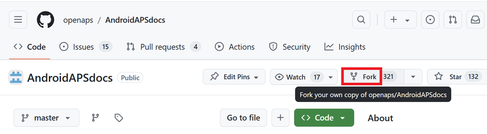
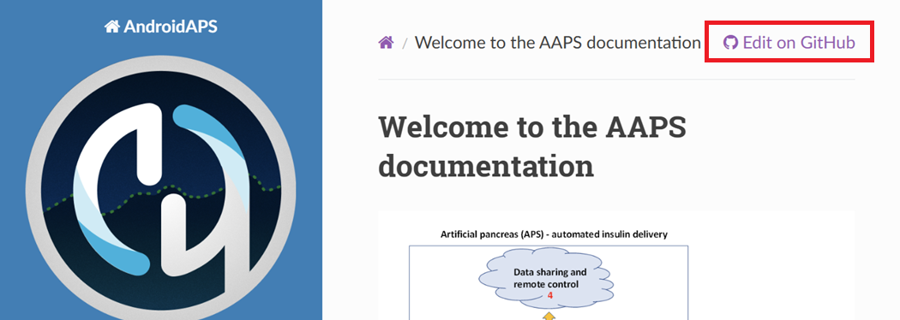
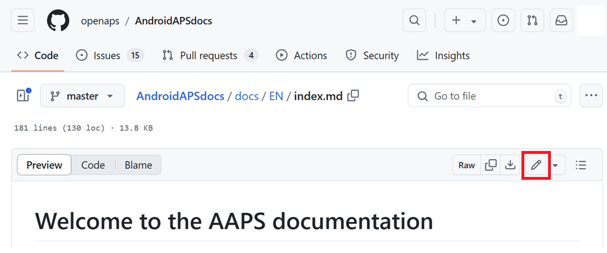
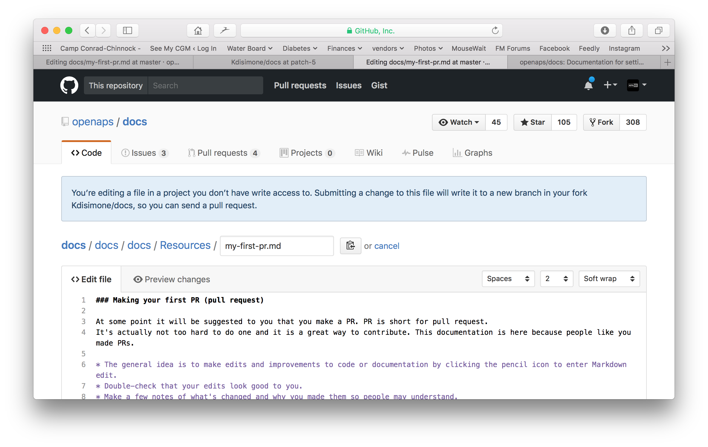
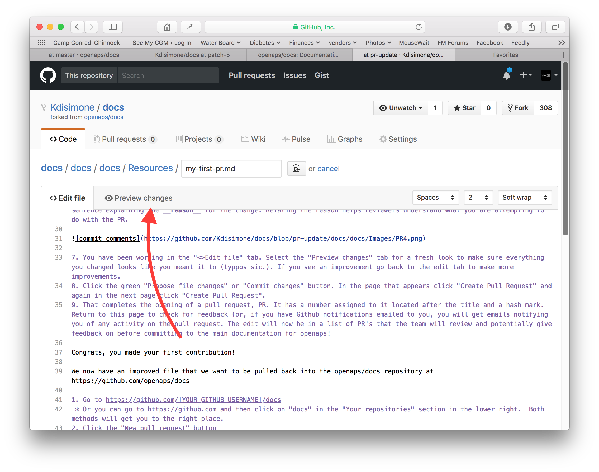
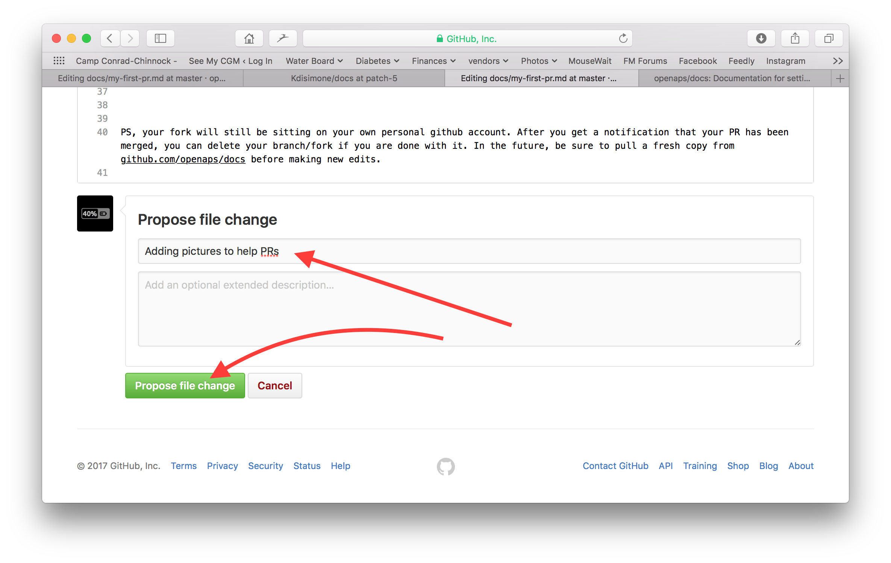
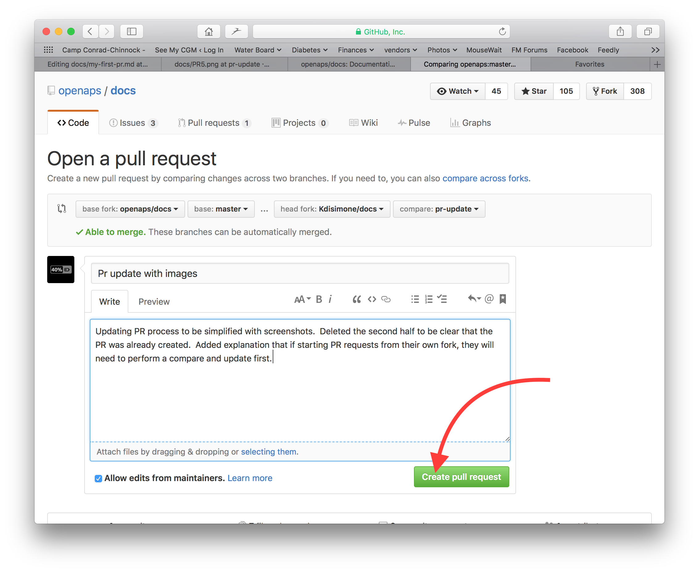
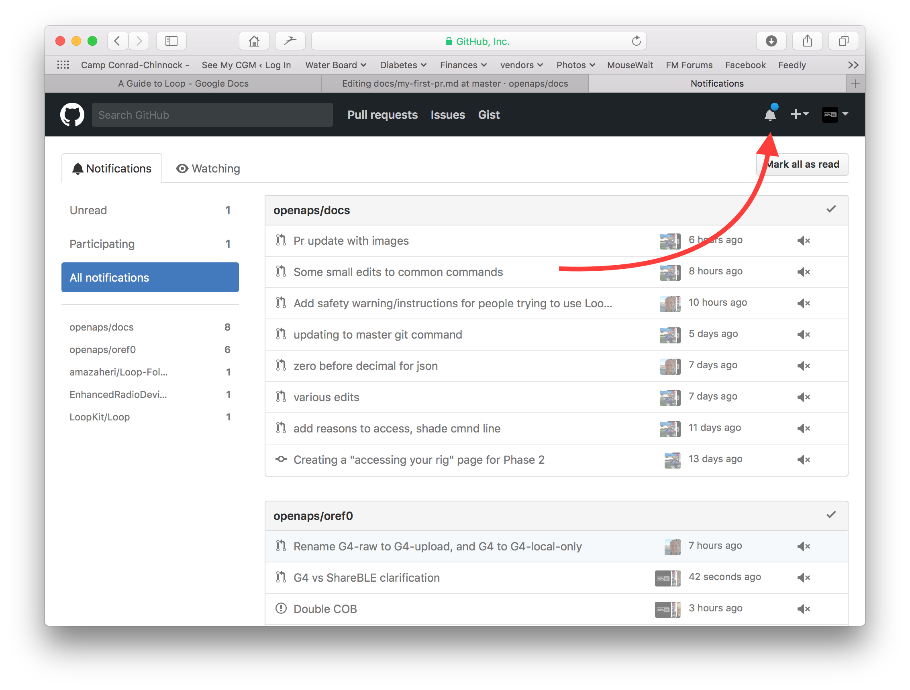
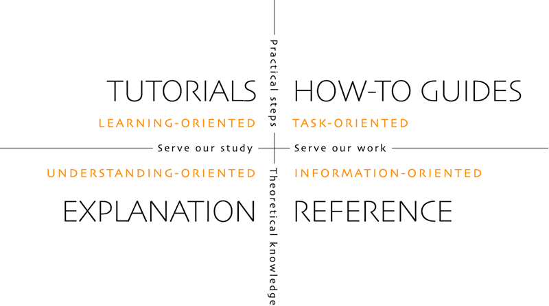

# 문서 편집 방법

**이 설명은 영어 문서를 편집할 때만 해당합니다. 새 정보는 모두 먼저 영어로 추가해야 합니다. 다른 언어로 번역하려면(감사합니다) [crowdin](https://crowdin.com/project/androidapsdocs)을 사용하십시오.**

텍스트 서식(제목, 굵게...)과 링크를 넣는 방법은 이 페이지의 ["코드 문법"](#edit-the-docs-code-syntax) 부분을 보십시오.

## 일반

질문, 의견, 새 아이디어가 있으면 [discord](https://discord.gg/4fQUWHZ4Mw)로 문서 팀에 연락할 수 있습니다.

언젠가 Pull Request(PR)를 만들어 보라는 제안을 받을 것입니다. PR은 문서의 변경 사항을 실제로 AAPS 웹페이지에 반영하는 방법이며, 이 웹페이지는 GitHub에 저장되어 있습니다. PR을 만드는 것은 생각보다 어렵지 않으며, 기여하는 좋은 방법입니다. 지금 이 문서를 읽을 수 있는 것도 여러분 같은 사람들이 PR을 만들었기 때문입니다. 실수하거나 엉뚱한 문서를 편집할까 봐 걱정하지 마십시오. 변경 사항은 "공식" AAPS 문서 저장소에 병합되기 전에 검토됩니다. 과정 중에 실수를 해도 원본이 망가지지 않습니다. 일반적인 과정은 다음과 같습니다:

- 기존 내용을 편집하여 코드나 문서를 수정하고 개선합니다.
- 편집한 내용이 괜찮은지 다시 한 번 확인합니다.
- 다른 사람이 편집 내용을 이해할 수 있도록 무엇을 바꿨는지 간단히 적습니다.
- Pull Request를 만듭니다. Pull Request는 관리자에게 변경 사항을 반영해 달라고 요청하는 것입니다.
- 관리자가 검토한 다음, (1)변경 사항을 병합(merge)하거나, (2)변경 사항에 대해 의견을 보내거나, (3)변경 사항으로 새 문서를 시작합니다.

(참고: 영상으로 배우는 것이 편하다면, PR 과정을 보여 주는 YouTube 영상이 [여기](https://youtu.be/4b6tsL0_kzg)에 있습니다.)

예시로 AndroidAPSdocs를 편집해 보겠습니다. Windows PC, Mac 등 어떤 컴퓨터에서도 할 수 있습니다. (인터넷에 연결된 컴퓨터라면 무엇이든 됩니다).

1. <https://github.com/openaps/AndroidAPSdocs>로 가서 오른쪽 위의 Fork를 눌러 저장소의 내 복사본을 만드십시오.



2. 아무 페이지로 가서 편집할 페이지로 이동하십시오. 오른쪽 위에 있는 "Edit in GitHub"(GitHub에서 편집) 링크를 누를 수 있습니다. 이것은 영어 페이지에서만 가능합니다. 



또는 편집할 페이지 내용의 위쪽 막대에 나타나는 연필 아이콘을 누르십시오. 이 작업을 하려면 먼저 GitHub 계정에 로그인해야 합니다(계정이 없다면 쉽게 만들 수 있습니다).



3. 2단계의 두 가지 방법 중 어느 것을 쓰든, 사용자의 저장소에 새 브랜치가 만들어지고 편집 내용은 그 브랜치에 저장됩니다. 파일을 편집하십시오.

문서 페이지에는 Markdown을 사용합니다. 파일 확장자는 ".md"입니다. Markdown 사양은 고정되어 있지 않으며, 지금은 Markdown 파일에 myst_parser를 사용합니다. [아래 설명](#edit-the-docs-code-syntax)대로 올바른 문법을 사용하도록 주의하십시오.



4. 지금까지 "<>Edit file"(파일 편집) 탭에서 작업했습니다. "Preview changes"(변경 사항 미리 보기) 탭을 눌러 새로운 눈으로 다시 보고, 바꾼 내용이 모두 의도한 대로 보이는지 확인하십시오(오타 확인). 더 고칠 부분이 보이면 편집 탭으로 돌아가서 더 수정하십시오. 



5. 편집을 마쳤으면 페이지 맨 아래로 스크롤하십시오. 맨 아래 상자에서 "Add an optional extended description..."(선택 사항인 자세한 설명 추가)라고 적힌 텍스트 필드에 설명을 적으십시오. 기본 제목에는 파일 이름이 들어 있습니다. 변경한 **이유**를 설명하는 문장을 하나 넣으십시오. 이유를 알려 주면 검토자가 이 PR로 무엇을 하려는지 이해하기 쉽습니다.



6. 초록색 "Propose file changes"(파일 변경 제안) 또는 "Commit changes"(변경 사항 커밋) 버튼을 누르십시오. 나타나는 페이지에서 "Create Pull Request"(Pull Request 만들기)를 누르고, 다음 페이지에서 다시 "Create Pull Request"를 누르십시오.



7. 이제 Pull Request(PR)가 만들어졌습니다. GitHub가 PR에 번호를 붙입니다. 번호는 제목 뒤에 # 기호와 함께 표시됩니다. 이 페이지로 돌아와서 의견이 있는지 확인하십시오(GitHub 알림을 이메일로 받도록 설정했다면, PR에 활동이 있을 때마다 이메일을 받습니다). 이제 편집 내용은 팀이 검토할 PR 목록에 들어갑니다. 팀은 AAPS의 메인 문서에 반영하기 전에 의견을 줄 수도 있습니다! PR 진행 상황을 확인하려면 GitHub 계정의 오른쪽 위에 있는 종 모양 아이콘을 눌러 자신의 PR을 모두 볼 수 있습니다.



참고: fork와 브랜치는 그대로 개인 GitHub 계정에 남아 있습니다. PR이 병합되었다는 알림을 받은 뒤, 더 이상 필요 없으면 브랜치를 지워도 됩니다(PR이 닫히거나 병합되면 7단계의 알림 영역에 브랜치 삭제 링크가 나옵니다). 앞으로도 이 방법을 따르면 편집은 항상 AndroidAPSdocs 저장소의 최신 버전에서 시작합니다. 다른 방법으로 PR을 시작한다면(예: fork한 저장소의 master 브랜치에서 편집 시작), 먼저 "compare"(비교)를 하고 마지막으로 fork를 업데이트한 뒤에 생긴 변경 사항을 병합하여 저장소를 최신 상태로 만들어야 합니다. 저장소 업데이트를 잊는 일이 많으므로, "compare"에 익숙해질 때까지는 위에서 설명한 PR 과정을 사용할 것을 권장합니다.

(edit-the-docs-code-syntax)=

## Code syntax

문서 페이지에는 Markdown을 사용합니다. 파일 확장자는 ".md"입니다.

Markdown은 텍스트 내용과 텍스트 서식을 분리하는 아주 간단한 텍스트 서식 언어입니다.

작성자는 예를 들어 제목을 수준 1 제목으로 표시만 하고, Markdown 처리기가 처리 중에 그 제목을 HTML로 보여 주는 데 필요한 HTML 코드를 만듭니다.

이렇게 하는 이유는 다음과 같습니다

- 작성자는 서식보다 먼저 텍스트 내용을 생각해야 합니다,
- Markdown 텍스트는 Microsoft Word 같은 독점 도구에 묶이지 않고 여러 Markdown 도구에서 주고받을 수 있습니다. 그리고
- Markdown 파일 하나로 여러 출력 형식을 만들 수 있습니다.

Markdown은 100% 고정된 표준이 아니며, 우리는 다음 목적을 위해 가능한 한 표준에 가깝게 쓰려고 합니다:

- Markdown 도구와 Markdown SaaS 서비스가 앞으로 발전하면서 필요하거나 어쩔 수 없을 때 Markdown 도구를 쉽게 바꿀 수 있습니다. 그리고
- 번역 서비스를 사용하여 영어를 프랑스어나 독일어 같은 다른 언어로 번역할 수 있게 하기 위해서입니다. 번역 서비스는 Markdown은 다룰 수 있지만 복잡한 서식 코드는 다룰 수 없습니다. 내용과 레이아웃을 구분하지 못하기 때문이며, 이는 치명적인 결과를 낳을 수 있습니다.

### 제목

- 제목 1: `# headline`
- 제목 2: `## headline`
- 제목 3: `### headline`
- 제목 4: `#### headline`

그보다 더 낮은 수준의 제목은 쓰지 않으려고 합니다.

### 텍스트 서식

- **굵게**: `**text**`
- *기울임꼴*: `*text*`
- ***굵은 기울임꼴***: `***text***`

### 번호 목록

    1. 첫째
    1. 둘째
    1. 셋째
    

1. 첫째
2. 둘째
3. 셋째

### 글머리 기호 목록

    - 항목 하나
    - 다른 항목
    - 또 다른 항목
    

- 항목 하나
- 다른 항목
- 또 다른 항목

### 여러 수준 목록

목록 안에 목록을 넣을 수 있습니다. 다음 수준을 앞 수준보다 오른쪽으로 공백 4칸 더 들여 쓰십시오.

    1. 첫째
    1. 둘째
    1. 셋째
      1. 항목 하나
      1. 다른 항목
      1. 또 다른 항목
    1. 넷째
    1. 다섯째
    1. 여섯째
    

1. 첫째
2. 둘째
3. 셋째 
    1. 항목 하나
    2. 다른 항목
    3. 또 다른 항목
4. 넷째
5. 다섯째
6. 여섯째

### 이미지

이미지를 넣으려면 다음 Markdown 문법을 사용합니다.

- 이미지: ``

이미지 형식은 PNG 또는 JPEG여야 합니다.

이미지 이름은 다음 이름 규칙 중 하나를 따라야 합니다. 예시에서는 확장자로 png를 사용합니다. JPEG를 사용한다면 확장자는 jpeg로 하십시오.

- `filename-image-xx.png`. 여기서 xx는 이 파일의 이미지마다 다른 두 자리 숫자입니다.
- `filename-image-xx.png`. 여기서 xx는 md 파일 작성자가 정한 의미 있는 이름입니다.

이미지는 영어용 images 폴더에 있으며, Crowdin이 다른 언어로 자동으로 전달합니다. 이 부분은 따로 할 일이 없습니다!

지금은 이미지를 번역하지 않습니다. 영어를 모르는 독자도 이해할 수 있도록 이미지에는 **텍스트를 최소한으로** 넣어야 합니다.

(make-a-PR-image-size)= 이미지는 PC, 태블릿, 휴대폰에서 읽을 수 있는 적당한 크기로 만드십시오.

- 웹 페이지 스크린샷 이미지는 너비 **1050픽셀**까지로 하십시오.
- 처리 과정 다이어그램은 너비 **1050픽셀**까지로 하십시오.
- 앱 스크린샷은 너비 **500픽셀**까지로 하십시오. 꼭 필요하지 않으면 나란히 놓지 마십시오.
- 워치(**Wear OS**) 스크린샷은 너비 **360픽셀**까지로 하십시오. 작은 스크린샷을 절대 크게 늘리지 마십시오.

### 링크

#### 외부 링크

외부 링크는 외부 웹사이트로 가는 링크입니다.

- 외부 링크: `[alt text](www.url.tld)`

#### md 파일의 시작 부분으로 가는 내부 링크

페이지로 가는 내부 링크는 우리 서버에 있는 md 파일의 시작 부분으로 가는 링크입니다.

- .md 페이지로 가는 내부 링크: `[alt text](../folder/file.md)`

#### 이름 있는 인라인 참조로 가는 내부 링크

이름 있는 인라인 참조로 가는 내부 링크는 우리 서버에 있는 md 파일 안에서 참조를 설정해 둔 아무 위치로 가는 링크입니다.

대상 md 파일에서 이동하고 싶은 위치에 이름 있는 참조를 추가하십시오.

`(name-of-my-md-file-this-is-my-fancy-named-reference)=`

이름 있는 참조는 그 참조가 있는 md 파일 안에서만이 아니라 AndroidAPSDocs의 모든 md 파일에서 고유해야 합니다!

그래서 파일 이름으로 시작하고 그 뒤에 직접 정한 참조 이름을 붙이는 것이 좋습니다.

소문자만 사용하고 단어는 하이픈(-)으로 연결하십시오.

그런 다음 작성 중인 텍스트에서 다음과 같은 링크로 이 참조에 링크하십시오.

- 이름 있는 인라인 참조로 가는 내부 링크: `[alt text](name-of-my-md-file-this-is-my-fancy-named-reference)`

### 참고, 경고, 접는 참고

문서에 참고 상자와 경고 상자를 넣을 수 있습니다.

또한 자세한 정보를 접는 참고로 넣을 수 있습니다. 그러면 자세한 내용에 관심이 없는 사용자가 글을 읽다가 지치지 않습니다. 문서는 최대한 읽기 쉬워야 하므로 이 상자들은 신중하게 사용하십시오.

#### 참고

    ```{admonition} 참고 제목
    :class: note
    이것은 참고입니다.
    ```
    

```{admonition} 참고 제목 :class: note 이것은 참고입니다.

    <br />#### 경고
    
    ````
    ```{admonition} 경고
    :class: warning
    이것은 경고입니다.
    

    ```{admonition} 경고 제목
    :class: warning
    이것은 경고입니다.
    ```
    
    #### 접는 참고
    
    

    {admonition} 관심 있는 독자를 위한 자세한 내용
    :class: dropdown
    
    이 안내 상자는 접혀 있습니다.
    그래서 여기에 긴 내용을 넣어도
    페이지에서 공간을 많이 차지하지 않습니다.
    

````

```{admonition} 관심 있는 독자를 위한 자세한 내용 :class: dropdown 이 안내 상자는 접혀 있습니다. 그래서 여기에 긴 내용을 넣어도 페이지에서 공간을 많이 차지하지 않습니다.

```

## 표

긴 텍스트가 들어간 표는 피하십시오. Markdown에서 내용을 넣기 어렵고, 보통 휴대폰 화면 너비에 맞지 않으며, 번역한 뒤에는 똑같이 보이지 않을 수 있습니다.

## 스타일 가이드

### 목차

1. 영어 글쓰기 팁

2. AAPS 문서 작성 참고 사항

3. 유용한 참고 자료

###  1\. 영어 글쓰기 팁

#### 읽는 사람에게 맞는 언어를 사용하십시오

가능하면 쉬운 영어(plain English)를 사용하십시오. 이렇게 하면 영어가 모국어가 아닌 독자에게 도움이 되고, AAPS 문서를 다른 언어로 번역하기도 쉬워집니다. 사용자와 대화하듯이 쓰십시오. 글을 읽을 사람이 책상 건너편에 앉아 있다고 생각하십시오. 기억하십시오. 대부분의 AAPS 사용자는 프로그래밍 경험이 없습니다. 당뇨 자체에도 전문 용어와 약어가 많습니다. 어떤 사람은 최근에 진단을 받았거나, 당뇨 경험이 여러분보다 적거나, 다른 당뇨 교육을 받았을 수 있다는 점을 기억하십시오. 줄임말이나 약어를 쓸 때는 처음 쓸 때 전체 말을 쓰고 바로 뒤 괄호 안에 약어를 적으십시오. 예: “super micro bolus (SMB)”. 그리고 용어집에 링크하십시오. 독자에게 익숙하지 않을 수 있는 전문 용어도 괄호 안에 함께 적을 수 있습니다.

이렇게 쓰지 말고: *“What causes high postprandial BG peaks in closed loop?”*

이렇게 쓰십시오: *“What causes a high BG peak **after lunch** (postprandial) in closed loop?”* (어려운 용어 “postprandial” 대신 쉬운 말 “after lunch”를 쓰고, 전문 용어는 괄호 안에 둡니다.)

##### 누구나 이해할 수 있는 쉬운 단어를 사용하십시오

글을 더 쉽게 만드는 대체 단어의 A-Z 목록은 여기에 있습니다:

<https://www.plainenglish.co.uk/the-a-z-of-alternative-words.html>

#### 개인 정보/라이선스 관련 주의 사항:

특히 영상이나 스크린샷을 만들 때는 개인 정보(API 키, 비밀번호)가 보이지 않도록 하십시오. YouTube 영상은 공개 목록에 나오지 않게 하고, 문서의 링크로만 볼 수 있게 하십시오. 저작권을 침해한 자료(BYODA 등)가 눈에 띄지 않도록 하십시오.

#### 문장은 짧게 쓰고 핵심을 바로 말하십시오

- 명확한 글은 평균 문장 길이가 15 - 20단어(영어 기준)입니다.

- 그렇다고 모든 문장을 같은 길이로 쓰라는 뜻은 아닙니다. 힘 있게 쓰십시오. 짧은 문장(앞 문장처럼)과 긴 문장(이 문장처럼)을 섞어서 변화를 주십시오.

- 한 문장에는 핵심 생각 하나만 넣고, 필요하면 관련된 내용 하나 정도만 더하십시오.

- 특히 복잡한 내용을 설명할 때는 가끔 긴 문장을 쓰게 될 수도 있습니다. 하지만 대부분의 긴 문장은 어떻게든 나눌 수 있습니다.

- 힘 없는 말을 빼십시오: “you can”, “there is/are/were”, “in order to”.

- 제목, 문장, 문단의 앞부분에 핵심 단어를 두십시오.

- 눈에 보이게 하십시오! 가능하면 간단한 다이어그램, 스크린샷 또는 영상을 넣으십시오.

#### 지시하는 것을 두려워하지 마십시오

명령문은 지시를 전하는 가장 빠른 방법입니다. 하지만 작성자들은 명령하는 것을 꺼려서 그냥 “do this”(이것을 하십시오)라고 쓰지 않고 “you should do this”(이것을 해야 합니다)라고 쓰기도 합니다. 아마 명령문이 너무 딱딱하게 들릴까 봐 걱정하는 것입니다. 이럴 때는 앞에 'please'를 붙이면 되는 경우가 많습니다. 하지만 반드시 해야 하는 일이라면 ‘please’를 쓰지 않는 것이 좋습니다. ‘please’는 독자에게 거절할 수 있다는 느낌을 주기 때문입니다.

이렇게 쓰지 말고: *“You should just think of it as a complete statement.”*

이렇게 쓰십시오: *“Think of it as a complete statement.”*

#### 수동태보다 능동태를 주로 사용하십시오

**능동태**의 예:

- *“The pump (subject) delivers (verb) the insulin (object).” (펌프(주어)가 인슐린(목적어)을 주입합니다(동사).)*

여기서 “delivers”는 능동태입니다. 이 문장은 무엇이 주입되는지보다 무엇이 주입하는지를 먼저 말합니다.

**수동태**의 예:

- *“The insulin (subject) is delivered (verb) by the pump (object).” (인슐린(주어)이 펌프(목적어)에 의해 주입됩니다(동사).)*

여기서 *“delivered”*는 수동태입니다. 능동태 문장과 비교하면 주어와 목적어의 위치가 바뀌었습니다. “is”와 “by the”가 들어가서 문장이 더 길어졌습니다. 문장을 능동태 동사로 시작하는 것도 생각해 보십시오.

이렇게 쓰지 말고: *“You can connect your pump with the phone through the AAPS pump menu, and there are a number of pumps available for you to connect with.”*

이렇게 쓰십시오: *“Connect your desired pump to the phone through the AAPS pump menu.”*

수동태는 문제를 일으킬 수 있습니다:

- 헷갈리게 할 수 있습니다.

- 글이 더 길고 장황해지는 경우가 많습니다.

- 글의 생동감이 떨어집니다.

##### 수동태를 쓰기 좋은 경우

수동태를 쓰는 것이 알맞을 때도 있습니다.

- 덜 공격적으로 말할 때 - 'this bill has not been paid'(수동태)는 'you have not paid this bill'(능동태)보다 부드럽습니다.

- 책임을 돌리지 않으려 할 때 - 'You made a mistake'(능동태) 대신 'a mistake was made'(수동태).

- 누가 또는 무엇이 행동했는지 모를 때 - 'the England team has been picked'.

- 그냥 그쪽이 더 자연스러울 때.

#### 명사화를 피하십시오

명사화(nominalisation)는 과정, 기술, 감정처럼 물리적인 물체가 아닌 것의 이름입니다. 명사화는 동사에서 만들어집니다.

예를 들어:

| 동사        | 명사화          |
| --------- | ------------ |
| complete  | completion   |
| introduce | introduction |
| provide   | provision    |
| fail      | failure      |

명사화는 원래 동사 **대신** 쓰이는 경우가 많지만, 실제로는 아무 일도 일어나지 않는 것처럼 들릴 수 있습니다. 명사화가 너무 많으면 글이 매우 지루하고 읽기 힘들어집니다.

이렇게 쓰지 말고: *“The implementation of the method has been done by a team.”*

이렇게 쓰십시오: *“A team has implemented the method.”*

#### 알맞은 곳에서는 목록을 사용하십시오

목록은 정보를 나누기에 아주 좋습니다. 목록에는 크게 두 가지 종류가 있습니다:

- 여러 항목을 문장의 처음, 중간 또는 끝에 나열하는 이어진 문장.

- 소개 문장과 그 뒤에 따로 나열한 글머리 기호 항목.

위의 글머리 기호 목록에서는 각 항목이 완전한 문장이므로, 영어에서는 각각 대문자로 시작하고 마침표로 끝납니다. 번호나 문자보다 글머리 기호를 사용하십시오. 글머리 기호는 추가 정보를 주지 않으면서 각 항목에 눈길을 끌어 줍니다.

#### 잘못된 통념 바로잡기

- 영어 문장을 **and, but, because, so 또는 however**로 시작해도 됩니다.

- 부정사를 나눠도 됩니다(split infinitive). 그래서 **“to boldly go”**라고 써도 됩니다.

- 문장을 전치사로 끝내도 됩니다. In fact, it is something **we should stand up for**. (전치사 “for”로 끝나는 문장의 예입니다.)

- And **you** can use the same **word** twice in a sentence if **you** can't find a better **word**. (더 좋은 단어가 없으면 한 문장에 같은 단어를 두 번 써도 됩니다.)

#### 목적에 따라 글쓰기 스타일 맞추기

문서를 명확하고 짧게 유지하기 위해, 문서의 각 부분을 서로 다른 스타일로 씁니다.

소개, 배경, 지식을 쌓는 부분에는 “설명(explanation)” 스타일을 사용합니다.

AAPS 빌드, 구성, 일부 문제 해결 부분에는 “방법 안내(How-to-guide)” 스타일(설명은 최소한으로)을 사용합니다.

튜토리얼은 배우는 사람이 기본 능력을 갖추도록 돕습니다. 사용자는 **직접 해 보면서 배웁니다**.



#####  튜토리얼 (예: 아이에게 달걀흰자 거품 내는 법 가르치기)

- 화자가 독자에게 직접 말합니다: In this tutorial **you** will 드물게 “우리가 함께 한다”는 느낌을 주기 위해 (we)를 쓸 수도 있습니다

- 미래 시제 -> 최종 목표를 보여 줍니다

- 명령문 -> 할 일을 시킵니다 -> 구체적인 단계 - 추상적인 개념은 피합니다

- 과거 시제 -> 끝낸 일을 보여 줍니다 -> 바로 눈에 보이는 빠른 결과

- 최소한의 설명 -> 작업을 끝내는 데 꼭 필요한 것만 - **무엇을, 왜**

- 옵션/대안/…은 다루지 않습니다. 모호함이 없어야 합니다

- 단계 연결: 한 단계를 끝낼 때는 다음 단계로 논리적으로 이어지는 문장으로 마무리합니다. Example: *You have now installed the Let’s Encrypt client, but before obtaining certificates, you need to make sure that all required ports are open. To do this, you will update your firewall settings in the next step.*

- **튜토리얼** 제목 (수준 1 제목)

- 소개 (제목 없음)

- 준비 사항 (수준 2 제목)

- 단계:

- 1단계 — 첫 번째 일 하기 (수준 2 제목)

- 2단계 — 다음 일 하기 (수준 2 제목)

- n단계 — 마지막 일 하기 (수준 2 제목)

- 결론 (수준 2 제목)
    
    - **튜토리얼의 언어**
        
        *In this tutorial, you will… (이 튜토리얼에서는 …을 합니다)*
        
        배우는 사람이 무엇을 이루게 되는지 설명합니다(주의 - “you will learn…”(…을 배웁니다)라고 쓰지 마십시오).
        
        *First, do x. (먼저 x를 하십시오.) Now, do y. (이제 y를 하십시오.) Now that you have done y, do z. (y를 했으니 이제 z를 하십시오.)*
        
        모호함이나 의심이 생길 여지가 없어야 합니다.
        
        *We must always do x before we do y because… (see Explanation for more details). (y를 하기 전에 항상 x를 해야 합니다. 왜냐하면… (자세한 내용은 설명 참조).)*
        
        행동에 대한 설명은 최대한 쉬운 말로 최소한만 하십시오. 더 자세한 설명으로 링크하십시오.
        
        *The output should look something like this… (결과는 대략 다음과 같아야 합니다…)*
        
        배우는 사람에게 무엇을 기대할지 분명하게 알려 주십시오.
        
        *Notice that… Remember that… (…을 확인하십시오. …을 기억하십시오.)*
        
        배우는 사람이 올바르게 하고 있는지 확인하고 방향을 잡을 수 있도록 단서를 많이 주십시오.
        
        *You have built a secure, three-layer hylomorphic stasis engine… (안전한 3층 구조의 … 엔진을 만들었습니다…)*
        
        배우는 사람이 이룬 것을 설명하고 (가볍게) 칭찬하십시오(주의 - “you have learned…”(…을 배웠습니다)라고 쓰지 마십시오)

#####  방법 안내 (예: 요리법)

방법 안내의 목적은 이미 능력이 있는 사용자가 특정 작업을 올바르게 하도록 돕는 것입니다.

- HOW-to (방법)

- 화자가 독자에게 직접 말합니다: In this guide **you** will

- 미래 시제 -> 최종 목표를 보여 줍니다

- 조건부 명령문 -> X를 얻으려면 Y를 하십시오 -> 구체적인 단계 - 추상적인 개념은 피합니다

- 최소한의 설명 -> 작업을 끝내는 데 꼭 필요한 것만 -> **무엇을, 왜**

- 옵션/대안/…은 다루지 않습니다. 모호함이 없어야 하지만, 참조 항목이나 설명 항목에 링크할 수 있습니다

- **How-to**: 제목 (수준 1 제목)

- 소개 문단

- 선택 사항인 준비 사항 (문단, 또는 2개 이상이면 수준 2 제목)

- 단계:

- 1단계 — 첫 번째 일 하기 (수준 2 제목)

- 2단계 — 다음 일 하기 (수준 2 제목)

- n단계 — 마지막 일 하기 (수준 2 제목)

- 결론 문단
    
    - **방법 안내의 언어**
        
        *This guide shows you how to… (이 안내는 …하는 방법을 보여 줍니다)*
        
        안내가 해결하는 문제나 작업이 무엇인지 분명하게 설명하십시오.
        
        *If you want x, do y. (x를 원하면 y를 하십시오.) To achieve w, do z. (w를 이루려면 z를 하십시오.)*
        
        조건부 명령문을 사용하십시오.
        
        *Refer to the x reference guide for a full list of options. (전체 옵션 목록은 x 참조 안내를 보십시오.)*
        
        실용적인 방법 안내에 x와 관련해 사용자가 할 수 있는 모든 일을 다 넣지 마십시오.

#####  설명 (예: 달걀흰자를 저으면 단단해지는 과학적 이유)

설명은 주제에 대한 독자의 이해를 분명하게 하고, 깊고 넓게 만듭니다.

- WHY (이유)

- **About**(~에 대하여)으로 시작합니다

- 배경을 알려 주고, 관련된 참고 자료를 모두 링크합니다

- 옵션/대안을 다룹니다

- 지시하거나 참조 내용을 넣지 마십시오(링크하십시오)

- 아직 알 수 없는 것이나 바뀌고 있는 목표 등을 밝힙니다…

- **About** 제목 (수준 1 제목)

- 소개 (제목 없음)

- 선택 사항인 준비 사항 (수준 2 제목)

- 하위 주제 1 (수준 2 제목)

- 결론 (수준 2 제목)
    
    - **설명의 언어**
    
    *The reason for x is because historically, y… (x의 이유는 역사적으로 y이기 때문입니다…)*
    
    설명하십시오.
    
    *W is better than z, because… (w가 z보다 낫습니다. 왜냐하면…)*
    
    알맞은 곳에서는 판단이나 의견도 말하십시오.
    
    *An x in system y is analogous to a w in system z. (y 시스템의 x는 z 시스템의 w와 비슷합니다.) However… (하지만…)*
    
    독자에게 도움이 되는 배경을 알려 주십시오.
    
    *Some users prefer w (because z). (일부 사용자는 (z 때문에) w를 더 좋아합니다.) This can be a good approach, but… (이것은 좋은 방법일 수 있지만…)*
    
    여러 대안을 비교해 보십시오.
    
    *An x interacts with a y as follows:… (x는 y와 다음과 같이 상호 작용합니다:…)*
    
    어떤 것이 왜 그렇게 동작하는지 이해할 수 있도록 내부의 원리를 풀어서 보여 주십시오.

### 2\. AAPS 문서 작성/업데이트 참고 사항

#### 작성자 & 편집자

AAPS 문서를 작성하거나 업데이트할 때는 과정을 두 단계로 생각하십시오. 두 단계는 한 사람이 다른 시점에 할 수도 있고, 여러 사람이 할 수도 있습니다.

**작성자(예: 여러분!)**가 문서의 한 부분을 간결하고 대화하듯이 쓰거나 편집한 다음, 편집자에게 넘깁니다.

**편집자(예: 다른 AAPS 사용자, 또는 Pull Request를 받는 사람)**는 스타일 가이드를 잘 지켰는지 검토하고, 명확하고 읽기 쉽게 편집하며, 단어를 최대한 줄입니다(특히 튜토리얼/방법 안내 부분). 글을 소리 내어 읽어 보면 도움이 될 수 있습니다.

#### AAPS 일반 사항

- 혈당 값은 나올 때마다 mg/dL와 mmol/L를 모두 적으십시오(가능하면 스크린샷에서도 고려하십시오).

- 일관성을 위해 “Android APS” 대신 “AAPS”를 사용하십시오.

- 어떤 버전의 Android Studio/AAPS를 기준으로 쓰는지, 또는 스크린샷이 어떤 버전에서 찍은 것인지 분명하게 적으십시오.

### 3\. 유용한 참고 자료

<https://dev.readthedocs.io/en/latest/style-guide.html>

[Diátaxis (diataxis.fr)](https://diataxis.fr/)

[Technical Writer Style Guide Examples | Technical Writer HQ](https://technicalwriterhq.com/writing/technical-writing/technical-writer-style-guide/)

[DigitalOcean's Technical Writing Guidelines | DigitalOcean](https://www.digitalocean.com/community/tutorials/digitalocean-s-technical-writing-guidelines)

[Top 10 tips for Microsoft style and voice - Microsoft Style Guide | Microsoft Learn](https://learn.microsoft.com/en-us/style-guide/top-10-tips-style-voice?source=recommendations)

<https://www.plainenglish.co.uk/how-to-write-in-plain-english.html>

<https://developers.google.com/style>

<https://www.mongodb.com/docs/meta/style-guide/screenshots/screenshot-guidelines/>