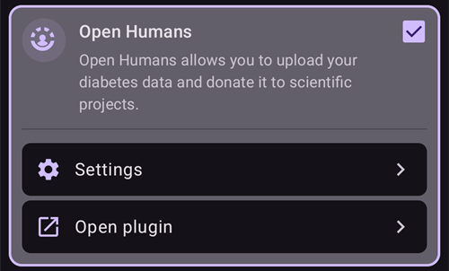

# Open Humans Uploader

## Donate your data for science

연구 프로젝트에 데이터를 기증하여 커뮤니티를 도울 수 있습니다! 이것은 과학자들이 받은 도움을 다시 나누고, 새로운 과학적 아이디어를 만들고, 오픈 소스 폐쇄 루프 시스템을 더 널리 알리는 데 도움이 됩니다. AAPS는 데이터를 [Open Humans](https://www.openhumans.org)와 동기화할 수 있습니다. Open Humans는 유전 정보, 활동 데이터, 건강 데이터 같은 개인 데이터를 업로드하고, 연결하고, 저장할 수 있는 플랫폼입니다.

데이터가 어떻게 쓰이는지, 그리고 어떤 프로젝트에 데이터 접근 권한을 주어 지원할지는 모두 사용자가 직접 정합니다. 참여한 프로젝트에 따라 데이터를 평가하고 사용하는 방법과 범위가 다릅니다.

다음 데이터가 Open Humans 계정으로 업로드됩니다:

- 혈당 값
- 케어포털 이벤트 (노트 제외)
- 확장 볼러스
- 프로파일 전환
- 총 일일 용량
- 임시 기저
- Temp targets
- 설정
- 애플리케이션 버전
- 기기 모델
- 화면 크기

Nightscout URL이나 API secret 같은 비밀 정보나 개인 정보는 업로드되지 않습니다.

## 설정

1. 아직 계정이 없다면 [Open Humans](https://www.openhumans.org)에서 계정을 만드십시오. 원하면 기존 Google 또는 Facebook 계정을 사용할 수 있습니다.
2. [**구성** > **통신**](../SettingUpAaps/ConfigBuilder.md)에서 **Open Humans** 플러그인을 활성화하십시오.



3. **Open Humans** 카드에서 **설정**을 누르십시오. 휴대폰이 Wi-Fi를 사용할 때(**WiFi 연결 시에만**) 및/또는 충전 중일 때(**충전 중에만**)만 업로드하도록 제한할 수 있습니다.


4. **Open Humans** 카드에서 **플러그인 열기**를 누른 다음, **설정하기**를 누르십시오.


5. **Open Humans에 오신 것을 환영합니다** 화면에서 **다음**을 누르십시오. **동의** 화면을 주의 깊게 읽으십시오. 이 화면에는 이용 약관과 업로드되는 데이터, 업로드되지 않는 데이터가 나와 있습니다.
6. **이해하고 동의합니다.**(1)를 켜고 **Open Humans에 로그인하기**(2)를 누르십시오.


7. Open Humans 웹사이트가 열립니다. 자신의 계정 정보로 로그인하십시오.
8. 공개 Open Humans 프로필에서 AAPS Uploader 회원 자격을 숨길지 정하십시오(1).
9. **Authorize project**(프로젝트 승인)를 누르십시오(2).


```{admonition} Older screenshot
:class: note
위의 스크린샷은 Open Humans 웹사이트의 예전 버전이며, 예전 프로젝트 이름인 **AndroidAPS Uploader**를 아직 사용합니다. 단계는 같습니다.
```

10. **AAPS**로 돌아오면 **최종 마무리** 화면에서 계속 진행할지 묻습니다. **진행**을 누르십시오.
11. **이제 끝났습니다!**가 나타날 때까지 기다린 다음, **닫기**를 누르십시오. 이제부터 휴대폰이 백그라운드에서 때때로 데이터를 업로드합니다.
12. 이제 **Open Humans** 플러그인 화면에 **프로젝트 회원 ID**가 표시됩니다. 바로 업로드를 시작하려면 **지금 업로드**를 누르십시오.
13. Open Humans로 데이터 업로드를 멈추려면 **로그아웃**을 누르십시오.
14. 업로드가 진행 중이면 Android 알림으로 알려 줍니다.


```{admonition} Older screenshot
:class: note
위 스크린샷은 이전 **AAPS** 버전의 것입니다. **AAPS** 4에서는 확인 화면이 **최종 마무리**와 **이제 끝났습니다!**이고, 대기열 크기는 없으며, 버튼은 **지금 업로드**와 **로그아웃**입니다.
```

15. [Open Humans 웹사이트](https://www.openhumans.org)에 로그인하면 데이터를 관리할 수 있습니다.


## 데이터 공유 기회

### ['OPEN' 프로젝트](https://www.open-diabetes.eu/)

'OPEN' 프로젝트에는 환자 혁신가, 임상의, 사회 과학자, 컴퓨터 과학자, 환자 옹호 단체가 함께 모인 국제적이고 여러 분야에 걸친 컨소시엄이 참여합니다. 이 프로젝트는 점점 더 많은 당뇨인이 사용하는 DIY 인공 췌장 시스템(DIY APS)의 여러 측면을 연구합니다. 자세한 내용은 해당 [웹사이트](https://www.open-diabetes.eu/)를 보십시오.

2020년 9월 'OPEN' 프로젝트는 [설문 조사](https://survey.open-diabetes.eu/)를 시작했습니다. 이 설문 조사에서 Open Humans에 업로드한 데이터를 기증할 수도 있습니다. 'OPEN' 프로젝트에 데이터를 기증하는 방법을 설명하는 [안내](https://open-diabetes.eu/en/open-survey/survey-tutorials/)가 해당 사이트와 설문 조사 안에 있습니다.

### [OpenAPS Data Commons](https://www.openhumans.org/activity/openaps-data-commons/)

OpenAPS Data Commons는 DIYAPS 커뮤니티의 데이터 세트를 연구용으로 쉽게 공유할 수 있도록 만들어졌습니다. 데이터는 일반적인 연구를 하는 기존 연구자들과 공유되고, 자신의 연구 프로젝트로 데이터를 살펴보려는 커뮤니티의 그룹이나 개인과도 공유됩니다. OpenAPS Data Commons는 'Open Humans' 플랫폼을 사용하여 AAPS, Loop, OpenAPS 등 DIYAPS의 데이터를 쉽게 업로드하고 공유할 수 있게 합니다.

다음 세 가지 방법 중 하나로 데이터를 Open Humans에 올릴 수 있습니다:

1. AAPS 업로더 옵션을 사용하여 데이터를 Open Humans에 올립니다
2. Nightscout Data Transfer를 사용하여 데이터를 Open Humans에 올립니다
3. 데이터 파일을 Open Humans에 직접 업로드합니다.

계정을 만들고 데이터가 Open Humans에 올라가기 시작하면, 원할 경우 데이터를 연구용으로 기증할 수 있도록 OpenAPS Data Commons에도 꼭 참여하십시오.

## Terms of Use

이 도구는 사용자의 데이터를 [Open Humans](https://www.openhumans.org)에 복사하는 오픈 소스 도구입니다. 사용자의 명시적인 승인 없이 제3자에게 데이터를 공유할 권리는 없습니다. 프로젝트와 앱이 받는 데이터는 무작위 사용자 ID로 식별되며, 사용자가 이 과정을 승인한 경우에만 Open Humans 계정으로 안전하게 전송됩니다. [www.openhumans.org](https://www.openhumans.org)에서 언제든지 업로드를 중지하고 업로드된 데이터를 삭제할 수 있습니다. 단, 데이터를 받는 일부 프로젝트는 이 기능을 지원하지 않을 수 있습니다.

[Open Humans 이용 약관](https://www.openhumans.org/terms/)도 참고하십시오.

## Data Privacy

Open Humans는 프로젝트마다 사용자에게 숫자 ID를 부여하여 개인 정보를 보호합니다. 이를 통해 프로젝트는 사용자를 구별할 수 있지만, 누구인지 알아낼 수는 없습니다. AAPS가 업로드하는 애플리케이션 ID도 이와 비슷하며, 데이터 관리에만 쓰입니다. 자세한 내용은 여기에서 볼 수 있습니다:

- [Open Humans 데이터 사용 정책](https://www.openhumans.org/data-use/)
- [Open Humans GDPR](https://www.openhumans.org/gdpr/)
