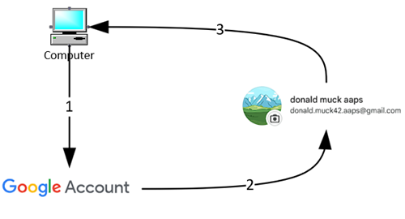
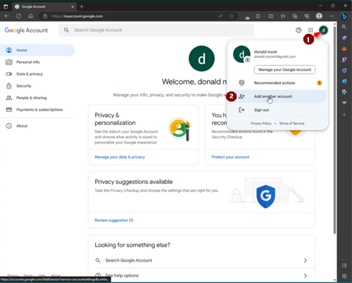
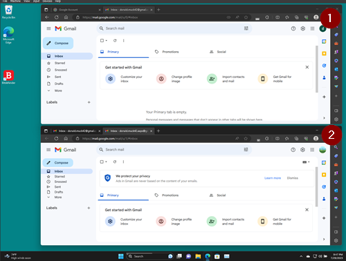

# AAPS 전용 Google 계정(선택 사항)

일부 **AAPS** 사용자는 **AAPS**에도 주 이메일 계정을 그대로 사용합니다. 다른 방법으로, 일부 **AAPS** 사용자(또는 보호자)는 **AAPS** 전용 이메일 계정을 따로 만듭니다. 이것은 선택 사항이며, 아래에 만드는 방법의 예를 설명합니다.

**AAPS** 전용 Gmail 계정을 만들고 싶지 않으면 바로 다음 섹션인 [AAPS 빌드](../SettingUpAaps/BuildingAaps.md)로 넘어가십시오.

```{admonition} Advantages of a dedicated Google account for AAPS
:class: dropdown

- 전용 Google Drive 공간이 있으면 **설정 내보내기** 때문에 개인 Google Drive 용량 한도가 찰 위험이 없습니다.
- 모든 **AAPS** 버전(그리고 xDrip, BYODA 같은 보조 앱)이 컴퓨터 하드웨어와 상관없는 한 곳에 저장됩니다. PC나 휴대폰을 도난당하거나 잃어버리거나 고장 나도 계속 접근할 수 있습니다.
- 설정 방식을 통일하면 폴더 구조가 비슷해서 사용자 간의 온라인 지원이 더 쉬워집니다.
- 설정 방식에 따라(아래 참조) 커뮤니티에서 소통할 때 별칭으로 된 별도의 신원을 쓸 수 있어서 개인 정보를 보호할 수 있습니다. 
- 제1형 당뇨병(T1D)이 있는 미성년 자녀는 자신의 “일상용” 이메일 계정을 그대로 두면서 성인 계정이 필요한 **AAPS**와 관련 기능을 사용할 수 있습니다.
- Gmail에서는 같은 전화번호로 계정을 최대 4개까지 등록할 수 있습니다.
```

## AAPS 전용 Google 계정을 설정하는 방법

(⌛약 10분)



준비물:

* **AAPS** 앱을 설치할 Windows PC(Windows 10 이상)와 Android 휴대폰(Android 12 이상)이 있어야 합니다. 일부 단계에서 프로그램을 다운로드하고 설치해야 하므로, 두 기기 모두 최신 보안 업데이트, 인터넷 연결, 관리자 권한이 있어야 합니다.
* Android 휴대폰에는 이미 개인 “일상용” 이메일 주소(예: Gmail 계정)가 설정되어 있습니다.

```{admonition} Things to consider when setting up your new account
:class: dropdown
- 개인 정보 보호를 위해 자신의 이름과 다른, 계정과 관련 있는 이름(예: t1dsuperstar)을 사용할 수 있습니다. 그러면 자신의 신원을 숨긴 채로 이 이름을 **AAPS** 공개 포럼에서 사용할 수 있습니다. Google은 복구 이메일과 전화번호를 요구하므로, 그래도 추적은 가능합니다.
- 새 **AAPS** 계정은 “_일상용_” 계정과 같은 전화번호로 인증합니다. 인증에는 “일상용” 이메일 주소를 사용합니다.
- 새 AAPS 전용 계정으로 오는 모든 이메일이 주 계정으로 전달되도록 이메일 전달을 설정합니다(그러면 두 개의 메일함을 확인할 필요가 없습니다).
- _일상용_ Gmail 계정과 AAPS 전용 Gmail 계정에는 서로 다른 비밀번호를 사용하십시오.
- 한 Gmail 계정에 Google “2-step verification”(2단계 인증, 다중 인증이라고도 함)을 사용한다면, 두 Gmail 계정 모두에 사용하는 것이 좋습니다.
- Google “Passkeys”(패스키)를 사용하려면 여러 기기를 등록하십시오. 그래야 자신의 계정에서 잠겨 버리지 않습니다. 다른 사람이 접근할 수 없는 기기에서만 하십시오(_예를 들어_ 다른 사람도 잠금을 풀 수 있는 공유 계정의 PC에서는 하지 마십시오).
```


```{admonition} Video Walkthrough!
:class: note
[여기](<https://drive.google.com/file/d/1dMZTIolO-kd2eB0soP7boEVtHeCDEQBF/view?usp=drive_link>)를 클릭하면 전용 Google 계정을 만드는 방법을 영상으로 볼 수 있습니다.
```

 영상에서 설명하는 단계는 다음과 같습니다:

이 예에서: 
- 기존 “_일상용_” Google 계정은 <donald.muck42@gmail.com>입니다; 
- 새 “_AAPS_” Gmail 계정은 <donald.muck42.aaps@gmail.com>입니다. 


### <https://myaccount.google.com>으로 이동합니다 

 이미 Google에 로그인되어 있으면 “일상용” 계정의 **My Account**(내 계정) 페이지로 이동합니다. (1) 페이지 오른쪽 위의 프로필 사진(이 예에서는 간단한 )을 클릭하고 (2) “_add another account_”(다른 계정 추가)를 선택하십시오.




### 새 전용 계정의 정보를 입력합니다: 

- 새 계정을 입력합니다. 
- 계정 만들기
- 개인용으로 사용합니다. 


### 개인 정보를 입력하십시오:
 - 이름 입력
 - 성
 - 생년월일(성인 나이여야 함)

### 새 이메일 주소와 비밀번호 정하기

이 예에서는 Donald Muck의 기존 주소 뒤에 “.AAPS”를 붙입니다.\
비밀번호를 정합니다.

### SMS 인증을 받을 수 있는 전화번호 입력하기

이제 Gmail이 확인용 고유 코드를 보냅니다. 이 코드를 입력하십시오.

### 복구 이메일 주소 입력하기

이 예에서는 기존 “_일상용_” 이메일입니다.

### 계정 설정 마치기

Gmail에 계정 이름이 표시됩니다. Gmail의 이용약관에 동의하고 개인 맞춤 설정을 확인하라는 요청이 나옵니다.

### 새 프로필 표시 사용자 지정하기

이제 새 **AAPS** 전용 이메일 계정이 보이는 Gmail의 MyAccount(내 계정) 페이지에 있어야 합니다. 프로필 사진은 기본으로 이름의 첫 글자로 설정됩니다. 혼동을 피하려면 다른 것과 구별되는 사진으로 바꾸십시오. 이 예에서 Donald.Muck.AAPS는 을(를) (으)로 바꾸었습니다.

\


### 두 창 모두에서 Gmail 웹사이트를 열어 새 계정 구성하기

별도의 이메일 계정을 따로 확인하지 않아도 되도록, 새 **AAPS** 전용 계정으로 오는 모든 이메일을 일상용 계정으로 전달합니다.\
두 계정 사이를 여러 번 오가야 하므로 이 부분은 조금 헷갈릴 수 있습니다. 작업을 쉽게 하려면 브라우저 창 2개를 위아래로 겹쳐 여십시오:

1. 지금 쓰는 브라우저 창을 화면 위쪽으로 옮기고, 화면의 위쪽 절반 정도만 차지하도록 크기를 조절합니다.
2. 작업 표시줄에서 브라우저 로고를 마우스 오른쪽 버튼으로 클릭합니다.
3. 메뉴에서 “New Window”(새 창)를 선택하고, 화면의 아래쪽 절반만 차지하도록 조절합니다.

각 브라우저 창에서 <https://gmail.com>을 엽니다. 개인 계정이 위쪽에, 새 **AAPS** 전용 계정이 아래쪽에 있는지 확인하십시오. 오른쪽 위 모서리의 프로필 사진으로 쉽게 구별할 수 있어야 합니다. 필요하면 언제든지 프로필 사진을 클릭하고 알맞은 계정을 선택하여 계정을 전환할 수 있습니다.


Gmail 홈 화면은 다음과 같아야 합니다:\


 ### 새 Gmail 계정(아래쪽 창)에서 Gmail 설정 열기

- 프로필 사진 왼쪽의 톱니바퀴를 클릭합니다.
- 그런 다음 “**See all Settings**”(모든 설정 보기)를 선택합니다.


### 전달 설정하기…

- “Forwarding and POP/IMAP”(전달 및 POP/IMAP) 설정 탭을 클릭하십시오
- “add a forwarding address”(전달 주소 추가)를 클릭하십시오
- “일상용” 이메일 주소를 추가하십시오
- Gmail이 “일상용” 이메일 주소로 인증 코드를 보냅니다.
- 일상용 프로필로 돌아가 링크를 클릭하여 전달을 수락한다고 확인하십시오(또는 “일상용” Gmail 창에 온 Gmail 확인 이메일에서 코드를 복사하여 “새 AAPS 전용” Gmail 창에 붙여 넣으십시오).

창 사이를 여러 번 오가야 하지만, 이렇게 하면 “일상용” 계정의 이메일을 확인할 때 Gmail 경고 같은 AAPS 전용 계정에서 전달된 이메일도 함께 볼 수 있습니다.


### 전달 이메일 주소 확인하기

- “일상용” Gmail(위쪽 창)에 “Gmail forwarding Confirmation”(Gmail 전달 확인) 이메일이 옵니다.
- 이메일을 열고 “click the link to confirm the request”(링크를 클릭하여 요청 확인)를 하십시오

### 새 전용 Gmail 계정(아래쪽 창)에서 전달된 이메일 보관하기

<!---->

1. 아래쪽 창을 새로 고치십시오
2. “forward incoming email”(수신 이메일 전달)에 체크하십시오
3. 그리고 Gmail 사본 보관을 선택하십시오(새 전용 메일함을 깔끔하게 유지하기 위해)
4. 맨 아래까지 스크롤해서 변경 사항을 저장합니다.\
   


축하합니다! 이제 AAPS 전용 Google 계정을 만들었습니다. 다음 단계는 [AAPS 앱 빌드](../SettingUpAaps/BuildingAaps.md)입니다.