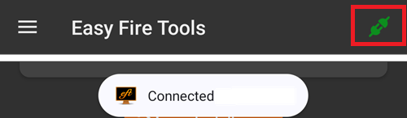
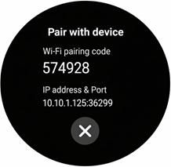
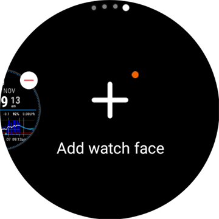

# Wear OS 워치에 AAPS 설정하기

아래 안내는 직접 빌드해야 하는 **AAPS Wear** apk에 적용됩니다. 아직 빌드하지 않았다면 [여기](../WearOS/BuildingAapsWearOS.md)에 링크된 안내를 참고하십시오. 빌드할 때는 휴대폰 **AAPS** apk에 사용한 것과 같은 키 저장소 파일을 사용해야 합니다.

**AAPSClient**와 **PumpControl**의 **Wear** apk에도 이 정보의 일부를 사용할 수 있습니다. 각 **Wear** 앱은 짝이 되는 휴대폰 앱과 통신합니다. 예를 들어 **AAPSClient Wear** 앱은 **AAPS** 데이터가 아니라 **AAPSClient** 데이터를 표시하는 데 사용할 수 있습니다. 여러 클라이언트 변형(**AAPSClient**, **AAPSClient2**, **AAPSClient3**)을 함께 설치한 경우, 각 변형의 타일 위에는 그 변형의 강조 색으로 된 작은 머리글이 있어서 화면을 넘길 때 서로 구별할 수 있습니다.

## Wear OS 버전과 호환성

(wearos-watchface-changes)=

### Wear OS 워치 페이스 변경(AAPS 워치 페이스에 미치는 영향)

```{admonition} Why newer Wear OS watches break AAPS watchfaces
:class: warning

2025년 6월 Google은 기존 워치 페이스 엔진(AndroidX / Wearable Support Library, 즉 "WSL" 엔진)을 단계적으로 없애고 더 새로운 선언형 **Watch Face Format**으로 바꾸는 [변경 사항을 발표했습니다](https://android-developers.googleblog.com/2025/06/upcoming-changes-to-wear-os-watch-faces.html). **AAPS** 사용자 지정 워치 페이스는 기존 엔진으로 만들어졌습니다. 따라서 Wear OS 버전이 새로울수록 AAPS 워치 페이스가 이상하게 작동하거나 작동을 멈출 가능성이 큽니다.

이 변경은 특히 **워치 페이스**에 영향을 줍니다. AAPS **컴플리케이션**, 타일, 원격 제어 기능은 영향을 받지 않습니다. 이 때문에 **Wear OS 워치의 펌웨어/시스템 업데이트 후 AAPS 워치 페이스가 작동하지 않을 수 있으며**, 업데이트 후에는 워치를 이전 Wear OS 버전으로 되돌릴 수 없습니다. 지금 AAPS 워치 페이스가 작동한다면 **워치 자동 업데이트를 끄십시오**.
```

아래 표는 Google의 변경이 Wear OS 버전별로 AAPS(기존 엔진) 워치 페이스에 어떤 영향을 주는지 요약합니다:

| Wear OS 버전              | 기반 Android | API 수준 | AAPS (기존) 워치 페이스에 미치는 영향                                                                                                                     |
| ----------------------- | ---------- | ------ | -------------------------------------------------------------------------------------------------------------------------------------------- |
| Wear OS 6               | Android 16 | 36     | **기존 워치 페이스를 더 이상 사용할 수 없음** — 대신 AAPS가 [Watch Face Format 워치 페이스](#wearos-aaps-v4-watchface)를 설치합니다: 사용자 지정 워치 페이스 또는 AAPS V4 컴플리케이션 워치 페이스 |
| Wear OS 5               | Android 14 | 34     | **심각** — 활성(대화형) 모드가 자주 실패하고, 컴플리케이션이 멈추고, 애니메이션이 멈춤                                                                                         |
| Wear OS 4               | Android 13 | 33     | **보통** — 속도 제한, 업데이트 누락, 일부 실패                                                                                                               |
| Wear OS 3.0 / 3.2 / 3.5 | Android 11 | 30     | **낮음** — 기존 엔진이 아직 지원됨                                                                                                                       |

워치의 Wear OS 버전에서 AAPS 워치 페이스가 안정적이지 않다면, 대신 호환되는 워치 페이스에서 **컴플리케이션**으로 AAPS 데이터를 표시할 수 있습니다. 또는 **AAPS**의 [외부 연동 앱](#external-companion-apps) 플러그인에서 데이터를 받는 [GlucoDataHandler](https://play.google.com/store/apps/details?id=de.michelinside.glucodatahandler)를 컴플리케이션과 함께 사용할 수 있습니다. **Wear OS 6 이상**에서는 AAPS가 새 형식으로 만든 대체 워치 페이스를 설치합니다. 아래를 참고하십시오.

(wearos-aaps-v4-watchface)=

### Wear OS 6 이상 — AAPS가 설치하는 워치 페이스

**Wear OS 6 이상**을 실행하는 워치에서는 기존 AAPS 워치 페이스를 워치 페이스로 실행할 수 없습니다. 이런 워치를 위해 AAPS 워치 앱에는 Google의 새 **Watch Face Format**으로 만든 워치 페이스 두 개가 들어 있습니다. Wear OS에서는 앱 하나가 워치 페이스를 **하나**만 설치할 수 있으므로, 둘 중 어느 것을 워치에 둘지 선택합니다:

- **사용자 지정 워치 페이스**(기본값): 휴대폰에서 **워치 페이스 불러오기**로 불러온 사용자 지정 워치 페이스를 표시합니다([AAPS 워치 페이스로 바꾸기](#WearOS_changing-to-AAPS-watchface) 참고). 워치는 디자인을 그림으로 그리므로, 기존의 모든 사용자 지정 워치 페이스가 작동합니다. 사용자 지정 워치 페이스에 정의된 컴플리케이션 슬롯은 이 그림에서 **사용할 수 없습니다**. Wear OS는 실제 워치 페이스에만 컴플리케이션 데이터를 전달하기 때문입니다. 워치 페이스를 길게 누르면 하나뿐인 설정이 나옵니다: 상시 표시 화면에 단순한 시계를 보여줄지, 아니면 내 디자인을 어둡게 보여줄지 정합니다.
- **컴플리케이션 워치 페이스**(**AAPS V4** 워치 페이스): **컴플리케이션 슬롯 7개**가 **AAPS 데이터로 미리 설정되어** 있습니다: 혈당 값, IOB, COB, [혈당 그래프 컴플리케이션](#Watchfaces-complications), 기저 주입량 / 임시 목표, 그리고 왼쪽 위 슬롯의 **실행 모드** 아이콘입니다(탭하면 워치에서 루프 모드를 바꿀 수 있습니다). 맨 위의 시간을 탭하면 워치의 알람 앱이 열립니다. 각 슬롯에 무엇을 표시할지는 워치 페이스 편집기에서 바꿀 수 있습니다.

선택은 휴대폰에서 합니다: **워치** 플러그인을 열고 **워치에 설치된 워치 페이스**에서 둘 중 하나를 선택하십시오. 이 카드는 Wear OS 6 이상 워치가 연결되어 있을 때만 표시됩니다. 워치가 워치 페이스를 바로 바꾸므로 **AAPS**가 확인을 요청합니다. **컴플리케이션 워치 페이스**에서 다른 워치 페이스로 바꾸면 워치 페이스 편집기에서 바꾼 컴플리케이션도 기본값으로 초기화됩니다. 확인 메시지에도 이 내용이 나옵니다. **컴플리케이션 워치 페이스**가 선택되어 있는 동안에는 사용자 지정 워치 페이스 버튼이 숨겨지고, 대신 워치 페이스 미리 보기가 표시됩니다. **컴플리케이션 워치 페이스**가 선택된 상태에서 사용자 지정 워치 페이스를 불러오면, 워치에서 보려면 **사용자 지정 워치 페이스**로 바꾸라고 **AAPS**가 알려줍니다.

- 선택한 워치 페이스는 이런 워치에서 AAPS 워치 앱이 처음 실행될 때 **자동으로 설치되고 활성화**되며, 워치 앱과 함께 **자동으로 업데이트**됩니다.
- 워치 페이스를 지웠다면 워치의 AAPS **메인 메뉴** 맨 아래에 **워치 페이스 설치** 항목이 나타납니다. 이 항목을 탭하면 다시 설치됩니다.

Wear OS 5 이하를 실행하는 워치가 연결되어 있는 동안에는 **워치에 설치된 워치 페이스** 카드가 전혀 표시되지 않습니다(이 기능이 사용하는 방식에는 Wear OS 6이 필요합니다). 이런 워치에서는 기존 워치 페이스가 예전처럼 실행됩니다.

(wearos-complications-watchface-setup)=

### 컴플리케이션 워치 페이스 — 권장 설정

**컴플리케이션 워치 페이스**에는 컴플리케이션 슬롯이 7개 있습니다. 워치 페이스를 길게 누르고 **Customize**(사용자 지정)를 탭한 다음, 각 슬롯의 데이터 소스를 고르십시오. 슬롯 번호는 워치 페이스 편집기와 같습니다: **1** 왼쪽, **2** 가운데, **3** 오른쪽, **4** 그래프, **5** 아래, **6** 왼쪽 위, **7** 오른쪽 위.

| 기본 설정                                                                         | 대체 설정                                                                             |
| ----------------------------------------------------------------------------- | --------------------------------------------------------------------------------- |
|  |  |

| 슬롯 | 위치    | 기본                                     | 대체                      |
| -- | ----- | -------------------------------------- | ----------------------- |
| 1  | 왼쪽    | IoB 아이콘                                | CoB & IoB               |
| 2  | 가운데   | 혈당                                     | 혈당                      |
| 3  | 오른쪽   | CoB 아이콘                                | BR & 목표                 |
| 4  | 그래프   | 혈당 그래프                                 | 혈당 그래프                  |
| 5  | 아래    | BR & 목표                                | 업로더/휴대폰 배터리             |
| 6  | 왼쪽 위  | 실행 모드                                  | 실행 모드                   |
| 7  | 오른쪽 위 | 업로더/휴대폰 배터리 또는 **AAPS 스누즈 알림** 앱 바로 가기 | **AAPS 스누즈 알림** 앱 바로 가기 |

**AAPS 스누즈 알림** 바로 가기는 워치 자체의 **App shortcut**(앱 바로 가기) 컴플리케이션에서 고릅니다. 이 바로 가기를 탭하면 휴대폰에서 울리고 있는 알람이 스누즈됩니다.

```{tip}
워치에서 **Always-on display**(상시 표시)를 켜십시오(**Settings**(설정) > **Display**(디스플레이)). 그러면 손목을 내리고 있을 때도 워치 페이스가 빈 화면이나 단순한 시계 대신 혈당을 계속 보여줍니다.
```

```{admonition} No complication data while the watch is locked
:class: note
**Settings**(설정) > **Security and privacy**(보안 및 개인정보 보호)에서 **Lock type**(잠금 유형)이 설정되어 있으면, 워치가 잠겨 있는 동안 컴플리케이션 데이터를 숨기고, 잠금을 풀 때까지 워치 페이스에 빈 슬롯이 표시됩니다. 데이터가 계속 보이게 하려면 같은 메뉴에서 **Hide information**(정보 숨기기)을 끄십시오.
```

### Wear OS 3

[Wear Installer 2](https://youtu.be/abgN4jQqHb0?si=5L7WUeYMSd_8IdPV), Easy Fire Tools(아래 설명) 또는 ADB를 사용해 **AAPS Wear** apk를 설치하십시오.  
**AAPS Wear** 작동에 제한이 없습니다.

(BuildingAapsWearOs-WearOS5)=

### Wear OS 4 및 Wear OS 5

예: 아직 Wear OS 6으로 업데이트되지 **않은** Galaxy Watch 4, 5, 6, 7, Ultra 또는 Pixel Watch. 버전은 **Settings**(설정) > **About watch**(워치 정보) > **Software**(소프트웨어)에서 확인하십시오.

[Wear Installer 2](https://youtu.be/abgN4jQqHb0?si=5L7WUeYMSd_8IdPV)를 사용해 **AAPS Wear** apk를 설치하십시오(Wear OS 5는 [이 영상](https://www.youtube.com/watch?v=yef_qGvcCnk)을 따르십시오). 모든 **AAPS Wear** 기능이 작동하지만, 기존 **AAPS** 워치 페이스는 위 표에 설명된 대로 제한됩니다: Wear OS 4에서는 속도가 제한되고, Wear OS 5에서는 자주 실패합니다.

```{admonition} Wear OS 5
:class: warning
Wear OS 5에서는 Wear 앱을 설치한 직후 Wear Installer 2로 AAPS 워치 페이스를 선택해야 합니다: 설치가 끝날 때 설치 프로그램이 **AAPS (Custom)** 워치 페이스를 제안합니다. 실수로 다른 워치 페이스로 바꾸었다면 설치를 다시 하십시오. 워치 페이스 설정(어두움, 경계선 색상 맞춤 등)을 바꾸지 못할 수도 있습니다.

지금 기존 워치 페이스가 잘 작동한다면 **워치 자동 업데이트를 끄십시오**: 다음 펌웨어 업데이트 후 작동하지 않을 가능성이 큽니다. 그래도 Wear OS 6으로 업데이트한다면 위 섹션을 읽으십시오: 그러면 **AAPS**가 새 형식으로 된 자체 워치 페이스를 설치합니다.
```

워치 페이스가 너무 불안정하다면 대신 [GlucoDataHandler](https://play.google.com/store/apps/details?id=de.michelinside.glucodatahandler)를 컴플리케이션과 함께 사용하는 것을 고려하십시오. 이를 위해서는 **AAPS**에서 [외부 연동 앱](#external-companion-apps) 플러그인을 켜야 합니다.

### Wear OS 6 이상

예: One UI 8 Watch가 설치된 Galaxy Watch 4 이후 모델, 2025년 업데이트 후의 Pixel Watch. 대부분의 Galaxy 및 Pixel 워치가 이 업데이트를 받았습니다.

[Wear Installer 2](https://youtu.be/abgN4jQqHb0?si=5L7WUeYMSd_8IdPV)를 사용해 **AAPS Wear** apk를 설치하십시오. 기존 워치 페이스는 사용할 수 없습니다. **AAPS**가 휴대폰에서 선택한 워치 페이스를 자동으로 설치합니다. [AAPS가 설치하는 워치 페이스](#wearos-aaps-v4-watchface)를 참고하십시오. **AAPS Wear** 작동에 제한이 없습니다.

## Samsung Galaxy Watch 4 스마트워치를 **AAPS**와 함께 사용하도록 설정하는 방법

이 섹션은 스마트워치를 처음 사용하는 분을 위한 것입니다. 인기 있는 워치인 **Galaxy Watch 4**의 기본 사용법을 먼저 소개하고, 이어서 워치에 **AAPS**를 설정하는 방법을 단계별로 안내합니다.

_이 안내는 Wear OS 3을 실행하는 Galaxy Watch를 기준으로 작성되었습니다._ Wear OS 4 이상에서는 휴대폰이나 컴퓨터가 ADB로 연결할 때 워치가 **페어링 코드**를 요청합니다. Wear Installer 2와 [아래](#BuildingAapsWearOs-WearOS5-TShoot)의 터미널 절차 모두 이를 지원합니다.

다음은 [Galaxy Watch 5](https://www.youtube.com/watch?v=Y5upzOIxwTU)와 [Galaxy Watch 6](https://www.youtube.com/watch?v=D6bq20KzPW0)의 기본 설정 안내입니다

## 스마트워치 기본 사용법 익히기

위 영상에 따라 워치의 기본 설정을 마친 후, 휴대폰에서 Play 스토어로 가서 다음 앱을 다운로드하십시오: "Galaxy Wearable", “Samsung”, 그리고 “Easy Fire tools” 또는 "Wear Installer 2" 중 하나.

새 스마트워치에 익숙해지는 데 도움이 되는 타사 YouTube 영상이 많이 있습니다. 예:

[https://www.youtube.com/watch?v=tSVkqWNmO2c](https://www.youtube.com/watch?v=tSVkqWNmO2c)

“Galaxy Wearable” 앱에도 사용 설명서가 들어 있습니다. 휴대폰에서 Galaxy Wearable을 열고 워치를 검색한 다음, 워치와 휴대폰을 페어링해 보십시오. 버전에 따라 Play 스토어에서 추가 앱 “galaxy watch 4 plugin”을 하나 더 설치하라는 메시지가 나올 수 있습니다(다운로드에 시간이 걸립니다). 이 앱을 휴대폰에 설치한 다음, Wearable 앱에서 워치와 휴대폰을 다시 페어링해 보십시오. 여러 메뉴를 거치면서 여러 가지 설정을 선택하십시오.

## Samsung 계정 설정하기

Samsung 계정을 만들 때 사용하는 이메일 계정의 생년월일이 사용자 나이 13세 이상으로 되어 있는지 확인하십시오. 그렇지 않으면 Samsung 권한을 승인하기가 매우 어렵습니다. 13세 미만 자녀에게 Gmail 계정을 만들어 주고 그 이메일 주소를 사용하는 경우, 이 계정을 간단히 성인 계정으로 바꿀 수 없습니다. 한 가지 해결 방법은 현재 생년월일을 바꾸어 지금 나이를 12세 364일로 만드는 것입니다. 다음 날 계정이 성인 계정으로 바뀌고, Samsung 계정 설정을 계속할 수 있습니다.

(remote-control-transferring-the-aaps-wear-app-onto-your-aaps-phone)=

## **AAPS** Wear 앱을 **AAPS** 휴대폰으로 옮기기

Android Studio에서 만든 Wear.apk를 휴대폰으로 옮기는 방법은 다음과 같습니다:

a)  USB 케이블로 **AAPS** wear apk 파일을 휴대폰에 넣은 다음, 워치로 “사이드로드”합니다. USB로 Wear.apk를 휴대폰의 다운로드 폴더에 옮깁니다. 또는

b)  Android Studio에서 Wear.apk를 잘라내어 Gdrive(Google Drive)에 붙여 넣습니다.


워치에 AAPS를 사이드로드하려면 다음 중 하나를 사용할 수 있습니다: 1) Wear Installer 2 2) Easy Fire tools 3) Android Debug Bridge (ADB) 여기서는 Wear Installer 2를 권장합니다. 영상의 안내와 과정이 매우 명확하고 잘 설명되어 있기 때문입니다. Wear Installer 2가 작동하지 않으면 아래에 설명된 Easy Fire Tools나 ADB를 사용해 보십시오.

### Wear Installer 2로 휴대폰에서 워치로 **AAPS** Wear 사이드로드하기

 

[Malcolm Bryant](https://www.youtube.com/@Freepoc)가 개발한 Wear Installer 2는 Google Play에서 휴대폰으로 다운로드할 수 있으며, AAPS wear 앱을 워치로 사이드로드하는 데 사용할 수 있습니다. 이 앱에는 유용한 ‘사이드로드 방법’ [영상](https://youtu.be/abgN4jQqHb0?si=5L7WUeYMSd_8IdPV)이 들어 있습니다.

```{tip}
Wear OS 5 워치는 [이 영상](https://www.youtube.com/watch?v=yef_qGvcCnk)을 따르십시오.
[아래](#BuildingAapsWearOs-WearOS5-TShoot)의 문제 해결 팁을 참고하십시오.
```

이 영상에 필요한 모든 내용이 자세히 나와 있습니다(휴대폰을 설정하면서 볼 수 있도록 영상은 다른 기기에서 여는 것이 가장 좋습니다).

영상에서 설명하듯이, 작업을 마치면 스마트워치 배터리가 빨리 닳지 않도록 워치에서 ADB debugging(ADB 디버깅)을 끄십시오.

Wear OS 5가 아니라면 다음 방법도 사용할 수 있습니다:

### Easy Fire tools로 워치에 **AAPS** wear 사이드로드하기

1)   Play 스토어에서 휴대폰에 _[Easy Fire Tools](https://play.google.com/store/apps/details?id=de.agondev.easyfiretools&hl=en)_를 다운로드하십시오


2)  워치에서 개발자 모드를 켜십시오(워치를 설정하고 휴대폰에 연결한 후):

**Settings**(설정) > **System**(시스템) > **About**(정보) > **Versions**(버전)로 가십시오(메뉴 이름은 워치 브랜드마다 다릅니다 — 일부 워치에서는 **About watch**(워치 정보) > **Software info**(소프트웨어 정보) > **Software version**(소프트웨어 버전)입니다).


이제 개발자라는 메시지가 나올 때까지 **Build number**(빌드 번호)(또는 **Software version**(소프트웨어 버전))를 빠르게 여러 번 탭하십시오.


**Settings**(설정) > **System**(시스템)으로 돌아가십시오: 이제 새 **Developer options**(개발자 옵션) 메뉴가 표시됩니다.

**Developer options**(개발자 옵션)에서 **ADB debugging**(ADB 디버깅)과 **Wireless debugging**(무선 디버깅)을 켜고, 확인 창에서 허용하십시오. 그러면 무선 디버깅 화면에 워치의 **IP address & Port**(IP 주소 및 포트)가 표시됩니다. 예: **192.168.1.214** : 5555. IP 주소(여기서는 **192.168.1.214**)만 필요하며, 콜론 뒤의 포트 번호는 필요 없습니다. IP 주소는 바뀔 수 있습니다. 예를 들어 AAPS용 휴대폰을 새 기기로 바꿀 때마다 바뀔 수 있습니다.


3단계)     휴대폰의 Easy Fire tools에 IP 주소(_예:_ **192.168.1.214**)를 입력하십시오(왼쪽 햄버거 메뉴에서 settings로 가서 IP 주소를 입력합니다).


그런 다음 오른쪽 위의 플러그 소켓 아이콘을 누르십시오. 연결되면 녹색으로 바뀝니다.




4단계) [여기](https://wearablestouse.com/blog/2022/01/04/install-apps-apk-samsung-galaxy-watch-4/?utm_content=cmp-true)의 안내에 따라 Easy Fire tools로 aaps-wear.apk를 스마트워치에 사이드로드(즉, 전송)하십시오


(BuildingAapsWearOs-WearOS5-TShoot)=

### 터미널 사용하기
스마트워치와 컴퓨터를 같은 Wi-Fi 네트워크에 연결하십시오.

- ADB를 설치하려면 다음에서 다운로드하십시오: https://developer.android.com/tools/releases/platform-tools
- 터미널을 여십시오.
- Windows에서는 `C:` 디스크 아래에 `adb`라는 새 폴더를 만드십시오. 위에서 다운로드한 `platform-tools-latest-windows.zip` 파일을 여십시오. `platform-tools` 안의 모든 파일을 `C:\adb`에 복사하고, 이 폴더를 명령 프롬프트로 여십시오(마우스 오른쪽 버튼을 누르고 Open in Terminal(터미널에서 열기) 선택). 아래 명령을 입력하여 ADB가 있는 폴더의 경로를 설정하십시오: `setx PATH "%PATH%;C:\adb"`
- Mac에서는 직접 설치하는 대신 homebrew를 사용할 수 있습니다: `brew install android-platform-tools`

워치에서:
- Settings(설정) → About watch(워치 정보) → **Software Information**(소프트웨어 정보)로 가십시오
- Developer mode enabled(개발자 모드 켜짐)가 보일 때까지 Software version(소프트웨어 버전)을 7번 탭하십시오.
- Settings(설정) → Developer options(개발자 옵션)로 가십시오. **ADB debugging**(ADB 디버깅)을 켜십시오
- Settings(설정) → Developer options(개발자 옵션) → Wireless debugging(무선 디버깅) → **Pair new device**(새 기기 페어링)로 가십시오

Wi-Fi 페어링 코드와 IP 주소 및 포트가 표시됩니다:



- 터미널에서: `adb pair ipaddress:port` 예: `adb pair 10.10.1.125:36299`
- 페어링 코드를 입력하라는 요청이 나옵니다. 코드를 입력하십시오.
- 다음과 같은 응답이 표시됩니다:<br> `Successfully paired to 10.10.1.125:36299 [guid=adb-RXXXW20LMKJY-eh5zBj]`<br>
- 터미널에 다음을 입력하십시오: <br>`adb devices`.<br> 다음과 같은 내용이 표시되어야 합니다:<br> `List of devices attached`<br> `10.10.1.125:36299  offline`<br> `adb-RFAW20LMKJY-eh5zBj._adb-tls-connect._tcp   device`<br>

- 이제 컴퓨터에서 Wear apk가 있는 폴더로 가서 다음을 입력하십시오<br> `adb install wear-full.apk` <br>wear-full.apk를 실제 apk 파일 이름으로 바꾸십시오.
- 다음이 표시됩니다:<br> `Performing Streamed Install`<br> `Success`


(wear-os-5-troubleshooting)=

### Wear OS 5의 일반적인 문제 해결 권장 사항

- Wi-Fi 테더링을 사용하지 마십시오. 그렇게 하면 작동하지 않습니다.
- 휴대폰에서 adb 디버깅을 켤 필요는 없습니다(워치에서만 켜면 됩니다). 휴대폰에서 adb 디버깅을 끄십시오.
- 휴대폰과 워치가 서로를 볼 수 있는 로컬 네트워크에 연결하고 있는지 확인하십시오(Wi-Fi 게스트 네트워크로 연결하지 마십시오).
- 워치와 휴대폰이 모두 같은 네트워크, 같은 Wi-Fi 기기에 연결되어 있는지 확인하십시오. 특히 Wi-Fi 중계기나 액세스 포인트는 문제를 일으킬 수 있습니다.
- 메인 라우터 가까이에 있는 상태에서 휴대폰과 워치를 모두 다시 시작하십시오.

**페어링 :**

- 워치: Wireless Debugging(무선 디버깅): IP 주소를 적어 두십시오.
- Wear Installer: Wear Installer 앱에 IP를 입력하십시오.
- Pair new(새로 페어링)를 선택하고, 표시되는 페어링 코드와 포트 번호를 적어 두십시오.
- Wear Installer: 페어링 코드 + 공백 + 포트 번호를 입력하십시오.
- Wear Installer에 페어링이 성공했다고 표시되어야 합니다. 그렇지 않으면 Wear Installer를 종료한 다음 다시 시도하십시오.

페어링되면 AAPS wear apk를 설치할 수 있습니다:

- Wear Installer를 종료하고(닫고) 다시 시작하십시오.
- 무선 디버깅에서 IP와 포트 번호를 적어 두고, Wear Installer에 이 IP와 포트 번호가 들어 있는지 확인하거나 입력하십시오.
- 참고: 이 포트 번호는 페어링에 사용한 포트 번호와 다릅니다!

## **AAPS**에서 워치와 휴대폰 사이의 연결 설정하기

마지막 단계는 휴대폰의 **AAPS**가 워치의 **Wear.apk**와 통신하도록 구성하는 것입니다. 이를 위해 워치(Wear) 플러그인을 켜십시오:

* 휴대폰에서 **AAPS** 앱으로 가십시오

* 왼쪽 위의 **메뉴** (☰)를 열고 **구성** > **통신**으로 가십시오

* **워치** 상자에 체크하십시오


워치에서 볼러스를 주입하거나 다른 동작을 하려면 [설정 > 워치](#preferences-wear)에서 **워치 제어**도 켜십시오.

다른 **AAPS** 워치 페이스로 바꾸려면 워치 홈 화면의 워치 페이스를 길게 누른 다음 **Customize**(사용자 지정)를 누르십시오. 그런 다음 모든 **AAPS** 워치 페이스가 나올 때까지 오른쪽으로 스와이프하십시오.

**AAPS** Wear.apk가 스마트워치에 제대로 사이드로드되었다면 다음과 같이 보입니다:


Samsung Galaxy 같은 일부 스마트워치에서는 Wi-Fi를 통해 원격으로 **Wear.apk**와 **AAPS**를 사용하려면 Samsung Galaxy의 Advanced Features(고급 기능)에 있는 'Remote Connection'(원격 연결)을 **켜야** 합니다.


(wear-os-watch-phone-communication)=

### **AAPS** 워치와 **AAPS** 휴대폰 사이의 통신 문제 해결

1.  EasyFire tools가 연결되지 않거나 ‘authorisation failed’(인증 실패)가 표시되면 > IP 주소를 올바르게 입력했는지 확인하십시오.
2.  스마트워치가 인터넷에 연결되어 있는지 확인하십시오(블루투스로 휴대폰에만 연결되어 있으면 안 됩니다).
3.  **AAPS** 휴대폰과 스마트워치가 Samsung 앱에서 페어링 또는 연결되어 있는지 확인하십시오.
4.  휴대폰과 스마트워치를 완전히 다시 시작하는 것(휴대폰을 껐다가 켜는 것)도 도움이 될 수 있습니다
5.  Wear.apk를 휴대폰에 다운로드했지만 혈당 데이터를 받지 못한다면, 워치에 올바른 **AAPS** Wear apk를 사이드로드했는지 _확인_하십시오: 브라우저 빌드의 워치 앱은 `aaps-wear-….apk` 파일입니다. [Wear AAPS 앱 빌드](../WearOS/BuildingAapsWearOS.md)를 참고하십시오. 설치한 파일이 다음 중 하나라면: a) **AAPSClient** Wear apk(휴대폰에서는 **AAPS**를 실행하는 경우); b) `.aab` 파일; 또는 c) 이름에 ‘debug’라는 단어가 들어 있는 파일, 빌드할 때 올바른 Wear OS apk를 선택하지 않은 것입니다.
6.  라우터가 기기들을 서로 분리(isolation)하고 있지 않은지 확인하십시오.

더 많은 문제 해결 팁은 [여기](https://freepoc.org/wear-installer-help-page/#:~:text=If%20you%20are%20having%20problems,your%20phone%20and%20your%20watch.)에 있습니다

(WearOS_changing-to-AAPS-watchface)=

## WearOS 워치에서 AAPS 워치 페이스로 바꾸기

AAPS Wear OS APK의 표준 빌드에는 여러 워치 페이스가 들어 있습니다. 워치에 AAPS Wear APK를 설치하면 이 워치 페이스들을 사용할 수 있습니다. 하나를 선택하는 방법은 다음과 같습니다:

1. 워치에서(WearOS 기준) 현재 워치 페이스를 길게 눌러 워치 페이스 선택 화면을 열고, "Add Watch Face"(워치 페이스 추가) 버튼이 보일 때까지 오른쪽 끝까지 스크롤한 다음 이 버튼을 선택하십시오



2. 목록을 스크롤하여 "AAPS (Custom)"을 찾고(워치에 따라 설치된 앱의 워치 페이스가 "Downloaded"(다운로드됨) 섹션에 나오거나 앱별로 묶여 있습니다), 이미지 가운데를 눌러 현재 워치 페이스 목록에 추가하십시오. "AAPS (Custom)" 워치 페이스의 지금 모양은 신경 쓰지 마십시오. 다음 단계에서 원하는 스킨을 선택합니다.


3. 이제 휴대폰에서 AAPS를 열고 워치 플러그인을 여십시오: **구성** > **통신** > **워치** > **플러그인 열기**(**워치**가 켜져 있지 않으면 먼저 체크하십시오).


4. "워치 페이스 불러오기" 버튼을 누르고 원하는 워치 페이스를 선택하십시오


5. 워치를 확인하십시오. 이제 "AAPS (Custom)" 워치 페이스에 선택한 스킨이 표시되어야 합니다. 화면이 새로 고쳐질 때까지 몇 초 기다리십시오. 이제 휴대폰의 **워치** 화면에 불러온 워치 페이스의 이름과 미리 보기가 표시됩니다. **워치 페이스 정보**는 워치 페이스의 세부 정보와 포함된 필드를 보여주고, **더 많은 워치 페이스**는 다른 사용자 지정 워치 페이스를 다운로드할 수 있는 [교환 사이트](../ExchangeSiteCustomWatchfaces/index.md)를 엽니다. 이제 워치 페이스를 길게 누른 다음 워치 페이스 이미지의 "Customize"(사용자 지정) 버튼을 눌러 컴플리케이션 등을 사용자 지정할 수 있습니다.

```{admonition} Complications on a custom watchface
:class: note
사용자 지정 워치 페이스 형식 3.0 이상으로 만든 사용자 지정 워치 페이스에는 컴플리케이션 슬롯이 최대 5개 있을 수 있으며, 슬롯의 위치와 크기는 워치 페이스가 정합니다(**컴플리케이션 배치**). 워치에서 워치 페이스를 길게 누르고 **Customize**(사용자 지정)를 탭한 다음, **컴플리케이션 1**부터 **컴플리케이션 5**까지 탭하여 각 슬롯에 표시할 데이터 소스를 고르십시오. 같은 항목이 워치의 AAPS 앱에서 **설정** > **AAPS(Custom)** 아래에도 있습니다. 여기서 항목을 탭해도 같은 선택 화면이 열립니다. **컴플리케이션 유형 우선순위**는 데이터 소스가 여러 형식을 제공할 때 슬롯이 값 또는 게이지, 텍스트, 아이콘 중 무엇을 먼저 쓸지 정합니다. 바꾼 우선순위는 다음에 그 슬롯의 데이터 소스를 고를 때부터 적용됩니다.

이 슬롯은 사용자 지정 워치 페이스가 실제 워치 페이스로 실행되는 **Wear OS 5 이하** 워치에서만 작동합니다. **Wear OS 6 이상**에서는 사용자 지정 워치 페이스가 컴플리케이션 슬롯 없이 그림으로 표시되므로 위의 1, 2단계는 필요 없습니다: 휴대폰의 **워치** 플러그인에서 **워치에 설치된 워치 페이스**로 **사용자 지정 워치 페이스**가 선택되어 있는지 확인하십시오([AAPS가 설치하는 워치 페이스](#wearos-aaps-v4-watchface) 참고).
```

## AAPSv2 워치 페이스 - 범례


A - 마지막 루프 실행 후 지난 시간

B - CGM 측정값

C - 마지막 CGM 측정 후 지난 시간(분)

D - 마지막 CGM 측정값과 비교한 변화(mmol 또는 mg/dL)

E - 최근 15분 동안 CGM 측정값의 평균 변화

F - 휴대폰 배터리

G - 기저 주입량(표준 주입량일 때는 U/h, 임시 기저(TBR)일 때는 %로 표시)

H - BGI (blood glucose impact, 혈당 영향) -> 인슐린 활동만으로 볼 때 혈당이 “올라가거나 내려가야 하는” 정도.

I - 탄수화물 (활성 탄수화물 | 앞으로 들어올 e-carbs)

J - 활성 인슐린 (볼러스에서 | 기저에서)
