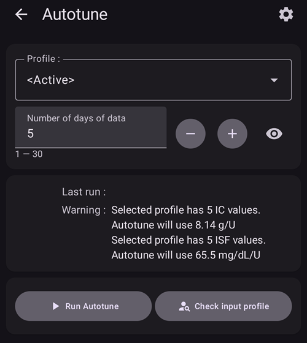
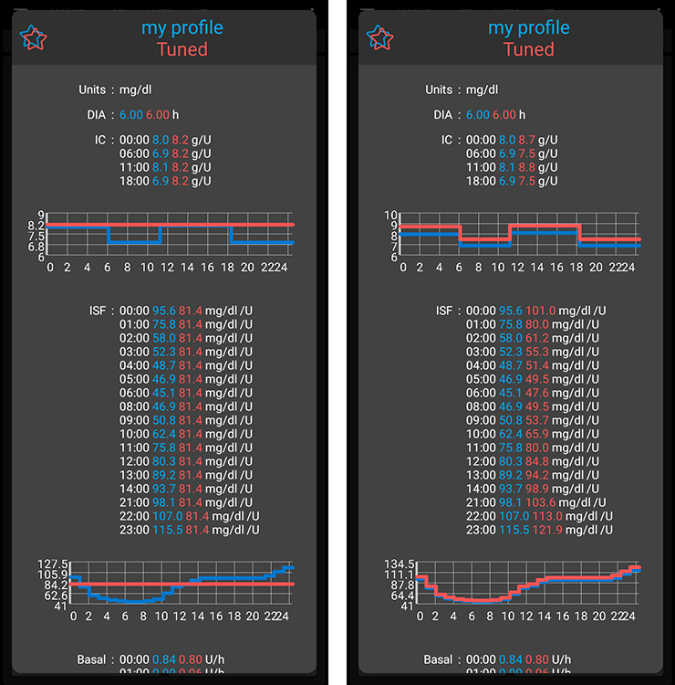
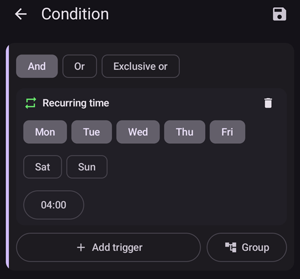
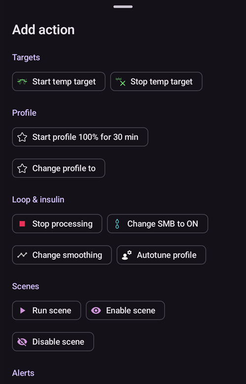
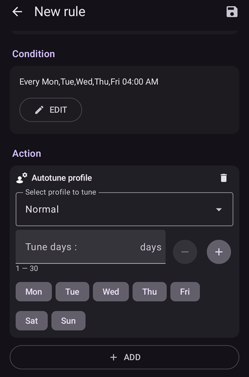

# Kaip naudoti Autotune įskiepį

Autotune įskiepis yra OpenAPS autotune algoritmo įgyvendinimas AAPS programėlėje. Jis analizuoja jūsų naujausią AAPS istoriją ir siūlo, kaip pakoreguoti valandinę bazę, JIF ir IA.

Autotune Plugin is available in AAPS releases since [3.4](#version3400) but is hidden by default.

(autotune-how-autotune-calculates-adjustments)=
## Kaip Autotune apskaičiuoja pakeitimus

Autotune peržiūri jūsų naujausią AAPS istoriją – CGM reikšmes, bolusus, angliavandenius ir laikinas valandines bazes – ir nustato, kur jūsų **profilis** (valandinė bazė, JIF, IA) ne visai atitinka tai, kas iš tikrųjų vyko su jūsų KG.

Kiekvienam 5 minučių duomenų taškui jis palygina **tikrą KG pokytį** su pokyčiu, kurį numatė jūsų profilis, ir priskiria gautą nuokrypį vienai iš trijų grupių:

* nuokrypiai, atsiradę, kai nėra aktyvių angliavandenių ir nėra insulino veikimo (naudojami **valandinei bazei** derinti, kiekvienai valandai atskirai),
* nuokrypiai, atsiradę po boluso ar korekcijos be angliavandenių (naudojami **JIF** derinti), arba
* nuokrypiai, atsiradę įsisavinant angliavandenius (naudojami **IA** derinti).

Tada jis peržiūri kiekvienos grupės nuokrypių dėsningumą (naudoja procentilius, o ne paprastą vidurkį, kad keli triukšmingi duomenų taškai neiškreiptų rezultato) ir siūlo naują tos valandos ar parametro reikšmę.

Kad vienas skaičiavimas per daug nepakoreguotų, kiekvienas Autotune paleidimas pakeičia reikšmę tik dalimi to, ką rodo duomenys: iki 10 % JIF ir IA, ir iki 20 % kiekvienam valandinės bazės intervalui. Bendrą pokytį dar riboja nustatymai **Didžiausia Autosens reikšmė** / **Mažiausia Autosens reikšmė** (žr. [Kiti nustatymai](#autotune-other-settings) žemiau) – tos pačios ribos, kurios riboja Autosens. Todėl Autotune skirtas paleisti pakartotinai (diena po dienos arba kas naktį), o ne pasitikėti juo po vieno paleidimo: rezultatai turi artėti palaipsniui, o didelis šuolis per vieną paleidimą yra ženklas dar kartą patikrinti duomenis (praleisti angliavandeniai, bloga jutiklio diena _ir t. t._), o ne aklai juo pasitikėti.

Autotune galima paleisti trimis būdais: rankiniu būdu vieną kartą įskiepyje (kaip aprašyta žemiau), automatiškai kiekvieną naktį naudojant [automatizacijos taisyklę](#autotune-run-autotune-with-an-automation-rule) arba visiškai be AAPS – kaip atskirą komandinės eilutės įrankį su eksportuotais duomenimis. Taip kai kurie bendruomenės vadovai aprašo jo naudojimą be telefono, kuriame veikia AAPS.

*Išsamų oref0 algoritmo matematinį aprašymą rasite [OpenAPS Autotune dokumentacijoje](https://openaps.readthedocs.io/en/latest/docs/Customize-Iterate/autotune.html).*

## Autotune įskiepio parodymas

Sukurkite tuščią failą `enable_autotune` poaplankyje `extra`, kuris yra jūsų telefono [AAPS aplanke](#preferences-maintenance-settings).

***PASTABA: AAPS nustatymuose būtinai patikrinkite, kur yra jūsų AAPS aplankas, ir ar įdėjote failą į teisingą aplanką. Keli naudotojai įdėjo failą į netinkamą aplanką.***


Paleiskite **AAPS** iš naujo. Tada atidarykite **meniu** (☰), pasirinkite **Konfigūracija**, tada kategoriją **Bendrieji** ir pažymėkite **Autotune**. Tada kortelėje rodoma **Parametrai** ir **Atidaryti įskiepį**:


## Autotune naudotojo sąsaja

Kortelėje **Autotune** spauskite **Atidaryti įskiepį**, kad atidarytumėte Autotune ekraną:



- Profilio išskleidžiamajame sąraše galite pasirinkti įkeliamą profilį, kurį norite suderinti (numatyta, kad pasirinktas jūsų dabar aktyvus profilis)
  - Pastaba: kiekvieną kartą pasirinkus naują profilį, ankstesni rezultatai bus pašalinti, o **Dienų, kurių duomenys naudojami, skaičius** bus nustatytas į numatytąją reikšmę
- Tada laukelyje **Dienų, kurių duomenys naudojami, skaičius** (senesnėse versijose **Dienų sk**) pasirenkate, kiek dienų naudoti skaičiuojant profilio derinimą. Mažiausia reikšmė yra 1 diena, didžiausia – 30 dienų. Šis skaičius neturi būti per mažas, kad rezultatai būtų teisingi, nuoseklūs ir tolygūs (daugiau nei 7 dienos kiekvienam skaičiavimui)
  - Pastaba: kiekvieną kartą pakeitus **Dienų, kurių duomenys naudojami, skaičius**, ankstesni rezultatai bus pašalinti
- Paskutinį kartą vykdyta – tai nuoroda, kuri atkuria jūsų paskutinį sėkmingą skaičiavimą. Jei šiandien nepaleidote Autotune arba jei ankstesni rezultatai buvo pašalinti pakeitus aukščiau esantį skaičiavimo parametrą, galite atkurti paskutinio sėkmingo skaičiavimo parametrus ir rezultatus.
- Įspėjime rodoma, pavyzdžiui, informacija apie pasirinktą profilį (jei turite kelias IA reikšmes arba kelias JIF reikšmes)
  - Pastaba: Autotune skaičiuoja tik su viena IA ir viena JIF reikšme. Šiuo metu nėra Autotune algoritmo, kuris derintų cirkadinį IA ar cirkadinį JIF. Jei jūsų įkeliamas profilis turi kelias reikšmes, įspėjimo skiltyje matysite vidutinę reikšmę, kuri naudojama derinant profilį.
- Mygtukas „Patikrinti įkeliamą profilį“ atidaro profilio peržiūrą, kad galėtumėte greitai patikrinti savo profilį (vienetus, IA, JIF, valandinę bazę ir tikslą)
  - Pastaba: Autotune derina tik jūsų IA (viena reikšmė), JIF (viena reikšmė) ir valandinę bazę (su cirkadiniais svyravimais). Vienetai ir tikslas gautame profilyje liks nepakeisti.

- „Paleisti Autotune“ pradeda Autotune skaičiavimą su pasirinktu profiliu ir pasirinktu duomenų dienų skaičiumi
  - Pastaba: Autotune skaičiavimas gali užtrukti ilgai. Paleidę skaičiavimą galite pereiti į kitą ekraną (pagrindinį, ...) ir vėliau grįžti į Autotune įskiepį pažiūrėti rezultatų

  

- Skaičiavimo metu žemiau matysite tarpinius rezultatus

  - Pastaba: skaičiavimo metu nustatymai užrakinti, todėl nebegalite pakeisti pasirinkto įkeliamo profilio ar dienų skaičiaus. Jei norite paleisti kitą skaičiavimą su kitais parametrais, turėsite palaukti, kol baigsis dabartinis.

  

- Kai Autotune skaičiavimas baigiasi, matysite rezultatą (suderintą profilį) ir keturis mygtukus žemiau.

  

- Svarbu visada palyginti įkeliamą profilį (stulpelis „Profilis“), gautą profilį (stulpelis „Suderintas“) ir kiekvienos reikšmės pokytį procentais (stulpelis „%“).

- Valandinei bazei taip pat matote „trūkstamų dienų“ skaičių. Trūkstamų dienų atsiranda, kai Autotune neturi pakankamai duomenų, priskirtų „bazei“, kad suderintų valandinę bazę tam laikotarpiui (pavyzdžiui, po kiekvieno valgio, kai įsisavinami angliavandeniai). Šis skaičius turi būti kuo mažesnis, ypač kai valandinė bazė svarbi (pavyzdžiui, naktį arba popietės pabaigoje)

- Mygtukas „Palyginti profilius“ atidaro profilių palyginimo vaizdą. Įkeliamas profilis yra mėlynas, o gautas profilis (pavadintas „Suderintas“) – raudonas.

  - Pastaba: žemiau pateiktame pavyzdyje įkeliamas profilis turi cirkadinius IA ir JIF svyravimus, bet apskaičiuotas gautas profilis turi vieną reikšmę. Jei jums svarbu gauti cirkadinį profilį, žr. [Cirkadinis IA arba JIF profilis](#autotune-circadian-ic-or-isf-profile) žemiau.

  

- Jei pasitikite rezultatais (mažas pokytis procentais tarp įkeliamo ir gauto profilio), galite spausti mygtuką „Aktyvuoti profilį“ ir patvirtinti spausdami OK.

  - Mygtukas „Aktyvuoti profilį“ jūsų profilių sąraše (**Valdymas → Profilis**) automatiškai sukuria naują profilį „Suderintas“.
  - Jei skiltyje **Valdymas → Profilis** jau turite profilį pavadinimu „Suderintas“, prieš aktyvavimą šis profilis bus atnaujintas apskaičiuotu Autotune profiliu

  

- Jei manote, kad suderintą profilį reikia pakoreguoti (pavyzdžiui, jei kai kurie pokyčiai jums atrodo per dideli), galite spausti mygtuką „Kopijuoti į vietinį profilį“

  - Skiltyje **Valdymas → Profilis** bus sukurtas naujas profilis su priešdėliu „Suderintas“ ir skaičiavimo data bei laiku

  

- Tada galite redaguoti suderintą profilį: atidarykite **Valdymas** > **Profilis**, perbraukite iki kortelės pavadinimu „Suderintas“ su skaičiavimo data ir laiku ir spauskite mygtuką **Redaguoti** (pieštukas)

  - profilio reikšmės naudotojo sąsajoje bus suapvalintos pagal jūsų pompos galimybes

  

- Jei norite pakeisti savo įkeliamą profilį Autotune rezultatu, spauskite mygtuką „Atnaujinti įkeliamą profilį“ ir iškylančiame lange patvirtinkite spausdami OK

  - Pastaba: jei spausite „Aktyvuoti profilį“ po „Atnaujinti įkeliamą profilį“, aktyvuosite savo atnaujintą profilį, o ne numatytąjį profilį „Suderintas“.

  

- Jei atnaujinote savo įkeliamą profilį, mygtuką „Atnaujinti įkeliamą profilį“ pakeičia mygtukas „Atstatyti įkeliamą profilį“ (žr. ekrano kopiją žemiau). Taip iš karto matote, ar jūsų dabartiniame įkeliamame profilyje skiltyje **Valdymas → Profilis** jau yra paskutinio skaičiavimo rezultatas, ar ne. Šiuo mygtuku taip pat galite atkurti savo įkeliamą profilį be Autotune rezultato

  


## Autotune settings

(autotune-plugin-settings)=

### Autotune įskiepio nustatymai

  

```{admonition} Only DEV
:class: note
Funkcija **Automatiškai perjungti profilį** veikia tik dev / inžineriniame režime.
```

- **Automatiškai perjungti profilį** (numatyta: išjungta): žr. [Autotune paleidimas automatizacijos taisykle](#autotune-run-autotune-with-an-automation-rule) žemiau. Jei šį nustatymą įjungsite, įkeliamas profilis bus automatiškai atnaujintas suderintu profiliu ir aktyvuotas.
  - **Būkite atsargūs: turite pasitikėti ir kelias kitas dienas tikrinti, ar atnaujinus ir aktyvavus suderintą profilį be pakeitimų jūsų ciklas pagerėja**

- **NDM priskirti bazės profiliui** (numatyta: išjungta): šis nustatymas skirtas naudotojams, kurie naudoja AAPS visiškai neįvesdami angliavandenių (Full UAM). Kai šis nustatymas išjungtas, NDM nebus priskiriamas bazei.
  - Pastaba: jei per dieną aptinkama bent viena valanda angliavandenių įsisavinimo, visi duomenys, priskirti „NDM“, bus priskirti bazei, nesvarbu, koks šis nustatymas (įjungtas ar išjungtas)
- **Numatytasis dienų skaičius derinimui** (numatyta: 5): šiuo nustatymu galite nustatyti numatytąją reikšmę. Kiekvieną kartą Autotune įskiepyje pasirinkus naują profilį, **Dienų, kurių duomenys naudojami, skaičius** bus pakeistas šia numatytąja reikšme
- **Naudoti cirkadinius IA/JIF** (numatyta: išjungta): žr. [Cirkadinis IA arba JIF profilis](#autotune-circadian-ic-or-isf-profile) žemiau.

(autotune-other-settings)=
### Other settings

- Autotune taip pat naudoja nustatymus „Didžiausia Autosens reikšmė“ ir „Mažiausia Autosens reikšmė“, kad apribotų pokyčius. Šias reikšmes galite peržiūrėti ir pakeisti skiltyje [**Nustatymai** > **Angliavandenių įsisavinimo parametrai** > **Papildomi nustatymai**](../SettingUpAaps/Preferences.md) (**Didžiausia Autosens reikšmė** ir **Mažiausia Autosens reikšmė**).

  


## Išplėstinė funkcija

(autotune-circadian-ic-or-isf-profile)=

### Cirkadinis IA arba JIF profilis

- Jei jūsų profilyje IA ir (arba) JIF labai svyruoja ir jūs visiškai pasitikite savo cirkadiniais laikais ir svyravimais, galite įjungti **Naudoti cirkadinius IA/JIF** (senesnėse versijose vadinosi „Apply average result in circadian IC/ISF“)

  - Atminkite, kad Autotune visada skaičiuoja su viena reikšme, ir cirkadinių svyravimų Autotune nederina. Šis nustatymas tik pritaiko jūsų cirkadinėms reikšmėms vidutinį pokytį, apskaičiuotą IA ir (arba) JIF

- Žemiau esančioje ekrano kopijoje matote suderintą profilį, kai vidutinio pokyčio taikymas išjungtas (kairėje) ir įjungtas (dešinėje)

  


### Konkrečių savaitės dienų derinimas

- Jei spausite **akies** piktogramą laukelio **Dienų, kurių duomenys naudojami, skaičius** dešinėje, pamatysite dienų pasirinkimą. Galite nurodyti, kurios savaitės dienos turi būti įtrauktos į Autotune skaičiavimą (žemiau esančioje ekrano kopijoje matote „darbo dienų“ pavyzdį, kai šeštadienis ir sekmadienis pašalinti iš Autotune skaičiavimo)
  - Jei į Autotune skaičiavimą įtrauktų dienų skaičius mažesnis už **Dienų, kurių duomenys naudojami, skaičius**, dienų pasirinkimo dešinėje matysite, kiek dienų bus įtraukta (žemiau esančiame pavyzdyje – 10 dienų)
  - Šis nustatymas duoda gerų rezultatų tik tada, kai likusių dienų skaičius nėra per mažas (pavyzdžiui, jei derinate atskirą profilį savaitgaliui ir pasirinkote tik šeštadienį ir sekmadienį, **Dienų, kurių duomenys naudojami, skaičius** turėtumėte nustatyti bent 21 ar 28, kad į Autotune skaičiavimą būtų įtrauktos 6 ar 8 dienos)

  

- Autotune skaičiavimo metu matote skaičiavimo eigą (žemiau esančiame pavyzdyje „Patikslinta 1 / 4 dienų“, kai šeštadienis ir sekmadienis neįtraukti)

  


(autotune-run-autotune-with-an-automation-rule)=

## Autotune paleidimas automatizacijos taisykle

```{admonition} Only DEV
:class: note
Funkcija **Automatiškai perjungti profilį** veikia tik dev / inžineriniame režime.
```

Pirmiausia reikia nustatyti tinkamą automatizacijos taisyklės su Autotune sąlygą:

Pastaba: daugiau informacijos, kaip nustatyti automatizacijos taisyklę, rasite [čia](../DailyLifeWithAaps/Automations.md).

- Turėtumėte pasirinkti sąlygą „Pasikartojantis laikas“: Autotune paleiskite tik kartą per dieną. Autotune sukurtas paleisti kasdien (kiekvieną kartą paslenkate viena diena vėliau, todėl profilio pokyčiai greitai turėtų tapti labai maži)

  

- Pradžioje geriau paleisti Autotune dieną, kad galėtumėte patikrinti rezultatus. Jei norite paleisti Autotune naktį, sąlygoje turite pasirinkti 4 val. ryto ar vėlesnį laiką, kad dabartinė diena būtų įtraukta į kitą Autotune skaičiavimą.

  

- Tada galite pasirinkti veiksmą **Paleisti Autotune** (grupėje **Ciklas & insulinas**)

  

- Tada galite pakoreguoti veiksmo parametrus savo skaičiavimui. Naujame veiksme laukelyje **Pasirinkite profilį tikslinimui** rodomas pirmasis jūsų vietinių profilių sąrašo profilis, laukelis **Dienų sk** yra tuščias, o visos dienos pasirinktos. Pasirinkite derinamą profilį ir įveskite **Dienų sk** (nuo 1 iki 30).

  

- Po kelių dienų, jei visiškai pasitikite Autotune rezultatais ir pokytis procentais mažas, galite [Autotune nustatymuose](#autotune-plugin-settings) įjungti „**Automatiškai perjungti profilį**“, kad po skaičiavimo suderintas profilis būtų automatiškai atnaujintas ir aktyvuotas.

Pastaba: jei norite automatiškai derinti profilius konkrečioms savaitės dienoms (pavyzdžiui, vieną profilį „savaitgaliui“, kitą – „darbo dienoms“), sukurkite po vieną taisyklę kiekvienam profiliui, sąlygoje ir Autotune veiksme pasirinkite tas pačias dienas, dienų skaičius turi būti pakankamai didelis, kad derinimas tikrai būtų atliktas su bent 6 ar 8 dienomis, ir nepamirškite sąlygoje pasirinkti laiko po 4 val. ryto...

- Žemiau pateiktas taisyklės pavyzdys, kuri vykdoma kiekvieną darbo dieną (nuo pirmadienio iki penktadienio) 04:00 ir derina profilį „Normal“ su 14 **Dienų sk**, tik darbo dienomis (todėl į Autotune skaičiavimą įtraukiama tik 10 dienų).

  


## Patarimai ir gudrybės

Autotune naudoja jūsų duomenų bazėje esančią informaciją, todėl jei ką tik įdiegėte AAPS naujame telefone, turėsite palaukti kelias dienas, kol galėsite paleisti Autotune su pakankamu dienų skaičiumi, kad rezultatai būtų prasmingi.

Autotune yra tik pagalba, svarbu reguliariai tikrinti, ar sutinkate su apskaičiuotu profiliu. Jei kyla abejonių, pakeiskite Autotune nustatymus (pavyzdžiui, dienų skaičių) arba nukopijuokite rezultatus į vietinį profilį ir pakoreguokite profilį prieš jį naudodami.

Visada kelias dienas naudokite Autotune rankiniu būdu ir patikrinkite rezultatus prieš juos taikydami. Automatizaciją pradėkite naudoti tik tada, kai visiškai pasitikite Autotune rezultatais ir kai skirtumas tarp ankstesnio ir apskaičiuoto profilio tampa labai mažas (niekada ne anksčiau)

- Autotune kai kuriems naudotojams gali veikti labai gerai, o kitiems – ne, todėl **jei nepasitikite Autotune rezultatu, jo nenaudokite**

Taip pat svarbu analizuoti Autotune rezultatus, kad suprastumėte (arba bandytumėte suprasti), kodėl Autotune siūlo šiuos pakeitimus

- viso profilio stiprumas gali padidėti arba sumažėti (pavyzdžiui, padidėja bendra valandinė bazė ir kartu sumažėja JIF ir IA reikšmės). tai gali būti susiję su keliomis paskesnėmis dienomis, kai Autosens korekcija yra virš 100 % (reikia daugiau agresyvumo) arba žemiau 100 % (esate jautresni)
- Kartais Autotune siūlo kitokį valandinės bazės ir IA/JIF santykį (pvz., mažesnę valandinę bazę ir agresyvesnius IA/JIF)

Nerekomenduojame naudoti Autotune šiais atvejais:

- Neįvedate visų suvalgytų angliavandenių
  - Jei neįvedate angliavandenių, suvalgytų hipoglikemijai koreguoti, Autotune mato netikėtą jūsų KG padidėjimą ir padidina valandinę bazę 4 valandomis anksčiau. Tai gali būti priešinga tam, ko reikia hipoglikemijai išvengti, ypač jei tai vyksta vidury nakties. Todėl svarbu įvesti visus angliavandenius, ypač suvalgytus hipoglikemijai koreguoti.
- Per dieną aptinkama daug NDM laikotarpių.
  - Ar įvedėte visus angliavandenius ir teisingai įvertinote jų kiekį?
  - Visi NDM laikotarpiai (išskyrus atvejį, kai per dieną neįvedate jokių angliavandenių ir NDM priskyrimas bazei išjungtas) bus priskirti bazei, todėl valandinė bazė gali labai padidėti (daug daugiau nei reikia)

- Jūsų angliavandenių įsisavinimas labai lėtas: jei didžioji įsisavinimo dalis apskaičiuojama pagal parametrą min_5m_carbimpact (šiuos laikotarpius matote kaip mažą oranžinį tašką AAO kreivės viršuje), AAO gali būti apskaičiuota neteisingai, o rezultatai bus klaidingi.
  - Sportuojant paprastai būnate jautresni ir jūsų KG daug nekyla, todėl sportuojant arba po jo įprasta matyti laikotarpių su lėtu angliavandenių įsisavinimu. Bet jei per dažnai pasitaiko netikėtai lėtas angliavandenių įsisavinimas, gali reikėti pakoreguoti profilį (didesnė IA reikšmė) arba min_5m_carbimpact gali būti šiek tiek per didelis.
- Turite „labai blogų dienų“, pavyzdžiui, kelias valandas užstrigote hiperglikemijoje ir prireikė labai daug insulino, kad grįžtumėte į tikslinį intervalą, arba po jutiklio keitimo ilgai buvo neteisingos KG reikšmės. Jei per pastarąsias savaites turėjote tik vieną ar 2 „blogas dienas“, galite rankiniu būdu išjungti šias dienas Autotune skaičiavime, kad jos nebūtų įtrauktos, ir vėl **atidžiai patikrinkite, ar galite pasitikėti rezultatais**
- Jei pokytis procentais per didelis
  - Galite pabandyti padidinti dienų skaičių, kad rezultatai būtų tolygesni
