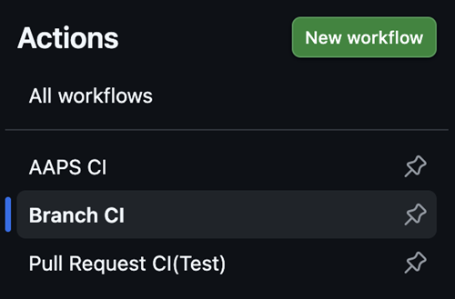
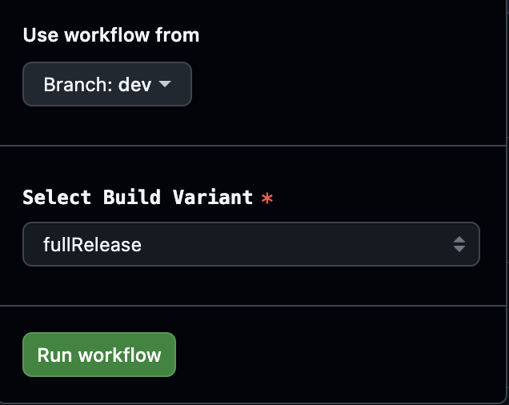
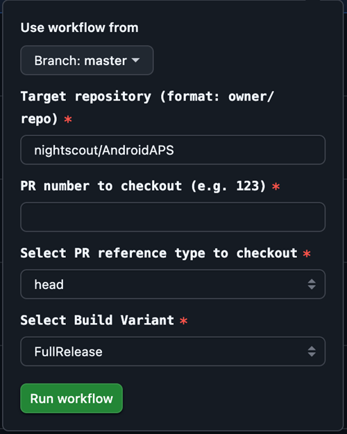

# Kūrimo atšaka (dev)

```{warning}
Dev atšaka skirta tik tolesniam AAPS kūrimui. Ją reikia naudoti atskirame telefone testavimui, <font color="#FF0000">**ne tikram ciklui!**</font>
```

Stabiliausia AAPS versija yra [master atšakoje](https://github.com/nightscout/AndroidAPS/tree/master). Tikram ciklui rekomenduojama likti master atšakoje.

AAPS dev versija skirta tik kūrėjams ir testuotojams, kuriems nesunku dirbti su klaidų išrašais (stacktrace), peržiūrėti žurnalų failus ir galbūt paleisti derintuvę (debugger), kad parengtų kūrėjams naudingus klaidų pranešimus (trumpai: žmonėms, kurie žino, ką daro, be kitų pagalbos!). Todėl daug nebaigtų funkcijų yra išjungtos. Norėdami įjungti šias funkcijas, įjunkite **inžinerinį režimą**: sukurkite failą `engineering_mode` aplanke /AAPS/extra. Įjungus inžinerinį režimą, ciklas gali visiškai nustoti veikti.

Tačiau dev atšaka yra gera vieta pamatyti, kokios funkcijos yra testuojamos, padėti ištaisyti klaidas ir pasakyti, kaip naujos funkcijos veikia praktiškai. Dažnai žmonės testuoja dev atšaką su senu telefonu ir pompa, kol įsitikina, kad ji stabili. Bet kokį jos naudojimą atliekate savo rizika. Testuodami bet kokias naujas funkcijas atminkite, kad patys pasirinkote testuoti dar kuriamą funkciją. Darykite tai savo rizika ir atsargiai, kad būtumėte saugūs.

Jei randate klaidą arba manote, kad naudojant dev atšaką kažkas įvyko ne taip, peržiūrėkite [skiltį „Issues“](https://github.com/nightscout/AndroidAPS/issues) ir patikrinkite, ar kas nors jau ją rado. Jei ne, pridėkite ją patys. Kuo daugiau informacijos čia pateiksite, tuo geriau (nepamirškite, kad gali reikėti pridėti ir jūsų [žurnalų failus](../GettingHelp/AccessingLogFiles.md)). Naujas funkcijas taip pat galima aptarti [Discord](https://discord.gg/4fQUWHZ4Mw).

Dev versija turi galiojimo pabaigos datą. Tai atrodo nepatogu, kai versija veikia gerai, bet tai turi tikslą. Kai naudojama tik viena dev versija, lengviau sekti klaidas, apie kurias praneša žmonės. Kūrėjai nenori, kad vienu metu būtų naudojamos trys dev versijos, kai klaidos ištaisytos vienose, bet ne kitose, o žmonės vis dar praneša apie jau ištaisytas klaidas.

(branch-ci-test)=

## Konkrečios atšakos išbandymas (branch-ci)

Norėdami sukurti testinę atšaką, pasirinkite branch-ci. Tai leidžia pasirinkti konkrečią atšaką APK kūrimui. Šį būdą galite naudoti, kai reikia išbandyti dev atšaką.





(github-pr-test)=

## Pakeitimų iš pull request (PR) išbandymas (GitHub CI actions deploy)

Galima nuo 3.3.2.1.dev

- Tinka testuotojams arba tiems, kurie padeda testuoti.

```{eval-rst}
.. raw:: html

    <!--crowdin: exclude-->
    <div align="center" style="max-width: 360px; margin: auto; margin-bottom: 2em;">
      <div style="position: relative; width: 100%; aspect-ratio: 9/16;">
        <iframe
          src="https://geo.dailymotion.com/player/x9rdx1q.html?video=x9rdx1q&loop=true&mute=true"
          loading="lazy"
          style="position: absolute; top: 0; left: 0; width: 100%; height: 100%;"
          frameborder="0"
          allowfullscreen>
        </iframe>
      </div>
    </div>
```



- Target repository: saugykla, kurioje yra PR, formatu owner/repo. Palikite numatytąją **nightscout/AndroidAPS**, nebent jums nurodė naudoti kitą saugyklą (tai turėtų daryti tik kūrėjai).

- PR number: įveskite PR numerį, kurį norite išbandyti.

- PR reference types: yra dvi PR nuorodos tipo parinktys:
    
    - head:
    - Paima tikrą turinį iš PR autoriaus atšakos (t. y. originalią commit istoriją be jokio sujungimo).
    - Tai atitinka pradinę PR atšakos būseną, lyg ji būtų paimta tiesiai iš fork ar funkcijos atšakos.
    
    - merge:
    
    - Paima rezultatą, kurį GitHub gauna iš anksto imituodamas PR sujungimą su tiksline atšaka (pvz., dev).
    - Tai virtualus sujungimo commit, kurį automatiškai sukuria GitHub.
    - Šis commit yra tik tada, kai PR neturi konfliktų ir gali būti sujungtas.
    
    - variant:
    
    - Žr. [variantą](#browserbuild-variant)