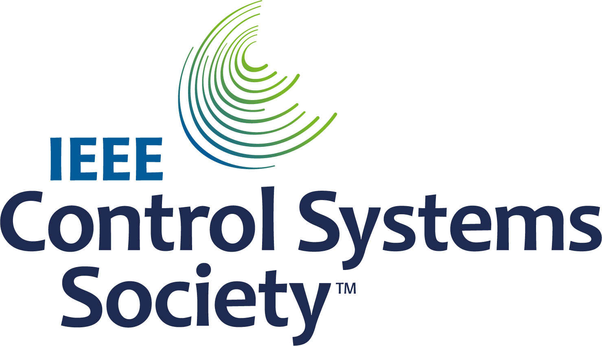

# Visiškai uždaras ciklas

```{contents} In this page
:backlinks: entry
:depth: 2
```

Pagrindinis visiškai uždaro ciklo **FCL** privalumas – jis gali imituoti dirbtinę kasą ir palengvinti kasdienį valdymą, nes nebereikia leisti bolusų valgiams.

Nors **hibridinis uždaras ciklas** ('HCL') veikia pagal algoritmą, naudotojui vis tiek reikia rankiniu būdu susileisti bolusus prieš valgį. Dėl to ciklas gali laikinai sustabdyti tiekimą (laikina nulinė bazė), kad nebūtų suleista per daug insulino.

**FCL** režime bolusai pagal valgio dydį nebereikalingi: palikite tai algoritmui!  **AAPS** gali valdyti valgius naudotojui nesileidžiant jokio boluso ir neįvedant angliavandenių – šis režimas vadinamas „nedeklaruotu maistu“ **(„NDM“)**. **NDM** leidžia **AAPS** geriau toleruoti neteisingai įvestus angliavandenius, nes veikia agresyviau.

## Ko tikėtis?

Yra daug paskelbtų tyrimų apie gerus rezultatus, kuriuos galima pasiekti su **FCL**. Daugiau skaitykite:

1)   National Library of Medicine, PubMed [First Use of Open-Source Automated Insulin Delivery AndroidAPS in Full Closed-Loop Scenario: Pancreas4ALL Randomized Pilot Study](https://pubmed.ncbi.nlm.nih.gov/36826996/);

2)  ClinicalTrials.gov National Library of Medicine, klinikinis tyrimas [Feasibility and Safety Study of the Automated Insulin Delivery Closed Loop System Pancreas4ALL (ASAP)](https://www.clinicaltrials.gov/study/NCT04835350?term=Feasibility%20and%20Safety%20Study%20of%20the%20Automated%20Insulin%20Delivery%20Closed%20Loop%20System%20Pancreas4ALL%20(ASAP)&rank=1)

Kad **FCL** pavyktų, naudotojas turi:

- patikrinti, ar atitinka **FCL** būtinąsias sąlygas;
- sukurti **automatizacijas**, pritaikytas savo kasdieniams poreikiams; ir
- tiksliai suderinti **AAPS** nustatymus (ypač **automatizacijas**).


## Bendri svarstymai, kodėl verta (ar neverta) pereiti nuo HCL prie FCL

**FCL** tinka ne visiems:

- Kai kurie **FCL** naudotojai pasiekia apie 90 % TIR (70–180) ir HbA1c žemiau 6 %, tačiau kiti naudotojai renkasi griežtesnę kontrolę. Ypač norint sumažinti reikšmes virš 140 mg/dL, kai mityboje yra greitų angliavandenių, tikriausiai reikės išankstinio boluso.
- **AAPS** derinimas gali būti sudėtingas. Jis netinka naudotojams, kuriems AAPS atrodo per sudėtinga.  Turėsite skirti kelias savaites, kad suderintumėte ir tiksliai sureguliuotumėte savo **FCL**. Investuotas laikas gali duoti geresnių rezultatų ir geresnę **KG** kontrolę.
- Valgių valdymas gali tapti lengvesnis, tačiau fizinis krūvis **FCL** režime vis dar gali būti iššūkis. Dauguma iš mūsų stengiasi riboti užkandžius sportuojant, kad kontroliuotų kūno svorį.
- Vis dar sunku pritaikyti **FCL** vaikams (aptariama toliau).


## Gerai suderintas hibridinis uždaras ciklas

Prieš svarstant perėjimą prie **FCL**, patartina pirmiausia gerai suderinti **HCL**.  Kad **FCL** pavyktų, reikia labai asmeniškai suderinti naudotojo nustatymus, kad **AAPS** galėtų leisti insuliną taip, jog kuo tiksliau imituotų JŪSŲ sėkmingą hibridinio uždaro ciklo režimą.

**FCL** reikalauja, kad naudotojas sukurtų ir suderintų savo **automatizacijas**. Tačiau prieš pradėdamas **FCL**, naudotojas turi gerai suprasti savo insulino poreikius. Klaidas gali paslėpti priešingos klaidos. Tai gali sukurti nestabilią **FCL** sistemą, kurią vėliau sunku pataisyti. Su FCL turėtumėte tikėtis panašaus %TIR, kokį šiandien matote su savo **HCL**.

**FCL – tai paties naudotojo (DIY) sukurtas automatizacijų rinkinys, kurį naudotojas nustato analizuodamas savo sėkmingo HCL ir pradinės FCL patirties duomenis, derindamas nustatymus.**

## Greitas insulinas (Lyumjev, Fiasp)

**FCL** reikia greito insulino.  Taip siekiama, kad prasidėjus su valgiu susijusiam **KG** kilimui **FCL** galėtų išlaikyti **KG** ribose (pagal įprastą apibrėžimą – žemiau 180 mg/dL (10 mmol/l)).

Modeliavimo tyrimas (išsamiau žr. LINK FullLoop V2/March2023, 2.2 skyrių) kiekybiškai parodo, kad *greitesni insulinai*

Source:

 


IEEE Control Systems Magazine, ResearchGate [The Artificial Pancreas and Meal Control: An Overview of Postprandial Glucose Regulation in Type 1 Diabetes](https://www.researchgate.net/publication/322866519_The_Artificial_Pancreas_and_Meal_Control_An_Overview_of_Postprandial_Glucose_Regulation_in_Type_1_Diabetes);

- duos gerokai žemesnius **KG** pikus nei lėtesni insulinai;
- leidžia kelias minutes vėliau suleisti pirmąjį valgio bolusą, nesukeliant nepriimtinai aukštų pikų; ir
- sumažinti skirtingų angliavandenių kiekių (valgio dydžių) poveikį **KG** pikui.

**FCL** greičiausiai nebus veiksmingas su kitu insulinu nei Lyumjev ar Fiasp, nebent naudotojas laikosi labai saikingos ar mažai angliavandenių turinčios mitybos.

Tačiau Fiasp ar Lyumjev gali sukelti dažnus pompos užsikimšimus, net optimizavus, pvz., adatos ilgį. Svarbu stebėti kaniulės ar pod naudojimo laiką. Daugelis naudotojų pastebi, kad po 48 valandų insulinas veikia prasčiau ir kaniulė / pod pradeda neveikti tinkamai.

## Prerequisites

Norint užtikrinti, kad **AAPS** veiktų optimaliai ir neprarastų brangaus laiko, reikia **KG** reikšmių ir stabilaus Bluetooth ryšio. **FCL** reikalauja techniškai stabilios sistemos 24/7:

- jūsų **NGJ veikimą**. Jūsų NGJ neturėtų rodyti šokinėjančių **KG** reikšmių, kurias **FCL** galėtų klaidingai palaikyti prasidedančio valgio ženklu. Panašiai **NGJ** kalibravimas gali duoti šokinėjančius rezultatus.
- kaip ir kur atliekamas **NGJ** duomenų glodinimas ir ką tai gali reikšti jūsų derinimui. Ypač tai, kaip apibrėžtas pokytis ir kaip AAPS jį atpažįsta kaip prasidedančio valgio ženklą.
- pompos ir NGJ Bluetooth ryšio stabilumą;
- pompos užsikimšimo vengimas (arba bent ankstyvas atpažinimas);
- duomenų srautas, naudojamos telefono programėlės ir skirtumai tarp jutiklio naudojimo dienų;
- visi **AAPS** komponentai gerai įkrauti, o atsarginės dalys – po ranka; ir
- kaniulės (ar pod) keitimas visada pakankamai anksti, kad sumažėtų užsikimšimo rizika;

Visa tai priklauso nuo jūsų **AAPS** komponentų sistemos ir gyvenimo būdo.

## Su valgiais susiję apribojimai

- **FCL** gali būti lengviau sukurti žmonėms, kurių mityboje nėra maisto komponentų, greitai ir stipriai veikiančių **KG**, ir kurių valgymo įpročiai kasdien labai nesikeičia. Tai nebūtinai reiškia mažai angliavandenių turinčią mitybą.

- Riebalų ar baltymų turtinga mityba, lėtas virškinimas ar gastroparezė **FCL** atveju viską palengvina, o ne apsunkina, nes vėlyvi angliavandeniai gerai padengia neišvengiamas vėlyvo veikimo „uodegas“ nuo boluso, reikalingo piko metu.

### Glikeminis indeksas ir poveikis gliukozei kraujyje

Iššūkis **NDM** režimui didėja, didėjant „poveikiui gliukozei kraujyje“ ('EBG')

- Pradėkite nuo vidutinio / mažo ir suderinkite savo **profilio** nustatymus. Tik tada „išbandykite“ valgius su dideliu **EBG**.
- Jei valgote maistą su labai dideliu **EBG**, apsvarstykite < 50 % pradinį bolusą.

1) **Be EBG**: pvz., šviežia mėsa, žuvis, kiaušiniai, šoninė, aliejai, sūris. 2) **Mažas EBG**: pvz., šviežios daržovės ir uogos, grybai, riešutai, pienas, jogurtas, varškė. 3) **Vidutinis EBG**: pvz., viso grūdo duona / makaronai, bulvės, laukiniai ryžiai, avižos, džiovinti vaisiai. 4) **Didelis EBG**: pvz., kvietinė duona, batonas, skrebučiai, vafliai, sausainiai, bulvių košė, makaronai, ryžiai. 5) **Labai didelis EBG**: pvz., cukrus, saldūs gėrimai, vaisių sultys, kukurūzų dribsniai, saldainiai, saldumynai, bulvių traškučiai, sūrios kringelių lazdelės.


Sunkiausi **FCL** valgiai yra tie, kuriuose yra tik labai didelio ir didelio **EBG** komponentų (paveikslėlyje pažymėta raudonai): ne tik **KG** greitai šauna aukštyn, bet ir beveik nėra riebalų / baltymų / skaidulų, kurie subalansuotų neišvengiamą insulino veikimo „uodegą“, atsirandančią bandant anksti suvaldyti aukštą gliukozę.

Nereguliarus užkandžiavimas ir saldūs gėrimai, kuriuose gausu greitai įsisavinamų angliavandenių, **FCL** sukelia problemų.


## Pasiruošimas fiziniam aktyvumui / sportui

Sportuojant ar esant aktyviems, naudojant pompą ar hibridinį uždarą ciklą, rekomenduojama prieš fizinį krūvį sumažinti **AIO**.

Naudojant **FCL**, algoritmas suderintas taip, kad aptiktų **NDM** ir automatiškai leistų insuliną, stabdydamas **KG** kilimą.  Aukštą **laikiną tikslą** ir mažesnį **profilio procentą** (veikiantį jau nuo valgio pradžios) reikia nustatyti gerokai prieš bet kokią veiklą.

Neįprastas ar nereguliarus fizinis aktyvumas **FCL** sukelia sunkumų. Fiziniam krūviui reikia ruoštis iš anksto (ypač jei norite sumažinti gelbėjimo angliavandenių / užkandžių poreikį, kai sportuojant krenta glikemija). Po aktyvios dienos rekomenduojama nakčiai, kai vakarienė visiškai suvirškinta, nustatyti mažesnį **profilio procentą**: **automatizacijose** nustatykite padidintą (>100 mg/dL) **KG** tikslą, o **AAPS** **nustatymuose** išjunkite **Naudoti SMB esant aukštesniam laikinam gliukozės tikslui**.

## Kliūtys vaikams

**FCL** vaikams gali sukelti papildomų iššūkių, tarp jų:

- Lyumjev ar Fiasp gali būti neprieinami arba prastai toleruojami.
- Valandinė bazė gali būti labai maža, todėl ji – prastas pagrindas dideliems **SMB**.
- Mityboje gali būti daug saldžių komponentų. Dėl mažo kūno nedidelio kraujo tūrio – stiprus polinkis į labai aukštus **KG** šuolius.
- Augimo hormonai ir ryškūs jautrumo insulinui pokyčiai apsunkina tikslų **FCL** suderinimą.


## Sustiprintų SMB įjungimas: sauga

**HCL** režime taikomi saugos apribojimai bolusų dydžiams, kuriuos ciklas gali suleisti automatiškai.

**FCL** naudotojams nebereikia leisti didelio boluso valgio pradžioje. Dėl to **SMB** dydžio apribojimai turi būti išplėsti, kad ciklas galėtų suleisti pakankamai didelius **SMB**.

Jei naudojate **AAPS** master versiją, siūloma **AAPS** **nustatymuose** nustatyti didžiausią leidžiamą **SMB** dydį, kurį gali suleisti **FCL** (maxUAMSMBBasalMinutes=120, t. y. 2 valandų bazės kiekis tuo paros metu).

Jei jūsų valandinė bazė labai maža, gautos **SMB** ribos gali būti per mažos, kad būtų galima pakankamai suvaldyti **KG** kilimą po valgio. Vienas galimų sprendimų – vengti mitybos, sukeliančios stiprius **KG** šuolius. [Auto ISF](#Open-APS-features-auto-isf) algoritmas (prieinamas tik dev versijoje su inžineriniu režimu) turi nustatymą **SMB dozės ribos išplėtimas**, kuris standartinį 2 valandų bazės kiekio maksimumą padidina koeficientu >1, ir leidžia padidinti numatytąją 50 % **SMB dozės dalį**.

**Vadovaukitės instrukcijomis, kad AAPS galėtų imituoti jūsų bolusus keliais SMB**.

Periodiškai tikrinkite **APS** įskiepio ekraną (**Konfigūracija → APS → Atidaryti įskiepį**), kad pamatytumėte, ar jūsų **SMB** leidžiama būti pakankamai dideliems, kad ciklas apie valgio pradžią suleistų reikiamą insuliną.

Priešingu atveju jūsų derinimo pastangos kartais nueis veltui!


```{admonition} Boosting **ISF** can become dangerous
:class: danger

Atidžiai stebėkite / analizuokite **SMB** dydžius netrukus po valgio pradžios. Derinkite žingsniais ir vienu metu keiskite ne daugiau kaip 1 ar 2 parametrus.

Jūsų **AAPS** nustatymai turi būti pakankamai gerai sukonfigūruoti, kad atitiktų jūsų (!) valgių įvairovę.
```

## Valgio aptikimas / jūsų automatizacijos stiprinimui

Sėkmingam **FCL** svarbiausias derinimo parametras yra **JIF**. Naudojant **AAPS** master versiją ir **automatizacijas**, **atpažinus valgį (pagal gliukozės pokyčius), turi būti automatiškai įjungtas > 100 % profilio keitimas**, kuris suteikia sustiprintą **JIF**.

**AAPS** master versija **HCL** režime leidžia laikiną **profilį** iki 130 %. **JIF** sustiprinimas atliekamas 3 žingsniais:

- 1 žingsnis – peržiūrėkite **profilyje** šiai valgio valandai nustatytą **JIF** ir patikrinkite, ar, pvz., Autosens siūlo pakeitimą, kuris atsižvelgia į dabartinę (pastarųjų kelių valandų) kūno jautrumo insulinui būklę.
- 2 žingsnis – pritaikykite koeficientą (1/profilio %, kaip nustatyta **automatizacijoje**), kad sustiprintumėte **JIF**.
- 3 žingsnis – patikrinkite, ar siūlomas **JIF** neviršija nustatytų saugos ribų.

### FCL automatizacijų šablonai

Žymimieji langeliai viršuje. Galite rinktis:

- Savo **automatizacijų** sąraše galite nuimti varnelę (kiekvieno lauko kairėje) => taip ta **automatizacija** išjungiama. Pavyzdžiui, tai galite padaryti visoms su pusryčiais susijusioms **FCL** **automatizacijoms**, kad pusryčiams pereitumėte į **HCL**.

- Kiekvienai **automatizacijos** taisyklei galite pažymėti langelį „Naudotojo veiksmas“ => tada, kai tenkinamos sąlygos, nustatyti veiksmai nebus vykdomi automatiškai. Vietoj to **AAPS** pagrindinis ekranas jus įspės kaskart, kai jūsų **FCL** automatiškai suleistų **SMB**. Tada galėsite atsakyti „taip“ arba „ne“. Tai labai naudinga derinimo etape.

Ši funkcija gali būti naudinga tam tikrose situacijose, pvz., esant „kojos ant grindų“ sindromui, kai ryte atsikėlus staiga pakyla **KG**, bet naudotojas nori išvengti visiškai automatinio „pusryčiai prasidėjo“ atsako.

Žemiau pateikiami patarimai, kaip sujungti **automatizacijos** sąlygas ir ką daryti situacijose, kai **AAPS** turėtų padidinti (ar sumažinti) insulino tiekimą. Kadangi **JIF** negalima derinti tiesiogiai, mūsų tikslui tą patį pasieks **profilio procento** padidinimas virš 100 %.

### Automatiniai dideli SMB kylant KG

Sėkmingo **FCL** raktas: **prasidėjus valgio sukeltam KG kilimui, ciklas turi kuo greičiau suleisti labai didelius automatinius SMB**, kad „pasivytų“ reikiamą **AIO** (palyginkite su įprastu bolusu, kurį **HCL** režime susileidžiate panašiam valgiui!)

Tam reikia išanalizuoti jūsų **HCL** duomenis ir nustatyti, kurie **pokyčiai** gali būti nesusiję su valgiu, o kurie gali būti susiję.

- Kadangi **automatizaciją** galite apibrėžti iš anksto nustatytam laiko langui, analizuoti reikia tik jį.
- Jei valgote labai skirtingus valgius (pvz., gana daug angliavandenių turinčius pusryčius, bet mažai angliavandenių turinčius pietus), galite sukurti dvi skirtingas **automatizacijas** (ar jų rinkinius) kiekvienam laiko intervalui.
- Neįtraukite naktų, jei kartais matote šuolius dėl suspaudimo sukeltų klaidingai žemų reikšmių.
- Dažniausiai pakanka naudoti paskutinių 5 minučių pokytį.
- Tačiau galite naudoti ir vieną iš vidutinių pokyčių. Palygindami pokyčius savo **automatizacijų** sąlygose, galite netgi apibrėžti skirtingo agresyvumo veiksmus, priklausomai nuo to, ar **KG** kyla greitėdama, ar ne.

> ( pokytis – trumpo laik. vid. pokytis )>n   yra išraiška, kurią galima naudoti pagreičiui aptikti, kad pirmasis **SMB** būtų paleistas vos pastebėjus **KG** kilimą. -                                                                             
> Dėmesio: negalima naudoti su prastomis ar stipriai glodintomis **NGJ** reikšmėmis!

**NGJ** su protarpiais trūkstamais duomenimis naudotoją pastato į blogą padėtį, nes, norėdami būti saugūs, turite „su atsarga“ apibrėžti, koks pokytis tikrai rodo prasidėjusį valgį. Tai reiškia:

- **FCL** praranda papildomo laiko, todėl **KG** pikai aukštesni, o %**TIR** mažesnis;
- negalite naudoti ankstesnio ar mažesnio pokyčio, kuris ir be valgio galėtų paleisti **SMB**, turinčius **FCL** režime pakeisti naudotojo bolusą.

Be to, pirmojo kilimo po valgio metu būna **mažas AIO**. Turint tai omenyje, automatizacija (#1) vakarienei galėtų atrodyti taip:


Automatizacija #1

Jei tenkinamos sąlygos, **AAPS** per ateinančias 12 minučių suleistų 1 ar 2 **SMB**, naudodama sustiprintą **JIF** pagal nustatytą padidintą **profilio procentą** (pavyzdyje insulinReq padidinamas 30 %). Kol šios sąlygos tenkinamos, **automatizacijos** taisyklė pratęsiama dar 12 minučių. Mažai angliavandenių turinčio valgio **KG** kilimas gali būti lėtesnis. Ją verta papildyti kita automatizacija (#2), kuri įsijungia esant mažesniam pokyčiui ir duoda silpnesnį insulino padidinimą.


Ta pati **automatizacija** tikriausiai įsijungs ir valgant daugiau angliavandenių, kai baigsis automatizacijoje #1 apibrėžtas staigus kilimas.

Šias dvi (+ galbūt trečią) **automatizacijas** reikia „išdėstyti pakopomis“, kad atitiktų tai, ką matote savo valgiuose (jų įvairovėje) => tinkamų šuolių dydžių, **AIO** kriterijų ir sustiprinimų nustatymas bus pasikartojantis derinimo procesas.  Be to, jei į sąlygas įtrauksite tinkamus laiko intervalus, galite lengvai sukurti skirtingas automatizacijas skirtingiems dienos valgymo laikams (pusryčiams, pietums, vakarienei).

Atkreipkite dėmesį, kad dar kilimo fazėje (!) reikia užblokuoti **AIO** „perteklių“, kad vėlyvas **insulino** poveikis („**uodega**“ po 3–5 valandų) neviršytų ciklo stabdymo galimybių naudojant nulinę laikiną bazę („atimant“ bazę, kad sumažėtų hipoglikemijos rizika).

Po didelių valgių **kartais būna antras kilimas**. Iki to laiko dažniausiai jau būna šiek tiek sumažėjęs ir AIO, todėl agresyvesnės automatizacijos vėl įsijungia. (Patikrinkite, ar AIO sąlyga automatizacijoje #2 nenustatyta per žemai, kad tai galėtų įvykti).

Netrukus po kelių pradinių **SMB** prasideda **subalansuota fazė**, kai saikingas insulino tiekimas turėtų padengti papildomai įsisavinamus angliavandenius. (Išskyrus mažai angliavandenių turinčius valgius, kai ciklas gali matyti per silpną **KG** kilimą ir jau dabar iškart pereiti prie nulinės laikinos bazės).

**AAPS** pagrindinis ekranas (kuriame **NDM** visiškame cikle matote AAO=0) šioje fazėje gali prašyti daugiau angliavandenių. **NDM** režime tai tiesiog reiškia, kad galite atlikti labai apytikslį tikėtinumo patikrinimą: ar tikėtina, kad toks angliavandenių kiekis dar yra jūsų kūne, neįsisavintas iš valgio, suvalgyto maždaug prieš valandą (apie kurį ciklui nieko nesakėte)?


### AIO riba

Dažnai **automatizacijos** #1 ir (ar) #2 padidina AIO iki lygio, kurio paprastai pakanka **jūsų** valgiams. Asmeniniam derinimui pažiūrėkite savo **HCL** duomenis: kokios didžiausios AIO reikšmės būna gerai suvaldytų valgių metu (dažnai – jūsų valgio bolusas) ir nuo kokio dydžio pabaigoje įvyko hipoglikemija (ar prireikė papildomų angliavandenių).

Tinkamos **AIO ribos**, nuo kurių reikėtų mažinti ciklo agresyvumą, gali skirtis kiekvienam valgiui. Tačiau ypač per pirmą valandą nuo valgio pradžios, kuri **NDM** režime yra labai svarbi. Tai kiekvienam naudotojui skirsis. Kai kuriems naudotojams įsisavinama tik apie 30 g per valandą, todėl gali būti įmanoma apibrėžti prasmingą **AIO**, nepriklausomą nuo konkretaus valgio.

Išskirtiniams valgiams arba norint ją sumažinti prieš sportą, **AIO** ribą galima greitai pakeisti savo **automatizacijoje**.

Automatizacija (#3) „iobTH reached => **SMBs** off“ skirta baigti (arba pristabdyti, kol ateis kita angliavandenių sukelta kilimo banga) agresyvų **SMB** stiprinimą.


Automatizacija #3

Ji nurodo ciklui, kad viršijus jūsų nustatytą **AIO ribą** geriau nebenaudoti jokių **SMB**

- Pateiktame pavyzdyje tai daroma nustatant LT=111 (tai gana atsitiktinė reikšmė; pasirinkite skaičių >100, kurį lengvai atpažinsite kaip savo automatinį **SMB** išjungimą)
- **AAPS** skiltyje [Nustatymai → OpenAPS SMB](#Preferences-openaps-smb-settings) paprastai neleiskite **SMB** esant padidintam tikslui.                                                                                                                   
  Tada reikiamą insuliną teks leisti daug atsargiau, per **laikinų bazių** „butelio kaklelį“.

**Dėmesio: automatizacija #3 veikia tik tada, kai nėra aktyvaus LT.** Taigi, jei naudojote EatingSoonTT, iki to laiko jis turi būti baigtas – paprastai tai būna praėjus 30–40 minučių nuo valgio pradžios.

Vienas būdas tai padaryti – sukurti **automatizacijos** sąlygą, kuri baigia veikiantį EatingSoonTT, kai tenkinama sąlyga **AIO**>65% * iobTH.
> Kaip naudoti EatingSoonTT Kai kurie ciklo naudotojai nustato EatingSoonTT („Netrukus valgysiu“ laikiną tikslą) maždaug valandą ar daugiau prieš valgio pradžią (paspausdami LT mygtuką arba automatiškai per sumažintą **profilio** **KG** tikslą, jei valgymo laikai gana pastovūs), kad užtikrintų žemą pradinę **KG** ir šiek tiek padidintą **AIO**. Tačiau, kadangi **FCL** visada juda link tikslo, tai gali duoti nedaug, ir galbūt geriau apibrėžti **automatizaciją**, kuri nustato EatingSoonTT atpažinus valgio pradžią (pagal gliukozės pokytį arba pagreitį = pokytis > vid. pokytis). Žemas **LT** šiame etape svarbus, nes ciklas kiekvieną **SMB** apskaičiuoja pagal formulę (prognozuojama gliukozė minus LT)/sens, todėl mažas LT padidina gautą insulinReq.

Kai suleidžiami pirmieji sustiprinti **SMB**, jūsų nustatytas iobTH ir **automatizacija** #3 turėtų gerai subalansuoti: riboti gliukozės piką, bet nesukelti hipoglikemijos po valgio.

Jei jūsų pusryčiai pagal angliavandenių kiekį gerokai skiriasi nuo vidutinės vakarienės, gali būti naudinga apibrėžti **automatizacijas**, kurios veikia atitinkamu paros metu ir turi skirtingą **iobTH** (galbūt ir skirtingus pokyčius bei skirtingą nustatytą **profilio procentą**). Tiek jūs, apibrėždami savo valgių spektrą ir nustatymus (ypač **iobTH**), tiek ciklas, valdydamas besiklostančią **KG** kreivę, turite susitaikyti su tam tikru pikų aukščiu, kad sumažėtų hipoglikemijos pavojus **SMB** insulino veikimo trukmės (**IVT**) pabaigoje.

### Stagnacija esant aukštai KG

Jei po „sotaus“ valgio matote ilgai trunkančią stagnaciją su **aukšta KG** reikšme, **automatizacija** #4 (žemiau) „post-meal High“ padeda įveikti riebalų rūgščių sukeltą atsparumą: po kelių patiekalų vaišių, didelės riebios picos ar raclette vakaro gliukozės kreivė gali turėti du kauburius arba, labai dažnai, ilgą aukštą plokščiakalnį.


Automatizacija #4


Automatizacija #5

Automatizacija #4 „post-meal High“ tinka ir hibridiniam uždaram ciklui.

Be to, reikia stabdymo automatizacijos #5 „Stop pmH“, kad insulino tiekimo agresyvumas sumažėtų, kai tik gliukozės reikšmė pradeda kristi. (Tačiau dažnai ciklas ir taip apribos papildomą insuliną, kad išvengtų hipoglikemijos, nes prognozuojama gliukozė jau būna žema).

## Hipoglikemijos prevencija

Pagrindinė problema ta, kad **NDM** **FCL** (be įvestų angliavandenių) **negali žinoti, kiek gramų angliavandenių dar liko** įsisavinti ir ar jų užteks tam „uodegos“ insulinui sunaudoti, kad dėl jo nepatektumėte į hipoglikemiją.

Naudodamas sustiprintus **SMB**, **FCL** „pasivijo“ tai, ką anksčiau darėme valgio bolusu. Tačiau **insulino veikimo „uodegos“ pabaigoje hipoglikemijos prevencija gali tapti rimtu klausimu**.

Ruošdamasis **FCL**, naudotojas turi atidžiau pažiūrėti į **AIO kitimą laike** įprastų valgių metu ir įvertinti, **kada jo tampa per daug ir kaip tai sugauti derinant automatizacijas**. Tai įmanoma, nes turime kelis reguliavimo „varžtus“. Tai gali būti sudėtinga padaryti teisingai

Apskritai nėra prasmės be galo optimizuoti nustatymų vienai valgio rūšiai. Kai turėsite pakankamai gerą nustatymą, pvz., vienam dažnai valgomam pietų tipui, patikrinkite, kaip jis veikia su kitais valgiais ir kokį „kompromisą“ rinktumėtės.

Kad išvengtumėte hipoglikemijos praėjus 3–5 valandoms po valgio, sumažinkite agresyvumą, kol nesusikaupė per daug AIO. Konkretūs būdai:

- Jau gliukozės kilimo metu darykite **JIF** vis švelnesnį, kaip pateiktuose automatizacijų pavyzdžiuose #1 ir #2.
- Nustatykite AIO ribą, nuo kurios **AAPS** tampa gerokai atsargesnė (automatizacija #3, aukščiau). Atkreipkite dėmesį, kad šį **AIO** gali viršyti paskutinis **SMB**, suleistas prieš ribai įsigaliojant, o vėliau – ir laikinos bazės, jei ciklas mato insulinReq. Įsisavinami angliavandeniai sukurs priešingą judėjimą link mažesnio AIO.
- AIO ribą galima diferencijuoti pagal valgius: klonuodami automatizacijas, galite lengvai atskirti pusryčių, pietų ir vakarienės laiko intervalus (ar net geografines vietas, pvz., darbo valgyklą ar uošvės namus ir pan.)
> Šiuose laiko intervaluose galite skirstyti dar smulkiau, nustatydami skirtingus LT mažai angliavandenių ir greitų angliavandenių valgiams ir t. t., taip „užkoduodami“ skirtingas valgių klases, kurios gali pasitaikyti tuo paros metu, ir iškviesdami jas specialiai joms suderintomis **automatizacijomis**. Tikriausiai to nereikia, nebent jūsų mitybos įpročiai labai skiriasi.

Prieš ypatingą valgį galite padidinti **AIO** ribą arba per mažiau nei 5 sekundes atlikti kitą pakeitimą bet kurioje automatizacijoje tiesiog savo AAPS telefone (**Valdymas → Automatizacija**).

Hipoglikemijos pavojus praėjus kelioms valandoms po valgio iš esmės priklauso nuo to, ar valgio sudėtis buvo tokia, kad **insulino „uodegas“, likusias kovojant su pagrindine angliavandenių dalimi**, **sunaudos „ištęsti angliavandeniai“** (gausus / vėlyvas angliavandenių įsisavinimas, baltymai, riebalai, skaidulos).

Laikui bėgant išmoksite atpažinti dėsningumus, suderinsite automatizacijas – galbūt net šiek tiek pakeisite mitybos įpročius, pvz., kartais suvalgysite vėlyvą nedidelį(!) užkandį, kuris padeda išlaikyti gerą **insulino veikimo ir angliavandenių įsisavinimo pusiausvyrą** per **visą** valgio (virškinimo, įsisavinimo) laiką ir taip palengvina gyvenimą jūsų ciklui (ir jums patiems).

### Užprogramuotų automatizacijų tvarka

Persidengiantys apibrėžimai **automatizacijose** gali sukelti problemų. Pavyzdys: problema ta, kad pokytis >8 kartu yra ir pokytis >5, t. y. gali būti dvi konkuruojančios **automatizacijos**. Ką tada daro ciklas? Ciklas visada sprendžia pagal tai, kokia tvarka jūsų **automatizacijos** išdėstytos skiltyje **Valdymas → Automatizacija**.  Pavyzdys: taisyklė pokytis > +8 turi būti pirmoji (ir paleisti stipriausią padidinimą, jei tenkinamos visos sąlygos); po jos tikrinamas pokytis >5 (ir švelnesnis atsakas). Jei tvarka būtų atvirkštinė, taisyklė pokytis>8 niekada neįsigaliotų, nes jau tenkinama sąlyga pokytis>5 – ir viskas.
> Patarimas dėl automatizacijų: tvarką pakeisti labai lengva. Skiltyje **Valdymas → Automatizacija** palieskite ir palaikykite taisyklės dešinėje esančią rankenėlę **=** ir nutempkite ją į kitą vietą.

Be to, bet kokias sąlygas ar veiksmus labai lengva ir greita pakeisti bet kuriuo metu, per kelias sekundes, tiesiog savo AAPS telefone; pavyzdžiui, jei ruošiatės į labai ypatingas vaišes. (Tačiau nepamirškite kitai dienai vėl nustatyti įprastos reikšmės).

(full-closed-loop-troubleshooting)=

## Troubleshooting

### Kaip grįžti į hibridinį uždarą ciklą

Galite nuimti varneles nuo su **FCL** susijusių **automatizacijų** ir vėl leisti bolusus valgiams bei įvesti angliavandenius. Jei pašalinote mygtukus **Insulinas** ar **Skaičiuotuvas** iš pagrindinio ekrano, vėl pridėkite juos [QuickLaunch įrankių juostos](#quicklaunch) nustatymuose (jie visada lieka prieinami apatinės navigacijos skiltyje **Terapija**). Atminkite, kad dabar vėl jūs patys turite leisti bolusus valgiams.

Gali būti protinga **FCL** naudoti tik tiems valgiams (laiko intervalams), kuriems **automatizacijos** visiškai apibrėžtos ir įjungtos, o išjungti tik tas, kurios skirtos kitiems valgymo laikams, kai norite naudoti **HCL** (arba kai jų dar neapibrėžėte pereinamuoju laikotarpiu).

Pavyzdžiui, visiškai įmanoma be jokių papildomų veiksmų, apibrėžus **automatizacijas** vakarienės laiko intervalams, **FCL** naudoti tik vakarienėms, o pusryčius ir pietus valdyti įprastu **HCL** režimu.


### Ar FCL būtinosios sąlygos vis dar tenkinamos?

- Ar pagrindinis **profilis** vis dar teisingas?
- Ar pablogėjo **NGJ** kokybė
- Žr. būtinąsias sąlygas (aukščiau).

### Gliukozė pakyla per aukštai

- Valgiai atpažįstami nepakankamai greitai
    - Patikrinkite Bluetooth ryšio (ne)stabilumą
    - Patikrinkite, ar galėtumėte nustatyti mažesnius pokyčius pirmajam **SMB** paleisti
    - Išbandykite aperityvą ar sriubą kelios minutės prieš valgio pradžią
- SMB per silpni
    - Patikrinkite **automatizacijų** tvarką (pvz.: didelis pokytis prieš mažą pokytį)
    - Patikrinkite (realiu laiku) **APS** įskiepio ekrane, ar valandinė profilio bazė ir nustatytos minutės (maks. 120) neriboja leidžiamo SMB dydžio
    - Patikrinkite (realiu laiku) **APS** įskiepio ekrane, ar profilio % reikia nustatyti didesnį
- Jei visi jūsų nustatymai jau ties riba, gali tekti susitaikyti su laikinai aukšta glikemija arba pakeisti mitybą.
> Jei esate pasirengę išbandyti dev versiją, [Auto ISF](#Open-APS-features-auto-isf) leidžia dar labiau padidinti SMB dydžius. Kai kurie naudotojai savo „FCL“ režime taip pat naudoja nedidelį išankstinį bolusą. Tačiau tai paveikia gliukozės kreivės elgseną, taigi ir kilimų aptikimą bei paleidžiamus **SMB**, todėl tai nelengva įgyvendinti taip, kad bendra nauda būtų įtikinama.
- Svarbus bandomųjų naudotojų pastebėjimas: tai, kaip jūsų gliukozės ir AIO kreivės artėja prie valgio pradžios, labai lemia, koks bus angliavandenių sukeltas pikas: Kai gliukozė krenta (pvz., link nustatyto EatingSoonTT), susikaupia šiek tiek AIO, o kreivė jau lenkiasi į stiprų teigiamą pagreitį, tai labai padeda išlaikyti žemus pikus.

### Gliukozė nukrenta per žemai

- Valgiai atpažįstami klaidingai
    - Patikrinkite, ar galėtumėte nustatyti didesnius pokyčius pirmajam **SMB** paleisti
    - Atitinkamoje automatizacijoje pažymėkite „Naudotojo veiksmas“, kad ateityje galėtumėte vietoje nuspręsti užblokuoti automatizacijos vykdymą, jei tai nesusiję su valgiu
    - Kad užkandžiai nepaleistų **SMB** kaip valgio atveju, užkandžiaudami nustatykite LT>100 (kaip ir taip darytumėte sportuodami ar valgydami užkandžius nuo hipoglikemijos)
- SMB iš viso suleidžia per daug insulino
    - Patikrinkite (realiu laiku) **APS** įskiepio ekrane, ar nustatymą **SMB dozės ribos išplėtimas** reikia sumažinti
    - Patikrinkite (realiu laiku) **APS** įskiepio ekrane, ar **profilio procentą** reikia sumažinti
    - Tikriausiai galima sumažinti SMB dozės dalį. Atkreipkite dėmesį, kad šiuo atveju tai veikia visiems **SMB** (visuose laiko intervaluose),
- Insulino „uodegos“ problemos po valgio
    - Gali reikėti suvalgyti užkandį (kai matote hipoglikemijos prognozę) arba gliukozės tablečių (jei jau esate hipoglikemijos zonoje). Tačiau atminkite, kad angliavandenių kiekis, kurio ciklas kažkuriuo metu gali paprašyti, greičiausiai bus per didelis, nes ciklas visiškai nieko nežino apie jūsų suvalgytus angliavandenius (o jūs galbūt galite įvertinti, kiek jų, įskaitant riebalų ir baltymų poveikį, dar laukia įsisavinimo).
    - Būtų vertinga žinoti, ar problema daugiausia kyla jau KG kilimo fazėje. Tada paprasta išeitis gali būti mažesnė iobTH reikšmė.
    - Jei papildomų angliavandenių reikia dažnai, užsirašykite, kiek gramų prireikė (neskaičiuodami to, ką galiausiai suvalgėte per daug ir dėl ko vėl prireikė papildomo insulino).  Tada pagal savo profilio IA reikšmę įvertinkite, kiek mažiau insulino **SMB** turėjo suleisti, ir naudokite šią informaciją derindami (**profilio procentą** **automatizacijose** arba galbūt ir nustatytą iobTH). Tai gali būti susiję su **SMB**, suleistais esant aukštai gliukozei, arba ir su **SMB** **KG** kilimo metu.
    - Gali būti, kad tiesiog teks susitaikyti su aukštesniais **KG** pikais, kad glikemija nenukristų per žemai. Arba pakeiskite mitybą į tokią, kurioje mažiau angliavandenių ir daugiau baltymų bei riebalų.


### Daugiau informacijos

Būtinai palaikykite ryšį su kitais **FCL** naudotojais.

Diskusijos apie visiškai uždarą ciklą su automatizacijomis:

- Anglų k.:   [Discord kanalas](https://discord.gg/ChXj8BaKwA)

- Vokiečių k.:  [German Looper Community](https://de.loopercommunity.org/t/ueber-die-kategorie-full-loop/10107)
