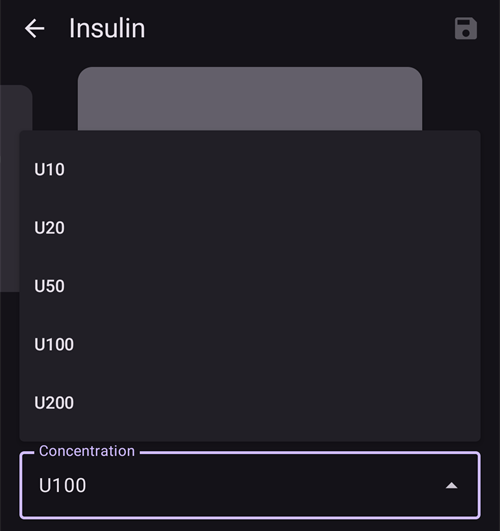
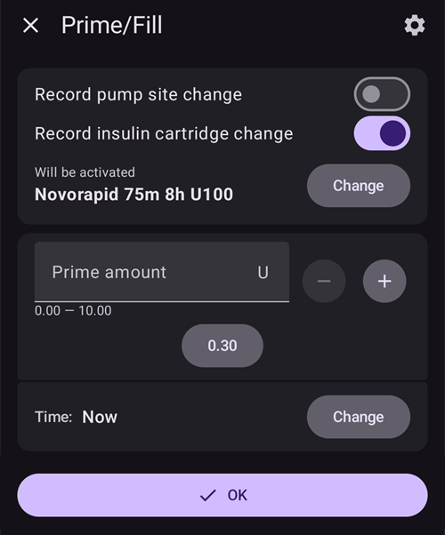

(Insulin-Concentration)=
# Insulino koncentracija

```{warning}
Visos komercinės pompos sukurtos naudoti **TIK** su U100 insulinu. Kitos koncentracijos insulinas pompoje gali būti pavojingas. Nors vis daugiau naudotojų AAPS naudoja su kitomis koncentracijomis, perskaičiavimą visada reikia valdyti, ir jis dažnai sukelia klaidų (net labai patyrusiems naudotojams!).
```

## Insulino pagrindų priminimas

Šiame skyriuje aprašytos pagrindinės insulino matavimo ir leidimo sąvokos.

### Insulino vienetas: veikimo matas

Insulinas matuojamas **tarptautiniais vienetais (V)**. Jie rodo biologinį aktyvumą (gebėjimą mažinti gliukozę kraujyje), o ne tik fizinę masę.

- **Apibrėžimas:** 1 V atitinka tam tikro insulino kiekio aktyvumą, standartizuotą iki **maždaug 0,04167 mg**.
- **Svarbu:** „vienetas“ reiškia tą patį biologinį poveikį visų tipų insulinui, todėl dozavimas yra vienodas.

### Insulino koncentracijos

Insulinas būna skirtingo stiprumo. Stiprumą nusako vienetų skaičius viename mililitre (ml).

- **U100:** pasaulinis standartas, turintis **100 V/ml**.
- **U200–U500:** labiau koncentruoti insulinai (pvz., U200 turi 200 V/ml), kad būtų galima leisti mažesnį tūrį.
- **U40/U50:** retesnės, istorinės koncentracijos (40 V/ml ir 50 V/ml). **U40 insulinui reikia specialių U40 švirkštų.**
- **Skiedimas rankiniu būdu:** klinikinė praktika, kai gaminamas labai praskiestas insulinas (pvz., U50, U10) retiems atvejams, pavyzdžiui, naujagimiams arba esant labai dideliam jautrumui. Tam reikia labai kruopštaus paruošimo vaistinėje.

```{admonition} Critical Warning
:class: danger
Koncentracijos naudojimas su jai netinkančiu prietaisu yra labai pavojingas ir gali sukelti didelį perdozavimą arba per mažą dozę. **Visada tris kartus patikrinkite, ar insulino koncentracija atitinka švirkšto, švirkštiklio arba pompos specifikaciją.**
```

## Kada naudojama nestandartinė koncentracija?

Insulino pompos sukurtos U100 insulinui, tačiau kai kuriose medicininėse situacijose reikia nestandartinių koncentracijų. Šiais atvejais reikia ypatingo atsargumo ir labai kruopštaus valdymo.

### 1 atvejis: praskiestas insulinas labai mažoms dozėms

- **Situacija:** 1 tipo diabeto gydymas labai mažiems kūdikiams ir vaikams.
- **Problema:** jiems reikia tiek mažai insulino, kad mažiausia pompos leidžiama dozė (pvz., 0,05 V) vis tiek gali būti per didelė. Dėl to sunku tiksliai valdyti glikemiją ir yra didelė hipoglikemijos rizika.
- **Sprendimas:** naudoti labai praskiestą insuliną (pvz., U10, t. y. 10 V/ml).
- **Poveikis:** padidėja skysčio tūris, suleidžiamas vienam insulino vienetui. Kai insulino „porcijos“ yra didesnio tūrio, bet silpnesnės koncentracijos, su esamais pompos nustatymais galima daug smulkiau keisti dozes ir dozuoti tiksliau.

```{admonition} Critical Safety Note on Dilution
:class: danger
Insulino skiedimas yra didelės rizikos procedūra. Niekada nebandykite to daryti namuose be specialaus mokymo ir gydytojo priežiūros. Tai turi atlikti sveikatos priežiūros specialistas arba apmokytas globėjas, naudodamas sterilų skiediklį, skirtą būtent tam insulino tipui. **Niekada nenaudokite vandentiekio vandens, fiziologinio tirpalo ar jokio kito skysčio**, nes jie gali sunaikinti insulino aktyvumą, pakeisti jo veikimą ir į jį patekti pavojingų teršalų.
```

### 2 atvejis: koncentruotas insulinas, kai reikia daug insulino arba yra didelis atsparumas insulinui

- **Situacija:** suaugusieji ar paaugliai, turintys didelį atsparumą insulinui, arba žmonės, kuriems įprasto insulino priedai sukelia vietinį skausmą.
- **Problema:**
  1. **Didelis poreikis:** labai didelis paros insulino poreikis gali viršyti didžiausią pompos bolusą arba paros leidimo ribas.
  1. **Skausmas:** insuline esantys konservantai leidžiant gali sukelti deginimą arba dirginimą.
- **Sprendimas:** naudoti labiau koncentruotą insuliną, pvz., U200 (200 V/ml).
- **Poveikis:** reikiama insulino dozė suleidžiama perpus mažesniu tūriu. Naudotojui reikia pakeisti vidinius pompos nustatymus (pvz., perpus sumažinti valandinę bazę ir bolusus), kad būtų atsižvelgta į dvigubą koncentraciją ir būtų suleistas teisingas vienetų skaičius. Taip pat sumažėja po oda suleidžiamo galimai dirginančio skysčio tūris.

## Kaip valdyti insulino koncentraciją su AAPS (AAPS 3 ir senesnės versijos)?

Jei AAPS cikle naudojate ne U100 insuliną, reikia labai kruopščiai viską nustatyti, kad programos skaičiavimai atitiktų tikrai suleidžiamą insuliną. Vienas dažnas būdas yra „modifikuoto profilio naudojimas“.

### Modifikuoto profilio naudojimas

Šiuo būdu AAPS „apgaunama“, kad paciento insulino poreikis yra mažesnis, nei yra iš tikrųjų. Taip kompensuojama, kad pompa leidžia labiau koncentruotą insuliną, nei ji sukurta. Toliau aprašytas atvejis, kai U200 insulinas įpilamas į pompą, sukurtą U100 insulinui.

- **Pagrindinė problema:** U100 pompa sukalibruota taip, kad **1 vienetui** suleistų **10 µl**. Jei į ją įpilsite U200 (1 U200 vienetas atitinka **5 µl** insulino), tai pompoje pasirinkus **1 vienetą**, ji suleis **10 µl** insulino, bet tame tūryje dabar yra **2 U200 insulino vienetai**. Tai reiškia 100 % perdozavimą.
- **Sprendimas „Profilio keitimas 50 %“:** Kad tai būtų ištaisyta, visas paciento terapijos profilis AAPS viduje padaromas „dvigubai silpnesnis“.
  1. Naudotojas sukuria naują profilį pagal savo įprastą U100 profilį, naudodamas funkciją „Profilio keitimas **50 %**“.
  1. Sukuriamas naujas profilis, kuriame:
     - **Valandinė bazė** sumažinama perpus.
     - **Insulino ir angliavandenių santykis (IA)** padvigubinamas (pvz., 1:10 g tampa 1:20 g).
     - **Jautrumo insulinui faktorius (JIF)** padvigubinamas (pvz., 1 vienetas, mažinantis KG 50 mg/dL (2,8 mmol/l), tampa 1 vienetu, mažinančiu KG 100 mg/dL (5,6 mmol/l)).
- **Ištaisytas rezultatas:** Dabar AAPS mano, kad pacientui reikia tik pusės insulino. Kai AAPS apskaičiuoja ir nurodo suleisti **1 vieneto** bolusą, pompa (sukurta U100, bet užpildyta U200) suleidžia **10 µl**, kuriuose yra **2 tikri U200 insulino vienetai**. Kadangi AAPS šią dozę apskaičiavo pagal „perpus silpnesnį“ profilį, šie suleisti **2 tikri vienetai** yra teisinga, numatyta dozė. „Perpus silpnesni“ ciklo skaičiavimai atitinka „dvigubai stiprų“ pompos leidimą.

```{admonition} Critical Risks and Common Errors
:class: caution

Šis būdas sukelia didelę riziką, nes programėlės duomenys nuolat neatitinka fizinės tikrovės.

**Pagrindinė klaida: „išorinio boluso“ neatitikimas**

Dažniausia klaida įvyksta, kai insulinas leidžiamas ir įrašomas **ne** per AAPS ir pompos sistemą.

- **Situacija:** AAPS, naudodama modifikuotą profilį, valgiui apskaičiuoja **5 vienetų** bolusą. Naudotojas jį susileidžia U200 švirkštikliu.
- **Dviguba klaida:**
  1. **Neteisingai pasirinkta dozė:** naudotojas galvoja: „AAPS apskaičiavo 5 vienetus“, ir kadangi naudoja U200 švirkštiklį, tikisi suleisti **5 tikrus U200 vienetus** be jokio perskaičiavimo. Tačiau kadangi profilis sumažintas perpus, organizmui iš tikrųjų reikia **10 tikrų vienetų**. Tai yra **50 % per maža dozė**, kuri gali sukelti hiperglikemiją.
  1. **Neteisingai apskaičiuotas aktyvus insulinas organizme (AIO) (pervertintas AIO):** įrašydamas šį išorinį bolusą į AAPS, naudotojas įrašo **5 vienetus**. Tai neteisinga. Kadangi AAPS profilis skirtas U200, **1 vienetas AAPS lygus 2 tikriems vienetams**. Todėl 5 tikri vienetai, suleisti švirkštikliu, programėlėje turėtų būti įrašyti kaip **2,5 vieneto**. Įrašęs 5 vienetus, naudotojas pervertina AIO 100 %. Dabar AAPS mano, kad organizme yra 5 „koncentruoti vienetai“ (tai atitinka 10 tikrų vienetų), nors veikia tik 5 tikri vienetai. Dėl to ciklas gali sustabdyti valandinę bazę arba sumažinti būsimus bolusus, ir hiperglikemijos rizika dėl pradinės per mažos dozės dar padidėja.

**Kitos rizikos:**

- **Klaidinantys duomenys ir ataskaitos:** visi duomenys AAPS arba Nightscout, įskaitant AIO, bendrą paros dozę (BPD) ir istorines ataskaitas, yra „koncentruotais vienetais“. Tai naudotojui ir jo gydytojų komandai rodo iškreiptą vaizdą. Gydytojas, žiūrėdamas ataskaitą, gali matyti 30 vienetų BPD ir nesuprasti, kad pacientas iš tikrųjų gavo 60 tikrų vienetų. Dėl to terapija gali būti įvertinta neteisingai.
- **Pasikeitęs mąstymas:** ilgiau naudodamas, naudotojas pradeda „mąstyti“ perpus sumažintomis programėlės reikšmėmis. Jis įpranta, kad jo JIF yra 100 mg/dL (5,6 mmol/l) arba valandinė bazė yra 0,5 V/val., ir pamiršta, kad tai „koncentruotos“ reikšmės. Tai sukuria pavojingą priklausomybę nuo sistemos ir prarandamas ryšys su tikruoju insulino poreikiu. Tai labai svarbu saugumui, kai sugenda pompa arba kyla problemų su programėle.

**Išvada:** šis būdas reikalauja nuolatinio budrumo. Naudotojas turi nuolat perskaičiuoti reikšmes tarp „koncentruoto pasaulio“ programėlėje ir fizinio pasaulio. Bet koks išorinis insulino leidimas ar duomenų peržiūra sugriauna šį mąstymo modelį ir kelia didelę riziką. Iš esmės pasikeičia kiekvieno skaičiaus sistemoje reikšmė.
```

## Koncentracijos parametro naudojimas (nauja funkcija AAPS 4.0 versijoje)

Kad modifikuoto profilio rizika būtų mažesnė, nauja funkcija insulino koncentraciją valdo tiesiogiai AAPS viduje. Ši funkcija perskaičiavimus atlieka automatiškai, todėl pagrindinė programėlė visada dirba **tikraisiais tarptautiniais vienetais (V)**.

### Kaip tai veikia: automatinis perskaičiavimas

Pagrindinis principas – aiškiai atskirti programėlės logiką ir ryšį su pompa:

- **AAPS naudoja tarptautinius vienetus:** pagrindinė AAPS duomenų bazė, algoritmai, ataskaitos ir žurnalai **visada naudoja tikruosius V**. Tai reiškia, kad jūsų AIO, BPD ir terapijos nustatymai (valandinė bazė, JIF, IA) atitinka tikruosius biologinius insulino vienetus.
- **Pompos tvarkyklė naudoja koncentruotus vienetus:** visos reikšmės, siunčiamos į pompos tvarkyklę arba gaunamos iš jos, pagal pasirinktą koncentraciją automatiškai perskaičiuojamos į „koncentruotus vienetus“ pompos tvarkyklės viduje.
  - **Pavyzdys su U200:** kai naudotojas prašo suleisti **1 vieneto bolusą**, pompos tvarkyklė, prieš siųsdama komandą į pompą, gauna **0,5 CU (koncentruoto vieneto)**. Tada pompa (nustatyta U100) suleidžia **5 µl**, kuriuose yra **1 V U200 insulino**.

### Privalumai ir likusios rizikos

**Privalumai:**

- Nebereikia modifikuoto profilio ir su juo susijusių perskaičiavimo mintyse klaidų.
- Naudotojai visada gali „mąstyti“ tikraisiais V.
- Leisdami išorinį bolusą švirkštikliu, tiesiog pasirinkite švirkštiklyje norimą insulino kiekį (nesvarbu, koks švirkštiklis ir kokios koncentracijos insulinas naudojamas). Nieko perskaičiuoti nereikia, nes U100 ir U200 švirkštikliuose vienetai visada pasirenkami V.
- Visos AAPS ataskaitos ir duomenys (BPD, AIO) pateikiami tikraisiais V, todėl jie aiškūs naudotojui ir jo gydytojų komandai.
- Nebėra rizikos neteisingai apskaičiuoti išorinius bolusus, nes jie įrašomi tikraisiais V.

**Likusios rizikos:**

- **Mąstymo pakeitimas:** naudotojai, pereinantys nuo „modifikuoto profilio“ būdo, turi grąžinti teisingą tikrąjį profilį (t. y. dvigubai stipresnį, jei anksčiau naudojo U200), ir jiems reikia laiko pakeisti savo **mąstymo modelį**. Pripratę prie „koncentruotų“ reikšmių programėlėje, jie turi iš naujo išmokti pasitikėti **tikrosiomis, nepaslėptomis V reikšmėmis**, rodomomis visur. Šiuo prisitaikymo laikotarpiu yra rizika reikšmes suprasti neteisingai.
- **Bolusas rankiniu būdu pompoje:** naudojant pačios pompos boluso funkciją (apeinant AAPS), įvyksta 100 % perdozavimas, nes pompa U200 insuliną leidžia pagal U100 tūrio skaičiavimus.
- **Bendras įspėjimas:** nestandartinių koncentracijų naudojimas tebėra pažengusiems skirta procedūra su rizika ir oficialiai nerekomenduojamas.

```{admonition} Never use the pump's own interface (tube pump users) to deliver a bolus manually
:class: danger
Priklijuokite ant pompos nuolatinį užrašą **„U200 insulinas“**, kad niekada to nepamirštumėte!
```

### Rodymas naudotojo sąsajoje

Kad būtų aiškiau, naudotojo sąsaja, kur reikia, rodo ir tikruosius, ir koncentruotus vienetus. Jei dabartinis insulinas yra U100, naudotojo sąsaja nesikeičia.

**Rodymo pavyzdžiai:**

- **Langas „Leidžiamas bolusas“:**
  - Langas „Leidžiamas bolusas“ yra pagrindinės AAPS programėlės dalis, todėl jame rodoma tik informacija V (pagal naudotojo pasirinkimą): **`Suleista 2,50 V iš 10,00 V`**
- **Pompos tvarkyklės sąsaja (dabartinė būsena):**
  - Pompos apžvalgoje suleistas kiekis rodomas abiem vienetais; pavyzdžiui, jei pasirinktas `U200`: **`Paskutinis bolusas: 10 V (5 CU) (10')`**

**Atkreipkite dėmesį:** abu vienetai (V ir CU) matomi tik pagrindinėje pompos apžvalgoje. Priklausomai nuo jūsų pompos, gali būti ir kitų ekranų, kuriuose rodomi tik koncentruoti vienetai. Istoriniai duomenys pompų tvarkyklėse paprastai lieka „koncentruotais vienetais“.

### Funkcijos įjungimas

Dėl su ja susijusios rizikos šis parametras pagal numatytuosius nustatymus neįjungtas. Norėdami jį įjungti, užbaikite 3 mokymo etapą ir bendruosiuose nustatymuose įjunkite **Skirtingų insulino koncentracijų palaikymas**.

### Naujo kitos koncentracijos insulino sukūrimas

Norėdami sukurti kitos koncentracijos insuliną, pirmiausia atverkite **Valdymas → Insulino nustatymai**.

- Spustelėkite piktogramą „+“ ekrano apačioje.
- Išskleidžiamajame meniu pasirinkite naują norimą koncentraciją (galimos U10, U20, U50, U100, U200).
  - Praskiestos koncentracijos, tokios kaip U10, U20 arba U50, skirtos vaikams, kuriems reikia labai mažos valandinės bazės.
  - U200 labiau skirtas suaugusiesiems, kuriems reikia daug insulino.

  

- Nustatykite piko laiką, insulino veikimo trukmę (IVT) ir, jei norite, pakeiskite insulino pavadinimą.
- Spustelėkite išsaugojimo mygtuką viršutiniame dešiniajame ekrano kampe.

Šiame žingsnyje insulinas jau sukurtas, bet jo negalima pasirinkti tiesiai skiltyje **Insulino nustatymai**.

### Koncentracijos keitimas iš U100 į Uxxx (AAPS 4)

```{admonition} Switching concentration is only allowed during a reservoir or patch/pod change
:class: warning
Saugumo sumetimais AAPS koncentracijos pakeitimą įrašo tik keičiant rezervuarą arba keičiant pompą (Patch/Pod).
```

Jei pradedate nuo U100 insulino, visas jūsų profilis, istoriniai duomenys ir ataskaitos atitinka tarptautinių vienetų standartą, todėl pakeitimas yra labai „lengvas“:

- Naudojant pompą be vamzdelio (Patch/Pod), keičiant pompą yra atskiras žingsnis, kuriame pasirenkate į ją įpiltą insuliną.
- Naudojant pompą su vamzdeliu, pagrindiniame ekrane (išskleistame būsenos juostos vaizde) spustelėkite mygtuką „Užpildymas“ (insulino keitimui), tada spustelėkite mygtuką „Keisti“.

1. Išskleidžiamajame meniu pasirinkite norimą koncentraciją (pvz., `U200`).
1. Tada žemiau pasirinkite tinkamą insuliną. Kol nepatvirtinsite, virš jo pavadinimo rodomas užrašas **Bus aktyvuotas** (vietoj **Šiuo metu aktyvus**).

   

1. **Svarbu:** koncentracijos pakeitimas AAPS įrašomas tik tada, kai profilio keitimas pritaikomas pompoje.
   - Šis žingsnis privalomas visoms pompoms be vamzdelio (Patch/Pod).
   - Naudodami pompą su vamzdeliu, palaukite, kol profilio keitimas bus pritaikytas pompoje, arba tai padarykite skiltyje **Valdymas → Profilis** arba **Insulino nustatymai**.

Tai viskas!

Jei keičiant insuliną veikia laikinas **profilio keitimas** (su trukme), naujas insulinas priskiriamas ir profiliui, kuris grįš pasibaigus laikinam keitimui. Senas insulinas nebegrįžta.

### Koncentracijos keitimas naudotojams, kurie U200 insuliną naudoja su 50 % profiliu (AAPS 4)

Jei pompoje jau naudojate U200 insuliną su 50 % profiliu, palyginti su įprastu pakeitimu nuo U100 insulino, turite atlikti papildomus žingsnius.

Atminkite, kad sunkiausia greičiausiai bus ne teisingai atlikti pakeitimą AAPS, o iš naujo išmokyti savo smegenis mąstyti „V“, o ne „CU“. Visos įprastos bolusų reikšmės (pusryčiams, pietums, vakarienei...) bus dvigubai didesnės, taip pat ir jūsų BPD, valandinė bazė ir kt. Pirmąsias kelias savaites turite būti labai atsargūs, kad nepadarytumėte klaidų, kol vėl pradėsite „mąstyti“ tarptautiniais vienetais.

- Pirmiausia paruoškite naują profilį, kurio visos reikšmės atitinka tarptautinius vienetus:
  - Atlikite laikiną profilio keitimą 200 % nuo savo įprasto veikiančio profilio.
  - Atverkite meniu (☰) → **Terapija**, eikite į kortelę **Profilio keitimas** ir klonuokite naują 200 % profilį (žr. [Profilio keitimo klonavimas](#your-aaps-profile-clone-profile-switch)).
  - Iki kito rezervuaro arba pompos (Patch) keitimo grįžkite prie savo įprasto profilio.
  - Eikite į **Valdymas → Profilis** ir pervadinkite šį naują profilį aiškiu pavadinimu (tai bus jūsų būsimas profilis, susietas su U200 insulinu, nustatytu AAPS 4).
- Jei naudojate funkciją Dinaminis JIF (DynISF), turite ją išjungti bent vienai savaitei:
  - Visa jūsų AAPS arba Nightscout įrašyta istorija yra neteisingais vienetais (CU), t. y. perpus mažesnė už tikrąją reikšmę tarptautiniais vienetais. Prieš ją vėl įjungdami, bent vieną savaitę naudokite U200 insuliną.
- Dabar esate pasiruošę kito insulino arba Pod keitimo metu pakeisti insuliną (su nauju U200, nustatytu skiltyje **Insulino nustatymai**).
- Kai naujas U200 insulinas bus teisingai pritaikytas, nepamirškite pritaikyti naujo įprasto profilio, paruošto pirmame žingsnyje.

## Kaip valdyti išorinius bolusus su skirtingais švirkštikliais?

### Su U200 insulinu ir 50 % profiliu (AAPS 3)

Atminkite, kad visų švirkštiklių padalos yra tarptautiniais vienetais, todėl nesvarbu, kokį švirkštiklį naudojate (U100, U200), leisdami išorinį bolusą švirkštikliu turite perskaičiuoti abiem kryptimis:

- Iš AAPS į švirkštiklį: jei skaičiuotuvas siūlo bolusą arba jūs galvojate apie tam tikrą kiekį, rinkdamiesi kiekį švirkštiklyje padauginkite jį iš 2, palyginti su tokiu pačiu bolusu, leidžiamu per AAPS.
- Iš švirkštiklio į AAPS: jei švirkštiklyje pasirinkote kiekį išoriniam bolusui, padalykite jį iš 2 ir įrašykite teisingą kiekį AAPS (mygtukas „Insulinas“, išorinis bolusas), kad AIO būtų teisingai apskaičiuotas CU (koncentruotais vienetais).

### Su U200 insulinu, naudojant AAPS 4 koncentracijos valdymą

Kai koncentraciją valdo pati AAPS, viskas daug paprasčiau: tiesiog pasirinkite švirkštiklyje norimą kiekį (nesvarbu, koks švirkštiklis ir koks insulinas naudojamas) ir įrašykite jį AAPS.

- Jei mygtuke „Insulinas“ pasirenkate išorinį bolusą, galite pasirinkti bet kurį skiltyje **Insulino nustatymai** nustatytą insulino tipą (dažniausiai U100, U200 švirkštikliams). Taip gaunate labai tiksliai apskaičiuotą AIO, net jei švirkštiklyje naudojamo insulino pikas / IVT labai skiriasi nuo pompoje naudojamo insulino piko / IVT.
