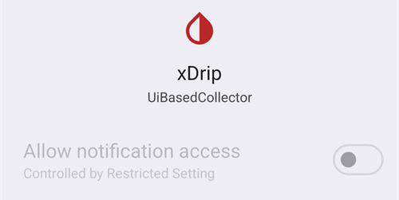

# Dexcom G7, ONE+ ir Stelo


## Svarbu žinoti iš anksto

Svarbu žinoti, kad G7, ONE+ ir Stelo sistemos, palyginti su G6, neglodina reikšmių nei programėlėje, nei skaitytuve. Daugiau informacijos rasite [čia](https://www.dexcom.com/en-us/faqs/why-does-past-cgm-data-look-different-from-past-data-on-receiver-and-follow-app).

```{admonition} Smoothing method 
Perskaitykite [glodinimo metodo](../CompatibleCgms/SmoothingBloodGlucoseData.md) patarimus, kurį naudoti su Dexcom G7/ONE+/Stelo
```

## 1. xDrip (tiesioginis ryšys su G7, ONE+ arba Stelo)

- xDrip pats jungiasi prie jutiklio: pašalinkite Dexcom programėlę, nes prie jutiklio gali jungtis tik viena programėlė. Jei norite pasilikti Dexcom programėlę, verčiau naudokite [xDrip Companion App](#DexcomG7-xdrip-companion-app).
- Vadovaukitės čia pateiktomis instrukcijomis: [xDrip G7, ONE+ ir Stelo](https://navid200.github.io/xDrip/docs/Dexcom/G7.html). Reikia naujos xDrip versijos – mažiausią versiją rasite nuorodoje pateiktame puslapyje.
- Pasirinkite xDrip skiltyje [**Konfigūracija → Glikemijos šaltinis**](#Config-Builder-bg-source).

- Sureguliuokite xDrip nustatymus pagal paaiškinimus xDrip nustatymų puslapyje [xDrip nustatymai](../CompatibleCgms/xDrip.md).

## 2. Build Your Own Dexcom App (tik G7)

```{admonition} Old app version
:class: warning
Dexcom BYODA yra labai sena programėlės versija, jos atnaujinti negalima. Netinka ONE+ ir Stelo.
```

-   [Build Your Own Dexcom App](https://docs.google.com/forms/d/e/1FAIpQLScD76G0Y-BlL4tZljaFkjlwuqhT83QlFM5v6ZEfO7gCU98iJQ/viewform?fbzx=2196386787609383750) (BYODA) palaiko vietinį duomenų siuntimą (local broadcast) į AAPS

-   Ši programėlė leidžia naudoti Dexcom G7 su bet kuriuo Android išmaniuoju telefonu.
-   Pašalinkite originalią Dexcom programėlę
-   Įdiekite atsisiųstą apk
-   Įveskite jutiklio kodą pataisytoje programėlėje
-   Po trumpo laiko BYODA turėtų pagauti jutiklio signalą.

(DexcomG7-xdrip-companion-app)=

## 3. xDrip Companion App (G7, ONE+ ir Stelo)

Oficiali Dexcom programėlė lieka prijungta prie jutiklio. xDrip nuskaito gliukozės reikšmes iš Dexcom programėlės pranešimų ir siunčia jas į **AAPS**.

```{admonition} Not a trusted data source
:class: note
**AAPS** nelaiko xDrip Companion App režimu [patikimu glikemijos duomenų šaltiniu](#GettingStarted-TrustedBGSource): SMB ne visada leidžiami.
```

### Dexcom programėlės pranešimų skaitymas

- Palikite Dexcom programėlę įdiegtą ir prijungtą prie jutiklio. Jos pranešimai turi likti matomi: jų nenutildykite ir neslėpkite.
- Atsisiųskite ir įdiekite [xDrip](https://github.com/NightscoutFoundation/xDrip). xDrip naudokite tuos pačius gliukozės vienetus kaip ir Dexcom programėlėje.
- xDrip programėlėje eikite į **Settings** > **Hardware Data Source** ir pasirinkite **Companion App**.

  

- xDrip paprašys leidimo skaityti pranešimus. Spauskite **OK**, tada sąraše pasirinkite **xDrip** ir įjunkite **Allow notification access** (leisti pasiekti pranešimus).

  

- Jei **Allow notification access** yra pilkas (*Controlled by Restricted Setting*), Android jį blokuoja, nes xDrip buvo įdiegtas ne iš Play Store:

  

  Atverkite xDrip programėlės informaciją (ilgai spauskite xDrip piktogramą > **App info**), viršuje dešinėje spauskite trijų taškų meniu ir pasirinkite **Allow restricted settings** (leisti apribotus nustatymus). Tada grįžkite į prieigos prie pranešimų ekraną ir leiskite prieigą.

  

  

- Rodmenys xDrip atsiranda, kai Dexcom programėlė parodo naują reikšmę. Jei niekas neatsiranda, gali reikėti xDrip programėlėje paleisti jutiklį: tai neturi jokio poveikio tikram jutikliui. Šiuo režimu Stelo pateikia rodmenį kas 15 minučių.

### Companion Bluetooth (G7)

Kai Dexcom programėlė prijungta prie G7 jutiklio, xDrip taip pat gali klausytis rodmenų, kuriuos jutiklis per Bluetooth siunčia Dexcom programėlei. xDrip nesusiejamas su jutikliu ir jums nereikia įvesti jutiklio kodo: valdymas lieka Dexcom programėlei.

Su **Companion Bluetooth** xDrip gauna tikslų kiekvieno rodmens laiką ir kitimo kryptį tiesiai iš jutiklio, o ne pranešimo atsiradimo laiką, ir užpildo spragas, kai telefonas buvo už ryšio ribų (backfill).

- xDrip programėlėje eikite į **Settings** > **Less common settings** > **Bluetooth Settings** ir įjunkite **Companion Bluetooth**.

  

- Tai veikia ne visuose telefonuose ir ne visose Android versijose. Jei pastebite problemų, šią funkciją išjunkite.
- Jei senas Dexcom jutiklis vis dar yra telefono Bluetooth sąraše, xDrip gali klausytis ne to jutiklio: Android **Settings** > **Connected devices** (Nustatymai, Prijungti įrenginiai) pamirškite jutiklius, kurių nebenaudojate.
- Companion Bluetooth sukurtas G7 jutikliui. Su ONE+ ir Stelo naudokite pranešimus.

### Konfigūravimas AAPS

- Pasirinkite xDrip skiltyje [**Konfigūracija → Glikemijos šaltinis**](#Config-Builder-bg-source).
- Sureguliuokite xDrip nustatymus pagal paaiškinimus xDrip nustatymų puslapyje [xDrip nustatymai](../CompatibleCgms/xDrip.md).

## 4. Juggluco (G7 ir ONE+)

Reikia 9.0 ar naujesnės versijos

- Išjunkite programėlę, kuri anksčiau buvo prijungta prie jutiklio: pašalinkite programėlę arba naudokite „Force Stop“ (priverstinai sustabdyti). Programėlės nustatymuose išjunkite leidimą „Nearby Devices“ (netoliese esantys įrenginiai). Apribokite programėlės baterijos naudojimą.

- Pamirškite jutiklį Bluetooth nustatymuose: Android nustatymuose susietų įrenginių sąraše raskite jutiklį ir pasirinkite „Forget“ (pamiršti). Dexcom G7 jutiklių pavadinimai prasideda DXCM.

- Venkite kitų jutiklių trikdžių: laikykite senus Dexcom jutiklius už Bluetooth ryšio ribų.

- Prijunkite G7 jutiklį prie Juggluco: atverkite Juggluco → kairysis meniu → Photo. Nuskenuokite duomenų matricos kodą ant G7 jutiklio aplikatoriaus. Palaukite iki 5 minučių, kol Juggluco suras jutiklį.

- Susiejimo reikalavimai: sutikite susieti jutiklį su Juggluco. Susiejimo metu ekranas turi būti neužrakintas. Jei susieti nepavyksta, prieš bandydami dar kartą palaukite 5 minutes.

- Išimtis: Wear OS laikrodžiai gali susieti be sutikimo mygtuko paspaudimo.
