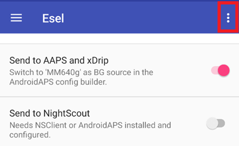

# Eversense

Eversense rodmenis galima gauti keturiais būdais:

- ESEL Companion režimas
- ESEL režimas su pataisyta programėle
- xDrip Companion App
- Pranešimų skaitytuvas (integruotas į **AAPS**)

## ESEL

Get and install the [ESEL app](https://github.com/BernhardRo/Esel/tree/master/apk), following these [instructions](https://github.com/BernhardRo/Esel?tab=readme-ov-file#esel).

- ESEL programėlėje viršuje dešinėje atverkite trijų taškų meniu (⋮) ir pasirinkite **Settings** (taip pat galima per ☰ meniu). Nustatymuose:
  - Įjunkite „Send to AAPS and xDrip“
  - **Išjunkite** „Send to Nightscout“
  - Eversense gliukozės duomenys gali būti triukšmingi, todėl ESEL programėlėje rekomenduojama įjungti „Smooth Data“.



### Companion režimas

Reads the data from the Eversense app notifications (works with the standard Eversense App, available since ESEL version 3.0.1).

1. Naudokite oficialią Eversense programėlę iš Google Play Store
   - Nebūtina, bet reikia trūkstamiems duomenims užpildyti (backfill): prisijunkite prie savo Eversense paskyros
   - Skiltyje „Sync“ įjunkite „Auto synchronization“
2. Configuration of ESEL:
   - Išjunkite nustatymą „Get data from patched Eversense App“
   - Trūkstamiems duomenims užpildyti (backfill): įjunkite „Fill missing data from eversensedms.com“
   - Kaip el. pašto adresą ir slaptažodį įveskite savo Eversense paskyros prisijungimo duomenis
3. Skiltyje [**Konfigūracija → Glikemijos šaltinis**](#Config-Builder-bg-source) pasirinkite „MM640g“.

### Pataisyta Eversense programėlė

 Reikia pataisytos Eversense programėlės versijos (veikia visiškai be interneto, įskaitant trūkstamų duomenų užpildymą).

1. Pašalinkite Eversense programėlę (Įspėjimas: jūsų vietiniai istoriniai duomenys (senesni nei 1 savaitė) bus prarasti!)

2. Įdiekite [pataisytą Eversense programėlę](https://cr4ck3d3v3r53n53.club) ir naudokite ją taip, kaip aprašo jos kūrėjas

   - Paleiskite Eversense programėlę, prisijunkite prie paskyros, prijunkite savo siųstuvą ir naudokite ją kaip įprastą programėlę.

3. Configuration of ESEL:

   - Įjunkite nustatymą „Get data from patched Eversense App“


Jei ESEL naudojate pirmą kartą su naujai įdiegta Eversense programėle, gali praeiti iki 15 min., kol pirmosios reikšmės atsiras xDrip!

4. Skiltyje [**Konfigūracija → Glikemijos šaltinis**](#Config-Builder-bg-source) pasirinkite „MM640g“.

## xDrip

xDrip gali skaityti gamintojo programėlės pranešimus, kaip tai daro ESEL. Trūkstamų duomenų užpildymas negalimas.

- Atsisiųskite ir įdiekite xDrip: [xDrip](https://github.com/NightscoutFoundation/xDrip)
- xDrip programėlėje kaip duomenų šaltinį reikia pasirinkti „Companion App“.
- Pasirinkite xDrip skiltyje [**Konfigūracija → Glikemijos šaltinis**](#Config-Builder-bg-source).
- Sureguliuokite xDrip nustatymus pagal paaiškinimus xDrip nustatymų puslapyje [xDrip nustatymai](../CompatibleCgms/xDrip.md).
- AAPS įjunkite [eksponentinį glodinimą](../CompatibleCgms/SmoothingBloodGlucoseData.md).

## Pranešimų skaitytuvas

**AAPS** gali nuskaityti gliukozės reikšmes tiesiai iš oficialios Eversense programėlės pranešimų, be jokios kitos programėlės tarp jų. Trūkstamų duomenų užpildymas negalimas.

- Skiltyje [**Konfigūracija → Glikemijos šaltinis**](#Config-Builder-bg-source) pasirinkite **Pranešimų skaitytuvas** ir, kai paprašys, suteikite **AAPS** prieigą prie pranešimų.
- Įsitikinkite, kad Eversense programėlė savo pranešime rodo dabartinę gliukozės reikšmę.

```{warning}
Gliukozės reikšmės ne visada gaunamos kas 5 minutes, gali atsirasti pasikartojančių reikšmių.
```