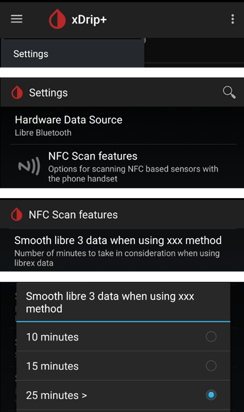

# Freestyle Libre 2 ir 2+

Freestyle Libre 2 jutiklis dabar yra tikras NGJ net ir su oficialia programėle. Vis dėlto LibreLink negali siųsti duomenų į AAPS. Yra keli būdai jį naudoti su AAPS.

## 1. Naudokite Bluetooth tarpinį ryšio įrenginį ir OOP

Bluetooth siųstuvus galima naudoti su Libre 2 (EU) arba 2+ (EU) ir programėle su išoriniu algoritmu (out of process, OOP). Cukraus kiekio kraujyje reikšmes galite gauti kas 5 minutes, kaip ir su [Libre 1](./Libre1.md).

Patikrinkite, ar tarpinis ryšio įrenginys ir programėlė, kurią norite naudoti, suderinami su jūsų jutikliu ir xDrip.

Libre2 OOP (rasite [čia](#Libre2_OOP2)) sukuria tokias pačias KG reikšmes kaip originalus skaitytuvas. AAPS su Libre 2 taiko 10–25 minučių glodinimą, kad išvengtų tam tikrų šuolių. Žr. toliau: [Reikšmių glodinimas ir neapdorotos reikšmės](#libre2-value-smoothing-raw-values). OOP kas 5 minutes sukuria reikšmę – paskutinių 5 minučių vidurkį. Todėl KG reikšmės nėra tokios glodžios, bet atitinka originalaus skaitytuvo reikšmes ir greičiau seka „tikrąsias“ KG reikšmes. Jei norite naudoti ciklą su OOP, xDrip įjunkite visus glodinimo nustatymus.

Yra kelios svarbios priežastys naudoti Bluetooth siųstuvą:

-   Galite pasirinkti įvairias OOP2 kalibravimo strategijas (1): rodyti skaitytuvo reikšmes su „no calibration“, kalibruoti jutiklį kaip Libre 1 su „calibrate based on raw“ arba kalibruoti skaitytuvo tipo reikšmes su „calibrate based on glucose“.  
  OOP1 palikite išjungtą (2).

    → Hamburger Menu → Settings → Less common settings → Other misc. options


-   Libre 2 jutiklį galima naudoti 14,5 dienos, kaip ir Libre 1
-   Visiškai palaikomas 8 valandų trūkstamų duomenų užpildymas (backfill)

Pastaba: siųstuvą galima naudoti kartu su LibreLink programėle, jis jai netrukdo.

### Start sensor

- → Hamburger Menu (1) → Start sensor (2) → Start sensor (3) → atsakykite „Not Today“ (4).


Tai fiziškai nepaleidžia jokio Libre2 jutiklio ir jokiu būdu su juo nesąveikauja. Tai tik praneša xDrip, kad naujas jutiklis siunčia cukraus kiekio kraujyje reikšmes. Jei įmanoma, pradiniam kalibravimui įveskite dvi kraujo matavimų reikšmes. Dabar gliukozės kraujyje reikšmės xDrip turėtų būti rodomos kas 5 minutes. Praleistos reikšmės, pvz., kai buvote per toli nuo telefono, nebus užpildytos vėliau (backfill).

Pakeitus jutiklį, xDrip automatiškai aptiks naują jutiklį ir ištrins visus kalibravimo duomenis. Po aktyvavimo galite pasitikrinti gliukozę kraujyje ir atlikti naują pradinį kalibravimą.

### AAPS konfigūravimas (tik ciklui)

-   **AAPS** viršutiniame kairiajame kampe atidarykite **meniu** (☰), eikite į **Konfigūracija** > **Glikemijos šaltinis** ir pasirinkite **xDrip+**


-   Jei AAPS negauna KG reikšmių, kai telefonas veikia lėktuvo režimu, naudokite „Identify receiver“, kaip aprašyta [xDrip nustatymų puslapyje](#xdrip-identify-receiver).

## 2. Tiesioginio xDrip ryšio naudojimas

```{admonition} Libre 2 EU only
:class: warning
xDrip nepalaiko tiesioginio ryšio su Libre 2 US ir AUS.
Tik Libre 2 ir 2+ **EU** modeliai.
```

- Nustatydami xDrip vadovaukitės [šiomis instrukcijomis](./Libre2MinimalL00per.md), nes originali dokumentacija nurodo pasenusią OOP2  versiją.
- Vadovaukitės nustatymo instrukcijomis [xDrip nustatymų puslapyje](../CompatibleCgms/xDrip.md).

-   Pasirinkite xDrip+ skiltyje [Konfigūracija > Glikemijos šaltinis](#Config-Builder-bg-source).

(libre2-value-smoothing-raw-values)=

### Reikšmių glodinimas ir neapdorotos reikšmės

Techniškai dabartinė cukraus kiekio kraujyje reikšmė į xDrip perduodama kas minutę. Svertinio vidurkio filtras pagal numatytuosius nustatymus apskaičiuoja glodintą reikšmę per paskutines 25 minutes. Šį laikotarpį galite pakeisti meniu NFC Scan features.

→ Hamburger menu → Settings → NFC Scan features → Smooth libre 3 data when using xxx method



This is mandatory for looping. Kreivės atrodo glodžios, o ciklo rezultatai puikūs. Neapdorotos reikšmės, kuriomis remiasi aliarmai, šokinėja šiek tiek daugiau, bet atitinka reikšmes, kurias rodo ir skaitytuvas. Be to, neapdorotas reikšmes galima rodyti xDrip grafike, kad galėtumėte laiku reaguoti į greitus pokyčius. Įjunkite Less Common Settings \> Advanced Settings for Libre2 \> "show Raw values" ir "show Sensors Infos". Tada neapdorotos reikšmės papildomai rodomos kaip maži balti taškai, o papildoma jutiklio informacija pasiekiama sistemos meniu.

Neapdorotos reikšmės labai naudingos, kai cukraus kiekis kraujyje greitai keičiasi. Net jei taškai šokinėja labiau, kryptį pastebėsite daug geriau nei pagal glodintą liniją ir galėsite priimti teisingus gydymo sprendimus.

→ Hamburger menu → Settings → Less common settings → Advanced settings for Libre 2


#### Kalibravimas

Libre2 galite kalibruoti **su poslinkiu nuo -40 mg/dL iki +20 mg/dL \[nuo -2,2 mmol/l iki +1,1 mmol/l\]** (intercept). Nuolydžio (slope) pakeisti negalima. Įvedę naują jutiklį, patikrinkite reikšmes matuodami gliukozę iš piršto. Atminkite, kad pirmąsias 12 valandų po įvedimo jutiklis gali būti netikslus. Kadangi skirtumai nuo kraujo matavimų gali būti dideli, tikrinkite kas 24 valandas ir, jei reikia, kalibruokite. Jei po kelių dienų jutiklio reikšmės visiškai netikslios, jutiklį reikia pakeisti.

## 3. Diabox naudojimas

- Įdiekite [Diabox](https://www.bubblesmartreader.com/_files/ugd/6afd37_f183eabd4fbd44fcac4b1926a79b094f.pdf). In Settings, Integration, enable Share data with other apps.


- Pasirinkite xDrip+ skiltyje [Konfigūracija > Glikemijos šaltinis](#Config-Builder-bg-source).

## 4. Juggluco naudojimas

Žr. [čia](./Juggluco.md).
