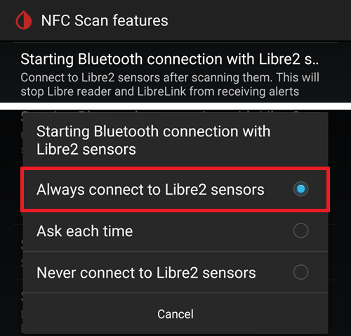
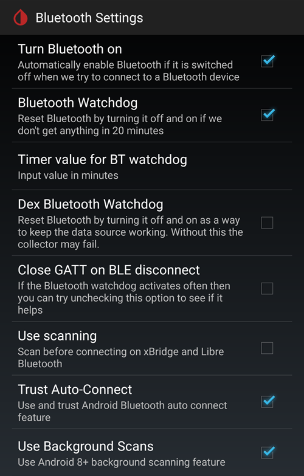
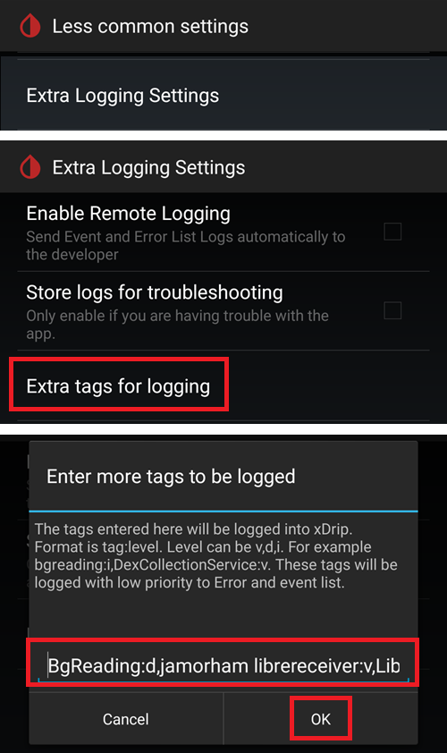
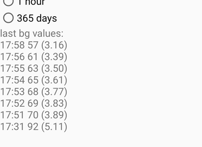

# Kaip nustatyti FSL 2 ir OOP2, kad xDrip naudotų tiesioginį Bluetooth ryšį

Perkelta iš [MinimalL00per](https://www.minimallooper.com/post/how-to-setup-freestyle-libre-2-and-oop2-to-use-a-native-Bluetooth-connection-in-xdrip) į markdown ir **pataisyta / atnaujinta**: 2025 m. rugpjūčio 25 d., psonnera

Šio dokumento pabaigoje yra sąvokų sąrašas. Jei kurios nors sąvokos ar santrumpos nesuprantate, *[pereikite žemyn](#minimallooper-definitions)* ir rasite paaiškinimą.

 

## Configuration

### Įranga

- *FSL2 ir 2+* **PASTABA: US, CAN, NZ, AUS versijos NEPALAIKOMOS**

**(NEPRIVALOMA) Skaitytuvas (Reader)** (nesuderinamas su FSL2+)

- Reader 1 (su atnaujinta programine įranga)

- Reader 2

*PASTABA: jei šiame sprendime norite naudoti skaitytuvą, jutiklį PRIVALOTE PALEISTI PIRMIAUSIA SKAITYTUVU. Jei to nepadarysite, negalėsite skaitytuvu gauti reikšmių iš aktyvuoto jutiklio. Kai jutiklis įšyla, reikšmes galite gauti LL programėle arba xDrip.*

### Programinė įranga

**OOP** – Out of Process Algorithm (išorinis algoritmas), atskira Android APK programėlė, kuri padeda gauti neapdorotus jutiklio duomenis ir iš jų gauti gliukozės kraujyje reikšmes. xDrip surinktus neapdorotus FSL2 BT duomenis siunčia į OOP, o gliukozės kraujyje reikšmės grąžinamos į xDrip.

- **OOP2**

  - **Veikia tik su Europos FSL2/2+ jutikliais**

  - Uždaras kodas (nėra GitHub)

  - Tikslas – iššifruoti šifruotas neapdorotas jutiklio reikšmes ir grąžinti jas į xDrip. Tada xDrip gali naudoti neapdorotus duomenis (tada reikia kalibruoti) arba pateikti gliukozės reikšmes, panašias į Reader 1.

[***xDrip***](https://jamorham.github.io/)

- [*Nightly*](https://github.com/NightscoutFoundation/xDrip/releases) – naujausias išeities kodas, sukuriamas kiekvieną naktį. Nėra kruopščiai išbandyta

- [*Stable*](https://xdrip-plus-updates.appspot.com/stable/xdrip-plus-latest.apk) – naujausia stabili, išbandyta versija.

- **PASTABA: naujiems jutikliams reikia atnaujintos OOP2 programėlės, todėl rekomenduojama naudoti bent naujausią xDrip išleistą (Stable) versiją, atitinkančią naujausią OOP2.**

 

## Eiga

- *Pirmiausia atsisiųskite ir įdiekite toliau nurodytas programėles*
- *Pašalinkite programėles, kurios gali trukdyti*
- *Kaip paleisti FSL2 jutiklį tiesioginiu Bluetooth režimu naudojant LL ir xDrip
  - [*1 žingsnis: programėlių įdiegimas ir konfigūravimas*](#minimallooper-step1)
  - [*2 žingsnis: xDrip nustatymų konfigūravimas*](#minimallooper-step2)
  - [*3 žingsnis: fiziškai įveskite jutiklį*](#minimallooper-step3)
  - [*4 žingsnis: paleiskite LL programėlę ir paleiskite jutiklį pirmuoju NFC skenavimu*](#minimallooper-step4)
  - [*5 žingsnis: atidarykite xDrip ir NFC NUSKENUOKITE FSL2 jutiklį*](#minimallooper-step5)
  - [*6 žingsnis: paleiskite naują jutiklį xDrip*](#minimallooper-step6)
  - [*7 žingsnis: palaukite 60 sekundžių ir dar kartą nuskenuokite jutiklį NFC*](#minimallooper-step7)
  - [*8 žingsnis: duomenų rinkimas nuo 3 iki 15 minučių*](#minimallooper-step8)
  - [*9 žingsnis: patikrinkite, ar jutiklis prijungtas ir siunčia duomenis*](#minimallooper-step9)

- *[Notes](#minimallooper-notes)*
- *[Privalumai](#minimallooper-advantages)*
- *[Trūkumai](#minimallooper-disadvantages)*
- <u>*\[Trikčių šalinimas\](#minimallooper-troubleshooting)*</u>

## Prieš pradedant

Labai rekomenduojama šiuos veiksmus atlikti su **nauju jutikliu**. Nors pranešta, kad prisijungti galima ir prie jau veikiančio jutiklio (***žr. [toliau](#minimallooper-started-sensor)***), labai tikėtina, kad LL programėlė arba skaitytuvas prisijungimo metu sukurs naują privatų bendrą ryšio raktą. Tai reiškia, kad po susiejimo xDrip nežino naujo rakto ir negalės bendrauti su jutikliu. Prisijungti prie veikiančio jutiklio bandote savo rizika, geriausia – artėjant jutiklio naudojimo pabaigai.

### Pirmiausia atsisiųskite ir įdiekite toliau nurodytas programėles

(Libre2_OOP2)=

- **OOP2** – oop2 versijas rasite čia:

  (*Pastaba: norint atidaryti nuorodą, reikia būti prisijungus prie Google.*)

*[oop2.apk](https://drive.google.com/file/d/1106h2s12b3Ev9gKCTU2G75q8h9ChHjcz/view?usp=sharing)* – OOP2_21_09_25 (05d1989) **2025.09.21** (naujausia versija)

- **xDrip** – **<u>naujausią versiją</u>** (mažiausiai 2025.09.26 versija) rasite čia:

[*xDrip.apk*](https://github.com/NightscoutFoundation/xDrip/releases)

(minimallooper-started-sensor)=

### Ką daryti, jei jutiklis jau paleistas? Ar vis dar galiu gauti reikšmes xDrip? TAIP!

Daug žmonių klausė, ar šį būdą galima naudoti su jau aktyviu jutikliu, ir galiu drąsiai atsakyti **TAIP** – galite paleisti jau veikiantį jutiklį.

1.  **PIRMIAUSIA** įsitikinkite, kad atlikote xDrip konfigūracijos pakeitimus ir nustatymus bei įdiegėte ir sukonfigūravote OOP2, kaip parodyta toliau.

2.  **TADA** pereikite prie *5 žingsnio* ir prieš pradėdami **ĮSITIKINKITE**, kad priverstinai uždarėte LL. Tada atlikite visus veiksmus iki galo.

*PASTABA: aktyvuoto FSL2 jutiklio negalėsite naudoti su FSLReader, JEI jis nebuvo pirmiausia paleistas su FSLReader. Jei jutiklis BUVO pirmiausia paleistas su FSLReader, galėsite **skenuoti** jutiklį ir gauti reikšmes ABIEM būdais – ir skaitytuvu, ir programėlėmis, pvz., LL ir xDrip.*

## Kaip paleisti FSL2 jutiklį tiesioginiu Bluetooth režimu naudojant LL ir xDrip

*PASTABA: jei ekrano nuotraukose yra nustatymų, kurie nepažymėti RĖMELIU ir yra NEPAŽYMĖTI (t. y. išjungti), PALIKITE JUOS IŠJUNGTUS. Ekrano nuotraukose matyti veikianti VISŲ parodytų nustatymų konfigūracija. Jei jutikliui jau veikiant norite išbandyti kitų funkcijų įjungimą ar išjungimą, galite tai daryti savo rizika.*

(minimallooper-step1)=

### 1 žingsnis: programėlių įdiegimas ir konfigūravimas

**Įdiekite ir sukonfigūruokite OOP2** ir patikrinkite, ar programėlė veikia, tiesiog ją atidarę.


**Parametrai**

- *Use service* **on**

- *Use foreground service* **on**

- *Timer Duration* **5 minutes**

  - Jei rezultatai gaunami nepakankamai greitai, pakeiskite į **1 sec** (toliau esančioje ekrano nuotraukoje parodytas šis nustatymas).

**2 versija: 93e5cac-2020.12.08 (naujausia versija)**


**Įdiekite xDrip**, mažiausia versija: naujausia išleista. Daugiau informacijos apie xDrip įdiegimą ir nustatymą rasite [*čia*](../CompatibleCgms/xDrip.md).

(minimallooper-step2)=

### 2 žingsnis: xDrip nustatymų konfigūravimas

**Hardware Data Source**: Libre Bluetooth


**NFC Scan features**: *laikoma, kad nepaminėti nustatymai yra išjungti.*

- *Use NFC feature*: **on**
- *Sensor Age or Expiry*: **on**
- *Scan when not in xDrip*: **on**
- *Use Any-tag optimized reading method*: **off**, bet jei sunku nuskenuoti, išbandykite **on**


- *Starting Bluetooth connection with FSL2 sensor*: **Always connect to libre2 sensors**



- *Smooth libre 3 data when using xxx method*: palikite numatytąją reikšmę. Jei jutiklio reikšmės triukšmingos, reikšmę padidinkite, jei stabilios – sumažinkite.


**Less Common Settings -\> Bluetooth Settings** (*šie nustatymai svarbūs ir gali skirtis pagal jūsų telefoną ar sąranką*)

- *Turn Bluetooth on*: **on**
- *Trust Auto-Connect*: **on**
- *Use Background Scans*: **on**
- *Always discover services*: **on**

xDrip galite nustatyti naudodami toliau esantį QR kodą. Jį reikia nuskenuoti (arba įkelti paveikslėlį) xDrip -> Auto Configure.

```{admonition} QR Code
:class: dropdown


```




Nuskenavę aukščiau esantį QR kodą, jei turite Samsung telefoną (tai naudinga ir daugeliui kinų gamintojų telefonų), nuskenuokite toliau esantį kitą QR kodą, kad pakeistumėte nustatymus ir ryšys būtų patikimesnis:

- *Trust Auto-Connect*: **off**
- *Use Background Scans*: **off**

```{admonition} QR Code
:class: dropdown


```


**Advanced settings for FSL2** (*neprivaloma, bet naudinga*)

- *show Raw values in Graph*: **on**

- *show Sensor info in Status*: **on**


**Extra Logging Settings** (*reikia klaidoms ieškoti, jei kas nors veikia netinkamai*)

- *Extra tags for logging*: įveskite šią reikšmę

`BgReading:d,jamorham librereceiver:v,LibreOOPAlgorithm:v,jamorham nsemulator:v,DexCollectionService:v`



(minimallooper-OOPsettings)=

**Less Common Settings -\> Other misc options**

> **OOP2 konfigūracijos nustatymai**

- *Out of process Libre algorithm*: **OFF**

(*OOP2 ATVEJU ĮSITIKINKITE, KAD ŠIS NUSTATYMAS **OFF**, KITAIP NEGAUSITE REIKŠMIŲ!*)


(minimallooper-step3)=

### 3 žingsnis: fiziškai įveskite jutiklį

(minimallooper-step4)=

### 4 žingsnis: paleiskite LL programėlę ir paleiskite jutiklį pirmuoju NFC skenavimu

Paleiskite LL programėlę, nuskenuokite ką tik įvestą jutiklį, tada uždarykite ir išjunkite arba pašalinkite LL programėlę. **Prieš tęsdami ir paleisdami jutiklį xDrip, vis tiek turite palaukti visas 60 minučių, kol jutiklis įšils**. Nepasitikėkite ankstesnėmis reikšmėmis, nes jutiklis dar vidujai kalibruojasi ir reikšmės labai šokinėja.

#### 4a žingsnis (NEPRIVALOMAS, naudojant FSLReader):

**Paleiskite FSL2 (ne 2+) jutiklį pirmuoju NFC skenavimu su FSLReader**

Jei norite FSL2 jutiklio reikšmes skaityti ne tik LL programėle ar xDrip, bet ir **FSLReader**, **ką tik įvestą FSL2 jutiklį PIRMIAUSIA turite nuskenuoti FSL Reader.** Jutikliui įšilus, reikšmes galėsite skenuoti LL programėle arba xDrip.

*PASTABA: LL programėlė reikalinga tik PATIEM PIRMAM NFC skenavimui po jutiklio įvedimo. Ji siunčia įšilimo pradžios signalą, po to programėlę PRIVALOMA išjungti (programėlės nustatymai-\>priverstinai sustabdyti) arba pašalinti. Galite naudoti pataisytą 2.3 programėlę arba oficialias versijas – tai nesvarbu. Svarbiausia – kad LL programėlė neveiktų tuo metu, kai xDrip bando pradėti BT susiejimą su jutikliu, nes LL programėlė trikdo ryšį ir taip trukdo Bluetooth prisijungimui iš naujo.*

*Pranešta, kad pakanka LL programėlės Android sistemos nustatymuose išjungti **vietos leidimą**, kad ji netrukdytų ryšiui. Keli naudotojai pranešė, kad tai pavyko. Vis dėlto **rekomenduoju programėlę išjungti arba pašalinti**, bet jei norite, galite išbandyti ir šį būdą.*

(minimallooper-step5)=

### 5 žingsnis: atidarykite xDrip ir NFC NUSKENUOKITE FSL2 jutiklį

(*Priminimas! Įsitikinkite, kad LL išjungta (išjungtas vietos leidimas) arba pašalinta IR kad palaukėte visas 60 minučių, kol jutiklis įšils ir vidujai susikalibruos.*)

**NFC NUSKENUOKITE** FSL2 jutiklį su xDrip. Tai siunčia jutikliui signalą įjungti Bluetooth susiejimą ir pradėti susiejimo procesą. Sėkmingai NFC nuskenavus FSL 2 jutiklį, xDrip pagrindinio ekrano (Overview) apačioje trumpam pasirodys nedidelis pranešimas **Scanning**, o po jo – pranešimas **Scanned OK!**.


(minimallooper-step6)=

### 6 žingsnis: paleiskite naują jutiklį xDrip

**xDrip pagrindiniame ekrane (Overview)** spauskite **meniu (hamburger)** viršutiniame kairiajame kampe. Tada pasirinkite **Start Sensor**.

Ekrane **Start New Sensor** spauskite **Start Sensor**. Bus paklausta **Did you insert it today?** (Ar įvedėte jį šiandien?). Atsakykite spausdami **NOT TODAY**.


*PASTABA: jei netyčia spustelėjote „YES, TODAY“, xDrip pagrindiniame meniu turėsite pasirinkti „stop sensor“, o tada „start sensor“, dar kartą atlikdami 5 žingsnį.*

(minimallooper-step7)=

### 7 žingsnis: palaukite 60 sekundžių ir dar kartą nuskenuokite jutiklį NFC

Antras NFC skenavimas reikalingas tam, kad jutiklis būtų **PRIDĖTAS** kaip Bluetooth įrenginys, iš kurio xDrip gaus reikšmes. Kai baigsis, pamatysite pranešimą **NEW SENSOR STARTED**.


Reikia palaukti 60 sekundžių, nes šio proceso metu jutiklį galima skenuoti ne dažniau kaip kartą per minutę. Jei jutiklį nuskenuosite per anksti, xDrip pagrindiniame ekrane (Overview) bus rodomas įspėjimas **Not so quickly, wait 60 seconds**.


Atidarykite xDrip įvykių žurnalus (event logs) ir patikrinkite, ar jutiklis tinkamai susietas su xDrip.


(minimallooper-step8)=

### 8 žingsnis: duomenų rinkimas nuo 3 iki 15 minučių

Per 3–15 minučių surenkama pakankamai duomenų, kad būtų parodytos pirmosios reikšmės. *Jei ir po to negaunate reikšmių, kartais padeda telefono paleidimas iš naujo.*

Jei naudojate Samsung (ar daugelio kinų gamintojų) telefoną ir kyla problemų gaunant duomenis, nuskenuokite toliau esantį QR kodą per xDrip -> Auto Configure.

```{admonition} QR Code
:class: dropdown


```

Jis pakeis xDrip Bluetooth nustatymus į:

- *Trust Auto-Connect*: **off**
- *Use Background Scans*: **off**

(minimallooper-step9)=

### 9 žingsnis: patikrinkite, ar jutiklis prijungtas ir siunčia duomenis

xDrip pagrindinio ekrano (Overview) viršutiniame kairiajame kampe spauskite meniu (hamburger) ir pasirinkite **System Status**. Ekrano System Status lauke **Bluetooth Device:** rodomas aktyvaus FSL2 Bluetooth įrenginio pavadinimas pagal formatą **ABB___XXXXXXXXXXX**, kur XXX yra jutiklio serijos numeris. Lauke **Connection Status** rodoma **Connected**, o lauke **Sensor Start:** – jutiklio paleidimo laikas.


Ekrane **BT Device** (perbraukite į kairę) galite patikrinti daugiau jutiklio ryšio informacijos ir šį ekraną naudoti ryšio trikčių šalinimui. Toliau pateiktas laukų sąrašas ir jų paskirtis, padėsiantys šalinti ryšio trikčių.

*PASTABA: šiame lange **<u>NELIESKITE</u> IR NEKEISKITE Bluetooth Pairing iš <u>Disabled</u>**. Taip bus bandoma tiesiogiai susieti, tai nepavyks (Not bonded), ir teks viską pradėti iš naujo nuo 5 žingsnio.*


- **Phone Service State:** paskutinis kartas, kai telefonas per BT prisijungė prie jutiklio (turi būti mažiau nei prieš 5 minutes)
- **Bluetooth Device:** rodo dabartinę ryšio būseną (**Connected** arba **Disconnected**)
- **Device Mac Address**: tai jutiklio aparatinis identifikatorius
- **Bluetooth Pairing**:  turi būti **<u>Disabled, tap to enable</u>**. Būkite atsargūs ir to NELIESKITE. Jei netyčia palietėte, lieskite dar kartą, kol vėl bus išjungta (disabled).
- **Slowest wake up**: į tai galite nekreipti dėmesio. xDrip nelaukia reikšmių visą laiką: jų pradeda tikėtis po tam tikro laiko (paprastai po 5 minučių). Jei tuo metu duomenų negaunama, pamatysite „Woke up early“ – tai reiškia, kad xDrip tikėjosi duomenų, bet jų nėra. Slowest wake up – ilgiausias užfiksuotas vėlavimas iki įprasto duomenų gavimo.
- **Next Wake up**: turi rodyti 5 minutes


(minimallooper-notes)=

### Notes

- **LL NFC skenavimas PO to, kai baigtas susiejimas xDrip**: NFC skenuoti galite, bet pirmiausia turi būti baigtas susiejimas su xDrip. Visada pažiūrėkite į xDrip ir patikrinkite, ar artėja 5 minučių reikšmė (pvz., prieš 4 minutes); jei beveik 5 min., palaukite, kol ateis nauja BT reikšmė, ir tik tada skenuokite NFC. Jei pataikysite netinkamu metu, sutrikdysite BT procesą xDrip ir BT reikšmių negausite; susiejimas iš naujo ir perdavimas gali užtrukti, o kartais LL gali „pavogti“ jutiklio BT ryšį. Tačiau tarp šių BT reikšmių man nekilo jokių problemų atliekant NFC skenavimą ir iš karto po to išjungiant programėlę. Nesu tikras, ar LL reikia išjungti kiekvieną kartą, bet dėl saugumo aš ją išjungiu.

- **Kas vyksta?** Kai užmezgamas Bluetooth ryšys, sukuriamas privatus bendras raktas, reikalingas jutiklio ir jį kviečiančios programėlės ar įrenginio ryšiui. Labai tikėtina, kad LL programėlė arba skaitytuvas prisijungimo metu sukurs naują privatų bendrą ryšio raktą. Tai reiškia, kad po susiejimo xDrip nežino naujo rakto ir negalės bendrauti su jutikliu.

  - Keli naudotojai pranešė, kad sėkmingai paleidus jutiklį ir xDrip gaunant reikšmes, LL programėlę galima vėl paleisti. LL programėlės Android leidimuose tiesiog išjunkite nustatymą **Allow Location**. Tai atlikę turėtumėte galėti naudoti LL programėlę ir xDrip vienu metu. Rekomenduoju nepasirinkti numatytosios NFC skenavimo programėlės, o kiekvieno NFC skenavimo metu pasirinkti, kuri programėlė nuskaitys jutiklį. Be to, NEPAMIRŠKITE kito jutiklio keitimo metu po pradinio įšilimo NFC skenavimo priverstinai sustabdyti LL programėlę. Kai jutiklis sukonfigūruotas ir xDrip gauna reikšmes, LL programėlę galite vėl paleisti.

&nbsp;

- **Telefono paleidimas iš naujo**: paleidę telefoną iš naujo ir išjungę ar priverstinai sustabdę programėlę, NEPAMIRŠKITE patikrinti, kad LL programėlė NEVEIKIA. Siūlau išbandyti paleidimą iš naujo ir pažiūrėti, ar LL vėl pasileidžia automatiškai. Tai galite patikrinti telefono Android programėlių nustatymuose, LL programėlės nustatymuose. Jei ji vis dar įjungta, vėl išjunkite LL programėlę; gali būti, kad vienintelis būdas to išvengti – pašalinti LL programėlę. Taip LL netyčia „nepavogs“ BT susiejimo. Be to, po paleidimo iš naujo BT reikšmių iš jutiklio teks laukti tas pačias 3–15 minučių, todėl būkite kantrūs ir į tai atsižvelkite, jei telefoną paleidžiate iš naujo prieš tuos laikus, kai jums reikės KG reikšmės bolusui, valgiui ir pan.

&nbsp;

- **Baterijos optimizavimo nustatymai**: būtinai PAŠALINKITE šias programėles iš telefono baterijos optimizavimo nustatymų

  - xDrip

  - OOP 2

  - LL

  - AAPS

&nbsp;

- **Lėktuvo režimo naudojimas:** kartais reikia įjungti lėktuvo režimą (kai skrendate ;-), kai miegate ir nenorite, kad šalia galvos esantis telefonas naudotų Wi-Fi ar mobiliojo ryšio signalus), ir įjungus lėktuvo režimą gali kilti Bluetooth ryšio problemų. Telefone įjungus lėktuvo režimą, o po to įjungus Bluetooth, gliukozės kraujyje reikšmės bus prarastos. Vienintelis apėjimo būdas – iš naujo paleisti duomenų rinkiklį (collector) per xdrip+ -\> System Status -\> Classic Status Page. Iš naujo paleidus rinkiklį, gliukozės kraujyje reikšmės vėl atsirado.

 

(minimallooper-advantages)=

### Privalumai

- **Pataisytos LL programėlės nebereikia** Norint gauti reikšmes iš FSL2 jutiklio, pataisytos LL programėlės versijos nebereikia. Pataisytą LL programėlę naudoti galite, bet oficialios LL programėlės versijos pirmąjį NFC inicijavimo skenavimą atlieka taip pat, kaip ir pataisyta. Kalbant apie NFC inicijavimo skenavimą jutikliui paleisti, skirtumo nėra.

&nbsp;

- **Trečiųjų šalių NFC skenavimo įrenginio nebereikia** Trečiųjų šalių NFC skenavimo įrenginių (pvz., Miaomiao, Bubble ar Blucon) reikšmėms gauti nebereikia *(bet juos vis dar galima naudoti)*, nes jutiklis pats gali jas perduoti per Bluetooth. Mažiau įrangos – mažiau gedimų, mažiau įkraunamų įrenginių ir paprastesnė sąranka.

&nbsp;

- **NFC skenuoti reikšmes FSL2 skaitytuvu (1 versija su atnaujinta programine įranga arba 2 versija) galėsite TIK TADA, KAI FSL2 jutiklis PIRMIAUSIA buvo paleistas su FSL Reader.** Kai jutiklis per Bluetooth susietas su xDrip, atskiru FSL2 skaitytuvu vis tiek galima skenuoti aktyvaus jutiklio reikšmes.

  - Jutiklį **PRIVALOTE** paleisti pačiu pirmuoju NFC skenavimu, kad prasidėtų jutiklio įšilimas, **PIRMIAUSIA su FSL Reader**. Po to ir kitos programėlės galės NFC skenavimu gauti reikšmes iš jau aktyvuoto jutiklio.
- Kiek suprantu, FSL2 jutiklis (kol jis nėra užmezgęs ryšio ir nebando jo užmegzti) visada kas 2 minutes per BLE praneša apie savo buvimą (ir pasiekiamumą) (tai mato bet kuris Bluetooth įrenginys, galintis ieškoti Bluetooth įrenginių). Pirmas į šį pranešimą atsakęs įrenginys laimi lenktynes ir yra *vienintelis* įrenginys, kuriam leidžiama prisijungti ir skaityti jutiklį, nes NFC skenavimo prisijungimo metu sukuriamas privatus bendras raktas, kuriuo iššifruojamas FSL 2 ryšys. Tada jutiklis nepasiekiamas kitiems įrenginiams, kurie neturi šio privataus bendro rakto ir taip pat gali bandyti prisijungti. Atrodo, kad FSL 2 skaitytuvas šias lenktynes visada laimi, kad ir koks būtų „varžovas“.

&nbsp;

- **Minimali įrenginių sąranka** Mano tikslas visada buvo, kad prie kūno būtų pritvirtinta kuo mažiau medicinos prietaisų. FSL2 kartu su Omnipod sistema šį tikslą pasiekė. Tai dar svarbiau keliaujant (tiek trumpai, tiek toli), nes daiktų ir jų keitimo rinkinių reikia mažiau, todėl lagamine lieka daugiau vietos kitiems daiktams. Tikiuosi, kad ateityje atsiras pompa be vamzdelio (patch), kurioje keičiamas bus tik rezervuaras, o lustas ir variklis bus daugkartinio naudojimo dalis. Tai sumažintų atliekų ir pakuočių keičiant infuzijos vietą, o lagamine vėl liktų daugiau vietos kitiems daiktams.

&nbsp;

- **Jokių valandos spragų keičiant jutiklius** Kadangi kitą jutiklį galite paleisti LL programėle pradiniu NFC skenavimu, dabartinis jutiklis gali toliau veikti ir tuo pat metu perduoti reikšmes per Bluetooth. Po 20 minučių iš naujo jutiklio jau galima gauti reikšmes, bet geriausia palaukti 1 valandą, kad jutiklis tinkamai vidujai susikalibruotų. Tai reiškia, kad galite sustabdyti dabartinį jutiklį ir paleisti naująjį (kai jis prieš valandą buvo įvestas ir įšildytas LL NFC skenavimu), ir per 3–15 minučių turėsite pradinius kalibravimus ir reikšmes.

&nbsp;

(minimallooper-disadvantages)=

### Trūkumai

- **Telefono paleidimas iš naujo:** kadangi po telefono paleidimo iš naujo Bluetooth procesas turi prasidėti iš naujo, pirmiausia turite rankiniu būdu išjungti LL programėlę (jei jos nepašalinote) ir kantriai laukti pirmųjų reikšmių (3–15 min.). Todėl telefoną paleiskite iš naujo tada, kai nėra svarbių momentų, pvz., korekcinių bolusų, valgio ar užkandžių metu.

&nbsp;

- **Negalite vienu metu naudoti LL ir xDrip Bluetooth reikšmėms gauti**. LL visada bandys „pavogti“ Bluetooth ryšį su jutikliu ir susiejimą. Jei taip atsitiks, iki jutiklio naudojimo pabaigos turėsite naudoti LL. Todėl programėlių naudojimas vienu metu ne visada veikia. Kaip minėsiu toliau, galite įjungti LL programėlę ir NFC skenavimu gauti LL reikšmę (jei reikia palyginti, norite gauti istoriją sau ar endokrinologo ataskaitoms), tačiau gavę reikšmę ją turėtumėte iš karto išjungti ir nebandyti to daryti likus mažiau nei minutei iki to laiko, kai xDrip gaus savo Bluetooth reikšmę. Nesu tikras, kaip tuo metu veikia FSL2 skaitytuvas, bet tai išbandysiu vėliau.
- Keli naudotojai pranešė, kad sėkmingai paleidus jutiklį ir xDrip gaunant reikšmes, LL programėlę galima vėl paleisti. LL programėlės Android leidimuose tiesiog išjunkite nustatymą **Allow Location**. Tai atlikę turėtumėte galėti naudoti LL programėlę ir xDrip vienu metu. Rekomenduoju nepasirinkti numatytosios NFC skenavimo programėlės, o kiekvieno NFC skenavimo metu pasirinkti, kuri programėlė nuskaitys jutiklį. Be to, NEPAMIRŠKITE kito jutiklio keitimo metu po pradinio įšilimo NFC skenavimo priverstinai sustabdyti LL programėlę. Kai jutiklis sukonfigūruotas ir xDrip gauna reikšmes, LL programėlę galite vėl paleisti.

&nbsp;

- **Trečiųjų šalių NFC skenavimo įrenginius vis dar galima naudoti**. Taip, tai įrašiau prie trūkumų, bet norėjau pabrėžti, kad jei su jutikliu kas nors nepavyksta ir LL perima jo valdymą, visada galite uždėti ant jutiklio NFC skenavimo įrenginį ir gauti reikšmes xDrip. Šį įrenginį taip pat galite naudoti vietoje tiesioginio Bluetooth ryšio, jei jums patogiau naudoti sąranką su trečiosios šalies NFC skenavimo įrenginiu (Miaomiao, Bubble, Blucon). Kartais kai kurie telefonai prastai veikia su tiesioginiu jutiklio Bluetooth susiejimu ir duomenų gavimu. Šiuos įrenginius galite naudoti kaip atsarginį variantą arba nuolat – bet kuriuo atveju ši galimybė jums lieka.
- Jei **FSL Reader** ketinate naudoti kaip NFC skenavimo įrenginį reikšmėms gauti, FSL2 jutiklį PRIVALOTE paleisti **PAČIU PIRMUOJU NFC skenavimu**, kad jutiklis būtų įšildytas **PIRMIAUSIA SKAITYTUVU**.

&nbsp;

- **LV duomenys nebus siunčiami automatiškai** Kadangi LL programėlė neturi nuolatinio Bluetooth ryšio (nes LL neturi veikti kartu su xDrip, kai jutiklis aktyviai siunčia Bluetooth reikšmes), ji automatiškai negauna reikšmių iš jutiklio. Tai reiškia, kad gliukozės kraujyje duomenys automatiškai nesiunčiami į LV, taigi ir į kitus telefonus su LL. Tai laikau trūkumu, nes žinau, kad šia funkcija naudojasi daug tėvų, taip pat tie, kurie privalo naudoti LV ataskaitas savo gydytojams. Vis dar galite atidaryti LL programėlę ir kas 8 valandas nuskenuoti jutiklį, kad trūkstami duomenys iš jutiklio patektų į LL (3 kartus per dieną, ne rečiau kaip kas 8 valandas, bet visų 24 valandų duomenims gauti tikriausiai reikės daugiau skenavimų), tačiau tai vėlgi rankinis darbas.

&nbsp;

(minimallooper-definitions)=

### Sąvokos

- **BT** – Bluetooth

- **BLE** – Bluetooth Low Energy

- **FSL** – FreeStyle Libre
  - **Libre 1 (FSL1)** – tik NFC. Pirmoji jutiklio versija

  - **Libre 2 (FSL2)** – Bluetooth ir NFC. Antroji jutiklio versija.

  - **Libre 3 (FSL3)** – Bluetooth ir NFC. Trečioji, mažesnė jutiklio versija. OOP2 nepalaiko (žr. Juggluco).

- **LL** – LibreLink, **programėlė**, kuria jutiklis paleidžiamas pradiniu NFC skenavimu

- **LV** – LibreView, debesijos paslauga duomenims dalintis su jūsų endokrinologų komanda (apsvarstykite Tidepool arba Nightscout)

- **MM** – MiaoMiao, trečiosios šalies NFC skenavimo įrenginio, kuris per Bluetooth siunčia reikšmes į xDrip, pavadinimas ir gamintojas.

- **NFC** – Near Field Communication (artimojo lauko ryšys), fizinis veiksmas, kai telefono NFC jutiklį priartinate prie savo jutiklio, kad gautumėte reikšmę. Tai dažnai vadinama „jutiklio skenavimu“ arba „NFC skenavimu“. Šiame procese Bluetooth visiškai nenaudojamas.

- **OOP1** – Out of Process Algorithm 1 versija, trečiosios šalies programėlė, kuri gauna neapdorotas reikšmes (iš jutiklio į xDrip perduotas per Bluetooth arba NFC skenavimu), jas apdoroja algoritmu (labai panašiu į aparatinį algoritmą jutiklio luste) ir grąžina į xDrip sukalibruotą (OOP1 algoritmu, o ne xDrip vidiniais kalibravimais) cukraus kiekio kraujyje reikšmę, kurią xDrip parodo arba, jei reikia, toliau apdoroja savo kalibravimu (pagal kraujo matavimą iš piršto).

- **OOP2** – Out of Process Algorithm 2 versija, trečiosios šalies programėlė, kuri gauna šifruotus duomenis iš FSL 2 jutiklio (per Bluetooth arba NFC skenavimu) ir juos iššifruoja. Iššifruoti duomenys siunčiami į xDrip.

 

(minimallooper-troubleshooting)=

### Troubleshooting

#### Nepavyksta nuskenuoti jutiklio NFC

- Įsitikinkite, kad Android nustatymuose įjungtas telefono NFC skaitytuvas.
- NFC skaitytuvas turi būti suderinamas su **ISO 15693** žymomis. Kai kuriuos Cubot telefonus naudoti labai sunku.
- Telefono dokumentacijoje suraskite, kur yra NFC antena. Priartinkite telefoną prie jutiklio ir palaikykite 10 sekundžių: xDrip NFC nuskaitymas trunka ilgiau nei gamintojo programėlė ar skaitytuvas.
- Prieš skenuodami jutiklį, pabandykite uždaryti xDrip.
- Įsitikinkite, kad jutiklio nebando nuskaityti jokia kita programėlė (skenuojant gali pasirodyti programėlių pasirinkimas: pasirinkite xDrip, bet telefono nepatraukite).
- Išbandykite visus xDrip NFC nustatymų *Use faster multi-block reading method* ir *Use Any-tag optimized reading method* derinius; NFC skenavimas paprastai patikimesnis, kai abu šie nustatymai **off**.

#### Užstrigo ties „collecting initial readings“

*Pastaba: rankiniu būdu kalibruotas FSL 2 nelaikomas patikimu duomenų šaltiniu.*

Kol viskas pradės veikti, nustatykite [OOP2 kalibravimo](#minimallooper-OOPsettings) strategiją „No calibration“.

Tada galėsite nuspręsti, ar kalibruoti.


#### Jutiklis atpažįstamas kaip FSL1


Įsitikinkite, kad naudojate naujausias xDrip ir OOP2 versijas.

#### Nepavyksta prisijungti prie jutiklio

- Patikrinkite, ar OOP1 išjungtas (žr. [čia](#minimallooper-OOPsettings))


- Patikrinkite, ar telefono baterijos taupymo programėlės ir nustatymai neužmigdo OOP2
- Patikrinkite, ar išjungta Google Play Protect, nes ji sustabdo OOP2
- Ar pakeitėte Bluetooth Pairing ekrane System Status? Palieskite dar kartą, kad vėl būtų **<u>Disabled</u>**


#### Praleistos reikšmės

Patikrinkite, ar OOP2 rodo reikšmes, kurios nėra 0 ar -1 – tai gali reikšti, kad jutiklis genda (pavyzdys toliau, mmol/l).



Jei jutiklio amžius nedidėja, tai taip pat gali reikšti, kad su jutikliu yra problemų. Tai reiškia, kad xDrip gavo reikšmę, bet ją atmetė, nes ji netinkama (jutiklio klaida).


#### Jutiklio susiejimas iš naujo nuo pradžių

1. xDrip meniu -> Stop sensor (FSL2 tai nesustabdys, tik pakeis xDrip būseną į nepaleistą)
2. xDrip meniu -> System status -> Forget device
3. Nuskenuokite jutiklį xDrip NFC. Palaukite bent vieną minutę
4. xDrip meniu -> Start sensor. Palaukite bent vieną minutę
5. Kelis kartus nuskenuokite jutiklį xDrip NFC, tarp dviejų skenavimų visada palaukdami bent vieną minutę.
