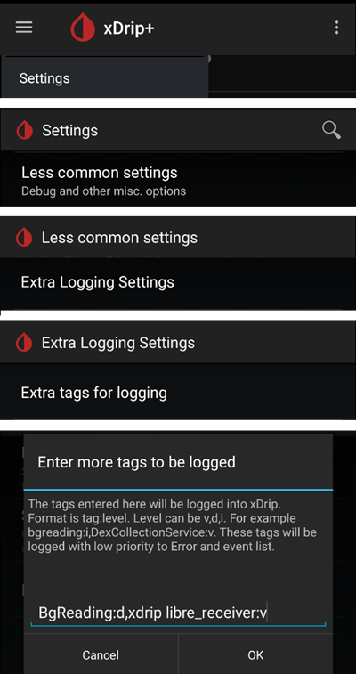

# xDrip nustatymai

Jei dar to nepadarėte, atsisiųskite ir įdiekite naujausią xDrip versiją iš [xDrip versijų puslapio](https://github.com/NightscoutFoundation/xDrip/releases).

Išjunkite xDrip programėlės baterijos optimizavimą ir leiskite jai veikti fone.

## Pagrindiniai visų NGJ ir FGM sistemų nustatymai

### Nightscout įkėlimo išjungimas

You shouldn't let any other app upload data (blood glucose and treatments) to Nightscout.

→ Meniu ☰ (1) → Settings (2) → Cloud Upload (3) → Nightscout Sync (REST-API) (4) → išjunkite (**OFF**) `Enabled` (5)

#### Automatinės kalibracijos ir terapijos išjungimas

Įsitikinkite, kad `Automatic Calibration` (7) išjungta. Jei langelis `Automatic Calibration` pažymėtas, vieną kartą įjunkite `Download treatments` (6), tada nuimkite `Automatic Calibration` žymėjimą ir vėl išjunkite `Download treatments`.

Spauskite `Extra Options`(8)

    {admonition} Saugos įspėjimas
    :class: warning
    xDrip programėlėje privalote išjungti „Upload treatments“. Kitaip terapijos įrašai AAPS gali dubliuotis, o AAO ir AIO bus neteisingi.

Išjunkite `Upload treatments`(9) ir įsitikinkite, kad **NENAUDOSITE** `Back-fill data` (11).

Parinktis `Alert on failures` taip pat turi būti išjungta (10). Kitaip, jei kils Wi-Fi ar mobiliojo ryšio problemų arba serveris bus nepasiekiamas, kas 5 minutes gausite aliarmą.

### **Inter-app Settings** (transliacija)

Jei naudojate AAPS, xDrip skiltyje Inter-App settings turite įjungti transliaciją, kad duomenys būtų perduodami į AAPS.

→ Meniu ☰ (1) → Settings (2) → Inter-app settings (3) → Broadcast locally **ON** (4)

Kad AAPS rodytų tokias pačias reikšmes kaip xDrip, įjunkite `Send the displayed glucose value` (5).

Įjunkite Compatible Broadcast (6).

Jei xDrip programėlėje įjungėte `Accept treatments`, o AAPS xDrip įskiepyje – `Įjungti duomenų perdavimą į xDrip+`, xDrip gaus iš AAPS informaciją apie insuliną, angliavandenius ir valandinę bazę.

Jei įjungsite `Accept Calibrations`, xDrip naudos kalibracijas iš AAPS. Būkite atsargūs, kai šią funkciją naudojate su Dexcom jutikliais: pirmiausia perskaitykite [šį straipsnį](https://navid200.github.io/xDrip/docs/Calibrate-G6.html).

Nepamirškite išjungti Import Sounds, kad xDrip neskambėtų kaskart, kai AAPS siunčia valandinės bazės ar profilio pakeitimą.

(xdrip-identify-receiver)=

#### Identify receiver (gavėjo nustatymas)

- Jei kyla problemų su vietiniu transliavimu (AAPS negauna KG reikšmių iš xDrip), eikite → Meniu ☰ (1) Settings (2) → Inter-app settings (3) → Identify receiver (7) ir įveskite `info.nightscout.androidaps`, jei naudojate AAPS versiją (jei naudojate PumpControl versiją, įveskite `info.nightscout.aapspumpcontrol`!!).
- Dėmesio: automatinis taisymas kartais keičia raidę i iš mažosios į didžiąją I raidę. Rašydami `info.nightscout.androidaps` (arba `info.nightscout.aapspumpcontrol`, jei naudojate PumpControl), **turite naudoti tik mažąsias raides**. Didžioji raidė I neleistų programėlei gauti KG reikšmių iš xDrip.
    
    

## Kalibravimas xDrip programėlėje naudojant AAPS

- Jei norite kalibruoti naudodami AAPS, xDrip programėlėje eikite į Settings → Interapp Compatibility → Accept Calibrations ir pasirinkite ON. 
- Taip pat galite peržiūrėti parinktis skiltyje Settings → Less Common Settings → Advanced Calibration Settings.

## Dexcom jutikliai

Viskas, kas susiję su pačiu Dexcom jutikliu ir siųstuvu (paleidimas, sustabdymas, keitimas, kalibravimas, trikčių šalinimas), aprašyta ir nuolat atnaujinama [xDrip Dexcom dokumentacijoje](https://navid200.github.io/xDrip/docs/Dexcom_page.html). Jutikliui naudokite tas instrukcijas. Vienintelė AAPS skirta dalis yra xDrip ir **AAPS** sujungimo nustatymai (aprašyti aukščiau šiame puslapyje).

### Dexcom G6 ir ONE

- Nustatykite xDrip pagal [rekomenduojamus nustatymus](https://navid200.github.io/xDrip/docs/G6-Recommended-Settings.html).
- Dexcom G6 ir ONE siųstuvai vienu metu gali būti prijungti prie Dexcom imtuvo (arba t:slim pompos) ir prie vienos programėlės jūsų telefone.
- Kai xDrip naudojate kaip imtuvą, pirmiausia pašalinkite Dexcom programėlę. **Negalite tuo pačiu metu prie siųstuvo prijungti ir xDrip, ir Dexcom programėlės!**
- Jei jums reikia Clarity ir norite naudotis xDrip funkcijomis, naudokite [Build Your Own Dexcom App](#DexcomG6-if-using-g6-with-build-your-own-dexcom-app) su vietiniu transliavimu į xDrip arba naudokite xDrip kaip Companion App, kuri gauna pranešimus iš oficialios Dexcom programėlės (KG rodmenys gali vėluoti).

#### Jutiklio paleidimas iš naujo

- Su dabartiniais siųstuvais xDrip visada naudoja siųstuvo [vidinį algoritmą](https://navid200.github.io/xDrip/docs/Native-Algorithm.html); jo išjungti nėra jokios priežasties.
- [Išankstinis paleidimas iš naujo (preemptive restart)](https://navid200.github.io/xDrip/docs/Preemptive-Restart.html) veikia tik su senais siųstuvais (programinė įranga 1.6.5.25 arba senesnė). Su jais jis reikalingas, kad jutiklis nesustotų po 10 dienų. Naujesni (Firefly) siųstuvai jo nepaiso.
- Norint iš naujo paleisti jutiklį su Firefly siųstuvu, reikia [nuimti siųstuvą](https://navid200.github.io/xDrip/docs/Remove-transmitter.html), o po paleidimo iš naujo rodmenys gali būti labai netikslūs. Tai pavojinga naudojant ciklą: visą puslapį [Jutiklio paleidimas iš naujo](https://navid200.github.io/xDrip/docs/Restart-G6-sensor.html) perskaitykite iki galo ir [kruopščiai kalibruokite](https://navid200.github.io/xDrip/docs/Calibrate-after-G6Restart.html).

(xdrip-connect-g6-transmitter-for-the-first-time)=

#### Jutiklių paleidimas, sustabdymas ir keitimas

Vadovaukitės šiomis instrukcijomis:

- [G6 arba ONE siųstuvo paleidimas](https://navid200.github.io/xDrip/docs/Starting-G6.html)
- [G6 arba ONE jutiklio sustabdymas ir paleidimas](https://navid200.github.io/xDrip/docs/Dexcom/StartG6Sensor.html)
- [Siųstuvo nuėmimas nuo jutiklio](https://navid200.github.io/xDrip/docs/Remove-transmitter.html)
- [Siųstuvo veikimo laiką](https://navid200.github.io/xDrip/docs/Transmitter-lifetime.html) galima pratęsti ([visiškas atstatymas, hard reset](https://navid200.github.io/xDrip/docs/Hard-Reset.html)) tik siųstuvams su pakeista baterija arba modifikuotiems siųstuvams, ne Firefly.

(xdrip-replace-transmitter)=

#### Siųstuvo keitimas

- Išjunkite originalų Dexcom imtuvą (jei jį naudojate) ir neįjunkite jo, kol xDrip nepradės rodyti rodmenų.
- Pamirškite įrenginį xDrip programėlėje (System Status → Forget Device) IR telefono Bluetooth nustatymuose (jis rodomas kaip DexcomXX, kur XX yra paskutiniai du siųstuvo serijos numerio skaitmenys).
- Seną siųstuvą laikykite už Bluetooth veikimo zonos ribų, kad jis vėl neprisijungtų.
- Tada vadovaukitės puslapiu [G6 arba ONE siųstuvo paleidimas](https://navid200.github.io/xDrip/docs/Starting-G6.html).

### Dexcom G7, ONE+ ir Stelo

- Vadovaukitės [G7, ONE+ ir Stelo instrukcijomis](https://navid200.github.io/xDrip/docs/Dexcom/G7.html) (reikia naujos xDrip versijos – žr. nurodytą puslapį).
- Galimas sąrankas su **AAPS** rasite puslapyje [Dexcom G7, ONE+ ir Stelo](../CompatibleCgms/DexcomG7.md).

(xdrip-troubleshooting-dexcom-g5-g6-and-xdrip)=

### Dexcom ir xDrip trikčių šalinimas

- [G6/ONE ryšio trikčių šalinimas](https://navid200.github.io/xDrip/docs/Connectivity-troubleshoot.html)
- [G7/ONE+/Stelo trikčių šalinimas](https://navid200.github.io/xDrip/docs/Dexcom/G7_Troubleshooting.html)
- [Problema paleidžiant naują jutiklį](https://navid200.github.io/xDrip/docs/Dexcom/SensorFailedStart.html)
- Visas sąrašas: žr. skyrių **Troubleshooting** [xDrip Dexcom puslapyje](https://navid200.github.io/xDrip/docs/Dexcom_page.html).

## Libre 1

- NFC–Bluetooth tilto (bridge) nustatymas xDrip programėlėje
    
    → Meniu ☰ (1) → Settings (2) → Less common settings (3) → Bluetooth Settings (4)

- Skiltyje Bluetooth Settings pažymėkite langelius lygiai taip, kaip toliau pateiktose ekrano nuotraukose (5)
    
    - Išjunkite stebėjimo funkcijas (watchdogs), nes jos iš naujo paleidžia telefono Bluetooth ir nutraukia ryšį su pompa.
    
    

- Galite pabandyti įjungti šiuos nustatymus (7)
    
    - Naudotis skanavimu
    - Trust Auto-Connect
    - Use Background Scans

- Jei ryšys su tiltu (bridge) dažnai nutrūksta arba sunkiai atsikuria, **JUOS IŠJUNKITE** (8).
    
    

- Visas kitas parinktis palikite išjungtas, nebent žinote, kodėl norite jas įjungti.
    
    

### Libre išmaniojo skaitytuvo baterijos lygis

- Tiltų, pavyzdžiui, MiaoMiao ir Bubble, baterijos lygį galima rodyti AAPS (Blucon – ne).
- Daugiau informacijos rasite puslapyje [AAPS ekranai](#screens-sensor-level-battery).

### Libre siųstuvo prijungimas ir jutiklio paleidimas

- Jei jūsų jutikliui to reikia (Libre 2 EU ir Libre 1 US), įdiekite naujausią išorinį algoritmą (out of process algorithm).

- Jutiklis jau turi būti paleistas gamintojo programėle arba skaitytuvu (xDrip negali paleisti ar sustabdyti Libre jutiklių).

- Nustatykite duomenų šaltinį Libre Bluetooth.
    
    → Meniu ☰ (1) → Settings (2) → skiltyje Hardware Data source pasirinkite Libre Bluetooth (3)
    
    

- Nuskenuokite Bluetooth ir prijunkite tiltą.
    
    → Meniu ☰ (1) → Scan Bluetooth (2) → Scan (3)
    
    - Jei xDrip neranda tilto, įsitikinkite, kad jis neprijungtas prie gamintojo programėlės. Įkraukite jį ir atstatykite (reset).
    
    

- Paleiskite jutiklį xDrip programėlėje.
    
        {admonition} Saugos įspėjimas
        :class: warning
        Nenaudokite jutiklio duomenų, kol nesibaigė vienos valandos įšilimo laikas: reikšmės gali būti labai didelės, o AAPS gali priimti klaidingus sprendimus.
    
    → Meniu ☰ (1) → Start sensor (2) → Start sensor (3) → Nustatykite tikslų laiką, kada paleidote jutiklį skaitytuvu ar gamintojo programėle. Jei jį paleidote ne šiandien, atsakykite „Not Today“ (4).

(xdrip-libre2-patched-app)=

## Libre 2 pataisyta programėlė

- Nustatykite duomenų šaltinį Libre patched app (pataisyta programėlė).
    
    → Meniu ☰ (1) → Settings (2) → skiltyje Hardware Data source pasirinkite Libre (patched App) (3)
    
    

- Galite pridėti `BgReading:d,xdrip libre_receiver:v` skiltyje Less Common Settings->Extra Logging Settings->Extra tags for logging. Taip bus įrašomi papildomi klaidų pranešimai trikčių šalinimui.

