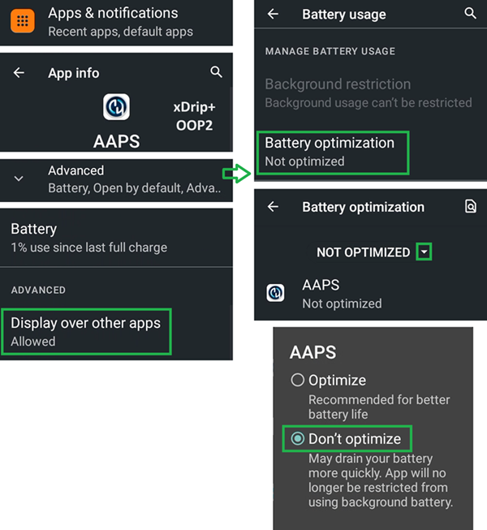

# Jelly

## Jelly Star Mini

**Features**

* Android 13
* 8 GB RAM

**Privalumai**

* Jis tikrai mažas.
* Net jei apie tai pasakysite žmonėms, jie gali nelaikyti jo įprastu išmaniuoju telefonu ir lengviau leis jį kaip išimtį ten, kur telefonai paprastai draudžiami.

**Trūkumai**

* Rekomenduojama tik patyrusiems ciklo naudotojams. Kai kuriuos nustatymus sunku atpažinti: turite iš patirties su įprastu dideliu Android AAPS telefonu žinoti, kaip ir kur kas yra. Kai kurie AAPS mygtukai maži ir juos sunku paspausti: reikia tikslaus prisilietimo, storais pirštais tai nepavyksta.
* Gali būti naudojamas tik kaip uždaro ciklo telefonas. Geriau turėti normalų telefoną kišenėje. 

### Baterijos optimizavimas

Jelly turi stiprias optimizavimo funkcijas, kurias AAPS (ir kitoms DIY programėlėms, pvz., BYODA, xDrip, OOP2, Juggluco ir t. t.) **būtina** išjungti.

Funkciją Intelligent assistance (išmanusis asistentas) galite palikti įjungtą, bet **DIY programėlėms ji turi būti išjungta**.

Libre jutikliams galite įjungti NFC.

### Baterijos optimizavimas

Kad niekas netrukdytų **AAPS**, Jelly Star nustatyme 'battery usage' (baterijos naudojimas) **AAPS** (ir kitoms **DIY programėlėms**, pvz., BYODA, xDrip, OOP2, Juggluco ir t. t.) pasirinkite 'unrestricted' (neribojama).

### Google Play Protect

Nepamirškite išjungti Google Play Protect.

### Remote Connection laikrodžio programėlei (Wear apk)

Kai kuriems išmaniesiems laikrodžiams, pvz., Samsung Galaxy, programėlės Galaxy Wearable skiltyje Advanced features reikia **įjungti** funkciją 'Remote connection', kad galėtumėte nuotoliniu būdu per Wi-Fi naudoti Jelly, **Wear.apk** & **AAPS**.

